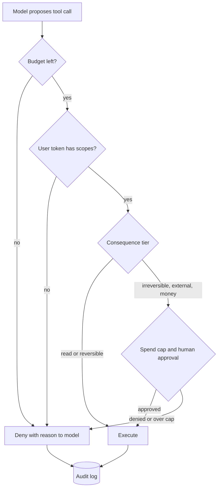

## TL;DR
Excessive agency is an agent that can do more than its task needs: too many tools, permissions or
autonomy. The fix is a smaller blast radius: minimal tools, user-scoped credentials enforced outside the
model, budgets and human checkpoints.

## For agent builders
- **Why it matters for agents.** Every tool you register is a capability a hallucination, a loop or an
  injected email can use. The agent's worst day is bounded by its tools, credentials and budgets, not its
  prompt.
- **Where it shows up in your stack.** The tool list, connected MCP servers, the executor's credentials,
  approval gates in your orchestration framework, and step and spend limits in the loop.
- **What you control.** Tool selection per workflow, read versus write split, consequence tiers,
  delegated per-user tokens, row-level security, approval with exact arguments, budgets and the kill
  switch.
- **What you can skip.** Debating whether the model is "aligned enough" to hold broad tools; assume any
  call can be wrong and size the blast radius with the arithmetic below.

## Why it exists
- **Tool calls are probabilistic outputs.** The decision to call a tool is sampled like a sentence, with
  the usual causes: an ambiguous request, a hallucinated detail, an injected instruction, a loop that
  never converges. A bad decision becomes real damage.
- **Agents are bounded only by credentials.** A user's mistaken click is bounded by the UI; an agent with
  a shell, a database client or an API token is bounded by its credentials and what the runtime refuses.
- **It is the confused deputy in a new costume:** a component with privileges that can be talked into
  using them on behalf of someone who should not have them.
- **Naive mitigations are instructions, which are what gets overridden.** "Be careful with destructive
  actions" is not enforcement. "Ask the model to confirm" makes the same model actor and reviewer. "Trust
  the user's instructions" ignores that the user did not write the email the agent just read.
- **The incidents are familiar.** OWASP lists excessive agency in its Top 10 for LLM applications: agents
  have mass-mailed, deleted data, run destructive commands or made purchases while technically doing what
  they were told.

## How it works
### Three axes
OWASP frames the problem along three dimensions, each with its own controls.

| Axis | What it looks like |
|---|---|
| 1. Excessive functionality | tools beyond the task (a summariser that can also send email); broad tools where narrow ones would do (a shell, raw SQL, a generic HTTP client); leftover development tools; a third-party tool server exposing forty functions when three are needed |
| 2. Excessive permissions | credentials broader than the user's: an admin service account shared by everyone, unscoped or long-lived tokens, no tenant or row-level enforcement; the agent can touch everything the service can, regardless of who asks |
| 3. Excessive autonomy | irreversible or high-impact actions without confirmation; no budgets for steps, time or money; no dry run; no kill switch |

### Controls: functionality
- **Select a tool set per workflow,** not globally.
- **Split read from write tools,** *because* the risk profile differs and the split lets you grant read
  widely.
- **Prefer narrow typed tools,** *because* a typed `issue_refund(order_id, amount)` can be policed while
  `run_sql(query)` cannot.
- **Deny by default:** keep a registry and review every tool before it is exposed.

### Controls: permissions
- **Act as the user, not the service:** delegated or on-behalf-of tokens scoped to the user's resources
  and tenant, with short lifetimes.
- **Enforce in the resource layer** (database row-level security, API authorisation) rather than in the
  prompt, *because* enforcement there is deterministic and survives any model behaviour.
- **One credential per tool,** and never place secrets in the context window.

### Controls: autonomy
1. **Classify every action by consequence:** read, reversible write, irreversible write, external
   communication, financial.
2. **Gate the last three with human approval** that displays the exact arguments, not the model's
   description of them.
3. **Offer dry-run or plan review** for destructive operations.
4. **Set budgets per session** for steps, tokens, spend and rows affected; apply rate limits.
5. **Prefer reversible designs:** drafts instead of sends, soft deletes.
6. **Keep a kill switch** and an audit log of every call.

### Runtime pattern: the model proposes, policy disposes
- **Every proposed call passes a policy check outside the model:** who is asking, which tool, which
  arguments, which consequence tier, how much budget is left.
- **Three outcomes:** allow, require approval, or deny with a reason returned to the model so it can
  choose another path.
- **This is where the guarantees live,** *because* a deterministic executor can be tested, logged and
  audited while a prompt cannot.
- **Approval ergonomics matter:** batch low-risk actions and escalate rarely, or humans rubber-stamp.

### Blast radius as arithmetic
```
worst case ≈ what one call can do × how many calls can happen before a human notices
```

| Setup | Worst case |
|---|---|
| Email tool, no recipient restriction, no rate limit, agent runs overnight at one call per second for eight hours | 28,800 sends before anyone looks |
| Per-session cap of 25 calls, a recipient allowlist, a daily limit of 200 | 200 emails to known addresses |

Each control attacks a different factor:
- **Narrower tools** shrink the damage per call.
- **Scoped credentials** shrink what any call can reach.
- **Budgets** shrink the count.
- **Alerting** shrinks the time until someone notices.

When reviewing an agent, compute this product per tool; the largest one is your first fix.

### Measuring agency
- **Tools exposed vs tools used** per workflow; the gap is unnecessary surface.
- **Approval share and acceptance rate;** near 100% means the gate is too broad or rubber-stamped.
- **Blast radius per credential:** the worst query or action it permits.
- **Incident reviews:** record which axis failed.

## Diagram
Every proposed call passes the executor's checks in order; denials return a reason and are audited too.



## Misconceptions
- **"A capable model with a careful prompt can safely hold broad tools."** Every tool call is a sampled
  output that a hallucination, a loop or an injected email can steer. The worst day is bounded by tools,
  credentials and budgets, so size the blast radius instead of trusting the prompt.
- **"Asking the model are you sure before destructive actions is a safeguard."** The same model is then
  actor and reviewer, and it says yes. The check belongs in a deterministic executor or with a human.
- **"Any human approval gate makes an action safe."** Only if it shows the exact arguments and fires
  rarely. Approving the model's summary of "send the update to the team" can mail four hundred people, and
  a 99% acceptance rate usually means rubber-stamping.
- **"One service account is fine if the prompt says which tenant to use."** That is a confused deputy:
  the agent can reach everything the service can. Use delegated, short-lived per-user tokens and enforce
  tenant scope in the resource layer, for example with row-level security.
- **"Step and spend budgets are an ops detail, not a safety control."** They set the count factor of the
  blast radius: one send per second for eight hours is 28,800 emails, while a daily cap of 200 bounds it
  at 200 whatever the model does.

## Examples
### Tool registry and policy-enforcing executor
Consequence tiers and required scopes per tool; the executor enforces the user's scopes, a step budget, a
spend cap and approval for tier-2 actions. The model never sees credentials. Runs as is on Python 3.12.

```python
from dataclasses import dataclass, field
from typing import Callable

@dataclass
class Tool:
    name: str
    fn: Callable[..., str]
    tier: int                    # 0 read, 1 reversible write, 2 irreversible / external / money
    scopes: set[str]             # permissions the *user's* token must carry, not the service's

@dataclass
class Session:
    user_scopes: set[str]
    approve: Callable[[str, dict], bool]       # asks a human and shows the exact arguments
    budget: dict = field(default_factory=lambda: {"calls": 25, "spent": 0, "spend_cap": 5000})
    audit: list = field(default_factory=list)

def execute(session: Session, tool: Tool, args: dict) -> str:
    def done(outcome: str, msg: str) -> str:                         # every decision is audited, denials too
        session.audit.append({"tool": tool.name, "args": args, "tier": tool.tier, "outcome": outcome})
        return msg
    if session.budget["calls"] <= 0:
        return done("budget", "ERROR: step budget exhausted; stop and report progress")
    session.budget["calls"] -= 1
    if not tool.scopes <= session.user_scopes:                      # permissions axis
        return done("scope", f"ERROR: {tool.name} requires {tool.scopes - session.user_scopes}")
    if tool.tier == 2:                                               # autonomy axis
        cents = int(args.get("amount_cents", 0))
        if session.budget["spent"] + cents > session.budget["spend_cap"]:
            return done("spend_cap", "ERROR: spend cap reached for this session")
        if not session.approve(tool.name, args):
            return done("denied", "DENIED by user; choose another course of action")
        session.budget["spent"] += cents
    return done("executed", tool.fn(**args))

TOOLS = {t.name: t for t in [                                        # functionality axis: two tools, no shell
    Tool("get_order", lambda order_id: f"order {order_id}: $89.99, delivered", 0, {"orders:read"}),
    Tool("issue_refund", lambda order_id, amount_cents: f"refunded {amount_cents}", 2, {"orders:refund"}),
]}
s = Session(user_scopes={"orders:read"},
            approve=lambda name, a: input(f"Allow {name} {a}? [y/N] ").strip().lower() == "y")
print(execute(s, TOOLS["get_order"], {"order_id": "ORD-104233"}))
print(execute(s, TOOLS["issue_refund"], {"order_id": "ORD-104233", "amount_cents": 8999}))
# -> ERROR: issue_refund requires {'orders:refund'}. A first-line agent's token cannot refund,
#    however persuasive the model, the customer, or an injected ticket is about it.
```

### Blast-radius calculator
The count factor is the smallest of rate-limited throughput and every cap in force.

```python
def worst_case_calls(rate_per_s: float, hours: float, session_cap=None, daily_cap=None, sessions=1):
    uncapped = int(rate_per_s * hours * 3600)
    caps = [uncapped]
    if session_cap is not None:
        caps.append(session_cap * sessions)
    if daily_cap is not None:
        caps.append(daily_cap)
    return min(caps)

print(worst_case_calls(1, 8))                                         # 28800 sends overnight
print(worst_case_calls(1, 8, session_cap=25, daily_cap=200, sessions=40))  # 200: the daily cap binds
print(worst_case_calls(1, 8, session_cap=25, daily_cap=200, sessions=1))   # 25: one runaway session
```

### Enforcing tenant scope in the resource layer
PostgreSQL row-level security (tested on PostgreSQL 17 as a non-superuser table owner; superusers
bypass RLS): the connection sets the tenant per transaction, and other tenants' rows stay invisible
whatever SQL the tool sends.

```sql
ALTER TABLE orders ENABLE ROW LEVEL SECURITY;
ALTER TABLE orders FORCE ROW LEVEL SECURITY;   -- otherwise the table owner bypasses the policy
CREATE POLICY tenant_isolation ON orders
  USING (tenant_id = current_setting('app.tenant_id')::uuid);

-- per request, inside the tool's transaction, from the user's verified identity (never from the model):
BEGIN;
SET LOCAL app.tenant_id = '6f1c2d3e-0000-4000-8000-000000000001';
SELECT id, total FROM orders WHERE id = 'ORD-104233';   -- other tenants' rows are invisible
COMMIT;
```

## Production patterns
- **Draft-only launch, then earn autonomy.** Ship write tools in approval-only or draft mode, track
  rejection rate and task accuracy from the audit log, and enable direct execution per tool when the
  numbers justify it.
- **Delegated, short-lived credentials per user.** On-behalf-of tokens scoped to the user's tenant, plus
  row-level security (as above), so isolation holds whatever the model does. Monitor scope-denied calls
  per user.
- **Consequence-tier registry, deny by default.** Every tool declares a tier and scopes before exposure;
  tier 2 always routes to exact-argument approval. Monitor approval share and acceptance rate.
- **Pin and diff third-party tool servers.** Pin the server version and diff the exposed tool list and
  descriptions on every update, blocking new or redefined functions until reviewed.
- **Budgets per task class with a kill switch.** Set step, spend and rows-affected caps per workflow, have
  the agent report "budget exhausted" rather than fail silently, and alert on sessions that hit caps.

## Trade-offs
- **Narrow typed tools vs engineering effort.** Policeable, but every new capability is work; for
  exploratory tasks such as coding agents, one broad tool inside a strong sandbox beats fifty narrow ones.
- **Approval gates vs fatigue.** They bound damage only while rare and informative; once users
  rubber-stamp, the gate is theatre with a false sense of safety.
- **Delegated credentials vs identity plumbing.** Per-user credentials remove the confused-deputy risk but
  need identity integration everywhere; unattended batch jobs fall back to a tightly scoped service
  identity with hard budgets.
- **Budgets vs long tasks.** They stop runaway loops but can cut off legitimate long tasks, hence caps
  per task class.
- **Dry-run vs round trips.** Plan review catches destructive mistakes at the cost of a second round trip;
  apply it to irreversible tiers only, not to reads.

## Pitfalls
- **One admin service account for all users.** Symptom: the agent answers questions about another
  customer's records when asked nicely. Diagnose: list the credential each tool uses and the worst query
  it permits. Fix: delegated user tokens plus row-level security.
- **Showing the human the model's summary, not the arguments.** Symptom: approving "send the update to the
  team" and four hundred people receiving it. Diagnose: compare the approval screen with the executed
  arguments in the audit log. Fix: render the exact arguments.
- **Asking the model "are you sure?" as the gate.** Symptom: it says yes. Fix: a deterministic executor
  check or a human.
- **Shipping shell, raw SQL or generic HTTP tools "for flexibility".** Symptom: an incident report with a
  destructive command or an outbound call to an unknown host. Diagnose: tools exposed versus used per
  workflow. Fix: narrow typed tools, or a sandbox.
- **No step or spend budget.** Symptom: a loop that burned thousands of calls overnight. Diagnose: plot
  calls per session; runaway sessions are the long tail. Fix: per-task-class caps.
- **Passing secrets through tool arguments.** Symptom: API keys in traces and occasionally in model output.
  Diagnose: scan traces for key patterns. Fix: credentials live in the executor.
- **Reviewing a third-party tool server once.** Symptom: new or redefined functions appear after an
  upstream update nobody approved. Diagnose: diff the exposed tool list against the pinned version.
- **Auditing only executed calls.** Symptom: an incident review that cannot tell how many times the agent
  tried a denied action before one worked. Fix: audit denials too.
- **Irreversible actions without a draft or soft-delete mode.** Symptom: a misfire with nothing to roll
  back. Fix: drafts and soft deletes first.

## When to use
- **Apply when:** a model output can cause a side effect, which is every agent and most tool-using
  assistants.
- **Recipe:** the task's minimal verbs, the user's scopes not the service's, consequence tiers with the
  irreversible and external ones gated, a budget per session, every call logged.
- **Measure:** tools exposed versus used, approval rates, blast radius per credential.
- **Day to day:** the review before enabling a new tool server; the first question in an incident review.
- **Interviews:** name the three axes and explain "the model proposes, the policy disposes" with an
  example of enforcement living in the resource layer.

## Exercise
**Goal:** cut the blast radius of an over-privileged agent and prove each cut with a test. No solution is
given.
- **Inputs:** a stub support agent with `run_sql` on a local PostgreSQL as the table owner, an
  unrestricted `send_email`, and two tenants' rows in `orders`.
- **Deliver:** narrow typed tools in place of `run_sql`, a non-owner database role with row-level
  security keyed to the verified tenant, a recipient allowlist, per-session and daily caps, and a
  blast-radius table per tool before and after.
- **Acceptance:** a test where the model supplies another tenant's id still returns only the caller's
  rows; a call past the cap is denied and audited; `run_sql` no longer exists in the tool list.

## Role lens
- **Engineer:** Builds the tool registry with tiers and scopes, the executor that enforces them, and
  tests proving a denied call returns a clean error the model can recover from.
- **Architect:** Owns the authorisation boundary: delegated identity, which actions require a human,
  budgets per workflow, and the rule that enforcement lives in the runtime and resource layers.
- **FDE:** Negotiates tool scopes with the customer's security team, launches write tools in
  approval-only mode, and uses the audit log to earn expanded autonomy over time.

## Check yourself
**Q:** A customer wants a procurement agent that reads invoices, matches them to purchase orders and
pays vendors. Design the agency controls before you agree to build it.
**A:** Functionality: four narrow tools, read invoice, match purchase order, create payment draft and
submit payment, with no email, shell or generic HTTP. Permissions: the agent acts with the accounts
payable clerk's delegated identity, scoped to their entities and vendors, and the payments API enforces
limits server-side. Autonomy: tier the tools, reads at zero, draft creation reversible, submission
irreversible and financial, so submission requires human approval showing vendor, amount and bank
details exactly; cap spend per session and per day; treat any change of vendor bank account as a
separate verification step, since that is the classic fraud pattern; produce a dry-run matching report;
log every call; keep a kill switch. Launch in draft-only mode, measure match accuracy and approval
rejection rate, and enable submission only when the numbers justify it.

## Interview questions
### What is excessive agency, and why can't a better prompt fix it?
- **Definition:** the system can do more than the task needs, through too many functions, too broad
  permissions or too much autonomy, so a bad decision becomes real damage.
- **Prompts are not enforcement:** injected text or a hallucination overrides "be careful"; controls must
  live in the executor and resource layer where they are deterministic.

### An agent answered a question using another tenant's data. Debug it.
- **Check the credential first:** a shared admin service account means the agent can read everything the
  service can, regardless of who asked.
- **Fix at the resource layer:** delegated per-user tokens and row-level security keyed to the verified
  tenant, never to a value the model supplies.
- **Audit:** use the call log, including denied calls, to find every request that crossed tenants.

### When would you give an agent a broad tool like a shell?
- **For exploratory work such as coding agents,** where fifty narrow tools would never cover the task.
- **Only inside a strong sandbox:** no production credentials, restricted network egress, disposable
  environment, and budgets on steps and time, so the blast radius stays small even though the tool is
  broad.

### Your approval gate has a 99% acceptance rate. Is that good?
- **Probably not:** it suggests the gate is too broad or being rubber-stamped, so it adds friction without
  scrutiny.
- **Narrow it to irreversible, external and financial actions,** batch low-risk ones, and always show
  exact arguments so the rare approvals that remain get real attention.

## Quiz
### Q: Which of these is not one of OWASP's three roots of excessive agency?
- [ ] Excessive functionality
- [ ] Excessive permissions
- [x] Excessive context length
- [ ] Excessive autonomy
> OWASP frames the risk as too many functions, too much permission and too much autonomy, each with its
> own controls. Context length affects cost and attention, not what the agent is allowed to do.

### Q: Why should an approval prompt show the exact tool arguments rather than the model's summary?
- [ ] Summaries are usually too long for the interface
- [x] The summary comes from the same possibly misled model, while the arguments are what will actually execute
- [ ] Arguments are easier to store in the audit log
- [ ] Showing arguments reduces token usage
> An approval gate exists to put a human between the model and the consequence; if the human reviews text
> the model wrote about itself, the gate inherits the model's error and becomes decoration.

### Q: What best prevents an agent from acting on another tenant's data?
- [ ] Adding "only access the current user's data" to the system prompt
- [ ] Lowering the model's temperature
- [x] Per-user delegated credentials enforced by the resource layer instead of a shared service account
- [ ] Reducing max_tokens so the agent cannot read large results
> Tenant isolation must hold regardless of what the model decides, so it belongs in authorisation and
> row-level security that the agent's credential cannot bypass; a prompt instruction is advisory.

## Mastery test
**Problem:** an HR assistant connects to a third-party server exposing 38 functions, including
`export_all_employees` and `terminate_employee`, using one admin API key. Approvals show the model's
summary and are accepted 99.5% of the time. Review it on all three axes and say what you fix first.

**A strong answer:**
- functionality: expose only the few functions the workflows need, pin the server and diff its tool list;
- permissions: replace the admin key with delegated per-user tokens so a manager reaches only their reports;
- autonomy: tier `terminate_employee` and bulk exports as irreversible, approve on exact arguments,
  narrow the gate so approvals become rare, and cap rows per session;
- fixes the largest blast-radius product first: the admin key behind `export_all_employees`.

## Use cases & projects
### Use cases
- **Customer-support agents with refunds.** First-line tokens read orders but cannot refund; refunds are
  tier 2 with approval and a spend cap.
- **Procurement and payments agents.** Draft-only launch, exact-argument approval, and separate
  verification for vendor bank changes.
- **Coding agents.** One broad shell tool inside a disposable sandbox with no production credentials,
  restricted egress and step budgets.
- **Agents built on third-party MCP servers.** Expose only the few functions a workflow needs, pin the
  server version and diff its tool list on every update.

### Mini project
**Policy-enforcing executor with a blast-radius report (2-3 hours).**
- **Goal:** put every tool call of a small agent through a registry with tiers, scopes, budgets and
  approval, and show the worst case before and after.
- **Steps:** build an agent with four stub tools (read order, draft email, send email, issue refund);
  give each a tier and required scopes; write an executor that enforces user scopes, a step budget, a
  spend cap and approval for tier 2, auditing denials too; run 20 tasks including injected tickets asking
  for refunds and mass emails; compute worst-case calls per tool with the blast-radius calculator.
- **Done when:** no tier-2 call runs without approval, the audit log shows every denied attempt, and you
  have a before and after blast-radius table per tool.
