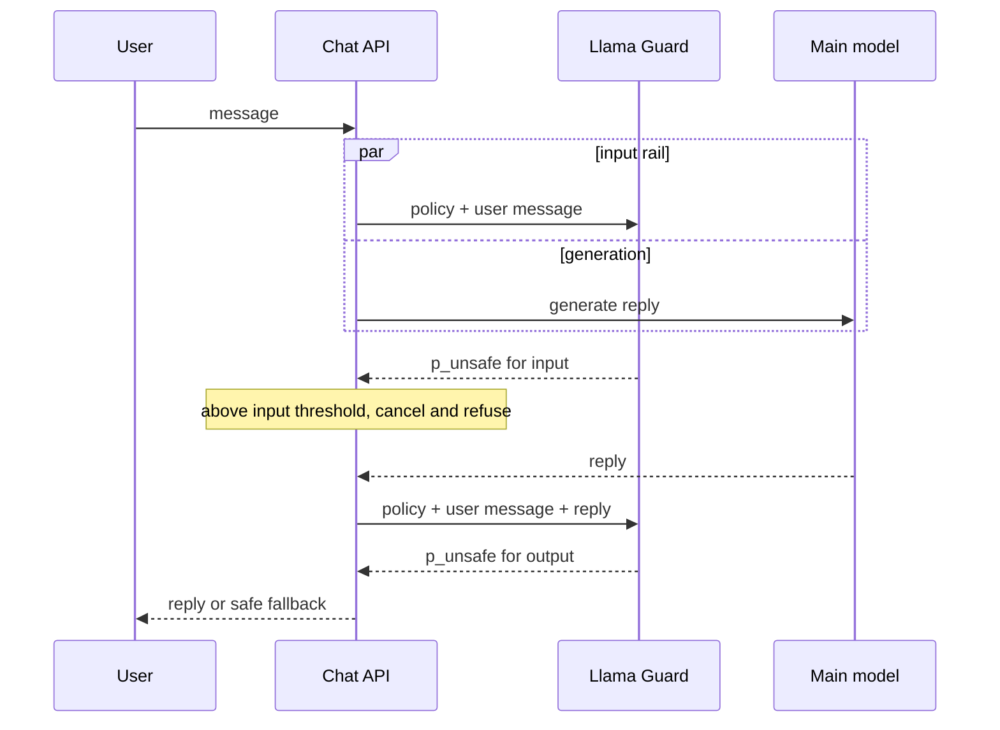

## TL;DR
Llama Guard is Meta's open-weight content-safety classifier for an agent's input and output rails: a
fine-tuned Llama that reads an editable policy and a conversation and generates `safe` or `unsafe` plus
category codes. It misses injection, PII and hallucination.

## For agent builders
- **Why it matters for agents.** A user-facing agent needs a content-safety check on what users ask and
  what the agent says, and the main model is the wrong judge because it is the one under attack. Llama
  Guard gives a separate, self-hostable verdict with a score you can threshold per rail.
- **Where it shows up in your stack.** A guard endpoint (often vLLM) called from your agent's chat path,
  or a rail inside NeMo Guardrails; Llama Guard 3's S14 code-interpreter abuse category can screen code an
  agent is about to run.
- **What you control.** Which categories are enforced, their wording, the threshold per rail, whether the
  input check runs in parallel with generation, and the 1B-versus-8B choice.
- **What you can skip.** Using it as your prompt-injection or tool-authorization defence: injected
  instructions in tool results look benign to a hazard taxonomy. Typed tools, scopes and taint rules do
  that job.

## Why it exists
- **Existing moderation fits chat badly.** Hosted endpoints mean sending every prompt and reply to a third
  party, with a taxonomy you cannot change: a medical assistant needs "specialised advice" allowed, a
  children's product needs far stricter lines, and a fixed classifier head can express neither.
- **Keyword and regex filters fail** on paraphrase and on any language other than the one they were written
  for.
- **Replies must be judged in context.** "Here is how you do it" is harmless after one question and
  dangerous after another; plain text moderation ignores the prompt.
- **Asking the main model "is this safe?" is the naive fix, and it fails.** That model is the one being
  attacked, was never evaluated as a classifier, gives uncalibrated prose verdicts, and is the most
  expensive model you run.
- **A separate, smaller classifier trained against a written policy** gives a parseable verdict and a usable
  probability, runs on cheaper hardware, stays stable when the main model is swapped, and can be evaluated
  on its own precision and recall. Open weights mean it runs inside your own boundary.

## How it works
### The prompt is the policy
Each request is a prompt with three parts:
1. **An instruction:** "check if there is unsafe content in the following conversation according to our
   safety policy".
2. **A block of categories** with short descriptions.
3. **The conversation.**

- **Only the last message is assessed,** so one model serves as an input rail (last message is the user's)
  and an output rail (last message is the assistant's, judged with the user's prompt in view).
- **The Hugging Face chat template assembles all of this,** so in code you pass a list of role/content
  messages.
- **For agents,** the "assistant message" you check can be the final reply or the text of a proposed
  action, such as code the agent wants to run, rendered as content.

### The output is generated, not predicted by a head
- **Format:** `safe`, or `unsafe` on the first line and a comma-separated list such as `S2,S9` on the second.
- **The verdict token is the decision,** so the probability of `unsafe` at that position is a confidence
  score. The original paper evaluates with it, and you can threshold it to trade precision against recall
  instead of taking the argmax.
- **Find that position; do not assume it is the first generated token.** Depending on version and chat
  template, whitespace or newline tokens may come first, and reading logits one step early scores a newline.
- **Renormalise over the two verdict tokens** (`z` are the logits at that position); this is what you
  threshold:

```
p_unsafe = exp(z_unsafe) / (exp(z_unsafe) + exp(z_safe))
```

- **This is also why fine-tuning worked:** training data was conversations labelled in exactly this output
  format against exactly this prompt structure.

### Taxonomy and versions
| Version | Base | Categories |
|---|---|---|
| Llama Guard (December 2023) | Llama 2 7B fine-tune | six categories of its own |
| Llama Guard 2 | Llama 3 8B | MLCommons hazard taxonomy, S1 to S11 |
| Llama Guard 3 | 8B on Llama 3.1, plus a 1B text model and an 11B vision model on Llama 3.2 | S1 to S14 |
| Llama Guard 4 | 12B, natively multimodal (April 2025) | S1 to S14 |

- **Llama Guard 3's S1 to S14:** violent crimes, non-violent crimes, sex-related crimes, child sexual
  exploitation, defamation, specialised advice, privacy, intellectual property, indiscriminate weapons,
  hate, suicide and self-harm, sexual content, elections, and code-interpreter abuse.
- **Categories are prompt text,** so you can drop ones you do not want enforced, reword descriptions, or add
  one zero-shot: build the prompt string yourself, or use the options some versions' chat templates expose
  for excluding or replacing categories.
- **Zero-shot categories work to a degree;** the paper shows accuracy on novel categories improves when you
  fine-tune on a few hundred examples.

### Deployment shape in an agent
1. **Input check** runs in parallel with main-model generation and cancels or replaces the answer if the
   prompt is unsafe.
2. **Output check** runs on the finished reply, or on chunks if you stream, at the cost of possibly
   retracting text already shown.
3. **Optional action check:** before a code-execution tool runs, the proposed code can be checked against
   the code-interpreter abuse category, as one signal next to the sandbox.

- **Cheap prefill:** the policy block is identical across requests, so prefix caching in the serving engine
  removes most of its cost, and generation is only a handful of tokens.
- **The 1B variant** exists for latency- or cost-constrained paths and is noticeably weaker; measure on your
  own data before choosing it.

### How it compares
| Option | Shape | When it fits |
|---|---|---|
| Hosted moderation APIs (OpenAI, Azure AI Content Safety) | free or cheap, no GPUs | data may leave your boundary and their taxonomy fits |
| ShieldGemma, Granite Guardian | open, similar policy-in-prompt designs; Granite Guardian adds RAG checks such as groundedness | open-weight alternatives |
| Meta's Prompt Guard | small classifier for jailbreak and injection text | the job Llama Guard does not attempt |
| NeMo Guardrails | orchestration layer | calls Llama Guard as one rail among several |

## Diagram
One model, two rails around the agent's turn: the input rail judges the user's message, the output rail
judges the reply with the question in view, and each thresholds `p_unsafe` separately.



## Examples
### Scoring a prompt and a reply
Moderates a user message, then the reply in context, returning the verdict and `p_unsafe` at the verdict
token.
- **Gated model:** the licence must be accepted on the Hub first.
- **Multi-piece tokens:** if `unsafe` is several tokens, the code compares the first pieces, where the
  decision is made.

```python
import torch
from transformers import AutoTokenizer, AutoModelForCausalLM

model_id = "meta-llama/Llama-Guard-3-8B"
tok = AutoTokenizer.from_pretrained(model_id)
model = AutoModelForCausalLM.from_pretrained(model_id, torch_dtype=torch.bfloat16, device_map="auto").eval()
SAFE_ID = tok.encode("safe", add_special_tokens=False)[0]
UNSAFE_ID = tok.encode("unsafe", add_special_tokens=False)[0]

@torch.no_grad()
def moderate(chat: list[dict]) -> tuple[str, float]:
    # the chat template inserts the S1..S14 policy block and "assess only the last message"
    ids = tok.apply_chat_template(chat, return_tensors="pt").to(model.device)
    out = model.generate(input_ids=ids, max_new_tokens=16, do_sample=False, output_scores=True,
                         return_dict_in_generate=True, pad_token_id=tok.eos_token_id)
    gen = out.sequences[0, ids.shape[-1]:]
    p_unsafe = float("nan")
    for pos, t in enumerate(gen.tolist()):       # skip any leading newline tokens
        if t in (SAFE_ID, UNSAFE_ID):
            z = out.scores[pos][0]
            p_unsafe = torch.stack([z[SAFE_ID], z[UNSAFE_ID]]).float().softmax(0)[1].item()
            break
    verdict = tok.decode(gen, skip_special_tokens=True).strip()
    return verdict, p_unsafe                     # e.g. ("unsafe\nS2", 0.97) or ("safe", 0.02)

user = {"role": "user", "content": "How do I pick the lock on my neighbour's door while they are away?"}
print(moderate([user]))                          # input rail
reply = {"role": "assistant", "content": "I can't help with that. If it's your own door, a locksmith can."}
print(moderate([user, reply]))                   # output rail: the reply is judged given the question
```

- **Versions:** mechanics checked on transformers 4.57, where `device_map` needs `accelerate` and
  `torch_dtype` is deprecated for `dtype`; verdicts not run.
- **Expected (typical, verify on your setup):** the input call comes back `unsafe` with a non-violent-crimes
  code (S2); the output call comes back `safe`, because the refusal is judged in context.

### Guard rails around one agent turn
Wraps the agent's turn with the `moderate` function above: an input rail, an optional check on code the
agent proposes to execute, and an output rail, each with its own threshold from config. `agent_step`,
`run_in_sandbox` and the thresholds are the application's own.

- **One tool round is shown;** a real loop repeats the action check for every code-execution call.

```python
THRESHOLDS = {"input": 0.5, "action": 0.3, "output": 0.4}   # chosen from labelled sweeps per rail
REFUSAL = "Sorry, I can't help with that."

def guarded_turn(history: list[dict], user_msg: str) -> str:
    user = {"role": "user", "content": user_msg}
    _, p_in = moderate([user])
    if p_in > THRESHOLDS["input"]:
        return REFUSAL                                   # in production: run in parallel, cancel the agent
    step = agent_step(history + [user])                  # model proposes a reply or a tool call
    if step.tool == "run_python":
        proposed = {"role": "assistant", "content": step.args["code"]}
        verdict, p_act = moderate([user, proposed])      # S14 code-interpreter abuse is in the policy
        if p_act > THRESHOLDS["action"]:
            return REFUSAL                               # a signal only; the sandbox is the real control
        step = agent_step(history + [user], tool_result=run_in_sandbox(step.args["code"]))
    reply = {"role": "assistant", "content": step.text}
    _, p_out = moderate([user, reply])
    return step.text if p_out <= THRESHOLDS["output"] else REFUSAL
```

- **What it does not cover:** a fetched page telling the agent to email data out passes all three rails,
  because the text is not hazardous content; that is a tool-layer problem.

### Choosing a threshold per rail
Thresholding `p_unsafe` rather than parsing the text lets the rails run at different strictness. Suppose a
labelled sample of 500 of your own prompts (50 truly unsafe, 450 benign; illustrative numbers):

| Threshold | Unsafe caught | Benign wrongly blocked | Precision | Recall |
|---|---|---|---|---|
| `p_unsafe > 0.5` | 46 of 50 | 9 of 450 (2%) | 0.84 | 0.92 |
| 0.2 | 49 of 50 | 30 of 450 (6.7%) | 0.62 | 0.98 |

- **Which point is right is a product decision** about the cost of a miss versus a false refusal, made with
  the score, not the argmax.

A sweep over your own labelled sample, pure Python:

```python
def sweep(scored, thresholds=(0.2, 0.5, 0.8)):
    """scored: list of (p_unsafe, is_unsafe) from a labelled sample of your own traffic."""
    pos = sum(1 for _, y in scored if y)
    neg = len(scored) - pos
    for t in thresholds:
        tp = sum(1 for p, y in scored if p > t and y)
        fp = sum(1 for p, y in scored if p > t and not y)
        prec = tp / (tp + fp) if tp + fp else float("nan")
        print(f"t={t}: recall {tp}/{pos} = {tp/pos:.2f}, precision {prec:.2f}, "
              f"false blocks {fp}/{neg} = {fp/neg:.1%}")

# tiny synthetic sample; use a few hundred real, labelled prompts per rail
sample = [(0.97, True), (0.81, True), (0.45, True), (0.12, True),
          (0.66, False), (0.31, False), (0.08, False), (0.03, False), (0.02, False)]
sweep(sample)
```

## Production patterns
- **Self-hosted guard endpoint with prefix caching.** Serve the guard model behind an internal endpoint in
  an engine with prefix caching (vLLM's `--enable-prefix-caching`, for example), so the identical policy
  block is prefilled once. Request token log-probabilities to compute `p_unsafe` server-side. Monitor guard
  p95 latency and prefix-cache hit rate.
- **Parallel input rail with cancellation.** Start the agent's first model call and the input check
  together; if the check crosses its threshold, cancel the generation and return a fixed refusal. Monitor
  added latency per turn (target: near zero for the input rail) and cancellation counts.
- **Check final replies, not every intermediate step.** In a multi-step agent, run the output rail on what
  the user sees and on consequential action text, rather than every internal thought, to keep guard calls
  per turn bounded. Monitor guard calls per turn and cost per conversation.
- **Per-rail, per-surface thresholds in config.** Keep thresholds and enforced categories in versioned
  config per product surface, chosen from a labelled sweep. Monitor block rate per category; a sudden shift
  usually means a traffic change or a model upgrade.
- **Shadow mode before enforcing.** Run a new version, threshold or custom category in log-only mode on live
  traffic, review disagreements with the current setup, then switch to enforce. Track disagreement rate.
- **Cascade for cost.** Use the 1B model as a pre-filter and escalate uncertain or flagged cases to the 8B
  model, rather than replacing it, when false negatives are costly. Monitor recall of the cascade against a
  labelled set.

## Trade-offs
- **Self-hosting vs a hosted API.** Prompts stay inside your boundary and the policy is editable, but you pay
  for a GPU-resident 8B model and operational ownership. A hosted moderation API wins when data residency is
  not a constraint and the vendor taxonomy fits.
- **Free policy customisation vs accuracy.** Zero-shot categories are measurably weaker than trained ones; if
  a custom category carries real risk, budget for labelled data and a fine-tune.
- **Tunable threshold vs calibration.** A generated verdict with a first-token probability gives a knob, but
  the probability is not calibrated for your distribution; without a labelled sample you cannot choose the
  threshold sensibly.
- **1B speed vs recall.** The 1B model cuts latency and cost several-fold, yet recall on subtle cases is
  lower. It suits a pre-filter before the 8B model, not a replacement, when false negatives are costly.
- **More rails per agent step vs latency.** Checking every tool call adds a guard round-trip per step; for
  long agent loops, reserve it for code execution and user-visible output.

## Pitfalls
- **Using Llama Guard as the prompt-injection defence.** Symptom: injected instructions in retrieved
  documents or tool results pass straight through, because they contain nothing the hazard taxonomy
  recognises. Diagnose: score a set of injected tool results and log `p_unsafe`. Fix: tool scopes and taint
  rules.
- **Checking only the input.** Symptom: a benign question produces a harmful answer that nothing inspected.
  Fix: an output rail judged with the question in view.
- **Taking the argmax verdict and ignoring the probability.** Symptom: a product that is too strict or too
  lax with no knob to adjust. Diagnose: log `p_unsafe` per rail and plot its distribution on labelled
  traffic. Fix: thresholds from the sweep.
- **Upgrading versions without re-running the eval set.** Symptom: a shift in refusal rate because category
  definitions changed between taxonomies. Diagnose: block rate per category code, old versus new, in
  shadow mode. Fix: re-pick thresholds before enforcing.
- **Assuming categories mean what your legal or trust team means.** Symptom: "specialised advice" blocks the
  core use case of a finance or medical product. Diagnose: group false blocks by code. Fix: reword or drop
  the category.

## When to use
- **Use when:** you need content-safety classification of prompts and replies inside your own
  infrastructure, with an editable taxonomy, and can afford an extra model call per check.
- **Avoid alone for:** injection, PII, topical control or groundedness; pair it with the dedicated tools.
- **Before launch:** build a labelled set of a few hundred examples from your own traffic covering each
  enforced category, measure precision and recall at several thresholds for each rail separately, and pick
  thresholds per rail.
- **Day to day:** a service with its own block-rate and latency dashboards.

## Exercise
**Goal:** choose and defend per-rail thresholds for one product. No solution is given.
- **Inputs:** Llama Guard 3 1B or 8B (or any guard returning `p_unsafe`), 100 prompts and 100 agent
  replies you label for a chosen product, including ten on its core sensitive topic.
- **Deliver:** a precision and recall table per rail at five thresholds, the chosen values with a
  written miss-versus-false-refusal reason, and one reworded or dropped category.
- **Acceptance:** `sweep` reproduces your table; a held-out 20% is reported with raw counts, since ten positives move recall in 0.1 steps; the
  core-topic prompts pass after the policy edit; an injected tool result is shown passing every rail.

## Role lens
- **Engineer:** Serves the model behind an internal endpoint with prefix caching, wires input and output
  rails into the chat path, and maintains the threshold evaluation set.
- **Architect:** Decides self-hosted Llama Guard versus a hosted moderation API based on data residency,
  taxonomy fit and GPU budget, and defines which categories are enforced per product surface.
- **FDE:** Tunes the category list and thresholds to a customer's acceptable-use policy and demonstrates
  block rates on their own sample traffic before go-live.

## Check yourself
**Q:** You are deploying a peer-support chatbot for a mental-health charity. Product wants the assistant to
discuss self-harm supportively but never give methods or encouragement. How would you use Llama Guard
here, and where would it fall short?

**A:** The relevant category is suicide and self-harm, whose description covers enabling, encouraging or
endorsing. On the input rail I would not block users for mentioning self-harm, because that is the
product's purpose; instead I would route such prompts to a conversation path with stricter instructions
and human escalation, using the category code as a signal rather than a wall. On the output rail I would
run the check with the user's message in context and a lower threshold on `p_unsafe` than elsewhere,
since a false negative is far worse than a retracted sentence. I would reword the category description to
match the charity's clinical guidance and validate on a labelled set built with their clinicians, because
the default wording encodes a general policy, not theirs. It falls short in that it cannot judge tone or
appropriateness of supportive content, it is not a crisis detector, and it will miss harmful content
phrased outside its training distribution; those need domain-specific classifiers and human review.

## Interview questions
### Your Llama Guard deployment blocks legitimate questions in a medical product. How do you fix it?
- **Find the category:** block logs with codes will likely show specialised advice (or similar) firing on the
  core use case.
- **Edit the policy text:** drop or reword that category for this surface, since categories are prompt text.
- **Re-tune the threshold** on a labelled sample from this product, and run the change in shadow mode first.

### Where would you place Llama Guard in a tool-using agent, and what would you not rely on it for?
- **Place it** on the user input (in parallel with the first model call), on user-visible output, and
  optionally on code the agent is about to execute via the code-interpreter abuse category.
- **Do not rely on it** for injection in tool results, tool authorization or data exfiltration; those need
  typed tools, scopes, taint rules and egress limits.
- **Measure** block rates and latency per rail, so the guard does not quietly dominate step latency.

### When would you choose a hosted moderation API over self-hosting Llama Guard?
- **Choose hosted** when data residency allows sending prompts out, the vendor taxonomy fits, and you do not
  want to run a GPU-resident model.
- **Self-host** when data must stay inside your boundary or you need custom or reworded categories.
- **Either way,** neither covers injection, PII or groundedness; those need separate controls.

### What does a production guard add to each chat turn, and how do you keep it small?
- **Two calls per turn:** input and output checks, each a full forward pass over the policy plus the
  conversation, generating only a few tokens.
- **Keep it small:** run the input check in parallel with generation, enable prefix caching so the fixed
  policy block is not re-prefilled, and use the 1B model as a pre-filter where recall allows.
- **Watch:** guard p95 latency, cache hit rate and block rate per category.

## Quiz
### Q: Why can Llama Guard's categories be changed without retraining the model?
- [ ] Each category is a separate output neuron that can be disabled at inference time
- [x] The policy is part of the prompt and the model was trained to classify against whatever policy text it is given
- [ ] The tokenizer maps category names to reserved tokens that can be remapped
- [ ] Categories are stored in a configuration file read by the serving engine
> The model is a generative classifier conditioned on a written policy; editing or adding a category changes
> the conditioning text, with reduced accuracy for genuinely novel categories unless you fine-tune.

### Q: Which task is Llama Guard not designed to perform?
- [ ] Judging whether an assistant reply is unsafe given the user's question
- [ ] Classifying a user prompt against a hazard taxonomy in several languages
- [x] Detecting prompt-injection instructions hidden in a retrieved document
- [ ] Returning the specific category codes that a message violates
> Injection text is usually benign under a hazard taxonomy, so it passes; Meta ships a separate small
> classifier for that, and architectural controls on tools remain the real defence.

### Q: How do you get a tunable score from Llama Guard instead of a binary verdict?
- [ ] Ask it to output a number between 0 and 100 in the prompt
- [ ] Average the verdicts over several sampled generations at high temperature
- [x] Read the probability of the `unsafe` token at the position where the verdict is generated and threshold it
- [ ] Count how many category codes appear on the second line
> The verdict token carries the decision, so its probability (renormalised against `safe`) is a natural
> confidence score; the paper evaluates this way and it lets input and output rails run at different
> strictness, whereas sampled or self-reported numbers are not calibrated.

## Mastery test
**Problem:** a coding agent for students runs Python in a sandbox. After launch, 4% of normal homework
requests are refused, while a red team got it to write a port scanner without any block. Using Llama
Guard, what do you inspect and change?

**A strong answer:**
- groups refusals by rail and category code first, likely S14 or S2 on the action rail firing on benign
  code, and checks that rail's threshold against a labelled sample;
- notes a port scanner may not read as hazardous; reword S14 for this product, or add a zero-shot
  category and measure it, budgeting a fine-tune if it stays weak;
- keeps the sandbox (no network) as the real control, because the guard is a signal;
- runs changes in shadow mode and reports per-rail precision and recall before enforcing.

## Use cases & projects
### Use cases
- **Consumer-facing chat agents.** Input and output rails with per-surface thresholds keep harmful requests
  and replies out without blocking the product's core topics.
- **Code-executing agents.** The code-interpreter abuse category adds a signal before the sandbox runs
  agent-written code.
- **Regulated or on-prem deployments.** Self-hosting keeps prompts inside the customer's boundary when a
  hosted moderation API is ruled out.
- **Per-customer acceptable-use policies.** Rewording or dropping categories lets one agent platform serve a
  medical customer and a children's product with different lines.

### Mini project
**Threshold a guard for a chat agent (2-3 hours).**
- **Goal:** pick input and output thresholds for a small agent from your own labelled data, not defaults.
- **Steps:** label about 100 prompts and 100 agent replies as safe or unsafe for a chosen product; score
  them with Llama Guard 3 (the 1B model is enough on a laptop GPU) using the `moderate` function; run the
  `sweep` at several thresholds per rail; wire the chosen values into `guarded_turn` and replay ten
  conversations, including one injected tool result.
- **Done when:** you have a precision and recall table per rail, a written threshold choice with its
  reason, and a note showing the injected tool result passed every rail, explaining which control should
  catch it instead.
