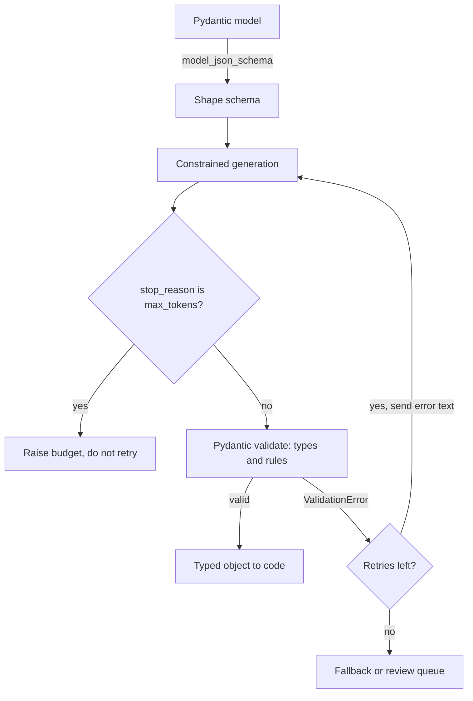

## TL;DR
Model output is a string until proven otherwise. Pydantic defines the contract, Instructor turns
validation failures into retries with the error fed back, and Outlines constrains decoding. Shape can be
guaranteed; meaning must be checked.

## Why it exists
- **Downstream code is typed; free text is not.** The failures are mundane and constant: JSON wrapped in
  markdown fences, a helpful sentence after the closing brace, `"42"` where an integer was required, an
  invented enum value, a missing required field, an extra field nobody asked for, and JSON cut off
  mid-string because `max_tokens` was reached.
- **The naive fix is dangerous.** `json.loads` inside a try/except either crashes the request or, worse,
  lets a wrong-but-parseable object through to a database write.
- **Model output is untrusted input.** It feeds a SQL builder, a shell command, a tool-call argument, an
  HTML template. You would never pass a web form's fields straight into those, and the model is a far
  less predictable client than a browser.
- **Validity has layers, so three tools exist.** *Syntactic*: the text parses. *Structural*: the right
  keys and types are present. *Semantic*: the values make sense (the date is not in the future, the order
  id exists, the line items sum to the total).
- **Only domain code checks meaning.** Constrained decoding can guarantee the first two at generation
  time; when a semantic check fails the only remedy is to ask the model again with a precise error.

## How it works
### The three layers and who enforces them
| Layer | Example failure | Enforced by |
|---|---|---|
| Syntactic | trailing prose, truncated string | constrained decoding, provider structured outputs |
| Structural | missing key, wrong type, unknown enum | schema (provider, Outlines) and Pydantic |
| Semantic | future date, totals do not add up | Pydantic validators plus retry (Instructor) |

### Pydantic: the contract
- **Declare fields and types** with a `BaseModel`; `Field` adds bounds (`ge=0`), lengths and regex
  patterns; `Literal` closes an enum.
- **Rules that need code** go in `field_validator` and `model_validator`, including cross-field rules.
- **Parse straight from text** with `model_validate_json`. In Pydantic v2 the core is compiled, so
  validation cost is negligible next to a model call.
- **Errors are the asset.** On failure it raises `ValidationError`, whose `.errors()` is a
  machine-readable list with the failing location, message and type, specific enough to feed back to a
  model.
- **One definition, three uses.** `model_json_schema()` emits JSON Schema, so the same model serves the
  provider, the parser and the documentation.

### Instructor: validation in the loop
1. **Patch a provider client** (`instructor.from_anthropic`, `instructor.from_openai`, ...) so the call
   accepts `response_model=YourModel` and `max_retries=N`.
2. **Derive the schema** and request structured output through the provider's tool-call or JSON mode. A
   `mode` setting chooses which, since providers differ in what they support.
3. **Parse the reply with Pydantic.**
4. **On `ValidationError`,** append the failed attempt plus a user message containing the error text, and
   ask again.

- **Why it works:** models are good at fixing a named error in a named field; most retries converge in
  one round.
- **The cost:** extra calls on failure. A high retry rate is a signal to fix the prompt or schema, not to
  raise `max_retries`.
- **Semantic rules become retryable:** any Python assertion in a validator becomes an instruction the
  model can act on.

### Outlines: constraints inside decoding
1. **Compile the constraint.** A regex, or a JSON schema first converted to a regex, becomes a
   finite-state machine (FSM) over characters.
2. **Bridge characters and tokens.** The model emits *tokens*, and one token can span several characters
   or cross a field boundary. So Outlines builds an index ahead of time: for every FSM state, the set of
   vocabulary tokens whose whole string walks the FSM to another valid state.
3. **Mask at each step.** Look up the current state, set the logits of every token outside that set to
   −∞, and sample from what remains.

- **Concretely:** for the regex `\d{3}` after the model has emitted `4`, the tokens `2` and `27` are
  allowed, but `273` (one digit too many) and `a` are masked.
- **No retries, cheap per step.** The output matches by construction, and each step is a lookup *because*
  the expensive work was done once per schema and cached; that precomputation is the contribution of
  Willard and Louf.
- **Regular languages cannot nest without bound.** Recursive schemas are bounded to a fixed depth; full
  context-free grammars need a pushdown automaton or incremental parser, which engines such as XGrammar
  provide.
- **Requires logit access:** local or open-weight models (Transformers, vLLM integrations). Hosted APIs
  offer the same idea as provider-operated "structured outputs" or strict schemas.

Two limits matter:
- **Syntax, not truth.** A model forced to fill a field it does not know fills it with something
  plausible, so allow `null` or an `"unknown"` enum where ignorance is a legitimate answer.
- **Tight grammars can steer into low-probability continuations,** so schema design (field order,
  descriptions, optionality) still affects quality. Field order matters *because* decoding is left to
  right: `reason` before `decision` lets the model justify and then commit; the reverse makes it commit
  first and rationalise afterwards.

### Provider-native structured outputs
- **Vendor-run constrained decoding.** Most major APIs accept a JSON schema and constrain generation
  server-side.
- **Keyword support varies.** Regex patterns, numeric bounds and string lengths are often not enforced, so
  treat the provider as guaranteeing *shape* and keep richer rules in Pydantic.
- **Check `stop_reason`:** a schema-valid prefix truncated by `max_tokens` is still invalid JSON.

### Putting the layers together
1. Define the model once in Pydantic.
2. Derive the shape schema for the provider or Outlines.
3. Parse the result with Pydantic so semantic validators run.
4. On `ValidationError`, retry with the error text (Instructor, or ten lines of your own).
5. After N failures, route to a fallback or a review queue rather than guessing.

## Diagram
Shape is enforced during generation; meaning is enforced by Pydantic afterwards, and only semantic
failures loop back with the error text.



## Examples
### One contract, three jobs
Its shape is sent to the provider so the JSON is structurally valid by construction, its validators
enforce domain rules the provider cannot, and its error messages drive a retry loop, which is exactly
what Instructor packages behind `response_model=` and `max_retries=`.

```python
from datetime import date
from typing import Literal
from pydantic import BaseModel, Field, ValidationError, field_validator, model_validator
import anthropic

class RefundDecision(BaseModel):
    order_id: str = Field(pattern=r"^ORD-\d{6}$")
    order_date: date
    reason: str = Field(min_length=10, max_length=300)   # before the verdict: justify, then commit
    decision: Literal["approve", "deny", "escalate"]
    amount_cents: int = Field(ge=0)

    @field_validator("order_date")
    @classmethod
    def not_in_future(cls, v: date) -> date:
        if v > date.today():
            raise ValueError("order_date cannot be in the future")
        return v

    @model_validator(mode="after")
    def deny_means_zero(self):
        if self.decision == "deny" and self.amount_cents != 0:
            raise ValueError("a denied refund must have amount_cents == 0")
        return self

SHAPE = {"type": "object", "additionalProperties": False,          # shape only: providers enforce this
         "required": ["order_id", "order_date", "reason", "decision", "amount_cents"],
         "properties": {"order_id": {"type": "string"}, "order_date": {"type": "string"}, "reason": {"type": "string"},
                        "decision": {"type": "string", "enum": ["approve", "deny", "escalate"]},
                        "amount_cents": {"type": "integer"}}}
client = anthropic.Anthropic()

def decide(ticket: str, max_retries: int = 2) -> RefundDecision:
    messages = [{"role": "user", "content": f"Today is {date.today()}. Decide the refund for:\n{ticket}"}]
    for _ in range(max_retries + 1):
        r = client.messages.create(model="claude-opus-5-5", max_tokens=1024, messages=messages,
                                   output_config={"format": {"type": "json_schema", "schema": SHAPE}})
        if r.stop_reason == "max_tokens":
            raise RuntimeError("truncated output: raise max_tokens, retrying will not help")
        text = next(b.text for b in r.content if b.type == "text")       # parses and has the right keys
        try:
            return RefundDecision.model_validate_json(text)                # semantic rules run here
        except ValidationError as e:                                       # the loop Instructor automates
            messages += [{"role": "assistant", "content": text},
                         {"role": "user", "content": f"Fix these validation errors and return the full object:\n{e}"}]
    raise RuntimeError("no valid decision after retries; route to review")

print(decide("ORD-104233, placed 2026-09-30, blender arrived cracked, paid $89.99.").model_dump())
# A failure this loop repairs: {"decision": "deny", "amount_cents": 8999, ...} passes the provider's
# shape check, then model_validator raises "a denied refund must have amount_cents == 0"; the retry
# carries that exact sentence and the model returns either approve/8999 or deny/0.
```

### The same call with Instructor
Instructor replaces the hand-written loop: pass the Pydantic class as `response_model` and a retry count.

```python
import anthropic, instructor

client = instructor.from_anthropic(anthropic.Anthropic())

decision = client.messages.create(
    model="claude-opus-5-5",
    max_tokens=1024,
    response_model=RefundDecision,   # the contract above, validators included
    max_retries=2,                   # each retry carries the ValidationError text
    messages=[{"role": "user", "content": "Decide the refund for: ORD-104233, blender arrived cracked."}],
)
print(decision.decision, decision.amount_cents)   # a typed RefundDecision, not a dict
```

### Lax vs strict coercion (pure Pydantic, no model call)
Lax mode quietly turns `"8999"` into `8999`; strict mode reports it, which matters for money and ids.

```python
from typing import Literal
from pydantic import BaseModel, ConfigDict, Field, ValidationError

class Lax(BaseModel):
    amount_cents: int = Field(ge=0)
    decision: Literal["approve", "deny", "escalate"]

class Strict(Lax):
    model_config = ConfigDict(strict=True)

print(Lax.model_validate({"amount_cents": "8999", "decision": "deny"}).amount_cents)  # 8999, coerced
try:
    Strict.model_validate({"amount_cents": "8999", "decision": "refund"})
except ValidationError as e:
    for err in e.errors():                 # machine-readable: loc, type, msg
        print(err["loc"], err["type"])     # ('amount_cents',) int_type / ('decision',) literal_error
```

### Worked scenario: reading the three metrics
Illustrative numbers from a week of an extraction pipeline, and what each one says to change.

| Metric | Value | Diagnosis | Fix |
|---|---|---|---|
| Truncation rate | 1.5% of calls | `max_tokens` too low for long documents | raise budget, check `stop_reason` |
| First-pass validation failures | 6% | mostly `order_date` in the future | put today's date in the prompt |
| Still failing after one retry | 0.4% | genuinely ambiguous tickets | send to the review queue |

## Production patterns
- **Validate at every service boundary.** Treat "no model output crosses a boundary unvalidated" as an
  architecture rule: every consumer parses into a versioned Pydantic model before acting. Monitor
  validation failure rate per field.
- **Export `ValidationError` as metrics.** Count `.errors()` entries by `loc` and `type` and alert on a
  jump, because a new failing field usually means prompt or model drift, not random noise.
- **Truncation guard before retry.** Check `stop_reason` first and treat `max_tokens` as a budget error
  that a retry will not fix. Monitor truncation rate by input length bucket.
- **Bounded retries, then a queue.** Keep `max_retries` small (one or two) and route the remainder to a
  fallback or human review; alert when retries per request climb, which points at the prompt or schema.
- **Strict mode for money and identifiers.** Set strict validation on fields where a coerced value is a
  silent bug, and check ids against reference data in a separate step so validators stay cheap.

## Trade-offs
- **Constrained decoding vs hidden uncertainty.** It removes retries and guarantees shape, but needs
  logit access or provider support and can hide uncertainty behind a confident-looking value. This flips
  in your favour once the schema allows `null` or `unknown` wherever the model may legitimately not know.
- **Retry-on-error vs cost.** Simple and provider-agnostic, but worst-case cost and latency multiply by
  the retry count; past a few percent failure rate the fix is the prompt or schema, not more retries.
- **Strict schemas vs release churn.** Closed enums and no extra fields catch drift the day it starts, but
  every new domain category becomes a schema release; version the contract rather than loosening it.
  Loosen instead (an `other` value plus a free-text field) when categories churn faster than you release.
- **Lax coercion vs hidden errors.** Pydantic's default (`"42"` to `42`) is convenient and hides model
  errors; use strict mode where the type carries meaning, such as money or identifiers.
- **I/O in validators vs latency.** Database-backed validators make rules retryable but couple validation
  to I/O; keep in-validator checks cheap and run reference-data lookups as a separate step.

## Pitfalls
- **Checking only that the text parses.** Symptom: `KeyError` and `TypeError` deep in downstream code on
  fields that were present but of the wrong type or shape.
- **Ignoring truncation.** Validation errors mentioning an unterminated string cluster on long outputs
  because `max_tokens` cut the JSON. Fix: check `stop_reason`, do not retry blindly.
- **Retrying with the identical prompt and no error feedback.** Symptom: the same failure three times in
  a row and a tripled bill.
- **Trusting unenforced schema keywords.** Sending patterns, bounds or lengths the provider's strict mode
  does not enforce, and assuming they held; values violating the rule arrive in a valid-looking object.
- **Making every field `Optional` to reduce failures.** The model learns that `null` escapes validation;
  the symptom is a rising null rate on fields you actually needed.
- **Trusting well-formed but hallucinated identifiers.** An `order_id` that matches the regex but does not
  exist produces downstream 404s, so validate against reference data for anything used as a key.

## When to use
- **Use when:** a program consumes the output: extraction results, classifications, tool arguments,
  agent plans, routing decisions.
- **Always:** parse into Pydantic so semantic rules and typed errors exist; use provider structured
  outputs or Outlines whenever available to guarantee shape at no retry cost.
- **Add a retry loop** (Instructor-style) when validators can fail in ways the model can fix.
- **Skip the schema** for free-form chat text, which still needs guardrails.
- **Measure:** validation failure rate per field, retries per request and truncation rate; together they
  say whether the prompt, the schema or the token budget is the problem.
- **Interviews:** separate syntactic from semantic validity and place each tool on that line.

## Role lens
- **Engineer:** Owns the Pydantic models, keeps schema and prompt in sync, exports `ValidationError` types
  as metrics and wires the retry loop or Instructor.
- **Architect:** Sets the rule that no model output crosses a service boundary unvalidated, chooses
  provider-native versus local constrained decoding, and versions the contracts between services.
- **FDE:** Maps the customer's record formats and real enum values into schemas, and tunes retries
  against their latency budget using failure rates from their own traffic.

## Check yourself
**Q:** An extraction pipeline returns invalid JSON 2% of the time and valid JSON with wrong values
(future dates, totals that do not add up) 7% of the time. Which tool fixes which, and why?
**A:** These are two failure classes. The 2% is syntactic: switch on provider structured outputs or
Outlines so the shape is guaranteed at decode time, and check `stop_reason` because some of that 2% is
probably truncation. The 7% is semantic and no decoder can fix it: encode the rules as Pydantic
validators (date not after today, line items summing to total) and run a retry loop that feeds the exact
error back, which is what Instructor does. Measure how many converge after one retry and send the rest
to a review queue. A high semantic failure rate also points at missing context, such as today's date not
being in the prompt, so fix the prompt before raising retry limits, and track failures per field.

## Interview questions
### What is the difference between JSON mode and validating with Pydantic?
- **JSON mode or structured outputs guarantee shape:** the text parses and has the right keys and types.
- **Pydantic checks meaning as well:** bounds, patterns, cross-field rules and custom validators, and it
  gives typed errors you can feed back to the model. You want both, because providers often do not
  enforce patterns or numeric bounds.

### How does Outlines stop the model emitting invalid JSON?
- **It compiles the schema to a finite-state machine** and precomputes, per state, which vocabulary
  tokens keep the output valid.
- **At each decode step it masks the rest** by setting their logits to −∞, so a valid output is
  guaranteed by construction, at the cost of a lookup per step.
- **It needs logit access,** so it fits local or open-weight models; hosted APIs expose the same idea as
  structured outputs.

### Your retry rate jumped from 1% to 12% after a model upgrade. How do you debug it?
- **Break failures down by field and error type** from `ValidationError.errors()` to see whether one
  field or one rule dominates.
- **Check truncation first,** because a verbosity change can push outputs past `max_tokens`, which no
  retry fixes.
- **Then fix the prompt or schema** (descriptions, field order, an `unknown` option) rather than raising
  `max_retries`, and add the failing cases to the eval set.

### When would you not use constrained decoding?
- **When you cannot access logits** and the provider's schema support lacks the keywords you need.
- **When forcing a value would hide ignorance:** without a `null` or `unknown` option the model invents
  plausible values.
- **When a tight grammar hurts quality,** for example committing to a decision field before the reasoning
  field; reorder fields or loosen the grammar.

### How do you validate an identifier the model returns?
- **Regex or pattern checks only prove format;** a well-formed but hallucinated `order_id` still causes
  downstream 404s.
- **Look it up against reference data** in a separate step after parsing, so validators stay cheap and
  the failure can still be retried or escalated.

## Quiz
### Q: What does constrained decoding with Outlines actually guarantee?
- [ ] That every value in the output is factually correct
- [x] That the generated tokens match the schema or grammar, with no guarantee about the truth of the values
- [ ] That it works with any hosted API without provider support
- [ ] That generation is always faster than unconstrained decoding
> The automaton masks tokens that would leave a valid state, so syntax and structure are guaranteed by
> construction. Whether the order id exists or the date is plausible is a semantic question that only
> validation code can answer.

### Q: What does Instructor do when the parsed response fails Pydantic validation?
- [ ] Lowers the temperature and resends the identical prompt
- [ ] Truncates the response until it validates
- [x] Resends the request with the validation error messages so the model can correct the specific fields
- [ ] Automatically switches to a larger model
> The retry carries the failed attempt and the exact error text, which is why most retries converge in
> one round; an identical resend would mostly reproduce the same mistake.

### Q: Which failure needs validation code, rather than the shape schema a provider or constrained decoder enforces?
- [ ] A missing required key
- [ ] A string where an integer was expected
- [x] A cross-field rule such as "a denied refund must have an amount of zero"
- [ ] An enum value outside the allowed set
> Keys, types and enums are structural and a schema or constrained decoder enforces them. A relationship
> between two fields is semantic, lives in a `model_validator`, and when it fails the remedy is a retry
> with the error message.
