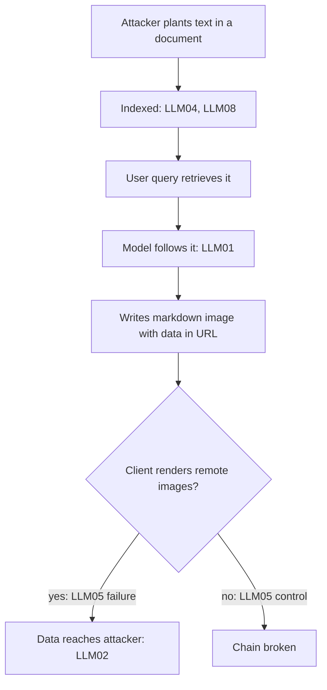

## TL;DR
The OWASP Top 10 for LLM Applications is the shared checklist reviewers will use on your agent. Its core
framing: the model is an untrusted component that follows instructions in data, so every boundary around
prompts, tools and outputs must be redrawn.

## For agent builders
- **Why it matters for agents.** Agents hit almost every item at once: indirect injection through tool
  results (LLM01), tools with too much authority (LLM06), retrieval leaking across users (LLM08), and
  runaway loops that burn budget (LLM10). The 2025 edition was restructured largely around these failures.
- **Where it shows up in your stack.** Your threat model, red-team suite, enterprise security
  questionnaires, and the review a new tool or data source goes through before it ships.
- **What you control.** A per-item control matrix kept as code next to the agent, with evidence links (a
  test, a config, a log), red-team cases tagged by item, and boundary controls that do not depend on
  detecting the attack.
- **What you can skip.** Memorising the numbering as a priority order, and any "OWASP compliant" claim.
  Rank items by your agent's exposure and blast radius instead.

## Why it exists
- **Security reviews run on checklists, and before 2023 there was none for LLM features.** Each review
  re-derived the threat model from scratch and missed different classes, and procurement questionnaires
  had nothing to ask.
- **The web Top 10 misses the crucial point.** Web injection is data interpreted as code because escaping
  was missing, fixed by separating the two syntactically. An LLM has no escaping: it is designed to treat
  text as instructions, so "sanitise your inputs" offers false assurance.
- **It tracks real failures.** v1.0 came in August 2023 and v1.1 that October; the restructured 2025 edition
  (late 2024) reflected agents with too much authority, retrieval leaking across users, system prompts
  treated as secrets, and cost blow-ups from unbounded usage.
- **Item numbers are the lingua franca.** Vendors, questionnaires and increasingly regulators cite LLM01 or
  LLM06; an engineer who cannot say what they mean, and how their system addresses them, struggles in an
  enterprise security review regardless of how good the system is.
- **Scope of this lesson:** it is the map; each boundary has a deep lesson elsewhere in this module.

## How it works
### The 2025 list, grouped by trust boundary
The ten items are easier to remember as six trust boundaries than as a numbered list, and each boundary
maps to a part of an agent: the context, the stores, the tools, the user, the loop and the build.

| Boundary | Item | What goes wrong | Deep lesson |
|---|---|---|---|
| **Instruction:** who tells the model what to do | *LLM01 Prompt Injection* | untrusted text from the user (direct) or documents, pages and tool results (indirect) changes behaviour; no reliable detector, so controls limit what a hijacked model can do | prompt injection |
| | *LLM07 System Prompt Leakage* | the system prompt will be extracted, so it must hold no secrets or authority | data leakage |
| **Data:** what the model can see and repeat | *LLM02 Sensitive Information Disclosure* | PII, secrets and other users' data in completions, logs or training data | data leakage, PII redaction, cross-tenant leakage |
| | *LLM08 Vector and Embedding Weaknesses* | retrieval stores without access control, cross-tenant retrieval, invertible embeddings, poisoned documents | RAG poisoning, cross-tenant leakage |
| | *LLM04 Data and Model Poisoning* | manipulated training, fine-tuning or retrieval data implants behaviour or bias | supply-chain security, RAG poisoning |
| **Action:** what output may cause | *LLM05 Improper Output Handling* | completions treated as trusted: rendered as HTML, passed to a shell or SQL engine, deserialised unchecked; the LLM version of output encoding | output validation |
| | *LLM06 Excessive Agency* | too many tools, too much permission, too little oversight, so a mistaken or injected model does real damage | excessive agency, tool privilege escalation |
| **Trust in output** | *LLM09 Misinformation* | confident wrong answers, fabricated citations, insecure generated code consumed unverified; the risk is in the workflow as much as the model | |
| **Resource** | *LLM10 Unbounded Consumption* | no limits on tokens, requests, context length or tool loops: denial of service, denial of wallet, model extraction by high-volume querying | |
| **Build** | *LLM03 Supply Chain* | compromised models, datasets, adapters and the packages that load them | supply-chain security for models and datasets |

### Attacks cross rows, so read the matrix across
A typical chain, four rows and one attack:
1. An attacker plants instructions in a document that gets indexed (LLM04/LLM08).
2. A user's question retrieves it and the model follows it (LLM01).
3. The model writes a markdown image whose URL carries the user's data, and the client renders it (LLM05).
4. The data reaches the attacker's server (LLM02).

- **The cheapest reliable control is often in a different row** from the one the incident is filed under.
  You cannot reliably stop LLM01, but not rendering remote images (an LLM05 control) breaks this chain
  completely.
- **So use the list as boundaries with layered controls.** The action and resource boundaries, which do not
  depend on detecting the attack, carry most of the weight.

### What changed from v1.1 to 2025, and why it matters
| 2023 (v1.1) item | 2025 fate | Why |
|---|---|---|
| Insecure Plugin Design | folded into Excessive Agency and Supply Chain | the failure was authority and provenance, not plugins specifically |
| Model Denial of Service | broadened into Unbounded Consumption | to cover cost and extraction |
| Model Theft | absorbed into Unbounded Consumption | extraction is a consumption problem |
| Overreliance | became Misinformation | |
| (new) | System Prompt Leakage, Vector and Embedding Weaknesses | RAG and agent deployments made them routine |

- **Direction of travel:** from "the model misbehaves" to "the system around the model grants it too much",
  which is also the direction your controls should take.

### How to use the list
- **It is a threat-modelling prompt, not a compliance standard.** There is no certification, and "OWASP
  compliant" has no formal meaning.
- **The numbering is not your priority order.** It reflects what is common across the industry; rank by
  exposure and blast radius in your system. An internal summariser with no tools barely has an LLM06
  problem; a customer-facing agent that can move money has little else.
- **Build a table:** one row per item, three columns: how the risk manifests in *this* system, the control,
  and the evidence (a test, a config, a log).
- **Never leave a blank.** Items that do not apply get a one-line reason, because reviewers read blanks as
  gaps.
- **Agentic guidance:** OWASP has since published agentic-specific guidance under its agentic security
  initiative; the ten items remain the baseline vocabulary.

| Framework | Answers |
|---|---|
| MITRE ATLAS | adversary tactics and techniques against ML systems; what red teams plan from |
| OWASP Top 10 for LLMs | the engineering checklist for one application |
| NIST AI Risk Management Framework | the organisational process for governing AI risk |

## Diagram
One injection chain through a RAG agent crosses four rows; the cheapest reliable control (no remote image
rendering) sits in a different row from the one the incident gets filed under.



## Examples
### Threat-modelling a contract-review agent
RAG over each customer's uploaded contracts, a tool that creates tickets in the customer's tracker, used by
legal teams at 300 tenants. Walking the list produces concrete controls rather than abstractions.

| Item | Control in this system |
|---|---|
| LLM01 | contracts are untrusted, so the ticket tool is gated by a confirmation step showing the structured title and body; no network tools exist |
| LLM07 | the system prompt holds formatting rules only; tenant and permissions come from the token |
| LLM02, LLM08 | retrieval filters on `tenant_id` inside the ANN query, traces are redacted before export, a per-tenant canary test runs in CI |
| LLM04 | the embedding model is pinned by hash and pulled from the internal registry; uploads are scanned for hidden text in white font and zero-width characters |
| LLM05 | completions are rendered as plain text, never HTML; the ticket body is validated against a schema with a length cap |
| LLM06 | the only write tool is `create_ticket`, scoped to the requesting user's tracker project |
| LLM09 | every clause-level claim must cite a retrieved span; a groundedness eval runs weekly |
| LLM10 | illustrative limits: 8k input tokens, 2k output tokens, 60 requests per user per hour, a per-tenant monthly token budget, a ten-step cap on the agent loop |
| LLM03 | base model, embedding model and reranker each have recorded hashes, signatures and an AI bill of materials entry |

Each row now has a control and a piece of evidence a reviewer can ask for. Ranking for this system:
1. **LLM01 with LLM06 first,** because the one write path lands in 300 customers' trackers and contracts are
   attacker-supplied by construction.
2. **LLM08 and LLM02 next,** because a single missing filter exposes one customer's contracts to another.
3. **LLM10 and LLM03 after that.**

A chatbot over public documentation, by contrast, would rank LLM09 and LLM10 near the top and LLM06 near
the bottom.

### A control matrix that fails CI on gaps
Keep the matrix in the repo next to the agent code and fail the build when a row is missing or lacks
evidence. Pure Python, runnable; here it reports the rows still to write.

```python
ITEMS = [f"LLM{n:02d}" for n in range(1, 11)]

MATRIX = {   # one row per item: how it shows up here, the control, the evidence
    "LLM01": {"manifests": "injected text inside uploaded contracts",
              "control": "ticket tool gated by confirmation; no network tools",
              "evidence": "tests/redteam/test_injection_to_tool.py"},
    "LLM06": {"manifests": "create_ticket writes into customer trackers",
              "control": "only write tool, scoped to requester's project",
              "evidence": "tools/registry.yaml scopes"},
    "LLM07": {"manifests": "system prompt extraction",
              "control": "prompt holds formatting rules only; authz from token",
              "evidence": "tests/test_prompt_has_no_secrets.py"},
    # an item that truly does not apply gets {"n/a": "<one-line reason>"}, never a blank
}

def gaps(matrix):
    out = []
    for item in ITEMS:
        row = matrix.get(item)
        if row is None:
            out.append(f"{item}: no row (reviewers read blanks as gaps)")
        elif "n/a" not in row and not all(row.get(k) for k in ("manifests", "control", "evidence")):
            out.append(f"{item}: missing manifests/control/evidence")
    return out

for g in gaps(MATRIX):
    print(g)       # in CI: sys.exit(1) if gaps(MATRIX) else 0
```

- **Version the matrix** with the edition it maps to (2025, not v1.1), so questionnaire answers line up with
  the item numbers customers cite.
- **Tie it to the tool registry:** a CI rule that a new entry in the agent's tool registry must touch the
  LLM06 row keeps the matrix from going stale.

### Worked scenario: LLM10 for a runaway agent loop
A research agent with no step cap hits a tool that keeps returning "try again"; each step adds ~2k tokens
of context. Rough numbers, illustrative:

| Setting | Steps before stop | Context at stop | Input tokens billed |
|---|---|---|---|
| No step cap, no budget | ~60, until the context window fills | ~120k | several million per run |
| Ten-step cap | 10 | ~20k | ~110k |
| Ten-step cap plus per-tenant monthly token budget | 10, and the tenant is throttled at the budget | ~20k | bounded per month |

- **The control is in code, not the prompt:** a loop counter and a budget check in the orchestrator, with
  alerts on limit hits, are the LLM10 evidence a reviewer asks for.

## Production patterns
- **Matrix-as-code in the repo.** The matrix and gap check above, with a matrix diff required in review
  for any new tool or data source. Monitor coverage and freshness.
- **Red-team suite tagged by item.** Tag each adversarial test case with the item it exercises (LLM01,
  LLM05, LLM06 and so on) and report pass rates per item on every release, so a regression shows up as
  "LLM05 dropped" rather than a generic score.
- **Boundary controls that do not need detection.** Plain-text or sanitised rendering for LLM05, scoped
  typed tools and approval gates for LLM06, and token, request and loop caps for LLM10, enforced in code.
  Monitor blocked renders, denied tool calls and limit hits.
- **Questionnaire answer bank.** Keep a reviewed, item-numbered answer per control with its evidence, mapped
  in both directions (item to control, control to items). FDEs reuse it per customer; track how often
  answers need edits after an architecture change.
- **Incident classification.** After every incident, tag every row the chain crossed and check which
  row's evidence was missing. Track repeat incidents per row.

## Trade-offs
- **Shared checklist vs thinking.** It speeds reviews and questionnaires, but filled-in rows can substitute
  for thinking. It flips from asset to liability when teams answer "LLM01: we have a guardrail" and stop.
- **Grouping by boundary vs questionnaires.** Boundaries make controls reusable across items, yet a
  questionnaire asks by item number, so maintain the mapping in both directions.
- **An evolving list vs stable references.** New editions keep it relevant, but a matrix written against
  v1.1 numbers no longer lines up with 2025 references; version your matrix explicitly.
- **Full coverage vs low-risk tools.** Covering all ten for a low-risk internal tool is more process than the
  risk warrants. Scale each row's depth to blast radius, but still write the row.

## Pitfalls
- **Accepting "OWASP LLM Top 10 compliant" from a vendor.** Symptom: they cannot produce a per-item control
  and evidence table when asked. Diagnose: request the table and one evidence link per row. Fix: make the
  table a procurement requirement.
- **Mapping LLM01 to an input classifier and declaring it solved.** Symptom: a red-team finding that a
  paraphrased injection reaches the tool layer unchanged. Diagnose: replay paraphrased and indirect cases
  and log which reach a tool call. Fix: gate and scope the tools.
- **Ignoring LLM10 because "the provider handles scaling".** Symptom: a month-end invoice several times the
  forecast after a scripted client or a runaway agent loop. Diagnose: tokens and steps per run, per
  tenant. Fix: caps and budgets in the orchestrator.
- **Reading LLM05 as a model problem.** Symptom: cross-site scripting or command execution from a completion
  rendered or executed without validation, which no model change would have fixed. Diagnose: trace every
  consumer of a completion. Fix: encode or validate there.
- **Writing the matrix once at launch.** Symptom: a new tool or data source ships months later with no row
  and no review. Diagnose: diff the tool registry against the LLM06 row. Fix: CI rule tying them.
- **Assessing each row in isolation.** Symptom: every row "mitigated" while a red team chains an injection
  through rendering into disclosure, because no single row owned the chain.

## When to use
- **When designing a new agent or LLM feature:** as the skeleton of the threat model.
- **Before an enterprise security review or questionnaire:** as the structure of your answers.
- **After any incident:** to classify it and check which row's evidence was missing.
- **Avoid:** using it as a scoring scheme or a certification.
- **Measure:** coverage (every item has a row with control and evidence), freshness (rows updated when the
  architecture changes), and red-team results per item.

## Exercise
**Goal:** threat-model a small agent with the list and prove the matrix with tests. No solution is given.
- **Inputs:** an agent you can run (or a stub) with RAG over uploaded files, one `create_ticket` write
  tool and a markdown-rendering UI.
- **Deliver:** all ten rows with manifests, control and evidence (or a one-line n/a), the `gaps` check in
  CI, a ranked top three with reasons, and one chained attack written as a test.
- **Acceptance:** the gap check fails when you delete a row; the chained test (injected file, then image
  URL or ticket write) fails before your controls and passes after; each control is in code, not the prompt.

## Role lens
- **Engineer:** Turns each applicable item into a test or configuration that can be pointed at as
  evidence, from tenant-filtered retrieval to token caps and output schema validation.
- **Architect:** Owns the per-item control matrix for each system and the trust-boundary diagram it derives
  from, and keeps it versioned against the edition of the list referenced by customers.
- **FDE:** Answers customer security questionnaires item by item with evidence, and translates a customer's
  item-numbered concern into the specific control in the deployment.

## Check yourself
**Q:** A vendor's sales deck says their chatbot is "OWASP LLM Top 10 compliant". What does that claim
actually mean, and what would you ask to evaluate their security posture?

**A:** Formally it means nothing: the Top 10 is an awareness and threat-modelling document with no
certification scheme, so the claim at best signals that someone has read it. I would ask for a per-item
table: for each of the ten, how the risk manifests in their architecture, the control, and the evidence.
Specifically, how tool actions are authorised and gated (LLM06), what the model can do if a retrieved
document contains instructions (LLM01), how tenants are separated in the vector store and caches (LLM08,
LLM02), whether anything in the system prompt would matter if leaked (LLM07), how completions are
rendered or executed (LLM05), what rate and token limits exist per tenant (LLM10), and where their models
and embeddings come from with hashes (LLM03). I would also ask which edition they mapped against, and for
red-team or penetration-test reports that reference those items, since evidence rather than assertion is
what the list is meant to elicit.

## Interview questions
### Why is prompt injection first on the list, and why can't it be fixed like SQL injection?
- **It is the entry point** for most chains: untrusted text, direct or indirect, changes the model's behaviour.
- **No syntactic separation exists:** SQL injection is fixed by keeping code and data in separate channels,
  but a prompt is one channel by design, so controls must limit what a steered model can do.

### Walk me through the Top 10 for a RAG agent that can create tickets for 300 tenants.
- **Group by boundary:** instruction (LLM01, LLM07), data (LLM02, LLM04, LLM08), action (LLM05, LLM06),
  output trust (LLM09), resources (LLM10), build (LLM03).
- **Name a control and evidence per row,** for example tenant filter inside the ANN query with a canary test
  for LLM08, plain-text rendering for LLM05, one scoped write tool with confirmation for LLM06.
- **Rank by blast radius:** LLM01 with LLM06 first, because the write path reaches every tenant's tracker.

### An incident was filed under LLM01. Why might the fix belong in a different row?
- **LLM01 has no reliable detector,** so fixing it in place usually means another classifier that a
  paraphrase bypasses.
- **The chain crossed other rows:** if data left through a rendered image, an LLM05 control (no remote
  images) breaks it completely; if a tool fired, LLM06 scoping and gates contain it.
- **So classify the incident across every row it crossed** and fix the cheapest reliable link.

### Your team adds a new tool to a production agent. How does the Top 10 enter that change?
- **The tool registry diff triggers a matrix diff:** the LLM06 row records its scope, credential source
  and whether it needs an approval gate.
- **Check the crossing rows:** does it return untrusted text (LLM01), can it send data out (LLM02), does
  its output reach a renderer or interpreter (LLM05)?
- **Add tagged red-team cases** for the new tool so its item pass rates appear in the next release report.

### What evidence would you expect a vendor to show for LLM10 Unbounded Consumption?
- **Concrete limits** in config: input and output token caps, requests per user per hour, per-tenant token
  budgets, and a step cap on agent loops.
- **Monitoring:** alerts on spend and limit hits per tenant, so a scripted client or runaway loop surfaces
  before the month-end invoice.
- **Extraction defence:** rate limits and anomaly detection on high-volume querying.

## Quiz
### Q: Why does input sanitisation, which solves SQL injection, not solve prompt injection?
- [ ] LLM inputs are too long to sanitise within latency budgets
- [x] A prompt has no syntactic separation between instructions and data; the model is built to treat text as instructions
- [ ] Sanitisation removes the few-shot examples the model needs
- [ ] Prompt injection only occurs through tool outputs, which are not user inputs
> SQL injection is fixed by keeping code and data in separate channels; in a prompt they are the same
> channel by design, so controls must limit what a steered model can do rather than try to filter the text.

### Q: An LLM's completion is passed directly to a shell command and later rendered as HTML in a dashboard. Which item covers this?
- [ ] LLM01 Prompt Injection
- [ ] LLM06 Excessive Agency
- [x] LLM05 Improper Output Handling
- [ ] LLM09 Misinformation
> Improper Output Handling is about downstream components trusting the completion; the fix is validation
> and encoding at the consumer, exactly as with any untrusted input, regardless of how the completion was
> produced.

### Q: What changed in the 2025 edition relative to v1.1?
- [ ] Prompt injection was removed because guardrail models solved it
- [ ] The list became a formal certification with audited levels
- [x] Model DoS broadened into Unbounded Consumption, and System Prompt Leakage and Vector and Embedding Weaknesses were added
- [ ] The list was merged into the web application Top 10
> The 2025 edition reflected real deployments: cost and extraction joined denial of service, and RAG and
> agent failures earned their own items, while prompt injection stayed at number one.

## Mastery test
**Problem:** an HR agent answers employees from a policy wiki, reads their own payroll record, and can
email the HR team. Its system prompt says "never reveal salaries of other employees". Rank the three
items that matter most and give each a control with evidence.

**A strong answer:**
- flags the system prompt rule as LLM07 and LLM02: the salary scope must come from the token in the
  payroll tool, tested with another employee's ID;
- ranks LLM01 with LLM06 high: an edited wiki page can steer the email tool, so restrict recipients and
  show a confirmation;
- checks LLM05 (rendered links or images leaking payroll data) and LLM08 if the wiki index is shared;
- gives evidence as tests or configs, and n/a reasons for the rest.

## Use cases & projects
### Use cases
- **Launch reviews for a new agent.** The per-item matrix is the threat model a security team signs off
  before a tool-using agent goes live.
- **Enterprise security questionnaires.** Item-numbered answers with evidence let FDEs reply quickly and
  consistently across customers.
- **Red-team reporting.** Tagging adversarial cases by item turns a vague safety score into "LLM06 pass rate
  dropped after the new refund tool".
- **Incident postmortems.** Classifying a chain across every row it crossed points at the cheapest
  reliable fix.

### Mini project
**Write the control matrix for a small agent (1-2 hours).**
- **Goal:** turn the Top 10 into a CI-checked artefact for an agent with RAG and one write tool.
- **Steps:** pick or sketch an agent (for example a docs assistant that can open tickets); fill all ten
  rows with manifests, control and evidence, or a one-line n/a reason; adapt the `gaps` script to fail CI;
  write one tagged red-team test each for LLM01, LLM05 and LLM10 (an injected document, an HTML
  completion, a loop that must stop at a step cap).
- **Done when:** the gap check passes, the three tests run and are tagged by item, and you can rank the ten
  items for this agent with a one-line reason each.
