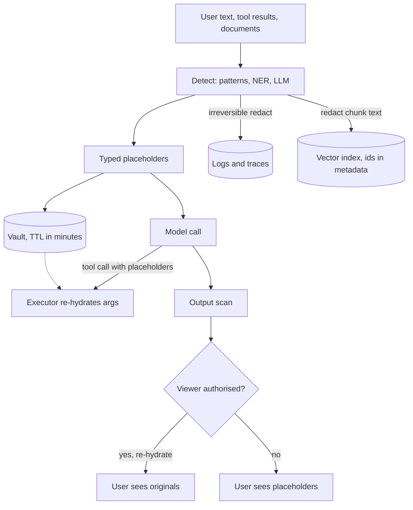

## TL;DR
Agents pull personal data in through tool results and copy it into prompts, traces, memory and indexes.
PII redaction replaces identifiers at each boundary; typed placeholders with a short-lived vault keep the
agent able to reason and act.

## For agent builders
- **Why it matters for agents.** A single agent run can fetch a CRM record, read an email thread and
  write a memory note, so PII arrives mid-loop through tool results, not just the user turn, and every
  step's prompt is captured by your tracing.
- **Where it shows up in your stack.** A redaction step on tool results before they enter the context,
  a processor in the tracing exporter, the memory and vector-index write path, and the tool executor that
  re-hydrates placeholders in arguments.
- **What you control.** The entity list per boundary, reversible placeholders versus irreversible
  redaction, the vault TTL, who may see re-hydrated output, and whether long-term memory stores raw values
  at all.
- **What you can skip.** Training your own NER model; start with patterns plus checksums and Presidio
  recognizers, and measure recall on your own traffic before adding an LLM detector.

## Why it exists
- **LLM features multiply where user text lives.** The prompt goes to a vendor. Tracing tools store full
  prompts and completions by default, because that makes them useful for debugging. Eval and fine-tuning
  sets are copied from traces. Output reaches people who may not own the data. Each copy is a new
  retention point.
- **Indexes retain identifiers indefinitely.** Chunks and embeddings sit in a vector index; the index
  usually stores the chunk text next to the vector, and embeddings themselves can be partially inverted
  back to text, so a phone number embedded is a phone number retained.
- **Law and contracts assume you know.** GDPR's data-minimisation principle, HIPAA for health data, PCI
  DSS for card data, state privacy laws and your vendor data-processing agreement all assume you know
  what personal data leaves your boundary and where it is retained.
- **The shortcuts fail.** "The vendor has zero retention" covers the vendor, not your logs, traces,
  indexes and outputs. "Tell the model not to repeat personal data" is a probabilistic instruction.
  "Don't log prompts at all" destroys debuggability, so teams quietly turn logging back on.
- **What works:** a deterministic transformation at each boundary, with a documented policy for which
  identifiers are transformed, how, and whether the transformation can be reversed.

## How it works
### What counts as PII
| Class | Examples | Note |
|---|---|---|
| Direct identifiers | name, email, phone, national id, card and account numbers, IP and device identifiers | point at one person |
| Quasi-identifiers | date of birth, postcode, employer, a rare diagnosis | identify in combination |
| Special categories | health, biometrics, religion | stricter rules |

- **The entity list is a policy decision** made with legal or privacy owners, not a default you inherit
  from a library.

### Detection: three detector families
1. **Patterns with checksums.** Regex plus a validity check: Luhn for card numbers, mod-97 for IBANs,
   structural rules for national ids. The checksum exists *because* format alone matches too much; any
   16-digit order number looks like a card.
2. **NER models.** Statistical taggers (spaCy, transformer NER, the recognizers in Microsoft Presidio)
   find names, locations and organisations that have no fixed format. Recall is good on common,
   well-cased English text and drops on unusual names, other languages, lowercase chat and OCR noise.
3. **LLM-based detection.** Best recall on messy text and novel identifier types, at the price of another
   model call, non-determinism, and the irony of sending PII to a model to find PII; use a model inside
   your boundary and give it only the text and an entity list.

- **Presidio-style engines combine the first two,** raise scores when context words appear ("phone" near
  a digit run) and expose per-entity confidence so thresholds can differ by type.

### Transformations
| Transformation | Example | Reversible | Why use it |
|---|---|---|---|
| Remove / redact | `[REDACTED]` | no | safest, loses the most |
| Typed, numbered placeholder | `<PERSON_1>`, `<EMAIL_2>` | with a vault | the model can still reason ("PERSON_1 emailed PERSON_2 twice") *because* type and coreference survive |
| Mask | `****0134` | no | keeps a few characters for human verification |
| Keyed hash (HMAC) | stable pseudonym | no | joins and analytics; keyed *because* small spaces such as phone numbers can be enumerated and plain hashes reversed by table lookup |
| Tokenise / encrypt with a vault | token | yes | mapping stored per request or session, used to re-hydrate output for an authorised viewer |
| Generalise | age 34 becomes "30s", postcode becomes region | no | keeps analytic value |

### Where the step runs
Five boundaries, each with its own policy:
1. **Before the model call:** depends on your vendor agreement.
2. **Before logging and tracing:** always, irreversibly.
3. **Before indexing:** redact in chunk text, keep identifiers in access-controlled metadata.
4. **On output:** scan for identifiers that were not in the requester's own input or authorised records.
5. **Before building eval or fine-tuning sets.**

- **The vault** for reversible mappings lives separately from logs, with a time-to-live measured in
  minutes, not months.

### Consistency and re-hydration
- **Same value, same placeholder** within a session, so the model can follow references.
- **Re-hydrate only for authorised viewers.** This ties redaction to the same access-control decisions as
  retrieval.
- **Streaming splits placeholders.** One can arrive as `<EMA` then `IL_1>`, so the re-hydrator must buffer
  from any `<` until the placeholder closes.
- **The model rewrites placeholders.** It may emit `EMAIL_1` or `<Email 1>`, or invent one not in the
  vault; match leniently, and leave anything unknown unresolved rather than guessing.

### In an agent loop
- **Redact tool results as they arrive.** A CRM lookup or email fetch is the main PII source in an agent,
  so the redactor runs between the tool and the context, not only on the user turn.
- **Re-hydrate tool arguments inside the executor.** The model writes `send_email(to="<EMAIL_1>")`; the
  executor swaps in the real value just before the side effect, *because* the action needs the original
  but the model, the trace and the transcript do not.
- **Keep memory pseudonymised.** Long-term memory outlives the vault, so store facts with irreversible
  redaction or keyed pseudonyms, never the session's numbered placeholders, which mean nothing next run.

### Redaction is not anonymisation
- **Quasi-identifiers remain.** A handful together (birth date, postcode, sex, employer, a rare
  condition) can single out one person; this re-identification by linkage is a well-documented result in
  privacy research.
- **World knowledge makes it worse.** A model can resolve "<PERSON_1>, the CEO of the company in the
  previous paragraph" by itself.
- **So treat redacted text as pseudonymised personal data,** which is what data-protection law calls it,
  not as anonymous data that is free to share.

### Measuring
- **Label real traffic per entity type** and track precision (share of redactions that were really PII)
  and recall (share of real PII that was caught).
- **Recall failures are the dangerous ones and never reach zero.** At an illustrative 99% recall and
  10,000 identifiers a day, about 100 a day still land in the logs.
- **So redaction *reduces* exposure;** the redacted stores still need access control and retention limits.
- **Audit the fast path** with a stricter, slower detector over logs after the fact to estimate its leak
  rate.
- **Precision is a utility metric:** over-redaction quietly breaks the task.

## Diagram
Each boundary gets its own transformation; only the model path is reversible. Re-hydration happens in
two places only: the tool executor, just before a side effect, and the output path, gated by the same
authorisation as retrieval.



## Misconceptions
- **"Our vendor has zero retention, so PII is handled."** That covers the vendor only. Your traces, logs,
  vector index, eval sets and other users' screens are each a retention point with its own policy.
- **"Redacting the user turn covers the agent."** In an agent the main PII source is tool results (a CRM
  lookup, an email fetch), so the redactor sits between every data-returning tool and the context.
- **"Blanket `[REDACTED]` is the right transformation for the model call."** It destroys type and
  coreference, so the model cannot reason or act. Typed, numbered placeholders with a short-lived vault
  keep both, and the executor re-hydrates only the tool argument that needs the real value.
- **"Redacted text is anonymous."** Quasi-identifiers in combination, plus the model's world knowledge,
  can single out a person. Treat redacted text as pseudonymised personal data.
- **"Hashing a phone number pseudonymises it."** The number space is small enough to enumerate, so a
  plain hash reverses by lookup. Use a keyed HMAC, with the key in a secrets manager.
- **"99% recall means the logs are clean."** At an illustrative 10,000 identifiers a day, about 100 still
  land in the logs, around 3,000 over 30 days of retention. Redaction reduces exposure; the stores still
  need access control, retention limits and an after-the-fact audit.

## Examples
### A self-contained redactor
Checksum-validated card detection, consistent typed placeholders, and a per-request vault for
re-hydration. The output shows what a regex layer catches and what it misses.

```python
import re
from dataclasses import dataclass, field

EMAIL = re.compile(r"[\w.+-]+@[\w-]+\.[\w.-]+")
PHONE = re.compile(r"(?<!\d)(?:\+?\d[\d ()-]{8,}\d)(?!\d)")
CARDISH = re.compile(r"(?<!\d)\d(?:[ -]?\d){12,18}(?!\d)")   # 13-19 digits, ends on a digit

def luhn_ok(s: str) -> bool:                       # checksum: an order number is not a card
    d = [int(c) for c in s if c.isdigit()]
    total = sum(d[-1::-2]) + sum(sum(divmod(2 * x, 10)) for x in d[-2::-2])
    return len(d) >= 13 and total % 10 == 0

@dataclass
class Redactor:
    vault: dict = field(default_factory=dict)      # placeholder -> original, lives for one request
    counts: dict = field(default_factory=dict)

    def _slot(self, kind: str, original: str) -> str:
        for ph, val in self.vault.items():         # same value -> same placeholder (coreference)
            if val == original:
                return ph
        self.counts[kind] = self.counts.get(kind, 0) + 1
        ph = f"<{kind}_{self.counts[kind]}>"
        self.vault[ph] = original
        return ph

    def redact(self, text: str) -> str:
        text = CARDISH.sub(lambda m: self._slot("CARD", m.group()) if luhn_ok(m.group()) else m.group(), text)
        text = EMAIL.sub(lambda m: self._slot("EMAIL", m.group()), text)
        text = PHONE.sub(lambda m: self._slot("PHONE", m.group()), text)
        return text

    def rehydrate(self, text: str) -> str:         # only for a viewer authorised to see the originals
        for ph, val in self.vault.items():
            text = text.replace(ph, val)
        return text

r = Redactor()
msg = "Hi, I'm Dana (dana.k@example.com, +1 415 555 0134). Card 4111 1111 1111 1111 was charged twice."
safe = r.redact(msg)
print(safe)  # Hi, I'm Dana (<EMAIL_1>, <PHONE_1>). Card <CARD_1> was charged twice.
# `safe` is what the model, the trace and the log see. The model answers "I'll refund <CARD_1>"
# and r.rehydrate(reply) restores the value on the way back to the authorised user only.
# "Dana" survived: names have no format, so they need an NER recognizer such as Presidio's.

print(Redactor().redact("Order 1234567890123456 shipped 2026-09-30; call me on 07700 900123."))
# Order <PHONE_1> shipped <PHONE_2>; call me on <PHONE_3>.
# The Luhn check correctly refused to call the order number a card, but the loose phone pattern then
# swallowed it and the date: precision failures that break a support workflow. Real phone detection
# needs per-locale rules (or a library such as phonenumbers) plus context words, not one regex.
```

### Keyed pseudonyms and a streaming re-hydrator
Standard library only. The HMAC pseudonym is stable for joins but cannot be reversed by enumerating
phone numbers without the key; the re-hydrator buffers split placeholders and matches lenient spellings.

```python
import hmac, hashlib, re

KEY = b"rotate-me-from-a-secrets-manager"      # never hard-code in real code

def pseudonym(value: str, kind: str) -> str:
    digest = hmac.new(KEY, value.encode(), hashlib.sha256).hexdigest()[:12]
    return f"{kind}_{digest}"                  # stable across records, useless without the key

print(pseudonym("+1 415 555 0134", "PHONE") == pseudonym("+1 415 555 0134", "PHONE"))  # True: joins work

PH = re.compile(r"<\s*([A-Za-z]+)[ _](\d+)\s*>")   # lenient: <EMAIL_1>, <Email 1>

def rehydrate_stream(chunks, vault):
    buf = ""
    for chunk in chunks:
        buf += chunk
        cut = buf.rfind("<")
        if cut != -1 and ">" not in buf[cut:]:     # a placeholder may still be arriving
            ready, buf = buf[:cut], buf[cut:]
        else:
            ready, buf = buf, ""
        yield PH.sub(lambda m: vault.get(f"<{m[1].upper()}_{m[2]}>", m[0]), ready)
    yield PH.sub(lambda m: vault.get(f"<{m[1].upper()}_{m[2]}>", m[0]), buf)

vault = {"<EMAIL_1>": "dana.k@example.com"}
print("".join(rehydrate_stream(["Sent to <EMA", "IL_1> and <Email 1>, not <PHONE_9>."], vault)))
# Sent to dana.k@example.com and dana.k@example.com, not <PHONE_9>.   (unknown stays unresolved)
```

### Agent scenario: re-hydrating placeholders only at the side effect
The model and the trace see placeholders; the executor resolves them for the one tool that needs the
real value, and refuses placeholders it cannot resolve.

```python
import re

PLACEHOLDER = re.compile(r"<([A-Z]+)_(\d+)>")
NEEDS_REAL_VALUES = {"send_email"}               # tools whose side effect needs the original value

def resolve_args(tool: str, args: dict, vault: dict) -> dict:
    """Swap placeholders for originals just before the side effect; never log the result."""
    if tool not in NEEDS_REAL_VALUES:
        return args                              # read-only tools keep working on placeholders
    def sub(v):
        if not isinstance(v, str):
            return v
        def one(m):
            if m[0] not in vault:
                raise ValueError(f"unknown placeholder {m[0]}: refuse rather than guess")
            return vault[m[0]]
        return PLACEHOLDER.sub(one, v)
    return {k: sub(v) for k, v in args.items()}

vault = {"<EMAIL_1>": "dana.k@example.com"}       # per-session, TTL in minutes
call = {"to": "<EMAIL_1>", "body": "Your refund for <CARD_1> is on its way."}
print(call)                                       # what the transcript and the trace store
try:
    resolve_args("send_email", call, vault)
except ValueError as e:
    print(e)                                      # <CARD_1> is not in this vault: the call is refused
print(resolve_args("send_email", {"to": "<EMAIL_1>", "body": "Refund sent."}, vault)["to"])
```

### Worked scenario: what 99% recall means in practice
Illustrative numbers for a support product, one day of traffic.

| Quantity | Value |
|---|---|
| Identifiers seen | 10,000 |
| Recall of the fast redactor | 99% |
| Identifiers missed, landing in logs | about 100 |
| Over a 30-day log retention | about 3,000 retained identifiers |

The conclusion: redaction lowers exposure but the log store still needs access control, a retention
limit, and a nightly stricter-detector audit to estimate the real leak rate.

## Production patterns
- **Redact in the trace exporter, not just the handler.** Observability SDKs capture the request early,
  so register the redactor as a processor in the logging and tracing export path and test it with a
  fixture containing every entity type. Monitor PII hits found by the after-the-fact audit.
- **Presidio with custom recognizers.** Use `AnalyzerEngine` for detection and `AnonymizerEngine` for
  transformation, and add a `PatternRecognizer` for the customer's own formats (employee ids, policy
  numbers). Monitor per-entity recall on a labelled sample.
- **Short-lived vault per session.** Store placeholder mappings in a separate store with a TTL measured in
  minutes and re-hydrate only after the same authorisation check as retrieval. Monitor vault reads by
  caller.
- **Redact at the tool boundary, re-hydrate at the executor.** Agent teams wrap each data-returning tool
  with the redactor and resolve placeholders only inside the executor for tools that need real values.
  Monitor unresolved-placeholder refusals per tool and raw identifiers found in agent traces by the audit.
- **Eval and fine-tuning data only from the redacted path.** Build datasets from the redacted trace store,
  never from raw request logs, so the training corpus inherits redaction automatically.

## Trade-offs
- **Recall vs utility.** Higher recall means more false positives: a travel assistant that redacts every
  city or an HR tool that redacts every name becomes useless. When the task is about the people and the
  vendor is covered by an agreement, redact for logs and indexes but not for the model call.
- **Reversibility vs concentrated risk.** Reversible pseudonymisation keeps the model useful but puts the
  most sensitive mapping in a vault; it is only safer than raw values if the vault is short-lived and
  access-controlled.
- **Patterns vs models.** Pattern-plus-checksum detectors are fast, deterministic and explainable; NER and
  LLM detectors catch names and free-form identifiers but add latency, non-determinism and, for LLM
  detectors, one more place the data goes.
- **Index protection vs search.** Redacting before embedding protects the index but makes "find the
  emails from Dana" impossible; redact the chunk text and keep identifiers in metadata behind access
  control.
- **Cross-session consistency vs linkage risk.** A consistent pseudonym preserves analytics linkage but
  becomes a persistent identifier itself; number placeholders per session unless you need linkage.

## Pitfalls
- **Redacting after the tracing SDK captured the request.** Symptom: PII in the trace UI for a request the
  model never saw PII in. Cause: the SDK hooks in before the handler. Diagnose: send a fixture with every
  entity type and grep the trace store. Fix: redact in the exporter.
- **Detecting cards by format alone.** Symptom: order numbers and tracking ids redacted and support staff
  unable to do their jobs. Diagnose: sample CARD redactions and count Luhn failures. Fix: checksum
  validation.
- **Shipping US-centric patterns.** Symptom: UK, Indian or Brazilian phone numbers and national ids
  passing straight through. Diagnose: measure recall per entity and locale on labelled traffic. Fix:
  per-locale recognizers.
- **Assuming redaction is anonymisation.** The model re-identifies "<PERSON_1>, the CEO of the company in
  the previous paragraph" from context, and the name appears in the answer anyway. Fix: treat the text
  as pseudonymised personal data.
- **Redacting only the user turn.** Symptom: PII from a CRM lookup or an uploaded document landing in
  logs through tool results. Diagnose: run the after-the-fact audit grouped by span type (user turn vs
  tool result). Fix: wrap every data-returning tool.
- **Writing session placeholders into long-term memory.** Symptom: next week the agent recalls "<PERSON_1>
  prefers email" and cannot tell who that was, or a new vault reuses the number for someone else. Fix:
  store memory with keyed pseudonyms or irreversible redaction.
- **Re-hydrating for whoever receives the output.** Symptom: one tenant's phone number in another
  tenant's shared dashboard. Fix: check authorisation first.
- **Assuming placeholders come back verbatim.** Symptom: users see raw `EMAIL_1` or `<Email 1>` strings
  because re-hydration matched only the exact token, or a split placeholder in streamed output. Diagnose:
  count placeholder-shaped strings in delivered output. Fix: lenient matching and buffering.
- **Plain hashing as a pseudonym.** Symptom: a security review reverses every phone-number hash by
  enumerating the number space in minutes. Fix: keyed HMAC.

## When to use
- **Use when:** text containing people crosses a trust change: to a vendor, into logs or traces, into an
  index, onto another user's screen, or into an eval or training set.
- **Minimum for any production LLM feature:** irreversible redaction in the logging and tracing path plus
  an output scan; everything else follows from data classification and vendor agreements.
- **Decide** the entity list with the privacy owner and set the transformation per boundary, not globally.
- **Measure:** recall per entity on a labelled sample of real traffic.
- **In agents:** redact every data-returning tool's result, keep placeholders in the transcript, and
  re-hydrate only in the executor for the tool that needs the real value.

## Exercise
**Goal:** measure and raise the recall of a redactor on text that looks like your agent's real tool
results. No solution is given.
- **Inputs:** the self-contained redactor above, and 50 synthetic records you write: CRM notes, email
  threads and chat logs with names, emails, at least 3 phone-number locales, Luhn-valid cards and
  card-like order numbers. Hand-label every identifier.
- **Deliver:** precision and recall per entity type before and after your changes (for example Presidio
  recognizers or per-locale phone rules), and a list of every remaining miss with its cause.
- **Acceptance:** a script recomputes the table from your labels; card recall is 100% with zero order
  numbers redacted; no entity type falls in precision; the miss list is empty or explained.

## Role lens
- **Engineer:** Implements the redactor as a pipeline step and as a processor in the logging and tracing
  exporter, with fixture tests per entity type and locale.
- **Architect:** Owns data classification, which boundary gets which transformation, where the vault
  lives and for how long, and the rule that eval and fine-tuning data only come through the redacted path.
- **FDE:** Discovers the customer's own identifier formats (employee ids, policy numbers), extends the
  recognizers, and reports leak-rate numbers the customer's privacy office can sign off on.

## Check yourself
**Q:** A support copilot uses a hosted LLM, a tracing tool that stores prompts, and a vector index of
past tickets. Where must redaction run, and which transformation fits each point?
**A:** Four boundaries. Before the model call: if the vendor agreement does not cover personal data,
pseudonymise reversibly with typed placeholders so the model can still reason about who did what, and
re-hydrate only for the authorised agent. Before the trace exporter: redact irreversibly, always,
because traces are long-lived and widely viewed. Before indexing: redact the chunk text and keep
identifiers in metadata behind the same access controls as the tickets, so search by customer still
works for people allowed to do it. On output: scan for identifiers that were not in the requester's
input or authorised records, which catches the model echoing another customer's data. Eval sets built
from traces inherit the redacted form automatically. Measure recall per entity type on labelled traffic
and extend patterns for the customer's locales.

## Interview questions
### Why is a typed placeholder better than a blanket [REDACTED] for an LLM call?
- **It preserves type and coreference.** `<PERSON_1>` and `<PERSON_2>` let the model reason about who did
  what without seeing identities.
- **It is reversible with a vault,** so the answer can be re-hydrated for an authorised viewer, while the
  vendor, traces and logs only ever see placeholders.

### A privacy review finds customer phone numbers in your trace UI even though the handler redacts. What happened?
- **The tracing SDK captured the raw request earlier** in the call chain than the application-level
  redaction.
- **Fix it in the exporter:** register redaction as a processor in the tracing and logging export path,
  and purge or re-redact the affected trace store.
- **Prove it:** a fixture test per entity type, plus an after-the-fact audit with a stricter detector.

### When would you not redact before the model call?
- **When the task is about the people,** such as an HR or CRM assistant, and redacting names would make it
  useless.
- **Only if the vendor agreement covers personal data;** you still redact irreversibly for logs, traces and
  indexes, because those are your own long-lived stores.

### Your agent must email a customer whose address it only sees as a placeholder. How does that work?
- **The model writes the placeholder** into the tool call, for example `to="<EMAIL_1>"`, and the
  transcript and trace keep it that way.
- **The executor re-hydrates from the session vault** just before the side effect, after checking the
  run is authorised for that customer, and refuses any placeholder not in the vault.
- **Nothing raw is logged:** the resolved arguments never go back into the context or the trace.


## Quiz
### Q: Why pseudonymise phone numbers with a keyed HMAC rather than a plain SHA-256 hash?
- [ ] SHA-256 is too slow for request-time use
- [x] The phone-number space is small enough to enumerate and hash, so plain hashes are reversible by lookup
- [ ] HMAC output is shorter and fits the placeholder format
- [ ] Plain hashes collide too often on numeric input
> A plain hash of a low-entropy value is a lookup problem, not a secret; an attacker hashes every possible
> number once. A keyed HMAC cannot be reproduced without the key, so the pseudonym stays unlinkable.

### Q: Which boundary is most commonly forgotten in practice?
- [ ] The model API call
- [x] The tracing or logging exporter, which often captures the raw request before application-level redaction
- [ ] The user interface
- [ ] The database write
> Teams redact in the request handler and assume the job is done, but observability SDKs hook in earlier
> and store full prompts by default, so the raw text lands in a long-lived store anyway.

### Q: What does a typed, numbered placeholder such as <PERSON_2> preserve that [REDACTED] loses?
- [ ] The original value, for later auditing
- [ ] The exact character length, for layout
- [x] The entity type and the coreference, so the model can reason about who did what without the identity
- [ ] The language of the surrounding text
> Replacing every identifier with the same token destroys the information that two mentions refer to the
> same person and that it was a person rather than an address; typed numbering keeps both while hiding the value.

## Mastery test
**Problem:** a clinic's scheduling agent reads patient messages, books slots through a calendar tool and
writes a memory note per patient. Its vendor agreement does not cover health data. A sample of the memory
store shows "<PERSON_3> needs a wheelchair-accessible room" and traces show real dates of birth. Fix the
design.

**A strong answer:**
- places redaction on tool results and the user turn before the model call, and in the trace exporter;
- re-hydrates names only in the calendar tool's executor, after an authorisation check;
- stores memory under a keyed pseudonym per patient, not session placeholders, and treats the accessibility
  need as special-category data with its own retention, kept out of the vendor prompt (the executor maps
  it to an accessible-room flag for the calendar);
- notes dates of birth are quasi-identifiers: generalise or redact them, and audit recall on them.

## Use cases & projects
### Use cases
- **Support agents with CRM tools.** Customer records are redacted as tool results, and the reply or
  refund tool re-hydrates only what it needs.
- **Email and calendar assistants.** Threads full of names, addresses and phone numbers flow through the
  agent while traces keep only placeholders.
- **Agent memory.** Facts about users are stored with keyed pseudonyms so memory stays useful without
  becoming a second customer database.
- **Building eval sets from agent traces.** Datasets come from the redacted trace store, so every eval
  and fine-tuning run inherits the protection.

### Mini project
**A PII-safe tool loop (2-3 hours).**
- **Goal:** run a small agent whose context and traces never hold raw identifiers, yet it can still send
  a real (fake-backend) email.
- **Steps:** add a `lookup_customer` tool that returns fixture records with emails, phones and card
  numbers; redact its results with typed placeholders and a per-session vault; log every prompt and tool
  call to a local trace file; add a `send_email` tool whose executor re-hydrates arguments; run 15 tasks
  and grep the trace file for raw identifiers.
- **Done when:** the trace grep finds zero raw emails, phones or Luhn-valid cards, every `send_email`
  reached the right fixture address, and unknown placeholders are refused.
