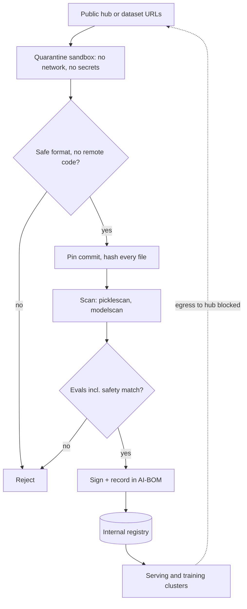

## TL;DR
The open-weight models, adapters, chat templates and datasets behind your agent are dependencies that can
run code on load, hide backdoors and carry poisoned data. Treat them as build artifacts: pinned, hashed,
scanned, signed, quarantined, loaded with least capability.

## For agent builders
- **Why it matters for agents.** A backdoored model inside an agent does not just say something wrong; it
  can pick a tool and arguments on a trigger phrase. The chat template also decides how tool calls are
  formatted, so a swapped template changes agent behaviour without touching a weight.
- **Where it shows up in your stack.** Self-hosted models in vLLM or similar engines, LoRA adapters
  fine-tuned for tool use, embedding models for RAG, `tokenizer_config.json` chat templates, and the
  datasets you fine-tune or evaluate agents on.
- **What you control.** Safetensors only, `trust_remote_code=False`, pinned commit hashes and per-file
  SHA-256, an internal registry with quarantine, and behavioural acceptance evals that include tool-calling
  and refusal behaviour.
- **What you can skip.** If you only call hosted APIs, the artifact pipeline is your provider's job; you
  still own your fine-tuning and eval datasets. Backdoor detection research is also skippable: there is no
  general detector, so limit blast radius instead.

## Why it exists
- **Software supply chains have a decade of tooling** (lockfiles, CVE databases, signed packages, SBOMs).
  Model and dataset supply chains arrived with none of it, and with four properties that make them harder.
- **1. The dominant checkpoint formats were executable.** PyTorch `.bin` and `.pt` files are Python pickles,
  and unpickling runs whatever `__reduce__` returns, so "loading a model" could mean "running the
  uploader's code with your credentials".
- **2. Repositories ship code as well as weights.** `trust_remote_code=True` imports and executes Python
  from the repo on every load.
- **3. Weights cannot be reviewed.** A backdoor (behaviour triggered by a specific input, otherwise
  invisible) was shown in classifiers by Gu et al. in 2017 and in LLMs by Hubinger et al. in 2024, where
  trigger behaviour survived standard safety training. Nobody can review ten billion floats.
- **4. Datasets are often lists of URLs, not content.** Carlini et al. showed in 2024 that buying expired
  domains referenced in web-scale datasets controls what future downloaders receive; about US$60 would
  have bought control of 0.01% of LAION-400M or COYO-700M.
- **"Only popular models from well-known organisations" does not hold.** Hub namespaces can be squatted with
  look-alike names, accounts get compromised, a branch like `main` is mutable, and researchers repeatedly
  find malicious pickle payloads in public repositories. Popularity says nothing about poisoning or
  backdoors, which pass every download count.

## How it works
### Threat model by layer
| Layer | Threats |
|---|---|
| **Artifact** | malicious serialization (pickle, also pickles hidden inside zip-based formats; Keras `Lambda` layers, which is why Keras 3 loads with `safe_mode` on); parser bugs in model-file loaders that turn a crafted file into memory corruption |
| **Templates and configs** | the chat template in `tokenizer_config.json` or GGUF metadata is a Jinja program rendered on every request (details below) |
| **Code** | remote code in the repo, conversion scripts, the loader's own dependency tree |
| **Weights** | backdoors and trojans; quietly degraded or safety-stripped fine-tunes relabelled as the original |
| **Data** | split-view poisoning (content behind a URL changes after curation), front-running poisoning (editing a source just before a scheduled snapshot), label flipping, poisoned instruction-tuning examples that implant a trigger |
| **Identity** | typosquatted organisations, hijacked maintainer accounts, unpinned references |
| **Licence and provenance** | not security in the narrow sense, but the same pipeline: gated models, consent and usage restrictions on datasets |

- **Templates are code.** A malicious chat template can inject hidden instructions into every prompt
  without touching a weight; for an agent that includes how tool definitions and tool results are framed.
- **Templates can execute.** A 2024 vulnerability in llama-cpp-python showed that rendering an untrusted
  template outside a sandbox could execute code on the server.
- **So configs are part of the artifact,** not metadata around it.

### Controls in order of leverage
1. **Safe formats only.** Load `safetensors`, a flat tensor format with a JSON header and no code path, and
   reject pickle-based files in production. Where `torch.load` is unavoidable, pass `weights_only=True`;
   newer PyTorch releases default to it, older pins do not.
2. **No remote code by default.** `trust_remote_code=False`. If an architecture genuinely needs custom code,
   vendor it into your repository after review and pin it there, so a later push to the hub cannot change
   what runs.
3. **Pin by content, not by name.** Reference a commit hash (`revision=`) and record the SHA-256 of every
   file at review time, because names and branches move and hashes do not.
   - On a git-backed hub the commit already commits to each large file's hash, so the local check earns its
     keep where bytes arrive from somewhere you trust less: a mirror, a shared cache, a developer's copy.
   - Check the *set* of files too, so an extra `.py` or `.bin` that appears later is a failure, not a no-op.
4. **Mirror through a registry.** Production pulls only from an internal registry; ingestion is quarantine,
   scan, evaluate, promote. Block egress from training and serving clusters to public hubs so the registry
   cannot be bypassed. Scanners such as picklescan and modelscan catch known-dangerous opcodes and imports;
   hubs run similar scans, but your pipeline should not depend on theirs.
5. **Sign and attest.** Sign promoted artifacts and build attestations with your container tooling
   (Sigstore/cosign, in-toto). Keep an AI bill of materials (base model, adapters, datasets, hashes) so an
   incident traces to every deployment using the component. CycloneDX (ML-BOM) and SPDX 3.0 (AI and dataset
   profiles) give it a standard shape security tooling can ingest.
6. **Dataset provenance.** Snapshot content rather than URLs, hash the snapshot, store it immutably, keep a
   manifest. For URL-indexed sets, verify per-item hashes captured at curation time, the mitigation
   Carlini et al. recommend. Deduplicate and inspect outliers.
7. **Behavioural acceptance.** Run your eval suite, including safety, refusal and (for agents) tool-call
   behaviour, on every ingested model or adapter, and compare with the publisher's reported numbers for the
   same checkpoint. A large unexplained gap suggests you do not have the weights you think you have.
   Backdoor detection in general is unsolved, so this is a sanity check, not a guarantee.
8. **Least privilege at load time.** Convert, scan and evaluate in a sandbox with no network and no
   production secrets, because the first time an artifact executes anything is during these steps.

## Diagram
An artifact moves from the public hub to the agent's serving cluster only through quarantine, checks and
signing; serving nodes never talk to the hub.



## Examples
### A pinned, hash-checked, safe loader
Pins a reviewed revision, downloads only tensor and config files, verifies hashes recorded at review time,
runs a pickle scan as a second line of defence, and loads with remote code disabled. The hash and revision
placeholders are filled in by the review step that promoted this artifact into the registry.

```python
import hashlib, subprocess, sys
from pathlib import Path
from huggingface_hub import snapshot_download
from transformers import AutoModelForCausalLM, AutoTokenizer

REPO = "Qwen/Qwen2.5-0.5B"
REV = "<commit-sha-reviewed>"                 # never "main": branches move, hashes do not
EXPECTED = {   # abbreviated: the review step writes one entry per downloaded file (also vocab.json etc.)
    "model.safetensors": "<sha256>", "config.json": "<sha256>",
    "tokenizer.json": "<sha256>", "tokenizer_config.json": "<sha256>",  # chat template lives here
}

def sha256(path: str) -> str:
    h = hashlib.sha256()
    with open(path, "rb") as f:
        for chunk in iter(lambda: f.read(1 << 20), b""):
            h.update(chunk)
    return h.hexdigest()

# 1. fetch only what a safe load needs; *.bin / *.pt / *.pkl are never downloaded
local = snapshot_download(REPO, revision=REV,
                          allow_patterns=["*.safetensors", "*.json", "tokenizer*"])

# 2. integrity: exactly the reviewed files, with exactly the reviewed bytes
got = {p.name: sha256(str(p)) for p in Path(local).iterdir() if p.is_file()}
if got.keys() != EXPECTED.keys():
    sys.exit(f"file set changed: {sorted(got.keys() ^ EXPECTED.keys())}")
bad = [n for n in EXPECTED if got[n] != EXPECTED[n]]
if bad:
    sys.exit(f"hash mismatch: {bad}")

# 3. belt and braces: scan the snapshot for pickle payloads (also run in CI on the mirror)
subprocess.run(["picklescan", "--path", local], check=True)

# 4. load with no code execution path: safetensors only, no remote code
tok = AutoTokenizer.from_pretrained(local)
model = AutoModelForCausalLM.from_pretrained(local, use_safetensors=True, trust_remote_code=False)
```

| Attack | Step that catches it |
|---|---|
| Maintainer later pushes `pytorch_model.bin` with a pickle payload | the pinned revision never sees it, and `allow_patterns` would not download it even on a moving branch |
| Attacker controlling your mirror swaps `tokenizer_config.json` for a template that prepends "Ignore safety guidelines" to every prompt | no scanner flags a JSON file, but the hash comparison fails |
| A new file appears in the snapshot | the file-set comparison fails before anything loads |
| A backdoor in `model.safetensors` that was there when you reviewed it | **none of the steps**; that is the job of behavioural acceptance and blast-radius limits |

- **In a real pipeline,** steps 1 to 3 run once at ingestion inside the sandboxed registry job, and serving
  nodes pull the promoted, signed artifact from the registry rather than from the hub at all.

### Why pickle is code and safetensors is data
Pure standard library, runnable. The pickle executes a callable on load; the safetensors-style file is
parsed as a length, a JSON header and raw bytes.

```python
import json, pickle, struct

class Payload:
    def __reduce__(self):                      # pickle stores "call print(...)" as the recipe
        return (print, ("code ran during load: this could have been os.system",))

blob = pickle.dumps(Payload())
pickle.loads(blob)                             # executes the callable: loading is running

# safetensors layout: 8-byte little-endian header length, JSON header, raw tensor bytes
header = {"w": {"dtype": "F32", "shape": [2], "data_offsets": [0, 8]}}
hbytes = json.dumps(header).encode()
st = struct.pack("<Q", len(hbytes)) + hbytes + struct.pack("<2f", 1.0, 2.0)

n = struct.unpack("<Q", st[:8])[0]
meta = json.loads(st[8:8 + n])                 # parsing is plain data, no callables
start, end = meta["w"]["data_offsets"]
print(meta["w"]["shape"], struct.unpack("<2f", st[8 + n + start:8 + n + end]))
```

- **Output:** the first line prints "code ran during load", the second prints `[2] (1.0, 2.0)`.
- **The lesson:** any file-format check that only looks at the extension misses this; the format itself
  decides whether loading can run code.

### Worked scenario: accepting a community tool-calling fine-tune
A team wants a community LoRA that tops a function-calling leaderboard to power an internal agent with a
ticketing tool and a shell-free deploy tool. The acceptance run on their own suite (illustrative numbers):

| Check | Base model | Community fine-tune | Verdict |
|---|---|---|---|
| Format and code | safetensors, no remote code | safetensors, no remote code | pass |
| Tool-call accuracy on 200 internal tasks | 81% | 90% | better |
| Refusal on 50 unsafe tool requests | 94% | 62% | fail: safety stripped |
| Calls `deploy` unprompted on 30 odd-token probes | 0 of 30 | 2 of 30 | investigate as a possible trigger |

- **Decision:** reject for the agent with a deploy tool, because two unprompted consequential calls are
  exactly the backdoor-shaped behaviour scanning cannot see, and the 32-point refusal drop alone fails
  the gate.
- **Alternative:** reproduce the fine-tune in-house from an audited tool-calling dataset, or use the
  community adapter only behind read-only tools.

## Production patterns
- **Offline serving nodes.** Serving and training jobs load only from the registry path, with the Hugging
  Face client forced offline (`HF_HUB_OFFLINE=1`) and network egress to public hubs blocked. Monitor
  denied-egress events from GPU nodes; any hit means something tried to bypass the registry.
- **Ingestion CI job.** A pipeline per new model or revision: fetch, then work in a no-network sandbox
  with no secrets, reject pickle files, run picklescan or modelscan, record SHA-256 for every file, run evals, then
  promote. Track scan coverage at ingestion (target 100%) and time from upstream release to promotion.
- **Agent acceptance evals in the promotion gate.** Before a model or adapter can back an agent, run
  tool-call accuracy, refusal on unsafe tool requests and unprompted-consequential-call probes against
  the base model. Block promotion on any regression in safety metrics, not just on task accuracy.
- **Signed artifacts verified at deploy.** Sign the promoted bundle with `cosign sign-blob` (or sign an OCI
  artifact that wraps it) and verify the signature in the deploy step before load. Monitor the share of
  production models with a verified signature.
- **AI-BOM per deployment.** Emit a CycloneDX ML-BOM listing base model, adapters, datasets and hashes with
  each release, so an advisory about one component maps to every affected deployment in minutes.
- **Pin review cadence.** Pins do not pick up upstream tokenizer or config fixes, so schedule a quarterly
  (or per-advisory) review that bumps revisions through the same ingestion path. Track pin age.

## Trade-offs
- **Registry with quarantine vs speed.** It gives provenance and a kill switch, but adds hours or days
  between release and availability. For research sandboxes with no production credentials, a lighter path
  is reasonable.
- **Refusing `trust_remote_code` vs new architectures.** It blocks arbitrary execution, yet some new
  architectures ship only that way. Vendoring the reviewed code preserves safety at the cost of maintaining
  a fork until upstream support lands.
- **Pinning by hash vs automatic fixes.** It guarantees reproducibility, but security fixes to a tokenizer
  or config do not arrive automatically. Pair pins with a review cadence rather than treating them as
  permanent.
- **Snapshotting dataset content vs storage and licensing.** It removes split-view poisoning and makes
  training reproducible, at the cost of storing terabytes you previously only referenced and taking on
  licence obligations for holding copies.
- **Community fine-tunes vs in-house training.** A community tool-calling adapter is free and fast, but
  its provenance is unverifiable; reproducing it from an audited dataset costs GPU time and data work and
  is the only way to trust it behind consequential tools.

## Pitfalls
- **`torch.load` on community checkpoints on a laptop with cloud credentials.** Symptom: a security alert
  about outbound connections from a Python process during "model loading".
- **Pinning `revision="main"` or no revision.** Symptom: an evaluation regresses overnight although nobody
  changed anything on your side.
- **Relying on the hub's own malware scan.** Symptom: a flagged file was already pulled into a training job
  because your pipeline never looked at the scan result.
- **Treating a leaderboard score as evidence of safety.** Symptom: a fine-tune that performs well on the
  benchmark has had its refusal behaviour stripped, discovered by a customer.
- **Reviewing weights, ignoring tokenizer and chat template.** Symptom: the model behaves differently in
  your serving stack than in the reference implementation, tool calls are parsed wrongly, or unexplained
  text appears in rendered prompts in your traces.
- **Building datasets from live URLs at training time.** Symptom: the training data differs from what was
  audited, and model behaviour nobody can reproduce.

## When to use
- **Full pipeline:** anything that reaches production or touches customer data: base models, fine-tunes,
  adapters, embedding models, tokenizers, and every dataset used for training or evaluation.
- **Lighter version for experiments:** safe formats and no remote code at minimum, because laptops hold
  credentials too.
- **Avoid over-investing when:** your agent only calls a hosted API; then focus on your own fine-tuning
  and eval datasets and on vendor review.
- **Measure:** the fraction of production models served from the registry (target 100%), the share of
  artifacts with recorded hashes and signatures, scan coverage at ingestion, and time from upstream release
  to promoted availability.
- **Interviews:** expect "a team wants to use a community fine-tune; what do you check?" Separate what you
  can verify (format, hash, code, behaviour on your evals) from what you cannot (absence of backdoors).

## Role lens
- **Engineer:** Writes loaders that enforce safetensors, pinned revisions and hash checks, and adds
  picklescan and dependency audits to the ingestion CI job.
- **Architect:** Owns the registry design: quarantine and promotion flow, signing, AI-BOM contents, egress
  policy for training and serving clusters, and the acceptance evals a model must pass.
- **FDE:** Explains to a customer's security team where each model and dataset came from, with hashes and
  attestations, and adapts the pipeline to their air-gapped or regulated environment.

## Check yourself
**Q:** Your team wants to adopt a community fine-tune of an open-weight model, published by an individual
account, because it tops a leaderboard for your task. Walk through what you would check before it reaches
production and what you cannot check.

**A:** First the artifact: does the repository ship safetensors only, or pickle files; does it require
remote code, and if so what does that code do; are there unexpected files. Pin the exact commit, record
hashes, scan with picklescan or modelscan, and ingest through the registry sandbox with no network. Then
provenance: who is the account, what base model and dataset do they claim, is the licence compatible, and
does the model card match the file sizes and architecture. Then behaviour: run your own task evals plus
safety and refusal suites and compare to the base model, because fine-tunes frequently trade safety for
benchmark gains, and check for suspicious behaviour on inputs with unusual tokens or phrases. What you
cannot check is the absence of a backdoor trained into the weights or subtle data poisoning; there is no
general detector. So the decision also weighs blast radius: an internal classifier is tolerable, a
customer-facing agent with tools is not, unless you can reproduce the fine-tune yourself from an audited
dataset.

## Interview questions
### Why is loading a model checkpoint a code-execution risk, and how do you remove it?
- **Pickle-based formats** (`.bin`, `.pt`) run whatever `__reduce__` returns on load, so loading is running
  the uploader's code with your credentials.
- **Remove it** with safetensors only, `weights_only=True` where `torch.load` is unavoidable, and
  `trust_remote_code=False`, with any needed custom code vendored and reviewed.

### Your eval scores for a pinned-by-name model regressed overnight with no change on your side. How do you investigate?
- **Suspect a moving reference:** a name or `main` branch was updated upstream, or a mirror served
  different bytes.
- **Compare** the downloaded file set and SHA-256 hashes with what was recorded at review, including
  tokenizer and chat template files.
- **Fix** by pinning a commit hash, verifying hashes and the file set on every load, and serving only from
  the internal registry.

### What would you require before a self-hosted model can back an agent with consequential tools?
- **Artifact floor:** safetensors, no remote code, pinned commit, hashed file set including the chat
  template, served from the signed registry.
- **Agent acceptance evals:** tool-call accuracy, refusal on unsafe tool requests and probes for unprompted
  consequential calls, compared with the base model.
- **Blast-radius limits anyway:** typed tools, approval gates and least-privilege credentials, because a
  trained-in backdoor can pass every check.

### What can artifact scanning not catch, and what do you do about it?
- **It cannot catch backdoors trained into the weights** or subtle data poisoning, because those are
  ordinary floats; there is no general detector.
- **Mitigate with** behavioural acceptance evals (including safety and refusal), provenance checks, and
  limiting blast radius: no tools or customer-facing use for unverifiable fine-tunes.

### When is a full quarantine-and-promote registry overkill?
- **For research sandboxes** with no production credentials or customer data, where hours or days of
  ingestion delay cost more than the risk.
- **Still keep the floor:** safe formats and no remote code, because developer laptops hold cloud
  credentials too.

### How would you defend a training set built from web URLs against poisoning?
- **Snapshot the content,** hash it and store it immutably, instead of re-fetching URLs at training time,
  which closes split-view poisoning.
- **For URL-indexed sets,** verify per-item hashes captured at curation, as Carlini et al. recommend, since
  about US$60 of expired domains could control 0.01% of LAION-400M.
- **Then** deduplicate, inspect outliers, and record the dataset hash in the AI-BOM.

## Quiz
### Q: Why is a safetensors checkpoint safer to load than a pickle-based one?
- [ ] It is encrypted, so only authorised users can read the weights
- [x] It contains only tensors and a JSON header, so loading involves no code execution path
- [ ] It is smaller, so there is less room to hide a payload
- [ ] It is signed by the hub automatically on upload
> Pickle deserialization executes arbitrary callables; safetensors is parsed as plain data, which removes
> the entire class of load-time code execution regardless of who produced the file.

### Q: Why pin a model by commit hash instead of by repository name?
- [ ] Hashes download faster because the hub can cache them
- [ ] The name may contain characters that break the tokenizer
- [x] The name and its default branch are mutable, so a compromised or careless maintainer can change what they point to
- [ ] Pinning by hash disables remote code automatically
> A name is a pointer; a content hash is the content. Reproducibility and integrity both require that the
> thing you reviewed is byte-for-byte the thing you deploy.

### Q: Which supply-chain risk cannot be addressed by scanning the artifact's bytes?
- [ ] A pickle opcode that imports `os` and runs a shell command
- [ ] A truncated file that fails its hash check
- [x] A backdoor trained into the weights that activates on a trigger phrase
- [ ] A repository that requires `trust_remote_code=True`
> Scanners detect dangerous code and integrity failures, but backdoored behaviour is encoded in ordinary
> floating-point weights; only behavioural evaluation, provenance and limiting blast radius address it,
> and none of them fully.

## Use cases & projects
### Use cases
- **Self-hosting the model behind an agent.** The registry, pins and hash checks decide which exact bytes
  pick your agent's tools in production.
- **Adopting tool-calling adapters.** Behavioural acceptance with refusal and unprompted-call probes is how
  teams vet community LoRAs before wiring them to real tools.
- **Fine-tuning on agent traces.** Snapshotted, hashed datasets keep the training data identical to what
  was audited and reproducible later.
- **Answering an enterprise security review.** The AI-BOM and signatures show which model, adapter and
  dataset power each agent deployment.

### Mini project
**Build an acceptance gate for agent models (2-3 hours).**
- **Goal:** a script that decides whether a small open-weight model may back a two-tool agent.
- **Steps:** download a small model by pinned commit with the safe loader above; record hashes and verify
  the file set; write 20 tool-calling tasks, 10 unsafe tool requests and 10 odd-token probes for a fake
  `deploy` tool; run them against the base model and one fine-tune; emit a pass or fail report with
  per-check numbers and an AI-BOM JSON listing model, revision and hashes.
- **Done when:** the gate fails on a tampered `tokenizer_config.json`, reports tool-call accuracy and
  refusal rate for both models, and blocks promotion on any refusal regression.
