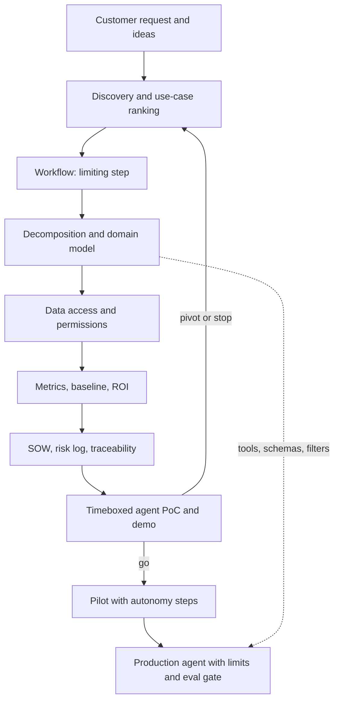

## Overview
This module covers the work between "the customer wants AI" and "the team is building the right agent,
against agreed numbers, with a path to production". Most failed agent projects did not fail on the model.
They built a tool-calling loop for the wrong job, at the wrong step, with no baseline and no agreed bar.

The first group is about understanding. Customer discovery turns a requested solution into the underlying
job, its current cost, the cost of an error and the person who decides. AI use-case discovery ranks
candidate ideas on value, fit for a probabilistic model, data feasibility and error tolerance. Workflow
analysis finds the step that actually limits the outcome.

Problem decomposition splits the goal into nodes with inputs, outputs, techniques and tests. Domain
modeling pins down what the customer's words mean, and data access and permissions discovery starts the
slowest approvals early.

The second group makes value measurable: a metric tree with guardrails, a baseline captured before
anything changes, and an ROI model built as ranges with a break-even point. The third group turns this
into a commitment: a dependency and risk log, a statement of work with statistical acceptance and dated
customer obligations, and requirements traced to eval cases.

The last group moves from evidence to production through timeboxed prototypes and PoCs, demos that drive
decisions, a staged pilot plan with entry and exit criteria, and risk-ordered hardening.

What this module gives an agent builder:
- **The agent's shape.** Decomposition decides which steps become deterministic tools, which stay model calls and where validators go, because errors in chained probabilistic steps multiply.
- **Typed tools and safe access.** The domain model becomes tool schemas, structured outputs, enums and retrieval filters; permissions discovery decides which tools act as the user and which as a service.
- **A bar before you build.** A metric tree, a pre-agent baseline and an ROI range say what the agent must move and what a successful task is worth after its run cost.
- **A contract that fits a probabilistic actor.** A SOW with statistical acceptance on a frozen eval set, named tools and actions, and dated dependencies such as credentials and sandbox access.
- **A path out of the PoC.** Timeboxed PoCs, decision-driving demos, autonomy steps in the pilot plan and production hardening for loops, retries and prompt injection.

Core versus background for agents:
- **Core (you use them directly when building agents):** problem-decomposition, domain-modeling, data-access-and-permissions-discovery, rapid-prototyping-poc, productionization.
- **Useful (you meet them scoping, piloting or operating agents):** customer-discovery, ai-use-case-discovery, workflow-analysis, success-metrics-kpis, baseline-measurement-before-deployment, roi-model, dependency-and-risk-management, statement-of-work, requirements-traceability, timeboxing, demos, pilot-to-production-plan.

What you can build afterwards:
- An agent spec from a vague request: the job, a ranked use case, a node table with contracts, a glossary and typed tool schemas.
- A data source register and a permission design for the agent's tools, index and memory.
- A phased SOW, a timeboxed agent PoC that ends in a decision, and a pilot plan whose go/no-go is a reading of agreed numbers.

Use cases where agent teams reach for this module:
- **"Build us a chatbot":** reframing a solution-shaped request into a job, and deciding whether it needs an agent, a workflow or no model.
- **The PoC that never ends:** an agent stuck at "almost there" for months needs a timebox, a question and an exit rule.
- **The pilot that stalls:** a working pilot with no baseline, no autonomy steps and no production-gap list.

It matters most for FDEs, who run this with customers, and for Architects, who own the decomposition, data
access and production plan.

## Why it matters
- **Engineer:** Decomposition gives you agent nodes with contracts and tests instead of one untestable prompt; the domain model types your tool schemas; and the frozen eval set, traced requirements and timebox tell you what "done" means before you start tuning prompts, tools or the planner.
- **Architect:** You decide which agent nodes need a model and which are plain code or tools, how the domain model projects into schemas, prompts and retrieval filters, how source permissions carry into tool calls, indexes and memory, and what hardening (step and cost limits, idempotent tools, eval gates) production needs.
- **FDE:** You turn "build us a chatbot" into a signed agent scope: the real job, a ranked use case, a baseline, an ROI range, the tools and write actions in and out of scope, dated customer dependencies, and acceptance criteria that survive a probabilistic model and a steering meeting.

## Mental model
Picture scoping as a funnel of decisions, each one narrowing what you build and each backed by evidence.

- **Wide top.** A customer request and a pile of ideas. Discovery, use-case ranking and workflow analysis narrow these to one job and the step that limits its outcome.
- **Shape.** Decomposition and the domain model give that job a shape: nodes with contracts, words with fixed meanings, data with known owners and permissions. For an agent, these become its tools, schemas and filters.
- **Measuring stick, fixed before building.** A metric tree, a baseline and an ROI range together say what success is worth and which number the pilot must move.
- **Commitment.** The SOW, risk log and traceability matrix turn that measuring stick into a commitment both sides can check.
- **Execution.** Every stage (timeboxed PoC, demo, pilot, production) ends in an explicit go, pivot or stop decision taken against the same numbers.

If a stage cannot name its question, its evidence and its decision rule, it is not scoped yet.

| Scoping artifact | Where it lands in the agent |
| --- | --- |
| Discovery and use-case ranking | Task statement, autonomy level, first eval samples |
| Decomposition | Tool list, model calls, validators, per-node evals |
| Domain model | Tool schemas, structured outputs, prompt glossary |
| Permissions register | Tool identities, ACL filters, approval gates |
| Metrics, baseline, ROI | Eval harness, trace logging, step and cost budgets |
| SOW and traceability | Frozen eval set, `reqs` tags, CI gate |
| Pilot and productionization | Shadow mode, feature flags, rollback, limits |

The left spine is the scoping funnel; the dotted edge shows that decomposition and the domain model become
the running agent's tools, schemas and filters, and the loop back from the PoC is the pivot-or-stop
decision.

## Suggested order
1. customer-discovery — every later step depends on knowing the real job, who feels it, what it costs and who decides, and whether it needs an agent at all.
2. ai-use-case-discovery — narrows many ideas to a ranked shortlist on value, model fit, data feasibility and error cost, and picks agent, workflow, prompt or no model.
3. workflow-analysis — maps the current process so the agent lands on the step that actually limits the outcome.
4. problem-decomposition — agent-core: splits the chosen job into nodes with inputs, outputs, techniques and tests, separating model work from plain code and tools.
5. domain-modeling — agent-core: fixes the entities, states and vocabulary that the decomposed nodes, tool schemas and eval labels will share.
6. data-access-and-permissions-discovery — agent-core: identifies sources, owners and permission rules for those entities early, because approvals have the longest lead time.
7. rapid-prototyping-poc — agent-core: tests the riskiest assumption on real data inside a timebox and ends in a decision; read it now for the agent build, and apply it after timeboxing on a real project.
8. productionization — agent-core: closes the gap between a working pilot and a system that survives real traffic, outages, model changes, prompt injection and audits.
9. success-metrics-kpis — defines the outcome, driver, quality and guardrail metrics before architecture choices lock in.
10. baseline-measurement-before-deployment — measures those metrics under the current process, because the before number cannot be recovered later.
11. roi-model — turns metrics and baseline into a money range with sensitivity and break-even, which can kill or prioritise the use case.
12. dependency-and-risk-management — lists dated customer dependencies and sized risks, which the SOW must contain.
13. statement-of-work — commits scope, statistical acceptance, dated obligations and change control, built from everything above.
14. timeboxing — sets the question, budget and decision rule that keep uncertain work like a PoC from expanding without limit.
15. demos — presents PoC and pilot evidence to a named audience so it produces a decision rather than applause.
16. requirements-traceability — links SOW requirements to components, prompts, tools and eval cases once the pilot build begins.
17. pilot-to-production-plan — stages the rollout with cohorts, autonomy steps, entry and exit criteria, owners and rollback, measured against the baseline.

## Capstone
### Brief
**Use case:** a mid-sized insurer's claims team has asked for "a chatbot to answer adjusters' policy
questions". You are the forward-deployed engineer. This is the module's major project (about a week): scope
the engagement end to end and build a working agent PoC for its riskiest node.

Work from a short written case: a one-page sponsor brief, three interview transcripts you write or
role-play, and a synthetic dataset of a few hundred claims with timestamps and policy documents.

What you will do:
- Run discovery and reframe the request into the underlying job, rank at least five candidate use cases on the four axes, and map the current claims workflow to find the step that limits cycle time.
- Decompose the chosen use case into nodes, marking each as a tool, a model call or a validator; write a glossary and one state machine for a claim, and turn them into typed tool schemas.
- Build a data source register with owners, access methods and permission models, and decide which tools act as the user and which as a service.
- Define a metric tree with guardrails, compute a baseline from the synthetic logs, and build an ROI model with ranges, sensitivity and break-even, using cost per successful task.
- Write a phased SOW with statistical acceptance and the tools and write actions in and out of scope.
- Run a two-day timeboxed PoC: a small agent loop with real tools for the node under test and stubbed tools for the rest, scored by an eval harness on task success, latency and cost per task. Record a short demo that ends in a stated decision.
- Finish with a pilot-to-production plan and a prioritised hardening list.

### Deliverables
- A discovery brief (one page) stating the job, current cost, cost of an error, success evidence and decision-maker, plus a ranked use-case table scored on value, model fit, data feasibility and error tolerance.
- A workflow swimlane with wait times and variant frequencies, a decomposition diagram where every node has an input, output, technique, owner and test, a domain glossary with a claim state machine, typed tool schemas derived from it, and a data source register with owner, access method, classification and permission model per source.
- A metric tree (outcome KPI, drivers, quality metrics, guardrails), a baseline report with means, variance, per-segment results and a human-quality audit, and an ROI spreadsheet with ranges, a sensitivity ranking and a break-even value.
- A RAID log with dated dependencies and risks sized in days, and a phased SOW with scope, out-of-scope items, statistical acceptance against a frozen eval set, dated customer obligations and change control.
- A working agent PoC repo (loop, tools, eval harness, frozen task set with dev and held-out splits) and a PoC report from the two-day timebox with the question, pass/fail bar, results on real-shaped data and the decision.
- A recorded demo of ten minutes or less, a traceability matrix from requirements to eval cases, and a pilot-to-production plan with stages, cohorts, autonomy steps, entry and exit criteria, rollback and a risk-ordered hardening list.

### Rubric
- The discovery brief names a job different from "chatbot" and supports it with quotes from the interviews, and the use-case ranking shows at least one high-value idea rejected for error cost or data feasibility, with the reason stated.
- The chosen AI step is the one the workflow map shows limits cycle time, and the decomposition multiplies per-node error rates to name the node that dominates end-to-end error.
- Every agent tool's schema uses the glossary's entities and enums, and every write tool checks the claim state machine and runs under an identity the permissions register allows.
- Every SOW acceptance criterion is a threshold on a named metric, on a frozen eval set with a stated size and slices, and every customer dependency has an owner and a need-by date that also appears in the RAID log.
- The ROI model's break-even value and its top-ranked sensitivity assumption are the numbers the pilot plan says it will measure, and the baseline uses the same metric definitions as the pilot.
- The PoC report ends with an explicit ship, continue, pivot or stop decision tied to its pass/fail bar on the held-out split, and the demo shows at least one failure case alongside eval numbers.
- Each pilot exit criterion maps to a metric in the tree, and every requirement in the traceability matrix links to at least one eval case and to the component, tool or prompt that implements it.
