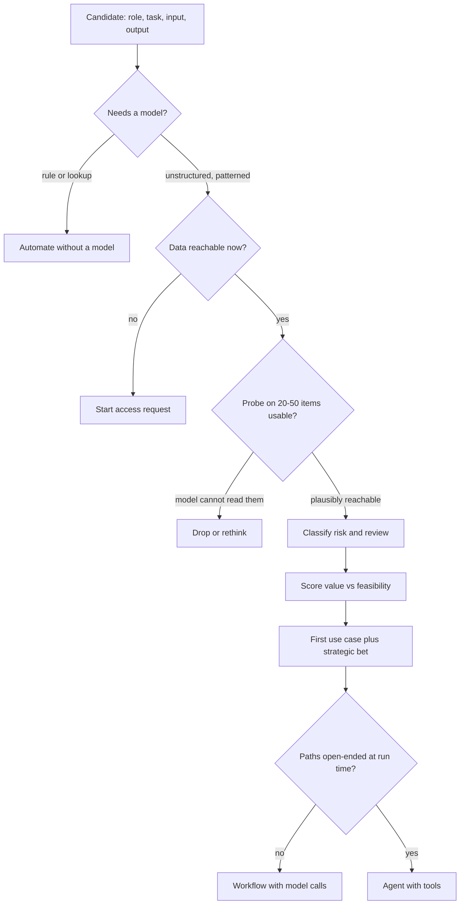

## TL;DR
AI use-case discovery ranks "we could build an agent for…" ideas into a shortlist that is valuable,
model-suited, feasible now and safe to get wrong sometimes. It decides which ideas deserve an agent, which
a prompt or workflow, and which no model.

## For agent builders
- **Why it matters for agents.** Most "agent use cases" are scheduled scripts, rule checks or single
  prompts in disguise. Screening first stops you building a tool-calling loop for a problem twenty lines of
  code solve, and points your first agent at a reviewed, measurable task.
- **Where it shows up in your stack.** The choice between a single call, a fixed workflow and an agent
  loop; whether an agent drafts for a human or acts on its own; and the probe harness that runs a plain
  prompt over 20 to 50 real items before any agent code exists.
- **What you control.** The four gates (AI fit, value, feasibility, risk), the assist-vs-automate
  break-even maths, and choosing the technique last.
- **What you can skip.** Elaborate weighted scoring matrices; an order-of-magnitude value estimate and the
  break-even formulas are enough to pick a first agent.

## Why it exists
- **Ideas outrun evaluation.** Once an organisation decides to "do AI", every team has a list, vendors
  pitch their own agents, and the loudest executive's idea tends to win by default.
- **Without a discipline, three failure patterns repeat:**
  - *AI for a deterministic problem.* A task that is really "apply these five rules" or "join these two
    tables" gets an LLM or an agent, which is slower, costlier and less reliable than twenty lines of code
    or a report.
  - *High value, impossible first step.* The most valuable idea (say, autonomous underwriting decisions)
    has the highest error cost, the strictest regulation and the least labelled data, so it spends a year
    in review and never ships.
  - *Feasible but worthless.* A team builds a neat summariser for a document nobody reads.
- **Ranking by value or enthusiasm fails because value is one of four independent axes.** A good *first*
  candidate is valuable, genuinely needs pattern-matching over unstructured input, has data and an
  integration point reachable now, and has occasional errors bounded by review or reversibility.
- **Discovery checks all four before committing engineers**, because most ideas turn out to be plain
  automation, too risky or data-starved, and a bad first pick sinks the programme's credibility.

## How it works
### 1. Build the candidate inventory from work, not wishes
- **Collect from real work:** walk workflows, read ticket queues, ask teams where time goes (see customer
  discovery and workflow analysis).
- **Write one line per candidate:** *"[role] spends [time] doing [task] on [input] to produce [output]"*.
- **The format forces an input and an output**, because a use case without both cannot be built or
  evaluated, and an agent without a defined output has no stopping condition.

### 2. Gate on AI fit
| Signs it needs a model | Signs it does not |
|---|---|
| Inputs are unstructured (free text, documents, images, speech) | The logic is a stable set of rules |
| The input-to-output mapping is patterned but too varied for hand-written rules | The answer is a database lookup |
| There is tolerance for imperfect output | Every output must be exactly correct with no review |

- **Test for verification asymmetry.** Tasks where checking an answer is much cheaper than producing it
  (drafting a reply a human approves, extracting fields a human confirms) are strong fits.
- **Review is what makes them strong**, because the human check turns a probabilistic component into a
  reliable system at low cost.
- **A second gate for agents:** does the task need the model to choose among tools and paths at run time?
  If the steps are the same every time, a fixed workflow with model calls is cheaper and easier to test.

### 3. Estimate value
- **Formula:** volume × time per item × loaded cost, plus error and delay costs, and any revenue effect.
- **Keep it order-of-magnitude here;** the ROI model refines the winners later.
- **Note whether value needs full automation or only assistance**, because assisted value (say, half the
  time saved) is reachable far sooner than a fully autonomous agent.

### 3a. Ask what accuracy the value requires
Value depends on accuracy, and differently for reviewed and unreviewed use cases. That difference is
what verification asymmetry means in numbers, and it is the assist-agent vs autonomous-agent decision.

**Reviewed (assist).**
- *w* = minutes to do the item by hand; *e* = minutes to check and edit a good draft; *r* = minutes wasted
  reading a bad draft before doing it by hand anyway; *p* = draft quality.
- Expected time is `p·e + (1−p)·(r + w)`, so the assistant breaks even at `p* = r / (w − e + r)`.
- With w = 12, e = 3, r = 1 (illustrative), p* ≈ 10%.
- At p = 70%, expected time is 0.7·3 + 0.3·13 = 6 minutes, half the manual time. Mediocre accuracy still
  pays.

**Unreviewed (automate).**
- Each error lands as its full cost *C*, so the break-even error rate is `value saved per item ÷ C`.
- Saving about $8 of handling time per item against a $200 average cost per wrong decision allows at most
  a 4% error rate. So 96% accuracy only breaks even, before any regulatory or reputational cost.

**The consequence.**
- The same model can be a clear win as an assistant and a loss as an autonomous agent.
- Both calculations assume reviewers really check. As drafts improve, reviewers start approving without
  reading (automation bias), so measure how many errors the review step actually catches.

### 4. Assess feasibility
- **Data:** can you get representative data this month?
- **Integration point:** is there somewhere output can land (an API, a queue, a UI people already use)? For
  an agent, which tools would it call, and does each backing system have an API?
- **Ground truth:** are there examples of correct outputs to evaluate against?
- **Economics:** is latency or cost per item compatible with the volume? An agent loop of many model calls
  per item multiplies both.
- **Blocked means not first.** A candidate blocked on a six-month data-access approval is not a first use
  case regardless of value.
- **Run a one- or two-day probe per shortlisted candidate:** a plain prompt against 20 to 50 real items,
  scored by someone who does the work. It will not give final accuracy, but it separates "plausibly
  reachable" from "the model cannot read these documents at all" before anyone writes a business case.

### 5. Classify risk
- **Consider:** consequence of error, who is affected (internal staff vs customers vs the public),
  reversibility, regulatory exposure and data sensitivity.
- **Agents that write add action risk:** an irreversible tool call (refund, email to a customer) is riskier
  than a wrong draft.
- **Map onto the organisation's AI risk classification.** High-risk use cases need governance work that
  should run in parallel, not be discovered at launch.

### 6. Rank and pick a portfolio
- **Plot survivors on value vs feasibility,** with risk as a gate or a penalty.
- **Pick a first use case that is** frequent, measurable against a known baseline, human-reviewed, and
  reachable with current data. It buys trust and builds reusable plumbing (connectors, tools, evaluation
  harness, access patterns).
- **Keep one larger strategic bet in discovery alongside it,** so the programme is not only quick wins.

### 7. Choose the technique last
- **Only after a candidate survives** do you decide prompt, RAG, fine-tuning, a workflow or an agent.
- **Technique-first ("we want an agent")** is how deterministic problems end up with LLMs in them.

## Diagram
Each candidate passes three gates (AI fit, data, a quick probe) before it is scored; failures are routed
to a non-model fix, a parallel access request or a rethink, and the technique (workflow or agent) is chosen
last.



## Examples
### Screening pass in code
A minimal screening pass. Gates remove candidates that do not need a model or cannot start now; the rest
are scored, with high-risk ones penalised rather than banned so they stay visible as strategic bets. All
figures are illustrative inputs a team would estimate in workshops.

```python
from dataclasses import dataclass

@dataclass
class Candidate:
    name: str
    hours_per_year: float      # volume x time per item, from workflow interviews
    unstructured_input: bool   # free text, documents, images, speech
    rule_solvable: bool        # a stable rule set or lookup already answers it
    data_reachable: bool       # representative samples obtainable this month
    human_review: bool         # a person checks output before it takes effect
    error_cost: int            # 1 = trivial, 3 = moderate, 5 = regulatory or customer harm

def screen(c: Candidate):
    if c.rule_solvable or not c.unstructured_input:
        return None, "automate without a model"
    if not c.data_reachable:
        return None, "blocked: start the access request now"
    risk = c.error_cost - (2 if c.human_review else 0)   # review absorbs some error cost
    return c.hours_per_year / max(risk, 1), "candidate"

ideas = [
    Candidate("Draft replies to supplier emails", 3000, True, False, True, True, 2),
    Candidate("Flag invoices over approval limit", 1500, False, True, True, False, 3),
    Candidate("Auto-decide loan applications", 9000, True, False, True, False, 5),
    Candidate("Extract fields from scanned contracts", 2500, True, False, False, True, 3),
]
for c in ideas:
    score, verdict = screen(c)
    print(f"{c.name:40} {verdict:40} {'' if score is None else round(score)}")
```

| Candidate | Outcome | Why |
|---|---|---|
| Supplier-email drafts | Score 3,000 | Risk 0 floors at 1 |
| Loan decisions | Score 1,800 | Three times the hours, but unreviewed and high-consequence |
| Invoice limits | Automate without a model | It is a rule |
| Contract extraction | Blocked on data | Tells you what access request to start in parallel |

### Break-even accuracy: assist vs automate
The two formulas from step 3a, so a workshop can test a candidate's numbers live. Inputs are the
illustrative figures above.

```python
def assist_break_even(w, e, r):
    """Draft quality p* at which reviewing a draft costs the same as doing it by hand."""
    return r / (w - e + r)

def assist_expected_minutes(p, w, e, r):
    return p * e + (1 - p) * (r + w)

def automate_max_error_rate(value_saved_per_item, cost_per_error):
    return value_saved_per_item / cost_per_error

print(round(assist_break_even(w=12, e=3, r=1), 2))                   # 0.1
print(round(assist_expected_minutes(p=0.7, w=12, e=3, r=1), 1))      # 6.0 minutes vs 12 by hand
print(automate_max_error_rate(value_saved_per_item=8, cost_per_error=200))  # 0.04
```

- **Reading it:** an assistant pays from about 10% good drafts, while the automaton needs fewer than 4%
  errors just to break even.
- **Before trusting the assist number,** measure reviewer catch rate, because automation bias pushes the
  real error rate toward the model's raw rate.

### Worked scenario: "find us agent use cases" in a support org
All figures illustrative. A support VP lists five agent ideas; screening routes each to the cheapest
technique that works.

| Idea | Gate result | Technique chosen | Why |
|---|---|---|---|
| Agent that tags tickets by product | Fixed labels, labelled history | Classifier or single prompt | Same one step every time; no tools needed |
| Agent that closes tickets older than 30 days | Rule | Scheduled script | Deterministic; no model |
| Agent that drafts replies from the knowledge base | Unstructured, reviewed | RAG workflow, human approves | Fixed steps: retrieve, draft, review |
| Agent that investigates billing disputes across CRM, billing and logs | Unstructured, paths vary per case | Agent with read-only tools, drafts a finding | Which system to query next depends on what it found |
| Agent that issues refunds on its own | Unreviewed, money moves | Strategic bet, decision support first | `value saved per item ÷ C` gives too little error budget |

- **One of five ideas is a genuine agent**, and it starts read-only with a human acting on its finding.

## Production patterns
- **Two-day probe harness** — for every shortlisted candidate, keep one script that runs a plain prompt
  over 20 to 50 real items and writes outputs to a sheet the person who does the work scores. Reuse it
  across candidates so probes are comparable. Only build agent scaffolding once the plain prompt shows the
  model can read the inputs. Monitor the share scored usable and the failure types.
- **Seeded-error review audits** — once an assist agent is live, periodically insert drafts with known
  errors into the review queue and record how many reviewers catch. A falling catch rate signals
  automation bias. Monitor catch rate per reviewer and edit distance between draft and final.
- **Risk review in parallel** — file the use case with the organisation's AI risk classification process
  the day it is shortlisted, not at launch, listing every write tool the agent would get. Track days in
  review per candidate, so a high-risk strategic bet does not surprise the sponsor.
- **Living candidate backlog** — keep the one-line inventory with input, output, value estimate, baseline,
  risk class and chosen technique in a shared tracker, and re-score after each deployment. Monitor which
  assumptions (data quality, adoption) the last deployment disproved.
- **Shared plumbing first** — sequence use cases so the first one builds connectors, reusable tools, the
  evaluation harness and access patterns the next agents reuse. Track how much of each new use case's
  build time goes to reused versus new integration work.

## Trade-offs
- **Trust vs headline value.** Starting with a low-risk, reviewed use case builds trust and reusable
  plumbing quickly, but its value may be modest. When the sponsor needs a headline result to keep funding,
  pair it with a strategic bet.
- **Transparency vs false precision.** A formal scoring matrix makes prioritisation transparent and harder
  to hijack, but its weights are judgement dressed as numbers. When two candidates score close, decide on
  qualitative factors instead.
- **Model vs codified rules.** Gating out rule-solvable tasks keeps LLMs where they add value, but some
  messy rule sets are cheaper to approximate with a model than to codify. That flips when rules change
  often or are undocumented.
- **Agent flexibility vs workflow predictability.** An agent handles cases a fixed pipeline did not
  foresee, but costs more calls per item and is harder to evaluate. Choose the workflow unless the paths
  genuinely vary per case.
- **Speed vs governance learning.** Penalising high-risk use cases speeds the first delivery, but defers
  the governance learning the organisation will eventually need. Run the risk review early when the
  strategic case depends on it.

## Pitfalls
- **Choosing the technique before the problem ("find us agent use cases").** Symptom: a shortlist where
  every item is an agent and several are just scheduled scripts with an LLM bolted on. Fix: write each
  candidate as a role, task, input and output line and pick the technique last.
- **Ranking by value alone.** Symptom: a first project stuck in legal, security or data-access review for
  months while stakeholders lose patience. Fix: score feasibility and risk alongside value.
- **Ignoring where output lands.** Symptom: an agent that works in a notebook but has no system, screen or
  queue to deliver into, so nobody uses its results. Fix: name the integration point during screening.
- **Not checking for a measurable baseline.** Symptom: a finished pilot where nobody can say whether it
  improved anything, because the current time or error rate was never recorded. Fix: record the baseline
  before building.
- **Assuming human review makes any accuracy acceptable.** Symptom: reviewers approve agent drafts unread
  once they are usually right, so errors reach customers at the model's raw error rate. Fix: measure the
  review step's catch rate.
- **Treating the candidate list as fixed.** Symptom: a stale backlog that ignores what the first deployment
  taught about data quality and user adoption. Fix: re-score the backlog after each deployment.

## When to use
- **Use when** a customer or organisation has more AI and agent ideas than capacity, at the start of an AI
  programme, and when choosing the next use case after a first deployment.
- **Run it as a short workshop series:** collect candidates from real workflows, screen them with the
  people who own the work, and leave with two or three shortlisted candidates, each with an input, output,
  value estimate, baseline, risk class and a proposed technique.
- **Avoid when** the problem is already fixed by contract; go straight to decomposition.
- **Interviews:** expect "the customer has twenty AI ideas, which do you start with?" and answer with the
  four axes, not with the most exciting idea.

## Role lens
- **Engineer:** Sanity-checks feasibility of shortlisted candidates by pulling sample data, trying a quick
  prompt and estimating per-item latency and cost before anyone commits.
- **Architect:** Owns the portfolio view: which use cases share connectors, evaluation tooling and data
  access, and therefore which sequence builds a reusable platform.
- **FDE:** Facilitates the use-case workshop with the customer's teams, keeps executive pet projects
  honest against the screening criteria, and starts access requests for blocked candidates.

## Check yourself
**Q:** A bank's innovation team brings you two candidates: AI that writes first drafts of responses to
customer complaints for agents to edit, and AI that decides whether to refund disputed card transactions.
The second is worth more. Which do you recommend first, and why?
**A:** The complaint drafts. Both involve unstructured text, but the drafts have strong verification
asymmetry: an agent reads and edits each one, so occasional errors are caught cheaply and the value
(time saved per complaint) is measurable against current handling time. Refund decisions act directly on
customer money, are likely to be regulated and auditable, need explanation for each decision, and
probably lack clean labelled outcomes. They belong in the portfolio as a strategic bet with a parallel
risk review, perhaps starting as decision support for a human. Starting there would likely stall in
governance and risk the programme's credibility.

## Interview questions
### What is verification asymmetry and why does it matter for picking use cases?
- **Definition:** checking an output is much cheaper than producing it, as with a drafted reply a human
  approves or extracted fields a human confirms.
- **Why it matters:** human review then turns a probabilistic component into a reliable system at low
  cost, so even mediocre accuracy saves time.
- **Caveat:** it only holds while reviewers really check; measure catch rate against automation bias.

### A customer asks you to "find agent use cases" across their company. How do you respond?
- **Reframe to problems first.** Build the inventory from real workflows as "role, time, task, input,
  output" lines, without naming a technique.
- **Gate on AI fit and data reachability**, so rule-solvable tasks and blocked candidates are routed to
  scripts or access requests.
- **Choose the technique last**; some survivors will be a prompt or a workflow, not an agent.

### How do you decide between a fixed workflow and an agent for a surviving use case?
- **Ask whether the steps vary per case.** If every item goes retrieve, draft, review, a workflow with
  model calls is cheaper, faster and easier to test.
- **Use an agent when the next step depends on what was found**, such as a billing investigation that
  chooses between CRM, billing and logs per case.
- **Even then, start read-only and reviewed**, because each extra model call multiplies cost and each write
  tool adds action risk.

### When would you use a model for a task that rules could in principle solve?
- **When the rules are messy, change often or are undocumented**, approximating them with a model can be
  cheaper than codifying and maintaining them.
- **Not when the logic is a stable threshold or lookup** on structured data, because a model adds cost,
  latency and error to a problem a rule answers exactly.

### Draft quality is 70% on a task that takes 12 minutes by hand. Is an assistant worth it?
- **Use the assist formula:** expected time `p·e + (1−p)·(r + w)`. With e = 3 and r = 1, that is
  0.7·3 + 0.3·13 = 6 minutes, half the manual time.
- **Break-even is about 10%** good drafts (`p* = r / (w − e + r)`), so 70% pays clearly.
- **The same model unreviewed** would need errors below `value saved per item ÷ C`, for example 4% at $8
  saved against $200 per error.

### An executive wants the first agent to act autonomously on refunds. How do you respond?
- **Run the automate break-even live:** at $8 saved per item against $200 per wrong decision, the agent
  needs under 4% errors just to break even, before regulatory cost.
- **Offer the assist version first:** the agent gathers evidence and drafts a decision a person approves,
  which pays from about 10% good drafts and produces labelled outcomes for later autonomy.
- **Keep autonomy as a strategic bet** with its risk review started now.

## Quiz
### Q: Which property most strongly suggests a task is a good first AI use case?
- [ ] It has the highest estimated annual value in the inventory
- [x] Checking an output is much cheaper than producing it, and a person reviews outputs before they take effect
- [ ] It can be fully automated with no human involvement from day one
- [ ] It uses the newest model capabilities the vendor has released
> Verification asymmetry plus human review turns a probabilistic component into a reliable system at low
> cost. Highest value often comes with the highest risk and access hurdles, which stall first projects.

### Q: A candidate is "flag purchase orders above the approval limit for the department". What is the right screening outcome?
- [ ] A strong AI candidate, because it is high-volume and repetitive
- [ ] A candidate for fine-tuning, because approval limits are company-specific
- [x] Solve it with a rule or a query, because the logic is a stable threshold check on structured data
- [ ] Block it until the team can label thousands of historical purchase orders
> The task is a deterministic comparison on structured fields. A model would add cost, latency and error
> to a problem that a rule answers exactly; repetitiveness alone does not make a task need AI.

### Q: Why choose the implementation technique (RAG, fine-tuning, agent) only after a use case survives screening?
- [ ] Because techniques change too fast to plan for
- [ ] Because the vendor contract usually determines the technique
- [x] Because choosing the technique first biases the inventory toward problems that fit it, including ones that need no model
- [ ] Because screening criteria are different for each technique
> Starting from "we want an agent" turns discovery into a search for agent-shaped problems and lets
> deterministic tasks sneak in. The task's input, output, error cost and data should decide the technique.

## Use cases & projects
### Use cases
- **Triage an "agents everywhere" mandate.** Route each idea to no model, a single prompt, a workflow or an
  agent, so only open-ended tasks get a tool-calling loop.
- **Pick the first agent.** Choose a frequent, reviewed, measurable task whose plumbing (connectors, tools,
  eval harness) later agents reuse.
- **Set autonomy with numbers.** Use the assist and automate break-even formulas to argue for draft-and-
  approve before autonomous action.
- **Re-plan after a deployment.** Re-score the backlog with what the first agent taught about data quality,
  cost per item and adoption.

### Mini project
**Screen ten agent ideas and probe the winner (2-3 hours).**
- **Goal:** turn a list of ten "agent" ideas into a ranked shortlist with a technique per idea, and probe
  the top one on real-looking data.
- **Steps:**
  1. Write each idea as a role, time, task, input and output line, and fill the `Candidate` fields.
  2. Run the screening pass and add a column for technique: none, prompt, workflow or agent.
  3. For the top candidate, write 20 realistic inputs and run a plain prompt over them; score each usable
     or not.
  4. Compute the assist break-even and the automate maximum error rate with your own estimates.
- **Done when:** you have a table of ten ideas with verdicts and techniques, a probe score for the winner,
  and a one-paragraph recommendation on assist versus autonomous.
