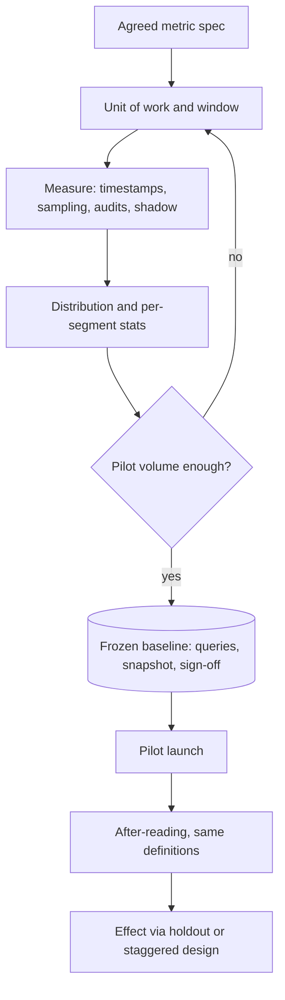

## TL;DR
A baseline is each success metric's measured value under the current process, captured before the AI
changes anything. You cannot recover it later, so measure variance, stratify by case type, audit human
quality like the AI's, and freeze the definitions.

## Why it exists
- **Every impact claim is a difference.** Handle time fell, errors dropped, throughput rose: a difference
  needs two numbers, and the first must be measured before deployment, because deployment destroys it.
- **The old process disappears.** Once the assistant is live, agents work differently, the old tool is
  switched off, the team is reorganised, and history was never logged at the right granularity. A
  baseline reconstructed at review time is exactly the contested, cherry-picked number the review was
  meant to avoid.
- **Management reports are not baselines.** They use their own definitions: they often exclude escalated
  cases, mix business days with calendar days, or report a target rather than a measurement.
- **Self-report is unreliable.** People tend to misjudge how long their own work takes and how often they
  make mistakes, which is why direct measurement beats SME estimates.
- **Skipping the quality baseline is the most expensive failure.** Customers demand near-perfect AI
  accuracy while the human process, once checked, errs on a meaningful fraction of cases. Unmeasured, you
  are held to an imaginary standard and can fail a bar the incumbent never met.

## How it works
### 1. Start from the metric spec
- **Baseline exactly the agreed metrics,** with the same numerator, denominator, population and
  exclusions you will use after launch.
- **Different definitions make the comparison invalid,** however careful the measurement was.

### 2. Define the unit of work and the window
- **Pick the unit you will count:** a ticket, a claim, a document, a report.
- **Choose a window that covers the work's natural cycles:** month-end peaks, weekly patterns, seasonal
  products. A two-week baseline in a quiet month compared against a peak-season pilot shows a
  "regression" that is really just volume.

### 3. Choose measurement methods per metric
| Method | Use for | Strength / caveat |
|---|---|---|
| **System timestamps** (ticketing, case-management or workflow tool) | cycle time, throughput | cheap and complete, but check what each timestamp actually records |
| **Time-and-motion or work sampling** | effort the system does not log, such as searching other tools | observational and small-sample, but the only way to see hidden work |
| **Retrospective quality audit** | human error rate | SMEs blind re-review a random sample of past human outputs against the same rubric the AI will face; the step teams skip, and the one that sets a fair bar |
| **Shadow labelling** | paired same-case comparison | humans work normally while the system's proposed output is logged but not used |

### 4. Capture distribution, not just averages
- **Record median, p90 and standard deviation,** and keep the raw per-case data.
- **Variance sets the sample size:** it determines how many post-launch cases you need to detect a change.
- **Handle times are usually right-skewed,** so medians and percentiles are more honest than means, and a
  log transform helps when testing.

### 5. Stratify by case type
- **Report each metric per segment:** category, channel, region, complexity.
- **This matters because of mix shift.** If the pilot happens to receive easier cases, the overall number
  improves even when no segment does. This is a composition (mix) effect; its extreme form, where the
  aggregate trend runs opposite to every segment's trend, is Simpson's paradox.
- **Fix:** compare within segments and re-weight to the baseline mix.

### 6. Size the comparison
```
proportion to within ±e:            n ≈ z²·p(1−p)/e²
mean shift δ, std dev σ, two arms:  n ≈ 2(z_α/2 + z_β)²σ²/δ² per arm
```
- **If the pilot cannot reach that volume in its window,** you learn it before launch, not at the review.

### 7. Freeze it
- **Store** the queries, the data snapshot, the definitions, the date range, and the names of the people
  who signed off.
- **A baseline that nobody can re-run is just an anecdote with a decimal point.**

### Choosing the after-comparison design
| Design | What it controls | Weakness |
|---|---|---|
| Simple before/after | nothing beyond the baseline | weakest: absorbs seasonality and any concurrent change |
| Concurrent holdout (teams or queues without the tool) | time effects | withholds the tool from some users |
| Staggered rollout | both time and team effects | slower to reach everyone |
| Shadow mode | paired comparisons on identical cases | measures quality, not the behavioural effect on humans |

With a holdout, the estimate is a difference-in-differences:

```
effect = (pilot_after − pilot_before) − (holdout_after − holdout_before)
```

- **The second bracket subtracts whatever happened to everyone** during the pilot: a seasonal dip, a
  policy change, a new-hire cohort. That is why the holdout needs its own baseline over the same window,
  not just a post-launch reading.
- **Parallel-trends assumption:** both groups would have moved in parallel without the tool, so check that
  their pre-period trends really do look parallel before trusting the number.

## Diagram
The baseline is captured and frozen before anyone sees the system; the after-reading reuses the same
definitions and the chosen comparison design.



## Examples
### Per-category baseline with an audit interval and pilot sizing
A support team will pilot an AI drafting assistant. This script computes the per-category baseline from
an 8-week ticket export, including a confidence interval on the human error rate from an SME audit
sample, and the pilot volume needed to detect a 2-minute drop in handle time.

```python
import csv, math, statistics as st
from collections import defaultdict

def wilson(k, n, z=1.96):
    """95% Wilson score interval for a proportion k/n (well-behaved for small n)."""
    p, d = k / n, 1 + z * z / n
    centre = (p + z * z / (2 * n)) / d
    half = z * math.sqrt(p * (1 - p) / n + z * z / (4 * n * n)) / d
    return centre - half, centre + half

def n_per_arm(sd, delta, z_a=1.96, z_b=0.84):
    """Cases per arm to detect a mean shift of `delta` (two-sided 5%, 80% power)."""
    return math.ceil(2 * (z_a + z_b) ** 2 * sd ** 2 / delta ** 2)

by_cat = defaultdict(list)
with open("tickets_w01_w08.csv") as f:          # 8-week export, one row per closed ticket
    for r in csv.DictReader(f):
        by_cat[r["category"]].append(
            (float(r["handle_min"]), r["audited"] == "1", r["audit_error"] == "1"))

for cat, rows in sorted(by_cat.items()):
    mins = [m for m, _, _ in rows]
    errs = [e for _, audited, e in rows if audited]   # SME blind re-review sample
    lo, hi = wilson(sum(errs), len(errs)) if errs else (float("nan"),) * 2
    print(f"{cat:10} n={len(mins):5} median={st.median(mins):5.1f} "
          f"p90={st.quantiles(mins, n=10)[8]:5.1f} sd={st.stdev(mins):5.1f} "
          f"audited={len(errs):4} error_rate_95ci=[{lo:.1%}, {hi:.1%}]")

print(n_per_arm(sd=9.0, delta=2.0))   # billing: sd 9 min, detect a 2-minute drop -> 318
```

Read the output critically:
- **False precision.** Suppose billing shows 11 errors in 120 audited tickets. The point estimate is 9.2%,
  but the Wilson interval is roughly 5% to 16%. "The AI must beat 9.2%" is therefore false precision.
- **The honest bar** is "not worse than the human interval", and you may need to enlarge the audit before
  signing it.
- **Volume check.** The sample-size line says the pilot needs about 318 billing tickets in each arm. If
  billing only gets 80 tickets a week, a two-week pilot cannot answer the question.

### Worked scenario: difference-in-differences with a holdout (illustrative numbers)
Two comparable queues are baselined over the same 8 weeks; one gets the assistant.

| Queue | Median handle time before | After | Change |
|---|---|---|---|
| Pilot | 14.0 min | 11.0 min | −3.0 min |
| Holdout | 14.5 min | 13.5 min | −1.0 min |
| **Effect** | | | (−3.0) − (−1.0) = **−2.0 min** |

- **A naive before/after would claim 3 minutes.** One of those minutes happened to everyone, perhaps a
  quieter season or a new knowledge-base article.
- **Check parallel trends first:** if the two queues' weekly medians already diverged during the 8 baseline
  weeks, the 2-minute estimate is not trustworthy.

## Production patterns
- **Baseline as a versioned job.** Keep the extraction SQL, the date range and the metric definitions in
  the repository and run them as a scheduled job against the same source the post-launch telemetry
  uses. Monitor that the job still reproduces the frozen baseline value on the frozen snapshot.
- **Blind, stratified audit sampling.** Draw the SME audit sample with a fixed random seed per segment,
  strip any indication of who produced the output, and reuse the same rubric for AI outputs later.
  Monitor the interval width per segment and enlarge the sample where it is too wide to set a bar.
- **Holdout routing flag.** Route a fixed set of queues or teams to the old flow and tag every case with
  its arm at creation time, so the difference-in-differences can be computed by a query. Monitor arm
  balance and any leakage of the tool into the holdout.
- **Mix re-weighting in the report.** Report both the raw pilot number and the number re-weighted to the
  baseline segment mix side by side. Monitor the gap: a large one means mix shift is doing the work.
- **Shadow logging before go-live.** Log the system's proposed output next to the human's actual output
  on the same case without showing it to users. Monitor agreement rate per segment as a quality baseline.

## Trade-offs
- **Window length vs schedule.** Longer baseline windows capture seasonality and reduce noise but delay
  the project. Shorten them only when the work has no strong cycles and volume is high enough to reach
  the needed sample size.
- **Audit cost vs a fair bar.** Retrospective quality audits cost SME hours, which the customer often
  resists. They become non-negotiable when the success criterion compares AI quality to human quality,
  which is most of the time.
- **Causal clarity vs access.** Concurrent holdout groups give the cleanest causal read but withhold the
  tool from some users. Use a pure before/after comparison only when the expected effect is far larger
  than seasonal variation.
- **Safety vs realism.** Shadow mode gives paired same-case comparisons without risk, but it does not
  measure how humans change when they actually rely on the output, so it cannot replace a live comparison.
- **Fairness vs sample size.** Heavy stratification makes comparisons fair but splits the sample thin.
  Merge segments whose baselines are statistically indistinguishable.

## Pitfalls
- **Using management-report numbers as the baseline.** Symptom: a "before" figure nobody can reproduce
  from raw data, and a dispute at review about what it included.
- **Baselining only speed and not quality.** Symptom: the customer holds the AI to a near-perfect accuracy
  bar the human process was never measured against.
- **Ignoring case mix.** Symptom: an overall improvement that disappears when results are broken down by
  category, because the pilot queue received easier work.
- **Changing the metric definition after launch,** for example by excluding a newly "out of scope" case
  type. Symptom: an improvement that appears exactly when the definition changed.
- **Announcing the measurement, then using that period as the baseline.** Symptom: unusually good baseline
  numbers (an observer, or Hawthorne, effect) that regress once observation ends, which makes the AI look
  worse than it is.
- **Picking the pilot team or queue because its recent numbers are the worst.** Symptom: a large
  "improvement" that the holdout, or the same team's longer history, shows would have happened anyway,
  because an unusually bad period tends to be followed by a more ordinary one (regression to the mean).

## When to use
- **Use when:** any metric in the success spec, before any pilot user sees the system, ideally during
  discovery while you are already mapping the workflow.
- **Plan the effort:** with good historical logs the baseline can be largely retrospective and take days.
  If effort or quality is not logged, plan two to four weeks of sampling and audits, and put that in the
  statement of work as a customer dependency.
- **Skip only for:** pure feasibility spikes with no value claim.
- **Interviews:** a baseline question usually hides inside "how would you prove the pilot worked?" The
  expected answer covers before/after definitions, human error rates, mix shift and sample size.

## Role lens
- **Engineer:** Writes the extraction queries and audit-sampling scripts, and makes the post-launch
  telemetry compute metrics with exactly the same definitions as the baseline.
- **Architect:** Chooses the comparison design (holdout, staggered rollout, shadow mode) and makes sure
  the platform can route and tag cases so that design is possible.
- **FDE:** Gets access to historical exports, schedules SME audit time, and gets the customer to sign
  off on the frozen baseline before the pilot starts.

## Check yourself
**Q:** The customer wants the AI to reach 99% accuracy before rollout. You have no baseline for the human
team. What do you do, and why?
**A:** I would run a blind retrospective audit. SMEs re-review a random, stratified sample of recent
human outputs against the same rubric we will use for the AI. The sample should be large enough that
the error-rate interval is narrow enough to set a bar. This changes the conversation from an
aspirational number to a fair comparison. If humans turn out to be at, say, 90% to 94%, a target of "at
least as good as humans, with no regression on high-severity case types" is defensible. The 99% figure
can stay as a stretch goal for low-risk categories. I would also record per-category human rates,
because the AI may beat humans on routine work and lose on rare, complex cases. Those rare cases are
where review should stay mandatory.

## Interview questions
### Why can't you just reconstruct the baseline from historical reports after the pilot?
- **Deployment destroys the old process:** behaviour shifts, the old tool is switched off and history was
  rarely logged at the needed granularity.
- **Reports use other definitions,** such as excluding escalations or mixing business and calendar days,
  so the "before" number becomes contestable exactly when it matters.

### Your pilot shows handle time down 20%, but the customer's ops lead says it is seasonal. How do you settle it?
- **Compare against a holdout or staggered cohort** with its own baseline over the same window, and compute
  the difference-in-differences so shared seasonal movement cancels out.
- **Check parallel pre-period trends** and stratify by category to rule out mix shift.
- **If there was no holdout,** compare against the same weeks in previous years and be explicit about the
  weaker evidence.

### When would you accept a simple before/after comparison instead of a holdout?
- **When the expected effect is far larger than seasonal variation,** so confounders cannot plausibly
  explain it.
- **Or when withholding the tool is unacceptable** to the customer; then lengthen the baseline window to
  cover cycles and document the limitation in the review.

### How many audited cases do you need before the human error rate can set the bar?
- **Use the proportion formula:** n ≈ z²·p(1−p)/e². With 11 errors in 120 tickets the 95% Wilson interval is
  roughly 5% to 16%, too wide to set a sharp bar.
- **Decide the acceptable interval width first,** then size the audit per high-risk segment rather than
  overall.

### What is regression to the mean and how does it bite pilot selection?
- **Definition:** an unusually bad period tends to be followed by a more ordinary one, whatever you do.
- **The trap:** picking the worst-performing team for the pilot guarantees an apparent improvement.
- **Fix:** choose pilot groups on other grounds, baseline over a longer history, and keep a holdout.

## Quiz
### Q: Why must the baseline be measured before deployment rather than reconstructed afterwards?
- [ ] Historical data is always deleted when new software is installed
- [x] Deployment changes the process and people's behaviour, and old logs rarely match the new metric definitions
- [ ] Statistical tests require the baseline to be collected first chronologically
- [ ] Regulators require baselines to be dated before a go-live
> Once the system is live, the old process is gone and behaviour has shifted, so it cannot be
> re-observed. Historical reports usually use different definitions, which makes a reconstructed
> baseline contestable.

### Q: A pilot shows a 20% drop in average handle time overall, but no individual ticket category improved. What is the most likely explanation?
- [ ] The confidence interval is too wide to tell
- [ ] The model improved only on the largest category
- [x] The pilot received a different mix of case types, with more easy cases, than the baseline
- [ ] Handle time should have been measured with medians instead of means
> If no segment improved but the total did, the weights changed: this is mix shift, the composition
> effect behind Simpson's paradox. Stratifying the baseline and re-weighting pilot results to the
> baseline mix exposes it.
> Medians would not fix a composition change.

### Q: Why record the standard deviation of a baseline metric, not just its mean?
- [ ] Executives prefer dashboards that show variability
- [ ] The standard deviation is needed to compute the ROI
- [ ] It replaces the need to stratify by case type
- [x] It determines how many post-launch cases are needed to detect a given improvement
> Required sample size scales with the variance divided by the square of the effect you want to detect.
> Without the spread, you cannot tell whether the pilot window has enough volume to distinguish a real
> change from noise.
