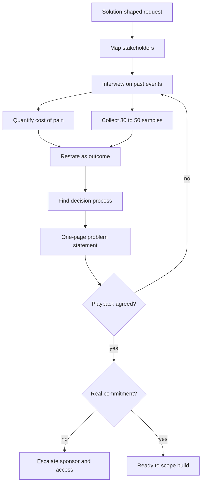

## TL;DR
Customer discovery finds out what problem a customer actually has, who feels it, what it costs today and
what evidence would prove it solved, before anyone builds. AI projects fail more often from solving the
wrong problem than from picking the wrong model.

## Why it exists
- **Requests arrive solution-shaped.** An executive saw a demo and wants "an agent for procurement" or
  "GPT over our documents". That one sentence compresses a pain someone feels, a guess about what would
  relieve it, and a political mandate.
- **Building the literal request is the classic failure.** It is fast and feels responsive, and it is the
  most common way an AI project ends up as a polished demo nobody uses.
- **The naive shortcuts fail predictably.**
  - *Taking the request at face value* inherits the requester's guess, made without knowing what the
    technology is good at.
  - *Asking "would you use a tool that does X?"* produces polite yeses, because hypothetical questions
    about the future cost nothing to answer.
  - *Prototyping first and "seeing what they think"* anchors everyone on your first design and skips the
    questions that decide success: how often the task happens, what an error costs, who must approve a
    change, and whether the data is even reachable.
- **AI raises the stakes because it is probabilistic.** A conventional feature works or it does not; an AI
  feature works on some fraction of cases. Whether 85% is a triumph or a liability depends on facts only
  discovery surfaces: the cost of a wrong answer, whether a human reviews the output, and how accurate the
  current manual process really is.

## How it works
### 1. Map the people before the problem
Every enterprise problem has several roles, and they are rarely the same person:

| Role | What they control or care about |
|---|---|
| **Economic buyer** | Controls the budget and decides whether this continues past a pilot |
| **Champion** | Wants it to succeed and will spend political capital; often the original requester |
| **End users** | Do the work today; their adoption decides whether value is realised |
| **Data and system owners** | Can grant or block access to the sources you need |
| **Risk functions** | Security, legal, compliance, works councils; veto power late if ignored early |

- **Map these first because each sees a different problem.** The VP sees headcount cost, the user sees a
  tedious lookup, compliance sees audit exposure.
- **A solution that satisfies only one of them stalls.**

### 2. Interview about past behaviour, not future intentions
- **Ask about specific recent events.** The core technique, popularised by *The Mom Test*: "Walk me
  through the last claim you processed. What did you open first? Where did you get stuck?"
- **Past behaviour is evidence; opinions about hypothetical products are not.**
- **Useful follow-ups:** "How often does that happen?", "What did you do about it?", "What have you tried
  before?", "What happens if you get it wrong?".
- **No past attempts means low pain.** If someone has never tried to solve the problem, it is probably not
  painful enough to fund.

### 3. Quantify the pain
Turn anecdotes into a rough annual cost:

```
cost ≈ volume × (time per item × loaded hourly cost  +  error rate × cost per error)  +  cost of delay
```

| Term | Who gives it to you |
|---|---|
| Volume | The system admin or a report |
| Time per item | Users |
| Error rate and cost per error | The team lead or QA |
| Cost of delay | The buyer |

- **You need this because it bounds the value of any solution** and feeds the ROI model; a problem worth
  200 hours a year does not justify a six-month integration.
- **Note which term dominates.** When errors cost more than time, the design must optimise for accuracy and
  review, not speed.

### 4. Separate the problem from the proposed solution
- **Restate each request as the outcome it serves.** "A chatbot over policy documents" might really be
  "adjusters need the applicable coverage clause, with a citation, inside the claims screen".
- **Ask "why" two or three times.** That usually moves from the solution to the job.
- **Keep the requester's idea as one hypothesis, not the specification.**

### 5. Collect artifacts, not descriptions
- **Ask for real samples:** 30 to 50 actual tickets, documents, emails or records, including the ugly ones.
- **A description of the data is always cleaner than the data.**
- **Samples do double duty:** they become the seed of the golden dataset and reveal access problems
  immediately.

### 6. Find the decision process and success evidence
- **Ask:** "If this worked, how would you know? Who decides whether it goes to production, and what would
  they need to see?"
- **This produces the success criteria and baseline before you build**, because criteria defined after a
  demo are negotiated to fit what was built.

### 7. Synthesise and play it back
- **Write a one-page problem statement:** who, what job, current cost, constraints, success evidence, open
  risks, and what you deliberately are not solving.
- **Read it back to the champion and users.** Disagreement here is cheap; disagreement after a build is
  expensive.

### Interview hygiene and when to stop
- **Interview users without their manager in the room**, because people describe the official process in
  front of the person who owns it.
- **Have a second person take notes** so the interviewer can follow up instead of writing.
- **Talk far less than the interviewee and never pitch mid-interview.** The moment you describe your idea,
  answers start rating it rather than describing work.
- **Look for disconfirming evidence.** Ask "when is this *not* a problem?" and "who handles this without
  trouble?".
- **Stop at saturation, not before full coverage.** Stop interviewing a role when two or three consecutive
  interviews add no new pain, workaround or exception, and not before you have covered every role on the
  map.

### Commitment is the real signal
- **Enthusiasm is free.**
- **Committed customers give things up:** time with real users, sample data, a named sponsor and an access
  request in flight. Those who only say "this is great" are not yet committed.

## Diagram
Discovery runs from the stakeholder map to a played-back problem statement; a failed playback or missing
commitment loops back instead of moving to build.



## Examples
### Cost-of-pain calculator
The formula from step 3 as code, so each interviewee's number goes into one place and the dominant term
is obvious. All inputs are illustrative.

```python
def annual_pain(volume_per_year, minutes_per_item, hourly_cost,
                error_rate, cost_per_error, cost_of_delay=0.0):
    time_cost = volume_per_year * (minutes_per_item / 60) * hourly_cost
    error_cost = volume_per_year * error_rate * cost_per_error
    total = time_cost + error_cost + cost_of_delay
    return {"time": round(time_cost), "errors": round(error_cost),
            "delay": round(cost_of_delay), "total": round(total),
            "dominant": max(("time", time_cost), ("errors", error_cost),
                            ("delay", cost_of_delay), key=lambda t: t[1])[0]}

# Lookup step only: 120 claims a day, ~250 working days, 15 minutes each
print(annual_pain(volume_per_year=120 * 250, minutes_per_item=15, hourly_cost=60,
                  error_rate=0.02, cost_per_error=1500))
# {'time': 450000, 'errors': 900000, 'delay': 0, 'total': 1350000, 'dominant': 'errors'}
# Errors dominate, so the design must optimise for accuracy and review, not speed.
```

### Worked scenario: "ChatGPT over our policy wordings"
All figures illustrative. An insurer's VP of Claims asks for "a ChatGPT-style assistant over our policy
wordings". The FDE runs six 45-minute interviews: the VP, a claims team lead, three adjusters and the
claims-system admin.

| Finding | Source | Evidence |
|---|---|---|
| A typical claim takes about 40 minutes of hands-on work | Adjusters | Each walked through their last three claims; the pattern repeated |
| Roughly 15 of those minutes go to finding which clauses apply | Adjusters | Wordings live in a store organised by product version; adjusters match the policy's issue date to the right version |
| About 120 claims a day, so lookup is 120 × 15 = 1,800 minutes, or 30 person-hours, daily | Interviews | Daily team volume |
| Wrong-version lookups are a known cause of payment leakage | Team lead | Supervisors already spot-check 10% of claims |
| Nobody asked for a chat interface | Adjusters | They live in the claims screen and do not want another tab |
| Policy issue date and product code are available | Claims-system admin | Exposed through the claims system's API |

- **Errors matter more than time** here, which shifts the design toward accuracy and citations.
- **The played-back problem statement:** "Given an open claim, surface the applicable clauses from the
  correct wording version, with citations, inside the claims screen. Success: on 50 historical claims
  labelled by a senior adjuster, the correct clause appears in the top three for at least the share a
  senior adjuster agrees is acceptable, and median lookup time drops."
- **The reframe:** a retrieval-and-citation problem with a hard metadata filter (version by date), not a
  chatbot. It now has a baseline, a metric and an integration point.

## Production patterns
- **Standard interview guide per role** — when running more than a handful of interviews, keep one guide
  per role on the stakeholder map: past-event prompts, the four follow-ups, and the error-cost question.
  Store notes in one shared template so findings are comparable. Monitor how many interviews end with a
  concrete frequency and a concrete workaround.
- **Saturation tracker** — after each interview, log new pains, workarounds and exceptions per role in a
  simple table. Stop a role after two or three consecutive interviews add nothing new. Monitor coverage:
  every role on the map has at least one row.
- **Commitment checklist as a gate** — before build starts, require sample data received, user time
  booked, a named sponsor and an access request filed. Track days since each was requested; escalate to
  the sponsor when one stalls rather than building on synthetic data.
- **Signed one-page problem statement** — version the statement in the shared engagement folder, read it
  back to the champion and users, and get the buyer's written sign-off for multi-quarter work. Monitor
  open risks and "not solving" items for drift when scope changes.
- **Samples become the eval seed** — check the 30 to 50 collected records into the evaluation set with
  labels from a senior user. Watch the share of "ugly" records (scans, inconsistent formats), because a
  prototype tested only on clean files hides the real failure rate.

## Trade-offs
- **Depth vs momentum.** Deeper discovery lowers the risk of building the wrong thing, but delays visible
  progress. When the sponsor needs momentum, run a narrow prototype in parallel rather than skipping
  interviews.
- **Users vs politics.** Interviewing end users surfaces the real job, but can bypass the champion
  politically. When the organisation is hierarchical, get the champion to introduce you and share
  findings with them first.
- **Precision vs time.** Quantifying pain precisely makes the ROI case defensible, but costs time. When the
  problem is obviously large or small, an order-of-magnitude estimate is enough to decide.
- **Alignment vs discomfort.** Playing back a written problem statement forces alignment, but exposes
  disagreements early. That discomfort is the point, unless stakeholders are already aligned, when a short
  confirmation suffices.

## Pitfalls
- **Asking hypothetical questions like "would you use this?".** Symptom: unanimous enthusiasm in
  interviews followed by near-zero usage in the pilot. Fix: ask about the last specific occurrence.
- **Interviewing only the requester and their managers.** Symptom: a solution that fits the org chart but
  not the screen users actually work in, and users route around it. Fix: interview end users directly.
- **Accepting a description of the data instead of samples.** Symptom: a prototype that works on clean demo
  files and collapses on the first real batch of scanned or inconsistent records. Fix: get real samples.
- **Skipping the decision process.** Symptom: a successful pilot that stalls because security, legal or the
  budget holder were never asked what they needed to see. Fix: ask who decides, early.
- **Asking leading questions or pitching mid-interview.** Symptom: notes full of quotes that agree with the
  original idea and almost no concrete descriptions of past events, frequencies or workarounds. Fix: never
  describe your idea until the interview ends, and ask for the last occurrence instead.
- **Letting the first solution idea become the spec.** Symptom: every later conversation is about features
  of the chatbot rather than whether claims get processed faster or more accurately. Fix: keep the idea as
  one hypothesis and steer each conversation back to the outcome in the problem statement.

## When to use
- **Use at the start of every engagement**, and again whenever scope changes materially, such as a new
  department or a new data source.
- **Keep it proportional.** A two-week pilot might need five interviews and one sample dataset; a
  multi-quarter programme needs a stakeholder map and a written problem statement signed off by the buyer.
- **Measure:** can you state the job, the current cost, the cost of an error, the success evidence and the
  decision-maker in a page? If you cannot, you are not ready to build.
- **Interviews:** for FDE and architect roles, expect a scenario where a customer asks for a specific AI
  solution; the strong answer reframes it into the underlying problem before proposing anything.

## Role lens
- **Engineer:** Joins user interviews to see real inputs and edge cases, and turns collected samples into
  the first evaluation set before writing pipeline code.
- **Architect:** Owns the problem statement and constraints that shape the design, and refuses to commit
  to an architecture until error cost and integration point are known.
- **FDE:** Runs the interviews on site, maps stakeholders and politics, and converts a solution-shaped
  executive request into a measurable problem the customer agrees to.

## Check yourself
**Q:** A customer's COO asks you to "build an agent that automates our procurement approvals" and gives you
two weeks for discovery. What do you do first, and what finding would make you push back on building an
agent at all?
**A:** First map the stakeholders: the COO as buyer, the procurement lead as likely champion, approvers and
requesters as users, the ERP owner for data, and finance controls and audit for risk. Then interview
approvers about their last several approvals: what they checked, where they waited, how often they
rejected and why. Quantify volume, time per approval and the cost of a wrong approval. I would push back
on an agent if the interviews show most delay is waiting in an approver's queue rather than judgement
work, or if approvals are mostly deterministic policy checks (thresholds, approved vendors), because then
routing rules or a policy engine fix it more cheaply and auditably, and the AI role shrinks to
summarising the exceptions.

## Interview questions
### Why do you interview about past behaviour instead of asking users what they want?
- **Past events are evidence.** "Walk me through the last claim" reveals real steps, frequency and
  workarounds that the person actually did.
- **Hypotheticals are cheap to answer.** "Would you use X?" produces polite yeses that predict nothing, so
  pilots built on them see near-zero usage.
- **Feature wish-lists describe solutions, not problems**, and anchor the conversation on one design.

### A VP gives you a clear spec for a chatbot and says users have already agreed. What do you do?
- **Treat the spec as one hypothesis.** Restate it as the outcome it serves and ask "why" two or three
  times to reach the job.
- **Interview end users without the VP present**, because people describe the official process in front of
  its owner.
- **Play back a one-page statement to the VP first**, so the reframe strengthens the champion instead of
  bypassing them.

### When would you cut discovery short?
- **When the problem is obviously large or small**, an order-of-magnitude cost estimate is enough to decide
  and further precision buys nothing.
- **When the sponsor needs momentum**, run a narrow prototype in parallel, but keep the interviews; skipping
  them trades a few days for the risk of building the wrong thing.
- **Never skip the decision process question**, because a pilot nobody has criteria for stalls at the end.

### How would you size the problem for an ROI case, and which number usually surprises people?
- **Use the cost formula:** volume × (time per item × loaded hourly cost + error rate × cost per error) +
  cost of delay, with each term from a different person.
- **Error cost often dominates.** In the insurer case, 30 person-hours a day of lookup mattered less than
  payment leakage from wrong-version clauses.
- **That changes the design**, toward accuracy, citations and review rather than raw speed.

### What signals tell you a customer is actually committed?
- **They give up something scarce:** time with real users, 30 to 50 real samples, a named sponsor and an
  access request already filed.
- **Enthusiasm alone is not commitment.** Three weeks of positive meetings without data is a risk to
  escalate, not a green light.

## Quiz
### Q: Which interview question produces the most reliable evidence about a user's pain?
- [ ] "Would you use a tool that summarised these documents automatically?"
- [x] "Walk me through the last time you had to find this information. What did you do?"
- [ ] "On a scale of 1 to 10, how painful is document search for you?"
- [ ] "What features would your ideal AI assistant have?"
> Questions about specific past events reveal actual behaviour, frequency and workarounds. Hypothetical
> and rating questions invite polite, cheap answers, and feature wish-lists describe solutions, not problems.

### Q: Why does discovery for an AI system need to establish the cost of a wrong output, more than for a conventional feature?
- [ ] Because AI systems are more expensive to host than conventional software
- [ ] Because regulators require error costs for every software project
- [x] Because AI output is correct only some of the time, so whether a given accuracy is acceptable depends on error cost and review
- [ ] Because error cost determines which model provider to choose
> A probabilistic system succeeds on a fraction of cases. The same accuracy can be excellent or
> unacceptable depending on what a mistake costs and whether a human checks, so discovery must surface both.

### Q: A customer is enthusiastic in every meeting but has not provided sample data or user access after three weeks. What is the best reading?
- [ ] The project is low-risk because stakeholder sentiment is strongly positive
- [ ] The team should build with synthetic data so as not to lose momentum
- [x] Commitment is not yet real; escalate the access request and the sponsor's role before building
- [ ] The data is probably clean, so it can be integrated later without risk
> Enthusiasm costs nothing; giving time, data and access does. Missing samples also hide the data
> problems that most often sink AI projects, so building on synthetic data defers the real risk.
