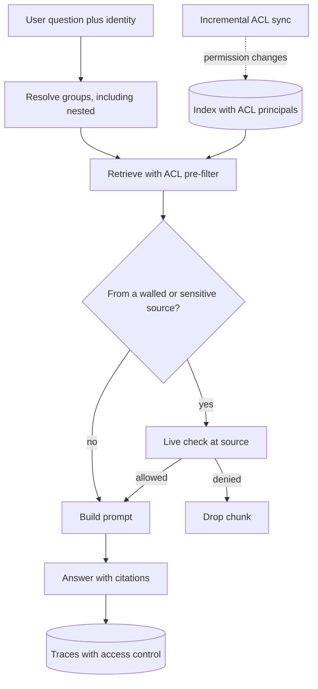

## TL;DR
Before building, establish which data a use case needs, who owns it, how to reach it technically and
legally, and how source permissions carry into the AI system. Approvals are often the longest lead time,
and export-based prototypes silently drop permissions.

## Why it exists
- **The typical stall is access, not model quality.** It is week six of a pilot, the prototype works on a
  folder someone emailed over, and the team still waits for a service account, a firewall rule, a
  data-processing agreement or the data owner's sign-off for production access.
- **Each blocker has its own approver, queue and lead time,** and none was started on day one because
  nobody listed them.
- **Exports silently erase permissions.** Sources enforce rules: a SharePoint site restricted to HR, a CRM
  record visible only to its account team, a database row filtered by region. Export into a vector index,
  or connect with a broad service account, and those rules are gone.
- **The result is a leak with a helpful interface.** The assistant answers anyone's question from
  everyone's data. The demo cannot reveal this, because the demo user is usually an admin.
- **"Get the data first, sort permissions later" fails twice:** it defers the longest lead times and bakes a
  permission-free design into the architecture. Discovery runs access and permissions as a first-class
  workstream, in parallel with the technical spike, on the same access path production will use.

## How it works
### 1. Derive the data needs from the use case
- **From the decomposition,** list every input each node needs and every system each action touches.
- **For each, ask:** is it needed to answer, to act, or only to evaluate?
- **Fewer sources means fewer approvals and less exposure**, because each source carries its own owner,
  contract and risk.

### 2. Build a source inventory
| Field | Why it matters |
|---|---|
| System and owner (a named person, not a team) | Someone must feel entitled to approve |
| Data volume and format | Sizes ingestion and parsing work |
| Freshness requirement | Decides sync vs live access |
| Access method (API, connector, database replica, file export, event stream) | Shapes the integration |
| Authentication method and rate limits | Decides delegated vs service access |
| Sandbox or non-production copy available? | Lets development start safely |

- **Ask for a sample in week one**, because samples expose format and quality problems that descriptions
  hide.

### 3. Map the permission model at the source
- **Find how the source decides who sees what:**
  - document or item-level ACLs, and inherited folder permissions;
  - group membership from the identity provider;
  - record ownership and sharing rules in a CRM;
  - row-level security in a database;
  - attribute-based rules (region, clearance, customer).
- **Note how often permissions change and whether the API exposes them**, because an AI system can only
  enforce what it can read.

### 4. Classify the data and find the legal constraints
- **Sensitivity:** public, internal, confidential, regulated personal or health data.
- **Constraints:** applicable regulation, contractual limits on use (for example, whether data may be sent
  to a third-party model provider), residency requirements, and retention or legal-hold obligations.
- **These decide the deployment shape** (provider API, private endpoint, in-customer-VPC), so they must be
  known before architecture is fixed.

### 5. Choose how permissions are enforced in the AI system
| Option | How | Strength | Cost |
|---|---|---|---|
| **Delegated user access** | Call the source with the end user's own token (for example via an OAuth token-exchange or on-behalf-of flow), so the source enforces its own rules | Most faithful | Slower; bound by per-user rate limits |
| **Index with ACL metadata** | Ingest content with its permission principals; filter every retrieval by the user's resolved groups | Fast | You must sync permission changes, resolve nested groups and honour explicit deny entries |
| **Partitioned indexes** | One index per audience (department or tenant) | Simple and robust | Only works when permissions are coarse |

- **Pre-filter, never post-filter.** Apply the ACL filter inside the search, not to the top-k results
  afterwards, because post-filtering a top-10 list for a user who can see a small share of the corpus often
  leaves zero results, which looks like a retrieval bug rather than a permission rule.
- **The choice depends on step 3**, because a source that does not expose ACLs through its API forces
  delegated access or coarse partitioning.

### 6. Treat derived data as carrying its sources' permissions
- **Derived data reveals source content:** embeddings, chunk stores, cached answers, conversation memory,
  summaries, prompt and trace logs, and evaluation datasets.
- **Visibility rule:** each derived item is visible only to users who could see every source it was built
  from, because a summary of an HR file and a public memo is as sensitive as the HR file.
- **List where derived data lands**, including the observability tool and the model provider's logs, and
  who can read each of those stores.

### 7. Apply least privilege to actions
- **For agents that write** (create tickets, update records, send email), list each action, the scope it
  needs, and whether it acts as the user or as a service.
- **Request read-only scopes where reading suffices**, and gate write actions behind approval.

### 8. Map the approval path and lead times
- **For each source, list who must approve:** data owner, security, privacy, legal, and the platform team
  that issues credentials, with their typical turnaround.
- **Start the slowest first** and track each as a project dependency with an owner and a date.

### 9. Write permission tests early
- **Test before launch, ideally in the prototype,** that a user without access to a document cannot
  retrieve, quote or summarise it, including through indirect questions.
- **Use real test identities with differing access.**

## Diagram
A query's path through an ACL-aware assistant: identity is resolved first, the filter is applied inside
retrieval, and the most sensitive documents get a live check before any text reaches the prompt.



## Examples
### Pre-filter vs post-filter on an ACL-tagged index
Pure Python stand-in for a vector search (random scores replace similarity). The user can read about 3% of
chunks, so filtering the top 10 afterwards returns nothing, while filtering inside the search returns ten
readable results.

```python
import random

random.seed(7)
# 1,000 chunks; each carries the principals allowed to read its source document
corpus = [{"id": i,
           "score": random.random(),                       # stand-in for similarity to the query
           "allowed": {"legal-all"} if i % 33 == 0 else {"hr-only"}}
          for i in range(1000)]
user_groups = {"legal-all", "user:asha"}                   # resolved, including nested groups

def visible(chunk, groups):
    return bool(chunk["allowed"] & groups)

def post_filter(k=10):                                      # search first, then drop what user cannot see
    top = sorted(corpus, key=lambda c: -c["score"])[:k]
    return [c["id"] for c in top if visible(c, user_groups)]

def pre_filter(k=10):                                       # restrict the search to what user can see
    allowed = [c for c in corpus if visible(c, user_groups)]
    return [c["id"] for c in sorted(allowed, key=lambda c: -c["score"])[:k]]

share = sum(visible(c, user_groups) for c in corpus) / len(corpus)
print(f"user can see {share:.0%} of chunks")
print("post-filter top-10:", post_filter())    # [] : looks like a retrieval bug
print("pre-filter  top-10:", pre_filter())     # ten readable chunks
```

- **In a real vector store,** pass the user's resolved groups as a metadata filter on the query itself, so
  the engine restricts candidates before ranking.

### Worked scenario: an assistant for a legal team
Lead times and counts illustrative. A legal team wants an assistant over contracts in SharePoint, matter
data in a practice-management database, and client billing in the ERP. In week one the FDE builds the
inventory.

| Source | What discovery found | Decision | Because |
|---|---|---|---|
| SharePoint contracts | About 40,000 documents; permissions inherited from matter sites, plus item-level exceptions for conflicted matters where named lawyers are walled off | Index with ACL principals, filter by the user's resolved groups at query time; incremental ACL sync; re-check walled-matter documents against SharePoint's live permissions before any text reaches the prompt | Ethical walls make sync freshness a hard requirement, and a sync can still lag |
| Practice-management database | Reachable only through a nightly replica; row-level visibility is enforced by its application, not the database, so a direct connection would see everything | Read through the application's API with delegated user tokens, not from the replica | The application keeps enforcing its row rules |
| ERP billing | Classified confidential; the ERP owner says AI use requires a privacy review | Cut from the first phase | The use case answers its target questions without it, and the review would dominate the timeline |

- **Freshness question asked explicitly:** how quickly must permission changes propagate? The incremental
  sync is designed to meet that answer.
- **Longest lead time first:** the security approval for the API integration and the service registration
  is requested in week one.
- **First test written:** a lawyer walled off from a conflicted matter asks "summarise the indemnity terms in
  the Acme agreement" and must get no content from it.

## Production patterns
- **Permission test suite in CI** — keep test identities with deliberately different access (walled-off,
  read-only, admin) and run retrieval and "summarise X" probes against every index or connector change.
  Fail the build if any identity retrieves, quotes or summarises a document it cannot open at the source.
  Track the suite's pass rate per release.
- **Incremental ACL sync with lag monitoring** — sync permission changes separately from (and more often
  than) content, and record the time from a change at the source to its effect in the index. Alert when lag
  exceeds the propagation requirement agreed with the data owner.
- **Live check for the most sensitive sources** — for walled matters, HR or other high-risk content, verify
  the user's access at the source just before text enters the prompt, accepting the extra latency. Monitor
  how often the live check denies a chunk the index allowed; non-zero means sync lag or a mapping bug.
- **Access-controlled traces** — apply the same visibility rule to prompt and trace logs as to the sources,
  or redact retrieved text from logs. Review who can read the observability tool and the provider-side logs.
- **Access-request tracker as a dependency list** — one row per source with named owner, approver,
  requested date, expected date and status, reviewed weekly with the sponsor. Monitor days open per request
  and escalate the slowest.
- **Scoped credentials for agents** — read-only scopes by default, write actions behind a human approval
  step, and acting as the user wherever the source supports it. Log every write with the identity it used.

## Trade-offs
- **Fidelity vs speed.** Delegated user access keeps the source authoritative for permissions, but adds
  latency and per-user rate limits. When queries are high-volume and permissions are coarse, an
  ACL-filtered index is faster.
- **Fast retrieval vs sync responsibility.** Indexing content with ACL metadata enables fast filtered
  retrieval, but makes you responsible for syncing permission changes. When walls or revocations must apply
  immediately, delegate instead.
- **Shorter approvals vs coverage.** Cutting sensitive sources from phase one shortens approvals
  dramatically, but limits what the system can answer. Add them once the access pattern is proven and the
  review has had time to run.
- **Development speed vs realism.** A non-production copy speeds development, but its permissions and data
  quality may differ from production. When the use case depends on fine-grained ACLs, test against
  production permissions early.

## Pitfalls
- **Building the prototype on an exported folder.** Symptom: a demo that delights an admin user but answers
  questions from documents ordinary users were never allowed to see.
- **Connecting with a broad service account and promising to "add permissions later".** Symptom: an
  architecture with no place to carry user identity, discovered during security review.
- **Ignoring permission-change latency.** Symptom: a revoked or walled-off user still retrieving content for
  hours or days after the change, until the next full re-index.
- **Naming a team instead of a person as data owner.** Symptom: access requests that sit unanswered for
  weeks because nobody feels entitled to approve them.
- **Securing retrieval but not the traces.** Symptom: a developer or vendor support engineer able to read
  restricted document text in the prompt logs of the observability tool.
- **Treating "the data exists" as "the data is usable".** Symptom: a pipeline that connects successfully and
  returns scanned images, empty fields or a schema nobody can explain.

## When to use
- **Use from the first week** of any engagement that touches customer data, which in enterprise AI is almost
  all of them, in parallel with the technical spike rather than after it.
- **Revisit** whenever a new source or action is added.
- **Non-negotiable for** retrieval over internal documents, agents with write access, and regulated data.
- **Measure:** every source has a named owner, an access method, a permission model, a classification and
  an approval with a date, and permission tests exist and pass.
- **Interviews:** "how would you build RAG over the company's SharePoint" is often really a question about
  this topic.

## Role lens
- **Engineer:** Implements identity propagation and ACL filtering on retrieval, and writes automated
  permission tests with distinct test identities that run on every index change.
- **Architect:** Chooses delegated access, ACL-filtered indexing or partitioning per source, and sets the
  deployment boundary that the data classification and residency rules require.
- **FDE:** Finds the real data owners, files and chases access requests from week one, and surfaces
  permission models and lead times that would otherwise stall the pilot.

## Check yourself
**Q:** A customer asks for a company-wide assistant over their document management system and offers a
service account with read access to everything "to get started quickly". How do you respond?
**A:** I would accept it only for a sandbox with non-sensitive content, and not as the production design.
A read-everything account erases the source's permissions, so every user could retrieve anything the
account sees. Instead I would find out how the system expresses permissions (item ACLs, inherited site
permissions, identity-provider groups) and whether its API exposes them, then either ingest with ACL
principals and filter by the user's resolved groups or call the source with delegated user tokens. I
would also ask how quickly revocations must propagate, classify which content is sensitive, start the
approvals now, and write a test proving a user cannot retrieve a document they lack access to.

## Interview questions
### How would you build RAG over a company's SharePoint so users only see what they are allowed to?
- **Map the source's permission model first:** inherited site permissions, item-level ACLs and
  identity-provider groups, and whether the API exposes them.
- **Ingest with ACL principals and pre-filter retrieval** by the user's resolved (including nested) groups,
  or delegate with the user's token where permissions are too fine or fast-changing.
- **Carry permissions to derived data** (chunks, caches, traces) and prove it with tests using real test
  identities.

### Users with narrow access report the assistant "finds nothing" while admins get great answers. What is happening?
- **Likely post-filtering:** the ACL filter is applied to the top-k results after ranking, so a user who can
  see a small share of the corpus gets zero results from a top-10 list.
- **Fix:** move the filter inside the search so candidates are restricted before ranking, then re-run the
  permission tests and a retrieval eval per identity.

### When would you choose delegated user access over an ACL-filtered index?
- **When permissions change often or must apply immediately,** such as ethical walls or revocations, because
  the source stays authoritative.
- **When the source does not expose ACLs through its API,** or enforces visibility in its application layer.
- **Not when** queries are high-volume and permissions are coarse, where per-user latency and rate limits
  make an index or partitions the better fit.

### Which approvals do you start in week one, and why?
- **The slowest ones:** security review of the integration, service or app registration, privacy review for
  regulated data, and data-owner sign-off, each with a named approver and date.
- **Because** they run on their own queues, and the access path they approve shapes the architecture;
  deferring them adds their full lead time after the prototype.

### Where can restricted content leak even if retrieval is correctly filtered?
- **Derived stores:** cached answers, conversation memory, summaries and evaluation datasets built from
  restricted sources.
- **Operational logs:** prompt and trace logs in the observability tool and on the model provider side,
  readable by developers or vendor support. Apply the same visibility rule or redact.

## Quiz
### Q: Why is a prototype built on exported documents risky even if it performs well?
- [ ] Exported documents are usually lower resolution than the originals
- [x] The export drops the source's permissions, so the design never accounts for who may see what
- [ ] Exports cannot be embedded by most embedding models
- [ ] Exported documents are always out of date
> Exports and broad service accounts discard ACLs. The prototype then demonstrates answers that ordinary
> users should never get, and the architecture has no place to carry user identity into retrieval.

### Q: A source system enforces row-level visibility in its application layer, not in its database. What does that imply for the AI integration?
- [ ] A read replica of the database is the safest integration point
- [ ] Row-level rules can be ignored because the database has no restrictions
- [x] Reading the database directly bypasses the rules, so access should go through the application's API with user context
- [ ] The data must be copied into a separate warehouse first
> If the application enforces visibility, the database itself returns every row to any connection.
> Going through the application's API as the user keeps its rules in force; a direct replica bypasses them.

### Q: Why start access and approval requests in the first week rather than after the prototype proves value?
- [ ] Approvers prefer to see requests before any code exists
- [ ] Early requests are cheaper because licences cost less
- [x] Approvals often have the longest lead times, and the access path chosen shapes the architecture
- [ ] The prototype cannot run without production credentials
> Security, privacy and owner sign-offs run on their own queues. Deferring them adds their full lead time
> after the prototype, and the access method (delegated, ACL index, partitioned) changes the design.
