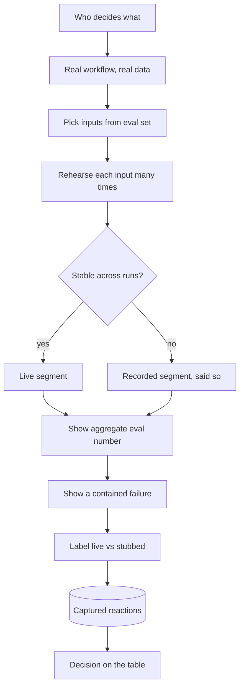

## TL;DR
A demo is a decision instrument that helps a specific audience decide something. Cherry-picked LLM inputs
look magical while typical inputs fail, so a good demo uses real data, pairs the story with eval numbers,
shows a failure and labels what is built.

## Why it exists
- **Decision-makers judge by what they see.** Most people who fund, approve or adopt an AI system will never
  read an eval report; they form their view in a meeting. That makes the demo one of the highest-leverage
  artifacts in an engagement, and one of the most hazardous.
- **The hazard is specific to generative AI.** Deterministic software that works once on stage mostly works
  every time, because behavior is covered by tests. An LLM can give different outputs across runs, and
  quality varies enormously across inputs. Finding five inputs where a prototype looks brilliant takes an
  afternoon; making the median input good takes weeks.
- **Curated demos create a gap that surfaces later.** Expectations built on those five inputs cannot be met,
  and the gap shows up in the pilot as "it worked in the demo".
- **The arithmetic forces design.** At 76% accuracy on real inputs, ten hand-picked successes imply close to
  100%, a 24-point overstatement nobody said out loud. Five truly random inputs all succeed with chance
  0.76⁵ ≈ 0.25, so three demos in four show a failure. The first misleads; the second leaves the story to
  chance.
- **Both naive alternatives fail.** The polished showcase (curated inputs, rehearsed path, everything green)
  wins the meeting and loses the account. Refusing to demo until "ready" leaves stakeholders nothing to react
  to, so workflow feedback arrives months late, when changes are expensive. The useful middle: designed
  around a decision, representative inputs, honest boundaries, backed by numbers.

## How it works
### 1. Start from the decision and the audience
Write one sentence first: "After this demo, *who* should be able to decide *what*?" One demo rarely serves
all audiences, because each decision needs different evidence.

| Audience | Decision | Needs to see |
|---|---|---|
| Executive | fund a pilot? | business outcome and risk |
| Operations lead | will her team use it? | her own workflow, including the awkward cases |
| Security reviewer | approve it? | the data flow |

### 2. Script around a real workflow with real data
- **Use the customer's own** documents, tickets or records (with permission and appropriate handling),
  arranged as the task a real user performs from start to finish.
- **Why real data:** it carries the mess synthetic data lacks (scanned pages, abbreviations, missing fields),
  and recognizable inputs make the audience trust what they see.

### 3. Choose inputs representatively, and say how
- **Pick from the evaluation set,** roughly in proportion to its error categories: some typical cases, one
  hard case, and one case the system gets wrong or escalates.
- **Selection is fine; *undisclosed* selection is the problem.**
- **State the aggregate:** "On 200 of your past tickets, it routed 87% correctly; here are three of them."
  The demo is the anecdote, the eval is the evidence; showing both stops the anecdote standing in for the
  evidence.

### 4. Show the boundary on purpose
- **Demonstrate uncertainty handling:** the system abstains, cites its sources, or hands off to a human.
- **Why:** a controlled failure builds more trust than a flawless run, because experienced buyers know
  nothing is flawless and want to see that failures are contained.

### 5. Control the live risks
Live demos of non-deterministic systems fail in ways rehearsals miss: provider latency spikes, rate limits,
a different output on the same input. Variance compounds across segments:

```
P(at least one live input goes wrong) = 1 − (per-input success)^(number of live inputs)
                                      = 1 − 0.9⁴ ≈ 34%   for four inputs at 9 of 10 rehearsal runs
```

- **Rehearse each live input many times and measure its stability.** Inputs that flip between runs belong
  in the recorded or narrated part, or are shown deliberately as a variance example.
- **Lower sampling temperature for the demo path** where the model exposes it. It reduces variance but does
  not guarantee identical outputs, and some reasoning models do not accept a temperature setting.
- **Pre-warm caches,** keep a recorded backup of each segment, and test on the actual network you will
  present from.
- **Say when output is cached or recorded,** because hidden caching also hides real latency.

### 6. Label what is real
- **Separate built from mocked:** "The extraction is live; the CRM write-back is a stub."
- **Why:** any UI, integration or data source that is faked becomes an implied commitment unless labeled.

### 7. Capture the reaction as data
- **Assign a note-taker** for questions, objections and feature requests. These are discovery inputs.
- **They often reveal the real success criterion,** such as "the summary is nice, but what I need is the
  deadline date".

## Diagram
Follow the path from the decision to the room: inputs come from the eval set, unstable inputs drop to a
labeled recording, and the session ends in a decision plus captured feedback.



## Examples
### Picking and checking demo inputs from the eval set
Selects a disclosed, representative mix and computes the odds that a live run goes wrong.

```python
import random

def pick_demo_inputs(eval_rows, n_typical=3, seed=7):
    """eval_rows: dicts with 'id', 'correct' (bool) and 'category' ('typical' or 'hard')."""
    rng = random.Random(seed)                       # fixed seed: the same picks at every rehearsal
    typical = [r for r in eval_rows if r["correct"] and r["category"] == "typical"]
    hard = [r for r in eval_rows if r["correct"] and r["category"] == "hard"]
    wrong = [r for r in eval_rows if not r["correct"]]
    picks = rng.sample(typical, n_typical) + rng.sample(hard, 1) + rng.sample(wrong, 1)
    acc = sum(r["correct"] for r in eval_rows) / len(eval_rows)
    line = f"On {len(eval_rows)} of your past tickets it was right {acc:.0%}; here are {len(picks)}."
    return [r["id"] for r in picks], line

def p_live_ok(stability):
    """stability: per live input, share of rehearsal runs that gave the intended result."""
    p = 1.0
    for s in stability:
        p *= s
    return p

rows = [{"id": i, "correct": i < 228, "category": "hard" if i % 10 == 0 else "typical"}
        for i in range(300)]                        # 228 of 300 correct = 76%
ids, line = pick_demo_inputs(rows)
print(ids, line)        # five ids; "On 300 of your past tickets it was right 76%; here are 5."
print(f"5 random inputs all succeed: {0.76 ** 5:.2f}")                   # 0.25
print(f"4 live inputs, one goes wrong: {1 - p_live_ok([0.9] * 4):.0%}")  # 34%
```

### A 25-minute contract-review demo
For a legal operations team deciding whether to run a six-week pilot of a contract-review assistant.

| Minutes | Segment | Purpose |
|---|---|---|
| 0–3 | The decision on the table and today's process: 40 minutes per NDA review, two reviewers | Anchor on their baseline |
| 3–10 | Live run on three of *their* past NDAs: two typical, one with an unusual indemnity clause | Show the real workflow |
| 10–14 | Results on 120 historical NDAs: clause-flag recall 91%, precision 84%, misses listed by type | Evidence behind the anecdote |
| 14–18 | A document where the model is unsure: it flags low confidence and routes to a lawyer | Show the boundary |
| 18–21 | What is live vs. stubbed (the document-management integration is mocked) | Prevent implied commitments |
| 21–25 | Proposed pilot scope, success metric and their questions | Turn reaction into a decision |

- **The figures are illustrative.**
- **Note what is absent:** no curated "wow" prompt, no unexplained accuracy claim, and no integration shown
  as working when it is not.
- **Safety nets:** the live segment has a recorded fallback, and the session ends on the decision it was
  built to inform.

## Production patterns
- **Demo manifest in the repo** — for any demo you will repeat. How: a small config file listing the
  eval-set input ids, model version, prompt version and sampling settings, so every rehearsal runs the same
  path. Monitor: that the manifest's eval-set accuracy matches the number you quote on the slide.
- **Rehearsal stability run** — the day before. How: run each live input 10-20 times through the same build
  and count intended results; anything below your bar moves to the recorded segment. Monitor: per-input
  stability and p95 latency on the presenting network.
- **Recorded fallback per segment** — for every live segment. How: a screen recording from the final
  rehearsal, cued up in a second window and introduced as recorded. Monitor: how often the fallback is used,
  which flags provider or network risk for the pilot.
- **Visible live-versus-stub labels** — whenever anything is mocked. How: a banner or badge on stubbed
  screens driven by the same feature flag that switches the stub, plus a slide listing what is stubbed.
  Monitor: SOW drafts for items that only exist as stubs.
- **No demo branch** — always. How: the demo runs the same build the pilot will use; code review rejects
  special cases keyed on demo input ids or prompts tuned to those documents. Monitor: demo inputs' results on
  the pilot build match the rehearsal.
- **Feedback log into discovery** — every demo. How: a named note-taker records questions and objections in a
  shared doc, triaged into the pilot backlog within a day. Monitor: how many requests change the success
  metric or scope.

## Trade-offs
- **Live credibility vs visible failure.** Live demos build credibility because the audience sees real
  behavior, but risk visible failure; recorded segments are safer when the network or provider is
  unreliable, provided you say they are recorded.
- **Honest failures vs initial excitement.** Showing failures costs some excitement but pays back in the
  pilot; the calculation flips only in pure exploratory sessions where nobody is making a commitment.
- **Early feedback vs anchoring.** Early, rough demos surface workflow feedback while it is cheap to act on,
  but risk anchoring stakeholders on unfinished UI; label rough parts explicitly to keep feedback focused.
- **Tailored vs reusable.** A demo tailored to one audience is persuasive for that decision, but reusing it
  for a different audience usually answers the wrong question and should prompt a rebuild.

## Pitfalls
- **Demoing on hand-picked inputs easier than real traffic.** The symptom is a pilot whose users say the
  system "worked better in the demo". Fix: draw inputs from the eval set and quote its aggregate.
- **Unlabeled mocked integrations or UI.** They become commitments; the symptom is a statement of work that
  includes features nobody estimated. Fix: label stubs on screen and on a slide.
- **Synthetic or public data instead of the customer's own.** The audience cannot judge relevance and the
  hard cases never appear; the symptom is polite approval and no follow-up. Fix: get permission to use
  their real records early.
- **Rehearsing only on a fast office network.** Then presenting through a customer VPN or proxy; the symptom
  is timeouts or long spinners during the live segment. Fix: rehearse on the network you will present from.
- **Treating the demo as the evaluation.** No aggregate number behind it; the symptom is stakeholders
  quoting a single impressive example as the expected performance. Fix: show the eval number beside the
  examples.
- **Special-casing the demo inputs in code.** A hard-coded lookup, or a prompt tuned to those three
  documents; the symptom is the same inputs behaving differently once the pilot build replaces the demo
  branch. Fix: demo from the pilot build.
- **Letting demo screens become the specification.** The symptom is change requests and SOW lines that cite
  "as shown in the demo" for behavior nobody designed or estimated. Fix: review the SOW for such lines and
  estimate or remove them.

## When to use
- **Use at decision points:** after discovery to confirm you understood the workflow, at the end of a PoC to
  decide on a pilot, during a pilot to show progress against the metric, and before production for sign-off.
- **Demo early and roughly** when the main risk is building the wrong thing; **later and with evidence**
  when the main risk is overpromising.
- **Avoid when:** you would use the demo to substitute for an evaluation, or the audience's decision is not
  identified.
- **Measure:** whether the demo produced a clear decision and actionable feedback, not applause.

## Role lens
- **Engineer:** Builds a reproducible demo path from the eval set, with fixed settings, warmed caches and a
  recorded fallback, and makes sure the aggregate numbers shown are real.
- **Architect:** Decides what the demo claims about the target architecture and labels which components
  are prototype stand-ins, so the demo does not quietly redefine the design.
- **FDE:** Runs demos inside the customer's environment on their data, reads the room for the real success
  criterion, and turns objections into scoped pilot requirements.

## Check yourself
**Q:** A sales lead asks you to demo a support-ticket triage prototype to the customer's VP next week, using
the ten examples that "look best". The prototype's accuracy on a 300-ticket eval set is 76%. How do you
build the demo?
**A:** First pin down the VP's decision, probably whether to fund a pilot. Then pick demo tickets from the
eval set to reflect the real mix: a few typical correct cases, one hard case, and one wrong or escalated
case showing how errors are caught. Present the 76% alongside the current baseline and what the pilot would
aim to improve, so the demo sets expectations the pilot can meet. Ten best-looking examples would win the
meeting but create a gap that surfaces as distrust during the pilot. Label anything mocked, run with a
recorded fallback, and close on the pilot proposal.

## Interview questions
### Why is demoing an LLM system riskier than demoing conventional software?
- **Quality is a distribution, not a constant.** Outputs vary across inputs and across runs, so a few good
  cases say little about the median input the pilot will see.
- **Numbers:** at 76% accuracy, five random inputs all succeed only about a quarter of the time, while ten
  curated successes imply near 100%; the demo has to be designed, not left to curation or chance.

### Your live demo segment returned a different, worse answer than in rehearsal. What went wrong and what do you change?
- **Likely cause:** run-to-run variance that rehearsal under-sampled; four inputs at 9 of 10 stability
  fail somewhere about a third of the time.
- **Fix:** rehearse each input many times, lower temperature where the model allows it, move unstable inputs
  to a labeled recording, and keep a recorded fallback ready for every live segment.

### When would you choose a recorded demo over a live one?
- **Choose recorded** when the network, VPN or provider is unreliable, or an input is unstable, provided you
  say it is recorded and quote real latency from the eval runs.
- **Choose live** when credibility is the main question and the path is rehearsed and stable, because the
  audience sees real behavior and real latency.

### How do you stop a demo from turning into an unestimated specification?
- **Label everything mocked,** on screen and on a slide, because unlabeled stubs become implied commitments.
- **Run the pilot build, not a demo branch,** so nothing shown depends on special cases.
- **Review the SOW** for items that cite "as shown in the demo" and estimate or remove them.

### How would you measure whether a demo worked?
- **By the decision it produced:** did the audience decide what the demo was built to inform, such as
  funding a six-week pilot?
- **By the feedback captured:** objections and requests logged and triaged, especially any that change the
  success criterion, rather than by applause in the room.

## Quiz
### Q: Why are cherry-picked demos a bigger risk for LLM systems than for conventional software?
- [ ] LLM systems are always slower, so demos need shorter inputs
- [x] Output quality varies widely across inputs and runs, so a few good cases say little about typical behavior
- [ ] Customers cannot see the source code of an LLM system
- [ ] LLM providers forbid showing failure cases in public demos
> Deterministic software that works once usually works every time. An LLM system's quality is a
> distribution over inputs, so curated examples can sit far above the median the pilot will experience.

### Q: What is the main reason to show a failure or low-confidence case during a demo?
- [ ] It makes the demo shorter by skipping the full workflow
- [ ] It proves the model is not overfitted to the demo inputs
- [x] It shows how errors are contained, which builds trust with buyers who know no system is flawless
- [ ] It satisfies regulatory requirements for AI transparency in all jurisdictions
> Experienced stakeholders expect errors; what they need to see is abstention, citations or human hand-off.
> One failure does not prove absence of overfitting, and no general rule requires it in demos.

### Q: You show a recorded segment because the customer network is unreliable. What should you do?
- [ ] Present it as live to avoid undermining confidence
- [ ] Skip the latency discussion entirely
- [x] Say it is recorded and give the real latency measured from the eval runs
- [ ] Re-record it at a higher speed so it fits the time slot
> Recorded output is a legitimate fallback, but hiding it misrepresents latency and reliability. Stating
> it and giving measured numbers keeps the demo honest and the expectations accurate.
