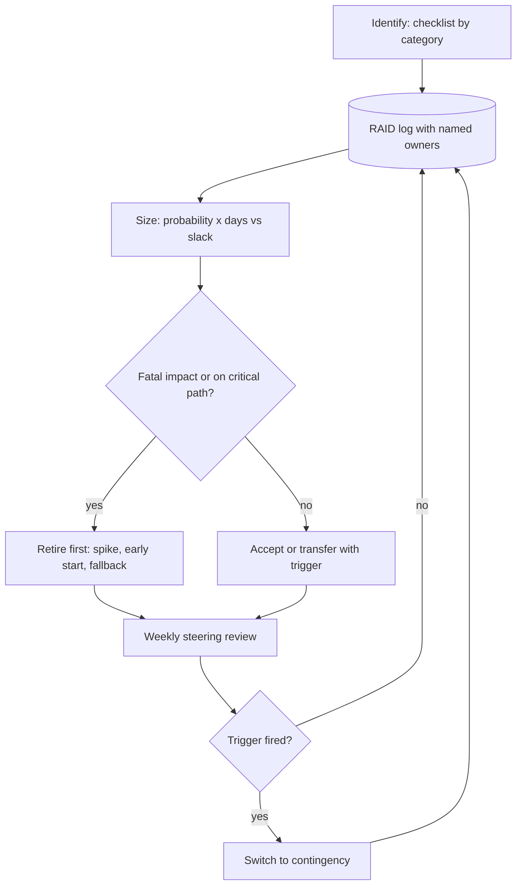

## TL;DR
Agent projects slip on things the team does not control: data, tool API access, security reviews, SME
time, quotas. Map dependencies with owners and need-by dates, size risks in days, and retire the biggest
with cheap spikes, so surprises arrive in week one.

## For agent builders
- **Why it matters for agents.** An agent is only as available as its tools. Every tool means a customer
  API, credentials, a sandbox, rate limits and often a security approval for write access, each owned by
  someone else and each able to stall the build.
- **Where it shows up in your stack.** Tool credentials and sandbox environments, provider quotas and
  regional availability, the adapter layer around model calls, and the eval set that needs real data
  before anything can be accepted.
- **What you control.** Spiking each tool integration against the real API in week one, putting model
  calls behind an adapter, recording each dependency with a named owner and date, and wiring triggers to
  pre-agreed contingencies.
- **What you can skip.** Formal risk-management frameworks in depth. The NIST AI RMF has its own lesson; a
  living RAID log with numbers is what scoping needs.

## Decision case
### Scenario
A freight forwarder is piloting a customs-declaration agent. It reads shipments with `get_shipment`,
proposes tariff codes, and files declarations through the customs broker's API with
`submit_declaration`. The pilot has 12 weeks and a go-live fixed by a contract renewal. All figures are
illustrative.

Constraints and the week-1 RAID log:
- **Slack.** 6 working days on the critical path; the end date cannot move.
- **Data residency.** Declaration data must stay in the EU; the CISO has not yet approved the external
  model API.
- **Team.** Three engineers, with about 5 engineer-days spare off the critical path.

| ID | Risk on the critical path | Prob | Impact | Expected |
|---|---|---|---|---|
| R1 | Broker's filing sandbox arrives late | 0.5 | 12 days | 6.0 days |
| R2 | CISO rejects the external model API for EU data | 0.25 | 24 days (rebuild on an in-region model) | 6.0 days |
| R3 | Write approval for `submit_declaration` refused or late | 0.4 | 20 days | 8.0 days |

Total critical-path exposure is 20.0 expected days against 6 of slack, so the plan as drawn is not
credible.

### Options
| Option | How it works | Exposure vs 6 days slack | Meets the fixed date? | Cost |
|---|---|---|---|---|
| **A. Pad the schedule** | Add 3 weeks (15 days) of buffer | 20.0 vs 21 | No: moves go-live | None in engineering |
| **B. Provider adapter and in-region fallback** | Model calls behind an adapter; R2's impact falls from 24 to 4 days | 15.0 | No | 5 engineer-days, off the critical path |
| **C. Drafts instead of writes in the pilot** | The agent prepares the declaration and a broker submits it; R3 leaves the pilot, R1 falls to 3 days because drafts are checked against the broker's published schema | 7.5 | No | Smaller pilot saving per declaration |
| **D. B and C together** | Adapter plus draft-only filing | 2.5 | Yes | 5 engineer-days and the smaller saving |

### Decision
Choose **D**, because no single response brings exposure under the slack:
- **C removes the fatal risk.** A refused write approval would leave the pilot without its core action.
  That is a risk to plan by impact, not expected days, and drafting avoids it outright.
- **B turns R2 into a configuration switch.** With the adapter, a CISO rejection costs about 4 days, so
  R2's expected delay falls from 6.0 to 1.0.
- **The arithmetic holds.** R1 at 0.5 × 3 = 1.5 plus R2 at 0.25 × 4 = 1.0 gives 2.5 expected days, inside
  the 6 of slack.
- **The spare effort pays for it.** The adapter uses the 5 spare engineer-days, which are off the critical
  path.

Start the security review and the write-approval request on day 0 anyway, so `submit_declaration` can be
promoted after the pilot.

What would change it:
- **Written API approval by day 10.** If the CISO approves the external model API in writing, drop the
  adapter build and spend the days on the eval set.
- **Sandbox delivered in week 1.** Then R1 is retired, and C alone (exposure 6.0) fits the slack exactly,
  with no margin; keep B.
- **The case needs autonomous filing.** If the ROI break-even needs automatic submission, a draft-only
  pilot cannot prove the value, and the end date must move instead.

### Trade-offs accepted
- **The pilot shows a smaller saving.** Brokers still review and submit each draft. Watch draft
  acceptance rate and minutes per approval, the evidence for promoting the write tool.
- **The adapter is effort that may never be used.** It is cheap insurance against a 24-day rebuild;
  monitor the CISO decision date as a trigger.
- **Numbers are rankings, not forecasts.** Re-run exposure after each spike and report the trend weekly.
- **Approval risk moves to the next phase.** Keep R3 open in the RAID log with a named owner and date.

### Review rubric
- **Exposure is computed against slack,** with probability and impact in days for each critical-path risk.
- **Fatal risks are planned by impact.** The write-up names any risk that would stop the pilot and
  avoids or contains it, whatever its expected days.
- **Each response shows its effect** on the numbers, and the combination is checked against the slack.
- **Cost of each response is stated,** including what the pilot can no longer prove.
- **Triggers are dated and owned,** such as an approval deadline that switches to the contingency.
- **Reversal conditions are concrete.** It names the approval, delivery or ROI fact that changes it.

## Why it exists
- **The plan says "weeks 1–2: data ingestion"; reality differs.** Week 1 is spent learning the document
  system's export needs a ticket to a team with a three-week queue. Week 3 reveals a third of the documents
  are scanned images. Week 5 brings the security verdict that customer data cannot go to an external API in
  that region.
- **None of these is an engineering failure,** yet each moves the delivery date, and the team takes the
  blame because nobody wrote the dependency down with an owner and a date.
- **A kickoff-deck risk list gives no protection.** Written once and never reopened, it records risks and
  drives no action. Rating everything "medium" makes it impossible to prioritise.
- **Watching risks instead of retiring them** leaves the biggest unknowns (data quality, security approval,
  feasibility on real inputs, whether the agent's tools actually behave as documented) unresolved until
  late, when there is no slack left to absorb them.
- **AI adds its own risks:** the data may not support the task, the eval set may not represent production,
  model behaviour can change when a provider updates or retires a version, and quotas or regional
  availability can block a deployment design that worked in a demo.

## How it works
### Keep a RAID log
One living log, because each category triggers a different action:

| Category | Meaning | Action |
|---|---|---|
| **R**isks | things that might happen | get a response |
| **A**ssumptions | treated as true but not verified | get verified |
| **I**ssues | risks that have already happened | get resolved now |
| **D**ependencies | inputs owned by someone else | get chased by their owner |

### Map dependencies
1. **Record each one:** what is needed (in a specific format), who owns it (a named person, not "IT"), the
   realistic lead time, the need-by date derived from the plan, and the status. For agents, list each
   tool's API access, credentials and sandbox as separate rows.
2. **Find the critical path:** the chain of dependent tasks with zero slack, such as data export → eval set
   → PoC → pilot sign-off. Anything on that chain slips the end date day for day; anything off it has slack
   you can spend.
3. **Start the longest-lead items first.** Security reviews, legal agreements, procurement and approvals
   for write-capable tools often take longer than the engineering, so they should start in week zero,
   before anything is built.

### Identify risks by category
Walk a checklist so you do not rely on memory:
- **Data:** availability, quality, volume, representativeness, rights to use.
- **Access and security:** credentials, network paths, approval of external model APIs, data residency,
  approval for the agent to write to customer systems.
- **Technical and model:** feasibility on real inputs, latency or cost at volume, provider quotas,
  deprecation of a model version, customer API rate limits and undocumented tool behaviour.
- **People and adoption:** SME availability, sponsor turnover, user resistance.
- **Commercial and vendor:** pricing changes, contract terms, lock-in.
- **Regulatory and harm:** whether outputs or agent actions could harm users or breach rules. This overlaps
  with AI-system risk management (frameworks such as the NIST AI RMF), which is covered in its own lesson.

### Assess in units people can act on
- **Score likelihood and impact,** with impact in schedule days or money where possible, not "high".
- **Expected delay = probability × impact,** which compares directly with the slack on the affected path.

| Risk | Probability | Impact | Expected | Path slack | Effect on end date |
|---|---|---|---|---|---|
| A | 50% | 15 days | 7.5 days | 0 (critical path) | lands directly |
| B | 90% | 2 days | 1.8 days | 10 days | absorbed |

- **Expected delay ranks risks but is not the whole story.** A 10% chance of a 60-day slip has the same 6
  expected days as a near-certain 6-day slip, yet only the first can end the engagement.
- **Plan fatal risks by impact, not expected value.** If the pilot could be unable to run at all, or a
  budget window could close, buy the risk down early or prepare a contingency whatever its expected days
  say.

### Choose a response and a trigger
| Response | How |
|---|---|
| **Avoid** | change the plan, for example drop a write tool from the pilot |
| **Reduce** | a spike, a fallback or an earlier start |
| **Transfer** | to the party best placed to own it, for example a data date as a customer obligation in the SOW |
| **Accept** | with a contingency plan |

- **Give each risk an early-warning trigger,** such as "export not received by day 10", so switching to the
  contingency is a pre-agreed step rather than a debate held in a crisis.

### Retire the biggest unknowns first
- **Order early work by the uncertainty it removes,** not by the order the architecture suggests. A two-day
  spike on 50 real documents removes more risk than two weeks of polished pipeline code over synthetic ones.
- **For agents, spike each tool against the real API:** call it with real credentials in a sandbox, check
  the response shape and rate limits, and see whether the model picks it correctly from its description.
- **Review the log weekly** at the steering meeting, with escalation thresholds agreed in the SOW.

## Diagram
The weekly risk loop: every item gets sized against slack, a response and a trigger, and a fired trigger
switches to a pre-agreed contingency.



## Examples
### Worked scenario: 10-week contract-review pilot
A 10-week pilot of a contract-review assistant for a legal department. All figures are illustrative. At
kickoff the RAID log holds these top items:

| ID | Item | Owner | Prob | Impact | Exp. days | Response and trigger |
|----|------|-------|------|--------|-----------|----------------------|
| D1 | DMS export of 3,000 contracts | Customer IT | — | critical path | — | Ticket raised day 0; need-by end of week 2 |
| R1 | Security review rejects external LLM API | Customer CISO | 0.3 | 20 days | 6 | Start review day 0; adapter layer allows in-region hosted model |
| R2 | Many contracts are scans with poor OCR | Delivery lead | 0.5 | 10 days | 5 | Spike on 50 real files in week 1 |
| R3 | SME lawyers miss labelling sessions | Customer GC | 0.6 | 5 days | 3 | Book sessions now; trigger if <75% attended in week 3 |
| R4 | Provider quota too low for batch backfill | Engineer | 0.2 | 3 days | 0.6 | Request increase week 1; accept |

- **The plan as drawn is not credible.** D1, then R1 and R2, sit on the critical path, because the eval set
  needs the export and the pilot needs security approval. Plan slack is 5 days, and the expected delays
  from R1 and R2 alone (11 days) exceed it.
- **What the team did:**
  1. Submitted the security questionnaire on day 0, not when the pilot was ready.
  2. Ran the OCR spike in week 1. It found 30% of files are scans and OCR is acceptable on 80% of them, so
     R2 dropped to a 3-day impact.
  3. Wrote D1's need-by date into the SOW, so a late export moves the schedule.
- **Outcome:** in week 4 the security review asked for an in-region deployment. Because R1 had a
  contingency, the switch took 4 days instead of the 20 it would have cost unplanned.

### Worked scenario: tool dependencies for a service-desk agent (illustrative)
An agent that triages IT tickets needs four tools. Each is a separate dependency with its own owner and
lead time.

| Tool | Needs | Owner | Lead time | Need-by | Risk and response |
|---|---|---|---|---|---|
| `search_kb` (read) | API key, sandbox | KB admin | 3 days | week 1 | low; accept |
| `get_user_devices` (read) | service account, network path | Endpoint team | 10 days | week 2 | on critical path; request day 0 |
| `reset_mfa` (write) | security approval for agent writes | CISO | 25 days | week 6 | 40% chance of refusal; avoid by shipping it as "draft for human" first |
| `create_ticket` (write) | sandbox with rate limit of the real system | ITSM owner | 5 days | week 3 | spike in week 1 to read the real limit |

- **The write tool drives the schedule,** not the model. Shipping `reset_mfa` as a human-approved draft
  turns a fatal-impact risk into a later scope addition.
- **The week-1 spike on `create_ticket`** finds a much lower rate limit than the docs claimed, so the agent
  gets a queue and retry budget before the pilot instead of failing under load.

### Exposure calculator for the weekly review
Ranks risks by expected days, flags fatal-impact ones, and compares critical-path exposure with slack.
Re-run it after each spike; the numbers reproduce the contract-review scenario above.

```python
RISKS = [  # id, probability, impact in schedule days, on critical path?
    ("R1", 0.3, 20, True),    # security review rejects external LLM API
    ("R2", 0.5, 10, True),    # scans with poor OCR
    ("R3", 0.6, 5, False),    # SMEs miss labelling sessions
    ("R4", 0.2, 3, False),    # provider quota too low for backfill
]
SLACK_DAYS = 5
FATAL_DAYS = 30               # illustrative: a slip this large would end the engagement

def report(risks, slack=SLACK_DAYS):
    for rid, p, days, critical in sorted(risks, key=lambda r: r[1] * r[2], reverse=True):
        flag = "  FATAL-IMPACT: plan by impact" if days >= FATAL_DAYS else ""
        print(f"{rid} expected {p * days:4.1f} days  critical={critical}{flag}")
    exposure = sum(p * d for _, p, d, c in risks if c)
    print(f"critical-path exposure {exposure:.1f} days vs slack {slack}: "
          f"plan {'not credible' if exposure > slack else 'holds'}")

def with_impact(risks, rid, days):
    return [(i, p, days if i == rid else d, c) for i, p, d, c in risks]

report(RISKS)                                    # 11.0 vs 5: not credible
after_spike = with_impact(RISKS, "R2", 3)        # OCR spike: R2 impact 10 -> 3 days
report(after_spike)                              # 7.5 vs 5: still not credible
report(with_impact(after_spike, "R1", 4))        # adapter contingency: R1 20 -> 4 days, 2.7 vs 5 holds
```

- **Exposure should fall week by week** as spikes and contingencies retire unknowns; here it goes 11.0, then
  7.5, then 2.7 days.

## Production patterns
- **RAID log as a shared, owned document.** Keep it where both delivery team and customer edit it, with a
  named person per row and a need-by date per dependency, including one row per agent tool. Monitor the
  count of dependencies past their need-by date at every weekly steering meeting.
- **Week-zero approvals.** Submit the security questionnaire, data processing agreement, write-access
  approvals for agent tools and procurement requests on day 0, in parallel with building. Track each
  approval's age against its expected lead time.
- **Provider seam for contingencies.** Put model calls behind an adapter interface so a switch to an
  in-region or alternative hosted model is a configuration change. Monitor provider quota usage, regional
  availability and announced model deprecation dates.
- **Spike-first backlog.** Schedule one- to two-day spikes on real data and real tool APIs for every risk
  on the critical path before building pipeline code. Track total critical-path exposure week by week; a
  flat or rising curve means the work is not attacking the risks.
- **Read-only first, writes behind approval.** Launch tools that write to customer systems as drafts a
  human approves, and promote them once approval and evals allow. Monitor approval rate and reverted
  actions per write tool.
- **Triggers wired to the calendar.** Turn each trigger (for example "export not received by day 10") into
  a dated check owned by a person, with the contingency pre-agreed in steering notes. Monitor fired
  triggers and time from trigger to switch.

## Trade-offs
- **Coverage vs steering time.** A detailed RAID log catches more surprises but costs steering time every
  week. Keep the top ten items active and archive the rest, unless the engagement is regulated or
  multi-vendor.
- **Early certainty vs visible progress.** Front-loading spikes removes uncertainty early but delays visible
  demo progress. That trade is worth making whenever a feasibility, data or tool-access risk sits on the
  critical path.
- **Schedule protection vs relationship.** Transferring risk to the customer through dated obligations
  protects the schedule but can strain the relationship. Frame it as shared planning, and only for items
  they genuinely control.
- **Cheap contingency vs upfront effort.** Building contingency architecture, such as a provider adapter or
  in-region fallback, costs effort upfront. It pays off when security or provider approval is uncertain,
  and is waste when approval is already confirmed.
- **Real prioritisation vs false precision.** Quantified scoring (probability × days) gives real
  prioritisation but implies false precision. Treat the numbers as ranking tools, not forecasts, when the
  estimates are rough.

## Pitfalls
- **Writing the risk list once at kickoff.** Symptom: a deck slide that still lists "data quality" as medium
  in week 8, after it has already caused a slip. Fix: a living RAID log reviewed at every steering
  meeting.
- **Naming teams instead of people as owners.** Symptom: a dependency marked "with IT" for three weeks with
  nobody able to say who is working on it. Fix: one named person and a need-by date per row.
- **Starting security and legal reviews only when the system is ready.** Symptom: a finished agent pilot
  that waits a month for approval to touch production data or write to a customer system. Fix: submit
  them on day 0, in parallel with building.
- **Building tools against API docs instead of the real API.** Symptom: in pilot week the agent hits rate
  limits, auth scopes or response fields the docs never mentioned. Fix: a week-one spike per tool.
- **Accepting risks without triggers or contingencies.** Symptom: a crisis meeting debating options that
  could have been decided calmly in week one. Fix: a dated trigger and a pre-agreed contingency per risk.
- **Ignoring model and provider risks.** Symptom: a deployment design that fails on quota, regional
  availability or a deprecated model version in the final week. Fix: track quota headroom and deprecation
  dates as risks, behind a provider adapter.

## When to use
- **Use when:** scoping, before the SOW is signed, because dated customer dependencies and known risks
  belong in the SOW itself. Then review the log weekly for the life of the engagement.
- **Lighter version:** even a two-week internal agent PoC benefits from a ten-line version naming the data,
  tool access and people it depends on.
- **Measure:** count dependencies past their need-by date, compare expected delay with slack on the critical
  path, and track total exposure (the sum of expected days on the critical path) week by week. Exposure
  should fall as spikes retire unknowns; a flat or rising curve means the work is not attacking the risks.
- **Interviews:** expect "what could stop this project?" The strong answer names specific, owned
  dependencies and the spike that would retire the biggest unknown first.

## Role lens
- **Engineer:** Runs the early spikes that retire technical and data risks, and builds the adapters
  and fallbacks that turn contingencies into small switches.
- **Architect:** Identifies architectural risks such as data residency, provider lock-in, quotas and
  deprecation, and designs seams so the contingency is cheap to execute.
- **FDE:** Owns the RAID log with the customer, chases named owners for access and data, and escalates
  through the steering group when a trigger fires.

## Check yourself
**Q:** You are two weeks into a 12-week pilot. The data export is late, SMEs have missed one labelling
session, and the security review has not started. How do you prioritise, and what do you change?
**A:** First I would map which items sit on the critical path. The security review usually has the
longest lead time and gates any production-data pilot, so not having started it is the biggest risk.
I would get it submitted this week, with an architecture fallback ready in case external APIs are
rejected. The late export is a dependency on the critical path, so I would name a specific owner,
agree a new date, and invoke the SOW clause that moves milestones day for day. The missed SME session
is a risk to watch: rebook it and set an attendance trigger. Then I would re-estimate expected delay
against remaining slack and tell the sponsor now whether the end date still holds.

## Interview questions
### What is a RAID log, and why keep four categories instead of one risk list?
- **Definition:** a living log of risks, assumptions, issues and dependencies, each row with a named owner.
- **Why four:** each category triggers a different action. Assumptions get verified, risks get a response
  and trigger, issues get resolved now, and dependencies get chased by their owner.

### What are the biggest risks specific to an agent pilot that an ordinary software plan misses?
- **Data and evaluation:** the data may not support the task, scans or poor OCR can surface weeks in, and
  the eval set may not represent production inputs.
- **Tools:** each tool is a customer API with credentials, rate limits and undocumented behaviour, and
  write access needs its own security approval.
- **Approval:** security review of external model APIs and data residency, often the longest lead time.
- **Provider:** behaviour changes when a model version is updated or retired, and quotas or regional
  availability can block a design that worked in a demo.

### Your agent needs a write tool whose security approval may take 25 days and might be refused. How do you plan around it?
- **Treat it as fatal-impact if the agent is useless without it,** and start the approval on day 0.
- **Avoid the risk in the pilot:** ship the tool as a draft a human approves, so the pilot runs on read
  tools and approved drafts while the review proceeds.
- **Keep a trigger:** if approval is not granted by an agreed date, the write path stays human-approved
  for launch and becomes a later change request.

### When would you plan by impact rather than by expected delay?
- **When the impact would be fatal,** such as the pilot being unable to run at all or a budget window
  closing.
- **Example:** a 10% chance of a 60-day slip and a near-certain 6-day slip both carry 6 expected days, but
  only the first can end the engagement, so buy it down early or prepare a contingency.

### Your critical-path exposure is 11 expected days against 5 days of slack in week 1. What do you do?
- **Say now that the plan is not credible,** rather than at the deadline.
- **Attack the biggest items:** submit the security review on day 0, build an adapter for an in-region
  fallback, run a spike on 50 real files, and write the export need-by date into the SOW.
- **Re-run the numbers** after each action and report the exposure trend to the sponsor weekly.

### How do you make customer dependencies enforceable without damaging the relationship?
- **Make them dated SOW obligations** with a day-for-day schedule consequence, only for items the customer
  genuinely controls.
- **Frame it as shared planning:** named owners, need-by dates visible in the shared log, and early-warning
  triggers agreed together, so a slip is a known step rather than blame.

## Quiz
### Q: Why should a security review or data-processing agreement usually start in week zero?
- [ ] Reviewers prefer to see an early design rather than a finished system
- [ ] It is a legal requirement before any code is written
- [x] It often has the longest lead time and gates the pilot, so starting late puts its full duration on the critical path
- [ ] Starting early lets the team skip the review if nobody objects
> Approval processes are frequently slower than the engineering and block access to real data.
> Starting them first runs them in parallel with building, instead of serially after it.

### Q: A risk has a 50% chance of a 15-day slip on the critical path; another has a 90% chance of a 2-day slip on a path with 10 days of slack. Which matters more?
- [ ] The second, because it is more likely to happen
- [x] The first, because its expected delay of 7.5 days lands directly on the end date
- [ ] They are equal, because both are rated likely
- [ ] Neither, because risks under 20 days are acceptable
> Expected delay is probability × impact, and a slip moves the end date only by the amount it exceeds
> the slack on its path. The second risk's 2-day slip, even if it happens, is fully absorbed by 10 days
> of slack, while the first lands directly on the end date with 7.5 expected days.

### Q: What distinguishes an assumption from a risk in a RAID log?
- [ ] Assumptions are low-impact risks
- [ ] Risks are owned by the customer, while assumptions are owned by the vendor
- [ ] Assumptions are issues that have already happened
- [x] An assumption is something treated as true but unverified, so its action is to verify it
> Each RAID category has a different action. Assumptions get verified, because a false one usually
> becomes a risk or issue. Risks get a response and a trigger, issues get resolved now, and dependencies
> get chased with their owner.

## Use cases & projects
### Use cases
- **Agents that integrate with customer systems.** One RAID row per tool (credentials, sandbox, rate limit,
  write approval) shows which integration will gate the pilot.
- **Regulated or data-residency customers.** An adapter seam plus a day-0 security review turns "no external
  API in this region" into a 4-day switch instead of a 20-day slip.
- **Model deprecations and quota limits.** Tracking provider deprecation dates and quota headroom as risks
  avoids a final-week surprise in a batch backfill or launch.
- **Weekly steering with a sponsor.** The exposure trend gives an honest, numeric answer to "will we hit
  the date?"

### Mini project
**RAID log and tool spikes for a planned agent (2-3 hours).**
- **Goal:** find the dependency that will gate a planned agent before writing its loop.
- **Steps:** pick an agent with three or four tools against real or public APIs; write one RAID row per
  tool plus data, model provider and approval rows, each with owner, lead time and need-by date; run a
  short spike per tool (authenticate, call it, record response shape and rate limit); size each risk in
  days and run the exposure calculator before and after the spikes.
- **Done when:** you have a RAID log with named owners, a spike note per tool listing at least one
  surprise against its docs, and an exposure number that fell after the spikes, with the remaining top risk
  and its trigger written down.
