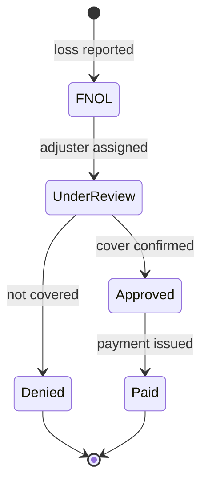

## TL;DR
Domain modeling captures the customer's entities, relationships, lifecycles, rules and vocabulary in one
agreed model reused by schemas, prompts, retrieval and evals. A model knows generic meanings, so unstated
mismatches ("active", "closed") produce confident, silently wrong outputs.

## Why it exists
- **Every organisation has a private dialect.** In one insurer "claim" means a single loss event; in
  another it means each coverage line within it. "Active customer" might mean "has a contract", "logged in
  this quarter" or "billed this month", depending on whether you ask sales, product or finance.
- **The knowledge lives in heads.** Experienced staff carry these distinctions, and the documents they
  write assume them.
- **A model brings the opposite: a broad, average sense of each word** learned from public text. Asked to
  "count active customers" or "extract the claim date", it picks a plausible generic meaning.
- **The error is silent.** The output is fluent and well formatted, so the wrong number, or the report date
  instead of the loss date, flows down the pipeline.
- **The naive fixes fail.**
  - *Letting the model infer meaning* works only when documents are consistent, and they rarely are across
    departments.
  - *Patching each misunderstanding in the prompt* piles up special cases that disagree with the database
    schema, retrieval filters and evaluation labels, because each was written separately.
- **One explicit model replaces the patches.** Agreed with subject-matter experts (SMEs), every component
  reads from it. It also forces scope-changing questions: which entity has the identity, which states
  exist, and which rules the system must never violate.

## How it works
### 1. Build the glossary first
- **List the terms** from interviews, documents and screens, each with a one-line definition, an example and
  a counter-example.
- **Domain-driven design calls the result the *ubiquitous language*:** one vocabulary shared by experts,
  code and documentation.
- **Start here** because most domain errors in AI systems are vocabulary errors, and a glossary is cheap to
  validate with SMEs.

### 2. Identify entities and value objects
| Kind | Definition | Examples | What AI must do |
|---|---|---|---|
| **Entity** | Identity persists while attributes change | A claim, a policy, a customer | Resolve to an existing identifier (which customer is this email about?) |
| **Value object** | Defined only by its attributes | An address, a money amount with currency | Parse correctly |

**Identity resolution deserves its own design**, because it is where extraction most often silently fails.
Resolve in order of reliability:

1. **Exact key found in the text** (a claim number matching the agreed pattern).
2. **Deterministic lookup on strong attributes** (policy number plus loss date).
3. **Fuzzy matching on weak attributes** (a name and a postcode).
4. **Ask a person.**

- **Record which rule matched**, because a record linked by a fuzzy name match should be treated with less
  trust than one linked by key.

### 3. Map relationships and cardinality
- **Record how entities relate:** a policy has many claims, a claim has many coverage lines, a customer can
  hold several policies.
- **Cardinality decides retrieval and reasoning.** "The customer's deductible" is ambiguous when the
  customer has three policies, so the system must ask or choose by rule.

### 4. Model lifecycles as state machines
- **For each key entity, list its states, the permitted transitions, and who or what triggers each.**
- **This lets an AI system reason about "what can happen next"** and stops an agent from taking an action
  the business forbids (paying a claim that was never approved).

### 5. Write down invariants and business rules
| Type | Meaning | Example |
|---|---|---|
| **Invariant** | Always holds | A loss date is never after the report date; the payment total never exceeds the approved amount |
| **Rule** | Guides decisions | Claims above a threshold need a second approver |

- **Enforce invariants in code as validators**, because a model can be asked to respect them but cannot be
  trusted to always do so.
- **Some invariants span several entities.** "The sum of payments across a claim's coverage lines never
  exceeds its approved amount" cannot be checked by looking at one line.
- **DDD groups such entities into an aggregate** with one root (the claim) through which all changes go, so
  the root can check the rule on every change.
- **For an agent, the aggregate is the unit a tool acts on.** Expose `add_payment(claim_id, …)` on the
  claim, not a raw "update coverage line" tool that can break the total.

### 6. Draw bounded contexts
- **Where the same word means different things, do not force one definition.** Model each context
  separately and define the translation between them.
- **In AI terms,** each context often gets its own schema, prompt glossary and retrieval index.

### 7. Project the model into every artefact
| Model element | Projection |
|---|---|
| Entities and fields | Typed schemas for structured output and extraction |
| Allowed values | Enums that constrain classification labels |
| Glossary | A glossary section in prompts |
| Key attributes | Metadata fields for retrieval filters |
| Relationships | Entity and relationship types, if a knowledge graph is warranted |
| States, rules, edge cases | The label set and edge cases for evaluation |

- **One source, many projections**, because divergence between them is where silent errors come from.

### 8. Validate with instances, not diagrams
- **SMEs rarely critique a class diagram well**, but they spot errors instantly in concrete examples: "this
  claim would never be in that state".
- **Walk real records through the model.**

## Diagram
The claim lifecycle from the example: only these transitions are permitted, so an agent's attempt to pay a
claim still under review is rejected in code.



## Examples
### One schema for extraction, glossary, invariant and lifecycle
A slice of an insurer's claims domain, agreed with claims SMEs, expressed as a Pydantic v2 schema. The
same class constrains LLM extraction output, documents the glossary in field descriptions, enforces an
invariant and guards lifecycle transitions that an agent might attempt.

```python
from datetime import date
from decimal import Decimal
from enum import Enum
from pydantic import BaseModel, Field, model_validator

class ClaimStatus(str, Enum):           # lifecycle agreed with claims SMEs
    FNOL = "first_notice_of_loss"
    UNDER_REVIEW = "under_review"
    APPROVED = "approved"
    DENIED = "denied"
    PAID = "paid"

ALLOWED = {                             # which transitions the business permits
    ClaimStatus.FNOL: {ClaimStatus.UNDER_REVIEW},
    ClaimStatus.UNDER_REVIEW: {ClaimStatus.APPROVED, ClaimStatus.DENIED},
    ClaimStatus.APPROVED: {ClaimStatus.PAID},
    ClaimStatus.DENIED: set(), ClaimStatus.PAID: set(),
}

class Claim(BaseModel):
    claim_id: str = Field(pattern=r"^CLM-\d{8}$")         # identity comes from the claims system
    policy_number: str = Field(description="Policy, not the customer account number")
    loss_date: date = Field(description="Date the loss happened, not the date it was reported")
    reported_date: date
    status: ClaimStatus
    reserve_amount: Decimal = Field(ge=0, description="Estimated liability, not the amount paid")

    @model_validator(mode="after")
    def loss_before_report(self):
        if self.loss_date > self.reported_date:           # invariant stated by SMEs
            raise ValueError("loss_date cannot be after reported_date")
        return self

def transition(claim: Claim, new: ClaimStatus) -> Claim:
    if new not in ALLOWED[claim.status]:
        raise ValueError(f"{claim.status.value} -> {new.value} is not a permitted transition")
    return claim.model_copy(update={"status": new})

c = Claim(claim_id="CLM-00412345", policy_number="HX-778", loss_date="2026-03-02",
          reported_date="2026-03-05", status="under_review", reserve_amount=4200)
print(transition(c, ClaimStatus.APPROVED).status.value)   # approved
transition(c, ClaimStatus.PAID)   # raises: under_review -> paid is not a permitted transition
```

- **Field descriptions carry the glossary** into the JSON schema the model sees.
- **The enum restricts status** to the agreed states.
- **The validator rejects** an extraction that swaps the loss and report dates.
- **The reserve is a `Decimal` rather than a `float`** because money is a value object whose arithmetic must
  be exact; binary floats cannot represent most decimal amounts and accumulate rounding error in totals.

### An aggregate that guards a cross-line invariant
The claim is the aggregate root, so the only way to pay a coverage line is through it. Each payment would
pass a per-line check; only the root sees the total. Pure Python, amounts illustrative.

```python
from dataclasses import dataclass, field
from decimal import Decimal

@dataclass
class CoverageLine:
    line_id: str
    paid: Decimal = Decimal("0")

@dataclass
class ClaimAggregate:                       # the root: every change goes through it
    claim_id: str
    approved_amount: Decimal
    lines: dict[str, CoverageLine] = field(default_factory=dict)

    def total_paid(self) -> Decimal:
        return sum((l.paid for l in self.lines.values()), Decimal("0"))

    def add_payment(self, line_id: str, amount: Decimal) -> None:
        if amount <= 0:
            raise ValueError("payment must be positive")
        if self.total_paid() + amount > self.approved_amount:   # cross-line invariant
            raise ValueError(f"would pay {self.total_paid() + amount}, approved {self.approved_amount}")
        self.lines[line_id].paid += amount

claim = ClaimAggregate("CLM-00412345", Decimal("5000"),
                       {"building": CoverageLine("building"), "contents": CoverageLine("contents")})
claim.add_payment("building", Decimal("3000"))
claim.add_payment("contents", Decimal("1500"))
print(claim.total_paid())                   # 4500
try:
    claim.add_payment("contents", Decimal("800"))   # each line alone looks fine; the total does not
except ValueError as e:
    print("rejected:", e)                   # rejected: would pay 5300, approved 5000
```

- **Expose `add_payment` as the agent's tool,** not a generic "update coverage line" write, so the tool
  surface cannot express a payment that breaks the total.

### Worked scenario: resolving the claim an email is about
Five inbound emails, resolved with the cascade from step 2 (illustrative).

| Email contains | Rule that matched | Trust | Action |
|---|---|---|---|
| "CLM-00412345" | Exact key | High | Link automatically |
| Policy HX-778 and loss date 2 March | Strong-attribute lookup, one claim found | High | Link automatically |
| Policy HX-778 only, customer has two open claims | Strong lookup, two candidates | Ambiguous | Ask a person |
| Name and postcode | Fuzzy match | Low | Link with a review flag |
| No identifiers | None | None | Ask a person |

- **Storing the matched rule** on each record lets downstream steps, and auditors, treat fuzzy links
  differently from key links.

## Production patterns
- **Glossary and schema in version control** — keep the glossary, enums and Pydantic models in one module
  and generate the prompt glossary section and the structured-output schema (`model_json_schema()` in
  Pydantic v2) from it, so they cannot drift. Review changes with SMEs like any other code change.
- **Validate, then reject or escalate** — run every model output through the schema and invariant
  validators before it is written anywhere; send failures to a review queue rather than retrying silently
  forever. Monitor validation-failure rate per field, because a spike usually means a new document layout or
  vocabulary drift.
- **Escape hatch in enums** — while the domain is still being discovered, include an explicit "other" or
  "needs review" value in classification enums. Monitor its share; a growing share signals a missing
  category to add to the model.
- **Match provenance field** — store which identity-resolution rule linked each extracted record (key,
  strong lookup, fuzzy, human). Monitor the fuzzy share and audit a sample of fuzzy links regularly.
- **Aggregate-shaped agent tools** — give agents tools that act on aggregate roots and enforce invariants
  inside the tool, never raw row-level writes. Log rejected tool calls; they show where the agent's plan
  disagrees with the business rules.
- **Record walkthroughs as eval cases** — every SME correction from a walkthrough becomes a labelled
  evaluation case, so the model's edge cases accumulate in the test set. Track remaining corrections per
  walkthrough as the model's maturity measure.

## Trade-offs
- **Precision vs SME time.** An explicit model prevents silent vocabulary errors, but takes SME time to
  agree. When the task is a narrow, single-team summarisation, a short glossary in the prompt may be all you
  need.
- **Reliability vs coverage.** Strict schemas and enums make outputs reliable and testable, but reject
  legitimate cases the model did not foresee. Add an explicit "other" or escalation path when the domain is
  still being discovered.
- **Separate contexts vs translation code.** Bounded contexts keep each definition precise, but require
  translation code between them. That pays off when departments genuinely disagree, and is overhead when
  they do not.
- **Graph vs maintenance.** A knowledge graph makes relationships queryable and explainable, but is costly
  to build and keep in sync. It is worth it when questions routinely traverse several relationships, not
  for flat lookups.

## Pitfalls
- **Defining terms from documents alone, without SMEs.** Symptom: a glossary that reads well but gets
  corrected on almost every example walked through with the people who do the work.
- **Letting prompts, schemas and evaluation labels drift apart.** Symptom: a model that passes its own tests
  while users report it uses terms differently from the reporting dashboards.
- **Forcing one meaning across bounded contexts.** Symptom: endless debates over a field definition and
  outputs that are right for one department and wrong for another.
- **Enforcing invariants only through prompt instructions.** Symptom: a rare but recurring output that
  violates a rule the business considers impossible, discovered by an auditor.
- **Giving an agent write tools on individual records inside an aggregate.** Symptom: each update passes its
  own validation while the combination violates a cross-record rule, such as payments exceeding the
  approved total.
- **Modelling entities without identity resolution.** Symptom: extracted records that name a customer or
  policy but cannot be linked to the system of record, so downstream steps fail.

## When to use
- **Use when** the AI system extracts, classifies or acts on business entities, when several teams or
  systems share data, and when outputs feed reports or decisions.
- **Timing:** right after discovery and workflow analysis, before writing prompts or schemas.
- **Keep it lightweight:** a glossary, key entities, one or two state machines and the invariants.
- **Measure:** how many SME corrections remain when you walk real records through it, and whether every
  schema, enum and evaluation label traces back to it.
- **Interviews:** explaining how one domain model projects into prompts, schemas, retrieval filters and
  evaluation labels shows architectural maturity.

## Role lens
- **Engineer:** Encodes the model as typed schemas, enums and validators used for structured outputs, and
  rejects or escalates model outputs that violate invariants instead of passing them on.
- **Architect:** Owns bounded-context boundaries and the canonical model, deciding where translation
  happens and whether a knowledge graph or relational schema represents the domain.
- **FDE:** Runs glossary and example-walkthrough sessions with the customer's experts, and catches the
  terms that mean different things in different departments before they reach a prompt.

## Check yourself
**Q:** A retail customer wants an assistant that answers "how many active customers do we have in each
region?" from their warehouse and documents. Sales, finance and marketing each define "active"
differently. How do you handle it?
**A:** Treat it as a bounded-context problem, not a prompt problem. Agree each definition with its owning
team, give each a distinct name in the glossary (contracted, billed in the last 30 days, engaged in the
last 90 days), and implement each as a deterministic metric in the warehouse or semantic layer, not as
something the model computes. The assistant's job becomes mapping a question to the right named metric
and asking for clarification when "active" is ambiguous, citing which definition it used. Evaluation
cases then include ambiguous phrasings to confirm it asks or chooses by an agreed default.

## Interview questions
### Why does an LLM system need an explicit domain model when the model already understands language?
- **The model knows generic meanings;** the customer's words have specific ones, such as "claim" meaning a
  loss event in one insurer and a coverage line in another.
- **Mismatches are silent:** fluent, well-formatted output with the report date instead of the loss date
  passes every format check.
- **One agreed model** feeds schemas, prompts, retrieval filters and eval labels, so they cannot disagree.

### Extracted records keep failing to link to the claims system. How do you debug and fix it?
- **Check identity resolution first:** what identifiers do the documents actually contain, and which
  resolution rule is being attempted?
- **Apply the cascade:** exact key, then strong-attribute lookup, then fuzzy match, then a person, recording
  which rule matched.
- **Measure the share per rule;** a high "no match" share often means a key pattern in the schema is wrong
  or documents use a different identifier.

### When would you not build a formal domain model?
- **For a narrow, single-team task** such as summarising one document type for internal reading, a short
  prompt glossary may be enough.
- **Avoid a knowledge graph** for flat lookups; it pays only when questions routinely traverse several
  relationships, because keeping it in sync is costly.

### An agent with a "pay coverage line" tool overpaid a claim. What went wrong in the design?
- **The tool acted inside an aggregate.** Each line payment passed its own validation, but the cross-line
  invariant (total never exceeds approved amount) was never checked.
- **Fix:** expose `add_payment(claim_id, …)` on the claim root, which checks the total on every change, and
  log rejected calls.

### Why store money as `Decimal` and enforce invariants in validators rather than in the prompt?
- **Money must be exact.** Binary floats cannot represent most decimal amounts and accumulate rounding error
  in totals.
- **Prompts shift probabilities; validators guarantee.** A rule like "loss date never after report date"
  stated only in the prompt will eventually be violated and found by an auditor.

## Quiz
### Q: Why should invariants such as "loss date is never after report date" be enforced in code rather than only stated in the prompt?
- [ ] Prompts cannot contain dates
- [ ] Code validation is required by every regulator
- [x] A model can be instructed to respect a rule but cannot be guaranteed to, while a validator rejects every violation
- [ ] Validators make the model generate faster
> Instructions shift probabilities; they do not guarantee behaviour. A deterministic validator catches
> every violation, so impossible outputs are rejected or escalated instead of silently passed downstream.

### Q: What distinguishes an entity from a value object in a domain model?
- [ ] Entities are stored in databases, value objects only in memory
- [x] An entity keeps its identity while attributes change; a value object is defined only by its attributes
- [ ] Entities are nouns and value objects are verbs
- [ ] Value objects always come from external systems
> A claim remains the same claim when its status changes, so it needs an identifier that extraction
> must resolve. An address or money amount is equal to any other with the same values and only needs parsing.

### Q: Two departments use "order" to mean different things. What is the most robust modelling choice?
- [ ] Pick the larger department's definition and use it everywhere
- [ ] Let the model infer which meaning is intended from context
- [x] Model separate bounded contexts with distinct definitions and an explicit translation between them
- [ ] Remove the term from the glossary to avoid confusion
> Forcing one meaning makes outputs wrong for one department, and inference fails when context is thin.
> Separate contexts keep each definition precise, and explicit translation makes the mapping testable.
