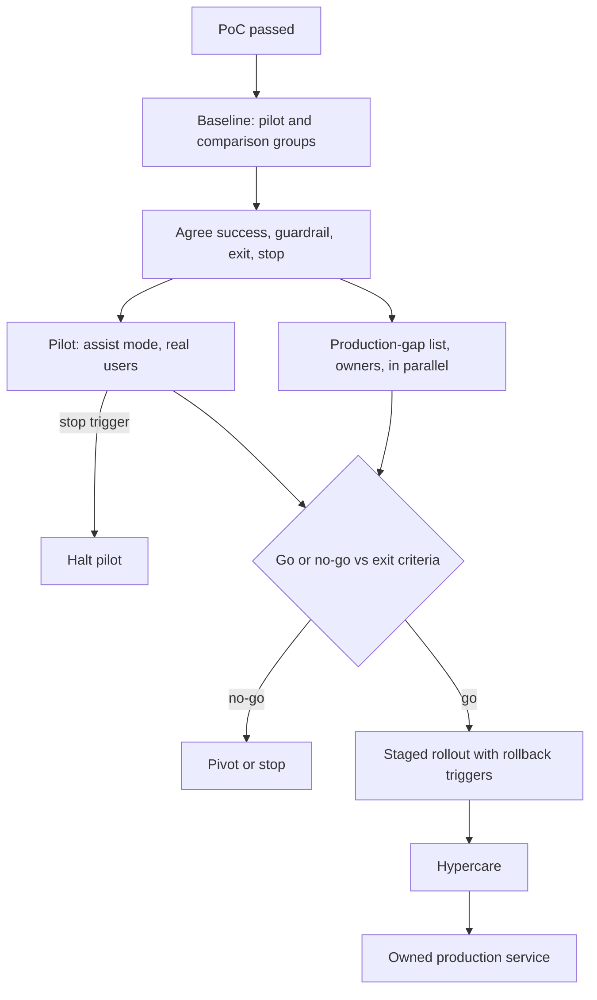

## TL;DR
An agent pilot puts real users on real work at limited scope and autonomy to measure impact against a
baseline. The pilot → production plan fixes stages, autonomy steps, criteria, owners and production-gap
work, so a successful pilot does not stall.

## For agent builders
- **Why it matters for agents.** Agents add an axis chatbots lack: autonomy. Moving from "drafts for a
  human" to "acts on its own" removes a safety net each step, so the plan must say what evidence unlocks
  each step and per which action.
- **Where it shows up in your stack.** Shadow-mode logging of proposed tool calls, approval gates on write
  tools, feature flags per cohort, a weekly sampled audit of agent traces, and rollback triggers wired to
  pooled audit windows.
- **What you control.** The autonomy level per tool or action type, the cohort, the success and guardrail
  metrics (task success, override rate, error escapes, cost per task) and the production-gap list.
- **What you can skip.** Heavy statistics for tiny internal agents with easy rollback; a short pilot and a
  checklist will do.

## Decision case
### Scenario
The insurer from the worked scenarios below wants to pilot an agent that drafts replies and proposes small
refunds. Its service organisation has 400 agents in 20 teams of 20. All figures are illustrative.
- **The metric:** median handle time of 11.0 minutes; the pilot must detect a 15% cut, 1.65 minutes, with a
  per-ticket σ of about 4 minutes.
- **Constraints:**
  - go/no-go at the end of pilot week 6, after two baseline weeks;
  - operations can release at most two teams (40 agents) into the pilot;
  - refunds may not run without review until the agent agrees with human decisions on at least 98% of 500
    shadow cases;
  - security and privacy reviews take about 4 weeks each and can run in parallel;
  - the result must predict the effect for typical teams, since most of the 400 did not volunteer;
  - the sponsor wants production within two weeks of a go.
- **Volume:** the pilot teams see about 120 refund-eligible tickets a week, so 720 in six weeks.

### Options
| Option | How it works | Credible effect estimate? | Transfers to typical users? | Refund evidence | Go to production |
|---|---|---|---|---|---|
| **A. One volunteer team, before/after** | team uses drafts and refund proposals; gaps worked after go | no: seasonality is credited to the agent | no | none: proposals only | about 4 weeks of reviews after go |
| **B. Two volunteer teams plus two comparison teams** | difference-in-differences, autonomy set per action, gaps after go | yes | weak: volunteers inflate it | shadow, 720 cases | about 4 weeks after go |
| **C. One volunteer and one typical team, two matched comparison teams** | as B, plus the production-gap list started in week 1 with owners | yes | better | shadow, 720 cases | reviews done by week 4, before go |
| **D. No pilot: shadow mode for all 400** | score proposed drafts and refunds on live traffic for six weeks | accuracy only, no handle time | n/a | shadow, plenty | adoption still unmeasured |

### Decision
Choose **C**, because it is the only option that meets every constraint at once.
- **Sample size:** 16 × 4² / 1.65² ≈ 95 independent tickets per group; with about 200 tickets per human agent
  and an ICC of 0.05 the design effect is 10.95, so about 1,030 tickets, roughly five agents' worth. Forty
  agents per arm clear that agent-level bar.
- **Team-level limit:** the tool is assigned by team, and two teams per arm cannot pin down team-level
  variance. Difference-in-differences removes stable team differences, not a shock that hits one team
  mid-pilot, so the readout reports per-team effects beside the pooled one.
- **Cohort:** one typical team checks that results transfer beyond volunteers, inside the 40-agent cap.
- **Refund autonomy:** 720 shadow cases exceed the 500 required; at 98% agreement, 500 cases give a 95%
  half-width of about ±1.2 points.
- **Speed after go:** reviews started in week 1 finish around week 4, before the week-6 decision, so
  production can follow within two weeks; A and B leave about 4 weeks of reviews after go.
- **Rollback:** pooled two-week audits of 400 tickets with an 88% trigger. That fires falsely about 1.8% of
  the time at a true 91% and catches a real drop to 85% about 95% of the time; a single-week 90% trigger on
  200 would fire falsely about 31% of the time.

**What would change it:**
- **An expected effect so large that before/after convinces:** drop the comparison teams.
- **Operations allow four teams:** add two more typical teams to tighten the team-level comparison.
- **Shadow agreement below 98% at week 6:** go on drafts only; refunds stay in shadow under a new box.

### Trade-offs accepted
- **Two comparison teams wait six weeks** for the tool. Watch for comparison teams changing behaviour, which
  would distort the second term of the estimate.
- **Parallel review effort may be wasted** on a no-go. Accepted because the PoC evidence was strong.
- **Two teams per arm is thin at team level.** Report the per-team effects next to the pooled one; if they
  disagree sharply, extend before scaling.
- **Novelty can inflate early weeks.** Read the weekly trend for weeks 4-6, not the six-week mean alone.

### Review rubric
- **The baseline and comparison group are fixed before the pilot**, with the effect computed as a
  difference-in-differences.
- **Sample size accounts for clustering** by the unit the tool is assigned to.
- **Autonomy is set per action** with the evidence and volume needed to step each one up.
- **The production-gap list has owners and starts with the pilot**, with review durations checked against
  the go date.
- **Rollback triggers have computed false-alarm and detection rates.**
- **At least two conditions that would change the plan are named.**

## Why it exists
- **A PoC cannot answer the adoption questions.** It shows "can it work?" on a sample, not whether people use
  it daily, whether it moves the business metric, or what breaks under real traffic, real permissions and
  real edge cases. Only real use answers those, which is what a pilot is for.
- **Pilots succeed and then nothing happens.** The pilot ran on a champion team, with an engineer on call in
  a chat channel, in a sandbox exempted from security review, paid from an innovation budget.
- **Production needs what the pilot skipped.** SSO, a security sign-off, an operations owner, a support
  process, a cost line in someone's budget, and training for users who did not volunteer. Unplanned, the
  pilot's success creates demand nobody can meet: pilot purgatory.
- **Both naive alternatives fail.** Skipping the pilot means the first real measurement happens at full blast
  radius, with no baseline comparison and no easy way back. An open-ended pilot "to learn" never reaches a
  moment where evidence is weighed and a decision made.
- **The plan makes the pilot a measured experiment** with a pre-agreed path to scale, so success triggers
  production work that is already scoped and funded.

## How it works
### 1. Define the stages and what each proves
A common progression widens exposure, and each stage answers a different question. Name the question for
each stage, because a stage without a question has no natural end.

| Stage | Question it answers |
|---|---|
| PoC | feasibility |
| Pilot | real-workflow impact |
| Limited rollout | operability at scale |
| General availability | full adoption |

AI systems need a second axis besides exposure: *autonomy*. Each step up removes a human safety net, so
each needs its own evidence. For agents, set the level per tool or action type, not for the whole agent.

| Autonomy level | What happens | Measures |
|---|---|---|
| **Shadow mode** | outputs logged and scored, never shown or used | accuracy on live traffic with zero user impact; not adoption or workflow effect, because nobody uses the output |
| **Assist** | a human sees the suggestion and decides | adoption, edit rates, workflow effect |
| **Act with review** | it acts; a human samples or can reverse | error escapes |
| **Act alone** | only on the subset where evidence supports it | ongoing error rate |

### 2. Measure the baseline before the pilot starts
- **Capture the current metric** (handle time, error rate, cycle time) for the pilot cohort and a comparison
  group *before* switching anything on.
- **Why:** without a baseline any post-pilot number is uninterpretable, because you cannot separate the
  system's effect from seasonality or the attention of being piloted.

With both groups measured before and during, the estimate is a difference-in-differences:

```
effect = (pilot_during − pilot_before) − (comparison_during − comparison_before)
```

- **The second term removes whatever moved both groups at once** (a quiet season, a policy change, a new
  ticket mix), which a plain before/after comparison silently credits to the system.

### 3. Choose the cohort deliberately
- **Volunteers inflate results.** Pilot cohorts tend to be enthusiastic volunteers; include some typical
  users and, if possible, keep a comparable group without the tool.
- **Size it so the metric can move detectably** within the pilot's duration. A common rule of thumb for
  comparing two group means at 95% confidence and 80% power:

```
n per group ≈ 16 × σ² / δ²      (σ = per-unit standard deviation, δ = effect you must detect)
```

- **Correction 1, the unit is what you assign the tool to.** If whole teams get it, outcomes within a team
  are correlated, so the effective sample is much closer to the number of teams than the number of tickets.
  A two-team pilot can show a large effect that is partly just "team A is faster".
- **Correction 2, novelty.** Early weeks carry a novelty effect, as users try the tool eagerly or slowly at
  first; plan enough duration to see the weekly trend settle rather than reading the first fortnight.

### 4. Write success, guardrail and exit criteria
- **Success metrics:** the business outcome the system is meant to move.
- **Guardrail metrics:** what must not get worse (customer satisfaction, error escapes, compliance
  incidents, cost per transaction). For agents add human override rate and wrong write actions.
- **Exit criteria:** the go/no-go rule, e.g. "median handle time down ≥ 15% with no guardrail regression
  over four weeks".
- **Stop triggers:** conditions that halt the pilot early, such as a data leak or a severe error, for
  example an agent calling a write tool outside its allowed scope.
- **Why guardrails:** AI systems often improve the headline metric by shifting cost elsewhere, for instance
  faster replies with more escalations.

### 5. Build the production-gap list during the pilot, not after
- **List everything production needs that the pilot skipped:** identity integration, security and privacy
  review, data residency, monitoring and alerting, on-call, runbooks, support process, cost budget and
  quotas, evaluation regression gates, user training.
- **Agent-specific items:** per-tool credentials and scopes, approval-gate UX, trace retention, step and
  spend limits per task, and a kill switch per tool.
- **Each item gets an owner and an estimate.**
- **Run them in parallel with the pilot,** which is what prevents purgatory, because most are slow
  organizational processes, not code.

### 6. Name owners and the handoff
- **Decide who owns it after launch:** which team runs it, who funds inference cost, who triages quality
  issues.
- **External builders** (an FDE team, a vendor) make the handoff plan part of the production plan.

### 7. Hold the go/no-go and roll out in steps
1. **Compare against the exit criteria** at the end of the pilot, in a scheduled meeting with the decision
   makers.
2. **If go, expand in increments** with rollback triggers.
3. **Follow with hypercare:** a period of heightened monitoring and fast response.

## Diagram
Two things to notice: the baseline and criteria are fixed before the pilot, and the production-gap work
runs alongside it, so a go decision leads straight into staged rollout.



## Examples
### Pilot readout calculator
Computes the difference-in-differences, the false-alarm rate of a rollback trigger, and how clustering
inflates the sample you need. The same rollback math applies to a weekly audit of agent traces.

```python
import math

def did(pilot_before, pilot_during, comp_before, comp_during):
    """Difference-in-differences: the pilot's change minus the comparison group's change."""
    effect = (pilot_during - pilot_before) - (comp_during - comp_before)
    return effect, effect / pilot_before

def norm_cdf(z):
    return 0.5 * (1 + math.erf(z / math.sqrt(2)))

def p_below(threshold, true_rate, n):
    """Chance a sample of n audited tickets shows a pass rate under threshold (normal approximation)."""
    sd = math.sqrt(true_rate * (1 - true_rate) / n)
    return norm_cdf((threshold - true_rate) / sd)

effect, rel = did(11.0, 9.1, 11.0, 10.8)
print(f"effect {effect:+.1f} min ({rel:+.1%}); naive before/after {(9.1 - 11.0) / 11.0:+.1%}")
print(f"false alarm, 90% trigger on 200: {p_below(0.90, 0.91, 200):.0%}")    # ~31%
print(f"false alarm, 88% trigger on 400: {p_below(0.88, 0.91, 400):.1%}")    # ~1.8%
print(f"catch a real drop to 85% on 400: {p_below(0.88, 0.85, 400):.0%}")    # ~95%

def n_per_group(sigma, delta, cluster_size=1, icc=0.0):
    """16 sigma^2 / delta^2 (95% confidence, 80% power), inflated by the design effect for clusters."""
    return math.ceil(16 * sigma**2 / delta**2 * (1 + (cluster_size - 1) * icc))

print(n_per_group(sigma=4.0, delta=1.65))                              # 95 independent tickets
print(n_per_group(sigma=4.0, delta=1.65, cluster_size=200, icc=0.05))  # 1030 when grouped by agent
```

- **Design effect:** `1 + (cluster_size − 1) × ICC` is the standard inflation for correlated units. The σ of 4
  minutes and ICC of 0.05 are illustrative; estimate both from baseline data.

### Worked scenario: a support-drafting pilot at an insurer
A ticket drafting assistant for an insurer's customer service team. All figures are illustrative.

- **Baseline (weeks −2 to 0):** two pilot teams (30 agents) and two comparison teams; median handle time
  11.0 minutes, quality-audit pass rate 92%, CSAT 4.2/5.
- **Pilot (weeks 1–6):** pilot teams use AI drafts; agents edit and send. Weekly audit of 200 randomly
  sampled AI-assisted tickets.
- **Audit precision:** at a pass rate near 92%, a 200-ticket sample estimates it to within about ±4 points
  at 95% confidence, enough to catch a large regression but not a one-point drift.
- **Exit criteria (agreed week 0):** handle time down ≥ 15% relative to the comparison teams; audit pass rate
  not below 90%; CSAT not below 4.1; inference cost under the per-ticket budget agreed with finance.
- **Stop trigger:** any instance of a draft exposing another customer's data.

| Production-gap item | Owner | Estimate |
|---|---|---|
| SSO and role mapping | IT | 3 weeks |
| Privacy review of prompt logging | legal | 4 weeks |
| Monitoring dashboards and alerts | platform team | |
| Runbook and on-call rota | support engineering | |
| Training for 400 agents | enablement | |
| Cost centre for inference | finance | |

**Week 6 result.**

| Metric | Pilot | Comparison | Exit bar |
|---|---|---|---|
| Median handle time | 9.1 minutes | 10.8 minutes | ≥ 15% relative cut |
| Audit pass rate | 91% | | not below 90% |
| CSAT | 4.2 | | not below 4.1 |

- **Naive reading:** 11.0 → 9.1, a 17% cut.
- **Difference-in-differences:** (9.1 − 11.0) − (10.8 − 11.0) = −1.7 minutes, about −15.5% of the baseline.
  The comparison teams also got 0.2 minutes faster without the tool, and that part is not the system's doing.
- **It clears the 15% bar narrowly,** and the weekly trend held steady across weeks 4–6, so it is not a
  fading novelty spike. Go decision.
- **Rollout:** to 25%, then 100% over six weeks, with rollback if the audit pass rate pooled over two
  consecutive weeks (400 tickets) drops below 88%.
- **Why the rollback line sits below the 90% exit bar:** with a true rate of 91% and ±4-point weekly noise, a
  90% trigger on a single week's sample would fire spuriously roughly a third of the time. 88% on 400 pooled
  tickets is a false alarm only a few percent of the time yet still catches a real drop to the mid-80s.
- **Hypercare** for the first four weeks after full rollout.
- **Outcome:** because the gap list ran in parallel, production started two weeks after the decision instead
  of months.

### Worked scenario: an autonomy ladder for a refund agent
Illustrative numbers. The same insurer later pilots an agent that looks up policies and issues small
refunds. Autonomy is set per action, and each step needs its own evidence.

| Action | Pilot level | Evidence to step up | Weeks 1-6 result | Decision |
|---|---|---|---|---|
| Policy and order lookups | act alone | read-only, low risk | n/a | stays act alone |
| Reply drafts | assist | edit rate falling, audit ≥ 90% | audit 92% | act with review |
| Refunds under a small limit | shadow mode | agreement with human decisions ≥ 98% on 500 cases | 96% on 500 | stays shadow, fix top error |
| Refunds above the limit | not offered | | | human only |

- **Why per action:** one aggregate success rate would let the low-risk lookups carry the high-risk refunds.

## Production patterns
- **Shadow mode before assist** — when accuracy on live traffic is the open question. How: run the model on
  every live input, log and score its output (for agents, the proposed tool calls, not executed), show
  nothing to users. Monitor: agreement with what humans actually did, per input category; it cannot tell
  you adoption.
- **Pre-registered readout doc** — at week 0. How: one page with baseline numbers, comparison group, success,
  guardrail and exit criteria, stop triggers and the go/no-go meeting date, signed off by the decision maker.
  Monitor: whether any criterion changed after results started arriving.
- **Percentage rollout behind a flag** — after go. How: gate access with a feature flag keyed on team or
  user id, step 25% then 100%, and wire the rollback trigger to a pooled audit window, not a single week.
  Monitor: guardrail metrics per cohort and the trigger's pooled sample size.
- **Weekly random audit** — through pilot and hypercare. How: sample a fixed number of AI-assisted items (for
  example 200) at random each week for human quality review, reading the agent trace, not only the output.
  Monitor: pass rate with its interval, and the weekly trend for novelty decay.
- **Production-gap tracker with owners** — from pilot day one. How: each gap item is a ticket with an owner
  outside the pilot team, an estimate and a due date before the go/no-go. Monitor: items still open at the
  decision meeting, the leading indicator of purgatory.
- **Per-tool autonomy flags** — for agents with write tools. How: a flag per tool or action type selects
  shadow, approval-required or autonomous, so one tool can step up or roll back without touching the rest.
  Monitor: override rate and error escapes per tool.

## Trade-offs
- **Comparison group vs delayed benefit.** It gives a credible causal estimate, but delays benefits for those
  users; it flips when the expected effect is so large or obvious that a before/after comparison is
  convincing enough.
- **Volunteer cohorts vs representative results.** They make pilots easier to run and generate goodwill, but
  overstate adoption and impact; include typical users when the decision depends on organization-wide
  adoption.
- **Longer pilots vs patience.** They smooth out weekly noise and seasonality, but delay value and erode
  stakeholder patience; set duration from how long the metric needs to stabilize, not by habit.
- **Parallel readiness work vs wasted effort.** It shortens time to launch, but spends effort on a system that
  might get a no-go; worth it when the PoC evidence was strong.
- **Approval gates vs agent value.** Gating every write keeps errors out but can erase the time saved; gate
  per action by risk and remove gates only with evidence.

## Pitfalls
- **No baseline measured before the pilot.** The result is a before/after story nobody can verify; the
  symptom is a debate at go/no-go about what the number "would have been".
- **A champion-only cohort.** Results do not transfer; the symptom is strong pilot metrics followed by low
  adoption and complaints when typical users get access.
- **A sandbox exempt from security and identity requirements,** with no plan to meet them; the symptom is a go
  decision followed by months waiting on reviews.
- **No guardrail metrics.** The headline metric improves while cost moves elsewhere; the symptom is faster
  handle times alongside rising escalations or complaints.
- **No named post-launch owner or budget.** The builders keep running it informally; the symptom is the pilot
  engineer still answering production questions six months later.
- **Reading the result while novelty is high.** The symptom is a metric that improves sharply in week one and
  then decays week over week toward the baseline.
- **Jumping from assist to autonomous action** because pilot accuracy looked good; the symptom is errors
  reaching customers that a reviewer used to catch silently, visible as rising complaints with no change in
  measured model accuracy.
- **Rubber-stamp approvals.** Reviewers approve agent actions without reading them; the symptom is an
  approval rate near 100% with very short review times. Fix: audit approved actions and track review time.

## When to use
- **Write the plan** when a PoC has passed and before the pilot starts, because baseline measurement and
  criteria must be fixed before anyone sees results.
- **Use the full staged approach** when the system touches many users, regulated data or customer-facing
  outcomes, or when the agent can take write actions.
- **Compress it** for small internal tools with easy rollback: a short pilot and a checklist.
- **Measure:** whether the go/no-go meeting is a short reading of agreed numbers and whether production
  follows within weeks.
- **Interviews:** a strong answer names baseline, cohort, guardrails, gap list, owner and rollback.

## Role lens
- **Engineer:** Instruments the pilot so success and guardrail metrics are captured automatically, and
  turns production-gap items like monitoring and evaluation gates into tracked work.
- **Architect:** Owns the stage gates and the production-gap list, deciding which pilot shortcuts are
  acceptable and which must be resolved before wider rollout.
- **FDE:** Negotiates exit criteria and the comparison group with the customer, chases their security and
  identity reviews in parallel, and plans the handoff to the customer's own team.

## Check yourself
**Q:** A pilot of an AI coding assistant with 25 volunteer developers reports "developers say they are
40% more productive". Leadership wants to roll it out to 2,000 developers next month. What do you ask
before agreeing?
**A:** First, what was measured: self-reported productivity from volunteers is weak evidence, inflated by
enthusiasm and novelty. Ask for a baseline and comparison group on observable metrics such as cycle time,
review rework and defect rates, plus guardrails like security findings in generated code. Then the
production gap: licensing or inference cost at 2,000 seats, identity and policy controls, data-handling
review for code sent to the provider, support and training for non-volunteers. Propose a staged rollout
to a few hundred typical developers with agreed exit criteria and rollback, rather than a jump from 25 to 2,000.

## Interview questions
### What is pilot purgatory, and how does a pilot-to-production plan prevent it?
- **Definition:** a pilot that succeeds and then stalls because nobody planned the path, budget or owner.
- **Prevention:** the production-gap list (SSO, security and privacy review, monitoring, on-call, support,
  cost centre, training) runs in parallel with named owners, so a go decision is acted on in weeks.

### A pilot shows handle time fell from 11.0 to 9.1 minutes. Is that the system's effect?
- **Not necessarily.** A plain before/after credits the system with seasonality, policy changes or the
  attention of being piloted.
- **Use difference-in-differences:** subtract the comparison group's change. If they went from 11.0 to 10.8,
  the effect is −1.7 minutes, about 15.5% rather than 17%.

### How would you move an AI system from suggesting actions to taking them?
- **Step up autonomy one level at a time:** shadow mode, assist, act with review, then act alone only on the
  subset where evidence supports it.
- **Each step removes a human safety net,** so require fresh evidence, such as reviewer override rates and
  error escapes, before the next one; accuracy alone hides errors a reviewer used to catch.

### Why might you set a rollback trigger below the pilot's exit bar?
- **Noise.** With a 91% true pass rate and ±4-point weekly noise on 200 tickets, a 90% single-week trigger
  fires spuriously about a third of the time.
- **Pool and lower:** 88% over two weeks (400 tickets) is a false alarm only a few percent of the time and
  still catches a real drop to the mid-80s.

### When would you skip the comparison group or compress the plan?
- **Skip the comparison group** when the expected effect is so large or obvious that before/after is
  convincing, since holding users back delays their benefit.
- **Compress the plan** for small internal tools with easy rollback to a short pilot and a checklist; keep
  the full staged approach for regulated data or customer-facing outcomes.

### Your agent has five tools, two of which write to customer systems. How do you plan its autonomy in the pilot?
- **Per tool, not per agent:** read-only tools can act alone; write tools start in shadow mode or behind an
  approval gate, each behind its own flag.
- **Evidence per step:** agreement with human decisions in shadow, then override rate and error escapes under
  review, with a rollback trigger per tool, so one risky tool does not hold back or endanger the rest.

## Quiz
### Q: Why must the baseline be measured before the pilot begins?
- [ ] Because the system cannot log metrics once it is live
- [x] Because without it you cannot separate the system's effect from seasonality or the attention of being piloted
- [ ] Because finance requires baselines for any budget approval
- [ ] Because the model's accuracy changes after deployment
> The pilot's value is a comparison. Measured afterwards, the baseline is contaminated or reconstructed from
> memory, and the go/no-go turns into argument rather than evidence.

### Q: What is the main purpose of guardrail metrics in a pilot plan?
- [ ] To replace the success metric when it is hard to measure
- [ ] To monitor GPU utilization during the pilot
- [x] To catch cases where the headline metric improves by pushing cost or harm elsewhere
- [ ] To decide which users join the pilot cohort
> AI systems can speed one step while increasing escalations, errors or cost downstream. Guardrails make
> those regressions part of the decision, so a "win" is not a cost shifted elsewhere.

### Q: Which practice most directly prevents "pilot purgatory"?
- [ ] Extending the pilot until every user has tried the system
- [ ] Choosing only enthusiastic volunteers for the cohort
- [x] Building and staffing the production-gap list in parallel with the pilot, with named owners
- [ ] Postponing security review until after the go decision
> Purgatory happens when success arrives with no path, owner or budget for production. Working the gap list
> during the pilot means a go decision can be acted on quickly; postponing reviews causes the stall.

## Use cases & projects
### Use cases
- **Support and operations agents.** Moving from drafted replies to agent-issued refunds or updates, one
  action type and one autonomy level at a time.
- **Internal copilots for engineers or analysts.** A cohort pilot with a comparison group shows whether the
  agent moves cycle time, not just how users feel.
- **Agents touching regulated data.** The production-gap list (identity, privacy review, trace retention)
  runs alongside the pilot so approval does not stall launch.
- **Vendor or FDE handoffs.** The plan names who owns, funds and triages the agent after launch.

### Mini project
**Write and simulate an agent pilot plan (2-3 hours).**
- **Goal:** produce a pre-registered pilot plan for a small agent with one write tool and test its rollback
  trigger with the calculator.
- **Steps:** pick an agent (for example a ticket-triage agent that can reassign tickets); write success,
  guardrail, exit and stop criteria; set autonomy per tool; list ten production-gap items with owners; use
  `p_below` to pick a weekly audit size and rollback threshold with a false-alarm rate under 5%.
- **Done when:** a one-page plan exists with the autonomy table, the gap list and a rollback trigger whose
  false-alarm and detection rates you computed and wrote next to it.
