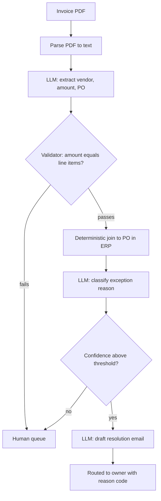

## TL;DR
Problem decomposition breaks a fuzzy business goal into sub-problems, each with an input, output,
technique and test. It shows which parts need a model, which are plain code, and where the chain fails,
because errors in chained probabilistic steps multiply.

## Why it exists
- **One big prompt cannot be debugged.** "Automate invoice exception handling" as a single prompt works on
  the three invoices you tried and fails opaquely on the fourth. You cannot tell whether the PDF was
  misread, the wrong field extracted, the purchase order lookup missed, or the model reasoned badly, so
  every fix is a prompt tweak that might break something else.
- **Errors compound.** If a task silently requires five steps that each succeed 95% of the time
  independently, the chain succeeds about 0.95⁵ ≈ 77% of the time. You only see this, and only know which
  step to improve, if the steps are explicit.
- **Most of a business process is not a model problem.** Lookups, joins, threshold checks and API calls are
  deterministic; putting them inside a prompt makes exact operations approximate.
- **Run-time planning does not replace design-time decomposition.** Letting an agent work out the steps
  moves decomposition from design time, where you can test it, to run time, where it varies per request.
  Agent planning has its place (see task decomposition in the agents module), but you still need to know
  what the agent should do, what tools it needs and how to judge it.

## How it works
### 1. State the goal as an observable output
- **Write what exists when the problem is solved:** "each invoice exception is routed to the right owner
  with a reason code and a drafted resolution, within one business day".
- **An observable output can be tested;** an aspiration ("streamline AP") cannot.

### 2. Work backwards from the output
- **Ask what must be true immediately before the output can be produced, and repeat.**
- **Backwards keeps every sub-problem tied to the goal**, because forward brainstorming produces steps
  nobody needs.

### 3. Split at natural seams
| Seam | Example |
|---|---|
| **Data type changes** | Scanned image to text, text to structured fields |
| **A decision is made** | Classify the exception reason |
| **A system boundary is crossed** | Reading the ERP, sending an email |
| **Responsibility passes between people** | AP clerk to purchasing owner |

- **Seams are where you put a test and an interface**, because the artefact passed across them is concrete
  and inspectable.

### 4. Write a contract for each node
Record for each sub-problem: input schema, output schema, technique, owner and acceptance test. The
technique choice is the heart of the exercise, in order of preference:

1. **Deterministic code** for lookups, joins, arithmetic, rules and API calls.
2. **Classical ML or a classifier** for high-volume, fixed-label decisions with labelled history.
3. **Retrieval** where the answer exists in a corpus and must be cited.
4. **LLM generation or extraction** for unstructured input and open-ended output.
5. **Human** for high-consequence or low-volume judgements.

- **Push work toward the top of this list wherever it suffices**, because every probabilistic node needs an
  evaluation set and contributes compounding error.
- **Stop splitting when a node has exactly one technique, one owner and an acceptance test you could write
  today.** Splitting further adds interfaces without adding testability.
- **Not finished:** a node that still needs two techniques, or whose test you cannot state.

### 5. Check coverage and independence
- **MECE test** (from consulting: mutually exclusive, collectively exhaustive): sub-problems cover the goal
  with no gaps and little overlap.
- **Gaps** show up as "and then somehow" in the walkthrough.
- **Overlaps** show up as two components that both decide the same thing.

### 6. Estimate per-node quality and find the critical node
- **Give each probabilistic node a rough expected accuracy**, multiply along the chain, and see which node
  dominates the loss.
- **Add mitigations where they are cheapest:** a human review on one node, a deterministic validator after
  an extraction (does the amount equal the sum of line items?), or a confidence threshold that routes
  uncertain cases to a person.

**Mitigations change *what* you multiply.** Split each node's outcomes three ways:

| Outcome | Meaning | Rate, for error rate *q* and catch fraction *c* |
|---|---|---|
| Correct | Passed on, right | 1 − q |
| **Escalated** | Caught and sent to a person | `q·c` (plus correct items the check flags by mistake) |
| **Silent error** | Wrong and passed on | `q·(1 − c)` |

- **Silent errors are what compound and reach users;** escalations cost reviewer time and lower the
  automation rate.
- **Report two end-to-end numbers:** the share of items fully automated and correct, and the share that
  went wrong silently.
- **Because** a design that trades silent errors for escalations can be a large improvement even though its
  "automation rate" goes down.

### 7. Prototype the riskiest node first
- **The node with the most uncertainty**, usually the one with the messiest input, gets a spike before
  anything else is built.
- **Because** if it cannot reach the required quality, the whole design changes.

### 8. Keep the tree as a living artefact
- **It becomes the backbone** of the statement of work, the requirements trace and the evaluation plan.
- **Tests follow the tree:** one test suite per node plus an end-to-end suite.

## Diagram
The invoice-exception chain: deterministic and probabilistic nodes alternate, and a validator or
threshold at a seam turns silent errors into escalations to a person.



## Examples
### Multiplying per-node success rates
Invoice exception handling, decomposed into five nodes with rough per-node success rates a team might
estimate from a spike (illustrative). The script multiplies along the chain, assuming independent
failures, and shows which single improvement raises end-to-end success most.

```python
from math import prod

nodes = [  # (name, technique, estimated success rate)
    ("parse PDF to text",                 "OCR + layout parser",   0.98),
    ("extract vendor, amount, PO number", "LLM extraction",        0.93),
    ("match invoice to PO in ERP",        "deterministic join",    0.99),
    ("classify exception reason",         "LLM classifier",        0.88),
    ("draft resolution email",            "LLM generation",        0.95),
]

def end_to_end(rates):
    return prod(rates)

base = [r for _, _, r in nodes]
print(f"end-to-end: {end_to_end(base):.1%}")          # about 75%

for i, (name, tech, r) in enumerate(nodes):
    improved = base.copy()
    improved[i] = 0.99                                 # what if this node were near-perfect?
    print(f"{name:36} {tech:20} {r:.0%} -> e2e {end_to_end(improved):.1%}")
```

| Change | End-to-end success |
|---|---|
| Baseline | About 75%, worse than any single node |
| Classifier 88% → 99% | About 85% |
| Extractor → 99% | Only about 80% |
| ERP join → 99% | No change; it is already at 99% |

- **Effort goes to the classifier:** a fixed reason-code list, few-shot examples, or routing low-confidence
  cases to a human.
- **Treat the product as a rough guide, not a forecast.** Real failures are often correlated (a bad scan
  breaks both parsing and extraction), and a validator that catches an error before it propagates breaks
  the simple multiplication.

### Silent errors vs escalations
The same chain with a validator after extraction (catching an illustrative 70% of its errors) and a
confidence threshold on the classifier (catching 60%). Error rates are 1 minus the success rates above.

```python
from math import prod

def outcomes(nodes):                       # nodes: (error rate q, catch fraction c)
    correct = prod(1 - q for q, c in nodes)
    not_escalated = prod(1 - q * c for q, c in nodes)
    return correct, not_escalated - correct, 1 - not_escalated

base    = [(0.02, 0.0), (0.07, 0.0), (0.01, 0.0), (0.12, 0.0), (0.05, 0.0)]
guarded = [(0.02, 0.0), (0.07, 0.7), (0.01, 0.0), (0.12, 0.6), (0.05, 0.0)]
for name, n in (("no checks", base), ("validator + threshold", guarded)):
    ok, silent, esc = outcomes(n)
    print(f"{name:22} automated-correct {ok:.1%}  silent {silent:.1%}  escalated {esc:.1%}")
# no checks              automated-correct 75.4%  silent 24.6%  escalated 0.0%
# validator + threshold  automated-correct 75.4%  silent 12.8%  escalated 11.7%
```

- **Silent errors roughly halve** while the automation rate falls from 100% to about 88%, which is the
  trade the two-number report makes visible.
- **Simplifications:** no false flags on correct items, and errors caught at one node are not counted again
  later; real numbers come from labelled runs.

## Production patterns
- **Typed contract per node** — define each node's input and output as a schema (for example a Pydantic
  model or JSON Schema) and validate at every seam, so a rephrased model output fails loudly instead of
  breaking a downstream regex. Monitor schema-validation failures per node.
- **Deterministic validators at seams** — after extraction, check invariants in code: amount equals the sum
  of line items, PO number exists in the ERP, dates are in range. Route failures to a review queue.
  Monitor catch rate and how many flagged items were actually correct.
- **Confidence-gated routing** — send classifier outputs below a tuned threshold to a person, and tune the
  threshold on labelled data against reviewer capacity. Monitor escalation volume against queue capacity
  and the silent-error rate on audited samples.
- **Per-node plus end-to-end eval suites** — keep one evaluation set per probabilistic node and one
  end-to-end set in CI, run on every prompt or model change. Monitor both, because node metrics can all
  look fine while the end-to-end result is poor.
- **Per-node trace logging** — log each node's input, output and outcome (correct, escalated, error) under
  one request ID, so error analysis can attribute a bad final result to the node where it started.

## Trade-offs
- **Testability vs integration cost.** Fine-grained decomposition makes each node testable and replaceable,
  but adds interfaces, latency and integration code. When one model call handles two steps reliably,
  merging them is simpler.
- **Exactness vs brittleness.** Moving logic into deterministic code gives exactness and auditability, but
  brittle rules break on variation. It flips when the inputs are too varied to enumerate rules for.
- **Predictability vs adaptability.** Explicit pipelines are predictable and debuggable, but cannot adapt to
  cases the designer did not foresee. When the space of paths is genuinely open-ended, an agent with tools
  fits better.
- **Node metrics vs end-to-end truth.** Per-node evaluation finds the weak link quickly, but node metrics
  can all look fine while the end-to-end result is poor. Always keep an end-to-end test alongside the node
  tests.

## Pitfalls
- **Decomposing by org chart or by existing system instead of by data flow.** Symptom: nodes whose outputs
  nobody consumes and handoffs that recreate today's delays.
- **Putting deterministic steps inside the prompt.** Symptom: arithmetic errors, invented IDs or wrong dates
  in otherwise fluent output.
- **Treating per-node accuracy as end-to-end accuracy.** Symptom: a team reporting 90%+ on every component
  while users see a large share of cases go wrong.
- **Leaving node outputs unstructured.** Symptom: downstream code parsing free text with regexes and failing
  whenever the model rephrases.
- **Reporting a single success rate that mixes escalations and silent errors.** Symptom: operations say "too
  many items reach the queue" and risk says "too many errors reach customers", and neither can be traded
  off because they were never measured separately.
- **Building the easy nodes first.** Symptom: a mostly finished pipeline blocked for weeks on the one hard
  extraction that should have been spiked on day one.

## When to use
- **Use before** estimating, before writing a statement of work and before choosing a model. It is worth
  doing even for small builds, because the output (nodes with contracts and tests) is the evaluation plan.
- **Avoid heavy decomposition** only for a genuinely single-step task, such as summarising one document type
  for internal reading.
- **Measure:** every node has an owner, a technique and a test, and you can name the node that dominates
  end-to-end error.
- **Interviews:** decomposing a vague goal aloud, marking which parts are deterministic, and multiplying
  error rates is a strong signal of senior judgement.

## Role lens
- **Engineer:** Implements each node behind a typed interface with its own tests, and adds validators
  between nodes so failures are caught at the seam where they occur.
- **Architect:** Owns the decomposition itself: where the seams go, which nodes are deterministic, where
  humans sit, and how node contracts map to services and evaluation suites.
- **FDE:** Decomposes the customer's goal in a workshop with their subject experts, and uses the tree to
  agree scope, ownership and what "done" means for each piece.

## Check yourself
**Q:** A customer wants a system that "answers any question about our 10,000 contracts". How would you
decompose it, and which node would you prototype first?
**A:** Start from observable outputs: an answer with citations to clauses, or "not found". Split into:
document ingestion and parsing (scans, tables); metadata extraction (counterparty, dates, contract type)
into structured fields; question routing, since "which contracts expire next quarter?" is a structured
query over extracted fields, not retrieval; clause retrieval for open questions; answer generation
constrained to retrieved text; and citation checking. Deterministic parts are the date queries and
filters. I would spike parsing and metadata extraction on a sample of the ugliest real contracts first,
because everything else depends on them and scanned legal documents are where quality is most uncertain.

## Interview questions
### Why decompose an AI problem instead of giving one capable model the whole task?
- **Debuggability:** with explicit nodes you can tell whether parsing, extraction, lookup or reasoning
  failed, instead of tweaking one prompt and hoping.
- **Compounding error becomes visible:** five steps at 95% each give about 77% end to end, and only explicit
  steps tell you which one to improve.
- **Exact work stays exact:** lookups and arithmetic move into code instead of becoming approximate inside a
  prompt.

### Every component reports over 90% accuracy, but users say a quarter of cases are wrong. How do you debug it?
- **Multiply, do not average:** several 90%+ nodes in a chain can easily land near 75% end to end.
- **Trace a sample of bad cases** through per-node logs to find where each error started, and check for
  correlated failures such as bad scans hurting parsing and extraction together.
- **Add an end-to-end eval set** if none exists, and fix the node that dominates the loss first.

### When would you merge nodes or let an agent plan instead of an explicit pipeline?
- **Merge** when one model call handles two steps reliably, because each extra seam adds interface code and
  latency.
- **Use an agent** when the space of paths is genuinely open-ended and a fixed pipeline cannot foresee the
  cases, while keeping a design-time decomposition of goals, tools and acceptance tests.

### Adding a validator lowered your automation rate. How do you explain that it is an improvement?
- **Report two numbers:** automated-and-correct share and silent-error share. A validator converts silent
  errors (`q·(1 − c)` remain) into escalations (`q·c`).
- **Silent errors reach users and compound;** escalations only cost reviewer time.
- **Example:** silent errors falling from about 25% to 13% while escalations rise to 12% is usually a good
  trade if the queue has capacity.

### How do you decide which node to prototype first?
- **The riskiest one,** usually the messiest input such as scanned documents, because if it cannot reach the
  required quality the whole design changes.
- **Not the easy ones,** which leave a mostly finished pipeline blocked on the hard extraction for weeks.

## Quiz
### Q: A pipeline has four independent probabilistic steps with success rates 0.95, 0.90, 0.97 and 0.92. What is the approximate end-to-end success rate?
- [ ] About 93%, the average of the four
- [ ] About 90%, the weakest step
- [x] About 76%, the product of the four
- [ ] About 97%, the strongest step
> With independent failures the chain succeeds only when every step succeeds, so rates multiply:
> 0.95 × 0.90 × 0.97 × 0.92 ≈ 0.76. Averages and the weakest step both overstate end-to-end quality.

### Q: Which is the best seam at which to split a sub-problem?
- [ ] Between two teams' sprint boundaries
- [x] Where the data changes form, such as scanned image to text or text to structured fields
- [ ] After every model call, regardless of what it produces
- [ ] At the point where the prompt exceeds a fixed token budget
> A change of data form produces a concrete, inspectable artefact that can carry a contract and a test.
> Splits by team or token count do not correspond to anything you can verify.

### Q: In the decomposition, why move a purchase-order lookup out of the LLM and into code?
- [ ] Because LLMs cannot read purchase-order numbers
- [ ] Because code is always cheaper to maintain than prompts
- [x] Because the lookup is exact and deterministic, and doing it in a prompt makes an exact operation approximate
- [ ] Because ERP systems forbid access from LLMs
> A join or lookup has one correct answer that code returns every time. Inside a prompt it gains error
> rate, cost and latency while adding nothing, and becomes a compounding failure point.
