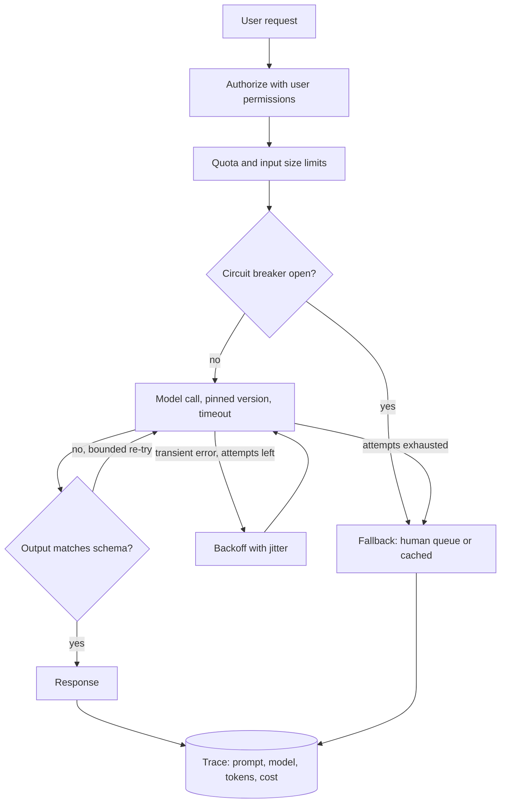

## TL;DR
Productionizing an agent turns a happy-path loop into a system that survives real traffic, bad inputs,
outages, model changes, prompt injection and audits. Plan reliability, step and cost limits, eval gates,
traces, tool security and ownership as risk-ordered hardening.

## For agent builders
- **Why it matters for agents.** An agent multiplies every model-call risk by its step count, and adds new
  ones: loops that never finish, tool calls that repeat side effects on retry, and injected instructions in
  tool results that steer later steps.
- **Where it shows up in your stack.** The LLM gateway (timeouts, retries, quotas), the agent loop (step,
  token and spend limits), tool wrappers (authorization, idempotency keys, schemas), the trace store and the
  eval gate in CI.
- **What you control.** Which layer retries, the per-task step and cost budget, which tools need approval,
  the identity each tool call runs as, model pinning, and what gets logged and redacted.
- **What you can skip.** Building your own gateway or tracing backend on day one; a shared library or an
  existing platform covers it, as long as the concerns above are handled somewhere.

## Why it exists
- **A prototype makes every time-saving assumption.** One user, clean inputs, a provider that always
  responds, a prompt edited by hand, no adversary, unlimited budget, the builder watching the output. Each
  is fine for a PoC and false in production.
- **Production breaks each assumption.** Thousands of users make the long tail of strange inputs, which the
  PoC sample barely touched, a daily occurrence. Concurrency hits provider rate limits. Providers have
  partial outages, return malformed JSON, or slow down at peak.
- **Things change underneath you.** The model behind an alias changes, or is deprecated on a schedule you do
  not control, and quality shifts silently. Users paste documents with instructions that try to hijack the
  system. Someone asks why it answered that way last Tuesday, and there is no record. The monthly bill
  arrives at several times the estimate because a retry loop or a few heavy users consumed it.
- **"Just deploy the prototype" fails for LLMs.** Fixing problems as they appear works for deterministic code
  with good tests; here problems show up as undetected quality degradation, cost overruns or a security
  incident, all discovered by users.
- **Waiting for perfect never ships.** Productionization is the disciplined middle: enumerate failure
  sources, harden against the ones that matter most for this use case, and make the rest observable.

## How it works
Organize the work by what can go wrong, because that makes gaps visible and lets you prioritize by risk.

### 1. Reliability of the model call
- **Explicit timeouts,** because a hung provider call otherwise holds a worker indefinitely.
- **Retry only transient errors** (timeouts, rate limits, server errors) with exponential backoff and jitter,
  and cap total attempts, because unbounded retries multiply cost and load during an outage.
- **Validate structured output against a schema** and handle failure. A schema failure is a middle case:
  outputs are sampled, so one bounded re-try (or a repair prompt) often succeeds, but count it separately so
  a prompt regression is not hidden by retries. For agents, validate tool-call arguments the same way.
- **Define a fallback:** a secondary model, a cached answer, or a graceful "cannot answer, routing to a
  person".

Two retry details decide whether this helps or hurts during an incident:

| Detail | Problem | Fix |
|---|---|---|
| **Retries multiply across layers** | 3 attempts in your code × 3 in the gateway × SDK retries by default (many do) = up to 27 provider calls per user request, just when the provider is struggling | one layer owns retries, others off or down; add a circuit breaker so when most recent calls fail, new requests go straight to the fallback instead of each discovering the outage |
| **Retries must fit the deadline** | worst case = attempts × timeout + total backoff | keep it below what the user or upstream service will wait |

- **Only retry what is safe to repeat.** Re-sending a classification is harmless; re-running a tool call that
  sends an email or files a refund duplicates it unless the action carries an idempotency key.

### 2. Bounding the agent loop
- **Step limit per task,** because a model can loop on a failing tool; stop and hand off at the cap.
- **Token and spend budget per task,** because each step re-sends a growing transcript, so a looping task
  costs far more than its step count suggests.
- **Overall deadline,** passed into each model and tool call so the whole task, not each call, fits what the
  user will wait.
- **Approval gates on consequential tools,** so a write action pauses for a human where the risk warrants.

### 3. Quality as a release gate
- **Regression suite:** the PoC eval set runs on every change to prompts, models, retrieval or tools.
- **Version prompts and pin model versions** where the provider allows, because an unpinned alias can change
  behavior with no deployment on your side. Version tool definitions too, since a renamed tool or reworded
  description changes tool choice.
- **Roll out changes** through canary or shadow traffic.

### 4. Observability
- **Trace each request end to end:** inputs, retrieved context, prompt version, model, outputs, latency,
  token counts and cost, tied to a request ID. For agents, record every step: tool name, arguments, result
  and the step count. Without traces, debugging a bad answer means guessing.
- **Monitor** latency percentiles, error rates, cost per request, and online quality signals such as user
  feedback or sampled human review; for agents add steps per task and step-limit hits.

### 5. Security and data handling
- **Authorize with the user's own permissions** on retrieved data and tool calls, because the model will
  happily summarize documents the user should not see.
- **Treat retrieved and user-supplied text as untrusted** input that may contain prompt injection, and tool
  results the same way, since they enter the transcript and steer later steps.
- **Decide logging policy:** what gets logged, how PII is redacted, and how long data is kept.

### 6. Cost and capacity
- **Set limits:** per-user and per-tenant quotas, maximum input and output tokens, and budget alerts.
- **Estimate cost at expected volume,** because PoC cost per call times production volume is often the first
  surprise:

```
monthly cost ≈ requests/month × (tokens_in × price_in + tokens_out × price_out) × (1 + retry rate)
in-flight requests ≈ arrival rate × mean latency          (Little's law)
tokens/minute ≈ requests/minute × (tokens_in + tokens_out)
```

- **Check the last two lines against provider rate limits,** which are usually set per minute in both
  requests and tokens. For an agent, a "request" is one model call, so multiply by steps per task.
- **Worked numbers (illustrative):** 20 requests/second with 6 seconds of latency is about 120 calls in
  flight; at 3,500 tokens each that is over 4 million tokens per minute. A PoC that never ran more than one
  call at a time tells you nothing about whether that fits your quota tier.
- **Cap output length.** Long outputs dominate latency (generated token by token) and usually cost more per
  token than input, so this is often the strongest cost and latency lever.

### 7. Operations and ownership
- **Define SLOs,** write runbooks for known failure modes (provider outage, quality regression, cost spike),
  set up on-call, and name the owning team.
- **Plan for model deprecation,** because the model you shipped on has a finite lifetime.
- **Kill switches per tool,** so one misbehaving integration can be disabled without taking the agent down.

## Diagram
One request through the hardened path: authorization and limits first, a circuit breaker before the
provider, bounded retries, schema validation, and a trace on every exit including the human fallback.



## Examples
### The same call, prototype vs productionized
The provider call is abstracted; the hardening around it is the point.

```python
import json, logging, random, time, uuid
from pydantic import BaseModel, ValidationError

log = logging.getLogger("triage")
PROMPT_VERSION = "triage-v7"      # versioned, reviewed, covered by the regression suite
MODEL = "provider-model-2025-xx"  # pinned snapshot, not a floating alias (placeholder name)

class Triage(BaseModel):
    category: str
    priority: int

class TransientError(Exception): ...   # map provider timeouts / 429 / 5xx onto this

def call_llm(model, prompt_version, text, timeout_s=None, with_usage=False):
    raise NotImplementedError("wrap your provider SDK here")

def prototype(ticket: str) -> dict:
    return json.loads(call_llm(MODEL, PROMPT_VERSION, ticket))   # happy path only

def production(ticket: str, user_id: str, max_attempts: int = 3) -> Triage | None:
    req_id = str(uuid.uuid4())
    ticket = ticket[:20_000]                                     # bound input size and cost
    for attempt in range(1, max_attempts + 1):
        t0 = time.monotonic()
        try:
            raw, usage = call_llm(MODEL, PROMPT_VERSION, ticket, timeout_s=15, with_usage=True)
            result = Triage.model_validate_json(raw)             # schema check, not blind json.loads
            log.info("ok", extra={"req": req_id, "user": user_id, "prompt": PROMPT_VERSION,
                                  "attempt": attempt, "ms": int((time.monotonic() - t0) * 1000),
                                  "tokens_in": usage["in"], "tokens_out": usage["out"]})
            return result
        except TransientError:
            log.warning("transient", extra={"req": req_id, "attempt": attempt})
            if attempt < max_attempts:                            # no pointless sleep before giving up
                time.sleep(min(8, 2 ** attempt) * random.uniform(0.5, 1.0))  # backoff with jitter
        except ValidationError:                                   # re-sample once more, counted separately
            log.warning("bad_schema", extra={"req": req_id, "attempt": attempt})
    log.error("fallback_to_human", extra={"req": req_id})
    return None                                                   # caller routes to manual queue
```

- **Each added line answers a production question** the prototype ignored: what if it hangs, rate-limits,
  returns broken output, or costs too much, and how will we debug it next week?
- **Worst case it implies:** three 15-second timeouts plus up to 2 and 4 seconds of backoff is about 51
  seconds before the human fallback.
- **Fit to the path:** acceptable for a background triage queue, far too long for a chat reply, where you
  would cut attempts, shorten the timeout, or pass a single overall deadline through the loop.
- **Deliberately omitted:** a circuit breaker and cost quotas belong in a shared gateway rather than in every
  call site.

### A bounded agent loop with safe tool calls
The model and tools are abstracted. The point is the budget checks around each step and the idempotency
key that makes a retried write safe.

```python
import hashlib, time

MAX_STEPS, MAX_COST_USD, DEADLINE_S = 12, 0.50, 60
WRITE_TOOLS = {"issue_refund", "send_email"}             # side-effecting: need keys and approval

def run_agent(task_id, messages, call_model, tools, approve, log):
    cost, t_end = 0.0, time.monotonic() + DEADLINE_S
    for step in range(1, MAX_STEPS + 1):
        if cost > MAX_COST_USD or time.monotonic() > t_end:
            return log("budget_exhausted", task_id, step, cost) or None   # hand off to a human
        reply, step_cost = call_model(messages, timeout_s=max(1, t_end - time.monotonic()))
        cost += step_cost
        if reply.tool is None:
            log("done", task_id, step, cost)
            return reply.text
        args = reply.args                                 # already schema-validated by the wrapper
        if reply.tool in WRITE_TOOLS:
            if not approve(task_id, reply.tool, args):
                messages.append({"role": "tool", "content": "rejected by reviewer"})
                continue
            key = hashlib.sha256(f"{task_id}:{reply.tool}:{sorted(args.items())}".encode()).hexdigest()
            args = {**args, "idempotency_key": key}       # same action on retry -> same key
        result = tools[reply.tool](**args)                # runs with the end user's permissions
        messages.append({"role": "tool", "content": str(result)})   # untrusted text from here on
        log("step", task_id, step, cost, tool=reply.tool)
    return log("step_limit", task_id, MAX_STEPS, cost) or None
```

- **The limits are illustrative;** set them from the step and cost distribution in your eval traces.
- **The tool must honour the key:** the idempotency key only helps if the receiving service rejects repeats.

### Capacity, cost and retry-budget calculator
Run this before launch with your own volumes and your provider's current prices and quota tier.

```python
def capacity(rps, latency_s, tokens_in, tokens_out, price_in_per_m, price_out_per_m,
             retry_rate=0.0, days=30):
    in_flight = rps * latency_s                                   # Little's law
    tpm = rps * 60 * (tokens_in + tokens_out)                     # check against the quota tier
    per_req = (tokens_in * price_in_per_m + tokens_out * price_out_per_m) / 1e6
    monthly = rps * 86_400 * days * per_req * (1 + retry_rate)
    return in_flight, tpm, monthly

def worst_case_latency(attempts, timeout_s, backoffs_s):
    return attempts * timeout_s + sum(backoffs_s)

def retry_amplification(attempts_per_layer):
    calls = 1
    for a in attempts_per_layer:
        calls *= a
    return calls

# Illustrative prices in dollars per million tokens, not any provider's list price.
inflight, tpm, monthly = capacity(rps=20, latency_s=6, tokens_in=3_000, tokens_out=500,
                                  price_in_per_m=3, price_out_per_m=15, retry_rate=0.05)
print(f"in flight {inflight:.0f}, tokens/min {tpm / 1e6:.1f}M, monthly ${monthly:,.0f}")
# in flight 120, tokens/min 4.2M, monthly $898,128  (if 20 rps were sustained around the clock)
print("worst case before fallback:", worst_case_latency(3, 15, [2, 4]), "s")   # 51 s
print("app x gateway x SDK retries:", retry_amplification([3, 3, 3]), "calls")  # 27
```

| Lever | Effect on the numbers above |
|---|---|
| Halve output tokens (500 → 250) | cuts per-request cost by about 23% here ($0.0165 to $0.01275), since output is priced 5× input in this example, and shortens latency |
| One retry layer instead of three | worst-case calls per request from 27 to 3 |
| Shorter latency | fewer calls in flight for the same traffic, by Little's law |

- **Agent reading:** if each user task averages 5 model calls, 4 user tasks per second already produce the
  20 calls per second above.

## Production patterns
- **One retry owner, everything else off** — always. How: retry in the gateway or the app, not both, and set
  the SDK's own retry count to zero or one (for example the OpenAI and Anthropic Python clients accept
  `max_retries`). Monitor: provider calls per user request, which should sit near 1 in steady state; a
  multiple during incidents means retries are stacking.
- **Shared LLM gateway** — once more than one service calls models. How: one internal service owns timeouts,
  circuit breaking, per-tenant quotas, token caps, model pinning and cost attribution, so call sites stay
  thin. Monitor: breaker state, quota rejections, and cost per tenant per day.
- **Eval regression gate in CI** — on every prompt, model, retrieval or tool change. How: a fast suite (a few
  hundred cases) blocks the merge if the score drops past a set margin; the full suite runs nightly. Monitor:
  gate run time and how often it is bypassed.
- **Canary on model or prompt changes** — for any change that alters outputs. How: route a small share of
  traffic to the new version, compare error rate, latency, cost and sampled quality against the old one,
  then widen. Monitor: the per-version deltas, with automatic rollback on a guardrail breach.
- **Idempotency keys on side-effecting tools** — for email, ticket or refund actions. How: derive a key from
  the request ID and action, and have the tool reject a repeat key. Monitor: duplicate-key rejections, which
  should line up with timeout spikes.
- **Deprecation calendar** — from launch day. How: record the pinned model's announced retirement date and
  schedule a migration eval well before it. Monitor: days remaining on every pinned model in production.
- **Per-task step and spend budgets** — for every agent. How: enforce a maximum step count, token or dollar
  budget and overall deadline in the loop, ending in a human hand-off. Monitor: share of tasks hitting a
  limit and the p95 steps per task, which rise when a tool or prompt regresses.

## Trade-offs
- **Retries vs latency and load.** They improve success rates during transient faults, but add latency and
  cost and can amplify an outage; this flips toward fewer retries when the call sits on a latency-critical
  user path.
- **Pinned versions vs migration work.** Pinning gives reproducible behavior but forces planned migrations
  before deprecation dates; floating aliases avoid that work at the price of unannounced behavior change.
- **Full logging vs sensitive data.** Logging full prompts and outputs makes debugging and audits far easier,
  but creates a store of sensitive data; redact or sample when inputs contain regulated or personal data.
- **Human fallback vs staffing.** A fallback to a human or a simpler path keeps service available, but needs
  staffing and a queue; for low-stakes features, returning a clear error may be the cheaper fallback.
- **Strict gates vs bypass.** Strict regression gates prevent quality backsliding, but a slow or flaky eval
  suite will be bypassed; keep the gating suite fast and run the expensive one nightly.
- **Tight step limits vs task completion.** Low caps stop runaway loops and cost, but cut off legitimately
  long tasks; set the cap from the eval step distribution and review tasks that hit it.

## Pitfalls
- **Deploying the prototype as-is** because it worked in the pilot; the symptom is the first provider outage
  taking the feature down with hung requests and no fallback.
- **Retrying every error,** including invalid requests and content refusals; the symptom is a cost spike and
  rate-limit errors during incidents, as retries pile onto an overloaded provider.
- **An unpinned model alias with no regression suite;** the symptom is a quality drop users report weeks
  before anyone on the team notices.
- **Retrieving with a service account** instead of the end user's permissions; the symptom is a user
  receiving content from documents they cannot open directly.
- **No per-request traces or cost attribution;** the symptom is a large bill or a bad answer that nobody can
  explain or reproduce.
- **Stacked retries in application code, gateway and SDK;** the symptom is provider call volume several times
  the request volume during an incident, with rate-limit errors that persist after the provider recovers.
- **Retrying side-effecting tool calls without idempotency keys;** the symptom is duplicate emails, tickets
  or refunds that line up with timeout spikes in the traces.
- **No step limit on the agent loop;** the symptom is a few tasks with dozens of steps dominating the daily
  bill. Fix: per-task step and spend budgets with a hand-off.

## When to use
- **Start** when a pilot shows the system is worth running, and scope it by risk.
- **Full treatment:** a customer-facing, regulated or tool-using system needs every section above; an agent
  with write tools always counts.
- **Light treatment:** an internal summarizer with easy fallback may need only timeouts, quotas, basic
  tracing and a regression set.
- **Silent failures first** (quality regression, data exposure, cost), because loud failures get fixed
  anyway.
- **Measure:** readiness with a checklist reviewed at a deployment readiness review; after launch track error
  rate, latency percentiles, cost per request and sampled quality.

## Role lens
- **Engineer:** Adds timeouts, scoped retries, schema validation, fallbacks, tracing and cost logging
  around every model call, and wires the eval set into CI as a regression gate.
- **Architect:** Decides the platform pieces shared across systems, such as gateways, prompt registry,
  tracing and quotas, so each team does not productionize the same concerns separately.
- **FDE:** Maps production requirements onto the customer's environment: their identity provider, logging
  and retention rules, network constraints and the team that will own operations.

## Check yourself
**Q:** A pilot of a document Q&A assistant was a success. The prototype calls a model alias directly,
retrieves with an admin service account, logs nothing, and has no tests. You have four weeks before
company-wide launch. What do you do first, and why that order?
**A:** Order by severity and silence of failure. First, fix authorization: retrieval must run with the
end user's permissions, because a data-exposure incident is the most damaging and hardest to undo. Second,
turn the pilot's eval examples into a regression suite and pin the model version, so quality changes
become visible. Third, add request tracing, with redaction, plus cost logging. Fourth, timeouts, scoped
retries, schema validation and a fallback. Then quotas, runbooks, on-call and an owner. Roll out by canary
so remaining gaps surface on a small population first.

## Interview questions
### What does productionizing an LLM feature involve beyond deploying the model call?
- **Reliability:** timeouts, transient-only bounded retries, schema validation and a fallback.
- **Quality and visibility:** a regression gate, pinned model versions, canary rollout and end-to-end traces
  with tokens and cost.
- **Safety and operations:** user-scoped authorization, injection-aware handling, quotas, SLOs, runbooks,
  on-call, an owner and a deprecation plan.

### During a provider incident your call volume to the provider tripled while user traffic was flat. Why?
- **Stacked retries:** app, gateway and SDK each retrying multiplies calls, up to 27 per request with three
  attempts at three layers.
- **Fix:** one layer owns retries, others set low or off, plus a circuit breaker that sends new requests to
  the fallback once most recent calls fail, so the provider can recover.

### How would you set the retry and timeout budget for a chat reply versus a background job?
- **Compute worst case:** attempts × timeout + total backoff; three 15-second timeouts plus 2 and 4 seconds
  of backoff is about 51 seconds.
- **Background triage** can absorb that; a chat reply cannot, so cut attempts, shorten the timeout, or pass
  one overall deadline through the loop.

### Estimate whether a launch at 20 requests per second fits your provider quota.
- **Little's law:** 20 per second × 6 seconds latency is about 120 calls in flight.
- **Tokens per minute:** 1,200 requests per minute × 3,500 tokens is about 4.2 million, which you compare with
  the tier's per-minute request and token limits; capping output length is the strongest lever if it does not
  fit.

### Your production agent sent the same refund twice during a provider slowdown. What happened and how do you fix it?
- **Likely cause:** a timeout fired after the refund tool had already succeeded, and a retry (in the loop,
  gateway or SDK) re-ran the call.
- **Fix:** an idempotency key derived from task and action that the refund service enforces, one retry owner,
  and an approval gate or spend cap on refunds; check traces for other duplicates.

### What limits would you put on an agent loop before launch, and how do you pick the numbers?
- **Limits:** maximum steps, a token or dollar budget per task, and an overall deadline, each ending in a
  human hand-off rather than a silent failure.
- **Numbers:** read the step and cost distribution of successful eval traces and set caps above their p95;
  then monitor the share of production tasks hitting each limit.

## Quiz
### Q: Why should retries be limited to transient errors such as timeouts and rate limits?
- [ ] Because providers charge double for retried requests
- [x] Because retrying permanent errors cannot succeed and only adds cost, latency and load during incidents
- [ ] Because retries break schema validation
- [ ] Because transient errors are always caused by the client
> A malformed request, an auth error or an oversized input will fail the same way again, and a policy refusal usually does. Retrying it wastes tokens and,
> during an outage, piles extra load onto an already struggling provider.

### Q: What is the main risk of calling a floating model alias in production without a regression suite?
- [ ] The alias will stop resolving after a fixed number of requests
- [ ] Latency always doubles when the alias updates
- [x] The underlying model can change without a deploy on your side, shifting quality with nothing to detect it
- [ ] Aliases cannot return structured output
> Aliases may point to new snapshots over time. Without pinned versions or a regression suite, behavior
> changes silently, and the first signal is user complaints.

### Q: Which productionization item should usually come first for a system that retrieves internal documents?
- [ ] Adding a caching layer to cut latency
- [ ] Switching to a cheaper model to reduce cost
- [x] Enforcing the end user's permissions on retrieval
- [ ] Building a dashboard of daily active users
> Data exposure through retrieval is severe, often silent and hard to reverse. Latency, cost and usage
> analytics matter, but they do not leak data to the wrong people.

## Use cases & projects
### Use cases
- **Launching a support or operations agent.** Step budgets, idempotent write tools and approval gates turn
  a pilot loop into something on-call can own.
- **Agents over internal documents.** User-scoped retrieval and tool authorization stop the agent from
  surfacing content the user cannot open.
- **Platform teams serving many agents.** A shared gateway owns retries, quotas, pinning and cost
  attribution so each agent team does not rebuild them.
- **Model migrations.** The regression gate and canary let a team move an agent to a new model before the
  old one's deprecation date.

### Mini project
**Harden a toy agent for production (2-3 hours).**
- **Goal:** take a two-tool agent (one read tool, one fake write tool) and make it survive faults you inject.
- **Steps:** add a step limit, a per-task cost budget and a deadline; give the write tool an idempotency key
  it enforces; add one retry owner with backoff; log a trace per step; then inject faults: timeouts after the
  write succeeds, malformed tool arguments, and a tool result that tells the agent to repeat the action.
- **Done when:** a fault-injection run shows no duplicate writes, every task ends in success or a logged
  hand-off within its limits, and the traces show which guard fired for each fault.
