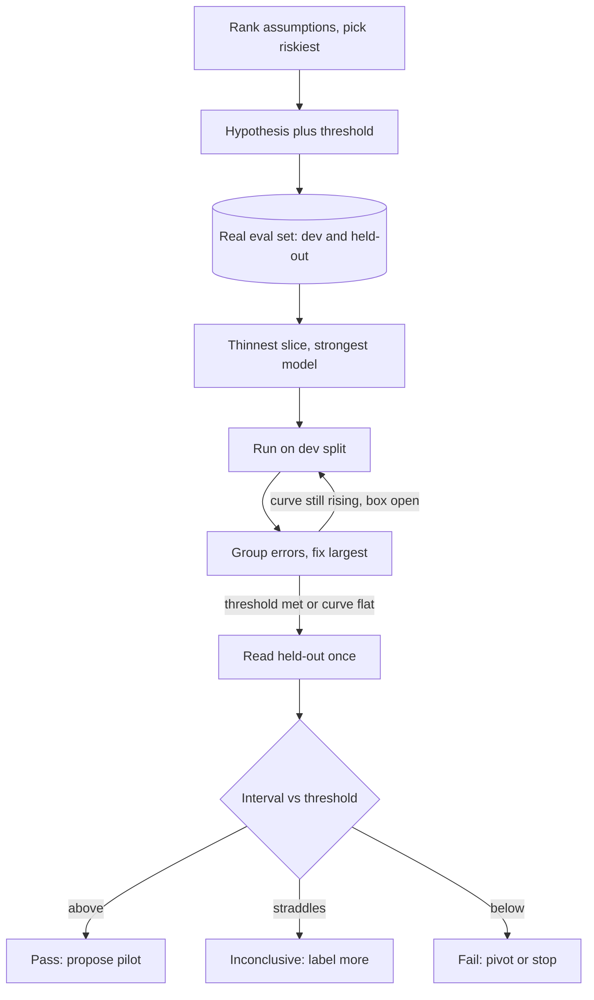

## TL;DR
An agent prototype is a cheap, disposable build asking "what should this agent do for users?"; an agent
PoC asks "can it complete real tasks?" against pass/fail criteria. Both fail when they test the easy part
or never decide.

## For agent builders
- **Why it matters for agents.** Most agent projects start as a PoC: one loop, a few tools, a replayed task
  set. Whether that PoC targets the riskiest assumption (tool access, tool choice, cost per task) decides
  whether the pilot surprises you.
- **Where it shows up in your stack.** A task-level eval set with dev and held-out splits, an eval harness
  that scores task success, latency and cost per task, and stubbed tools for anything not under test.
- **What you control.** Which assumption to retire, the threshold, the tools you stub versus wire for real,
  starting with the strongest model, and the single held-out readout.
- **What you can skip.** Memory, multi-agent orchestration, auth flows and UI, unless one of them is the
  riskiest assumption. Every extra component is something not under test.

## Why it exists
- **Two uncertainties no spec removes.** *Desirability*: do users want an assistant that drafts replies, or
  a better search box? *Feasibility*: can a model hit the accuracy, latency and cost the use case needs on
  this customer's data? Neither is settled by discussion.
- **Specs hide both.** A written spec for "an AI that summarizes claims files" hides whether the summaries
  are useful and whether the model gets the dates right on scanned forms.
- **Committing to the full build is expensive in the worst way.** Integration, UI, auth and deployment,
  most of the budget, get done before anyone learns the core model step reaches 70% when the business needs
  95%.
- **Endless notebook exploration fails the other way.** With no criteria it produces impressive anecdotes
  and no decision.
- **Prototypes and PoCs sit in between.** Deliberately incomplete builds aimed at one uncertainty at a time,
  so you spend days rather than months learning whether the idea survives users and data. They are cheap
  because they skip everything not under test, which is also why they must not be mistaken for the product.

## How it works
### Prototype vs. PoC: different questions
| | Prototype | PoC |
|---|---|---|
| Question | what should the experience be? | can this work technically? |
| Tests | workflow, interaction, useful output format | model, data, metric |
| Can fake | yes, even the AI ("Wizard of Oz": a person produces the output behind the scenes), because the question is about the human | no: real model, real data, real metric, because faking any invalidates the answer |
| Agent version | a person plays the agent while users try the hand-offs | the real loop on replayed tasks, scored on task success |

- **Do not mix the two questions** into one build; it usually answers neither well.
- **Neither is a pilot** (real users doing real work, measuring business impact) **or an MVP** (the smallest
  version you would actually ship and support). A PoC that passes earns a pilot, not a launch.

### 1. Find the riskiest assumption
- **List what must be true:** the data is accessible, the model can read these documents, latency fits the
  workflow, cost per transaction fits the budget, users trust the output.
- **For agents, add:** the tools the agent needs exist and you can call them, the model picks the right tool
  and fills valid arguments, and the loop finishes within a step and cost budget.
- **Rank** by likelihood of being false times cost if false.
- **Target the top item;** everything else can be stubbed.

### 2. State a hypothesis with a threshold
- **Example:** "Using a general-purpose model with retrieval over the policy manual, at least 85% of answers
  to 100 real employee questions will be judged correct and grounded."
- **Agent example:** "At least 70% of replayed helpdesk tickets end in the correct resolution, with no
  unauthorised write actions, within 10 tool calls."
- **The threshold comes from the business need,** because "it works pretty well" cannot be passed or failed.

### 3. Build the eval set from real data first
- **Collect real inputs,** including messy ones, and label expected outputs with domain experts. For an
  agent, label the expected end state (ticket resolved, which record changed), not one exact trace.
- **Scale:** fifty to a few hundred examples is common for a PoC, enough to see error categories, though
  small sets give wide confidence intervals.
- **It comes first** because every later decision is read off this set.

Size it with the binomial interval for a measured accuracy *p* on *n* examples:

```
95% half-width ≈ 1.96 × sqrt(p(1 − p) / n)
n ≈ 1.96² × p(1 − p) / E²     (examples needed for half-width E)
```

| *p* = 0.85, examples | 95% half-width |
|---|---|
| 100 | about ±7 points |
| 400 | about ±3.5 points |
| roughly 550 | ±3 points |

- **Rule of thumb:** if the business threshold and the likely result are close, the set has to be large; if
  far apart, 100 is plenty.
- **Split before tuning:** a *dev* portion you read and iterate on, and a *held-out* portion nobody looks at
  until the readout.
- **Why the split:** every prompt change chosen because it fixed dev failures fits the system to those
  examples, so the dev score drifts upward faster than true accuracy. The held-out number is the one the
  decision uses.

### 4. Build the thinnest end-to-end slice
- **Wire input to output** with the least code possible: one loop, the fewest tools that can complete the
  task, read-only or sandboxed where writes are not under test.
- **Start with the strongest available model** to establish the ceiling, because if the best
  general-purpose model cannot do it with your prompt and retrieval, cheaper off-the-shelf models almost
  certainly will not. Cost optimization comes after feasibility.
- **The ceiling is approach-specific, not absolute.** Fine-tuning, a specialized component (say, a dedicated
  OCR or table parser) or a redesigned pipeline can beat it, so a failed PoC rules out the approach tested,
  not the use case.

### 5. Iterate with error analysis, inside a timebox
1. **Read failures** on the dev split and group them (for agents: wrong tool, bad arguments, retrieval miss,
   loop or step-limit hit, wrong final answer).
2. **Fix the largest group, re-run,** because fixes land roughly one category at a time, so the biggest
   category is the biggest available gain.
3. **Track latency and cost per example** alongside accuracy, since a design that passes on quality but
   takes 40 seconds per answer has not passed.
4. **Stop** when the threshold is met, the curve flattens, or the box closes.

### 6. Write the findings and decide
- **Record** the result, the error breakdown, what was stubbed, and what production would require.
- **Decide:** proceed to pilot, pivot the design, or stop.
- **Disposable vs evolutionary:** a disposable prototype gets thrown away; an evolutionary one is kept only
  if it was built with that intent.

## Diagram
The PoC path: one risky assumption, a threshold and a held-out split fixed before tuning, a dev-only
iteration loop, then a single held-out readout that ends in pass, fail or inconclusive.



## Examples
### A minimal PoC harness
Real labeled examples, one function under test, a pre-written threshold, and a decision printed at the end.
The model call is a placeholder for whichever provider SDK you use. For an agent PoC, `call_model` becomes
one full agent run and `judge` checks the end state.

```python
import json, math, collections, time

THRESHOLD = 0.85  # written down before any tuning, from the business requirement

def call_model(question: str, context: str) -> str:
    """Placeholder: call your LLM provider here with a fixed prompt version."""
    raise NotImplementedError

def retrieve(question: str) -> str:
    """Placeholder: the thinnest retrieval that could work (e.g. BM25 over the manual)."""
    raise NotImplementedError

def judge(pred: str, expected: str) -> bool:
    """Start with expert labels or a strict string/regex check; add an LLM judge later if needed."""
    return expected.lower() in pred.lower()

def run_poc(path: str = "eval_set.jsonl", split: str = "dev") -> None:
    rows = [json.loads(l) for l in open(path)]           # {"q", "expected", "category", "split"}
    rows = [r for r in rows if r["split"] == split]      # iterate on dev; read held-out once
    errors, correct, secs = collections.Counter(), 0, []
    for r in rows:
        t0 = time.monotonic()
        pred = call_model(r["q"], retrieve(r["q"]))
        secs.append(time.monotonic() - t0)
        if judge(pred, r["expected"]):
            correct += 1
        else:
            errors[r["category"]] += 1
    n = len(rows); acc = correct / n
    half = 1.96 * math.sqrt(acc * (1 - acc) / n)          # binomial 95% half-width
    p95 = sorted(secs)[int(0.95 * (n - 1))]
    print(f"[{split}] accuracy {acc:.1%} ±{half:.1%} on {n} real examples, p95 {p95:.1f}s")
    print("errors by category:", errors.most_common())
    if split == "heldout":
        verdict = ("pass" if acc - half >= THRESHOLD else
                   "fail" if acc + half < THRESHOLD else "inconclusive: need more data")
        print("DECISION:", verdict)
```

- **The threshold is a constant set before the loop.**
- **Errors are grouped by category,** so the next iteration targets the biggest one.
- **Latency is measured, not assumed.**
- **The decision prints only for the held-out split,** with an explicit "inconclusive" band when the interval
  straddles the threshold.
- **Worked readout:** on a 200-example held-out split, 88% gives about ±4.5 points, so the verdict is
  "inconclusive" against 85%. That is the honest answer: label more data, do not celebrate.

### Sizing the eval set before you label
Run this before asking experts to label, so you request enough examples to make the decision resolvable.

```python
import math

def half_width(p, n, z=1.96):
    return z * math.sqrt(p * (1 - p) / n)

def n_needed(p, e, z=1.96):
    return math.ceil(z * z * p * (1 - p) / (e * e))

for n in (100, 200, 400):
    print(f"p=0.85, n={n}: ±{half_width(0.85, n):.1%}")   # ±7.0%, ±4.9%, ±3.5%
print("n for ±3 points at p=0.85:", n_needed(0.85, 0.03))  # 545
print(f"p=0.88, n=200: ±{half_width(0.88, 200):.1%}")      # ±4.5%
```

| Likely result vs threshold | Gap | Examples worth labeling |
|---|---|---|
| 95% vs 85% | 10 points | ~100 resolves it |
| 88% vs 85% | 3 points | ~550, or accept a pilot with the risk stated |

### Worked scenario: a helpdesk-agent PoC
Illustrative numbers. Threshold: 70% task success on held-out tickets, zero unauthorised writes, at most
10 tool calls per task.

| Assumption | Likely false? | Cost if false | Treatment |
|---|---|---|---|
| Agent can call the ticketing API with a scoped service account | medium | blocks everything | test on day 1, for real |
| Model picks the right tool among 9 | medium | high | the PoC's main question |
| Cost per task fits the budget | low | medium | measure, do not optimise |
| Users trust the replies | unknown | high | separate Wizard-of-Oz prototype |

| Run | Split | Task success | Largest error bucket |
|---|---|---|---|
| Baseline, strongest model | dev, 100 tasks | 52% | wrong tool between two similar lookup tools |
| Merge the two tools, rewrite descriptions | dev | 71% | invalid date arguments |
| Validate arguments, return errors to the model | dev | 80% | none dominant |
| Single readout | held-out, 150 tasks | 79% ± 6.5 | lower bound 72.5% clears 70%: pass, propose pilot |

## Production patterns
- **Locked held-out split** — every PoC. How: assign each example to dev or held-out once (for example by a
  stable hash of its id) and store the split in the file, so nobody re-splits after seeing results. Monitor:
  the gap between dev and held-out accuracy; a widening gap means you are fitting the dev set.
- **Versioned prompt and model in every result row** — while iterating. How: log prompt version, model id,
  tool-definition version, retrieval settings and commit with each run's score and latency, so the readout
  cites an exact configuration. Monitor: which change moved which error category.
- **Strongest-model ceiling, then a cost pass** — when feasibility is the risk. How: first run with the most
  capable model you can access, then re-run the same held-out set on cheaper candidates. Monitor: accuracy
  drop per cost saved; skip this order when cost itself is the riskiest assumption.
- **Random sample from the real source** — before building the eval set. How: ask for a random draw across
  the full archive or ticket history, including old scans and edge formats, not a curated folder. Monitor:
  the share of examples by format or age compared with production.
- **Throwaway repo for disposable code** — for prototypes. How: keep prototype code in a separate repository
  or folder marked disposable, so it cannot be merged into the product by accident. Monitor: any import of
  prototype modules from production code.
- **Stub tools behind the real interface** — for tools not under test. How: implement the stub with the same
  name, schema and error shapes as the real tool, so swapping in the real one does not change the agent's
  prompt. Monitor: which tools are still stubs at readout, listed in the findings.

## Trade-offs
- **Disposable speed vs shipping temptation.** Disposable prototypes are fast because they ignore quality,
  but teams are tempted to ship them; keep the code only when it was built evolutionarily with tests and
  structure from the start.
- **Strongest model first vs hidden cost.** It establishes feasibility quickly but can hide a cost problem;
  this flips when cost per transaction is itself the riskiest assumption and must be tested first.
- **Wizard of Oz vs feasibility.** Wizard-of-Oz prototypes answer desirability without any model work, but
  say nothing about feasibility; use them only when the user experience is the main unknown.
- **Small eval sets vs firm decisions.** They let a PoC finish in days, but with 100 examples the sampling
  error on accuracy is several points, so a near-threshold result needs more data before a firm decision.
- **Framework vs bare loop.** An agent framework gets a PoC running in hours, but hides prompts and retries
  you will need to see during error analysis; a bare loop is slower to write and easier to debug.

## Pitfalls
- **Clean sample data the vendor or customer prepared.** Not production-like; the symptom is accuracy that
  drops sharply in the pilot on scanned, partial or messy inputs.
- **Proving the easy part.** Showing a chat UI works while the hard assumption (data access, a rare document
  type, latency, tool access) stays untested; the symptom is surprise blockers after the contract.
- **Defining success after seeing the results.** The PoC always "succeeds"; the symptom is a criterion that
  suspiciously matches the number achieved.
- **PoC purgatory.** A successful PoC with no owner, budget or plan for the next stage; the symptom is a
  well-received demo followed by months of silence.
- **Shipping the prototype code because "it already works".** It brings hard-coded credentials, no retries
  and no tests; the symptom is the first production incident.
- **Tuning and reporting on the same examples.** Reported accuracy is fitted to the eval set; the symptom is
  a readout number several points above what a fresh sample or the pilot shows.
- **Scoring traces instead of outcomes.** Requiring one exact tool sequence fails valid alternative paths;
  the symptom is low scores on runs that a reviewer calls correct. Fix: score the end state.

## When to use
- **Prototype when:** the main unknown is what users need or how they will interact.
- **PoC when:** the main unknown is whether the model can meet a quantified bar on real data.
- **Do both** before committing to an integration-heavy build, and inside a timebox.
- **Skip when:** the task is well understood and the same pattern already runs in production elsewhere with
  similar data; a pilot may then be the cheaper first step.
- **Measure:** a PoC by the decision it enabled and the risks it retired, not by how polished it looks.

## Role lens
- **Engineer:** Builds the eval harness and thinnest slice, tracks error categories per iteration, and
  keeps prototype code clearly separated from anything meant to survive.
- **Architect:** Picks which assumption the PoC must retire and judges whether a passing result actually
  transfers to the production architecture, data volumes and constraints.
- **FDE:** Gets real customer data into the PoC early, negotiates the success threshold with the
  customer up front, and turns the findings into a pilot proposal.

## Check yourself
**Q:** A customer wants a PoC of an LLM that answers questions over their 40,000-page engineering archive.
Their IT team offers a curated folder of 200 clean PDFs to make it fast. What do you do, and why?
**A:** Accept the curated folder only for wiring the slice, not for the decision. The riskiest assumptions
are probably document parsing (scans, drawings, tables) and retrieval over a large, near-duplicate corpus,
which a clean 200-PDF set would hide. Ask for a random sample across the archive, including old scans, and
build the eval questions with engineers who actually ask them. State the threshold up front. If full
access is impossible in the timebox, report results as conditional on the sample and list what remains
untested. Otherwise the PoC passes and the pilot fails on the very data the curated set excluded.

## Interview questions
### What is the difference between a prototype, a PoC, a pilot and an MVP?
- **Prototype:** tests the experience and may fake the AI, because the question is about users.
- **PoC:** tests feasibility with the real model, data and metric against a pre-set threshold.
- **Pilot and MVP:** a pilot puts real users on real work to measure business impact; an MVP is the smallest
  version you would ship and support. A passing PoC earns a pilot, not a launch.

### How do you choose what a PoC should test?
- **List the assumptions that must hold,** such as data access, document parsing, latency, cost and trust.
- **Rank by likelihood of being false times cost if false,** and point the PoC at the top item while stubbing
  everything else, because proving the easy part leaves the real blocker for after the contract.

### Your dev accuracy rose from 78% to 91% over a week but the held-out set says 82%. What happened?
- **Overfitting to dev:** each prompt change chosen to fix dev failures fits the system to those examples,
  so the dev score drifts up faster than true accuracy.
- **Response:** report the held-out number, check which error categories differ between splits, and if needed
  draw a fresh sample from the real source to confirm.

### How many examples does a PoC eval set need?
- **Depends on the gap to the threshold.** At 85% accuracy, 100 examples give about ±7 points, 400 give about
  ±3.5, and ±3 points needs roughly 550.
- **So** if the expected result is far from the threshold, 100 is plenty; if close, label more or report the
  result as inconclusive. Skip the PoC entirely when the same pattern already runs in production on similar
  data, or when desirability, not feasibility, is the risk.

### How would you scope a two-week PoC for a customer-support agent with nine tools?
- **Retire the riskiest assumption first:** real, scoped access to the systems the agent must call, then
  whether the model chooses among the tools correctly.
- **Keep the slice thin:** one loop, stubs with real schemas for tools not under test, the strongest model.
- **Score outcomes:** task success on replayed tickets, unauthorised writes, tool calls, latency and cost
  per task, with one held-out readout.

### Your agent PoC passes on task success but averages 14 tool calls per task. Is that a pass?
- **Not if the threshold included a step or cost budget,** because cost and latency per task scale with
  tool calls and a 40-second task may not fit the workflow.
- **Diagnose from traces:** repeated lookups, retries on invalid arguments or loops usually explain it, and
  merging tools or validating arguments often cuts steps without hurting success.

## Quiz
### Q: What best distinguishes a PoC from a rapid prototype?
- [ ] A PoC is always longer and more expensive than a prototype
- [x] A PoC tests technical feasibility against criteria on real data; a prototype tests what the experience should be
- [ ] A prototype must use the production model while a PoC can use a mock
- [ ] A PoC is shown to executives while a prototype is internal only
> The difference is the question asked. A prototype can fake the AI because it studies users; a PoC cannot
> fake the model or data because feasibility is exactly what it measures.

### Q: Why start a PoC with the strongest available model rather than the cheapest?
- [ ] Cheap models are not allowed on customer data
- [ ] The strongest model is always cheapest per correct answer
- [x] It establishes a ceiling for the approach: if the best model fails, cheaper off-the-shelf ones almost certainly will too
- [ ] Strong models need no evaluation set
> Feasibility first: the strongest model bounds what this prompt-and-retrieval approach can achieve, and cost
> can be optimized later. The exception is when cost itself is the riskiest assumption, in which case it
> must be tested directly. Fine-tuning or specialized components can still exceed that ceiling.

### Q: A PoC reaches 86% against an 85% threshold on 100 examples. What is the soundest conclusion?
- [ ] The PoC has clearly passed and the team should commit to full production
- [ ] The PoC failed because results should exceed the threshold by at least ten points
- [x] It is a marginal pass; sampling error of several points means more data is needed before a firm commitment
- [ ] The threshold was wrong and should be raised to 90%
> With 100 examples, accuracy near 85% has a 95% interval of roughly ±7 points, so 86% is consistent with
> true performance below threshold. Collect more examples or proceed to a pilot with that risk stated.

## Use cases & projects
### Use cases
- **Agent feasibility for a new customer.** A two-week PoC on replayed tickets or documents decides whether
  an agent, a simpler pipeline or nothing is the right build.
- **Tool-set design.** A PoC shows whether the model can choose among the proposed tools, often leading to
  merged or renamed tools before any integration work.
- **Model selection for an agent.** Strongest-model ceiling first, then the same held-out set on cheaper
  models, gives the cost-quality curve for the pilot.
- **Wizard-of-Oz agent prototypes.** A person plays the agent in the real workflow to learn which hand-offs
  users accept before any model work.

### Mini project
**Run an agent PoC to a held-out decision (2-3 hours).**
- **Goal:** decide pass, fail or inconclusive for a small tool-calling agent against a threshold written first.
- **Steps:** write the hypothesis and threshold; build 60 tasks with expected end states and split about 40 dev,
  20 held-out by id hash; build a loop with three tools (one stubbed with the real schema); run the
  harness on dev, bucket failures, fix the largest bucket twice; read held-out once.
- **Done when:** you have a run log per iteration with error buckets, a held-out score with its interval,
  and a one-page findings note listing what was stubbed and the decision.
