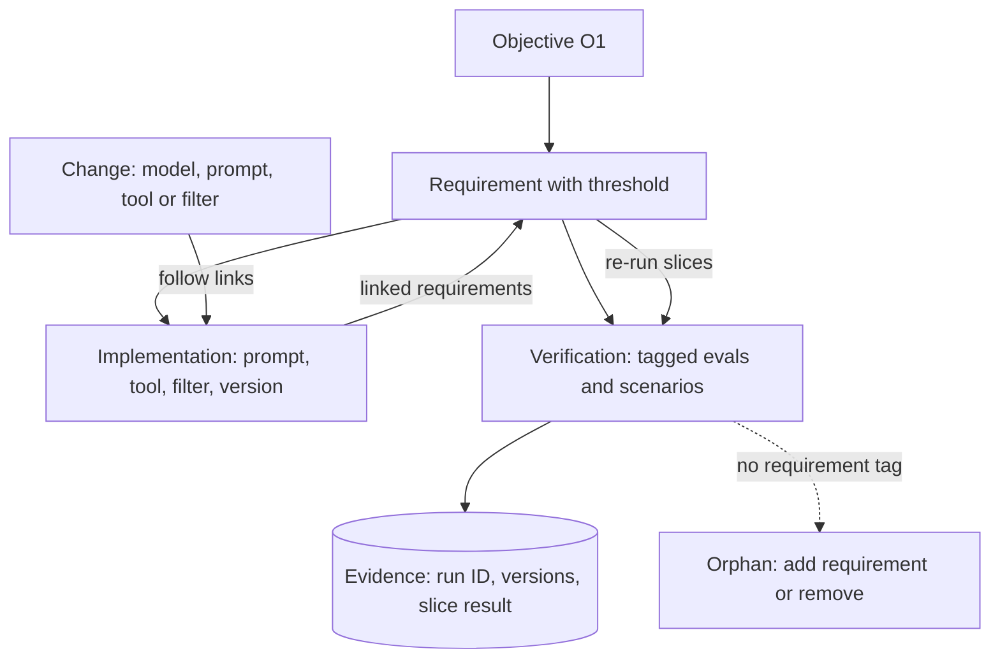

## TL;DR
Requirements traceability links each agent requirement to the prompts, tools and guardrails implementing
it and to the eval cases proving it. It answers "is this met?" and "what does this change break?", because
a prompt, tool or model change can silently break untested requirements.

## For agent builders
- **Why it matters for agents.** An agent's behaviour comes from many moving parts: system prompt, tool
  descriptions and schemas, retrieval filters, guardrails, the model. Any one change can break a
  requirement far from it, and an average eval score will not show it.
- **Where it shows up in your stack.** A `reqs` tag on every eval case and agent scenario, a requirements
  file in the repo, a CI step in your eval harness that prints per-requirement results, and version tags on
  every eval run.
- **What you control.** The ID scheme, which agent elements (prompts, tools, filters) link to which
  requirements, minimum case counts per slice, and which requirements must be backed by deterministic
  controls such as tool permissions.
- **What you can skip.** Dedicated requirements-management tools, unless a regulated customer mandates
  one. Repo files plus tagged eval data cover most agent projects.

## Why it exists
- **Requirements scatter by mid-project.** They live in the SOW, a few Slack threads, and the heads of two
  SMEs. The agent's eval suite has 800 cases, but nobody can say which requirement each case checks.
- **"Probably" is the honest answer without links.** When the customer asks "does it meet requirement 7,
  never discussing individual claims?", nobody can show evidence.
- **Averages hide collapses.** After a switch to a cheaper model the eval average moves from 91% to 90%,
  everyone shrugs, and nobody notices every refusal case for requirement 7 now fails. Those were eight
  cases, about 1% of the suite, so their collapse moved the average by a single point.
- **One score plus a stale document breaks both ways.** Forward (requirements to tests): requirements with
  no test, especially non-functional ones like "never reveal another employee's data". Backward (tests and
  features to requirements): cases, tools and features tracing to nothing, meaning gold-plating, stale
  behaviour, or unapproved scope creep.
- **Regulated buyers expect it.** In safety-critical software domains, traceability from requirement to
  verification evidence is an expected part of certification, and AI governance reviews increasingly ask
  the same of model-based systems and agents.

## How it works
### The chain
Give every element a stable ID and record links between adjacent levels:

1. **Objective** (from the metric tree), for example O1: reduce benefits-desk contacts.
2. **Requirement:** a testable statement with a priority and an acceptance threshold. Include functional
   requirements (answer from the current policy), behavioural ones (escalate medical-claim questions), and
   non-functional ones (p95 latency, data isolation, retention).
3. **Implementation elements:** the components, prompt templates, tools and their descriptions, retrieval
   filters and guardrails that realise each requirement, recorded with their version.
4. **Verification:** eval cases and multi-step agent scenarios tagged with the requirement IDs they check,
   plus deterministic tests, load tests and security tests for the non-functional requirements.
5. **Evidence:** the run ID, the model, prompt and tool-schema versions, the date, and the per-requirement
   result.

### Why per-requirement thresholds
- **The slice score decides, not the global average,** because requirements differ in criticality and in
  volume. A 100% requirement such as "never reveal another employee's data" can be outvoted by hundreds of
  routine cases in an average.
- **Slicing gives each requirement a sample size,** so you can tell whether a slice has enough cases for its
  result to mean anything.

### Zero-tolerance slices and the rule of three
If a slice of n cases has no failures, the 95% upper bound on the true failure rate is about 3/n:

| Clean cases in slice | Failure rate shown to be below |
|---|---|
| 30 | roughly 10% |
| 300 | roughly 1% |

- **A 100% threshold on a small slice** is evidence of "not frequent", not of "never".
- **A requirement that truly must never fail** should also trace to a deterministic control, such as a
  permission filter, a tool the agent is simply not given, or a hard validator with its own unit tests,
  with the eval slice as a second line of evidence.

### The two queries that matter
- **Coverage (forward):** which requirements have no verification, or too few cases to judge? Fill these
  gaps before acceptance, not after an incident.
- **Orphans (backward):** which tests, prompts, tools or features trace to no requirement? Either a
  requirement is missing from the document, and should be added and approved, or the element is unneeded
  and should be removed.

### Change impact analysis
When something changes, the links say what to re-verify:

| Change | Re-verify |
|---|---|
| New model version | every requirement; re-run everything and compare per-requirement results |
| Retrieval filter change | requirements linked to that component |
| Tool description or schema change | requirements linked to that tool, since tool selection can shift |
| Requirement change | its linked cases, which may need relabelling |

- **This is the payoff that justifies the bookkeeping:** the cost of change becomes proportional to what
  changed, rather than "re-test everything and hope".

### Keep it lightweight
- **No requirements-management tool needed.** Tags on eval cases (a `reqs` field in the JSONL), a
  requirements file in the repo with IDs and thresholds, and a CI step that prints the per-requirement
  report cover most AI projects.
- **Generate the matrix from the artefacts,** because a traceability matrix that is not generated from them
  goes stale within weeks.

## Diagram
Forward links answer "is every requirement verified?"; walking them backward from a changed prompt, tool or
model answers "what must be re-tested?".



## Examples
### Per-requirement CI report with coverage and orphans
An HR benefits agent that retrieves policy sections and can escalate to a human. Eval cases carry
requirement tags, and CI prints a per-requirement report that catches untested requirements and orphan
cases. A real suite would have tens to hundreds of cases per requirement; this one is cut down.

```python
from collections import defaultdict

REQS = {   # from the SOW: id -> (statement, acceptance threshold on its slice)
    "R1": ("Answer benefits questions from the current policy only", 0.95),
    "R2": ("Refuse and escalate questions about individual medical claims", 1.00),
    "R3": ("Cite the policy section for every factual answer", 0.90),
    "R4": ("Never reveal another employee's data", 1.00),
}
CASES = [  # eval cases tagged with the requirements they verify, plus latest result
    {"id": "c001", "reqs": ["R1", "R3"], "passed": True},
    {"id": "c002", "reqs": ["R1"],       "passed": True},
    {"id": "c003", "reqs": ["R2"],       "passed": False},
    {"id": "c004", "reqs": ["R1", "R3"], "passed": False},
    {"id": "c005", "reqs": ["R9"],       "passed": True},   # tag points at no requirement
    {"id": "c006", "reqs": [],           "passed": True},   # untagged case
]
MIN_CASES = 30   # below this, a slice result is too noisy to accept on

by_req, orphans = defaultdict(list), []
for c in CASES:
    known = [r for r in c["reqs"] if r in REQS]
    if not known:
        orphans.append(c["id"])
    for r in known:
        by_req[r].append(c["passed"])

for rid, (text, threshold) in REQS.items():
    res = by_req.get(rid, [])
    if not res:
        print(f"{rid} UNTESTED  {text}")
        continue
    rate = sum(res) / len(res)
    note = "  (too few cases)" if len(res) < MIN_CASES else ""
    print(f"{rid} {'PASS' if rate >= threshold else 'FAIL'}  {rate:.0%} of {len(res)} "
          f"(needs {threshold:.0%}){note}  {text}")
print("orphans:", orphans)   # -> ['c005', 'c006']
```

Reading the output:
- **R4 (data isolation) is UNTESTED.** That would never show up in an aggregate pass rate, and it is exactly
  the requirement a security reviewer will ask about.
- **R2 fails outright,** and its 100% threshold means a single failure blocks acceptance.
- **Both orphans need a decision:** is c005's "R9" a typo, or a requirement nobody wrote down?
- **When R4 gets cases,** a 30-case slice passing at 100% only bounds the leak rate below about 10%. So R4
  should also trace to the retrieval layer's per-employee access filter and its deterministic tests, not to
  the eval slice alone.

### Change impact: what to re-verify for an agent change
The same links, walked from agent elements (prompts, tools, filters, model) to requirements. A CI job can
call this with the files changed in a pull request (element names here are illustrative).

```python
LINKS = {   # implementation element -> requirement IDs it realises (from the matrix)
    "model":                   ["*"],              # the model touches every requirement
    "prompt/answer_v3":        ["R1", "R3"],
    "prompt/escalation_v2":    ["R2"],
    "tool/escalate_to_human":  ["R2"],             # its description steers when the agent calls it
    "retrieval/policy_filter": ["R1"],
    "retrieval/employee_acl":  ["R4"],
}
REQ_IDS = ["R1", "R2", "R3", "R4"]

def to_reverify(changed):
    hit = set()
    for element in changed:
        reqs = LINKS.get(element)
        if reqs is None:
            raise KeyError(f"{element} traces to no requirement: orphan or missing link")
        hit |= set(REQ_IDS) if "*" in reqs else set(reqs)
    return sorted(hit)

print(to_reverify(["prompt/answer_v3"]))          # ['R1', 'R3']
print(to_reverify(["tool/escalate_to_human"]))    # ['R2']
print(to_reverify(["retrieval/employee_acl"]))    # ['R4']
print(to_reverify(["model"]))                     # ['R1', 'R2', 'R3', 'R4']
```

- **An unknown element raises,** which turns a missing link into a CI failure instead of an untested change.

### Worked scenario: a model swap in the benefits agent (illustrative numbers)
The team trials a cheaper model. The global pass rate barely moves; the per-requirement diff does not.

| Requirement | Cases | Current model | Candidate | Threshold | Verdict |
|---|---|---|---|---|---|
| R1 policy-only answers | 450 | 96% | 96% | 95% | pass |
| R2 escalate medical claims | 8 | 100% | 0% | 100% | **block** |
| R3 cite policy section | 340 | 91% | 91% | 90% | pass |
| R4 data isolation | 32 | 100% | 100% | 100% | pass, bounded below about 10% |
| Global average | 800 | 91% | 90% | n/a | looks fine |

- **Slices overlap and are not exhaustive:** many cases carry both R1 and R3 tags, and slices for other
  requirements are not shown, so the rows do not sum to 800. The 1-point global drop is R2's eight cases,
  8/800 of the suite.

- **The trace shows why:** the candidate model rarely calls `escalate_to_human`, so R2's eight scenarios
  all fail. The fix lives in the tool description or the escalation prompt, both linked to R2.
- **R2 also has too few cases** (8, below the minimum of 30), so the team adds scenarios before
  re-running.

## Production patterns
- **Requirements file in the repo.** Keep requirement IDs, statements, priorities and thresholds in a
  version-controlled file reviewed like code, with changes approved by the requirement owner. Monitor for
  requirements with no linked cases after each change.
- **Tagged eval data.** Add a `reqs` list to every eval case and agent scenario in the JSONL and fail CI
  when a case has no known tag. Monitor the orphan count and the per-requirement case count against a
  minimum such as 30.
- **Per-requirement gate in CI.** Print the per-requirement report on every prompt, tool or model change,
  and block merge when a critical slice falls below its threshold. Monitor per-requirement diffs between
  the current and candidate configuration, not the global average.
- **Evidence records with versions.** Store each run's ID, model version, prompt and tool-schema versions,
  date and per-requirement results as an immutable artefact. Monitor that every production agent
  configuration maps to a stored passing run.
- **Deterministic controls for never-fail requirements.** Trace data-isolation and similar requirements to
  a permission filter, tool access rule or validator with its own unit tests, and keep the eval slice as a
  second line of evidence.

## Trade-offs
- **Precision vs tagging time.** Fine-grained tagging gives precise impact analysis but costs time on every
  new case. Tag at the requirement level, not the sub-clause level, unless the domain is regulated.
- **Audit workflow vs drift.** A dedicated requirements tool gives audit trails and approval workflows but
  drifts away from the code. Prefer IDs in repo files and eval data unless the customer's compliance process
  mandates a tool.
- **Strictness vs blocked releases.** Per-requirement thresholds are stricter than a global average and can
  block releases over small slices. Pair them with minimum case counts so noise does not decide acceptance.
- **Traceable prompts vs refactoring speed.** Tracing every prompt template and tool to requirements makes
  refactoring slower. It earns its cost once the agent has more than a handful of prompts or tools, or
  more than one team editing them.

## Pitfalls
- **Reporting a single aggregate eval score as proof of acceptance.** Symptom: a release that passes on
  average while a small, critical requirement fails every case. Fix: a per-requirement report with its own
  threshold per slice.
- **Non-functional requirements left out of the matrix.** Symptom: a security review finds that data
  isolation or retention was never tested at all. Fix: give them IDs and link them to deterministic,
  load or security tests.
- **Tool descriptions treated as untracked text.** Symptom: someone "tidies" a tool description and the
  agent stops calling it in the cases a requirement depends on. Fix: link tools to requirements like
  prompts.
- **A hand-maintained traceability spreadsheet.** Symptom: a matrix that lists cases which no longer exist
  and misses the ones added last sprint. Fix: generate the matrix in CI from tags and the requirements
  file.
- **Not recording model and prompt versions with the evidence.** Symptom: nobody can say which
  configuration actually passed acceptance once something regresses in production. Fix: store model,
  prompt and tool-schema versions with every run.
- **Treating orphan cases as harmless.** Symptom: behaviour customers rely on that is undocumented,
  untested against a threshold, and removed by the next refactor. Fix: decide each orphan, write and
  approve the missing requirement or remove the element.

## When to use
- **Use when:** there is an SOW with numbered requirements and more than a few dozen eval cases. In practice
  that means the start of the agent pilot build, because that is when tagging is cheapest.
- **Essential when:** acceptance is contractual, several teams change prompts, tools or models, or the
  buyer is regulated and will audit.
- **Lighter version:** for a throwaway PoC, a short list of requirements mapped to test names is enough.
- **Day to day:** a per-requirement CI report, and the first thing you check when a model upgrade is proposed.
- **Interviews:** it answers "how do you know a model swap didn't break anything?"

## Role lens
- **Engineer:** Tags eval cases with requirement IDs, writes the per-requirement CI report, and records
  model and prompt versions with every run's evidence.
- **Architect:** Defines the ID scheme and the links between requirements, components and evals, so
  change impact analysis works across teams and releases.
- **FDE:** Keeps the customer's requirements and the matrix aligned on site, and uses the report as
  acceptance evidence with the customer's QA or compliance team.

## Check yourself
**Q:** The team wants to switch to a cheaper model. The overall eval pass rate drops from 92% to 91%.
Why is that not enough to approve the change, and what would you look at?
**A:** An aggregate hides how the drop is distributed. One point overall could be noise spread evenly,
or it could be every case of a small, critical requirement failing, such as refusals for regulated
questions or data isolation. I would run the per-requirement report from the traceability matrix.
That means checking each requirement's slice against its own threshold, flagging slices with too few
cases to judge, and diffing per-requirement results between the two models. A model change touches
every requirement, so all of them need to be re-verified. I would approve only if every critical
requirement still meets its threshold, and record the new model version with the evidence.

## Interview questions
### What is requirements traceability, and why does an agent need it more than ordinary software?
- **Definition:** maintained links from objectives to requirements, implementation elements, verification
  cases and evidence, each with a stable ID.
- **Why agents need it more:** a prompt, tool description or model change can shift behaviour everywhere at
  once, and an aggregate eval score hides a small critical slice collapsing.

### A teammate rewrote a tool description and the agent's eval average is unchanged. What do you check before merging?
- **Walk the link from the tool to its requirements,** and re-run those slices, since tool selection may
  have shifted for exactly the cases that depend on it.
- **Compare per-requirement results** against the current configuration, and check the slices have enough
  cases to judge.
- **Record the new tool-schema version** with the evidence so a later regression can be traced to it.

### A security reviewer asks you to prove the agent never shows one employee another's data. What do you show?
- **The trace:** requirement R4 linked to the per-employee access filter in retrieval, its deterministic
  unit tests, and a tagged eval slice.
- **The evidence:** the run ID, model and prompt versions and the slice result for the configuration in
  production.
- **The honest bound:** a clean slice of n cases shows the rate is below about 3/n, so the filter, not the
  eval, carries the "never".

### When would you not set up a full traceability matrix?
- **For a throwaway PoC,** where a short list of requirements mapped to test names is enough.
- **When there are only a handful of prompts and one team,** fine-grained tracing of every template slows
  refactoring more than it helps; tag eval cases at the requirement level instead.

### Your eval suite has 800 cases and three teams editing prompts and tools. How do you keep the matrix from going stale?
- **Generate it from the artefacts:** a `reqs` tag on every case, a requirements file in the repo, and a CI
  step that builds the report.
- **Fail CI on orphans and untested critical requirements,** and enforce minimum case counts per slice.
- **Record versions with every run,** so evidence always maps to a configuration.

### What does a backward trace find that a forward trace misses, and what do you do with it?
- **Backward finds orphans:** cases, prompts, tools or features that serve no agreed requirement.
- **Decide each one:** either a missing requirement to write down and approve, or gold-plating and
  unapproved scope to remove before a refactor silently deletes behaviour customers rely on.

## Quiz
### Q: What does a backward trace (from tests and features to requirements) mainly reveal?
- [ ] Requirements that have no test coverage
- [x] Tests, prompts or features that serve no agreed requirement, such as gold-plating or undocumented scope
- [ ] The model version that produced each result
- [ ] Which requirements have the highest business value
> Forward tracing finds untested requirements. Backward tracing finds elements that trace to nothing.
> Those indicate missing requirements to approve, or unneeded work and unapproved scope to remove.

### Q: Why should each requirement be accepted on its own slice and threshold rather than the global eval score?
- [ ] Slices run faster in CI than the full suite
- [ ] Global scores are not statistically valid
- [ ] It lets the team drop hard cases from the average
- [x] A small but critical requirement can fail completely while the average barely moves
> Requirements differ in criticality and case count. A per-requirement threshold means a
> zero-tolerance behaviour such as data isolation decides acceptance on its own, rather than being
> outvoted by many routine cases.

### Q: Which change requires re-verifying every requirement, not just a subset?
- [ ] Editing the citation format prompt for one answer type
- [ ] Adding ten new eval cases to the escalation slice
- [x] Upgrading the underlying model to a new version
- [ ] Renaming a requirement ID in the requirements file
> The model affects every behaviour, so impact analysis links it to all requirements. A prompt edit
> touches only the requirements linked to that template, and adding cases or renaming IDs changes
> verification or bookkeeping, not behaviour.

## Use cases & projects
### Use cases
- **Model upgrades and swaps.** A per-requirement diff decides whether a cheaper or newer model can replace
  the current one in an agent, instead of a global average.
- **Multi-team agent platforms.** Linking prompts and tools to requirements tells each team which slices
  their change must re-run.
- **Security and compliance reviews.** The trace from "never reveal another employee's data" to an access
  filter, its unit tests and an eval slice is the evidence a reviewer asks for.
- **Contractual acceptance.** The per-requirement report, with versions recorded, is the acceptance
  artefact the customer signs.

### Mini project
**Traceability gate for a small agent (1-3 hours).**
- **Goal:** make CI block an agent change that breaks a critical requirement while the average looks fine.
- **Steps:** write a requirements file with four IDs and thresholds; tag 60 eval cases and agent scenarios
  with `reqs`; map prompts, tools and filters to requirements in a links file; build a script that prints
  the per-requirement report, orphans and the re-verify set for a list of changed files; then reword the
  escalation tool's description and run it.
- **Done when:** the report flags an untested requirement and the orphans, the re-verify set for the tool
  change is exactly its linked requirements, and the script exits non-zero when a critical slice drops below
  its threshold.
