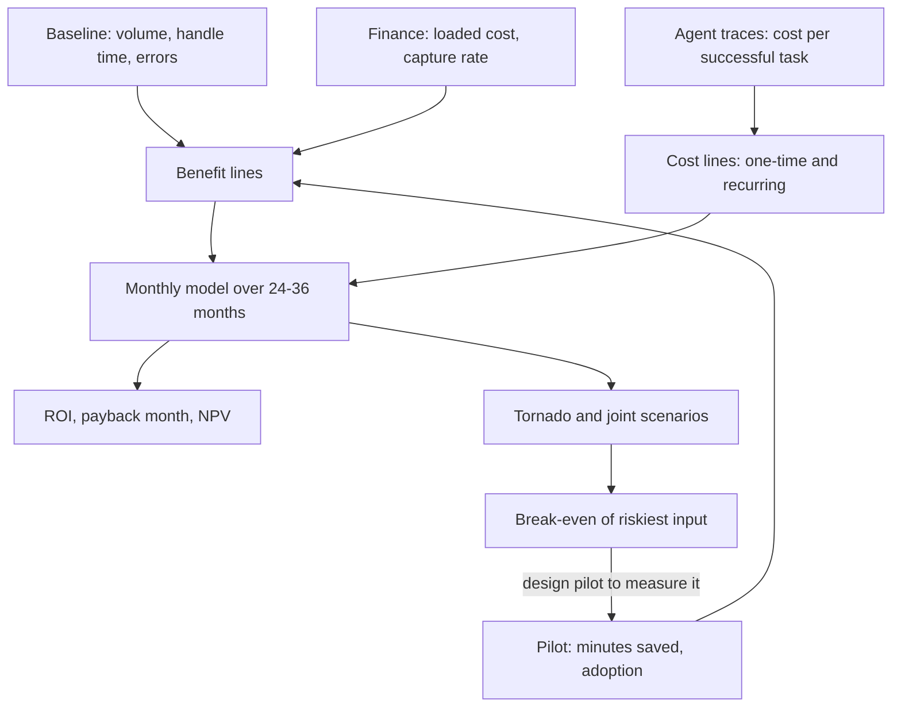

## TL;DR
An ROI model turns an agent's success metrics into money: baseline × improvement × adoption × capture
rate, minus one-time and recurring costs, over a horizon. Build ranges, sensitivity and break-even, not one
heroic number, because capture rate and adoption usually decide it.

## For agent builders
- **Why it matters for agents.** Agents cost more per task than a single model call: several LLM steps,
  tool calls, retries and human review of failed runs. The ROI model is where that cost per successful
  task meets the value the agent creates, and it decides whether the agent gets funded.
- **Where it shows up in your stack.** Provider usage fields and your trace store give tokens, steps and
  retries per run; your eval and audit pipeline gives success rate; both feed the recurring cost line.
- **What you control.** Model tier per step, step budgets, caching, when the agent stops and hands off,
  and review design. Each moves cost per successful task and therefore break-even.
- **What you can skip.** Corporate-finance theory beyond ROI, payback month and NPV. Let the customer's
  finance owner supply the discount rate and capture rate.

## Why it exists
- **Budget holders reason in payback and NPV, not eval scores.** Agent projects compete with every other
  project; if you cannot say what the agent is worth, someone else decides, usually with a vendor's slide
  or a gut feeling.
- **It protects the customer.** A use case that cannot clear break-even under plausible assumptions should
  be found in week two, not in month nine.
- **The one-line spreadsheet is wrong.** "Agents spend 12 minutes per ticket, AI saves 50%, 40,000 tickets
  a month, so we save 240,000 minutes" fails in four ways:
  1. **Freed time is not money.** Salaries do not fall when each person saves twenty minutes a day unless
     hiring is avoided, overtime drops, or the time goes to work that has value.
  2. **Adoption is not instant.** Real adoption ramps and plateaus below 100%.
  3. **AI adds recurring costs:** inference per task (including failed and retried agent runs), human
     review of outputs, eval-set upkeep, monitoring, and re-validation when a model version is deprecated.
  4. **A point estimate hides which assumption the case rests on,** so no one knows what to measure in the
     pilot to confirm or kill it.
- **The assumptions that decide AI ROI** (how much freed time becomes real savings, how fast people adopt)
  are rarely the ones vendors talk about.

## How it works
### Benefit lines
Build each benefit as a product of measurable factors, so every factor traces to a baseline or a pilot
measurement:

| Benefit | Formula | Caveat |
|---|---|---|
| **Labour efficiency** | eligible volume × adoption × time saved per used case × loaded cost per minute × capture rate | capture rate should be owned by finance |
| **Quality / error avoidance** | volume × change in error rate × cost per error (rework, credits, write-offs, penalties) | only counts if the error rate was baselined |
| **Revenue** | affected volume × change in conversion or speed × value per unit | hardest to attribute; needs a holdout group to defend |
| **Risk reduction** | change in probability × impact of a loss event | present separately, because finance discounts it heavily |

- **Capture rate** is the share of freed time that turns into cash or redeployed capacity.
- **It is high** when the team is growing (hires avoided), when there is overtime or contractor spend, or
  when there is a backlog with a cost.
- **It is low** when the freed time just becomes slack.

### Cost lines
- **One-time:** discovery, integration (tool and API wiring for the agent), data preparation, building the
  eval set (SME hours count), security review, training and change management.
- **Recurring:** inference cost per task × total tasks attempted, platform or vendor fees, human review
  minutes per output × loaded cost, engineering upkeep (prompt, tool-schema and eval maintenance,
  monitoring, incident response), and periodic re-validation when the provider retires a model.
- **Divide recurring cost by successful tasks, not attempted ones,** because retries and failed attempts
  consume tokens but produce nothing, and the review time on a bad draft is a cost, not a saving.
- **Agent runs vary widely in cost.** A run that loops through ten tool calls costs several times one that
  finishes in two, so use the measured distribution of steps per run, not the happy path.

### Compare against the next-best alternative
- **The counterfactual is rarely "do nothing".** A macro library, a form redesign, a rules engine, a
  single-call assistant or a process change might capture part of the same benefit at a fraction of the
  cost and risk, and a sharp finance reviewer will ask about it.
- **State the agent case as incremental value.** If better templates would remove half of the handle time
  the agent targets, the agent project's return is computed on the other half, and its build cost is
  compared with the template project's cost, not with zero.

### Horizon, ramp and summary measures
Model month by month over a horizon the sponsor uses, often 24 or 36 months, with an adoption ramp from
comparable rollouts or the pilot. Report three numbers, because they answer different questions:

| Measure | Definition | Question it answers |
|---|---|---|
| **ROI** | (total benefit − total cost) / total cost | is it worth it overall? |
| **Payback month** | month cumulative net value turns positive | the cash-flow question |
| **NPV** | net value discounted at the customer's rate | how it compares with other investments |

### Sensitivity and break-even
1. **Tornado analysis.** Vary one input at a time across its plausible range and rank inputs by how far
   they swing NPV.
2. **Break-even.** Solve for the break-even value of the most uncertain input; the model exists to answer
   this. If break-even needs 2 minutes saved and the pilot measures 4, the case is robust. If it needs 3.8,
   the pilot must be designed to measure that one number precisely.
3. **Joint scenario.** One-at-a-time sensitivity assumes inputs move independently, and in AI rollouts they
   often do not: low minutes saved and low adoption tend to arrive together, because people abandon a tool
   that saves them little. Run a joint pessimistic scenario, or a simple Monte Carlo over the input ranges,
   and report the chance that NPV is negative alongside the tornado chart.

## Diagram
Benefits and costs both trace to measured inputs; agent traces supply cost per successful task, and the
sensitivity loop finds the one input the pilot must measure.



## Examples
### Worked scenario: cost per successful task for a support agent (illustrative numbers)
A month of pilot traces for a tool-calling support agent. Prices and counts are illustrative; take yours
from provider usage fields and your trace store.

| Line | Value |
|---|---|
| Agent runs attempted | 10,000 |
| Model cost per attempted run (all steps, retries included) | $0.12, so $1,200 |
| Runs that succeed (audited, not self-reported) | 8,000 |
| Failed runs reviewed by a human, 1 minute each at $0.80/min | 2,000 × $0.80 = $1,600 |
| **Cost per successful task** | ($1,200 + $1,600) / 8,000 = **$0.35** |
| Naive figure (model cost / attempts, no review) | $0.12 |

- **The naive figure understates unit cost almost 3×,** and most of the gap is human review of failures,
  not tokens. Raising success rate or failing fast to a human usually beats a cheaper model.
- **Compare with the drafting example below,** which assumes $0.04 per ticket for one model call; a
  multi-step agent at $0.35 needs a larger saving per ticket to break even.

### Monthly model with sensitivity and break-even
A drafting assistant for a 40,000-ticket-per-month support team. All inputs are illustrative. A real
model takes volume and handle time from the baseline, loaded cost and capture rate from finance, and AI
cost per ticket from a token measurement on real traffic.

```python
BASE = dict(tickets=40_000, min_saved=4.0, cost_per_min=0.80, capture=0.6,
            adoption_ramp=[0.2, 0.35, 0.5, 0.6, 0.7], adoption_steady=0.7,
            ai_cost_per_ticket=0.04, review_min=0.0, platform=6_000, upkeep=10_000,
            build=180_000)                  # review_min=0: min_saved is measured net of review

def monthly(p, month):
    ramp = p["adoption_ramp"][month] if month < len(p["adoption_ramp"]) else 1.0
    a = min(ramp, p["adoption_steady"])          # the plateau caps the ramp
    benefit = p["tickets"] * a * (p["min_saved"] - p["review_min"]) * p["cost_per_min"] * p["capture"]
    run = p["tickets"] * p["ai_cost_per_ticket"] + p["platform"] + p["upkeep"]  # drafts for every ticket
    return benefit, run

def evaluate(p, months=24, rate=0.10):
    cum, payback, npv = -p["build"], None, -p["build"]
    for m in range(months):
        b, r = monthly(p, m)
        cum += b - r
        npv += (b - r) / (1 + rate / 12) ** (m + 1)
        if payback is None and cum >= 0:
            payback = m + 1
    benefit = sum(monthly(p, m)[0] for m in range(months))
    cost = p["build"] + sum(monthly(p, m)[1] for m in range(months))
    return dict(roi=(benefit - cost) / cost, payback=payback, npv=round(npv))

print("base", evaluate(BASE))                      # ROI ~ +100%, payback month 8, NPV ~ 517k
for k, v in [("capture", 0.3), ("adoption_steady", 0.4), ("min_saved", 2.5), ("upkeep", 20_000)]:
    print(k, v, evaluate({**BASE, k: v}))
# capture 0.3 -> ROI ~ 0, no payback in 24 months; adoption 0.4 -> +19%, month 16
# min_saved 2.5 -> +25%, month 15;               upkeep 20k -> +43%, month 11

lo, hi = 0.0, 10.0                                 # break-even on minutes saved
for _ in range(40):
    mid = (lo + hi) / 2
    lo, hi = (mid, hi) if evaluate({**BASE, "min_saved": mid})["roi"] < 0 else (lo, mid)
print(f"break-even minutes saved: {hi:.2f}")       # ~2.0
```

What the run tells you:

| Finding | Implication |
|---|---|
| Base case: ROI about +100%, payback month 8 | looks strong |
| Halving capture rate (0.6 to 0.3) wipes out the return entirely | the most valuable scoping conversation is with finance about what happens to freed time, not with engineering about tokens |
| Doubling upkeep roughly halves the return but leaves it clearly positive | engineering cost matters less than capture |
| Break-even at about 2 minutes saved | the pilot must measure minutes saved precisely; the case survives anything above that |
| Joint mild pessimism (capture 0.45, adoption 0.5, 3 minutes saved, each milder than its single-input stress) | ROI of about −17% and no payback within 24 months |

Three modest disappointments together sink a case that survives each one alone, so the one-at-a-time view
flatters the case.

- **To model the multi-step agent instead,** set `ai_cost_per_ticket` to total agent spend per ticket
  attempted, because the model multiplies it by every ticket: $2,800 / 10,000 = $0.28 in the trace
  example. Using the $0.35 per-success figure here would count the failure rate twice.
- **What changes:** at $0.28 the base ROI falls to about +44%, payback moves to month 11, and break-even
  rises to about 2.8 minutes saved, so the pilot's 4-minute margin shrinks sharply.

### Monte Carlo with correlated inputs
Continues the script above (reuses `BASE` and `evaluate`). A shared "usefulness" factor drives both minutes
saved and adoption, because people abandon a tool that saves them little. Ranges are illustrative.

```python
import random

def draw(rng):
    u = rng.random()                                  # shared "how useful is the tool" factor
    return {**BASE,
            "min_saved": 2.5 + 2.5 * u,               # 2.5 to 5.0 minutes
            "adoption_steady": 0.4 + 0.4 * (0.7 * u + 0.3 * rng.random()),  # tracks usefulness
            "capture": rng.uniform(0.3, 0.8),         # finance's range, independent
            "upkeep": rng.uniform(8_000, 20_000)}

rng = random.Random(7)
runs = [evaluate(draw(rng)) for _ in range(5_000)]
npvs = sorted(r["npv"] for r in runs)
print(f"P(NPV < 0) = {sum(n < 0 for n in npvs) / len(npvs):.0%}")   # about 36% with these ranges
print(f"NPV p10 / p50 / p90 = {npvs[500]:,} / {npvs[2500]:,} / {npvs[4500]:,}")
```

- **Report the probability, not just the base case.** A base-case ROI near +100% still carries roughly a
  one-in-three chance of negative NPV once the inputs are allowed to disappoint together.

## Production patterns
- **Finance-owned assumption sheet.** Keep capture rate, loaded cost per minute and discount rate in a
  sheet the customer's finance owner signs, and have the model read from it. Monitor for assumption edits
  between reviews, each with a named approver.
- **Cost per successful task from agent traces.** Compute recurring cost as total inference, tool, retry
  and review spend divided by audited successful tasks, from production traces tagged by task ID. Monitor
  it weekly against the modelled value, because retries, longer loops and discarded drafts drift it upward.
- **Step and spend budgets per run.** Cap the number of agent steps and tokens per run, and hand off to a
  human when the cap is hit, so the cost distribution has a ceiling the model can assume. Monitor the
  share of runs that hit the cap.
- **Re-run the model at each gate.** Refresh inputs with baseline numbers, then pilot measurements, and
  re-run before every expansion decision. Monitor the gap between measured and break-even values of the
  top sensitivity input.
- **Adoption curve from usage logs.** Replace the assumed ramp with measured use on eligible work per
  month. Monitor the plateau level, since a payback month that keeps slipping usually means the plateau
  was overestimated.
- **Lead with the conservative case.** Present the conservative scenario first, with the range and the
  probability of negative NPV beside it. Track which assumption reviewers challenge most and measure it.

## Trade-offs
- **Honesty vs simplicity.** Ranges and sensitivity analysis are more honest than a point estimate, but
  sponsors often want one number. Lead with the conservative case, and show the range alongside it.
- **Headline vs attribution.** Including risk-reduction and revenue benefits raises the headline, but those
  lines are hard to attribute. Keep them separate unless a holdout group can measure them.
- **Long horizon vs stability.** A longer horizon makes payback look easier, but it assumes model costs,
  prices and the workflow stay stable. Use 24 months or less when the provider or the process is likely to
  change.
- **Detail vs speed.** A detailed bottom-up model is defensible but slow to build. For an early go/no-go, a
  10-line version with honest ranges is enough, provided the break-even input is identified.
- **Clean story vs overstatement.** Counting capture rate at 100% simplifies the story but overstates
  value. It is only justified when the team is actively hiring or paying for overtime the agent will
  remove.
- **Autonomy vs unit cost.** A fully autonomous agent removes review minutes but needs a stronger model and
  more steps; an assistive agent is cheaper per run but saves less. Model both before choosing.

## Pitfalls
- **Treating time saved as cash saved.** Symptom: a CFO asks which budget line goes down, and nobody can
  answer. Fix: a finance-owned capture rate.
- **Pricing inference on successful tasks only.** Symptom: actual monthly spend runs well above the model,
  because retries, failed agent runs and unused drafts were never counted. Fix: price per attempt, divide
  by successes.
- **Costing the agent from the happy path.** Symptom: real runs average far more steps than the demo, and
  spend doubles. Fix: use the measured steps-per-run distribution and a step budget.
- **Assuming instant, complete adoption.** Symptom: a payback month that slips every quarter while usage
  sits on a plateau far below the modelled figure. Fix: a measured ramp and plateau.
- **Forgetting the human review cost.** Symptom: "time saved" shrinks in the pilot because reviewers spend
  minutes checking each output. Fix: a review-minutes line, or measure savings net of review.
- **Comparing the agent case against doing nothing.** Symptom: a finance reviewer asks why a cheaper
  process or template fix was not costed, and the model has no answer. Fix: cost the next-best alternative.
- **Building the model before the baseline exists.** Symptom: ROI inputs that the customer's own data
  contradicts when the pilot report is reviewed. Fix: baseline first.

## When to use
- **Use when:** scoping, as soon as the success metrics are agreed. Use it to kill or prioritise agent use
  cases before anyone writes tool integrations.
- **Refine:** with baseline numbers, then with pilot measurements, and re-run it before any expansion
  decision.
- **Skip only for:** exploratory work explicitly funded as learning.
- **Measure:** the most useful outputs are the break-even value and the ranked sensitivity list, because
  they tell you which number the pilot must measure.
- **Interviews:** expect "this use case saves 50% of time, what is it worth?" The strong answer asks about
  capture rate, adoption, review cost and cost per successful task before multiplying.

## Role lens
- **Engineer:** Measures real cost per successful task from traces, including retries and failures, and
  supplies the inference and upkeep numbers the model needs.
- **Architect:** Owns the cost structure behind the model: model tier, caching, review design and
  hosting choices, which set recurring cost and therefore break-even.
- **FDE:** Builds the model with the customer's finance and operations owners, so capture rate and
  loaded cost are their numbers, which makes the result credible internally.

## Check yourself
**Q:** A pilot shows a drafting tool saves 5 minutes per ticket, but the sponsor's finance team rejects
the ROI case. What are the likely reasons, and how do you fix the model?
**A:** Most likely the model counted all freed time as cash. If the team is not shrinking or avoiding
hires, those minutes do not reduce any budget line, so the capture rate is far below 100%. Other
likely gaps: the 5 minutes was measured on the cases where the tool was used, not across all eligible
work at realistic adoption; review time on bad drafts was not subtracted; and inference was priced per
successful draft instead of per attempt. I would rebuild with finance's own capture assumption, which
might be avoided hiring next year, overtime or backlog cost. I would use the measured adoption curve
and full per-attempt cost, then show the break-even capture rate so they can judge whether it is plausible.

## Interview questions
### A vendor says their agent saves 50% of staff time. How would you turn that into a value estimate?
- **Start from the baseline,** not the claim: eligible volume and measured handle time.
- **Multiply through the real factors:** realistic adoption plateau, minutes saved net of review, loaded
  cost and a finance-owned capture rate.
- **Subtract recurring cost per successful task,** including retries, then report ROI, payback and NPV with
  a break-even on the riskiest input.

### How do you compute cost per successful task for a multi-step agent, and what usually dominates it?
- **Sum every cost of attempted runs:** all model steps, retries and tool fees, plus human review of failed
  or escalated runs, then divide by audited successes, not self-reported ones.
- **What dominates is often review,** not tokens: in the worked example review of 2,000 failures is $1,600
  against $1,200 of model spend.
- **So the levers are success rate and failing fast to a human,** with a step budget to cap long loops.

### Why is capture rate often the most sensitive input in an AI ROI model?
- **Definition:** it is the share of freed time that becomes cash or valuable redeployed capacity.
- **Why it swings the case:** in the worked example, halving it from 0.6 to 0.3 takes ROI from about +100%
  to about zero, while doubling upkeep only roughly halves the return.
- **It depends on the business,** not the model: hiring plans, overtime and costly backlogs.

### When is one-at-a-time sensitivity analysis misleading?
- **When inputs are correlated.** Low minutes saved and low adoption tend to arrive together, because
  people abandon a tool that saves them little.
- **Then mild joint pessimism can sink a case** that survives each single stress, as in the example where
  three modest misses give about −17% ROI.
- **Fix:** add a joint scenario or a Monte Carlo and report the probability that NPV is negative.

### Six months after launch, actual agent spend is well above the model. Where do you look?
- **Unit of cost:** whether inference was priced per successful task instead of per attempt, missing
  retries, failed runs and unused drafts.
- **Run length:** steps per run drifting up after a prompt or tool change, or loops that never hit a cap.
- **Volume:** drafts generated for every ticket rather than only adopted cases, and growth in eligible
  volume.
- **Upkeep:** eval maintenance, monitoring and re-validation after a provider retired a model version.

### How do you handle a finance reviewer who asks why you did not just fix the templates?
- **Cost the next-best alternative.** Estimate how much of the targeted handle time a template or process
  change removes, and at what cost.
- **Restate the agent case as incremental value** on the remainder, with its build cost compared against
  the template project's cost, not against zero.

## Quiz
### Q: In an AI labour-efficiency benefit, what does the capture rate represent?
- [ ] The share of tickets the model handles without a human
- [x] The share of freed employee time that turns into real savings or valuable redeployed capacity
- [ ] The fraction of model outputs that pass the eval suite
- [ ] The share of users who adopt the tool after training
> Saving minutes reduces cost only if hiring, overtime or contractor spend falls, or if the time goes to
> valuable work. Capture rate encodes that, and it often swings ROI more than accuracy does. Adoption
> and automation rate are separate factors.

### Q: Why should recurring AI cost be divided by successful tasks rather than attempted tasks?
- [ ] Providers only bill for successful completions
- [ ] Attempted tasks are hard to count in logs
- [x] Failed attempts and retries consume tokens and review time but deliver no value, so they belong in the cost of each success
- [ ] It makes the cost per task look smaller to the sponsor
> Cost per successful task is the true unit cost. Failures, retries and drafts that get discarded are
> paid for but produce nothing. Dividing by attempts understates the cost of the value you actually
> deliver.

### Q: A sensitivity analysis shows NPV swings most with minutes saved per case. What should the scoping team do?
- [ ] Raise the assumed minutes saved to give the case more margin
- [ ] Drop the sensitivity analysis and present the base case
- [ ] Shorten the horizon so the assumption matters less
- [x] Compute break-even minutes saved and design the pilot to measure that input precisely
> The highest-sensitivity input decides the investment, so the pilot should measure it against the
> break-even value. Raising the assumption hides the risk. Shortening the horizon changes the question
> without reducing the uncertainty.

## Use cases & projects
### Use cases
- **Agent go/no-go in scoping.** A 10-line model with honest ranges kills agent ideas whose break-even
  needs more minutes saved than the workflow contains.
- **Choosing autonomy level.** Comparing an autonomous agent (higher model cost, no review) with an
  assistive one (cheaper, review minutes) on the same model shows which clears break-even.
- **Model-tier decisions.** Swapping a cheaper model into some agent steps is judged by its effect on cost
  per successful task, including any drop in success rate.
- **Expansion reviews.** Re-running the model with pilot traces and measured adoption decides whether the
  agent rolls out to the next region.

### Mini project
**Cost an agent from its own traces (2-3 hours).**
- **Goal:** compute cost per successful task for a small agent and feed it into the ROI model above.
- **Steps:** run a two-tool agent on 100 tasks, logging tokens, steps and retries per run from the provider
  usage fields; label success by audit; add a review-minutes cost for failures; compute cost per
  successful task; set `ai_cost_per_ticket` to total spend per attempted task and re-run `evaluate` and
  the break-even search; then try a step budget and a cheaper model for one step.
- **Done when:** you have a table of naive versus true unit cost, the new break-even minutes saved, and a
  one-paragraph recommendation on which lever (success rate, step cap, model tier) moves ROI most.
