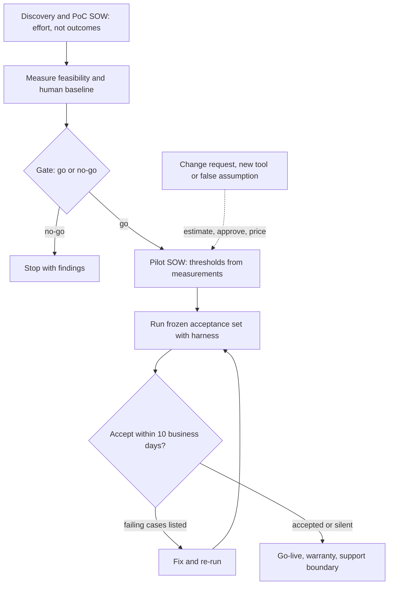

## TL;DR
A statement of work (SOW) is the project contract: deliverables, acceptance, customer obligations, out of
scope, change control. Agents need a stricter one, because outputs are probabilistic and agents act:
statistical acceptance on a frozen eval set, named tools and actions, dated dependencies.

## For agent builders
- **Why it matters for agents.** An agent acts: it calls APIs, writes records, sends messages. The SOW is
  where "which actions, on which systems, with what approval" gets agreed, and where task-level acceptance
  replaces "it seems to work in the demo".
- **Where it shows up in your stack.** Acceptance clauses become your eval harness and frozen scenario
  set; action scope becomes the tool list and permissions you register; data-handling clauses become trace
  retention and redaction settings.
- **What you control.** Proposing a phased SOW, writing acceptance as a computation, listing write actions
  as explicitly in or out of scope, and making credentials and sandbox access dated customer obligations.
- **What you can skip.** The legal terms in the MSA. Leave liability and IP wording to counsel, and this
  lesson is not legal advice.

## Decision case
### Scenario
A parcel carrier wants an agent for "where is my parcel" and delay emails, about 25,000 a month. It reads
tracking with `get_tracking`, drafts a reply, and may issue a goodwill credit of up to €20 with
`issue_credit`. Procurement asks for a fixed price that guarantees "90% fully automated". All figures are
illustrative.

Constraints:
- **Budget.** Procurement needs a cap: €220,000 in total.
- **Deadline.** Go-live before peak season, 16 weeks from signature.
- **Unseen data.** The delivery team has not seen a single email; a sample arrives in week 2, after the
  data processing agreement is signed.
- **Write approval.** The customer's security review of `issue_credit` takes about 3 weeks.
- **One contract preferred.** Procurement dislikes running two separate tenders.

### Options
| Option | How it works | Budget certainty | Who carries quality risk | Fits 16 weeks and unseen data? |
|---|---|---|---|---|
| **A. Fixed price, 90% guaranteed** | One SOW, full scope including autonomous credits | High, until the dispute | Vendor, priced blind | No: the target was never measured |
| **B. Time and materials, capped** | Hourly billing up to €220k, no quality commitment | Cap only | Customer, with no acceptance test | Yes, but no definition of done |
| **C. Phased under one SOW** | Phase 1: €45k fixed fee, weeks 1-4, measure on real emails. Gate. Phase 2: €150k in milestones, weeks 5-16, thresholds set from Phase 1. €25k change budget | €220k cap | Shared, after measurement | Yes |
| **D. Outcome-based fee** | For example €1.20 per resolved email, uncapped | Low: about €18k a month at 60% resolution, more in peak | Vendor | Needs an agreed attribution rule first |

### Decision
Choose **C**, because the constraints rule out the others:
- **The 90% target cannot be priced yet.** Nobody has measured feasibility or a human baseline on these
  emails. Phase 1 does that on 500 real emails and reports achievable resolution per intent.
- **One contract, two commitments.** A single SOW with a gate clause meets procurement's preference, and
  either side may stop at the gate with the findings delivered. €45k + €150k + €25k = €220k, the cap.
- **Acceptance becomes a computation.** If Phase 1 measures 84% resolution, Phase 2 might accept at 80% on
  300 frozen scenarios, which allows up to 60 failures.
- **The write tool is scoped by approval.** The security review starts in week 1, in parallel. Until it
  passes, `issue_credit` drafts a credit for a human to approve; after it passes, credits up to €20 run
  automatically.
- **"Never more than €20" is enforced, not just tested.** A tool validator rejects larger amounts. A clean
  run of 300 scenarios alone only bounds the rate below about 1% (3/300).

What would change it:
- **Data seen earlier.** If 500 representative emails were shared under NDA before signature, Phase 1
  could shrink to 2 weeks.
- **Measured feasibility.** If Phase 1 measured 92% or more on the customer's own emails, a fixed price
  for Phase 2 becomes reasonable.
- **Procurement insists on fixed price for everything.** Then fix the price for Phase 1 only and keep
  Phase 2 as a priced option.

### Trade-offs accepted
- **No 90% guarantee at signature.** The sponsor must sell a gate to procurement. Mitigate with a dated
  Phase 1 report and a written go or no-go rule.
- **The customer may pay €45k for a no-go.** That is the price of learning feasibility before committing
  €150k; record findings so they are reusable.
- **Phase 2 starts with only 12 weeks.** A late email sample moves milestones day for day; track slip
  days at every steering meeting.
- **Credits stay human-approved if the review slips.** Watch approval rate per draft so the case for
  automation is ready when the review passes.

### Review rubric
- **No guarantee before measurement.** The write-up commits to effort until feasibility is measured on
  the customer's data.
- **Acceptance is a computation.** It names the frozen set size, thresholds, allowed failures and the
  harness.
- **Every write tool has a scope and an approval rule,** with zero-tolerance limits backed by a control.
- **Money adds up.** Phase fees and contingency sum to the cap, and each payment ties to a gate.
- **Dependencies are dated.** Data and security review dates have a day-for-day consequence.
- **Reversal conditions are concrete.** It names the measurement or procurement rule that would change
  the structure.

## Why it exists
- **Two parties start with different finish lines.** The customer imagines "an agent that answers our
  policy questions and updates the case correctly." The vendor or internal team imagines "a RAG prototype
  over the documents you give us." The gap stays invisible until the delivery date, when it becomes a
  dispute about money and reputation. The SOW makes the pictures match while changing them is still cheap.
- **"Answer questions correctly" cannot be accepted or rejected,** because any probabilistic system answers
  some questions wrongly, so the customer can always find a failure.
- **Undated dependencies become your missed milestone.** "Customer will provide data" (or API credentials
  for the agent's tools) with no date or format turns a three-week delay into the delivery team's slip.
- **Fixed scope and price on an unmeasured quality level** transfers unpriced research risk to whoever
  signed it.
- **Ownership and operation questions arrive at the worst moment** when nothing says who owns the eval set,
  prompts and fine-tuned weights, or who operates the agent after go-live. The SOW settles these before
  work starts, while each side can still walk away.

## How it works
### Where it sits
- **MSA holds the legal terms:** liability, confidentiality, IP defaults and payment, in a master services
  agreement (MSA).
- **Each project gets an SOW under it** with the specifics. An order-of-precedence clause says which
  document wins when they conflict.
- **Internal agent projects** often have a charter or project brief that does the same job; the structure
  below applies to both.
- **Caveat:** the legal terms are for counsel, and this lesson is not legal advice.

### Core sections
1. **Objective and success metrics.** The business problem and the agreed metric tree, so every deliverable
   can be traced to a purpose.
2. **Scope and deliverables.** Concrete artefacts: a deployed agent service in a named environment, an eval
   report, a runbook, a handover session. Name the use cases, document types, languages, channels and
   tools in scope.
3. **Out of scope.** Explicit, because scope disputes are almost always about what was *assumed* to be
   included: other languages, write-back to the CRM, mobile, 24/7 support, new tools.
4. **Acceptance criteria.** Each deliverable has an observable test, and for model behaviour it is
   statistical: "On the agreed held-out eval set of N cases, field accuracy is at least X% overall and at
   least Y% on each named critical field, with no critical-severity failures, measured by the agreed
   harness."
   - Name who runs the test, how long the customer has to accept or reject, and what happens if they do
     not respond, for example deemed acceptance after 10 business days.
5. **Customer responsibilities.** Each a dated obligation: data extract in a specified format by a date,
   SSO, network and tool API access by a date, SME hours per week for labelling and review, security
   review turnaround. State the consequence when one slips: the timeline moves day for day.
6. **Assumptions.** Facts the plan rests on, such as volumes, document formats, API availability and rate
   limits, and model provider access. Each one, if false, triggers change control.
7. **Timeline and milestones,** ideally phase-gated: discovery, then proof of concept, then pilot, then
   production. Each gate has exit criteria and a go/no-go decision.
8. **Change control.** How a change is requested, estimated, approved and priced. Without it, small
   additions (one more tool, one more channel) accumulate unpaid.
9. **Roles, governance and support boundaries.** Who decides, the steering cadence, the escalation path, and
   who operates, monitors and pays for inference after go-live.
10. **Commercials.** Fixed fee, time and materials, or milestone-based payment, tied to the gates.

### AI- and agent-specific clauses
- **Action scope and autonomy.** List each tool, whether it reads or writes, and which write actions need
  human approval. A new write action is a change request, because it changes the risk profile.
- **Eval set ownership and freeze.** Agree who builds the acceptance set (ideally jointly with the
  customer's SMEs), that it is representative, and that it is frozen before tuning, so acceptance does not
  chase a moving target. For agents, include end-to-end task scenarios, not just single answers.
- **Model and provider changes.** State what happens if the provider deprecates the model or changes
  pricing mid-project, and that re-validation counts as a change.
- **Phase-based commitment.** Commit to quality targets only after a discovery or PoC phase has measured
  feasibility on real data. Before that, commit to effort and learning, not outcomes.
- **Sampling noise in thresholds.** A rate measured on N cases has an error bar, so say whether the
  threshold applies to the point estimate or to a confidence bound, and size N to match.
- **Zero-tolerance lines need the same care.** Zero failures in N cases shows, at 95% confidence, only that
  the true rate is below about 3/N (the "rule of three"). If a failure type truly must never happen, also
  require a deterministic control, such as a validator, a hard filter or a tool permission the agent
  cannot bypass, not just a clean eval run.
- **Post-acceptance performance.** Acceptance certifies behaviour on a frozen set at one date, and
  production inputs drift afterwards. State the warranty period, who monitors which metrics after go-live,
  the threshold that triggers remediation, and whether remediation is in scope or a change.
- **Data handling.** Where customer data goes (including agent traces and tool results), retention, use
  (or no use) for training, and deletion at the end. This often references the data processing agreement.

## Diagram
A phase-gated SOW: each gate turns measured results into the next commitment, and any change or false
assumption goes through change control rather than silently into scope.



## Examples
### Rewriting a weak clause for an invoice-extraction pilot

```text
WEAK
  4.1 Vendor will deliver an AI system that accurately extracts invoice data.
  5.1 Customer will provide sample invoices.

STRONG
  4.1 Deliverable D2: extraction service deployed in Customer's staging tenant, writing to the
      AP staging table defined in Appendix B.
  4.2 Acceptance of D2: on the frozen acceptance set (600 invoices, stratified by the 12
      highest-volume suppliers plus 100 long-tail invoices, labelled per Appendix C), measured
      with the harness in Appendix D:
        - invoice total, currency, supplier ID: >= 98% exact match each
        - line items: >= 90% F1 at line level
        - zero cases of a total written with the wrong currency
      Customer has 10 business days to accept or list failing cases; silence = acceptance.
  5.1 Customer provides 2,000 historical invoices with posted AP records (PDF + CSV export)
      by 3 March; SSO access to staging by 10 March; 4 SME hours/week from the AP team.
  5.2 Each business day of delay in 5.1 moves milestones M2-M4 by one business day.
  6.3 Out of scope: handwritten invoices, non-Latin scripts, posting to the ERP ledger.
```

All thresholds and dates here are illustrative. What the strong version achieves:

| Feature | Why it matters |
|---|---|
| Acceptance is a computation anyone can re-run | not an opinion at a meeting |
| Sample stratified by supplier, plus long-tail | long-tail suppliers, where extraction usually breaks, cannot be quietly excluded |
| Separate zero-tolerance line | the one catastrophic error type is not hidden in the averages |
| Honest resolution | on 600 invoices, 98% allows at most 12 misses per field; a clean currency run bounds the true wrong-currency rate below about 0.5% (3/600), not at zero |
| Deterministic backstop | a check that the extracted currency is one the vendor master allows for that supplier is what makes "zero" credible |
| Dated dependency with a consequence | a late extract moves the schedule instead of eating the team's time |
| Explicit out of scope | in week 4 the customer asks for posting to the ERP; clause 6.3 makes it a change request with its own estimate rather than an argument |

### Worked scenario: action scope and acceptance for an AP agent (illustrative)
The same customer later asks for an agent that resolves invoice exceptions by looking up purchase orders
and emailing suppliers. The pilot SOW adds an action table and task-level acceptance.

| Tool | Access | Approval | In scope |
|---|---|---|---|
| `lookup_po` | read | none | yes |
| `draft_supplier_email` | write (draft only) | AP clerk sends | yes |
| `post_to_ledger` | write | n/a | no, clause 6.3 |

| Acceptance line (200 frozen exception scenarios) | Threshold | Allows |
|---|---|---|
| Task resolved correctly, graded per rubric | at least 85% | up to 30 failed scenarios |
| Agent escalates instead of guessing on the 20 "ambiguous PO" scenarios | at least 18 of 20 | 2 misses |
| Calls to any tool outside the table | zero, enforced by the tool registry | rule of three: below 1.5% (3/200) from the run alone |
| Median model cost per scenario | at most the agreed cap | measured by the harness from usage fields |

- **The action table is the risk boundary.** Adding `post_to_ledger` later is a change request with its
  own security review, not a prompt tweak.
- **Zero out-of-scope calls is backed by permissions,** not only by the eval run, for the same rule-of-three
  reason as the currency line.

### Acceptance harness for clause 4.2
A minimal, runnable version of the computation behind the clause. It also shows how the choice between
point estimate and confidence bound changes the verdict; the same structure grades agent scenarios.

```python
import math

THRESHOLDS = {"total": 0.98, "currency": 0.98, "supplier_id": 0.98}   # clause 4.2, exact match

def wilson_lower(k, n, z=1.96):
    p, d = k / n, 1 + z * z / n
    centre = (p + z * z / (2 * n)) / d
    return centre - z * math.sqrt(p * (1 - p) / n + z * z / (4 * n * n)) / d

def accept(rows, use_lower_bound=False):
    """rows: one dict per acceptance invoice with gold and predicted values."""
    n, report = len(rows), {}
    for field, bar in THRESHOLDS.items():
        k = sum(r["gold"][field] == r["pred"][field] for r in rows)
        score = wilson_lower(k, n) if use_lower_bound else k / n
        report[field] = (k, n - k, round(score, 4), score >= bar)
    wrong_ccy = sum(r["gold"]["currency"] != r["pred"]["currency"] for r in rows)
    report["zero_tolerance_wrong_currency"] = (wrong_ccy, wrong_ccy == 0)
    report["rule_of_three_bound"] = round(3 / n, 4)       # true rate below this at ~95% if clean
    return report

gold = {"total": "100.00", "currency": "EUR", "supplier_id": "S1"}
rows = [{"gold": gold, "pred": dict(gold)} for _ in range(600)]
for r in rows[:10]:                                       # 10 wrong totals out of 600
    r["pred"] = {**gold, "total": "99.00"}
print(accept(rows)["total"])                        # (590, 10, 0.9833, True): passes, max 12 misses
print(accept(rows, use_lower_bound=True)["total"])  # lower bound ~0.97: fails the same 0.98 bar
print(accept(rows)["rule_of_three_bound"])          # 0.005, about 0.5%
```

- **The clause must say which reading applies.** The same 10 misses pass on the point estimate and fail on
  the 95% lower bound, which is exactly the dispute the SOW should prevent.

## Production patterns
- **Phase-gated SOWs.** Sign a short discovery and PoC SOW first, then a pilot or production SOW whose
  thresholds come from the PoC measurements. Track each gate's exit criteria and the go/no-go decision in
  the steering notes.
- **Acceptance set under version control.** Store the frozen acceptance set (answers and agent scenarios),
  its labelling guide and the harness in a repository both parties can read, with a content hash recorded
  in the SOW appendix. Monitor that the hash at acceptance matches the signed one.
- **Action table mirrored in the tool registry.** Generate the agent's registered tools and permissions
  from the SOW's action table, so an unlisted tool cannot be called. Monitor for any tool call not in the
  table and treat it as a contract breach to investigate.
- **Dependency tracker with day-for-day clauses.** Keep each customer obligation (data, SSO, tool API
  credentials, sandbox access), its due date and its actual delivery date in a shared tracker reviewed at
  every steering meeting. Monitor cumulative slip days, because they move milestones.
- **Change log tied to clauses.** Log every change request with the SOW clause it touches, its estimate and
  its approval. Monitor the number of unapproved requests in flight, which signals scope creep.
- **Post-go-live monitoring clause.** Name the metrics, owner and remediation threshold for the warranty
  period, and wire the same harness to a sample of production agent traces. Monitor drift against the
  acceptance numbers.

## Trade-offs
- **Budget certainty vs priced risk.** Fixed-price SOWs give the customer budget certainty but make the
  vendor price research risk. Use them only after a PoC has measured feasibility on the customer's own data.
- **Flexibility vs cost control.** Time-and-materials terms absorb uncertainty well but give the customer
  little cost control. They suit discovery and PoC phases, and should give way to milestones once the
  target is known.
- **Fewer disputes vs upfront effort.** Tight, statistical acceptance criteria prevent disputes but take
  effort to agree on and to build the eval set for. That effort is worth it whenever payment or go-live
  depends on acceptance.
- **Protection vs speed to signature.** A long out-of-scope list protects the delivery team but can read as
  defensive and slow the signature. Focus it on the extensions customers most often assume are included,
  such as extra write actions.
- **Capped loss vs repeated negotiation.** Phase gates let both sides stop early, which caps loss. The cost
  is negotiating several times, which only pays off when uncertainty is high.

## Pitfalls
- **Acceptance criteria in prose such as "accurate" or "production-ready".** Symptom: an acceptance meeting
  where the customer shows three wrong answers and refuses sign-off. Fix: thresholds on a frozen set,
  computed by a named harness.
- **Customer dependencies without dates or consequences.** Symptom: the team waits weeks for data, tool API
  credentials or access while the delivery date stays fixed. Fix: dated obligations with a day-for-day
  clause.
- **Committing to a quality target before measuring feasibility on real data.** Symptom: a project that is
  technically sound but contractually failed because the data was worse than the sample. Fix: a discovery
  or PoC SOW first, with targets set from its measurements.
- **No action scope for the agent.** Symptom: mid-pilot the customer expects the agent to update records it
  was only meant to read, and nobody can point to a clause. Fix: an action table with approval rules.
- **No support boundary after go-live.** Symptom: the delivery team is paged for production incidents
  months after the engagement ended. Fix: name who operates, monitors and pays for inference after
  go-live, and when the warranty ends.
- **An eval set the customer can change during the project.** Symptom: acceptance thresholds are met and
  then the set is "updated" with new hard cases before sign-off. Fix: freeze the set with a recorded
  content hash, and route new cases through change control.

## When to use
- **Use when:** someone outside the team must accept the agent, and especially when money or a go-live
  date depends on it.
- **Draft it:** at the end of scoping, once the success metrics, baseline plan and dependencies are known.
  Ideally phase it so the first SOW covers only discovery and a PoC.
- **Lighter version:** for a two-week internal spike, a one-page brief with objective, out of scope and an
  exit question is enough.
- **Day to day:** the SOW is the reference in every scope discussion, including "can the agent also do X?"
- **Interviews:** expect "how would you write acceptance criteria for a model?" The answer is a frozen,
  representative eval set, per-slice thresholds, a zero-tolerance list and a named harness.

## Role lens
- **Engineer:** Turns acceptance clauses into a runnable eval harness and frozen dataset, so acceptance
  is a reproducible computation rather than a review meeting.
- **Architect:** Sets the deliverable boundaries, environments, support model and the technical
  assumptions whose failure would trigger change control.
- **FDE:** Drafts and negotiates the SOW with the customer, makes data and access dependencies dated
  obligations, and enforces change control on site.

## Check yourself
**Q:** A customer insists on a fixed-price SOW guaranteeing "95% accuracy" for a document-classification
assistant, before you have seen their documents. How do you respond?
**A:** I would not sign a quality guarantee for unseen data, because nobody knows whether 95% is
feasible, what "accuracy" covers, or what the human baseline is. I would propose a phased structure.
First, a short fixed-fee discovery and PoC phase: we receive a representative sample, build a jointly
labelled eval set, measure the human baseline, and report achievable accuracy per category. Second, a
pilot or production SOW with acceptance criteria set from those measurements: per-class thresholds on
the frozen set, zero-tolerance error types, and dated customer obligations. This gives the customer an
early exit and a defensible target, and it stops either side from pricing a guess.

## Interview questions
### How is an SOW for an AI agent project different from one for ordinary software?
- **Acceptance is statistical:** a rate on a frozen, representative eval set (answers and end-to-end task
  scenarios) with per-field thresholds and a named harness, because a probabilistic system always fails on
  some inputs.
- **Extra clauses:** action scope and approvals, eval set ownership and freeze, model deprecation and
  re-validation, data and trace handling, post-acceptance drift monitoring, and phase-based commitment.

### How would you write the scope and acceptance for an agent that can take write actions?
- **List every tool** with read or write access and which writes need human approval; a new write action
  is a change request.
- **Accept on task scenarios,** with a resolution threshold, an escalation threshold on ambiguous cases and
  a cost cap per scenario.
- **Back zero-tolerance lines with permissions,** such as a tool registry generated from the action table,
  because a clean run of 200 only bounds the rate below about 1.5%.

### The customer shows three wrong answers at acceptance and refuses to sign. What went wrong, and how do you recover?
- **Root cause:** acceptance was written in prose, so any failure counts as a breach.
- **Recover:** agree a frozen set and thresholds now, run the harness, and evaluate the three cases against
  severity rules rather than as a veto.
- **Prevent:** write the computation, the review window and deemed-acceptance terms into the next SOW.

### When would you not accept a fixed-price SOW?
- **Before feasibility is measured on the customer's data,** because the vendor would be pricing research
  risk blind.
- **Use time and materials or a short fixed-fee discovery phase instead,** then move to fixed price or
  milestones once the PoC has measured achievable quality and the human baseline.

### Your SOW says zero wrong-currency errors on 600 invoices. What does a clean run actually prove?
- **Only a bound:** by the rule of three, the true rate is below about 3/600, or 0.5%, at 95% confidence.
- **So pair it with a deterministic control,** such as validating the extracted currency against the vendor
  master for that supplier, which is what makes "zero" credible.

### What belongs in the customer-responsibilities section, and why the day-for-day clause?
- **Dated obligations:** data extract format and date, SSO, network and tool API access, SME hours per
  week, security review turnaround.
- **Day-for-day movement** makes slips visible and fair, so a late extract moves milestones instead of
  silently consuming the delivery team's time.

## Quiz
### Q: Why are acceptance criteria for model behaviour written against a frozen eval set?
- [ ] Frozen datasets run faster in the evaluation harness
- [x] A fixed, agreed set makes acceptance a reproducible computation and stops the target moving during tuning
- [ ] Regulators require every model to be tested on frozen data
- [ ] It lets the team tune the model directly on the acceptance cases
> Probabilistic systems will always fail on some inputs, so acceptance must be a rate on a defined
> sample. Freezing the set prevents both sides from changing the test mid-project. Tuning on it would
> make the result meaningless.

### Q: What is the main purpose of the customer-responsibilities section with dates and consequences?
- [ ] To shift all project risk onto the customer
- [ ] To satisfy the MSA's liability terms
- [ ] To list the customer's internal stakeholders
- [x] To make data, access and SME-time dependencies explicit so their delays move the schedule rather than silently consuming it
> AI delivery depends on customer data, access and expert time. Dated obligations with a stated
> consequence make slips visible and fair, rather than turning them into the delivery team's missed
> milestones.

### Q: When does a fixed-price commitment to a quality target become reasonable for an AI project?
- [ ] When the vendor has hit that target with other customers
- [ ] When the model provider publishes benchmark results above the target
- [x] After a discovery or PoC phase has measured feasibility and the baseline on the customer's own data
- [ ] Never; AI projects should always be time-and-materials
> Quality depends on the customer's data and task definition, so other customers' results or public
> benchmarks do not transfer. Once feasibility is measured on real data, the risk is known well enough
> to price.

## Use cases & projects
### Use cases
- **Agent pilots with a customer.** The action table and scenario-based acceptance keep "can it also send
  the email?" from becoming an unpaid scope change.
- **Fixed-fee discovery for agent ideas.** A first SOW buys measurement on real data, so the pilot SOW's
  thresholds are earned rather than guessed.
- **Internal platform teams.** A one-page brief with tools in scope, exit question and acceptance harness
  does the same job for an internal agent.
- **Model migrations mid-engagement.** A re-validation clause makes a provider's model retirement a priced
  change instead of a free rebuild.

### Mini project
**Write an agent SOW and its acceptance harness (2-3 hours).**
- **Goal:** turn a vague agent request into SOW clauses that a script can accept or reject.
- **Steps:** pick a small agent (for example a support agent with two read tools and one draft-only write
  tool); write the deliverables, out-of-scope list, action table, dated customer obligations and
  acceptance lines; build 50 frozen scenarios; extend the `accept` harness to grade task resolution,
  escalations and out-of-table tool calls; run it on your agent with point-estimate and lower-bound
  readings.
- **Done when:** the harness prints pass or fail per clause, the two readings disagree on at least one line
  you then resolve in the clause wording, and an unlisted tool call is blocked by the registry.
