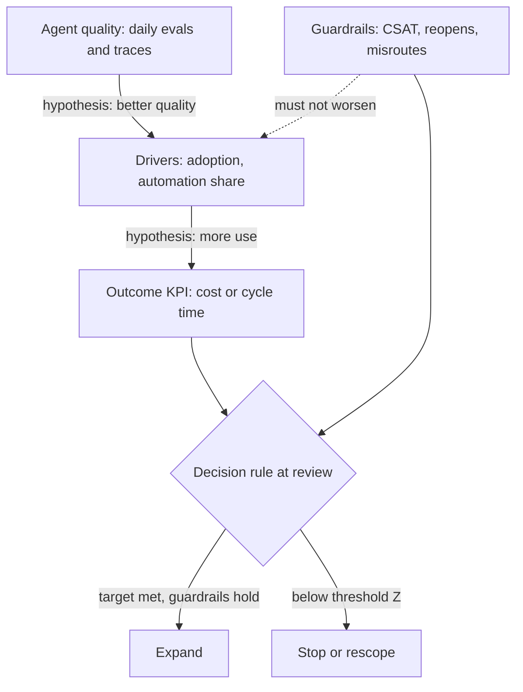

## TL;DR
Success metrics are how the customer judges your agent; KPIs are the business outcomes among them. Agree
them before building, as a tree from outcome to drivers to agent quality to guardrails, because task
completion alone proves no value and single metrics get gamed.

## For agent builders
- **Why it matters for agents.** An agent's evals (task completion, tool-call accuracy, cost per
  successful task) only matter if they are linked to a business number the sponsor reports. The metric
  tree is that link, and it decides whether your agent survives the pilot review.
- **Where it shows up in your stack.** Your trace logs and eval harness feed level 3; a task ID on every
  agent run that also lands on the ticket or claim lets you compute drivers and outcomes by a join.
- **What you control.** Which actions the agent may take autonomously, when it hands off to a human, and
  what you log per step. Those choices move the drivers and decide which guardrails you need.
- **What you can skip.** Formal experiment-design theory. The `n ≈ 16σ²/δ²` rule of thumb and a written
  spec per metric are enough to scope an agent pilot.

## Why it exists
- **Agent projects fail at the review meeting, not in the middle.** The demo impressed, the pilot ran six
  weeks, then the sponsor asks "so, did it work?" and nobody had agreed what "work" meant. The agent gets
  judged on anecdote, perhaps the one embarrassing answer or wrong tool action someone screenshotted.
- **Engineers and sponsors bring different numbers.** Engineers bring 94% answer correctness on a golden
  set and p95 latency of 3 seconds per agent turn. Sponsors need cost per resolved case, cycle time,
  revenue or regulatory exposure. Nothing connects the two sets unless you build the link.
- **"We'll know it when we see it" moves the goalposts.** Recency bias decides the verdict: once accuracy
  is good the question becomes adoption, then cost.
- **One metric invites Goodhart's law** (a measure that becomes a target stops being a good measure). A
  support agent's deflection rate climbs fastest when reaching a human gets hard. Model-only metrics leave
  you defenceless at budget time, because nobody can translate "faithfulness 0.91" into money.
- **Metrics chosen after deployment cannot be falsified,** because people pick whichever one looks good.
  Defining them up front turns the agent project into a testable claim instead of a story.

## How it works
### Build a metric tree, not a list
Arrange metrics in levels connected by a stated causal hypothesis:

| Level | Cadence | Examples (agent framing) |
|---|---|---|
| 1. **Outcome KPI** (lagging) | monthly or quarterly | cost per resolved ticket, claim cycle time, days sales outstanding, analyst hours per report |
| 2. **Operational drivers** (leading) | weekly | share of cases the agent completes without a human, handle time on agent-assisted cases, adoption rate, edit rate on agent drafts |
| 3. **System quality** | daily, from evals and traces | task completion rate, extraction field accuracy, retrieval recall, escalation precision, p95 latency, cost per successful task |
| 4. **Guardrails** (counter-metrics) | with every report | customer satisfaction, reopen rate, compliance errors, misrouted high-severity cases, wrong irreversible tool actions |

- **Keep one outcome KPI, or at most two.** It is what the sponsor reports upward; several outcome KPIs
  dilute accountability.
- **Adoption rate means use on eligible work:** the share of eligible work where the agent was actually
  used, not logins.
- **Guardrails must not get worse** while the others improve.
- **Why a tree:** outcome KPIs move slowly and are confounded by seasonality, staffing and pricing
  changes, so you cannot steer week to week by them. Leading indicators and daily agent evals predict them.
- **Why write the links down:** failures become diagnosable. If level 3 improves but level 1 does not,
  one specific link in the hypothesis is wrong, and you can see which one.

### Write a spec for every metric
Each metric gets:
1. Name, plus the exact numerator and denominator.
2. Population: which cases, with what exclusions.
3. Data source and who owns that pipeline (for agents: which trace field or eval run).
4. Measurement window.
5. Baseline value and how it was measured.
6. Target and a named owner.

- **This is tedious because it is the part that gets disputed.** In three departments "resolved" can mean
  three things: closed by an agent, no customer reply for 72 hours, or not reopened within 7 days.
- **The denominator matters just as much.** Drop "out-of-scope" tickets after the fact, or count only
  runs where the agent did not crash, and the automation rate inflates silently.

### Turn targets into decision rules
- **A target needs a reference point, a horizon and a consequence.** For example: "median cycle time falls
  from the measured baseline of X to at most Y within 90 days of pilot start. If it does, we expand to
  region B. If it improves by less than Z, we stop."
- **Without a pre-agreed decision rule the target is decoration,** and the review turns into a negotiation.

### Pair every target with its cheapest way to cheat
For each optimised metric, name the cheap way to game it and add a guardrail that would catch it:

| Optimised metric | Guardrail |
|---|---|
| Deflection (agent containment) | reopen rate and escalations within 24 hours |
| Handle time | QA score |
| Auto-approval rate | error rate on auto-approved items, audited by sampling |
| Agent task completion | sampled human audit of "completed" runs, since the agent self-reports success |

- **This does not assume bad faith.** Optimisation pressure, including the team's own prompt iteration
  against the metric, finds the cheap path by default. An agent prompt tuned to "resolve" will learn to
  close conversations.

### Check the target is attributable and detectable
A target is only useful if the pilot can tell whether it was hit. That takes two decisions made now, not
at the review.
- **Attribution: what would the KPI have done without the agent?** Outcome KPIs drift with seasonality,
  staffing and pricing, so agree the comparison up front: a concurrent holdout group, a staggered rollout,
  or at minimum a before/after read against a comparison queue (the baseline lesson covers these designs).
- **Detectability: is the pilot big enough?** A rule of thumb from online experimentation, for about 80%
  power at a two-sided 5% significance level:

```
n ≈ 16σ²/δ² cases per group
δ  = smallest change that matters
σ² = p(1−p) for a rate
```

- **Guardrails are where this bites,** because they are rare-event rates. Detecting a misrouting rise from
  1.5% to 2.5% needs about 16 × 0.015 × 0.985 / 0.01² ≈ 2,400 cases per group.
- **If the pilot will not see that volume,** lengthen the window, accept a wider tolerance, or back the
  guardrail with targeted audits of agent traces instead of the raw rate.

## Diagram
Read bottom-up: agent quality should move the drivers, which should move the outcome, while guardrails
catch the metric being gamed. Each arrow is a causal hypothesis you can test.



## Examples
### Worked scenario: insurer FNOL intake agent (illustrative numbers)
An insurer wants an agent that reads first-notice-of-loss (FNOL) emails, extracts policy number, loss
date, loss type and description, looks up the policy with a tool, and pre-fills the claim record for an
adjuster to confirm.

| Level | Metric | Baseline / target |
|---|---|---|
| Outcome KPI | median hours from FNOL receipt to claim set up | baseline over 8 weeks: 26 hours; target at most 8 hours, 90 days after pilot start |
| Driver | share of FNOLs with every mandatory field pre-filled and accepted without edits | target 70% |
| System quality | field-level accuracy on a 400-email golden set, re-run on every prompt, tool or model change | at least 99% for policy number, at least 90% for loss-type category |
| Guardrails | misrouting rate (claim sent to the wrong line of business); claims set up against the wrong policy number | misrouting at or below the 1.5% baseline; zero wrong-policy claims, with weekly audits |

What week 3 showed:
1. **Driver reads 78%,** ahead of target; cycle time has fallen to 11 hours.
2. **Guardrail shows misrouting at 3.1%.** Is that noise? With about 700 FNOLs that week (illustrative),
   3.1% is roughly 22 misroutes against about 10 expected at the 1.5% baseline. A count of 10 varies by
   only about ±3 week to week, so this is a real shift, not a bad draw.
3. **Drill-down in the traces:** adjusters on the busiest queue accept pre-filled loss types without
   reading them, and the agent confuses "escape of water" with "flood" in one region's phrasing.
4. **Fix:** disable auto-accept for the water categories, add 40 region-specific emails to the golden
   set, re-run the eval.

Without the guardrail the dashboard would have said "success" while claims went to the wrong handlers.
The tree told them which link broke: the driver rose for the wrong reason.

### Computing the tree from agent traces
Each agent run logs a task ID that also lands on the ticket, so drivers and guardrails are a join, not a
spreadsheet. The second half reproduces the guardrail numbers above.

```python
import math

runs = [  # one row per agent run, joined to the ticket by task_id
    {"task_id": "T1", "eligible": True, "agent_used": True, "completed": True, "human_touch": False, "reopened_7d": False},
    {"task_id": "T2", "eligible": True, "agent_used": True, "completed": True, "human_touch": False, "reopened_7d": True},
    {"task_id": "T3", "eligible": True, "agent_used": False, "completed": False, "human_touch": True, "reopened_7d": False},
    {"task_id": "T4", "eligible": False, "agent_used": True, "completed": True, "human_touch": False, "reopened_7d": False},
]
elig = [r for r in runs if r["eligible"]]                    # denominator fixed in the metric spec
used = [r for r in elig if r["agent_used"]]
adoption = len(used) / len(elig)
resolved = [r for r in used if r["completed"] and not r["human_touch"] and not r["reopened_7d"]]
print(f"adoption {adoption:.0%}, true resolution {len(resolved)/len(used):.0%}")

def n_per_group(p_base, p_alt):
    """Rule of thumb n = 16 sigma^2 / delta^2: ~80% power, two-sided 5% level."""
    sigma2 = p_base * (1 - p_base)
    delta = abs(p_alt - p_base)
    return math.ceil(16 * sigma2 / delta ** 2)

def shift_z(observed, n, p_base):
    """How many standard deviations a weekly count sits above its baseline."""
    expected = n * p_base
    sd = math.sqrt(n * p_base * (1 - p_base))
    return expected, sd, (observed - expected) / sd

print(n_per_group(0.015, 0.025))   # 2364 -> about 2,400 cases per group
print(shift_z(22, 700, 0.015))     # (10.5, ~3.2, ~3.6): a real shift, not noise
```

- **Read the first print:** the agent's self-reported "completed" counts T2, but the 7-day reopen
  guardrail removes it, so true resolution is lower than the agent claims.
- **Read the last line:** 22 observed against 10.5 expected is about 3.6 standard deviations, well past
  the usual 2 to 3 used as an alert line.

## Production patterns
- **Metric spec as a reviewed file.** When the agent pilot starts, keep each metric's numerator,
  denominator, population, source, window, baseline, target and owner in a version-controlled file that
  the sponsor signs off. Monitor for unreviewed edits to definitions, because a changed denominator
  silently moves the number.
- **Join keys from day one.** Log a task ID on every agent run, tool call and model event that also
  appears on the business record (ticket, claim), so drivers and outcomes are computed by a join, not by
  hand. Monitor the share of business records with no matching task ID.
- **Guardrail-paired dashboards.** Put each optimised metric next to its counter-metric on the same panel,
  for example agent deflection beside 7-day reopen rate. Alert when the guardrail breaches its threshold
  over a confidence interval rather than a single week's reading.
- **Version-tagged quality metrics.** Tag every eval run and production trace with the model, prompt and
  tool-schema version, so a shift in level 3 can be attributed to a specific change. Monitor quality per
  version after each deploy.
- **Audit the agent's own success claims.** Sample "completed" agent runs weekly for human review, because
  the agent's final message is not ground truth. Track the audited pass rate next to the self-reported one.
- **Steering meeting from the tree.** Use the tree as the agenda: outcome, drivers, agent quality,
  guardrails, then the decision rule. Track which causal link is under investigation and who owns it.

## Trade-offs
- **Diagnosis vs accountability.** More metrics give better diagnosis but blur accountability. Keep one
  outcome KPI and three to five drivers, and add more only if a review cannot locate a failure.
- **Relevance vs speed.** Outcome KPIs are what sponsors care about, but they lag by weeks and carry
  confounders. Lean on leading drivers and daily agent evals for steering unless the outcome moves fast,
  as in real-time conversion.
- **Precision vs negotiation time.** Tight metric specs prevent disputes but take days of negotiation with
  data owners. For a throwaway agent proof of concept, a looser spec is acceptable if it is labelled as
  such.
- **Ambition vs fairness.** Ambitious targets motivate, but they make a sound agent look like a failure.
  Set targets from a measured baseline and the realistic human error rate, not from vendor marketing.
- **Protection vs false alarms.** Hard guardrails (a breach stops rollout) protect users but can halt a
  sound launch over noise. Define the breach threshold with a confidence interval, not a single week's
  reading.

## Pitfalls
- **Choosing agent eval metrics as the success criteria.** Symptom: an agent that hits 95% task
  completion and still gets cancelled because nobody could say what it saved. Fix: an outcome KPI at the
  top of the tree.
- **Leaving the denominator undefined.** Symptom: two teams report different automation rates from the
  same traces and the review becomes an argument about definitions. Fix: a written spec per metric.
- **Setting targets before measuring the baseline.** Symptom: a demand for 99% accuracy on a task where the
  human team, once audited, turns out to be 88% accurate. Fix: measure first.
- **No guardrail for the optimised metric.** Symptom: the headline number improves while complaints,
  reopens or downstream rework quietly rise. Fix: pair every target with its cheapest cheat.
- **Measuring adoption as logins rather than use on eligible work.** Symptom: high "active users" of the
  agent alongside no change in handle time. Fix: define adoption over eligible work items.

## When to use
- **Use when:** any customer-facing agent engagement, in the first two weeks and before architecture
  choices, because the metrics decide what you build. A cycle-time KPI favours an autonomous agent; a
  quality KPI favours assistive drafting with human review.
- **Skip the full tree when:** an internal spike's sole question is technical feasibility (can the agent
  call this API at all?), and say so in writing.
- **Day to day:** the tree becomes the agent pilot dashboard and the agenda of every steering meeting.
- **Interviews:** expect "how would you measure success for X?" A strong answer names the outcome, the
  drivers, the guardrail that catches gaming, and how the baseline gets measured.

## Role lens
- **Engineer:** Instruments the system so every driver and quality metric can be computed from logs,
  with task IDs that join model events to business records.
- **Architect:** Owns the causal hypothesis linking system quality to business outcome, and makes sure
  the platform can attribute outcomes to a specific model and prompt version.
- **FDE:** Negotiates the metric specs with the customer's operations and finance owners, and gets the
  decision rule signed before the pilot starts.

## Check yourself
**Q:** A customer asks you to "maximise the share of chats resolved by the bot." Why is that a dangerous
sole KPI, and what would you propose instead?
**A:** Bot-resolved share rises if the bot makes escalation hard, ends chats early, or answers
confidently when it should hand off, so it rewards exactly the failures that hurt customers. I would
make the outcome KPI cost per *successfully* resolved contact, or contacts per customer per month.
Bot resolution share would be one driver, defined as no human contact and no repeat contact on the same
issue within 7 days. Guardrails would be CSAT on bot-resolved chats, the 7-day repeat-contact rate, and
the share of high-severity intents escalated within one turn. I would measure all of these over a
baseline window first, and agree in writing what result triggers expansion or a stop.

## Interview questions
### What is the difference between a success metric and a KPI, and why build a tree rather than a list?
- **Definition:** success metrics are every number the customer uses to judge the project; KPIs are the
  business outcomes among them, such as cost per case or cycle time.
- **Why a tree:** outcomes lag and are confounded, so you steer by leading drivers and daily agent
  quality metrics, and the stated causal links show which assumption failed when the outcome does not
  move.

### Your agent's task completion and tool-call accuracy all improved, but the outcome KPI is flat after two months. How do you debug it?
- **Walk the tree link by link.** Check the drivers first: if adoption on eligible work is low, the agent's
  quality gain never reached the business process.
- **If drivers moved but the outcome did not,** check attribution against the holdout or comparison queue
  for seasonality or staffing changes, then question the hypothesis linking that driver to the outcome.
- **Check definitions,** in case the outcome's denominator or population changed during the pilot, or
  "completed" is the agent's self-report rather than an audited result.

### When would you not insist on a hard guardrail that halts rollout on breach?
- **When the guardrail is a rare-event rate and volume is low.** Detecting 1.5% to 2.5% needs about 2,400
  cases per group, so a small pilot would halt on noise.
- **Instead,** use a confidence-interval threshold, a longer window, or targeted audits of the risky
  segment, and reserve hard stops for severe harms such as wrong-policy claims or irreversible agent
  actions.

### How would you set the target for an extraction agent when the customer asks for 99% accuracy?
- **Measure the baseline first.** Audit the human team on the same task; if they are 88% accurate, 99% is
  a target that makes a sound agent look like a failure.
- **Set per-field targets by consequence,** for example 99% on policy number but 90% on loss-type
  category, and tie the decision rule to the outcome KPI, not to accuracy alone.

### Your agent reports "task completed" at the end of each run. Can you use that as the level-3 quality metric?
- **Not on its own.** The agent's final message is a self-report, and optimisation pressure on prompts
  pushes it towards claiming success. Treat it as a candidate label, not ground truth.
- **Verify against the business record:** join the run's task ID to the ticket or claim and count only
  runs with no human touch and no reopen within 7 days, the same strict definition the driver uses.
- **Audit a weekly sample** of "completed" runs by hand and report the audited pass rate beside the
  self-reported one; a widening gap after a prompt or model change is the signal to roll back.

## Quiz
### Q: Why does a metric tree separate operational drivers from the outcome KPI?
- [ ] Drivers are easier for executives to understand than outcomes
- [x] Outcomes lag and are confounded, so leading drivers are needed to steer and to locate which causal link failed
- [ ] Drivers replace the outcome KPI once the pilot starts
- [ ] Outcome KPIs cannot be measured for AI systems
> Outcome KPIs such as cost per case move slowly and depend on seasonality and staffing. Drivers move
> weekly and predict the outcome. Keeping both, linked by a stated hypothesis, shows whether a missed
> outcome came from low adoption, poor quality, or a wrong assumption.

### Q: A deflection bot's containment rate rose from 40% to 65% in a month. What should you check first?
- [ ] Whether the model was upgraded to a larger version
- [ ] Whether latency improved enough to explain it
- [x] Guardrails such as repeat contacts and escalations within a few days, which reveal contained-but-unresolved chats
- [ ] Whether the golden-set accuracy also rose by 25 points
> Containment is easy to game, even unintentionally, by making handoff harder. The repeat-contact and
> reopen guardrails show whether contained chats were actually resolved. Accuracy and latency changes
> do not answer that question.

### Q: What makes a success target usable at a pilot review?
- [ ] It is ambitious enough to impress the sponsor
- [ ] It is expressed as a model metric so engineering can own it
- [ ] It is chosen after seeing the first month of pilot data
- [x] It has a measured baseline, a horizon and a pre-agreed decision such as expand or stop
> A target becomes a decision tool only when it has a reference point, a deadline and an agreed
> consequence. Targets chosen after seeing data cannot be falsified, and model metrics alone do not
> show business value.

## Use cases & projects
### Use cases
- **Support agent pilots.** Containment is paired with 7-day reopen and escalation guardrails so the
  agent cannot "win" by ending chats early.
- **Document intake agents.** Field accuracy on a golden set (level 3) is tied to cycle time (level 1),
  with misrouting as the guardrail that catches over-trusted pre-fills.
- **Internal research or coding agents.** Analyst hours per report or time to merged change become the
  outcome KPI, so agent cost per successful task can be judged against a real saving.
- **Agent platform reviews.** A shared metric-spec file lets several agent teams report comparable
  numbers to one steering group.

### Mini project
**Build a metric tree and dashboard for a toy support agent (2-3 hours).**
- **Goal:** turn raw agent traces into an outcome, two drivers, one quality metric and one guardrail, each
  with a written spec.
- **Steps:** generate or log 200 runs of a small tool-calling support agent with a task ID per run; write
  a metric spec file (numerator, denominator, population, window, baseline, target, owner) for five
  metrics; compute them with a script that joins runs to simulated ticket outcomes, including a 7-day
  reopen flag; use `n_per_group` to say how many runs the guardrail needs.
- **Done when:** the script prints all five metrics, the self-reported and audited resolution rates differ
  visibly, and you have a one-paragraph decision rule (expand, rescope or stop) a sponsor could sign.
