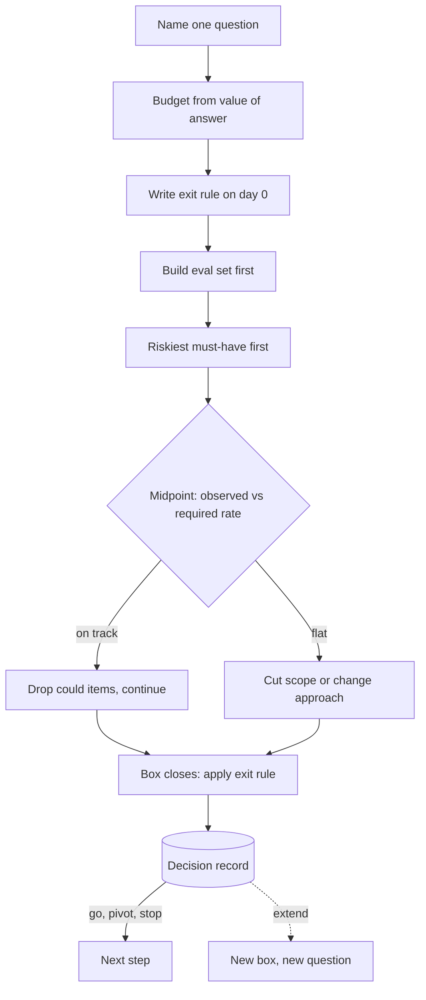

## TL;DR
Agent quality climbs fast and then plateaus, so agent PoCs drift for months. A timebox fixes the time,
lets scope flex, and commits you to one question answered by an eval: ship, continue, pivot or stop when
the box closes.

## For agent builders
- **Why it matters for agents.** Agents have more knobs than any single prompt: system prompt, tool
  descriptions, tool set, planner, model, retrieval, memory. There is always one more thing to try, so
  without a box an agent prototype stays "almost there" indefinitely.
- **Where it shows up in your stack.** The frozen eval set of replayed tasks, the eval harness you run
  daily, the trace store you mine for error categories, and the decision record that closes the box.
- **What you control.** The question (for example task success rate on 200 real tickets), the exit rule
  written on day 0, the order of work (riskiest tool or integration first) and the midpoint arithmetic.
- **What you can skip.** Formal estimation of agent "features". Estimate the plumbing; box the unknowns,
  such as whether the model picks the right tool reliably.

## Decision case
### Scenario
A freight insurer asks a forward-deployed team to "build the claims-intake agent in six weeks". The agent
reads a claim email, looks up the policy, and opens a claim record through the insurer's claims API. All
figures are illustrative.
- **The decision it feeds:** the insurer's board meets in 20 working days to approve or drop a six-month
  build by about five engineers, roughly 600 person-days.
- **Constraints:**
  - three engineers, and at most 40 person-days before the board meeting;
  - nobody knows yet whether the claims API grants a sandboxed write scope (the riskiest assumption);
  - claims handlers can label at most 150 past claims in the first week;
  - the board needs a go, pivot or stop with evidence, not a progress report.
- **Value of the answer:** if there is a one-in-three chance the evidence flips the board's choice, it is
  worth about 600 / 3 = 200 person-days, far more than any box below costs.

### Options
| Option | How it works | Person-days | Ready for day 20? | Riskiest assumption tested |
|---|---|---|---|---|
| **A. Fixed-scope estimate** | plan the full agent as six weeks of features | 3 × 30 = 90: over budget | no: ends on day 30 | late, inside the build |
| **B. One two-week PoC box** | 10 days on the whole agent, exit rule on day 0 | 3 × 10 = 30 | yes, readout day 10 | whenever someone gets to it; a write-scope refusal on day 8 voids the box |
| **C. Spike, then PoC box** | 3-day spike by 2 engineers on API write access while the third builds the replay harness; then a 10-day PoC box by all 3 if the spike passes | 3 × 3 + 3 × 10 = 39 | yes, readout day 13, 7 days slack | first, on days 1-3 |
| **D. Open-ended exploration** | "improve the agent until it is good" | unbounded | no decision date | maybe never |

### Decision
Choose **C, a spike followed by a PoC box**, because it is the only option that fits every constraint.
- **Budget:** 39 person-days fits under 40; A needs 90.
- **Deadline:** the readout lands on day 13, leaving 7 working days to write it up; A and D give the board
  nothing on day 20.
- **Risk order:** the write scope is tested on days 1-3. If it fails, the team stops after 9 person-days and
  recommends a draft-only agent, instead of learning it on day 8 as B might.
- **Exit rule, written on day 0:** at least 75% task success on the 150 labeled claims with zero uncaught
  wrong claim records means pilot; 60-75% means one more box scoped to the largest failure bucket; below
  60% means stop and recommend agent drafts with a human filing.
- **Noise floor:** at about 70% success on 150 tasks, one standard error is about 3.7 points (the 95%
  half-width about 7.3), so the midpoint check ignores moves of a point or two.

**What would change it:**
- **The insurer already grants sandbox write scopes to vendors:** skip the spike and run B.
- **The board date moves out by a month:** add a second box on cost per task before the readout.
- **The board would fund the build whatever the result:** the box buys nothing; shrink it to the spike.

### Trade-offs accepted
- **A shorter PoC box.** The spike eats into calendar time, so the PoC gets no extension inside the 20 days.
  Watch the midpoint arithmetic and cut "could" items early.
- **150 tasks only.** The ±7.3-point half-width makes a result near 75% inconclusive. Report it as such
  rather than rounding up, and size the next box's eval set from it.
- **One person-day of slack.** 39 of 40 leaves no room for a slipped spike. If API access takes longer than
  3 days, treat that as the spike's answer and pivot to a draft-only agent.
- **A pre-written rule may be wrong.** Allow one revision at the midpoint, with the reason in the decision
  record.

### Review rubric
- **The box answers one question** with a numeric or yes/no answer tied to the decision it feeds.
- **Box cost is compared with the value of the answer**, with the arithmetic shown.
- **The riskiest assumption is scheduled first**, and the write-up says what happens if it fails.
- **The exit rule is written before work starts**, maps every result to exactly one decision, and includes a
  guardrail on wrong write actions.
- **The eval set's noise floor is computed** and used to read the midpoint and final numbers.
- **At least two conditions that would change the plan are named**, each tied to an observable fact.

## Why it exists
- **AI work breaks classic estimation.** Estimation assumes known work: list the features, sum the effort.
  Whether an LLM can extract fields from this customer's scanned invoices at 95% accuracy, or whether an
  agent resolves their tickets end to end, is an empirical question nobody can answer by thinking; you find
  out by trying.
- **The trying has no natural end.** Accuracy climbs fast, then flattens: day one of prompt work might move
  a metric from 60% to 80%, the next week from 80% to 85%, the following month from 85% to 87%. There is
  always one more prompt variant, tool description, retrieval tweak or model to try.
- **Estimating the work fails.** "The extraction feature will take three weeks" is a guess about an unknown.
  When it is wrong the team keeps going, because stopping feels like admitting failure and the next tweak
  always looks promising. Result: a proof of concept that is "almost there" for three months.
- **A timebox inverts the commitment.** You promise a *decision* by a date, backed by evidence, not an
  outcome. Scope is the variable: missing the target when the box closes is information, not a slip.
- **It protects the customer relationship,** because the customer buys a de-risked answer on a known
  schedule rather than an open-ended research project.

## How it works
### 1. Name the question, not the task
- **Good:** one question with a yes/no or a number: "Can we reach 90% field-level accuracy on their real
  invoice sample with an off-the-shelf model?" or "Can the agent complete 70% of replayed refund tickets
  with correct tool calls?"
- **Bad:** an activity: "Work on extraction" or "build the support agent".
- **Why the question form matters:** it tells you when you are done and what evidence counts, which for an
  agent means a scored eval run, not a good-looking transcript.

### 2. Set the budget from the value of the answer
Match the box length to what the answer is worth and how much uncertainty it removes, not to how long the
work "should" take. A rough value-of-information test keeps this honest:

```
worth boxing if   cost of box  <  P(answer changes the decision) × cost of deciding wrongly
```

- **Large stakes justify longer boxes.** A question that gates a large contract justifies two weeks; which
  of two chunking strategies a RAG tool should use justifies a day.
- **Worked check:** three engineers for two weeks is about 30 person-days. If the answer has a
  one-in-three chance of flipping a decision that would otherwise sink six months of a larger team into the
  wrong design, the box is cheap.
- **No decision change, no box.** If the team would make the same choice whatever the result, the box buys
  nothing; skip or shrink it.

| Box type | Typical length | Agent example |
|---|---|---|
| Spike | hours | does the model call this API tool with valid arguments? |
| Feasibility check | days | can one agent loop finish the core task on 20 real cases? |
| PoC | a few weeks | task success on a frozen set of real tasks, with cost per task |
| Open-ended | almost never | "keep improving the agent" |

- **Scrum sprints are timeboxes too, but for delivery cadence.** The discovery-style box here differs in that
  "stop" is an expected, legitimate outcome.

### 3. Write the exit criteria before starting
Write the decision rule before any work: what result means go, stop or pivot. For example:

| Result on the 100-document set | Decision |
|---|---|
| ≥ 90% | proceed to pilot |
| 75–90% | one more week, focused only on the top two error categories |
| Below 75% | stop and recommend a human-in-the-loop design |

- **Why pre-commit:** after a week of effort everyone is anchored on their sunk cost, and criteria written
  afterwards drift toward whatever was achieved.
- **For agents, add guardrail criteria:** a success rate alone can hide unsafe tool calls, so the rule also
  caps wrong write actions, cost per task and p95 latency.

### 4. Order the work by risk, with a scope ladder
1. **Split scope** into must, should and could. For an agent, a review UI or memory is usually "could".
2. **Do the riskiest must-have first,** because if it fails nothing else matters and you want to learn that
   on day two, not day nine. Often that is access to the one system the agent must write to.
3. **Build the evaluation set before tuning,** so every hour of tuning moves a number you trust.

### 5. Checkpoint at fixed points
A two-week box gets a midpoint check: are we on a trajectory to the target, or flat? Make it arithmetic
rather than mood:

```
required rate = (target − current) / days remaining
observed rate = gain over the last few working days / those days
```

- **Observed well below required:** grinding will not close the gap. The second week should cut scope,
  change approach, or prepare a stop recommendation.
- **Caution 1, curves bend down:** the observed rate overstates the future one.
- **Caution 2, noise:** a gain only counts if it exceeds the eval set's noise. On 100 documents a one-point
  move can come from a handful of borderline cases flipping, so "we went from 86% to 87%" may be no
  movement at all. Agent runs add sampling noise too, so run each task more than once.

### 6. Close the box with a decision record
- **Record** the question, the evidence, the decision and what was learned, including dead ends.
- **Extensions are new boxes.** Extending is allowed, but only as an explicit new box with its own question
  and criteria, never as a silent slide.

## Diagram
Read it top to bottom: the question and exit rule come before any work, and every path out of the box
ends in a recorded decision, never in a silent extension.



## Examples
### Midpoint checkpoint calculator
Turns the checkpoint into arithmetic, with a rough noise floor (one standard error of a proportion over
the number of documents, because fields within a document fail together). For an agent, pass the number
of tasks in the eval set as `n_docs`.

```python
import math

def checkpoint(target, scores, day, days_total, n_docs, window=2):
    """scores: accuracy in points (0-100) for the last few working days, oldest first."""
    current = scores[-1]
    required = (target - current) / (days_total - day)
    observed = (scores[-1] - scores[-1 - window]) / window
    p = current / 100
    noise = 100 * math.sqrt(p * (1 - p) / n_docs)    # one standard error, in points
    if observed >= 2 * required:
        verdict = "continue; drop 'could' items to protect the time"
    elif observed >= required:
        verdict = "continue, scoped to the top error categories"
    else:
        verdict = "change approach or prepare a stop recommendation"
    return round(required, 2), round(observed, 2), round(noise, 1), verdict

print(checkpoint(90, [71, 77, 83], day=5, days_total=10, n_docs=100))
# (1.4, 6.0, 3.8, "continue; drop 'could' items to protect the time")
print(checkpoint(90, [86, 86.5, 87], day=7, days_total=10, n_docs=100))
# (1.0, 0.5, 3.4, 'change approach or prepare a stop recommendation')
```

The second call shows the trap: a 1-point gain sits well inside a ~3.4-point noise floor, so it is not
evidence of progress.

### Worked scenario: a two-week extraction box
A forward-deployed team gets two weeks (10 working days) to test whether an LLM can extract 12 fields from
a logistics customer's bills of lading, the core tool step of a planned document-processing agent.

- **Question:** can we reach ≥ 90% field-level accuracy on the customer's real documents?
- **Exit rule (written day 0):** ≥ 90% → pilot; 80–90% → one focused extra week; < 80% → recommend a
  review-queue design where the model drafts and a clerk confirms.

| Day | Work | Result |
|---|---|---|
| 1–2 | Obtain 150 real documents; customer's clerks label 100 of them (1,200 field values). The must-have: without it every later number is opinion. | eval set |
| 3 | Baseline: strong general model, simple prompt | 71% (852 of 1,200 correct, 348 wrong) |
| 4–5 | Error analysis: about 40% of the 348 errors (roughly 140, out of only 300 values in those fields) come from three fields: consignee address on multi-line stamps, weight unit, date format. Explicit format instructions and examples. | 83% (about 996 correct) |
| 5 (midpoint) | Required rate (90 − 83) / 5 = 1.4 points per day; the last two days delivered about 6 points per day. Even allowing for flattening, continue. Drop the "could" item (a review UI). | continue |
| 6–9 | OCR preprocessing for stamped regions; further prompt variants add under a point | 88% |
| 10 | 88% (about 1,056 correct, 144 wrong) lands in the 80–90% band. Roughly 60% of remaining errors sit in the ~20 documents with handwritten weights and annotations. | one more week, scoped only to handwritten documents, with its own pass/fail threshold |

The numbers are illustrative, but the shape is typical: rapid early gains, then a plateau that only a
pre-written rule stops the team from chasing indefinitely.

### Worked scenario: boxing a support-agent PoC
Illustrative numbers. Question: can a tool-calling agent resolve refund tickets end to end? Eval set: 200
replayed tickets, each run 3 times, scored on task success and on wrong write actions (refunds issued
when they should not be).

| Exit rule (day 0) | Decision |
|---|---|
| ≥ 70% success and 0 uncaught wrong refunds | pilot with approval gate on refunds |
| 50–70% success, 0 uncaught wrong refunds | one more week on the top error category |
| < 50% success, or any wrong refund that guardrails cannot catch | stop; recommend agent drafts, human sends |

"Uncaught" means a wrong refund that the approval gate or argument validation would not have blocked;
with these bands every result maps to exactly one decision.

| Day | Work | Task success |
|---|---|---|
| 1–3 | Read-only sandbox access to the order API (the riskiest must-have), replay harness, labels | eval set |
| 4 | Baseline agent, 4 tools | 41% |
| 5 (midpoint) | Traces show 60% of failures are wrong tool choice between two lookup tools; merge them | 58% |
| 10 | Clearer tool descriptions, argument validation | 64%, 0 wrong refunds |

At 64% the pre-written rule says one more box, scoped to the largest remaining failure category, not
"keep improving the agent".

## Production patterns
- **Decision record per box** — when every box closes. How: a one-page file in the repo or project wiki
  with question, exit rule, evidence table, decision and dead ends, committed on day 0 with the rule filled
  in. Monitor: share of boxes that end with a written decision, and how many end in "stop".
- **Frozen, versioned eval set** — before any tuning of prompts, tools or the planner. How: label the set,
  store it read-only with a content hash in the file name, and have the eval script refuse to run if the
  hash changes. Monitor: score on the frozen set plus a small held-out sample nobody tunes against.
- **Daily metric plot** — throughout the box. How: run the agent eval harness once a day (a scheduled CI
  job or a notebook) and append date, commit and score to a shared sheet. Monitor: slope over the last few
  days versus the required rate.
- **Calendar-fixed midpoint review** — for any box of a week or more. How: book the midpoint and closing
  meetings with the decision-maker on day 0, and present the required-versus-observed arithmetic. Monitor:
  whether scope was cut at the midpoint when the curve was flat.
- **Scope ladder in the tracker** — when a box has more than a few tasks. How: label each ticket must,
  should or could, and work riskiest-must first (usually tool access and the eval harness). Monitor: how
  often a must-have gets cut, since repeated cuts mean the question was too large.
- **Trace-driven error buckets** — at each checkpoint. How: tag failed agent traces by category (wrong
  tool, bad arguments, retrieval miss, loop or timeout) and spend the next days only on the largest bucket.
  Monitor: share of failures in the top bucket.

## Trade-offs
- **Fixed time vs a working solution.** It gives predictable schedules and forces decisions, but you may
  stop just short of a working solution; this flips when the remaining gap is a known, well-scoped
  engineering problem.
- **Short boxes vs trustworthy evidence.** They reduce sunk cost and expose dead ends early, but too-short
  boxes cannot produce a trustworthy eval set, so the decision rests on anecdotes instead of measurements.
- **Pre-written exit criteria vs understanding the data.** They resist motivated reasoning, but can be wrong
  if written before you understood the data; allow one explicit revision at the first checkpoint, with the
  reason recorded.
- **Cutting scope vs answering the question.** It keeps the date, but repeatedly cutting the same must-have
  item means the question was too large and should have been decomposed into smaller boxes.
- **One agent question vs many.** Boxing "can the agent do the whole workflow" gives a dramatic answer but
  diffuse errors; boxing one tool step gives a clean answer that may not compose.

## Pitfalls
- **Silently extending the box.** "Just two more days" until the PoC has run for months; the symptom is a
  status update that says "almost there" three times in a row. Fix: extensions only as a new box.
- **Timeboxing an activity instead of a question.** The box ends with work done but no decision; the
  symptom is a closing meeting where nobody can say whether to proceed. Fix: rewrite the box as one
  question with a yes/no or numeric answer before day 1.
- **Tuning prompts before building the evaluation set.** Progress is judged by eyeballing outputs or agent
  transcripts; the symptom is accuracy claims that collapse when someone runs a held-out sample. Fix: label
  the eval set first and make it the must-have of days 1-2.
- **Sizing the box by feel.** Setting length by how long the work feels like it should take rather than by
  the value of the answer shows up as two-week investigations into decisions worth a day. Fix: run the
  value-of-information test and shrink or skip boxes whose answer would not change the decision.
- **Treating "stop" as a team failure.** Nobody ever recommends stopping; the symptom is an organisation
  whose boxes all end in "promising, continue" and never in a stop. Fix: name "stop" as a legitimate
  outcome in the exit rule and credit the team for a well-evidenced stop.
- **Leaving tool access to the last day.** The agent works against mocks until day 9, then the real API
  behaves differently. Fix: make real (sandboxed) tool access the first must-have.

## When to use
- **Use when:** the outcome is uncertain and the work could expand without limit: feasibility checks, PoCs,
  agent and model or vendor bake-offs, debugging an unexplained quality drop, and any research spike inside a
  delivery project.
- **Avoid when:** the engineering work is well understood; ordinary estimation is fine and the scope is
  fixed by requirements, such as wiring an agent to a documented API.
- **Measure:** progress by the metric the question names, plotted over the box, not by hours spent.
- **Interviews and customer conversations:** a timebox is how you say "we will know by Friday" credibly:
  name the question, the evidence and the decision rule up front.

## Role lens
- **Engineer:** Builds the eval set first, plots the metric daily, and flags a flat curve at the midpoint
  instead of quietly trying more prompt variants.
- **Architect:** Decides which unknowns get boxed and in what order, so the riskiest architectural
  assumption is tested before the team invests in surrounding infrastructure.
- **FDE:** Sells a fixed-length discovery or PoC engagement with written exit criteria, which keeps the
  customer relationship anchored on a decision date rather than an open-ended promise.

## Check yourself
**Q:** Your two-week PoC ends at 84% accuracy against a 90% target, the team is confident another week will
get there, and the customer is enthusiastic. What do you do?
**A:** Go back to the exit rule written at the start. If it defined a middle band, follow it; if not, treat
an extension as a new box, not a continuation. Ask what the error analysis says: if most remaining errors
cluster in one or two identifiable categories with a concrete fix, a one-week box scoped only to those is
justified, with its own pass/fail threshold. If errors are diffuse and the curve has flattened, another
week of tuning is unlikely to close a six-point gap, so recommend a design that tolerates 84% (human review,
narrower scope) instead. Enthusiasm is not evidence; the trajectory and error distribution are.

## Interview questions
### What is a timebox, and why does AI work need it more than ordinary software?
- **Definition:** fixed time, flexible scope, and an explicit decision (ship, continue, pivot, stop) when
  the time runs out.
- **Why AI needs it:** quality improves asymptotically, so there is always one more prompt or model to try.
  Without a box, a PoC stays "almost there" for months because the next tweak always looks promising.

### How would you decide whether a question deserves a one-day or a two-week box?
- **Value of information:** box only if its cost is below the chance the answer changes the decision times
  the cost of deciding wrongly.
- **Concrete:** two weeks for three engineers is about 30 person-days, cheap against six months of a larger
  team going the wrong way, but wasted if the team would choose the same either way.

### At the midpoint your metric moved from 86% to 87% over two days on a 100-document set. What do you conclude?
- **Probably nothing.** One standard error at that accuracy on 100 documents is roughly 3-4 points, so a
  1-point move can be a handful of borderline cases flipping.
- **Then compare rates:** if the required rate to hit target exceeds the observed rate, cut scope, change
  approach, or prepare a stop recommendation rather than grinding.

### When would you not timebox, and when would you break your own exit rule?
- **Do not box** well-understood engineering work with requirements-fixed scope; estimation works there.
- **Revise the rule once,** at the first checkpoint, if it was written before you understood the data, and
  record why. Revising it at the end to match what was achieved is the failure the rule exists to prevent.

### How would you write the exit rule for a two-week agent PoC that can take write actions?
- **Primary metric:** task success on a frozen set of replayed real tasks, each run several times because
  agent runs vary.
- **Guardrail metrics:** zero uncaught wrong write actions, plus caps on cost per task and p95 latency, so a
  higher success rate cannot hide an unsafe agent.
- **Bands:** pilot, one scoped extra box, or stop with a human-in-the-loop design.

### Your agent PoC is flat at day 6 of 10. How do you use traces to decide what happens next?
- **Bucket the failures:** wrong tool, bad arguments, retrieval miss, loops or timeouts, using the trace store.
- **Concentrated:** if one bucket holds most failures and has a concrete fix (merge tools, rewrite a
  description, validate arguments), spend the remaining days only there.
- **Diffuse:** prepare a stop or a narrower-scope recommendation rather than trying more prompts.

## Quiz
### Q: What is the defining feature of a timebox compared with an ordinary estimate?
- [ ] It uses smaller units of time, such as hours instead of days
- [x] Time is fixed and scope flexes, with an explicit decision when the time runs out
- [ ] Scope is fixed and the deadline moves when new information appears
- [ ] It removes the need for success criteria because the date is the criterion
> An estimate predicts how long fixed scope will take; a timebox fixes the time and ends in a decision.
> The date alone is not a criterion; you still need the question and exit rule to know what the result means.

### Q: Why should exit criteria be written before the timeboxed work begins?
- [ ] So the team can ask the customer to sign them as part of the contract
- [ ] Because criteria cannot be measured until the eval set exists
- [x] Because after investing effort, people anchor on sunk cost and criteria drift toward whatever was achieved
- [ ] Because the model provider requires a target accuracy for evaluation access
> Pre-commitment protects the decision from motivated reasoning. Contract signature can help but is not the
> reason; the core issue is that judgment after effort is biased toward continuing.

### Q: At the midpoint of a two-week box, accuracy has been flat for three days. What is the best response?
- [ ] Keep going, since the plan allocated two weeks and the second week may bring gains
- [ ] Immediately extend the box by a week to give the approach a fair chance
- [x] Treat it as an early signal: cut scope, change approach, or prepare a stop recommendation
- [ ] Switch to measuring hours spent so the effort is visible to stakeholders
> Checkpoints exist to detect a flat trajectory early. Continuing unchanged spends the second week hoping;
> extending without a new question is a silent slide, and hours spent measure effort, not learning.

## Use cases & projects
### Use cases
- **Agent feasibility spikes.** A one-day box answers "does the model call our order API tool with valid
  arguments?" before anyone designs the full agent.
- **Agent PoCs for customers.** A two-week box with a written exit rule turns "build us an agent" into a
  dated go, pivot or stop decision.
- **Model or framework bake-offs.** Boxing the comparison on a frozen task set stops endless "let us also
  try this one" rounds.
- **Quality regressions in production agents.** A short box to find why task success dropped, ending in a
  fix or a rollback decision.

### Mini project
**Run a timeboxed agent spike (2-3 hours).**
- **Goal:** answer one agent question inside a fixed box and close it with a decision record.
- **Steps:** pick a question such as "can a two-tool agent answer 20 FAQ-plus-lookup tasks correctly?";
  write the exit rule first; build the 20-task eval set; run a baseline, then two timed improvement rounds,
  logging the score after each; run the checkpoint calculator at the midpoint.
- **Done when:** you have the exit rule, a score per round, the checkpoint output and a one-page decision
  record that names go, pivot or stop and the largest failure bucket.
