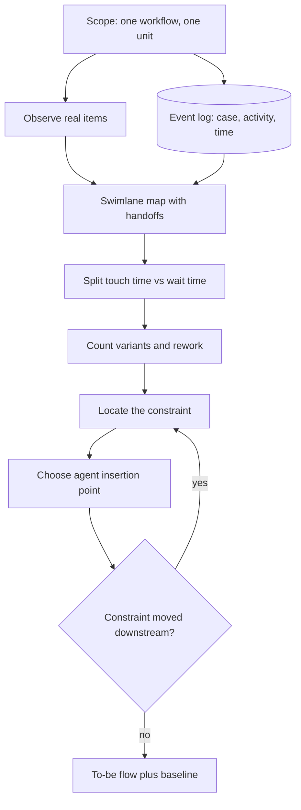

## TL;DR
Workflow analysis maps how work actually flows: steps, people, systems, handoffs, exceptions and waits. It
shows where to put an agent, which only improves the outcome at the step that limits it; speeding a
ten-minute task inside a three-day process changes almost nothing.

## For agent builders
- **Why it matters for agents.** Agents are pitched at tasks ("research the ticket"), but customers judge
  cycle time and errors. If waits dominate, a brilliant research agent leaves the outcome unchanged; an
  intake agent that removes a wait can move it a lot.
- **Where it shows up in your stack.** The step your agent is triggered from, the event log it writes to,
  the human-in-the-loop review queue it feeds, and the fallback path when it is unsure.
- **What you control.** The insertion point, whether the agent removes a wait or only shortens touch time,
  the size of the review step you create, and the baseline you record before launch.
- **What you can skip.** Full lean certification and process-mining tooling; a swimlane sketch, an event-log
  export and Little's law are enough to place an agent.

## Decision case
### Scenario
A company's IT team gets 120 access requests a day and the CIO wants the average time to access under 2
days this quarter. An event-log export of 3,000 recent requests (figures illustrative) shows:
- **Backlog:** 480 open requests and throughput of 110 a day, so average time in system is 480 ÷ 110 ≈
  4.4 days, and the queue grows by 10 a day.
- **Manager approval is the constraint:** managers spend about 440 minutes a day in total, at 4 minutes per
  request, so capacity is 110 a day. Provisioning engineers can do 150 a day.
- **Rework loop:** 35% of requests go back to the requester for missing details, waiting about 1.5 days.
- **Touch time:** provisioning research takes 12 minutes per request.
- **Constraints:** security policy keeps a human approval on every request; two engineers for 10 weeks;
  each agent is estimated at 4 to 5 weeks.

### Options
| Option | How it works | Effect on the constraint | Effect on time in system | Fits 10 weeks |
|---|---|---|---|---|
| A. Research agent for engineers | Drafts the entitlement plan, 12 → 4 minutes | None: provisioning is not the constraint | Barely moves; saves 120 × 8 = 960 minutes, 16 engineer-hours a day | Yes |
| B. Intake completeness agent | Checks requests at submission and asks for missing details at once | None: approval still caps at 110 | Removes most of the rework wait, but the queue still grows 10 a day | Yes |
| C. Approval-pack agent | Summarises the request, peers' access and the policy match for the manager | Same 440 minutes at 2 minutes each: capacity 220 a day | Throughput rises to all 120 arrivals; the backlog drains | Yes |
| D. C first, then B | C in weeks 1-5, B in weeks 6-10 | As C | As C, then the rework wait shrinks too | Yes, just |

### Decision
Choose **D**: build the approval-pack agent first, then the intake completeness agent.
- **Only C touches the constraint.** Halving approval minutes doubles approval capacity to 220, so
  throughput reaches the 120 arrivals and the queue stops growing.
- **The constraint moves to provisioning at 150 a day,** so the backlog drains at up to 150 − 120 = 30 a
  day. By Little's law, under 2 days at 120 a day means fewer than 240 open requests; draining from 480 to
  240 takes about 240 ÷ 30 = 8 working days.
- **B then cuts the rework WIP:** about 120 × 0.35 × 1.5 = 63 requests sit waiting for details at any time;
  catching 80% at intake removes about 50.
- **The approval stays human,** as security requires; the agent pre-packages evidence and decides nothing.
- **A saves real engineer time but not the CIO's outcome,** so it goes on the backlog.

**What would change it:**
- **Managers will not change how they approve** (for example they approve from email without opening the
  pack): C's capacity gain vanishes; pilot it with two managers and measure minutes per approval first.
- **Policy allows auto-approval of low-risk roles:** routing them past managers raises capacity more than C.
- **Arrivals grow past 150 a day:** provisioning becomes the constraint and A moves up.

### Trade-offs accepted
- **Engineers keep spending 12 minutes on research:** track provisioning queue length daily, since it is
  now the next-slowest step.
- **Managers may rubber-stamp a good pack:** sample approved requests weekly and track minutes per approval
  and reversal rate.
- **B ships late in the quarter:** report the rework-loop share and its wait separately so its effect is
  visible.

### Review rubric
- Computes time in system with Little's law from WIP and throughput, with the arithmetic shown.
- Names the constraint from capacities against arrivals, not from the task the customer named.
- Shows where the constraint moves after the proposed agent ships and checks that step's capacity.
- Respects controls (here the human approval) by pre-packaging evidence rather than removing them.
- Sequences agents by effect on the outcome and states the baseline the pilot is measured against.
- Lists measurable conditions, such as minutes per approval, that would flip the choice.

## Why it exists
- **AI is pitched at tasks; customers buy outcomes.** "Summarise the ticket" or "extract the fields" is a
  task. The customer wants tickets resolved faster, claims paid correctly, fewer escalations. The workflow
  links the two, and it is where many agent deployments quietly fail to deliver.
- **Elapsed time is dominated by waiting, not working.** Items sit in queues, wait for an approver, or wait
  for missing information. If an agent halves research time but the ticket then waits two days for
  approval, customer-visible cycle time barely moves.
- **Flow efficiency is usually small.** Lean practice calls working time ÷ elapsed time *flow efficiency*;
  in office processes it is commonly a small fraction, so most of the opportunity sits in the waits.
- **The documented process is not the real one.** Diagrams show the happy path. Real work includes
  exception paths, rework loops, side channels (spreadsheets, chat messages, personal email) and tacit
  checks experienced staff never write down.
- **Designing from the official diagram breaks.** The agent fails on the cases that make up much of the
  actual volume, or skips a check that quietly mattered. Workflow analysis sees the real flow first.

## How it works
### 1. Fix the scope and the unit of work
- **Choose one workflow and its unit:** a ticket, a claim, an invoice, a contract. This is usually one agent
  run.
- **Define start and end:** complaint received to complaint closed.
- **Measure everything per unit**, because averages across mixed units hide the bottleneck.

### 2. Observe, do not only interview
- **Sit with people doing the work** ("go to the gemba", in lean terms) and watch several real items end to
  end.
- **Interviews give the believed process;** observation shows the copy-paste between systems, the lookup in
  a personal spreadsheet and the colleague they message for an answer. Each of those is a tool or data
  source the agent will need, or a step it will miss.

### 3. Map the steps with actors and systems
- **Draw a swimlane diagram:** one lane per role or system, boxes for steps, arrows for handoffs, diamonds
  for decisions. Give the agent its own lane in the to-be map.
- **For each step capture:** who does it, which system they use, what input they need and what they
  produce.
- **Mark handoffs explicitly**, because every handoff is a queue and a chance for context loss, including
  the handoff from agent to human reviewer.

### 4. Measure touch time and wait time
| Measure | Meaning |
|---|---|
| *Touch time* | Someone (or an agent) is actively working on the item |
| *Wait time* | The item sits before the step starts |

- **This split is the core of a value stream map.**
- **Mine the event log where one exists** (ticket history, case management audit trail, ERP change log).
  Every record of case ID, activity and timestamp lets you compute waits and paths for thousands of cases
  instead of the handful you observed. This is the basis of process mining.

### 5. Enumerate variants and exceptions
- **Count distinct paths** and how frequent each is.
- **Track rework loops** (an item sent back), escalations and "request more information" steps.
- **Design for the variants that carry the volume**, and decide explicitly which rare variants stay manual;
  those become the agent's "hand to a human" branch.

### 6. Locate the constraint
- **Find the step that limits throughput or dominates elapsed time.**
- **A growing queue is the tell.** It means items arrive faster than that step completes them: its capacity
  is below the arrival rate.
- **Little's law explains why it hurts:** average items in progress = throughput × average time in system,
  for a stable system. With throughput capped by the constraint, every extra item queued adds directly to
  time in system.

**Sanity check (illustrative numbers):**

| Situation | Result |
|---|---|
| 200 tickets open, team closes 50 a day | Average time in system = 200 ÷ 50 = 4 days |
| Halve research effort, approval caps throughput | Still 50 a day, so the 4 days stay |
| Double approval capacity, or remove items that did not need approval | Throughput rises, up to the capacity of the next-slowest step, and the same WIP clears faster |

- **Theory-of-constraints rule in one line:** an hour saved at a non-constraint is a mirage; an hour saved
  at the constraint is an hour for the whole system.

### 7. Identify agent insertion points
- **Ask how an agent could help at each step:** removing a step, shortening touch time, preventing a
  rework loop (by catching missing information at intake), or eliminating a wait (by pre-computing what the
  approver needs).
- **Mark where humans must stay in the loop** and what they will review.
- **Check where the constraint moves.** If agents finish research twice as fast, items reach approval twice
  as fast; if approval was near capacity, it becomes the new constraint and its queue grows.
- **Every human review is a new step with its own capacity.** 400 items a day at 2 minutes of review each
  is over 13 reviewer-hours daily, which someone must staff.

### 8. Draft the to-be workflow and the baseline
- **Draw the proposed flow** with the agent, its human checkpoints and the fallback path when it is unsure.
- **Record the baseline:** current cycle time, touch time, error and rework rates, because without them the
  pilot cannot show improvement.

## Diagram
The analysis loop: map the real flow from observation and logs, split touch from wait, find the
constraint, then check that the agent insertion does not just move the queue to the next step.



## Examples
### Mining touch and wait time from a ticket log
A support team wants an agent to "write better research notes". Exporting three tickets from the
ticketing system's history (illustrative data) and splitting each step into touch and wait time shows
where time actually goes.

```python
from collections import defaultdict, Counter

# (case_id, activity, start_hour, end_hour) exported from the ticketing system
log = [
    ("T1", "receive", 0.0, 0.1), ("T1", "triage", 4.0, 4.2), ("T1", "research", 22.0, 22.6),
    ("T1", "approve", 47.0, 47.1), ("T1", "reply", 49.0, 49.3),
    ("T2", "receive", 0.0, 0.1), ("T2", "triage", 2.0, 2.1), ("T2", "research", 26.0, 26.4),
    ("T2", "approve", 50.0, 50.1), ("T2", "reply", 51.0, 51.2),
    ("T3", "receive", 0.0, 0.1), ("T3", "triage", 6.0, 6.3), ("T3", "research", 20.0, 20.8),
    ("T3", "request info", 21.0, 21.1), ("T3", "research", 70.0, 70.5),
    ("T3", "approve", 93.0, 93.1), ("T3", "reply", 95.0, 95.2),
]
cases = defaultdict(list)
for case, act, start, end in log:
    cases[case].append((start, end, act))

touch, wait, variants = defaultdict(float), defaultdict(float), Counter()
for steps in cases.values():
    steps.sort()
    variants[" > ".join(a for _, _, a in steps)] += 1
    prev_end = steps[0][0]
    for start, end, act in steps:
        wait[act] += start - prev_end      # time the item sat in a queue before this step
        touch[act] += end - start          # time someone actually worked on it
        prev_end = end

t, w = sum(touch.values()), sum(wait.values())
print(f"touch {t:.1f}h, wait {w:.1f}h, flow efficiency {t / (t + w):.1%}")
for act in touch:
    print(f"{act:13} touch {touch[act]:4.1f}h   wait before {wait[act]:5.1f}h")
print(len(variants), "variants; most common:", variants.most_common(1)[0])
```

| Result across the three tickets | Value |
|---|---|
| Work vs waiting | 4.3 hours of work inside 191 hours of waiting |
| Flow efficiency | About 2% |
| Research touch time | 2.3 hours |
| Waiting before research | 104 hours, including two days in T3 waiting for customer information |
| Waiting for approval | 70 hours |

- **A research-notes agent would save little.**
- **The waits are the target:** an intake agent that catches missing information immediately, and one that
  pre-packages the approver's evidence.

### Worked scenario: the constraint moves when the agent ships
Daily capacities for a ticket flow (illustrative). Arrivals are 60 tickets a day.

| Stage | Research capacity | Approval capacity | Throughput | Queue that grows |
|---|---|---|---|---|
| Before | 55 a day | 58 a day | 55 a day (research caps it) | Before research, +5 a day |
| Research agent doubles research speed | 110 a day | 58 a day | 58 a day (approval caps it) | Before approval, +2 a day |
| Plus agent-prepared approval evidence | 110 a day | 70 a day | 60 a day (all arrivals) | None; WIP stops growing |

- **Doubling research capacity bought only 3 tickets a day**, because the constraint moved to approval.
- **Little's law turns that into days:** at a steady WIP of 200, moving throughput from 55 to 60 cuts average
  time in system from about 3.6 to about 3.3 days; clearing the backlog shrinks WIP and time further.
- **Staffing check:** if the agent's output adds a 2-minute human review on all 60 tickets, that is 2
  reviewer-hours a day of new capacity someone must provide.

### Agent events in the same log
So before and after are computed by one script, the agent writes the same `(case_id, activity, start,
end)` rows as the humans. A sketch with an in-memory list standing in for the ticket system's event store.

```python
import time

EVENTS = []   # stand-in for the ticketing system's history table

def emit(case_id, activity, start, end, actor):
    EVENTS.append({"case_id": case_id, "activity": activity,
                   "start": start, "end": end, "actor": actor})

def intake_agent(ticket):
    start = time.time()
    missing = [f for f in ("order_id", "account_email") if not ticket.get(f)]
    if missing:
        emit(ticket["id"], "request info", start, time.time(), actor="agent")
        return {"status": "waiting_customer", "asked_for": missing}
    emit(ticket["id"], "triage", start, time.time(), actor="agent")
    return {"status": "ready_for_research"}

print(intake_agent({"id": "T4", "order_id": "A-19"}))
print(EVENTS[-1]["activity"], EVENTS[-1]["actor"])   # request info agent
```

- **The `actor` field** lets the same mining script split waits by human versus agent steps after launch.
- **The completeness check here is a plain rule** to keep the sketch short; a real intake agent might use a
  model to read a free-text ticket, but it would emit the same rows.

## Production patterns
- **Emit the same events before and after** — when the agent goes live, have it write case ID, activity
  and timestamp into the same log as the existing steps, so pre- and post-launch flows are computed by one
  script. Monitor cycle time, waits per step and flow efficiency on the same dashboard.
- **Queue-length alerting per step** — track open items in front of each step daily and alert when a queue
  grows for several consecutive days, because that is the signature of a step whose capacity is below the
  arrival rate. Watch the step downstream of any agent insertion first.
- **Intake completeness agent** — run an automated check at intake for the information later steps need,
  and request missing items immediately instead of discovering them at research. Monitor the share of
  items that enter a "request info" loop and the wait it adds.
- **Variant budget** — let the agent handle the variants that carry most of the volume and route rare
  variants to a manual path by explicit rule. Monitor the share of items on the manual path; a rising share
  means the variant mix has shifted.
- **Reviewer capacity as a planned step** — size human review of agent output as items a day × minutes per
  review before launch, staff it, and monitor review queue length and edit rate so rubber-stamping or full
  rework shows up early.

## Trade-offs
- **Depth vs coverage.** Direct observation reveals tacit steps and side channels, but covers only a
  handful of cases. When an event log exists, combine both so observation explains what the log measures.
- **Statistics vs blind spots.** Process mining gives statistically meaningful paths and waits, but only
  sees steps that write to a system. Work done in email or chat is invisible unless captured separately.
- **Rigour vs customer patience.** A detailed current-state map makes the constraint unarguable, but takes
  time customers may resent. When the bottleneck is obvious and agreed, map just that segment in depth.
- **Outcome vs mandate.** Targeting the constraint maximises outcome improvement, but the constraint may sit
  in another team or a policy you cannot change. Then pick the best step within your mandate and say so
  explicitly.
- **Agent review vs throughput.** A human check on every agent output catches errors, but is a new step that
  can become the constraint. Sample-based review fits when error cost is low.

## Pitfalls
- **Analysing the documented process instead of the real one.** Symptom: an agent that handles the happy
  path but fails on the exception paths that make up much of real volume. Fix: observe real items and mine
  the event log for variants.
- **Measuring only touch time.** Symptom: a pilot that cuts handling time per item yet leaves
  customer-visible cycle time unchanged, and the sponsor sees no improvement. Fix: split touch from wait
  per step before choosing the insertion point.
- **Ignoring side-channel tools.** Symptom: users keep their old spreadsheet open next to the new agent,
  because a check or lookup it supported was never modelled as a tool. Fix: list every side channel seen
  in observation and give each a tool or an explicit manual step.
- **Inserting an agent without redesigning the human step around it.** Symptom: reviewers either approve
  everything unread or redo the work from scratch, erasing the saving. Fix: design the review step (what
  to check, how long, sampled or full) as part of the to-be flow.
- **Speeding up one step without checking downstream capacity.** Symptom: a queue that shrinks in front of
  the improved step and grows in front of the next one, with cycle time unchanged. Fix: check the next
  step's capacity against the new arrival rate before launch.
- **Not recording a baseline before changing the flow.** Symptom: an argument after launch about whether
  things improved, settled by anecdote. Fix: record cycle time, touch time and rework rate from the log
  before the agent ships.

## When to use
- **Use whenever** an agent will sit inside an existing business process, which is almost always in
  enterprise and forward-deployed work, and do it before choosing which step to automate.
- **Keep it lean for small scopes:** observe five to ten items, sketch a swimlane, and pull timestamps for a
  few hundred cases if a log exists.
- **Go deeper** (full value stream map, process mining) when the sponsor's goal is a cycle-time or
  throughput outcome.
- **Measure:** flow efficiency, waits per step, variant frequencies and rework rates.
- **Interviews:** the signal is recognising that the step the customer named is often not the one that
  limits the outcome.

## Role lens
- **Engineer:** Pulls event logs from ticketing or case systems, computes per-step waits and variants, and
  wires the AI step to emit the same events so before and after are comparable.
- **Architect:** Decides where AI components and human checkpoints sit in the to-be workflow, and whether
  orchestration lives in an existing workflow engine or a new service.
- **FDE:** Shadows the customer's staff, uncovers the side channels and tacit checks, and presents the
  current-state map that convinces the sponsor where the real bottleneck is.

## Check yourself
**Q:** A customer wants an AI copilot to speed up loan officers' document review, which takes about an
hour per application. End-to-end, applications take about ten business days. How would you decide whether
the copilot is the right investment?
**A:** I would map the workflow and pull timestamps from the loan origination system for a few hundred
recent applications, splitting touch time from waits per step and counting variants. If most of the ten
days is waiting, for example for missing documents from applicants or for a credit committee that meets
twice a week, a review copilot saves officer time but barely changes time to decision. In that case the
higher-leverage AI use is at intake: checking completeness and requesting missing documents immediately,
or preparing the committee pack. If review itself queues because officers are the capacity constraint,
the copilot is right, and I would baseline review time and error rate first.

## Interview questions
### What is flow efficiency and why does it change where you put an agent?
- **Definition:** touch time ÷ elapsed time per unit of work. In office processes it is commonly a small
  fraction; the ticket example was about 2%.
- **Why it matters:** if waits dominate, shortening touch time barely moves cycle time, so the agent belongs
  where it removes a wait or a rework loop, such as completeness checks at intake.

### An agent pilot halved handling time but the sponsor says nothing improved. How do you investigate?
- **Pull the event log** for before and after and split touch from wait per step.
- **Look for the moved constraint:** a queue that shrank before the improved step and grew before the next
  one means downstream capacity now caps throughput.
- **Check the new review step** for its own queue, because added human review of agent output is a step
  with finite capacity.

### How do you size the human-in-the-loop step for an agent before launch?
- **Multiply items a day by minutes per review:** 400 items at 2 minutes is over 13 reviewer-hours daily,
  which is a staffing decision, not a detail.
- **Compare it with reviewer capacity** and decide between full review, sampling or confidence-gated
  review, because an unstaffed review queue becomes the new constraint.
- **Monitor queue length and edit rate** after launch to spot rubber-stamping or full rework.

### When would you not target the constraint?
- **When it sits outside your mandate**, such as another team's approval or a policy you cannot change.
  Then pick the best step within scope and state explicitly that cycle time is capped elsewhere.
- **When the constraint is a deliberate control**, such as a regulatory sign-off, where the better lever is
  pre-packaging evidence rather than removing the step.

### 200 tickets are open and the team closes 50 a day. What is the average time in system, and what would change it?
- **Little's law:** 200 ÷ 50 = 4 days, assuming a stable system.
- **Only the constraint changes it.** Faster research leaves 50 a day if approval caps throughput; more
  approval capacity, or removing items that never needed approval, raises throughput up to the next-slowest
  step.

### Why observe users if you already have a complete event log?
- **Logs only record steps that touch a system.** Spreadsheets, chat questions and mental checks leave no
  trace.
- **Observation explains the log**, for example why one variant has a long wait, and reveals tacit checks
  an agent design would otherwise skip.

## Quiz
### Q: In a process with 30 minutes of touch time and 4 days of elapsed time, AI halves the touch time. What most likely happens to elapsed time?
- [ ] It halves, because the work is done twice as fast
- [x] It barely changes, because elapsed time is dominated by waiting between steps
- [ ] It doubles, because reviewers must check AI output
- [ ] It drops to 15 minutes, because the queue disappears
> Saving 15 minutes of work inside four days of queueing leaves elapsed time almost unchanged. Unless
> the touched step is the capacity constraint causing the queue, the waits are where elapsed time lives.

### Q: Why is direct observation of users valuable even when a detailed event log exists?
- [ ] Event logs are usually inaccurate about timestamps
- [ ] Regulations require in-person observation before automation
- [x] Logs only record steps that touch a system, missing side channels, tacit checks and workarounds
- [ ] Observation produces larger sample sizes than logs
> Logs are excellent for statistics on recorded steps, but spreadsheets, chat questions and mental checks
> leave no trace. Observation explains what the log measures and reveals what it cannot see.

### Q: A queue in front of the approval step grows every week. What does that indicate?
- [ ] The approval step has too much documentation
- [ ] Items arriving at approval are of lower quality than before
- [x] Approval capacity is below the arrival rate, so it is the constraint limiting throughput
- [ ] The upstream steps are working too slowly
> A queue only grows when work arrives faster than the step completes it, so approval capacity is the
> constraint. Slow upstream steps would shrink this queue, not grow it; and by Little's law, the growing
> backlog at a capped throughput translates directly into longer time in system.

## Use cases & projects
### Use cases
- **Placing a support agent.** The log shows waits before research and approval, so the agent goes to
  intake completeness and approval packs, not research notes.
- **Sizing human review.** Items a day times minutes per review decides whether an agent's output is fully
  reviewed, sampled or confidence-gated.
- **Proving an agent's impact.** The agent emits the same events as humans, so one script compares cycle
  time before and after launch.
- **Explaining a "nothing improved" pilot.** Queue lengths per step reveal the constraint that moved
  downstream of the agent.

### Mini project
**Find the right step for an agent from an event log (1-2 hours).**
- **Goal:** decide, from data, where a support agent should sit and what it would change.
- **Steps:**
  1. Generate or export an event log of 100+ tickets with case ID, activity, start and end.
  2. Run the touch-and-wait script; list waits per step, variants and flow efficiency.
  3. Model two insertions, a research agent and an intake completeness agent, as capacity changes in the
     constraint table, and apply Little's law.
  4. Add the review step each agent would create and compute reviewer-hours a day.
- **Done when:** you have a one-page recommendation naming the insertion point, the expected change in time
  in system, and the reviewer capacity it needs.
