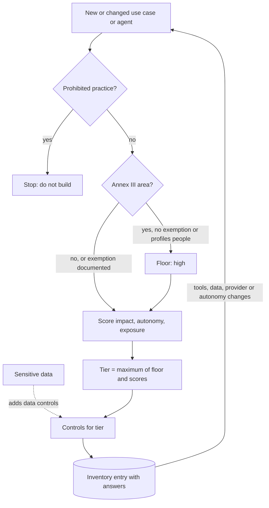

## TL;DR
An AI inventory lists every AI system, agent and use case with owner, data, models, tools and purpose.
Risk classification gives each *use case* a tier that sets its controls, because the same model can draft
copy or, given tools, act on applicants.

## For agent builders
- **Why it matters for agents.** Your agent's tier, and so the controls you must build (evals, approval
  gates, audit trails, review board sign-off), is decided by its use, its autonomy and the tools it holds,
  not by which model it calls. Adding one write tool can move an agent up a tier overnight.
- **Where it shows up in your stack.** The intake form you fill before getting production model API keys,
  your LLM gateway config (which providers an agent calls), egress proxies and secret scanning that find
  agents nobody registered, and the system card linked from the inventory entry.
- **What you control.** Declaring the agent honestly (tools, permissions, data categories, who is
  affected), keeping autonomy low enough for the tier you can afford (approval gates on consequential
  tools), and triggering re-classification when you add tools, data or providers.
- **What you can skip.** Memorising every Annex III paragraph. Know that employment, credit, education and
  essential services are high-risk areas, know the exemption exists, and ask legal for the rest.

## Decision case
### Scenario
A retailer's customer-support agent is registered as medium tier (read-only tools, customers affected).
The product team wants it to issue refunds, which triggers re-classification. All figures are illustrative.
- **Volume:** 3,000 refund requests a day; today staff handle each one end to end.
- **Classification rule:** the lesson's questionnaire. A `write` tool without approval scores autonomy
  2, so the tier becomes high; the same tool behind approval (`write_approved`) keeps it medium.
- **Constraints:**
  - launch in 6 weeks, a date tied to the peak season;
  - high-tier controls (impact assessment, human oversight design, audit trails, bias testing, board
    sign-off) take the governance team about 10 weeks to complete for one system;
  - the support team can review at most 800 agent-proposed refunds a day at about 1 minute each;
  - refunds are reversible only by asking the customer to pay back, so a wrong one is costly.

### Options
| Option | How it works | Tier | Fits 6 weeks? | Approvals a day vs 800 |
|---|---|---|---|---|
| **A. Auto-refund** | `issue_refund: write`, the agent pays out directly | high | no: controls need about 10 weeks | 0 |
| **B. Approved refunds, all traffic** | `issue_refund: write_approved` for every request | medium | yes | 3,000: 3.75 × capacity |
| **C. Approved refunds, pilot cohort** | `write_approved`, enabled for 25% of requests (one region); the rest stay manual | medium | yes | 3,000 × 25% = 750: fits |

### Decision
Choose **C, approved refunds for a 25% pilot cohort**, because it is the only option that meets the deadline
and the approval capacity together.
- **Deadline:** C stays medium tier, so it needs an evaluation, a system card and monitoring, all feasible
  in 6 weeks; A needs about 10 weeks of high-tier controls.
- **Capacity:** 750 approvals a day fits under 800, while B produces 3,000.
- **Evidence:** the pilot records how often reviewers accept the agent's proposals, which is the input a
  later high-tier case for auto-refunds needs.
- **Inventory:** the entry records the new tool, its permission and the cohort, and the tier is
  recomputed from the stored answers rather than asserted.

**What would change it:**
- **Approval capacity of 3,000 a day or more:** roll B out to all traffic at medium tier.
- **A deadline 10 weeks or more away:** run high-tier controls for A in parallel, if the business wants
  unattended refunds.
- **A pilot acceptance rate that stays high on several thousand proposals:** start the high-tier case for
  auto-refunds on low-value requests, with the acceptance data as evidence.

### Trade-offs accepted
- **75% of requests stay manual at launch.** The saving is a quarter of what was planned. Track the
  cohort's handling time against the manual queue to size the next expansion.
- **Reviewers may rubber-stamp.** At 1 minute per refund, approval can turn into a click. Sample approved
  refunds weekly and track the rejection rate; a rate near zero needs a second look, not celebration.
- **The 800 and 10-week figures are estimates.** Measure approvals per reviewer-hour in week one and
  re-plan before widening the cohort.

### Review rubric
- **The tier is derived from declared answers** (tools and permissions, impact, exposure), and the
  write-up shows how a tool change moves it.
- **Each option's tier is costed in controls and lead time**, not just named.
- **Human approval load is computed** from volume and cohort share and compared with reviewer capacity.
- **A re-classification trigger is named** for the next change (wider cohort, removing approval, a new
  tool).
- **The plan collects the evidence** the next tier decision will need, with a threshold stated up front.

## Why it exists
- **You cannot govern AI you do not know exists.** Model cards, evaluations, audit trails, incident response
  and regulatory filings all presume a list of things to apply them to. In most organizations that list
  does not exist.
- **AI arrives through many doors.** A product team calls a model API, a vendor switches on an "AI
  assistant" in the CRM, an analyst pastes customer data into a chatbot, a developer wires an agent to the
  ticketing system, a data science team shipped a churn model years ago. Asked "where do we use AI, and which
  uses are high-risk?", the honest answer is often "we don't know".
- **Governing everything identically fails both ways.** Applied strictly, one heavyweight review buries a
  meeting-summary tool under credit-model paperwork, so teams route around it and shadow AI grows. Applied
  loosely, the credit model gets the light-touch review the summary tool deserved.
- **Classifying by model fails too,** because risk is a property of the use: which decisions the output
  informs or which actions the agent takes, about whom, how reversibly, in what legal context. The EU AI Act
  attaches obligations to a system's intended purpose, not its technology.
- **So you need both halves:** a complete inventory, and a per-use-case classification that proportions
  controls to stakes.

## How it works
### 1. Define what counts
- **Write a short, inclusive definition:** any system where a learned model produces outputs that influence
  decisions, content or actions. Agents are the clearest case: their outputs *are* actions.
- **Include third-party SaaS features and employee use of general chat tools,** *because* those are where
  data leaves and where nobody thinks they are "doing AI".

### 2. Discover
Combine declaration with detection, *because* self-reporting alone misses shadow use:
- **Intake:** a lightweight registration form required before procurement, launch or production access.
- **Technical signals:** outbound traffic to model API domains through egress proxies, API keys found by
  secret scanning, cloud bills with AI service line items, SSO logs for AI SaaS apps, expense reports.
- **Vendor review:** ask existing SaaS vendors which features use AI (including built-in agents) and on
  which data.

### 3. Record a minimum useful entry
| Field | Note |
|---|---|
| Owner | A named person, not a team alias |
| Business purpose, users, affected people | Who benefits and who bears the risk |
| Decision type | Advisory or automated |
| Tools and permissions (agents) | Read-only, write behind approval, or write without approval |
| Models and providers with versions | Links to the model registry |
| Data categories processed | Links to data classification |
| Deployment surface, geographies | Decides which laws apply |
| *Your role* | Built it, bought it, or substantially modified something bought; under the EU AI Act this decides whether you are provider or deployer |
| Lifecycle status, model or system card link | Keeps governance artifacts attached |

Keep it small enough that people fill it in; fields nobody reads are fields nobody maintains.

### 4. Classify the use case
Use a short questionnaire whose answers map to tiers, so classification is repeatable rather than a
judgement call each time. The deciding factors:
- **Legal category.** Does the use fall in a regulated list? Under the EU AI Act:
  - *Prohibited practices,* for example social scoring (the final text bans it for public and private
    actors alike) or manipulative techniques causing significant harm.
  - *High-risk areas in Annex III:* employment, education, access to essential services including credit
    scoring, biometric identification, critical infrastructure, law enforcement, migration and justice.
    AI that is a safety component of a product under EU product-safety law (Annex I) is high-risk too.
  - *Transparency obligations* for systems like chatbots and generated media; *minimal risk* for the rest.
    General-purpose AI models carry their own separate provider obligations.
- **Impact.** Who is affected, how severely and how reversibly if the output or action is wrong.
- **Autonomy.** Human decides with AI advice, human approves AI decision, or fully automated action. For an
  agent, read this off its tools: any consequential write tool without an approval gate is automated.
- **Data sensitivity.** Health, financial, children's, biometric or other special-category data.
- **Exposure.** Internal staff only, customers, or the public.

### The combining rule
The order and the rule matter:
1. **Knock-out questions first.** A prohibited practice stops the process. A use in a regulated high-risk
   area sets a floor that no other answer can lower.
2. **Then take the maximum across the remaining factors, not an average,** *because* averaging lets
   "internal only" cancel out "decides who gets disciplined", and harm does not average.
3. **Decide which factors drive the tier and which only trigger controls.** Data sensitivity in particular
   can instead be wired to specific controls at any tier (vendor terms, redaction, access logging). That is
   a policy choice to write down once.
4. **Encode the Annex III exemption.** An Annex III use is not high-risk if it only performs a narrow
   procedural task, improves the result of a completed human activity, detects patterns without replacing
   human assessment, or does preparatory work. The exemption never applies when the system profiles people,
   and the reasoning must be documented.
5. **Record the answers, not just the tier,** so a later change in one answer re-runs the classification
   instead of requiring someone to remember why.

### 5. Attach controls to tiers
| Tier | Required controls |
|---|---|
| Low | Inventory entry and acceptable-use rules |
| Medium | Adds an evaluation, a system card and monitoring |
| High | Adds impact assessment, human oversight design, audit trails, bias testing, review board sign-off and periodic re-review |

This mapping is the payoff, *because* teams know up front what a tier costs them, and an agent team can
choose to keep a tool behind approval rather than pay for the next tier.

### 6. Keep it alive
- **Re-classify on change** of purpose, data, model provider, geography, tool set or autonomy level.
- **Reconcile** the inventory against discovery signals on a schedule.

## Diagram
Read the classification top to bottom: knock-out questions first, then a floor, then the maximum of the
remaining factors (autonomy read from the agent's tools), with sensitive data routed to controls.



## Examples
### Classification as code, with autonomy derived from an agent's tools
Encoding the questionnaire makes tiers repeatable and keeps the answers next to the result. For agents,
autonomy is computed from the declared tool list instead of asked, so it cannot be under-reported.

```python
TIERS = ["low", "medium", "high"]
ANNEX_III = {"employment", "education", "essential_services", "credit_scoring", "biometric_id",
             "critical_infrastructure", "law_enforcement", "migration", "justice"}

def agent_autonomy(tools: dict) -> str:
    # tools: name -> "read" | "write_approved" | "write"
    if any(p == "write" for p in tools.values()): return "automated"
    if any(p == "write_approved" for p in tools.values()): return "human_approves"
    return "human_decides"

def classify(a: dict) -> dict:
    if a["prohibited_practice"]:
        return {"tier": "prohibited", "why": ["prohibited practice: stop"]}
    why, floor = [], 0
    if a["area"] in ANNEX_III:
        if a["exemption_condition"] and not a["profiles_people"]:
            why.append("Annex III exemption claimed: document the reasoning")
        else:
            floor = 2
            why.append(f"Annex III area '{a['area']}' sets floor high")
    autonomy = agent_autonomy(a["tools"]) if "tools" in a else a["autonomy"]
    scores = {"impact": {"minor": 0, "significant": 1, "severe": 2}[a["impact"]],
              "autonomy": {"human_decides": 0, "human_approves": 1, "automated": 2}[autonomy],
              "exposure": {"internal": 0, "customers": 1, "public": 1}[a["exposure"]]}
    tier = max([floor, *scores.values()])          # maximum, never an average
    why += [f"{k}={v}" for k, v in scores.items() if v == tier and v > 0]
    controls = ["data controls"] if a["sensitive_data"] else []   # triggers controls, not the tier
    return {"tier": TIERS[tier], "why": why, "extra_controls": controls, "answers": a}

base = dict(prohibited_practice=False, area=None, exemption_condition=False, profiles_people=False,
            sensitive_data=False, impact="significant", exposure="customers")
support_v1 = {**base, "tools": {"search_kb": "read", "lookup_order": "read"}}
support_v2 = {**support_v1, "tools": {**support_v1["tools"], "issue_refund": "write"}}
support_v3 = {**support_v1, "tools": {**support_v1["tools"], "issue_refund": "write_approved"}}
for name, ans in [("v1 read-only", support_v1), ("v2 auto refund", support_v2),
                  ("v3 approved refund", support_v3)]:
    r = classify(ans)
    print(f"{name:19} {r['tier']:7} {r['why']}")
# v1 read-only        medium  ['impact=1', 'exposure=1']
# v2 auto refund      high    ['autonomy=2']
# v3 approved refund  medium  ['impact=1', 'autonomy=1', 'exposure=1']
```

- **The agent lesson.** Adding `issue_refund` without approval moves the support agent from medium to high;
  putting the same tool behind an approval gate keeps it at medium. Tool permissions are a classification
  input you control.

### Worked scenario: one model, three tiers
A mid-size insurer runs discovery and intake and gets 46 entries. Three of them show why classification
must be by use case:

| Use case | Same model? | Decision | Affected | Tier |
|---|---|---|---|---|
| Drafting marketing emails | Vendor LLM A | Human edits and sends | Public (indirect) | Low |
| Summarizing claim files for adjusters | Vendor LLM A | Advisory, adjuster decides | Claimants | Medium |
| Ranking job applicants for interview | Vendor LLM A via an HR SaaS | Shortlist shown to recruiter | Applicants | High |

- **Marketing emails (low).** Needs an inventory entry and a rule against pasting customer data.
- **Claim summaries (medium).** Processes personal and possibly health data and informs a consequential
  decision. Needs evaluation on real claim files, a groundedness check, a system card and an audit trail of
  which summary an adjuster saw.
- **Claim summaries is the contested row.** Health data alone would make it high under a pure maximum rule;
  this insurer chose to let sensitive data trigger data controls rather than the tier when a human decides.
  Another organization could reasonably tier it high; what matters is that the rule is explicit and applied
  the same way to every entry.
- **Applicant ranking (high).** Employment is an EU AI Act high-risk area, and applicants never consented to
  the tool. Needs an impact assessment, bias testing across applicant groups, documented human oversight,
  vendor documentation and review board approval.
- **Discovery found 9 undeclared entries,** including two teams calling model APIs from personal accounts
  and one internal agent with write access to the claims system, which became the first remediation items.
- **The output is a register that targets review effort** at the handful of high-tier uses, not all 46
  equally.

## Production patterns
- **Intake gate at procurement, launch and key issuance.** Make an inventory ID a required field on purchase
  requests for AI SaaS and on production access requests for model API keys, so no agent reaches production
  unregistered. Keep the low-tier form to a few minutes. Monitor median time from intake to classification
  and the share of requests escalated.
- **Egress and key discovery feed.** Route outbound traffic through a proxy or LLM gateway that logs requests
  to known model API domains, and add model-provider key patterns to secret scanning. Reconcile hits against
  the inventory weekly. Monitor undeclared sources found per month; it should trend down.
- **Answers stored, tier computed.** Keep questionnaire answers and agent tool lists as structured fields and
  compute the tier in code, as in the example, so a policy change re-tiers every entry in one run. Monitor
  how many entries changed tier after each policy update.
- **Change triggers on the entry.** Tie re-classification to events you can detect: a new model provider in
  the gateway config, a new data category in the pipeline, a new tool or permission in the agent's config,
  an autonomy flag flipped. Monitor entries past their review date.
- **Owner liveness check.** Nightly, look up every owner in the HR or identity directory and flag entries
  whose owner has left. Monitor orphaned entries and the time to reassign them.

## Trade-offs
- **Broad definition vs inventory size.** Calling more things "AI" catches shadow and embedded use but
  inflates the inventory; tiering keeps that cheap because most entries land in the low tier with minimal
  obligations.
- **Questionnaire vs judgement.** Questionnaire-driven classification is consistent and fast, but edge cases
  need human judgement; add an escalation path rather than more questions when ambiguous answers become
  common.
- **Mandatory registration vs friction.** Registration before procurement gives early visibility but adds
  friction; it flips to driving shadow AI when intake is slow, so the low-tier path must take minutes, not
  weeks.
- **Approval gates vs agent usefulness.** Gating write tools keeps an agent in a lower tier but adds human
  latency to every consequential action; it flips when approval volume makes reviewers rubber-stamp.
- **Technical discovery vs employee privacy.** It finds what people forget, but egress monitoring of
  employee traffic raises privacy and works-council concerns in some jurisdictions; agree scope with legal
  and HR first.

## Pitfalls
- **Inventorying models instead of use cases.** Symptom: one "Vendor LLM" row covering twenty uses with
  wildly different risk. Fix: one entry per use case or agent.
- **Relying only on self-declaration.** Symptom: an auditor or journalist discovering a use the inventory
  does not contain. Fix: reconcile against egress, key and billing signals.
- **Treating the inventory as a one-off spreadsheet.** Symptom: entries whose owner left months ago and
  whose model provider has changed. Fix: owner liveness and change triggers.
- **Classifying once at launch.** Symptom: an "advisory" agent that quietly gained write tools and became
  automated decision-making without anyone re-reviewing it. Fix: re-classify on tool changes.
- **Ignoring AI features inside bought SaaS.** Symptom: customer data flowing to a sub-processor nobody
  assessed. Fix: vendor review of AI features.

## When to use
- **Start when:** an organization has more than a handful of AI uses or agents, or faces any AI regulation,
  audit or customer due-diligence questionnaire, which today is nearly everyone.
- **It is a prerequisite for:** an ISO/IEC 42001 management system; the NIST AI RMF (inventorying AI systems
  is an explicit Govern outcome, GOVERN 1.6, and every Map activity presumes the list); and EU AI Act role
  and obligation analysis.
- **Measure:** coverage (discovered uses reconciled against declared), freshness (entries reviewed within
  their cycle) and time-to-classify.
- **Interviews:** the key insight is that risk attaches to use, autonomy and affected people, not to the
  model, and that tiering exists to make governance proportionate.

## Role lens
- **Engineer:** Registers each new AI feature with model, version, data categories and owner, and adds the
  egress or secret-scanning signals that feed automated discovery.
- **Architect:** Designs the inventory schema, the tiering questionnaire and the tier-to-control mapping,
  and links the inventory to the model registry and data classification.
- **FDE:** Helps a customer classify the use case being deployed in their environment, often discovering
  it is higher-tier than assumed because of the data or decisions involved.

## Check yourself
**Q:** A team argues their use case is low risk because it uses the same approved vendor model as the
company chatbot. They will use it to flag employees for performance review. How do you respond?
**A:** Model approval says the vendor and model meet baseline security and contractual requirements; it
says nothing about this use. Risk depends on purpose, affected people, autonomy and legal context.
Flagging employees for performance review is an employment decision about people with limited ability to
contest it, which the EU AI Act lists as a high-risk area and many labour regimes regulate. It needs its
own inventory entry and high-tier classification: an impact assessment, bias evaluation across groups,
documented human oversight, transparency to employees, an audit trail, and review board sign-off before
launch. The approved model is reusable; the approval is not.

## Interview questions
### Why do we need an AI inventory if procurement already tracks vendors?
- **Procurement tracks contracts, not uses.** One vendor LLM can sit behind twenty use cases and agents with
  very different risk, and AI features switched on inside existing SaaS never pass procurement again.
- **Governance needs the use-level list,** with owner, data, autonomy and affected people, because every
  other control (cards, evals, audit trails, incident response) is applied per entry.

### Your support agent is read-only today; the team wants to add a refund tool. How does that change its classification?
- **Autonomy changes,** so the tier re-runs: a write tool without approval makes it automated action on
  customers' money, which can move it from medium to high.
- **The team has a design choice:** put the refund behind an approval gate or a low amount cap and stay in
  the lower tier, or accept the high-tier controls (audit trail, oversight design, board sign-off).
- **Detect it automatically** by diffing the agent's tool config against the inventory entry.

### How would you find shadow AI and unregistered agents in a 5,000-person company?
- **Declaration plus detection:** an intake form tied to procurement and API key issuance, plus egress proxy
  logs for model API domains, secret scanning for provider keys, AI line items on bills and SSO logs.
- **Ask SaaS vendors** which features use AI and on which data.
- **Agree scope with legal and HR** before monitoring employee traffic, because some jurisdictions restrict it.

### Why take the maximum across risk factors instead of a weighted score?
- **Harm does not average.** A weighted score lets "internal only" offset "decides who gets disciplined".
- **Knock-outs and floors come first:** prohibited practices stop the process and Annex III areas set a high
  floor no other answer can lower.
- **The trade-off:** a pure maximum over-tiers some uses, so decide explicitly which factors only trigger
  controls, such as sensitive data wired to redaction and vendor terms.

### A summarization tool was classified medium as advisory. Six months later it auto-closes tickets. What should happen?
- **Autonomy changed, so classification re-runs.** Moving from human decides to automated action can raise
  the tier and the required controls.
- **Detect it by trigger, not memory:** an autonomy flag or new tool permission on the entry should fire
  re-review automatically.
- **Until re-reviewed,** the new behaviour should be blocked or held behind human approval.

### When does the EU AI Act Annex III exemption apply, and when can it never apply?
- **It can apply** when the system only performs a narrow procedural task, improves a completed human
  activity, detects patterns without replacing human assessment, or does preparatory work.
- **It never applies** when the system profiles people, and the reasoning must be documented either way.

## Quiz
### Q: Why should risk classification be done per use case rather than per model?
- [ ] Models are too numerous to classify individually
- [x] The same model can be low-risk in one use and high-risk in another, depending on decisions, affected people and autonomy
- [ ] Vendors classify their own models, so organizations only need to classify use cases
- [ ] Regulations prohibit classifying models directly
> Harm comes from what the output is used for and whom it affects. Regulation such as the EU AI Act attaches
> obligations to intended purpose, so a model-level label cannot capture the difference between drafting
> emails and screening job applicants.

### Q: Which discovery approach is most likely to find shadow AI usage that teams did not declare?
- [ ] Sending an annual survey asking teams to list their AI projects
- [ ] Reviewing the approved vendor list in procurement
- [x] Combining intake registration with technical signals such as egress traffic to model APIs, secret scanning and AI line items on bills
- [ ] Asking the model provider for a list of the company's users
> Self-reporting and procurement lists only contain what people chose to declare or buy formally. Technical
> signals catch personal-account API use and embedded SaaS features that never went through intake.

### Q: What is the main purpose of mapping risk tiers to required controls?
- [ ] To guarantee that every use case receives a full impact assessment
- [x] To make governance proportionate and predictable so teams know what each tier requires
- [ ] To replace the need for an AI review board entirely
- [ ] To let low-tier systems skip the inventory
> Tiers concentrate scarce review effort on high-stakes uses while giving low-risk uses a fast path. Every
> use still enters the inventory; what varies is the depth of control applied to it.

## Use cases & projects
### Use cases
- **Getting an agent to production.** Intake and classification decide which controls the agent team must
  build before launch, so they are known in week one, not week ten.
- **Adding tools to an existing agent.** A new write tool re-runs classification and may require an
  approval gate or a higher tier's controls.
- **Finding rogue agents.** Egress and secret-scanning reconciliation surfaces agents built on personal API
  keys or wired to production systems without review.
- **Customer due diligence.** An FDE fills the customer's questionnaire from the inventory entry and system
  card instead of from memory.

### Mini project
**Tier calculator wired to agent configs (1-2 hours).**
- **Goal:** compute each agent's risk tier from its declared config and fail CI when a config change raises
  the tier without a review.
- **Steps:** write YAML configs for three agents (read-only FAQ bot, support agent with an approved refund
  tool, HR screening agent); implement the knock-out, floor and maximum rule with autonomy derived from tool
  permissions; store the last approved tier per agent; add a CI script that recomputes tiers and compares.
- **Done when:** changing a tool from approval-gated to direct write makes CI fail with the old tier, new
  tier and the factor that changed.
