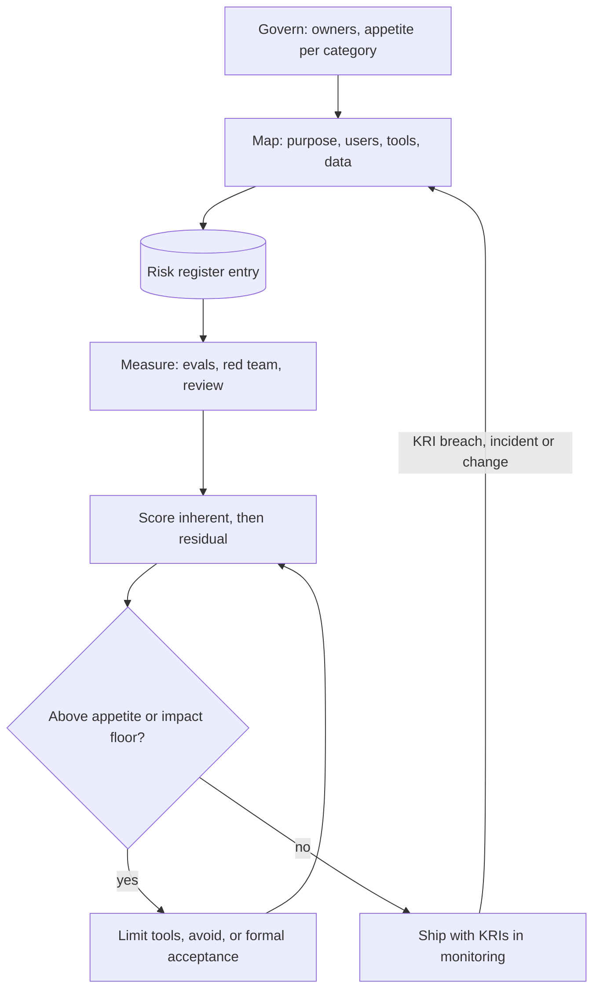

## TL;DR
AI risk management is a continuous loop: identify what can go wrong, rate likelihood and harm, choose
controls, track what remains, with owners and an explicit appetite. For agents, the strongest controls
limit what tools can do, and live KRIs show when risk moves.

## For agent builders
- **Why it matters for agents.** Agents turn model errors into actions: a stale document becomes a wrong
  promise, an injected instruction becomes a refund or an email. The risk register is where you decide which
  tools need approval, which data the agent may read, and which capability to drop entirely.
- **Where it shows up in your stack.** A register file next to the agent's code, CI checks on residual risk,
  KRIs on your monitoring dashboards (ungrounded-answer rate, approval rejection rate, injection detections),
  and change triggers from deploy config diffs when you add a tool or swap a model.
- **What you control.** Capability-limiting controls (tool allow-lists, approval gates, recipient
  restrictions, amount caps), the evidence each control has, and the KRI that would move if a control broke.
- **What you can skip.** Mapping every clause of NIST AI RMF and ISO/IEC 23894 against each other. Know the
  four functions, write cause-event-consequence risks, and score residual risk against an agreed appetite.

## Decision case
### Scenario
A B2B software company runs an account-management agent that reads inbound customer email, looks up the
CRM and replies with `send_email`.

The register's top entry: "Because inbound email is untrusted, an
injected instruction may make the agent email account data to an attacker's address, leading to a data
breach." All scores use the lesson's 1-5 scales and are illustrative judgements.
- **Volume:** 4,000 outbound agent emails a day; about 6% (240) go to an address not already on the
  account's CRM record.
- **Inherent rating:** likelihood 3 × impact 5 = 15.
- **Constraints:**
  - appetite 8, and the impact floor of 5 needs the CISO's sign-off;
  - account managers can review at most 500 emails a day;
  - customers expect a reply within 1 hour in business hours;
  - the team has 4 weeks before the agent moves from pilot to all accounts.

### Options
| Option | How it works | Residual (L × I) | Review load a day vs 500 | Reply time |
|---|---|---|---|---|
| **A. Detect** | injection classifier on inbound mail, flagged mail goes to a human | 2 × 5 = 10: above appetite, impact floor | flagged mail only | fast |
| **B. Approve every email** | all 4,000 drafts need a human click | 1 × 5 = 5: impact floor still applies | 4,000: 8 × capacity | queues for hours |
| **C. Limit recipients** | the tool can only address contacts on the thread's CRM account; any other recipient needs approval | 1 × 3 = 3: data can reach only that customer's own contacts | 240 | fast for 94% |
| **D. Avoid** | remove `send_email`; the agent drafts, people send | 1 × 3 = 3 | 4,000 manual sends | slow |

### Decision
Choose **C, a recipient allow-list enforced in the tool, with approval for new recipients**, because it is
the only option under appetite that also fits the review budget.
- **Appetite:** a residual of 3 sits well under 8; A's 10 does not, because a classifier against an
  adaptive attacker leaves likelihood at 2.
- **Impact, not only likelihood:** C lowers impact from 5 to 3 because the attacker's own address is no
  longer reachable without a person. That also clears the impact floor, so no CISO acceptance is needed.
- **Review load:** 240 approvals a day fits under 500; B needs 4,000 and would turn into rubber-stamping.
- **Reply time:** 94% of emails still go out in minutes, unlike B and D.
- **Keep A as a second layer:** the classifier still runs and feeds a KRI, but no longer carries the risk.

**What would change it:**
- **New-recipient share rising above about 12%** (480 a day): approvals near capacity; split approval by
  domain or add reviewers.
- **A compromised customer mailbox** being used as the attacker channel: recipients on the CRM record are
  then not trustworthy; re-score impact and consider approval on attachments.
- **Contract terms that forbid any automated outbound email:** D becomes the only option.

### Trade-offs accepted
- **Legitimate new contacts wait for a person.** About 240 replies a day are slower. Track their time to
  send and the approval rejection rate; a rate near zero suggests the gate could narrow.
- **The allow-list is only as good as the CRM.** A poisoned CRM contact defeats it. Log CRM contact
  changes made in the last day before an email and alert when an agent email goes to one.
- **Scores are judgements.** Ask the second line to re-score this entry independently before rollout and
  record the gap.

### Review rubric
- **The risk is written cause-event-consequence**, with inherent and residual scores on anchored scales.
- **Each option's residual is scored against appetite and the impact floor**, not just ranked.
- **Capability limits are preferred over detection** where they exist, with the reason stated.
- **Human review load is computed** and compared with capacity before approval is chosen as a control.
- **Every control has a KRI** with a named metric and alert threshold.
- **Conditions that would reopen the decision** are listed with the number or event that triggers them.

## Why it exists
- **Traditional reviews assume specified, stable behaviour:** test against the spec, fix deviations, ship. AI
  breaks that. Behaviour is statistical (an error rate, not a bug), depends on data that drifts, and can
  change when a provider updates a model you did not touch.
- **AI harms are not outages.** A confident wrong answer, a biased outcome, leaked training data, an agent
  taking an action nobody intended. Many fall on people outside the organization who never see the system.
- **A launch checklist is binary and one-off.** It cannot express "this hallucinates on roughly one answer in
  fifty for long documents and that is acceptable only with a citation check", and says nothing about six
  months later, when the corpus, users, tools or model have changed.
- **Ownership fragments.** Security looks at prompt injection, legal at copyright, product at accuracy, and
  nobody sees the combined picture or decides which risk to fund first.
- **Frameworks give a shared structure.** The NIST AI RMF and ISO/IEC 23894 provide a common vocabulary, a
  lifecycle, and recorded, revisited risk decisions. They are voluntary guidance, but regulators, auditors and
  enterprise customers increasingly expect to see them.

## How it works
### The NIST AI RMF functions
| Function | What it covers | Because |
|---|---|---|
| **Govern** | Policies, roles, risk appetite, accountability, culture; cross-cutting | Without an owner and an agreed appetite, the other three produce reports nobody acts on |
| **Map** | Context for one system: purpose, users, affected people, legal setting, dependencies (models, tools, data sources), and the risks that context creates | Comes first, because the same model carries different risks in different uses |
| **Measure** | Evaluations, red teaming, monitoring, expert review, including saying what you cannot measure well | Turns mapped risks into evidence |
| **Manage** | Prioritize, treat (mitigate, transfer, avoid or accept), monitor, respond to incidents | Where decisions and money go |

- **NIST's Generative AI Profile** adds generative-specific risks such as confabulation, harmful content,
  information integrity and data privacy.
- **ISO/IEC 23894 takes the other route:** it adapts the generic ISO 31000 process (establish context,
  identify, analyse, evaluate, treat, monitor and review, communicate) to AI.
- **They map onto each other closely,** and either gives an auditor a recognizable structure. The EU AI Act's
  risk management system for high-risk systems asks for the same loop, run across the system's whole
  lifecycle.

### The risk register
The working artifact is a register per system (one per agent), rolled up across the portfolio. Each entry
has:
1. **Risk statement** in cause-event-consequence form: "Because retrieved documents may be outdated, the
   assistant may state a superseded policy, leading a customer to act on wrong terms."
2. **Category:** security, privacy, fairness, safety, reliability, legal or IP, third-party, operational.
3. **Inherent rating:** likelihood × impact before controls, on a defined scale, *because* "high" means
   nothing without anchors (for example, impact 5 = regulatory breach or harm to many people).
4. **Controls** mapped to the risk, each with an owner and evidence that it works.
5. **Residual rating** after controls, compared with the risk appetite. Above appetite means treat further,
   avoid the use, or record formal acceptance by someone with authority.
6. **Key risk indicators (KRIs):** live metrics that warn the risk is materializing (groundedness rate,
   override rate, injection detections, complaint volume).
7. **Review trigger and date.**

### Why likelihood × impact needs a guard rail
- **The product of two ordinal 1–5 scales is lossy.** A near-certain nuisance (5 × 1) and a rare catastrophe
  (1 × 5) both score 5, yet no one would treat them alike, and the gaps between ratings are not real
  distances.
- **Add an impact floor.** Any risk with maximum impact (serious harm to people, regulatory breach, money to
  the wrong person) needs a named owner's sign-off regardless of its product.
- **Anchor likelihood to observable frequencies** ("more than once a month in comparable systems") rather
  than adjectives.
- **State appetite per category,** because an organization may accept moderate reliability risk while
  accepting almost no privacy or safety risk.

### Treatment options
| Option | Examples | Agent version |
|---|---|---|
| **Mitigate** | Guardrails, human review, evaluation gates | Approval gate on a write tool, citation check on answers |
| **Transfer** | Contract terms, insurance, vendor indemnities | Zero-retention terms with the model provider |
| **Avoid** | Narrow scope, do not automate the decision | Remove the tool or the untrusted data source |
| **Accept** | With sign-off by someone with authority | Recorded with approver, date and expiry |

- **Avoidance is underused:** removing autonomy, a tool or a data source often removes a risk more cheaply
  than any control.
- **Capability limits beat detection for agents,** because a detector is probabilistic against an adaptive
  attacker while a tool that cannot send externally cannot leak externally.

### Integration with delivery
Risk management is only real when wired into delivery:
- **High residual risks block releases.**
- **KRIs feed monitoring alerts.**
- **Incidents update likelihood estimates.**
- **The register is reviewed** when the model, data, tools, purpose or regulation changes.
- **Three lines model,** common in regulated firms: builders own risks, a risk or compliance function
  challenges them, internal audit checks the process.

## Diagram
Govern sets owners and appetite; each agent then cycles through Map, Measure and Manage, and live KRIs,
incidents and tool or model changes push it back round the loop.



## Examples
### A register for a support agent, with an appetite line and an impact floor
A customer-support agent with retrieval and a refund tool. Scores use a 1 to 5 scale; numbers are
illustrative judgements, not measurements.

```python
APPETITE = 8      # residual scores above this need treatment or formal acceptance
IMPACT_FLOOR = 5  # any residual impact this high needs named sign-off, whatever the product

register = [
    # risk, inherent (likelihood, impact), controls, residual (likelihood, impact), KRI
    ("Answers state superseded policy from stale docs", (4, 3),
     ["nightly re-index", "citation required", "doc expiry metadata"], (2, 3), "ungrounded-answer rate"),
    ("Indirect prompt injection triggers refunds", (3, 5),
     ["refund tool requires human approval", "tool allow-list", "input scanning"], (1, 4), "approval rejection rate"),
    ("Customer PII sent to provider and retained", (3, 4),
     ["zero-retention contract terms", "PII redaction"], (2, 4), "redaction misses in samples"),
    ("Provider model update changes tone and refusals", (3, 2),
     ["pinned model version", "regression suite on upgrade"], (2, 2), "eval score delta"),
    ("Refund paid to the wrong customer after an ID mix-up", (2, 5),
     ["account ID must match authenticated session"], (1, 5), "refund-to-session mismatch count"),
]

for risk, (li, ii), controls, (lr, ir), kri in register:
    inherent, residual = li * ii, lr * ir
    status = ("TREAT OR ACCEPT" if residual > APPETITE
              else "OWNER SIGN-OFF" if ir >= IMPACT_FLOOR else "OK")
    print(f"{inherent:>2} -> {residual:>2}  {status:<15} {risk}  [KRI: {kri}]")
```

Output: stale docs 12 → 6 OK; injection 15 → 4 OK; PII 12 → 8 OK; model update 6 → 4 OK; wrong-customer
refund 10 → 5 OWNER SIGN-OFF.

- **The PII risk lands exactly at the appetite line** with residual 8. That prompts the useful conversation:
  is redaction measured (the KRI) and good enough, or should the agent avoid sending free-text history at
  all?
- **The wrong-customer refund scores only 5,** below the stale-policy and PII risks, yet the floor rule
  escalates it: a residual impact of 5 means real money to the wrong person, and a low product should not let
  it slip past an accountable owner.
- **The injection risk shows capability-limiting controls at work.** With human approval on refunds, a
  successful injection can at most *propose* a refund, so the likelihood that harm completes drops far more
  than any detector could achieve against an adaptive attacker.

### Worked scenario: a KRI fires and the register moves
Two months after launch the team migrates the agent's knowledge base to a new CMS. Numbers are
illustrative.

| Step | Register effect |
|---|---|
| Ungrounded-answer KRI doubles over a week after migration | Stale-docs entry flagged for review |
| Root cause: expiry metadata not carried over, so superseded pages are retrieved | The "doc expiry metadata" control has no evidence |
| Residual likelihood re-rated from 2 to 4 | Residual 4 × 3 = 12, above appetite 8 |
| Treatment: re-map expiry fields, add an eval case per superseded policy | Control evidence restored |
| KRI back to baseline for two weeks, likelihood re-rated to 2 | Residual 6, back under appetite, review date reset |

- **The register changed because evidence changed,** not because a calendar review came round.
- **The control list was right; its evidence was not,** which is why each control needs a test or metric.

## Production patterns
- **Register as code next to the agent.** Keep entries in a versioned file with scores, controls and KRI
  names, and have CI fail when any residual exceeds appetite without an acceptance record (approver, date,
  expiry). Monitor accepted risks past their expiry date.
- **KRIs wired to real alerts.** Each register KRI names a dashboard metric and an alert threshold in the
  monitoring system, such as ungrounded-answer rate from sampled grading or approval rejection rate on a
  gated tool. Monitor KRIs with no data in the last day, since a silent KRI is a missing control.
- **Risk library per tier.** Maintain a standard set of risks and controls per use-case tier (for agents:
  injection, tool misuse, data leakage through tools, runaway loops), and let each system record only its
  deltas. Monitor how many systems override library controls and why.
- **Change-triggered re-assessment.** Re-run the assessment on a model version change, a new data source, a
  new tool or a new geography, detected from deploy config diffs. Track mean time from change to re-scored
  register.
- **Second-line challenge before high-tier launch.** A risk or compliance reviewer re-scores the top entries
  independently; large disagreements go to the owner for a decision. Monitor the score gap between first and
  second line as a signal of under-scoring.

## Trade-offs
- **Quantified scoring vs false precision.** Likelihood-impact scoring makes risks comparable and
  prioritizable, but scores are judgement dressed as numbers; anchor scales with examples and revisit scores
  when incident data arrives.
- **Per-system depth vs portfolio scale.** A detailed register gives depth, but a portfolio of hundreds
  becomes unmaintainable; standard risk libraries per use-case tier with system-specific deltas scale
  better.
- **Strict appetite vs honest scoring.** Clear thresholds give clear release decisions, but can push teams to
  under-score risks; independent challenge from a second line keeps scoring honest.
- **More controls vs avoidance.** Each control reduces residual risk but brings cost, latency and failure
  modes of its own; avoiding a risky capability can be cheaper and more robust.
- **Approval gates vs agent throughput.** Human approval caps impact, but adds latency and reviewer load; it
  flips into rubber-stamping when volume outgrows reviewers, so gate only the consequential actions.

## Pitfalls
- **Writing vague risks such as "bias" or "hallucination".** Symptom: a register where no control can be
  shown to address any specific entry. Fix: cause-event-consequence statements.
- **Rating only inherent risk and never re-rating after controls.** Symptom: a register that never changes no
  matter what the team builds. Fix: residual scores tied to control evidence.
- **Controls without evidence.** Symptom: "guardrails in place" in the register while nobody can show a
  detection rate or a test result. Fix: a test or metric per control.
- **No key risk indicators.** Symptom: learning about a materialized risk from a customer complaint. Fix: one
  alerting KRI per material risk.
- **Treating the register as a launch artifact.** Symptom: a review date a year in the past on an agent whose
  model was swapped twice and which gained three tools. Fix: change-triggered re-assessment.

## When to use
- **Every inventoried system, proportionate to tier:** a short standard template for low-tier uses; a full
  register with KRIs and second-line review for high-tier uses and agents with write tools.
- **Run it before design is fixed,** because the cheapest treatments (scope, tool and autonomy decisions) are
  only available early; re-run on any material change.
- **It underpins** ISO/IEC 42001 certification, EU AI Act risk management obligations for high-risk systems,
  and enterprise customer due diligence.
- **Interviews:** show the loop: map in context, measure with evidence, manage with explicit residual risk
  and an owner.

## Role lens
- **Engineer:** Implements the controls the register names and exposes the metrics that serve as key risk
  indicators, so each control has evidence rather than an assertion.
- **Architect:** Owns risk appetite translation into design: which capabilities to avoid, where human
  approval sits, and how residual risk rolls up across the AI portfolio.
- **FDE:** Runs the risk mapping workshop with the customer's security, legal and business owners and
  records which residual risks they formally accept for their deployment.

## Check yourself
**Q:** Your register shows a high residual risk that an agent with email access could exfiltrate data via
prompt injection. Detection-based guardrails only lower it slightly. What options do you have, and how do
you choose?
**A:** Detection is a probabilistic control against an adaptive attacker, so it will never drive likelihood
near zero. I would look at impact and avoidance: restrict the email tool to internal recipients or
templates, require human approval for external sends, separate the agent that reads untrusted content
from the one that can act, and strip attachments. Each reduces impact or removes the path entirely. Then
re-score residual risk, compare with appetite, define KRIs such as blocked external sends, and if it is
still above appetite either drop the capability or obtain formal acceptance from an accountable owner.

## Interview questions
### Why isn't a pre-launch security and privacy review enough for an AI system?
- **It is binary and one-off,** while AI risk is statistical and moves after launch as data drifts, users
  change and providers update models.
- **It fragments ownership** across security, legal and product, so nobody weighs the combined risks or
  decides what to fund first. A register with owners, appetite and KRIs fixes both.

### Two risks both score 5 on likelihood × impact. Do you treat them the same?
- **No.** 5 × 1 is a frequent nuisance and 1 × 5 a rare catastrophe; ordinal products hide that.
- **Apply an impact floor:** maximum-impact risks need named sign-off whatever the product.
- **Anchor likelihood** to observed frequencies so scores mean the same across teams.

### Your team wants to give a support agent a refund tool. How do you work it through the register?
- **Write the risks concretely:** injection-triggered refunds, refunds to the wrong customer, refunds outside
  policy, each in cause-event-consequence form with inherent scores.
- **Prefer capability limits:** amount caps, account ID bound to the authenticated session, human approval
  above a threshold, then re-score residual risk.
- **Define KRIs** such as approval rejection rate and refund-to-session mismatches, and get owner sign-off on
  any entry at the impact floor.

### How do you show a control in the register actually works?
- **Attach evidence:** a test result, a detection rate on a labelled set, or a metric that would move if it
  failed.
- **Make it a KRI with an alert,** so a broken control shows up as a dashboard change, not a complaint.
- **Re-rate residual risk** when the evidence changes, as in the CMS migration scenario.

### When would you choose avoidance over adding another guardrail?
- **When the risk comes from a capability you can remove:** autonomy, external email, a sensitive data source.
- **Because detectors are probabilistic against adaptive attackers,** while removing the path cuts impact
  regardless of whether an injection succeeds.
- **The cost is product scope,** so the owner must agree the narrower feature still meets the need.

### How would you keep risk registers manageable across 300 AI systems and agents?
- **Use a risk library per tier,** with each system recording only deltas.
- **Store registers as code** with CI checks on appetite and acceptance expiry.
- **Trigger re-assessment from change events** such as model version, new tool or new data source, instead
  of calendar reviews alone.

## Quiz
### Q: In the NIST AI RMF, why does the Map function come before Measure?
- [ ] Measurement tools are only available after mapping is approved
- [x] Risks depend on the context of use, so you must establish purpose, users and setting before deciding what to measure
- [ ] Mapping is required by law and measurement is optional
- [ ] Map produces the model card that Measure then publishes
> The same model has different risks in different deployments. Mapping establishes that context so that
> measurement targets the risks that actually matter for this system rather than generic ones.

### Q: What distinguishes residual risk from inherent risk in a risk register?
- [ ] Residual risk only covers security threats
- [ ] Inherent risk is measured after deployment and residual before
- [x] Residual risk is the rating that remains after controls are applied, compared against risk appetite
- [ ] They are the same rating expressed on different scales
> Inherent risk is assessed before controls; residual risk reflects what remains after them. Release and
> acceptance decisions are made on residual risk relative to the organization's stated appetite.

### Q: Which treatment usually reduces prompt-injection risk for a tool-using agent most reliably?
- [ ] Adding a stronger system prompt telling the model to ignore injected instructions
- [ ] Logging all injected prompts for later review
- [ ] Transferring the risk by adding a disclaimer to the user interface
- [x] Limiting tool capability and requiring human approval for consequential actions
> Instruction-based and detection controls are bypassable by adaptive attackers. Reducing what the agent can
> do, and gating consequential actions, cuts impact regardless of whether the injection succeeds.

## Use cases & projects
### Use cases
- **Adding a write tool to an agent.** The register decides whether the tool ships direct, behind approval,
  with caps, or not at all.
- **Agents that read untrusted content.** Email, web and document agents need injection risks scored with
  capability limits, not just detectors.
- **Model or provider swaps.** A change trigger re-runs the assessment so a new model's refusal and tone
  changes are measured before traffic moves.
- **Enterprise sales.** Customers' security reviews ask for the risk register and accepted residual risks for
  their deployment.

### Mini project
**Register-as-code with live KRIs for a small agent (2-3 hours).**
- **Goal:** keep an agent's risk register in the repo, block releases on unaccepted residual risk, and wire
  one KRI to a real metric.
- **Steps:** write five cause-event-consequence risks for an agent with retrieval and one write tool; score
  inherent and residual on 1-5 scales; add a CI script that fails on residual above appetite without an
  unexpired acceptance record, flags impact-floor entries, and fails when a control the register names (such
  as the approval gate) is missing from the agent's tool config; log approval rejections from the agent's
  gate and compute the KRI daily.
- **Done when:** removing the approval gate from the tool config makes CI fail, and an injected test document
  that triggers rejected refund proposals shows up as a KRI rise.
