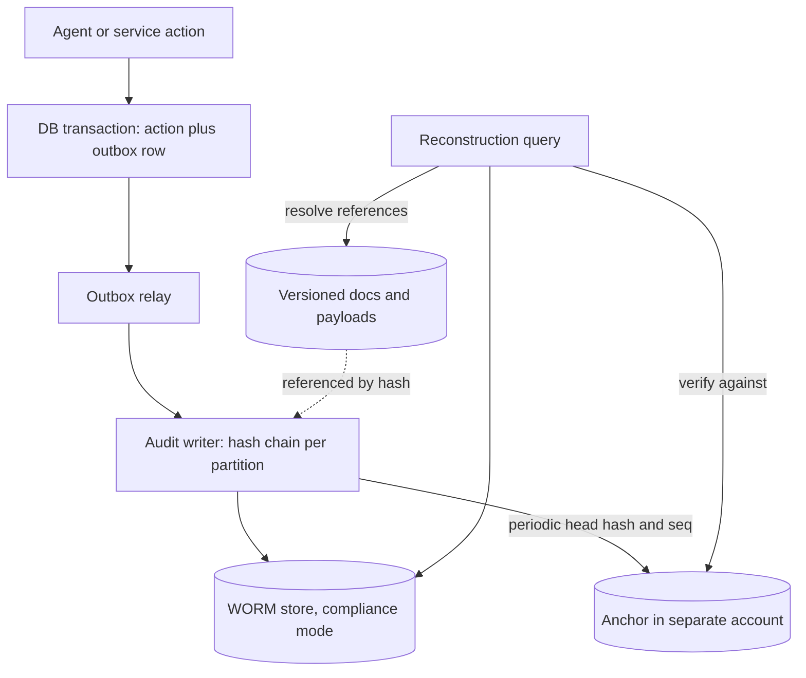

## TL;DR
An audit trail is an append-only, tamper-evident record of who did what, when, with which inputs and
versions. AI needs more, because without the prompt, model version, retrieved context and tool
calls recorded at the time, an output cannot be explained later.

## Why it exists
- **Someone will ask "why did the system do that?"** A customer disputing a denied refund, a regulator
  asking how an applicant was screened, a security team investigating an agent that emailed a file
  outside the company. The answer must come from evidence written at the time, because nothing else
  survives.
- **You cannot re-run the request.** The provider may have updated the model, the prompt template has
  changed twice, the retrieved document was edited, and sampling is not deterministic even with the same
  inputs.
- **Application logs fail as evidence.** Written for debugging, they are sampled, rotated after days,
  missing the fields that matter (which model version? which document chunks?), and editable by the
  engineers whose actions might be in question. A log line an administrator can delete proves nothing.
- **Traces have the right shape, wrong guarantees.** Observability traces are optimized for recent,
  aggregate debugging and are often sampled at a few percent.
- **Compliance formalizes the need.** HIPAA's Security Rule requires audit controls on systems holding
  health data; SOC 2 auditors test that security-relevant events are logged and reviewed; the EU AI Act
  requires high-risk AI systems to support automatic recording of events over their lifetime. An audit
  trail is built to meet those guarantees on purpose.

## How it works
### What goes in an AI audit event
An event answers who, what, when, on what basis and with what result.

| Field group | Contents | Because |
|---|---|---|
| **Actor** | Authenticated user or service identity, tenant, and for agents the human on whose behalf it acted | "The agent did it" is not an accountable answer, so record both |
| **Action and resource** | e.g. `claim.decision`, `tool.send_email`, with the target object ID | Lets you find every event for one object |
| **Versions** | Model ID as returned by the provider, prompt template version, system config hash, index or embedding version, guardrail policy version | Every one of them changes behaviour, so they make reconstruction possible |
| **Inputs by reference** | Request ID, retrieved document IDs and content hashes, tool arguments | Full prompts often contain personal data and would make the audit store your largest PII copy |
| **Output and decision** | Output (or its hash and a pointer to a retained copy), action taken, human approval with approver identity, overrides | The dispute is about the decision and who changed it |
| **Time** | From a trusted clock, plus the trace ID linking to the debugging trace | Ordering and the link back to debugging detail |

- **A hash only proves *which* text was used if you can still produce that text.** References must point
  at a versioned document store (or a retained payload store) whose own retention is at least as long as
  the trail's.

### Tamper evidence
Two mechanisms, usually combined:
1. **Hash chaining.** Each record stores `h_i = SHA256(h_{i-1} || canonical(record_i))`. Changing or
   deleting any past record breaks every later hash, so re-walking the chain detects tampering.
2. **Anchoring the head.** Two attacks survive a bare chain: a writer can recompute every hash after an
   edit, and can silently drop the most recent records, since a truncated chain still verifies.
   Periodically anchor the latest hash and a monotonically increasing sequence number where the writer
   cannot alter it (a separate account, a signed timestamp, a customer-visible digest).
   - A rewritten chain no longer matches the anchored head.
   - A sequence number below the anchored one exposes truncation.
3. **WORM storage.** Write-once-read-many storage, such as object-lock buckets in compliance mode, refuses
   deletion or overwrite until retention ends, even for administrators. This *prevents* tampering rather
   than merely detecting it.

### Scaling the chain
- **One chain is a bottleneck.** It serializes every write through one "previous hash" when many services
  emit events.
- **Use per-partition chains plus a Merkle tree.** Chain per service or tenant, then periodically build a
  Merkle tree over the latest heads or over each batch of events; only its root is anchored. This is the
  structure of transparency logs such as Certificate Transparency.
- **Bonus: inclusion proofs.** You can prove a single record is included by handing an auditor a short
  Merkle path, without exposing other tenants' events.

### Separation of duties
- **Isolated store.** The audit store lives in a different account or project from the application.
- **Append-only writes.** Writes go through an append-only path and the application's credentials cannot
  delete.
- **Logged reads.** Auditors and investigators get read-only access that is itself logged.
- **Why:** the threat model includes insiders and a compromised application.

### Retention vs erasure
Audit trails want to keep everything; privacy law wants personal data minimized and deletable. Resolve
it by design:
- **Pseudonymous identifiers** in the trail.
- **Content payloads stored separately** under their own retention.
- **Crypto-shredding** (per-subject encryption keys you destroy on erasure) where content must be retained
  but later made unreadable.
- **Retention per record type** from the strictest applicable rule, decided with legal, not by default
  bucket settings. For example, the EU AI Act requires deployers of high-risk systems to keep the
  automatically generated logs under their control for at least six months unless other law says
  otherwise, while a credit or employment dispute may need records for years.

### Write path reliability
- **A lost event is worse than useless,** *because* gaps look like concealment.
- **Write with the business action.** Use the same transaction as the business action (or a transactional
  outbox), so either both happen or neither does.
- **One event per agent tool call,** carrying the same run ID and the step number, *because* after an
  incident the question is usually "which step, on which retrieved text, led to this action", not just
  "what was the final answer".

### Answering a reconstruction query
The test of the design is "show everything that led to decision D":
1. Look up the event by object ID.
2. Verify its chain position against the latest anchor.
3. Follow the version fields to the exact prompt template and guardrail policy in their registries.
4. Follow the document references to the versioned store and check the content hashes match.
5. Join any later override events on the same object.

If any hop needs a person's memory or a system that has since been rotated, the trail has a gap.

## Diagram
Trace one consequential action: the event is written with the business change, chained, stored as
WORM, and its head anchored outside the writer's reach.



## Examples
### Hash-chained audit log with verification
A minimal hash-chained audit log. In production the chain would be appended to WORM storage and the
head hash anchored elsewhere.

```python
import hashlib, json, time

GENESIS = "0" * 64

def canonical(rec: dict) -> bytes:
    return json.dumps(rec, sort_keys=True, separators=(",", ":")).encode()

def append(log: list, event: dict) -> dict:
    prev = log[-1]["hash"] if log else GENESIS
    body = {**event, "ts": time.time(), "prev": prev}
    body["hash"] = hashlib.sha256(prev.encode() + canonical(body)).hexdigest()
    log.append(body)
    return body

def verify(log: list):                    # index of first broken record, or None
    prev = GENESIS
    for i, rec in enumerate(log):
        body = {k: v for k, v in rec.items() if k != "hash"}
        if rec["prev"] != prev or hashlib.sha256(prev.encode() + canonical(body)).hexdigest() != rec["hash"]:
            return i                      # first broken record
        prev = rec["hash"]
    return None

log = []
append(log, {"actor": "svc:refund-agent", "on_behalf_of": "user:4821", "action": "refund.decide",
             "model": "provider-model-2026-05", "prompt_version": "refund-v14",
             "retrieved": ["policy-77#sha256:9f1c..."], "decision": "deny", "approver": None})
append(log, {"actor": "user:ops-17", "action": "refund.override", "decision": "approve",
             "reason": "policy-77 outdated"})
anchor = (len(log), log[-1]["hash"])      # copied to a store the writer cannot alter
print(verify(log))                         # None: chain intact
dropped = log[:1]                          # an insider deletes the override record
print(verify(dropped), len(dropped) < anchor[0])   # None True: chain still verifies, anchor exposes it
log[0]["decision"] = "approve"             # an insider edits history
print(verify(log))                         # 0: tampering detected at record 0
```

- **The middle case matters.** Deleting the newest record leaves a perfectly valid chain, which is why
  the head must be anchored outside the writer's reach.
- **The second record shows why overrides are logged.** The dispute can be answered with the original
  model decision, its inputs, and the human who reversed it.

### WORM bucket for the audit store (AWS CLI)
Enable S3 Object Lock when creating the bucket (it cannot be turned off later). A default retention rule
in compliance mode then stops anyone, including the root user, deleting or overwriting a locked object
version before its retention expires.

```bash
aws s3api create-bucket --bucket acme-ai-audit --region us-east-1 \
  --object-lock-enabled-for-bucket

aws s3api put-object-lock-configuration --bucket acme-ai-audit \
  --object-lock-configuration \
  '{"ObjectLockEnabled":"Enabled","Rule":{"DefaultRetention":{"Mode":"COMPLIANCE","Days":180}}}'
```

- **180 days matches the six-month EU AI Act floor** for deployer-held logs; record types with longer
  obligations get their own bucket or a longer per-object retention.
- **Compliance mode cannot be shortened,** so test with governance mode first; a wrong long retention on
  personal content cannot be undone.
- **Grant the application `s3:PutObject` only,** and run the anchoring job under a different account.

## Production patterns
- **Transactional outbox for audit events.** When an action changes business state, insert the audit
  event into an outbox table in the same database transaction and let a relay publish it to the audit
  writer with retries. Monitor outbox lag and rows older than a few minutes.
- **Head anchoring on a schedule.** Every few minutes, a job in a separate account reads each partition's
  latest hash and sequence number and writes them to its own WORM store or a signed timestamp. Alert when
  any verification run finds a mismatch or a sequence gap.
- **Exact model version from the response.** Record the model identifier the provider returns in the
  response body, not the alias you requested, alongside prompt template and guardrail policy versions.
  Monitor the count of distinct model versions per day to catch silent provider updates.
- **Reconstruction drill.** Each quarter, pick a random past decision and time how long it takes to
  answer "show everything that led to D" end to end. Track the time and every hop that needed a person's
  memory.
- **Completeness reconciliation.** Nightly, compare counts of business decisions in the system of record
  with audit events of the same action type. Alert on any difference, because a missing event looks like
  concealment.

## Trade-offs
- **Full payloads vs references.** Logging full prompts and outputs makes reconstruction easy but creates
  a large sensitive-data store; references plus hashes flip the balance when inputs contain personal or
  regulated data.
- **Synchronous vs asynchronous writes.** Transactional audit writes guarantee completeness but add latency
  and a dependency; asynchronous writes via an outbox are fine as long as delivery is guaranteed, not
  best-effort.
- **WORM vs correction.** WORM retention prevents tampering but also prevents correcting mistakes and
  honouring erasure; it fits metadata and decisions better than raw personal content.
- **Long retention vs exposure.** It helps disputes and audits years later, but every extra year raises
  storage cost, breach impact and discovery exposure; set it per record type from actual obligations.

## Pitfalls
- **Recording "model: gpt" or an alias instead of the exact version returned.** Symptom: an incident
  review that cannot tell whether a provider model update caused the change.
- **Using the sampled debugging log pipeline as the audit trail.** Symptom: a disputed decision whose
  event simply is not there.
- **Letting the application role delete or rewrite audit records.** Symptom: an auditor finding that
  integrity of the trail cannot be demonstrated.
- **Logging the agent's action but not the human principal.** Symptom: an investigation that ends at "the
  service account did it".
- **Storing raw prompts with personal data indefinitely.** Symptom: an erasure request that cannot be
  fulfilled without breaking the audit chain.

## When to use
- **Use when:** an AI system makes or informs decisions about people or money, takes actions through
  tools, touches regulated data, or must pass SOC 2, HIPAA or EU AI Act scrutiny.
- **Lighter option:** for a low-risk internal assistant, structured logs with longer retention may be
  enough.
- **Decide early:** fix the event schema at design time, alongside the threat model, because retrofitting
  version and provenance fields is hard.
- **Measure:** completeness (share of decisions with an audit event), integrity checks passing, and time
  to answer a reconstruction query.
- **Interviews:** distinguish audit trails from observability: different retention, access, integrity and
  completeness guarantees.

## Role lens
- **Engineer:** Emits a structured audit event in the same transaction as each consequential action,
  including model, prompt and index versions and retrieved document hashes.
- **Architect:** Owns the audit store's isolation, integrity mechanism, retention per record type and the
  balance between reconstruction and data minimization.
- **FDE:** Maps the customer's audit and retention requirements to the event schema and shows their
  compliance team how to run a reconstruction query for a disputed case.

## Check yourself
**Q:** A regulator asks you to explain an automated loan pre-screen decision made eight months ago. Your
provider has since retired that model version and your prompt has changed. What must your audit trail
have captured for you to answer?
**A:** I cannot re-run the request, so the answer must come entirely from recorded evidence. The trail
needs the applicant's pseudonymous ID and the request ID; the exact model version, prompt template version
and configuration hash; the inputs used, as references to the application fields and retrieved policy
documents with content hashes so I can show which text the model saw; the raw output and the decision
derived from it; any thresholds applied; and any human review with reviewer identity. Integrity matters
too: hash chaining or WORM storage lets me show the record was not altered after the fact.

## Interview questions
### How is an audit trail different from logging and tracing you already have?
- **Different guarantees:** complete (no sampling), retained for the legal period, integrity-protected,
  and readable only through logged, read-only access.
- **Different content:** actor and human principal, exact versions and input references, because the goal
  is reconstruction and defence, not recent aggregate debugging.

### An agent emailed a confidential file to an outside address. What would you need from the trail to investigate?
- **The run:** one event per tool call with run ID and step number, so you can see which step chose the
  recipient.
- **The basis:** retrieved document IDs and hashes and the tool arguments, to see whether injected text
  in a document steered it.
- **The principal and versions:** the human the agent acted for, the model version and prompt and
  guardrail versions in force at that moment.

### Hash chaining or WORM storage: which would you choose, and when would you use both?
- **Chaining detects** edits and deletions on re-verification but cannot stop them, and a bare chain
  misses truncation and full rewrites unless the head is anchored.
- **WORM prevents** overwrite and deletion until retention ends, even for admins, but cannot be corrected
  or erased early.
- **Use both** for regulated decisions: WORM for prevention, an anchored chain to prove to an auditor that
  nothing is missing.

### How do you keep an audit trail and still honour GDPR erasure requests?
- **Keep the chain free of raw personal content:** pseudonymous IDs plus content hashes.
- **Store payloads separately** under their own retention, and crypto-shred per-subject keys when content
  must become unreadable.
- **Confirm retention per record type with legal,** because some records must outlive an erasure request.

### Your audit writer cannot keep up with 50 services sharing one chain. What do you change?
- **Partition the chain** per service or tenant so writes no longer serialize on one previous hash.
- **Anchor a Merkle root** over the partition heads periodically, as transparency logs do.
- **Gain inclusion proofs:** you can show one record's presence to an auditor without exposing other
  tenants' events.

## Quiz
### Q: Why are ordinary application debug logs usually insufficient as an AI audit trail?
- [ ] They are stored in text rather than JSON
- [x] They are often sampled, short-lived, missing version and provenance fields, and editable by operators
- [ ] They cannot record timestamps precisely enough
- [ ] They are too expensive to query compared with an audit database
> Evidence must be complete, retained for the required period, integrity-protected and rich enough to
> reconstruct the decision. Debug logs fail on most of those; format and cost are secondary concerns.

### Q: What does hash chaining an audit log provide on its own?
- [ ] Prevention of any deletion of records
- [ ] Encryption of personal data in the records
- [x] Detection of modification or deletion of past records when the chain is re-verified
- [ ] Guaranteed delivery of every event to storage
> Each hash depends on the previous one, so altering history breaks verification. It detects tampering but
> does not prevent it; WORM storage provides prevention, and anchoring the head hash stops full rewrites.

### Q: How do you reconcile long audit retention with a data subject's right to erasure?
- [ ] Exclude AI systems from erasure requests because audit law overrides privacy law
- [ ] Delete the entire audit chain whenever an erasure request arrives
- [x] Keep pseudonymous identifiers and hashes in the trail, store content separately, and crypto-shred where needed
- [ ] Store all audit records in a different country
> Separating identity and content from the integrity chain lets you erase or render personal content
> unreadable while the trail of decisions and versions stays intact. Blanket exemptions are not a safe legal
> assumption and must be confirmed with counsel.
