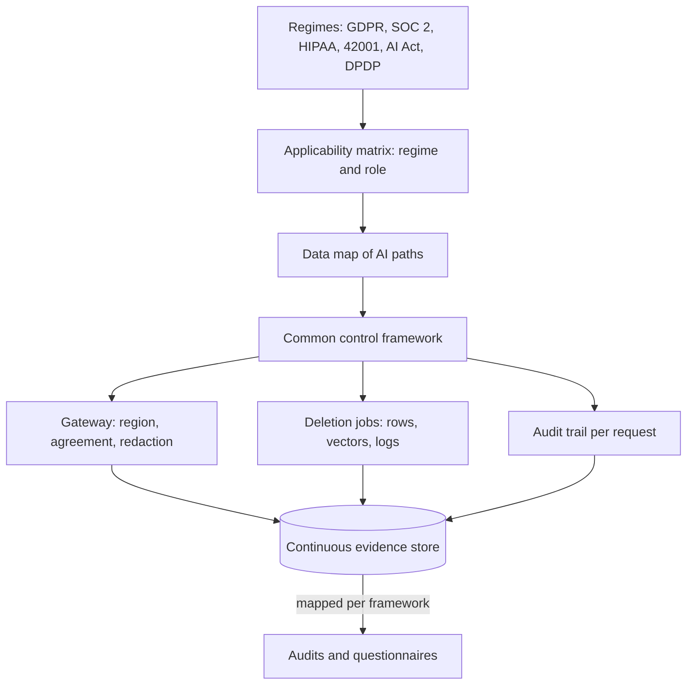

## TL;DR
Compliance architecture enforces legal and assurance obligations through system structure and automatic
evidence, not policy documents. One control set maps to GDPR, SOC 2, HIPAA, ISO/IEC 42001, the EU AI Act
and India's DPDP Act. Orientation, not legal advice.

## Why it exists
- **An enterprise AI product meets several regimes at once.** A European customer brings GDPR; a US
  hospital brings HIPAA; every enterprise buyer asks for a SOC 2 report; an Indian customer brings the
  DPDP Act; a high-risk EU use case brings the AI Act; a growing number of buyers ask for ISO/IEC 42001
  certification. Each arrives as a questionnaire, a contract clause or an audit.
- **One project per regime duplicates work.** A GDPR spreadsheet, a SOC 2 sprint before the audit window,
  a HIPAA addendum. "Who can access customer data, and how do you know?" is asked by all of them, and
  answering it five ways guarantees five inconsistent answers.
- **Compliance by document drifts from reality.** The policy says data stays in the EU while a new feature
  quietly calls a model endpoint in the US.
- **AI adds data paths classic controls never saw:** prompts with personal data sent to a third-party
  model, embeddings of documents that must later be erased, conversation logs, training on customer data,
  and decisions about people.
- **The architectural answer:** identify the obligations that bind, express them as a common control set,
  enforce as many as possible in code and infrastructure, and generate evidence continuously, so a new
  framework is mostly a mapping exercise. These regimes overlap heavily but differ in scope, triggers and
  proof.

## How it works
The six regimes come first, by what each demands; then the architecture that serves them all.

### GDPR (EU and EEA personal data)
- **Principles:** lawfulness, purpose limitation, data minimization, accuracy, storage limitation,
  integrity and confidentiality; a lawful basis for each processing purpose.
- **Special categories** such as health data get stricter rules.
- **Data subject rights:** access, rectification, erasure, objection; rules on solely automated decisions
  with legal or similarly significant effects.
- **Duties:** data protection impact assessments for high-risk processing; processor contracts with every
  vendor handling the data; restrictions on transfers outside the EEA; breach notification to the
  supervisory authority, normally within 72 hours.
- **For AI:** is training on customer data a compatible purpose, can you erase someone from an index or a
  fine-tune, and is the model provider a processor with a proper agreement?

### SOC 2 (assurance, not law)
- **What it is:** an attestation report by an independent CPA firm against the AICPA Trust Services
  Criteria: security (always in scope), plus optionally availability, processing integrity,
  confidentiality and privacy.
- **Type I** assesses control design at a point in time; **Type II** assesses operating effectiveness over
  a period.
- **Not a certification, prescribes no technology:** you define controls and prove they ran.
- **For AI:** model providers and vector stores become in-scope sub-processors, and change management must
  cover prompts and models, not just code.

### HIPAA (US protected health information)
- **Scope:** covered entities (providers, health plans, clearinghouses) and their business associates.
- **Rules:** the Privacy Rule limits uses and disclosures and requires the minimum necessary; the Security
  Rule requires administrative, physical and technical safeguards including access and audit controls;
  the Breach Notification Rule sets notification duties.
- **For AI:** any vendor receiving PHI, including a model API, must sign a business associate agreement
  first, and the specific service and configuration must be covered by it.
- **De-identification** via the Safe Harbor or Expert Determination methods takes data out of scope.

### ISO/IEC 42001 (AI management system)
- **What it is:** a certifiable management-system standard with the same high-level structure as ISO/IEC
  27001: context, leadership and AI policy, planning with AI risk and impact assessment, support,
  operation, performance evaluation, improvement, plus Annex A controls.
- **What it governs:** *how the organization manages AI* (inventory, roles, lifecycle, impact assessment,
  supplier oversight), not one system's accuracy.
- **Pairs naturally** with an existing ISO 27001 programme.

### EU AI Act (Regulation (EU) 2024/1689)
- **Risk-based product-style regulation** keyed to intended purpose and to your role (provider, deployer,
  importer, distributor). Prohibited practices are banned.
- **High-risk systems** (Annex III areas such as employment, credit scoring, education and essential
  services, plus safety components of regulated products) require a risk management system, data
  governance, technical documentation, automatic logging, transparency to deployers, human oversight,
  accuracy and robustness, conformity assessment and post-market monitoring.
- **Deployers** must use them as instructed, assign human oversight and keep logs.
- **The Annex III escape hatch:** a use can leave the high-risk tier if it only performs a narrow
  procedural or preparatory task, or improves or checks prior human work, but never when it profiles
  people, and the provider must document that assessment.
- **Also:** transparency duties for chatbots and synthetic content; general-purpose AI model providers have
  their own obligations.
- **Timing:** obligations phase in over several years from entry into force in August 2024, and parts of
  the timeline have been subject to amendment proposals, so check the current dates for your obligations.

### DPDP Act 2023 (India digital personal data)
- **Basis:** Data Fiduciaries need valid consent (free, specific, informed, unambiguous, with clear notice)
  or a listed legitimate use.
- **Rights:** Data Principals can access, correct and erase data and seek grievance redress; consent
  managers are a recognized role.
- **Extra duties:** Significant Data Fiduciaries carry audits and impact assessments; children's data
  requires verifiable parental consent; breaches must be notified to the Data Protection Board and
  affected people.
- **Transfers:** cross-border transfers are permitted except to countries the government restricts.
- **Timing:** implementing rules phase in over time, so verify which duties are in force.

### The architecture
1. **Applicability matrix.** Per product and customer segment: which regimes apply and in what role
   (controller or processor, fiduciary, provider or deployer, business associate). Wrong role, wrong
   obligations.
2. **Data map.** Every flow of personal or regulated data through the AI path: ingestion, prompts,
   retrieval, model provider, logs, evals, training. Most compliance questions are answered here.
3. **Common control framework.** One control ("access to production customer data requires SSO, MFA and a
   ticket; access is logged and reviewed quarterly") mapped to the clauses it satisfies in each
   framework. The mapping is many-to-many, which is exactly why it saves work (excerpt below).
4. **Enforcement in the platform.** Region pinning and routing by tenant, a gateway that only allows
   vendors with the right agreements for the data class, redaction before prompts leave, tenant-scoped
   retrieval, retention and deletion jobs that cover vectors and logs, audit trails.
5. **Continuous evidence.** Controls emit evidence automatically (access reviews, config snapshots,
   deletion job results, eval reports), so audits sample existing evidence instead of triggering a
   scramble. This matters most for SOC 2 Type II and ISO certification, *because* they test that a control
   operated throughout a period, and evidence reconstructed afterwards cannot show that.

### The control map, in miniature
An indicative excerpt of a common control framework (verify references against current texts):

| Control | GDPR | SOC 2 | HIPAA | EU AI Act (high-risk) | DPDP |
|---|---|---|---|---|---|
| SSO + MFA + logged, reviewed access to customer data | Art. 32 | CC6.1 | §164.312(a), (b), (d) | – | s.8(5) |
| Per-request audit event with model, prompt and index versions | Art. 5(2) accountability | CC7.2 | §164.312(b) | Art. 12, 26 logging | s.8(5) |
| Deletion job reaching rows, vectors, caches, logs, eval sets | Art. 17 | Confidentiality / privacy criteria | – (no general erasure right) | – | s.8(7), s.12 |
| Gateway allows only vendors with the right agreement for the data class | Art. 28 | CC9.2 | BAAs, §164.502(e) | – | s.8(2) |

- **Read the blanks as carefully as the entries.** HIPAA has no general right to erasure, so a deletion
  control built only for GDPR and DPDP is not a HIPAA control.
- **The AI Act's logging duty attaches to high-risk systems,** not to every chatbot.
- **ISO/IEC 42001 is left out only for width:** its Annex A includes controls on AI system event logging
  and on suppliers that the second and fourth rows also evidence.

### Where the regimes diverge
A common control set still needs regime-specific branches: one incident can start five different clocks
(worked below). The architecture's job is to make the shared part (detection, scoping from audit trails,
evidence) fast, so that the branching legal part starts with facts.

## Diagram
Obligations flow down into one control set enforced in the platform; evidence flows back up, and each
framework becomes a mapping over the same evidence.



## Examples
### Compliance as routing policy at the gateway
A SaaS clinical documentation assistant serves a German hospital group, a US clinic network and an Indian
hospital chain. The platform encodes the obligations as routing policy at the gateway, so a request
carrying PHI cannot reach a model endpoint lacking a BAA, and EU personal data cannot leave approved
regions.

```python
from dataclasses import dataclass

@dataclass(frozen=True)
class Endpoint:
    name: str; region: str; baa: bool; dpa: bool; zero_retention: bool

ENDPOINTS = [
    Endpoint("vendor-a-eu", "eu-central", baa=False, dpa=True, zero_retention=True),
    Endpoint("vendor-a-us", "us-east", baa=True, dpa=True, zero_retention=True),
    Endpoint("selfhost-in", "ap-south", baa=False, dpa=True, zero_retention=True),
]

TENANT_POLICY = {   # derived from the applicability matrix, reviewed by legal; regions in preference order
    "de-hospital": {"regions": ["eu-central"], "needs_baa": False},
    "us-clinic":   {"regions": ["us-east"], "needs_baa": True},    # PHI under HIPAA
    "in-hospital": {"regions": ["ap-south", "eu-central"], "needs_baa": False},  # contract allows EU fallback
}

def route(tenant: str, contains_personal_data: bool, down=()) -> Endpoint:
    p = TENANT_POLICY[tenant]
    for region in p["regions"]:
        for e in ENDPOINTS:
            if e.region != region or e.name in down: continue
            if p["needs_baa"] and not e.baa: continue
            if contains_personal_data and not (e.dpa and e.zero_retention): continue
            return e
    raise PermissionError(f"no compliant endpoint for {tenant}")   # fail closed, and audit it

print(route("us-clinic", True).name)                       # vendor-a-us
print(route("in-hospital", True).name)                     # selfhost-in
print(route("in-hospital", True, down={"selfhost-in"}).name)   # vendor-a-eu, allowed by contract
route("us-clinic", True, down={"vendor-a-us"})             # PermissionError: no BAA endpoint left
```

- **The last two calls are the point.** When the Indian tenant's preferred endpoint fails, traffic falls
  back only to a region its contract permits.
- **Fail closed for PHI.** When the only BAA-covered endpoint fails, the US clinic gets an error rather than
  a silent reroute to an EU endpoint with no BAA, because an outage is recoverable and an unauthorized PHI
  disclosure is a reportable breach.
- **The routing table is evidence.** The SOC 2 auditor samples its change history, the hospital's GDPR team
  sees region enforcement, the US clinic's HIPAA review sees the BAA check, and the ISO 42001 audit sees
  supplier controls. One control, four frameworks.

### Worked incident: one event, five clocks
A misconfigured retrieval filter shows one hospital patient's notes to another patient.

| Regime | Duty triggered |
|---|---|
| **GDPR** | Notify the supervisory authority within 72 hours of awareness unless the breach is unlikely to result in risk; notify affected people if the risk is high |
| **HIPAA** | Notify affected individuals without unreasonable delay and no later than 60 days after discovery, plus HHS (and media for breaches affecting more than 500 residents of a state or jurisdiction) |
| **DPDP** | Notify the Data Protection Board and every affected Data Principal, with no "unlikely to result in risk" exemption |
| **SOC 2** | No clock, but the auditor will test that your incident procedure ran |
| **EU AI Act** | Serious-incident reporting if the system is high-risk |

- **Shared part:** detection, scoping from the audit trail (which requests hit the bad filter, which
  outputs exposed whom) and evidence are the same for all five.
- **Branching part:** each regime's notification decision, owned by legal, starts from those facts.

## Production patterns
- **Policy as code at the gateway.** Express tenant region and agreement rules as versioned policy (for
  example in Open Policy Agent, or a reviewed config table like the example) evaluated on every model call,
  failing closed for regulated data. Monitor deny counts per tenant and every policy change, which is
  itself audit evidence.
- **Vendor agreement register wired to the allow-list.** Keep DPA, BAA and transfer-mechanism status per
  vendor service, and generate the gateway allow-list from it, so an endpoint without the right agreement
  cannot be routed to. Alert on any egress to a model domain not on the list.
- **Deletion with receipts across derived stores.** An erasure request fans out to rows, vector indexes,
  caches, logs and eval sets, and each store returns a receipt. Monitor requests still open as they near
  GDPR's one-month response window, and stores that never return receipts.
- **Continuous evidence collection.** Have controls write evidence on a schedule (quarterly access review
  exports, daily config snapshots, deletion job results), or use a compliance automation platform that
  pulls it from cloud and identity APIs. Monitor controls with no fresh evidence in their period.
- **Data map from infrastructure tags.** Tag storage, queues and egress routes with data class and region
  in infrastructure as code, and fail CI when a new resource handling personal data lacks tags. Monitor
  untagged resources in the data map.

## Trade-offs
- **Unified control framework vs upkeep.** It removes duplicated audit work, but needs an owner and a
  mapping maintained as frameworks change; for a single-framework startup a direct checklist is simpler.
- **Infrastructure enforcement vs friction.** Enforcing compliance in the gateway makes violations
  impossible rather than merely forbidden, but adds latency and blocks features until vendors sign
  agreements; fail-closed is right for regulated data, fail-open may be acceptable for public content.
- **Region pinning and self-hosting vs model access.** They satisfy strict residency, but lose access to the
  newest models and raise cost; it flips when a customer contract or regulator makes residency
  non-negotiable.
- **Certifications vs audit effort.** ISO 42001 or SOC 2 Type II shorten sales cycles, but cost ongoing
  audit effort; they pay off when enterprise buyers repeatedly ask for them.

## Pitfalls
- **Assuming a provider's certifications cover your system.** Symptom: an auditor asking about your own
  access reviews, prompts and logs, which no vendor report addresses.
- **Treating SOC 2 as a certificate or HIPAA as satisfied by encryption alone.** Symptom: a failed customer
  review that asks for a BAA or for evidence of controls operating over time.
- **Forgetting derived data in erasure.** Symptom: a deletion request honoured in the database while the
  person's text lives on in embeddings, caches, logs and eval sets.
- **Getting your role wrong (provider vs deployer, controller vs processor).** Symptom: obligations
  discovered late in a deal or audit that the architecture never accounted for.
- **Point-in-time compliance.** Symptom: a frantic evidence hunt every audit season and a new feature
  calling an unapproved model endpoint between audits.

## When to use
- **Use when:** you handle personal, health or regulated data or sell to enterprises; retrofitting region
  pinning or deletion across vectors and logs is far harder than designing it in.
- **Order:** start with the applicability matrix and data map, add enforcement where violations would be
  costly, and automate evidence before the first audit.
- **Lean on specialist counsel for interpretation:** architects translate obligations into controls, they
  do not decide what the law requires.
- **Interviews:** show the mapping mindset, the AI-specific data paths, and the difference between law
  (GDPR, HIPAA, AI Act, DPDP), attestation (SOC 2) and certifiable management systems (ISO 42001).

## Role lens
- **Engineer:** Implements region-aware routing, redaction, tenant-scoped retrieval, deletion jobs that
  reach vectors and logs, and the automatic evidence each control emits.
- **Architect:** Owns the applicability matrix, data map and common control framework, and decides which
  obligations are enforced in infrastructure versus process.
- **FDE:** Fills security questionnaires and DPIAs with the customer, maps their regime (HIPAA, DPDP,
  sector rules) to existing controls, and flags gaps before deployment, not after.

## Check yourself
**Q:** An EU bank wants your LLM assistant to help credit officers assess loan applications. Which
regimes and roles come into play, and what architectural controls follow?
**A:** GDPR applies to applicant data; the bank is controller and we are likely processor, so we need a
processing agreement, EU-region processing or valid transfer mechanisms, minimization, erasure across
indexes and logs, and support for the bank's DPIA. Creditworthiness evaluation is an Annex
III high-risk area under the EU AI Act; a tool that only reformats documents might argue the
preparatory-task exemption, but one that scores or ranks applicants is profiling them, so the exemption is
unavailable. We must establish whether we are provider of a high-risk system, which means risk management,
technical documentation, logging, human oversight design and conformity assessment, while the bank as
deployer needs oversight, log retention and, because credit scoring is specifically named in Article 27, a
fundamental rights impact assessment before first use. If the bank rebrands or substantially modifies the
system it can itself become the provider. Add SOC 2 evidence, audit trails, and human review of decisions.

## Interview questions
### What is a common control framework, and why build one instead of a project per regime?
- **One control, many clauses:** for example logged, reviewed SSO and MFA access satisfies GDPR Art. 32,
  SOC 2 CC6.1, HIPAA access controls and DPDP security duties at once.
- **Why:** answering "who can access customer data?" five ways guarantees five inconsistent answers, and
  each new framework becomes a mapping exercise rather than new work.

### A customer asks you to erase a person's data. Where does that data live in an LLM application?
- **Beyond the database:** vector indexes and their source chunks, caches, conversation logs, eval sets,
  and possibly fine-tuning data.
- **Design for it:** record where each subject's data flows (the data map) and run a deletion job that
  returns a receipt from every store.
- **Note the regime:** GDPR and DPDP give an erasure right; HIPAA has no general one.

### Your only BAA-covered model endpoint is down. Should the gateway fail over to another region?
- **Not for PHI.** Rerouting to an endpoint without a BAA is an unauthorized disclosure, a reportable
  breach; an outage is recoverable.
- **Fail closed, audit the denial,** and fall back only to endpoints the tenant's contract and agreements
  permit, as the routing example does.

### What is the difference between SOC 2 Type I and Type II, and why does it change your architecture?
- **Type I** tests control design at a point in time; **Type II** tests operating effectiveness over a
  period.
- **So evidence must be continuous:** access reviews, config snapshots and deletion results written as
  controls run, because evidence reconstructed afterwards cannot show operation throughout the period.

### How do you work out your role under the EU AI Act for a customer deployment?
- **Ask who places the system on the market under their name** and who uses it: that separates provider
  from deployer.
- **Watch for role changes:** a customer that rebrands or substantially modifies the system can become its
  provider.
- **Role drives duties:** providers of high-risk systems carry documentation and conformity assessment;
  deployers carry oversight and log retention.

## Quiz
### Q: What is a SOC 2 report?
- [ ] A government certification that a company complies with data protection law
- [x] An independent CPA attestation on controls against the Trust Services Criteria, with Type II covering operating effectiveness over a period
- [ ] An ISO standard for AI management systems
- [ ] A mandatory filing for any company processing personal data in the US
> SOC 2 is assurance, not law or certification: an auditor attests that defined controls are designed (Type I)
> and operated effectively over a period (Type II). ISO/IEC 42001 is the certifiable AI management standard.

### Q: A US healthcare customer wants to send PHI to your feature that calls a third-party model API. What must be in place first?
- [ ] The model vendor's SOC 2 report is sufficient
- [ ] Encrypting the prompts in transit is sufficient
- [x] A business associate agreement covering that specific vendor service, alongside your own BAA with the customer
- [ ] Nothing, because model APIs do not store data
> Under HIPAA, a vendor that receives PHI on behalf of a covered entity or business associate must be bound
> by a BAA. Encryption and attestations are safeguards but do not replace the contractual requirement.

### Q: Why does the EU AI Act force teams to determine their role before designing controls?
- [ ] Only providers are subject to fines
- [ ] Deployers are exempt from all obligations
- [x] Obligations differ by role, so a provider of a high-risk system carries documentation and conformity duties a deployer does not
- [ ] Roles determine which EU country's law applies
> The Act assigns different duties to providers, deployers, importers and distributors. A deployer must use
> the system as instructed with human oversight and logging, while the provider bears conformity assessment.
