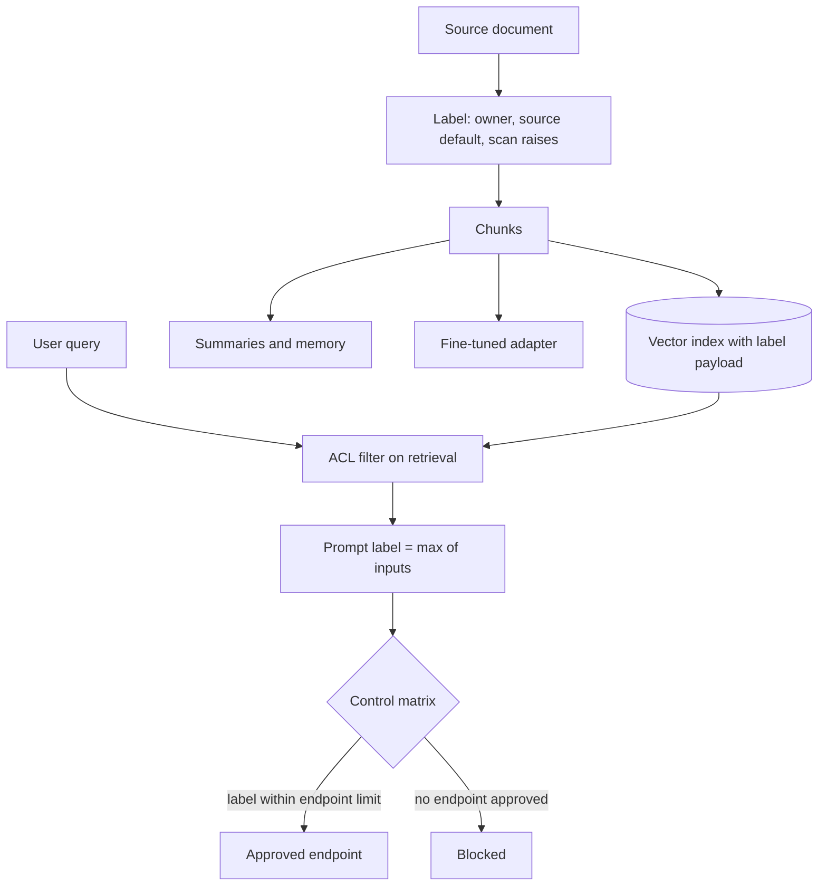

## TL;DR
Classification gives every dataset a sensitivity label (Public, Internal, Confidential, Restricted) so
your agent's routing, logging and tool limits are decided once per label. The hard part is propagation
into chunks, embeddings, memory, summaries and fine-tuned weights.

## For agent builders
- **Why it matters for agents.** An agent with broad data access decides, every step, which model
  endpoint, tool and memory store receives what it just read. Labels turn that into a lookup instead of a
  judgement the model makes, and they stop a confidential chunk riding a public tool call out.
- **Where it shows up in your stack.** Label fields in vector payloads and tool results, a session label
  in the orchestrator, label-aware routing in the AI gateway, labels on memory entries and traces, and
  training-data labels on model registry entries.
- **What you control.** The high-water-mark rule per session, which sinks each label may reach, explicit
  labels for cross-source agent outputs, and the reviewed path for declassifying redacted data.
- **What you can skip.** Designing a scheme from scratch. Reuse the organisation's existing labels and spend
  the effort mapping agent artifacts and sinks onto them.

## Decision case
### Scenario
A 3,000-person manufacturer is connecting an internal copilot agent to its document estate. The agent
retrieves, summarises and can post to team channels. The question is how labels get onto the corpus and
its derived chunks. All figures are illustrative planning numbers, not benchmarks.
- **Corpus:** 1.2 million documents in 8 source systems (wiki, HR, finance, CRM, engineering drives and
  others), about 20 chunks each, so about 24 million chunks.
- **Endpoints under the control matrix:** an external API approved up to Internal, a zero-retention EU
  endpoint up to Confidential, and a self-hosted model for Restricted that handles 8 requests a second.
- **Traffic:** copilot peak of 40 requests a second, so the self-hosted model can serve at most 8 / 40 =
  20% of peak.
- **Audit need:** answer "which stores and indexes hold Restricted data" from metadata, not interviews.
- **Deadline:** pilot in 10 weeks with 2 engineers and part-time data owners.

### Options
| Option | How it works | Effort | Label accuracy | Fits capacity? |
|---|---|---|---|---|
| Owner labels every document | Owners review each document | 1.2M x 30 s = 10,000 hours | high, but never finishes | yes |
| Everything Restricted until declassified | Safe default, owners downgrade on request | low up front | over-labels nearly everything | no: 100% of traffic to an endpoint sized for 20% |
| Scanner assigns labels both ways | DLP decides each chunk's label | low | misses lower labels silently | yes, but unsafe |
| Source defaults plus scan-raise per chunk | Owners label each of the 8 sources (and folders where a source is mixed); chunks inherit, the scanner may only raise a chunk's label; sessions use high-water mark | about a week of owner time | good where sources are coherent | yes, if the Restricted share stays under 20% |

### Decision
**Source defaults set by owners, inheritance to every chunk, scanner raises only, and a session
high-water mark in the orchestrator.** It is the only option that labels all 24 million chunks before the
pilot without making the self-hosted endpoint the bottleneck.
- **Capacity check:** in a pilot sample, 70% of requests stayed Internal or below, 25% reached
  Confidential and 5% Restricted. 5% of 40 = 2 requests a second to the self-hosted model, well under 8.
- **Audit answer:** every chunk payload, trace and memory entry carries its label, so the Restricted
  stores are a metadata query.
- **Aggregates labelled explicitly:** cross-source outputs such as "account health overview" get a label
  set by the feature owner, not the computed maximum.

**What would change it.** If the Restricted share passes 20% of peak, add self-hosted capacity or split
sessions so Restricted reads run separately. If a source turns out to be a mixed dump with no coherent
default, label it per folder before it is indexed.

### Trade-offs accepted
- **Label creep.** High-water mark only ratchets up. Track the share of sessions ending Confidential or
  higher and run the reviewed declassification path for redacted outputs.
- **Scanner false negatives.** A health note inside a wiki page stays Internal if the detector misses it.
  Sample chunks monthly for missed labels and report the rate per source.
- **Coarse sessions block harmless calls.** After a Confidential read, web search is refused. Count calls
  refused by label and reorder public lookups before sensitive reads.

### Review rubric
- **Assignment path stated:** the write-up says who or what sets each label (owner, inheritance, scanner)
  and that scanners never lower one.
- **Effort and capacity computed:** labelling effort and routed traffic per endpoint follow from the
  corpus size and label mix.
- **Derivation covered:** chunks, embeddings, summaries, memory and any fine-tuned adapter carry a label.
- **Labels separated from ACLs:** retrieval filters by entitlement first; the label then picks the
  destination.
- **Change triggers stated:** which label mix or source finding would reopen the decision.

## Why it exists
- **Every control asks the same question.** How bad would it be if this leaked, was altered, or was
  unavailable? Without classification each team answers it from scratch for each feature.
- **The result is inconsistency.** One engineer sends board minutes to an external model because "it's
  just a summary"; another refuses to send public marketing copy anywhere. Reviews take weeks, and nobody
  can answer an auditor's "which systems hold restricted data?".
- **"Protect everything at the highest level" fails.** Restricted-data controls (self-hosted models only,
  no third-party logging, short retention, approval for access) are expensive; applied universally they
  make most AI use cases uneconomic. Teams then quietly bypass the policy, which is worse than a weaker one.
- **AI transforms data constantly.** A contract becomes chunks, chunks become vectors, a conversation
  becomes a memory entry, a support corpus becomes a fine-tuned adapter. Each artifact looks harmless,
  with no column name or file path announcing what it was derived from.
- **So labels must follow the data.** A label that does not follow these transformations protects the
  original while leaving its copies wide open: the most sensitive source silently ends up in the least
  protected store.

## How it works
### Define a small scheme
Most organisations use three to five levels, for example:

| Label | Examples | Harm if leaked |
|---|---|---|
| Public | Approved for release | Negligible |
| Internal | Ordinary business data | Limited |
| Confidential | Customer data, contracts, unreleased financials | Material |
| Restricted | Regulated or high-impact data: health records, card data, credentials, M&A material | Severe or legal |

- **Keep it small** *because* every extra level must be understood by every data owner and mapped to
  distinct controls; a seven-level scheme where adjacent levels have identical controls is noise.
- **Borrow FIPS 199's split.** It frames impact separately for confidentiality, integrity and
  availability: a public price list is low-confidentiality but high-integrity, since an altered price is
  harmful.

### Assign labels
Three sources, in order of reliability:
1. **Owner assignment.** The data owner labels the system or dataset at onboarding.
2. **Inheritance from source.** Everything from the HR system is Confidential by default.
3. **Content scanning.** DLP detectors upgrade a label when they find card numbers or health terms in a
   document labelled Internal.

- **Scanning only raises labels automatically, never lowers them,** *because* a missed detection would
  otherwise declassify data.

### Propagate through derivation
The rule is **high-water mark**: a derived artifact carries the highest label of any input.

| Artifact | Inherits from |
|---|---|
| Chunk | Its document |
| Embedding | Its chunk |
| Summary of five documents | The highest of the five |
| Fine-tuned model | The highest label in its training set, *because* models can memorise and reproduce training data |

- **Store the label as metadata next to the artifact** (vector payload, trace attribute, registry entry),
  so enforcement can read it without tracing lineage at runtime.

### The aggregation blind spot
- **High-water mark under-labels aggregates.** Many individually Internal facts (org-chart entries,
  meeting titles, ticket counts per customer) can combine into something Confidential, such as an
  unannounced reorganisation or a list of at-risk accounts. The maximum of the inputs is still Internal.
- **LLMs are very good at exactly this synthesis,** which is why an assistant with broad Internal access is
  a different risk from the same documents sitting in a wiki.
- **Response:** label known high-value aggregates (reports, exports, agent outputs that summarise across
  many sources) explicitly rather than trusting the computed label.

### Labels are not permissions
| Check | Question it answers |
|---|---|
| Classification | How sensitive is this, and what controls apply? |
| Access control | May *this* user see *this* item? |

- **A RAG system needs both.** A Confidential HR document is correctly labelled and may be sent to an
  approved endpoint, yet most employees still must not retrieve it.
- **Order:** retrieval filters by the user's entitlements (the ACL-aware retrieval lesson); the label then
  decides where the permitted content may travel.
- **Each alone fails.** Labels as a substitute for ACLs let anyone cleared for "Confidential" read every
  confidential document; ACLs alone let permitted content flow to an unapproved provider.

### Map labels to controls
- **The payoff is a single control matrix.** For each label: which model providers and regions are
  allowed, whether prompts may be logged, retention periods, who may retrieve it, encryption and approval
  requirements.
- **The AI gateway and retrieval layer read the label and enforce the matrix.**

### Handle declassification explicitly
- **Downgrading requires a named owner and a recorded reason,** for example a redacted or aggregated
  dataset reviewed before it is labelled Internal.
- **Without that path,** high-water mark makes everything Restricted over time and the scheme collapses.

## Diagram
Labels are assigned at ingestion, ratchet up through every derived artifact, and are read at request
time after the ACL filter to pick an approved destination.



## Examples
### A label-driven router for a RAG assistant
Retrieved chunks carry labels; the prompt's label is the maximum, and that decides which model endpoint
may receive it.

```python
from enum import IntEnum

class Label(IntEnum):
    PUBLIC = 0; INTERNAL = 1; CONFIDENTIAL = 2; RESTRICTED = 3

# Control matrix: highest label each endpoint is approved to receive.
ENDPOINTS = {
    "external-frontier-api": Label.INTERNAL,      # no customer data under current contract
    "external-api-zdr-eu":   Label.CONFIDENTIAL,  # zero-retention terms, EU processing
    "self-hosted-vpc":       Label.RESTRICTED,
}
PREFERENCE = ["external-frontier-api", "external-api-zdr-eu", "self-hosted-vpc"]

def prompt_label(user_label: Label, chunks: list[dict]) -> Label:
    return max([user_label, *(Label[c["label"]] for c in chunks)])   # high-water mark

def route(user_label, chunks):
    lvl = prompt_label(user_label, chunks)
    for ep in PREFERENCE:                      # preferred endpoint first, if approved
        if ENDPOINTS[ep] >= lvl:
            return ep, lvl.name
    raise PermissionError(f"no endpoint approved for {lvl.name}")

chunks = [{"id": "faq-12", "label": "PUBLIC"}, {"id": "contract-7#3", "label": "CONFIDENTIAL"}]
print(route(Label.INTERNAL, chunks))           # ('external-api-zdr-eu', 'CONFIDENTIAL')
print(route(Label.INTERNAL, chunks[:1]))       # ('external-frontier-api', 'INTERNAL')
```

- **One confidential chunk moves the whole request to a different endpoint.**
- **The endpoint names and contract terms in the comments are illustrative;** the point is that the
  decision reads labels, not content.

### Labelling at ingestion: inherit, then let scanning raise
The three label sources in order, with the rule that a scanner hit can only push a label up, and
high-water mark for anything derived.

```python
import re
from enum import IntEnum

class Label(IntEnum):
    PUBLIC = 0; INTERNAL = 1; CONFIDENTIAL = 2; RESTRICTED = 3

SOURCE_DEFAULT = {"hr": Label.CONFIDENTIAL, "wiki": Label.INTERNAL, "website": Label.PUBLIC}
RAISE_ON = [(re.compile(r"\b(diagnosis|prescription|sick leave)\b", re.I), Label.RESTRICTED),
            (re.compile(r"\b\d{4}[ -]?\d{4}[ -]?\d{4}[ -]?\d{4}\b"), Label.RESTRICTED)]

def label_chunk(source, owner_label, text):
    # owner label first, then inheritance from source; unknown sources default to INTERNAL
    label = owner_label if owner_label is not None else SOURCE_DEFAULT.get(source, Label.INTERNAL)
    for pattern, floor in RAISE_ON:
        if pattern.search(text):
            label = max(label, floor)          # scanning may raise a label, never lower it
    return label

def label_summary(chunk_labels):
    return max(chunk_labels)                   # high-water mark for anything derived

a = label_chunk("wiki", None, "Team offsite agenda for March")
b = label_chunk("wiki", None, "Priya is on sick leave until the 14th")
c = label_chunk("website", Label.PUBLIC, "Pricing starts at 20 per seat")
print(a.name, b.name, c.name, "->", label_summary([a, b, c]).name)
# INTERNAL RESTRICTED PUBLIC -> RESTRICTED
```

- **The detector list is a toy;** in production the raise step calls your DLP detectors, and the point is
  the direction of the rule, not the patterns.

### Agent scenario: a session label that rises with every tool result
In an agent the "prompt" is rebuilt every step, so the high-water mark lives on the session. Each tool
result carries its source's label, and every sink (model endpoint, outbound tool, memory write) is
checked against the label of what is now in context.

```python
from enum import IntEnum

class Label(IntEnum):
    PUBLIC = 0; INTERNAL = 1; CONFIDENTIAL = 2; RESTRICTED = 3

SINK_MAX = {  # highest label each sink may receive; illustrative policy
    "llm:external-api-zdr-eu": Label.CONFIDENTIAL,
    "tool:web_search": Label.INTERNAL,            # the query leaves for a third party
    "tool:post_slack_public": Label.INTERNAL,
    "memory:write": Label.CONFIDENTIAL,
}

class Session:
    def __init__(self, user_label=Label.INTERNAL):
        self.label = user_label                   # high-water mark of everything in context

    def ingest(self, result_label):               # every tool result carries its source's label
        self.label = max(self.label, result_label)

    def check(self, sink):
        if SINK_MAX[sink] < self.label:
            raise PermissionError(f"{sink} approved up to {SINK_MAX[sink].name}, context is {self.label.name}")

s = Session()
s.ingest(Label.PUBLIC)                            # read the public FAQ
s.check("tool:post_slack_public")                 # fine: context is INTERNAL
s.check("tool:web_search")                        # fine: search before the confidential read
s.ingest(Label.CONFIDENTIAL)                      # read a customer contract
s.check("llm:external-api-zdr-eu")                # fine: endpoint approved for CONFIDENTIAL
for sink in ("tool:post_slack_public", "tool:web_search"):
    try:
        s.check(sink)
    except PermissionError as e:
        print(e)
# tool:post_slack_public approved up to INTERNAL, context is CONFIDENTIAL
# tool:web_search approved up to INTERNAL, context is CONFIDENTIAL
```

- **Session labels are coarse, like session taint.** After the contract, web search is blocked even for a
  harmless query such as a public company name, because the whole context is now Confidential. Labelling
  each argument by where its value came from is more permissive and much harder to get right.
- **Order the work to keep the session low:** run public lookups before the agent reads confidential
  data, or split them into a separate session.

### Worked control matrix
| Label | Allowed model endpoints | Prompt logging | Retention | Retrieval | Approval |
|---|---|---|---|---|---|
| Public | Any approved provider | Full | Standard | Anyone | None |
| Internal | Approved providers under enterprise terms | Full, access-controlled | Standard | Employees, by ACL | None |
| Confidential | Zero-retention or regional endpoints | Redacted | Short | By ACL and need to know | Owner approves new use cases |
| Restricted | Self-hosted in your network only | Metadata only | Shortest legal minimum | Named groups | Per-access or per-dataset approval |

- **The cells are an example policy, not a standard.** What matters is that each cell is enforced
  somewhere in code: the gateway, the logging pipeline, the retriever or the store.

## Production patterns
- **Labels in the vector payload.** Write the label (and source ID) into each chunk's metadata at ingestion
  so the retriever and gateway can compute the prompt label per request. Monitor the share of chunks with
  no label, which should be zero.
- **Label-aware gateway routing.** The gateway reads the computed prompt label and picks the preferred
  approved endpoint or blocks, as in the router example. Monitor reroute and block counts by label and the
  share of requests arriving without a label.
- **Registry labels for models and adapters.** Record the highest training-data label on each model
  registry entry and refuse deployment to targets approved for less. Monitor deployments blocked by label.
- **Explicit labels for aggregates.** Agent outputs, exports and cross-source reports get a labelled
  output type set by the feature owner, not the computed maximum. Monitor aggregate outputs carrying only a
  computed label.
- **Session labels in the agent orchestrator.** Tools return their result's label alongside the data, the
  orchestrator keeps the session's high-water mark, and every model call, outbound tool and memory write
  is checked against it. Monitor tool calls refused by label and sessions that end Restricted.
- **Reviewed declassification workflow.** A ticketed path with owner, reason and redaction evidence for any
  downgrade, recorded in the catalogue. Monitor the age of downgrade requests and the drift of stores
  toward Restricted.

## Trade-offs
- **High-water mark vs label creep.** It is safe and simple, but labels only ratchet upward; it stays
  workable only if you also run a reviewed declassification path for redacted or aggregated outputs.
- **Owner assignment vs content scanning.** Owner assignment is accurate for known systems but slow and
  incomplete; content scanning scales to unlabelled data but has false negatives, so use it to raise
  labels, never to lower them.
- **Coarse vs fine schemes.** Three or four levels are easy to apply consistently; finer schemes flip to
  worthwhile only when the extra levels map to genuinely different controls.
- **Document vs chunk labels.** Document level is cheap but over-protects documents with one sensitive
  paragraph; section or chunk labels are more precise and cost more ingestion work and harder audits.

## Pitfalls
- **Labelling source systems but not derived stores.** Symptom: a vector index or trace store that nobody
  can classify when an auditor asks.
- **Letting a fine-tuned adapter or cached summary carry a lower label than its source data.** It later
  gets deployed to a tenant or provider the source data was never approved for.
- **Defining labels with no mapped controls.** Teams label diligently and nothing behaves differently, so
  the labels decay into decoration within a year.
- **Allowing automated scanners to downgrade labels.** One missed detection declassifies a restricted file.
- **Trusting the computed label for cross-source summaries.** Symptom: an agent-generated "account health
  overview" labelled Internal that, read as a whole, reveals confidential commercial plans.
- **Classifying only confidentiality.** An editable public knowledge base whose integrity matters gets no
  write protection, and poisoned content flows into answers.

## When to use
- **Introduce it** before the second or third AI use case, when inconsistent per-feature decisions start
  costing review time, and always before connecting an assistant to broad enterprise data.
- **Reuse the organisation's existing scheme** if one exists; your job is mapping AI artifacts and
  destinations onto it.
- **Measure:** the share of stores and indexes with labels, the share of gateway requests carrying a label,
  and how often a request is rerouted or blocked by label.
- **Interviews:** show that you know labels must propagate through embeddings, summaries and weights.

## Role lens
- **Engineer:** Stores labels as metadata on chunks, vectors and traces, computes the high-water mark per
  request, and makes the gateway and retriever enforce it.
- **Architect:** Owns the label-to-controls matrix: which providers, regions, retention and logging each
  label permits, and the declassification process.
- **FDE:** Maps the customer's own classification scheme onto the product's labels and finds the
  unlabelled shares and inboxes the pilot will ingest.

## Check yourself
**Q:** A team fine-tunes a small model on support tickets labelled Confidential, then proposes deploying
it to a public-facing chatbot because "the model is just weights, not data". How do you respond?
**A:** Weights derived from Confidential data inherit that label under high-water mark, because models
can memorise and regurgitate training examples, including names, account details and verbatim ticket
text. Deploying publicly is effectively publishing the training data with an unknown leakage rate. To
change the label you need a declassification argument: training data redacted or pseudonymised before
fine-tuning, memorisation and extraction tests on the trained model, and a named owner's sign-off.
Otherwise the model may only run where Confidential data is allowed.

## Interview questions
### What is data classification for, and why does it matter more in AI systems?
- **Purpose:** decide controls once per sensitivity label instead of arguing them per request, so reviews
  are fast and consistent and an auditor can be told which systems hold restricted data.
- **AI twist:** pipelines constantly derive new artifacts (chunks, embeddings, summaries, adapters) that
  carry no hint of their source, so labels must propagate or copies end up unprotected.

### Your RAG assistant retrieves one Confidential chunk among ten Public ones. What happens to the request?
- **High-water mark:** the prompt is Confidential, because it now contains that chunk's information.
- **Routing:** the gateway sends it only to an endpoint approved for Confidential, or blocks it, and logging
  follows the Confidential row of the control matrix.
- **Before all of that,** the ACL filter must already have confirmed this user may see the chunk at all.

### Why not just use access control lists and skip labels?
- **They answer different questions.** ACLs decide who may see an item; labels decide where permitted
  content may travel and under what controls.
- **ACLs alone** let content a user may read flow to an unapproved provider or log store; **labels alone**
  let anyone cleared for a level read every document at that level.

### Where does high-water mark fail, and what do you do about it?
- **Aggregation:** many Internal facts can combine into a Confidential insight, such as a list of at-risk
  accounts, and LLMs are good at that synthesis.
- **Fix:** label known high-value aggregates explicitly (reports, exports, cross-source agent outputs).
- **The opposite failure is creep:** everything ratchets to Restricted unless a reviewed declassification
  path exists.

### How would you measure whether a classification program actually works?
- **Coverage:** share of stores, indexes and chunks with labels, ideally with zero unlabelled chunks.
- **Enforcement:** share of gateway requests carrying a label, and reroute or block counts by label.
- **Health:** age of declassification requests and the drift of stores toward Restricted over time.

### Your agent reads a Confidential contract, then wants to call a public web-search tool. How should the system decide?
- **By the session label, not the model's judgement.** After the contract, the context is Confidential,
  and a search query is egress to a third party approved only up to Internal, so the orchestrator
  refuses.
- **Then design around it:** run public lookups before reading confidential data, split research into a
  separate session, or build the query from trusted fields so a per-argument label can allow it.
- **Log the refusal with both labels,** so the product team sees where the policy bites.

## Quiz
### Q: Under high-water-mark propagation, what label does a summary of one Public, one Internal and one Restricted document carry?
- [ ] Internal, the median of the inputs
- [ ] Public, because a summary is a new work
- [x] Restricted, the highest label among its inputs
- [ ] Whatever label a content scanner assigns to the summary text
> A derived artifact can contain information from any input, so it inherits the most sensitive label.
> A scanner may miss paraphrased sensitive content, which is why it must not lower the label.

### Q: Why should automated content scanning be allowed to raise a label but not lower it?
- [ ] Scanners cannot read documents that are already labelled
- [x] A false negative would otherwise declassify sensitive data with no human decision
- [ ] Lowering labels requires re-encrypting the data, which scanners cannot do
- [ ] Regulations forbid any automated change to classification labels
> Detectors miss things. Raising on a hit costs little; lowering on a miss exposes data. Downgrades
> therefore need an owner and a recorded reason, not an algorithm's silence.

### Q: What makes a classification scheme actually change system behaviour?
- [ ] Using at least five levels so distinctions are precise
- [ ] Printing the label in each document's header
- [ ] Training every employee annually on the definitions
- [x] Mapping each label to enforced controls such as allowed endpoints, retention and logging
> Labels only matter when gateways, retrievers and stores read them and enforce different behaviour.
> Without a control matrix, labelling is documentation that nothing checks.

## Use cases & projects
### Use cases
- **Enterprise RAG assistants.** One Confidential chunk among ten Public ones moves the request to an
  approved endpoint and the redacted logging row.
- **Agents mixing internal and external tools.** The session label stops a confidential context from
  flowing into a public search, a public channel or a third-party API.
- **Fine-tuning on agent traces.** Adapters inherit the highest label in their training set, so the
  registry blocks deployment to targets approved for less.
- **Cross-source agent reports.** Account summaries and exports get an explicit label from the feature
  owner, closing the aggregation blind spot.

### Mini project
**Label-aware routing for a small RAG agent (2-3 hours).**
- **Goal:** an agent whose endpoint and tool choices follow the labels of what it has read.
- **Steps:** label 20 documents with `label_chunk` and store the label in each chunk's metadata; add the
  `Session` class from this lesson to a tool-calling loop with a retriever, a public search tool and a
  memory write; route model calls with `route`; write five tasks that mix public and confidential reads.
- **Done when:** every task's trace shows the session label after each step, the right endpoint per call,
  and at least one public-tool call refused after a confidential read.
