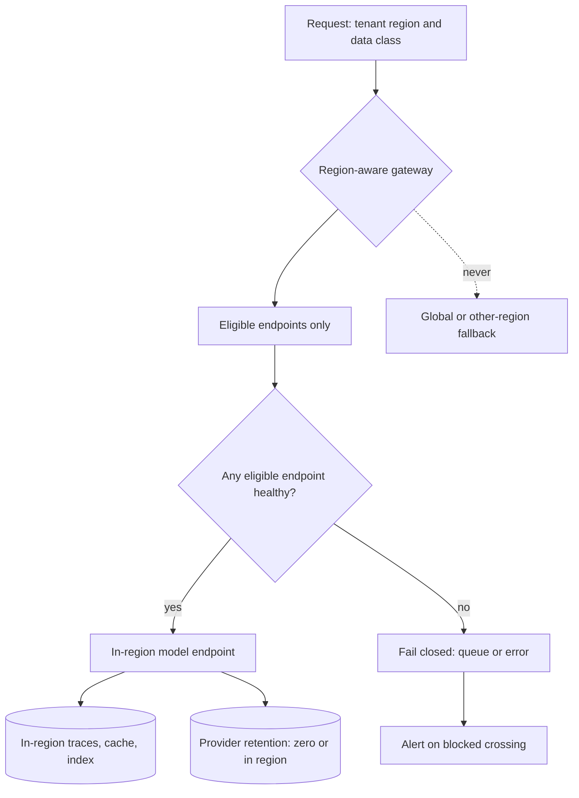

## TL;DR
Data residency means data is stored and processed only in approved locations. For an agent that covers
every hop: model endpoint, provider logs, tool servers, memory, checkpoints, caches, traces and support
staff. Sovereignty differs: whose law can compel access.

## For agent builders
- **Why it matters for agents.** An agent multiplies the places data goes. Each step can call a model, a
  hosted tool, a third-party API or an MCP server, then write memory, a checkpoint and a trace. One hop in
  the wrong region breaks the promise for every residency customer.
- **Where it shows up in your stack.** The region-aware AI gateway, the location of every tool and tool
  server the agent can call, managed memory, checkpoint and vector stores, your tracing exporter, and
  backup targets.
- **What you control.** The tenant's home region on every request, which endpoints and tools are eligible
  per region and data class, fail-closed routing, and in-region telemetry with redaction.
- **What you can skip.** Interpreting transfer law yourself. Ask the customer whether they mean residency,
  localisation or sovereignty, let counsel own the legal assessment, and own the data-flow map and the
  routing rules.

## Why it exists
- **Regulators want data within reach of their own law.** Governments, regulators and contracts set the
  approved locations for personal and sensitive data.
- **GDPR restricts transfers, not location as such.** It does not, in general, require data to stay in the
  EU; it restricts *transfers* outside the European Economic Area unless the destination has an adequacy
  decision or safeguards such as standard contractual clauses are in place, with supplementary measures
  where the destination's law undermines them.
- **Transfer mechanisms can disappear overnight.** Schrems II in 2020 invalidated the EU-US Privacy Shield
  on exactly that ground. Its successor, the EU-US Data Privacy Framework, received an adequacy decision
  in 2023 and has faced legal challenges of its own, so designs that depend on any single mechanism stay
  exposed.
- **Other rules go further.** Some jurisdictions have localisation rules requiring certain data to stay
  in-country; banking, health and public administration often add their own; many enterprise contracts
  simply say "customer data stays in region X" regardless of what the law allows.
- **"Deploy in the right cloud region" covers a minority of the flow.** The database and app servers are
  in region, but prompts go to an endpoint that may route elsewhere, the provider may retain them for abuse
  monitoring, traces sit in a vendor's default region, embeddings in a managed vector DB, fine-tuning
  copies data to wherever capacity is, and support staff abroad read logs. Missing one hop breaks
  compliance for every customer who required residency.

## How it works
### Separate three ideas
| Term | Meaning | Nature |
|---|---|---|
| Residency | Where data is stored and processed | A technical and contractual property you can design |
| Localisation | A legal mandate that certain data must remain in a country | A hard constraint |
| Sovereignty | Which jurisdiction's law governs the data and can compel access | Not settled by location: a provider headquartered in one country may be subject to its laws (the US CLOUD Act is the usual example) even for data stored elsewhere |

- **Customers often say "residency" when they mean one of the others; ask which.**

### Map every place data exists
For an LLM feature, list data at rest and in processing:
1. **Inference:** the model endpoint's processing location, and whether the provider routes across regions
   (global or cross-region routing modes trade residency for capacity).
2. **Provider-side retention:** abuse-monitoring logs, stored conversations, batch files, and whether a
   zero-retention or regional-processing option exists under your contract.
3. **Your own stores:** primary database, vector index, caches including prompt and semantic caches, agent
   memory, object storage for uploads.
4. **Telemetry:** traces, prompt logs, evaluation datasets, error reports, analytics.
5. **Derived assets:** embeddings, fine-tuned weights, summaries, all of which carry the source data's
   obligations.
6. **Human access:** support, on-call and labelling staff, *because* remote access from another country can
   itself count as a transfer.
7. **Backups and disaster recovery replicas,** which are frequently configured cross-region by default.

### Design the controls
- **Regional cells.** Deploy a full stack per region (app, stores, telemetry) and pin each tenant to a home
  region, *because* shared global services are where residency leaks hide.
- **Region-aware gateway.** The AI gateway reads the tenant's region and the request's data class and
  routes only to endpoints approved for that combination, failing closed rather than spilling over to
  another region when capacity is short.
- **Provider terms.** Choose endpoints and contract options that pin processing and retention to the
  region; vendor offerings change, so verify current documentation and contract language, not marketing
  pages.
- **Self-hosted or in-customer deployment** when no approved managed endpoint exists or sovereignty concerns
  rule out a foreign provider.
- **Encryption with customer-held keys** reduces sovereignty exposure for data at rest but does not help
  during inference, where the model needs plaintext.

### Evidence
- **What auditors and customers ask for:** a data-flow map, a sub-processor list with locations, and proof
  that routing and retention settings are enforced. Generate it from configuration, not from a slide.
- **Transfers under standard contractual clauses** outside the EEA: the exporter is expected to assess
  whether the destination's law lets the clauses actually be honoured (a transfer impact assessment, in the
  spirit of the EDPB recommendations) and to record any supplementary measures.
- **Maintain the map and the assessment together,** because the data-flow map is the input to that
  assessment.

### Why fail closed is the core engineering rule
- **Most residency controls are configuration;** the one genuine engineering decision is what happens under
  pressure.
- **Pressure always arrives.** Capacity incidents, provider outages and new-model launches all create a
  reason to route somewhere else "just for now".
- **The guarantee is only as strong as the weakest path a request can take,** so the gateway treats region
  as a hard constraint in routing (an ineligible endpoint is invisible, not a lower-priority option) and
  alerts on any attempt to cross it.
- **Test it:** deliberately make the in-region endpoint unavailable in staging and check that requests fail
  or queue rather than succeed somewhere else.

## Diagram
The gateway filters endpoints by tenant region and data class first, then by health; when nothing
eligible is healthy it queues or errors, never falls back across the boundary.



## Examples
### Worked review: a German health insurer's EU requirement
A German health-insurance customer requires that member data be stored and processed only in the EU, and
that the provider not retain prompts. The vendor's first draft architecture:

| Component | Initial location | Issue |
|---|---|---|
| App and Postgres | EU region | fine |
| Model endpoint | provider global endpoint | may process outside the EU |
| Provider abuse logs | default retention | prompts retained, location unclear |
| Vector DB (managed) | EU region | fine |
| Tracing SaaS | US default region | full prompts with member data in the US |
| On-call engineers | India and US | production log access is a transfer |
| Backups | cross-region to US | replicas of everything |

Fixes for the problem rows:
- **Model endpoint and abuse logs:** switch to the provider's EU-processing endpoint under a contract with
  zero data retention, or self-host an open-weight model in the EU region if no such option is available.
- **Tracing:** move to an EU instance and redact member identifiers before export.
- **People:** restrict production data access to EU-based staff, with others seeing only redacted telemetry.
- **Backups:** change to a second EU region.
- **Then make the gateway fail closed:** if the EU endpoint is throttled, return an error or queue the
  request instead of falling back to the global endpoint. That last rule matters in practice, because a
  fallback added during an incident is a common way for a compliant design to silently stop being
  compliant.

### Fail-closed routing and the staging drill
The routing rule as code: eligibility by region and data class comes first, health second, and an
unknown combination has no eligible endpoint at all. Endpoint names are illustrative.

```python
APPROVED = {  # (tenant home region, data class) -> approved endpoints, in preference order
    ("eu", "member_data"): ["provider-eu-zdr", "selfhosted-eu"],
    ("eu", "public"):      ["provider-eu-zdr", "provider-global"],
    ("us", "member_data"): ["provider-us"],
}

class ResidencyError(Exception):
    pass

def route(tenant_region: str, data_class: str, healthy: set) -> str:
    eligible = APPROVED.get((tenant_region, data_class), [])   # unknown combination: nothing eligible
    for ep in eligible:                  # ineligible endpoints are invisible, not lower priority
        if ep in healthy:
            return ep
    raise ResidencyError(f"no healthy endpoint approved for {tenant_region}/{data_class}")

# Staging drill: take every EU endpoint down and check nothing succeeds elsewhere.
healthy = {"provider-global", "provider-us"}
try:
    route("eu", "member_data", healthy)
except ResidencyError as e:
    print("fail closed:", e)                 # queue or return an error to the caller
print(route("eu", "public", healthy))        # 'provider-global': no residency requirement
```

- **Cross-region fallback stays possible for data with no requirement** (the `public` row), which is the
  trade-off in the first bullet below made explicit in config.
- **Run the drill as a scheduled test,** so a fallback added during an incident is caught before an audit.

### Agent scenario: every tool call is a hop
The same insurer wants a claims agent. One run of it touches more locations than the whole chat product
did, because each tool and store has its own home.

| Hop in one agent run | Initial location | Fix |
|---|---|---|
| Planner and worker model calls | EU endpoint via the gateway | fine, fail closed as above |
| `web_search` tool (hosted search API) | provider default, unknown | query carries member details: block member data from it, or use an EU-hosted search option |
| `lookup_policy` MCP server | EU cell | fine |
| Document OCR tool | third-party SaaS, US | swap for an in-region OCR service or self-host |
| Agent memory and checkpoints | managed store, default region | pin to the tenant's EU cell |
| Traces of every step | tracing SaaS, US default | EU instance, redact before export |

- **Tools need the same eligibility table as models.** The gateway's region rule is useless if the
  orchestrator can call a tool that ships the same text abroad.
- **Checkpoints are full copies of the context,** so a durable-execution store in the wrong region holds
  everything the agent ever read.

## Production patterns
- **Tenant home region as a first-class field.** Store each tenant's home region on the tenant record and
  carry it on every request, so the gateway, stores and telemetry exporters all read the same value.
  Monitor requests arriving without a region, which should fail.
- **Fail-closed gateway with a crossing alert.** Encode region and data-class eligibility in gateway config
  as in the example, and page on any blocked crossing. Monitor the share of requests served by approved
  regional endpoints, which should be all of them for residency tenants.
- **Residency drills in staging.** On a schedule, make the in-region endpoints unavailable and assert
  requests queue or error. Monitor drill results as a release check.
- **Data-flow map generated from config.** Build the map and sub-processor list from infrastructure and
  gateway configuration (regions of stores, telemetry exporters, backup targets, provider endpoints).
  Monitor drift between the generated map and the one given to customers.
- **Region-tagged tool registry.** Record where each agent tool and tool server processes data, and let the
  orchestrator offer a residency tenant only tools eligible for its region and data class. Monitor tool
  calls refused for region and tools registered without a location.
- **In-region telemetry with redaction.** Point trace and log exporters at an in-region instance and redact
  identifiers before export. Monitor exporter destinations and DLP hits in telemetry.

## Trade-offs
- **Regional cells vs cost.** They give clean residency guarantees but multiply operational cost and split
  capacity, which is worth paying once regulated customers in that region justify a dedicated stack.
- **Fail closed vs availability.** It preserves compliance during provider incidents at the cost of
  availability; a cross-region fallback is acceptable only for data classes and tenants with no residency
  requirement.
- **Regional endpoints vs newest models.** Regional endpoints may lag global ones in model availability or
  capacity, so residency can cost access to the newest model; self-hosting fixes availability but moves the
  quality and operations burden to you.
- **Customer-managed keys vs complexity.** They narrow sovereignty exposure for stored data but add
  key-management failure modes and do nothing for plaintext during inference.
- **In-region staff vs follow-the-sun.** Restricting human access to in-region staff satisfies auditors but
  weakens follow-the-sun support, which matters most for products sold with tight incident response
  commitments.

## Pitfalls
- **Checking only the application region.** Symptom: a security questionnaire answered "EU only" while the
  tracing vendor's invoice shows a US data centre.
- **Adding a cross-region fallback during an outage and never removing it.** Residency silently breaks until
  an audit or a customer's own monitoring finds it.
- **Treating embeddings as anonymous.** They are derived from personal data and can leak it, so they carry
  the same residency obligation as the source text.
- **Assuming the provider's regional endpoint also keeps abuse-monitoring logs in region.** Retention and
  processing locations can differ and must be confirmed separately in the contract.
- **Confusing residency with sovereignty** and promising a customer that EU storage protects them from a
  foreign government's access request, which it may not.

## When to use
- **Raise it early:** in the first scoping call with any regulated, public-sector or EU and other non-US
  enterprise customer, *because* it can rule out the default model provider entirely and change the
  architecture.
- **Lighter version when:** no customer, law or contract requires it; a single-region deployment with
  documented sub-processors is enough.
- **When it applies:** produce the full data-flow map, choose between regional managed endpoints, regional
  cells and self-hosting, and make the gateway fail closed.
- **Measure:** the share of requests served by approved regional endpoints, and alert on any cross-region
  call.
- **Interviews:** interviewers look for the full list of hidden data locations and the residency versus
  sovereignty distinction.

## Role lens
- **Engineer:** Implements region-pinned routing in the gateway, fail-closed behaviour, in-region telemetry
  and backup configuration, and tests that no fallback crosses regions.
- **Architect:** Chooses between regional cells, regional managed endpoints and self-hosting, and owns
  the data-flow map and sub-processor list as living artifacts.
- **FDE:** Asks whether the customer means residency, localisation or sovereignty, and answers their
  questionnaire with evidence drawn from actual configuration.

## Check yourself
**Q:** A customer requires EU residency. Your app, database and vector store are in an EU region, and you
call a frontier model through its EU endpoint. Is the product compliant? What else would you check?
**A:** Not necessarily; those are three of many locations. I would check whether the endpoint guarantees
EU processing or can route globally under load, where provider-side abuse logs and stored files are
retained and for how long, where traces, prompt logs and eval datasets live, whether backups or DR
replicas cross regions, where caches and agent memory sit, which staff in which countries can access
production data, and whether any fallback path calls a non-EU endpoint. I would also ask whether the
real concern is sovereignty, since an EU-located service run by a non-EU provider may not satisfy it.

## Interview questions
### What is the difference between data residency, localisation and sovereignty?
- **Residency** is where data is stored and processed, a property you can design with regions, endpoints and
  contracts.
- **Localisation** is a legal mandate that certain data stay in-country, a hard constraint.
- **Sovereignty** is whose law can compel access; a provider may be subject to its home country's laws for
  data stored elsewhere, so location alone does not settle it.

### Where does data go in an LLM feature that a region choice alone does not cover?
- **Provider side:** the endpoint's processing location and cross-region routing, plus abuse-monitoring logs
  and stored files.
- **Your side:** caches, agent memory, vector indexes, traces, prompt logs, eval sets, backups and DR
  replicas.
- **Derived and human paths:** embeddings and fine-tuned weights carry the source's obligations, and remote
  staff access can itself be a transfer.

### Your EU endpoint is throttled during a launch and the business wants a temporary global fallback. What do you say?
- **No for residency tenants:** any out-of-region call is a breach, logged or not, so the gateway queues,
  degrades or errors.
- **Yes only for data classes and tenants with no requirement,** encoded in config, not as an incident
  hotfix that is never removed.
- **Offer capacity options instead:** a second in-region endpoint or a self-hosted model in region.

### When would you self-host a model for residency reasons?
- **When no managed endpoint pins both processing and retention to the region under contract,** or
  sovereignty concerns rule out a foreign provider.
- **The cost:** you take on quality, capacity and operations, and may lose access to the newest model, so
  confirm the requirement first.

### How do you prove residency to an auditor?
- **Generate evidence from configuration:** a data-flow map and sub-processor list built from infra and
  gateway config, plus routing and retention settings.
- **Show enforcement:** fail-closed gateway rules, crossing alerts, and scheduled staging drills that take
  in-region endpoints down.
- **For SCC transfers,** keep the transfer impact assessment alongside the map, since the map is its input.

### A residency customer's agent needs a web-search tool whose provider processes queries in the US. How do you ship it?
- **Treat the query as data leaving the region.** If it can carry member details, it is a transfer, so the
  tool is ineligible for that data class.
- **Options:** an in-region search provider, queries built only from fields known to hold no personal data,
  or a separate session with no member data that is allowed to search.
- **Enforce it in the orchestrator's tool list,** not in the prompt, and add it to the data-flow map.

## Quiz
### Q: Under GDPR, what is the accurate characterisation of its rules on data location?
- [ ] Personal data of EU residents must always be stored inside the EU
- [x] Transfers outside the EEA are restricted and need an adequacy decision or appropriate safeguards
- [ ] Data may go anywhere as long as it is encrypted in transit
- [ ] Only health and financial data is subject to location rules
> GDPR's Chapter V governs transfers rather than mandating EU storage; transfers need an adequacy
> decision or safeguards such as SCCs. Strict in-country localisation comes from other laws or contracts.

### Q: The EU model endpoint is rate-limited during an incident. What should a residency-compliant gateway do for a tenant that requires EU processing?
- [ ] Fall back to the provider's global endpoint and log the event for later review
- [ ] Fall back to a different provider's US endpoint with stronger capacity
- [x] Fail closed: queue, degrade or return an error rather than route outside the approved region
- [ ] Strip obvious identifiers and route to any available region
> Residency is a hard constraint for that tenant; any out-of-region call is a breach, logged or not.
> Redacting identifiers does not make free text anonymous, so the safe behaviour is to fail closed.

### Q: Why does storing data in an EU region not by itself answer a sovereignty concern?
- [ ] EU regions are physically located outside the EU for redundancy
- [ ] Sovereignty only concerns encryption algorithms, not location
- [ ] Data residency and sovereignty are legally identical concepts
- [x] A provider may be subject to its home country's laws compelling access regardless of where data sits
> Sovereignty is about which jurisdiction can compel access. A provider incorporated elsewhere may face
> its home country's legal orders for data stored in the EU, so location alone does not settle it.

## Use cases & projects
### Use cases
- **Selling agents to EU, public-sector or regulated customers.** The data-flow map and fail-closed
  gateway are usually what the security questionnaire asks for.
- **Agents with third-party tools.** A region-tagged tool registry keeps a residency tenant's agent from
  calling a search, OCR or enrichment API abroad.
- **Long-running agents with durable execution.** Checkpoint and memory stores pinned to the tenant's cell
  hold full context copies in region.
- **Capacity incidents during launches.** Fail-closed routing plus scheduled drills stop a "temporary"
  global fallback from becoming a silent breach.

### Mini project
**Make an agent residency-aware (2-3 hours).**
- **Goal:** an agent whose model calls and tool calls both respect the tenant's home region, and fail
  closed under an outage.
- **Steps:** extend the `APPROVED` table with tools as well as model endpoints; tag four fake tools with a
  location; have the orchestrator offer only eligible tools for the tenant's region and data class; route
  model calls with `route`; write a staging drill that marks every EU endpoint unhealthy.
- **Done when:** an EU member-data run never calls a non-EU tool or endpoint, the drill produces a
  `ResidencyError` instead of a fallback, and you can print a data-flow map generated from the tables.
