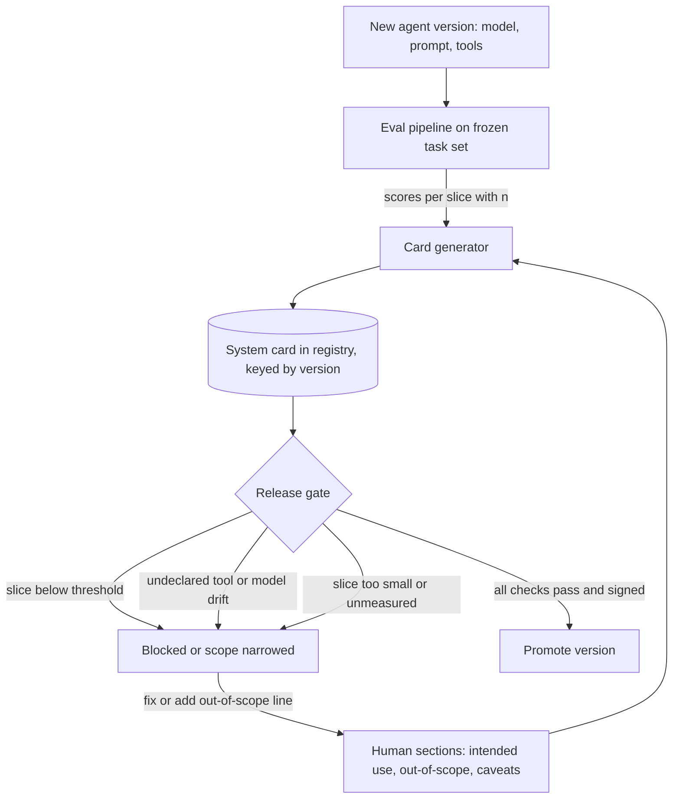

## TL;DR
For an agent, the card that matters is a system card: model version, prompt, tools and their
permissions, intended and out-of-scope tasks, and eval results per task type. It travels with each
release because agent behaviour cannot be read from weights or code.

## For agent builders
- **Why it matters for agents.** The same foundation model behaves very differently behind your prompt,
  tool set and guardrails, so a vendor's model card says little about your agent's risk. The system card
  is where you write down what the agent may do, which tools it holds, and where it was never tested.
- **Where it shows up in your stack.** Your model registry or prompt registry (MLflow, SageMaker, Vertex),
  Hugging Face model card YAML for any fine-tune, your eval pipeline's per-slice results, and the review
  your AI governance board runs before an agent ships.
- **What you control.** The out-of-scope task list, the declared tool list and permission level, which
  factors you slice evals by (task type, channel, language, tool used), and a release gate that fails when
  the running agent drifts from its card.
- **What you can skip.** Polishing prose and long ethics essays for a low-risk internal agent. A half-page
  card with honest out-of-scope lines and sliced eval numbers beats ten pages of boilerplate.

## Why it exists
- **A trained model, and even more an agent, is an opaque function.** Another team, a customer or a
  regulator must decide whether it is safe for *their* purpose, and only the builders know the facts: what
  data it saw, which populations and tasks it was tested on, where accuracy drops.
- **Unwritten knowledge leaves with the engineer.** Without a record it lives in a notebook and a Slack
  thread.
- **The classic failure is silent scope creep.** A classifier evaluated on adult English support tickets is
  reused for a medical triage queue; a summarizer tested on news is pointed at legal contracts; an agent
  built to look up orders is handed a refund tool. Nothing in the API says it was never measured there. A
  headline metric ("94% accuracy" or "94% task success") makes it worse, because an aggregate can hide a
  subgroup where it is much worse.
- **"The README describes the model" fails three ways.** It is unstructured, so out-of-scope uses and
  disaggregated results are simply absent; it is not tied to a version, so it describes last quarter's
  model or prompt; and it is written for code users, not for the reviewer approving a deployment.
- **Model cards force the deployer's questions.** Mitchell et al. proposed a fixed set of headings for
  exactly this. Regulation now makes the same demand: the EU AI Act requires technical documentation for
  high-risk systems, and documentation general-purpose model providers must pass to downstream providers.

## How it works
### The sections and why each exists
The original proposal has nine sections; most production templates keep their spirit. The agent reading
of each is in the last sentence.

1. **Model details.** Owner, version, date, architecture, licence, contact. Exists *because* a card that
   cannot be tied to one artifact and one accountable owner is unauditable. For an agent: model version,
   prompt hash and tool list are the artifact.
2. **Intended use and out-of-scope uses.** Primary use cases and users, and explicitly what the model must
   not be used for. The out-of-scope list is the most valuable line in the card *because* it is the only
   defence against reuse in a context nobody tested. For an agent: list the actions it must never take.
3. **Factors.** Conditions along which performance is expected to vary: demographic groups, languages,
   input channels, document types, device or sensor. For an agent add task type and which tool path ran.
4. **Metrics.** Which metrics, why those, and the decision thresholds used, *because* "accuracy" means
   nothing without knowing whether false positives or false negatives cost more. For an agent: task
   success, tool-call success, wrong-action rate.
5. **Evaluation data** and 6. **Training data.** Provenance, size, collection period, preprocessing, known
   gaps. For third-party foundation models you often know only what the provider discloses; say so.
7. **Quantitative analyses.** Results *disaggregated* by the factors, with uncertainty where possible.
   This is the core idea: an aggregate number averages away the subgroup that gets hurt.
8. **Ethical considerations.** Sensitive data, risks to people, mitigations applied.
9. **Caveats and recommendations.** Known failure modes and what a deployer must add (human review,
   approval gates, guardrails, monitoring).

### Model card vs system card vs datasheet
| Document | Describes | Typical contents |
|---|---|---|
| **Datasheet** (Gebru et al.) | One dataset | Motivation, composition, collection, consent, recommended uses |
| **Model card** | One model | The nine sections above |
| **System card** | A deployed system | Model plus prompts, retrieval, tools, guardrails, human oversight |

- **For most LLM applications and every agent the system card is what matters,** *because* the same
  foundation model behaves very differently behind different prompts, tools and filters, and the risk
  lives in the composition.
- **Build a chain.** The provider's model card, your fine-tune's card that references it, and a system
  card per deployment of the agent.

### Making it a living artifact
A card written once at launch rots, and agents change faster than models because prompts and tools ship
weekly. Automation keeps it honest:
- **Key it to the immutable version.** Store the card next to the model in the registry, keyed by version
  or weights hash (for an agent, also prompt hash and tool list), so promoting a version without a card is
  a failed check, *because* a card that can drift from its artifact is worse than none: it lends false
  authority to the wrong system.
- **Generate the numbers.** Write the quantitative section from the evaluation pipeline, not by hand, so the
  card's numbers are the numbers that gated the release.
- **Review the human sections on change.** Intended use, out-of-scope and caveats are re-reviewed when the
  eval set, training data, tool set or intended use changes, with the signer recorded, *because* intent is
  the one thing a pipeline cannot measure.
- **Fail on missing evidence, not only bad evidence.** A declared factor with no slice, or a slice too small
  to mean anything, blocks release just as a low score does. Otherwise the cheapest way to pass is to not
  measure.
- **Keep machine-readable metadata.** Hugging Face model cards put YAML front matter above Markdown, so the
  inventory can query licence, task and owner across all models and agents.

## Diagram
Follow an agent release from eval to promotion: the gate passes only when the card exists, matches the
running config, every declared factor has a big enough slice, and the human sections are signed.



## Examples
### Release gate for a claims-intake agent's system card
A team ships an agent that reads insurance claims emails, looks up the policy and routes each claim to one
of 12 queues for human handling. The gate compares the running config to the card and refuses promotion
when a slice fails, is under-sampled, is unmeasured, or the agent holds a tool the card never declared.

```python
import hashlib, json

system_prompt = "You are the claims intake agent. Route claims to a queue. Never approve payouts."
running = {"model": "vendor-model-2026-09", "tools": {"lookup_policy": "read", "route_claim": "write",
           "send_email": "write"}, "prompt_sha256": hashlib.sha256(system_prompt.encode()).hexdigest()}

card = {
    "system": "claims-intake-agent", "version": "2026.10.1", "owner": "claims-ml@corp",
    "model": "vendor-model-2026-09", "prompt_sha256": running["prompt_sha256"],
    "tools": {"lookup_policy": "read", "route_claim": "write"},
    "out_of_scope": ["Deciding claim approval or payout", "Non-English emails", "Voice transcripts"],
    "metric": "task_success", "release_threshold": 0.85, "min_slice_n": 200,
    "factors": ["language_variant", "channel", "attachment_present"],
}
# From the eval pipeline on the frozen task set: (score, n). Illustrative numbers.
results = {
    ("channel", "web_form"): (0.91, 1800), ("channel", "email"): (0.89, 950),
    ("channel", "broker_portal"): (0.78, 240), ("channel", "fax_scan"): (0.88, 40),
    ("attachment_present", True): (0.86, 1100), ("attachment_present", False): (0.90, 1930),
}
caveats = [f"Model drift: running {running['model']}" for _ in [0] if running["model"] != card["model"]]
caveats += [f"Undeclared tool: {t}" for t in running["tools"] if t not in card["tools"]]
for (f, v), (s, n) in results.items():
    if n < card["min_slice_n"]: caveats.append(f"Too few examples to judge {f}={v} (n={n})")
    elif s < card["release_threshold"]: caveats.append(f"Below threshold on {f}={v} ({s:.2f}, n={n})")
caveats += [f"No evaluation results for declared factor {f}" for f in card["factors"]
            if f not in {f for f, _ in results}]
print(json.dumps(caveats, indent=1))
if caveats:
    raise SystemExit("Release blocked: drift, undeclared tool, or a failing, small or unmeasured slice")
```

- **The undeclared tool is the agent-specific catch.** Someone added `send_email` to the agent; the card
  and its review never saw it, so the gate blocks until the card (and its out-of-scope list) is updated.

### Worked numbers: why the aggregate hides the problem
Assume production traffic splits as below (scores from the eval run above).

| Channel | Share of traffic | Task success | Contribution |
|---|---|---|---|
| Web form | 60% | 0.91 | 0.6 × 0.91 |
| Email | 31% | 0.89 | 0.31 × 0.89 |
| Broker portal | 8% | 0.78 | 0.08 × 0.78 |
| Fax | 1% | 0.88 | 0.01 × 0.88 |
| **Traffic-weighted** | | **≈ 0.89** | clears 0.85 comfortably |

- **The headline passes, a customer class fails.** A metric like macro-F1 does not decompose exactly by
  slice, but the order of magnitude holds. Broker-portal claims are a small share of traffic but all come
  from one class of customer, who gets an agent measurably worse than everyone else's.
- **The card surfaces it.** The team either fixes it or ships with "broker portal out of scope" written
  down, and the agent hands those claims straight to a human.
- **Small slices are noise.** `fax_scan` scores 0.88, but on 40 examples that means little. For an
  accuracy-like metric near 0.8 the standard error at n = 100 is already √(0.8 × 0.2 / 100) ≈ 0.04, so a
  95% interval is about ±0.08; at n = 40 it is wider still.
- **Unmeasured is not passed.** `language_variant` is declared as a factor with no slice at all. Both it and
  the fax slice become caveats a reviewer must read, instead of numbers that look fine.

## Production patterns
- **System card as a promotion check.** When agents and models live in a registry (MLflow, SageMaker,
  Vertex), attach the card as an artifact of the exact version (model, prompt hash, tool list) and make the
  promotion job fail if it is missing or any field differs from the running config. Monitor promotions
  blocked for missing or drifted cards.
- **Eval run ID inside the card.** Have the agent eval job write its run ID and eval-set hash into the
  card's quantitative section, so any number can be reproduced from a stored run. Monitor cards whose run ID
  no longer resolves to a stored run.
- **Owners on the human-written sections.** Keep cards in the repo and use a CODEOWNERS entry so changes to
  intended use, out-of-scope or the tool list need approval from the named product owner. Track review age
  against the last change to tools, training data or eval set.
- **Front-matter metadata for the inventory.** Fill the Hugging Face model card YAML fields such as
  `license`, `pipeline_tag` and `base_model` for fine-tunes, plus your own owner, risk tier and tool list,
  then index them nightly. Monitor coverage: share of inventory entries with a current card.
- **Provider card plus your system card.** For a vendor model, store the provider's card link and retrieval
  date with the model version your agent calls, and re-check it whenever the provider ships a new version.
  Alert when the model version in traffic differs from the one your system card references.

## Trade-offs
- **Strict template vs box-ticking.** A fixed template gives comparability across hundreds of models and
  agents but invites boilerplate; it becomes a liability when reviewers accept boilerplate instead of
  reading the out-of-scope list.
- **Disaggregated metrics vs noise.** Slices by task type and channel expose hidden failures but need
  labelled slices. When slice sizes are tiny the numbers are noisy, so report counts and intervals or the
  card becomes misleadingly precise.
- **Public detail vs exposure.** Detailed cards build customer and regulator trust, but can reveal
  competitive or security-relevant details such as tool permissions; split into a public card and an
  internal annex when that matters.
- **Automation vs intent.** Generating cards from the pipeline keeps numbers current, but generated text
  cannot state intent; the human-written sections still need an owner and a review trigger.

## Pitfalls
- **Writing the card after launch from memory.** Symptom: numbers in the card that nobody can reproduce
  from any stored eval run. Fix: generate them from the gating eval run.
- **Reporting only the aggregate metric.** Symptom: a complaint from one customer segment that the headline
  task-success number says should not exist. Fix: disaggregate by every declared factor.
- **Documenting the base model but not the agent.** Symptom: an audit question about tools, guardrails or
  retrieval sources that no document answers. Fix: a system card per deployment.
- **Empty or generic out-of-scope uses ("do not use for illegal purposes").** Symptom: the agent quietly
  appears in a second product with a different risk profile, or gains a write tool. Fix: name the concrete
  uses and actions you never tested.
- **Not versioning the card with the model and prompt.** Symptom: a card describing a model three versions
  old. Fix: key the card to the version and gate promotion on it.

## When to use
- **Use when:** any model, agent or AI system that another team, a customer or an approver relies on. Make
  it a release gate rather than a wiki page.
- **Scale depth with risk:** a low-risk internal tagging agent needs a half-page card; an agent in an
  employment, credit or health decision needs full disaggregated evaluation, data provenance and a system
  card.
- **Third-party models:** collect the provider's card and write your own system card on top.
- **Measure:** coverage (share of inventory entries with a current card) and staleness (versions shipped
  without a card update).
- **Interviews:** the strong signal is knowing that out-of-scope uses and disaggregated results are the
  point, not the formatting.

## Role lens
- **Engineer:** Wires the eval pipeline to write the card's quantitative section and adds a registry check
  that blocks promotion of any version without a current card.
- **Architect:** Defines the documentation chain (provider card, fine-tune card, system card), the required
  sections per risk tier, and where cards live relative to the model registry and inventory.
- **FDE:** Hands the customer's risk or procurement team a system card for their deployment and adds
  their data and slices to the evaluation so the card reflects their reality.

## Check yourself
**Q:** Your company deploys a vendor LLM behind a RAG pipeline for HR policy questions. The vendor
publishes a model card. Is that sufficient documentation for your internal AI review board? What would
you add?
**A:** No. The vendor card describes the base model's training and general evaluations, but the risk
your board cares about lives in the system: the retrieval corpus and its freshness, the system prompt,
guardrails, who the users are, and what decisions the answers inform. I would write a system card that
references the vendor card and adds intended use (answering policy questions, not making employment
decisions), out-of-scope uses, groundedness and refusal results on our own HR question set broken down by
policy area and language, known failure modes such as stale documents, and the human escalation path. It
must be versioned with the prompt and index, because changing either changes behaviour.

## Interview questions
### What is a model card, and why is a good README not enough?
- **Definition:** a structured, versioned document tied to one model artifact: details, intended and
  out-of-scope uses, factors, metrics, data, disaggregated results, ethics and caveats.
- **Why not a README:** it is unstructured, so the out-of-scope list and slice results are usually
  missing, and it is not tied to a version, so it drifts from the model actually deployed.

### What goes into a system card for a tool-calling agent that a model card does not cover?
- **The composition:** model version, system prompt hash, every tool with its permission level (read or
  write), retrieval sources, guardrails and approval gates.
- **Out-of-scope actions,** not just out-of-scope inputs: for example "never approves payouts", which is
  what reviewers check against the tool list.
- **Eval results sliced by task type and tool path,** with n per slice, plus a gate that fails if the
  running agent's tools or model differ from the card.

### Your agent scores 0.92 task success overall but a customer segment complains it is bad for them. How do you investigate?
- **Slice the eval by that segment's factors** (channel, language, task type) and report n with each score;
  the aggregate weights slices by frequency, so a small segment barely moves it.
- **Check whether the segment was ever measured.** If its slice is missing or tiny, the card should say
  "untested", and the gate should have blocked on it.
- **Then decide:** fix with targeted data or prompt changes, or narrow intended use, write the exclusion
  into the card and route that segment to a human.

### How small is too small for a slice in the card?
- **Use the standard error.** Near 0.8 accuracy, n = 100 gives about ±0.08 at 95%, so differences smaller
  than that are noise.
- **Set a minimum n per slice** (the example uses 200) and treat smaller slices as caveats, not passes.
- **Report counts and intervals** next to every number so readers can judge precision themselves.

### When would you write a system card instead of, or as well as, a model card?
- **Whenever a model is composed with prompts, retrieval, tools or filters,** because the risk lives in the
  composition and the same base model behaves very differently behind each one.
- **For a vendor LLM** you cannot write its model card; you collect the provider's and write a system card
  per deployment that references it.
- **Version the system card with the prompt and index,** since changing either changes behaviour.

### How do you stop system cards going stale across dozens of agents that ship prompt changes weekly?
- **Make the card a promotion gate** keyed to the immutable version (model, prompt hash, tool list), so no
  card means no release.
- **Generate the numbers from the gating eval run** and require re-review of human sections when data, eval
  set, tools or intended use change.
- **Measure coverage and staleness** across the inventory and report them to the governance owner.

## Quiz
### Q: Which model card section most directly prevents a model being reused in a context it was never tested in?
- [ ] Model details, because it identifies the owner
- [x] Intended use with explicit out-of-scope uses
- [ ] Training data, because it shows what the model has seen
- [ ] Metrics, because it states the decision thresholds
> The out-of-scope list tells a downstream team in plain words where the model must not be used. Training
> data hints at coverage but requires inference; the explicit exclusion is what stops silent scope creep.

### Q: Why does the model card approach insist on disaggregated quantitative results?
- [ ] Regulators require one number per demographic group by law
- [ ] Aggregate metrics are statistically invalid for classifiers
- [x] An aggregate can look acceptable while one subgroup or condition performs much worse
- [ ] It makes the card longer and therefore more credible
> Averages weight slices by their frequency, so a small but important subgroup with poor performance barely
> moves the headline. Breaking results down by factors is the only way to see that failure before users do.

### Q: For an LLM application built from a vendor model, prompts, retrieval and guardrails, which document best captures deployment risk?
- [ ] The vendor's model card alone
- [ ] A datasheet for the retrieval corpus alone
- [x] A system card covering the composed system and referencing the vendor's model card
- [ ] The application's API reference documentation
> The same base model behaves very differently depending on prompts, tools and filters, so risk lives in the
> composition. A system card documents that composition, while the vendor card and datasheets are inputs to it.

## Use cases & projects
### Use cases
- **Shipping an internal agent past a review board.** The system card is the document the board reads:
  tools, permissions, out-of-scope actions and sliced eval results.
- **Procurement and customer security reviews.** An FDE hands the customer a system card for their
  deployment instead of the vendor's generic model card.
- **Catching tool creep.** A gate that diffs the running tool list against the card stops an agent quietly
  gaining a write or send capability nobody reviewed.
- **Fine-tuning a model on agent traces.** The fine-tune's Hugging Face card records `base_model`, training
  data provenance and per-task results, and the agent's system card references it.

### Mini project
**System card gate for a small agent (2-3 hours).**
- **Goal:** block a release of a tool-calling agent whenever its config or eval evidence drifts from its
  system card.
- **Steps:** build a tiny agent with three tools (two read, one write); write a YAML system card listing
  model, prompt hash, tools with permissions, out-of-scope actions and factors; run a 50-task eval sliced by
  task type; write a script that fails on model or prompt drift, undeclared tools, slices under threshold or
  under a minimum n, and unmeasured factors.
- **Done when:** adding a fourth tool or editing the prompt makes the gate fail with a readable caveat list,
  and updating and re-signing the card makes it pass.
