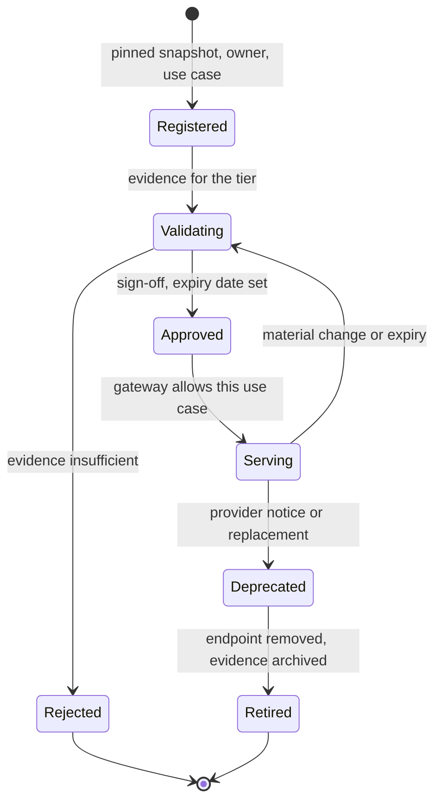

## TL;DR
Model governance controls which models may be used, for what, on what evidence, and how changes are
approved, monitored and retired. Models change without code changes and fail statistically, so good
governance is automated: a registry, risk-tiered approval, a gateway refusing unapproved models.

## Why it exists
- **Banks learned this first.** A wrong pricing or credit model does not crash; it quietly makes bad
  decisions at scale. US supervisory guidance on model risk management (SR 11-7, 2011) formalised the
  response: inventory every model, validate it independently before use, monitor it, assign clear
  ownership. Generative AI widens the problem in three ways.
- **Models arrive from outside.** A hosted provider can update the model behind an alias, deprecate a
  version on its own schedule, or change its data-handling terms, so "we didn't deploy anything" no longer
  means nothing changed.
- **Use spreads faster than oversight.** Any team with an API key can put a model into a customer-facing
  flow, so organisations discover dozens of untracked uses at audit time.
- **Regulation now expects it.** The EU AI Act imposes obligations on high-risk systems (risk management,
  documentation, logging, human oversight) and on general-purpose model providers; NIST AI RMF and ISO/IEC
  42001 give the management-system shape.
- **A review committee that approves by meeting fails twice.** It is too slow for teams shipping weekly,
  so they bypass it, and its approvals are not enforced anywhere, so the approved model and the model
  actually serving traffic drift apart. Governance has to live in the delivery path.

## How it works
### 1. Inventory and registry
- **Every model in use is a registry entry:** model and version (or provider plus pinned snapshot), owner,
  use cases, data classes it may receive, deployment endpoints, approval status and expiry, linked evidence.
- **Use cases are inventoried and risk-classified separately,** *because* the same model can be low-risk for
  drafting internal notes and high-risk for screening job applicants; the AI inventory lesson covers this.

### 2. Risk-tiered approval
Approval depth follows the use case's risk tier, not the model's fame.

| Tier | Typical requirements |
|---|---|
| Low | Automated eval pass and owner sign-off |
| High | Independent validation, red-teaming, a bias or fairness assessment where people are affected, a documented human-oversight design, sign-off from risk or compliance |

- **Tiering keeps the process proportionate,** *because* a uniform heavy process is what drives teams to
  shadow AI.

### 3. Evidence, not assertions
- **Approval attaches artifacts:** eval results on a versioned dataset, red-team findings and their
  dispositions, the model card, data provenance for any fine-tuning, and the provider's terms for hosted
  models.
- **Evidence is tied to the exact model version,** so a new version needs new evidence.

### 4. Enforcement in the path
- **The AI gateway or deployment pipeline checks the registry** on every request or release: model
  registered, approved for this use case and data class, approval unexpired.
- **Unregistered models are refused.** This is what turns the registry from documentation into control.

### 5. Change management
- **Pin provider snapshots instead of floating aliases** where the provider allows it, *because* an alias
  can change behaviour beneath you.
- **Treat model swaps, prompt changes and fine-tune refreshes as changes** that rerun the tier's evals before
  promotion, with canary or shadow rollout for higher tiers.

### 6. Monitoring and retirement
- **Production monitoring** watches quality signals, drift, incidents and cost per use case.
- **Approvals carry an expiry or review date.**
- **Provider deprecation notices feed the registry,** so migrations are planned rather than forced.
- **Retirement** removes the endpoint, archives evidence and records why.

### Roles
| Role | Owns |
|---|---|
| Model or use-case owner | Accountability |
| Independent validator | Reviews evidence for higher tiers |
| Risk or compliance function | The policy |
| Platform engineering | Enforcement |

- **Separate builder and validator.** SR 11-7 insists on it, because builders grade their own work
  generously.
- **"Effective challenge"** is SR 11-7's term for what the validator must provide: critical review by people
  with the competence, independence and authority to force changes. A validator who reports to the product
  owner, or who can comment but not block, is review in name only.

### What counts as a change
- **The rule:** anything that can change the distribution of outputs for the approved use case is a
  change, and its depth of re-review follows the tier.
- **Material changes:** a new model snapshot, a prompt or system-instruction edit, a change to retrieval
  sources or chunking, new tools, a fine-tune refresh, and a provider's change to data-handling terms
  (which affects which data classes the model may receive, not its quality).
- **Not changes:** purely operational edits, such as scaling or a timeout.
- **Write the list down per tier.** It stops both failure modes: re-validating on every typo, and shipping
  a new retrieval corpus to a high-tier use case without anyone noticing it was a material change.

## Diagram
A model's lifecycle in the registry: approval is per use case and version, and any material change or
expiry sends it back through validation before it can serve again.



## Examples
### A gateway check against the registry
The scenario: a team's code asks for `provider-x/large-latest`, an alias whose underlying snapshot the
provider just changed.

```python
from datetime import date

REGISTRY = {
    "provider-x/large-2025-06-01": {
        "approved_for": {"support-drafting": "medium"},  # use case -> max risk tier
        "max_data_class": "CONFIDENTIAL",
        "approval_expires": date(2026, 12, 31),
        "evidence": ["evals/support-v14", "redteam/2025-07", "card/large-2025-06"],
    },
}
TIER_RANK = {"low": 0, "medium": 1, "high": 2}
CLASS_RANK = {"PUBLIC": 0, "INTERNAL": 1, "CONFIDENTIAL": 2, "RESTRICTED": 3}

def authorise(model: str, use_case: str, tier: str, data_class: str, today: date) -> str:
    entry = REGISTRY.get(model)
    if entry is None:
        return f"DENY: {model} not registered (aliases must resolve to a pinned snapshot)"
    if use_case not in entry["approved_for"]:
        return f"DENY: not approved for {use_case}"
    if TIER_RANK[tier] > TIER_RANK[entry["approved_for"][use_case]]:
        return f"DENY: approved up to {entry['approved_for'][use_case]} risk, request is {tier}"
    if CLASS_RANK[data_class] > CLASS_RANK[entry["max_data_class"]]:
        return "DENY: data class exceeds approval"
    if today > entry["approval_expires"]:
        return "DENY: approval expired, re-validation due"
    return "ALLOW"

print(authorise("provider-x/large-latest", "support-drafting", "medium", "INTERNAL", date(2026, 10, 20)))
print(authorise("provider-x/large-2025-06-01", "support-drafting", "medium", "INTERNAL", date(2026, 10, 20)))
print(authorise("provider-x/large-2025-06-01", "claims-decisions", "high", "RESTRICTED", date(2026, 10, 20)))
```

- **The alias is refused,** the pinned snapshot is allowed for its approved use, and reusing it for a
  high-risk claims decision is denied until that use case has its own evidence.
- **Model names are invented.**

### Deciding which changes re-open approval
The "what counts as a change" rule as a release check. The field lists and review steps are an example
policy; the point is that every changed field is classified, and an unclassified one stops the release.

```python
MATERIAL = {   # can change the output distribution, or which data the model may receive
    "model_snapshot", "prompt", "retrieval_sources", "chunking", "tools",
    "fine_tune", "provider_data_terms",
}
OPERATIONAL = {"replicas", "timeout", "rate_limit", "log_level"}
REVIEW_BY_TIER = {
    "low": "rerun automated evals, owner sign-off",
    "medium": "rerun evals plus red-team regression, owner sign-off",
    "high": "rerun evals, red-team, independent validator sign-off, canary rollout",
}

def required_review(changed_fields: set, tier: str) -> str:
    unknown = changed_fields - MATERIAL - OPERATIONAL
    if unknown:
        return f"classify first: {sorted(unknown)} not on the list"   # no silent default
    if changed_fields & MATERIAL:
        return REVIEW_BY_TIER[tier]
    return "no re-approval; normal change control"

print(required_review({"timeout", "replicas"}, "high"))
print(required_review({"retrieval_sources"}, "high"))
print(required_review({"prompt"}, "low"))
print(required_review({"temperature"}, "medium"))
# no re-approval; normal change control
# rerun evals, red-team, independent validator sign-off, canary rollout
# rerun automated evals, owner sign-off
# classify first: ['temperature'] not on the list
```

### Worked scenario: one model, three use cases
| Use case | Tier | Evidence required | Gateway result with the support-drafting approval only |
|---|---|---|---|
| Internal meeting-notes summaries | Low | Automated evals, owner sign-off | Denied until registered for this use case (cheap to add) |
| Support reply drafting, human sends | Medium | Evals on real tickets, red-team regression | Allowed (the approved use) |
| Insurance claims decisions | High | Independent validation, fairness assessment, human-oversight design, compliance sign-off | Denied: tier and data class exceed approval |

- **Same model, three different answers,** because approval attaches to the use case and tier, and the
  gateway enforces it per request.

## Production patterns
- **Registration as a side effect of the platform.** Teams get model access only through the gateway, and
  requesting a new model or use case creates the registry entry. Monitor unregistered-model call attempts
  and traffic that bypasses the gateway.
- **Pinned snapshots with deprecation tracking.** Reference dated snapshots in config, never floating
  aliases, and feed provider deprecation notices into registry entries with a migration due date. Monitor
  entries within a set window of deprecation without a validated successor.
- **Evidence generated by CI.** Eval runs, red-team regression results and model cards are produced by the
  release pipeline and linked to the exact version in the registry. Monitor entries whose evidence predates
  the current version.
- **Expiring approvals with automated re-runs.** Each approval has an expiry; the pipeline re-runs the
  tier's evals ahead of it so renewal is a review, not a rebuild. Monitor approvals past expiry and time
  from request to approval per tier.
- **Sandbox tier for exploration.** A separate environment with synthetic or public data where any model
  may be tried without approval, and no route to production data. Monitor sandbox-to-production promotions
  that skip registration.

## Trade-offs
- **Gateway enforcement vs experimentation.** It makes governance real but blocks experimentation; a
  sandbox tier with synthetic or public data only keeps exploration fast without touching production paths.
- **Pinned snapshots vs improvements.** Pinning gives reproducibility, yet pinned versions get deprecated
  and miss improvements, so it pays off only alongside a planned re-validation cadence.
- **Independent validation vs release speed.** It catches what builders miss but adds days to each
  high-tier release; it should flip to automated evidence review for low tiers where errors are cheap and
  reversible.
- **Expiring approvals vs busywork.** They force periodic review and catch drift, but generate busywork if
  evidence must be rebuilt by hand; automated eval reruns make short expiry affordable.
- **Central registry vs federated teams.** It gives one view for auditors, but federated teams resist it
  unless registration is a side effect of using the platform rather than a separate form.

## Pitfalls
- **Approving a model in a meeting with no enforcement.** Symptom: an audit finds production traffic on
  models nobody on the committee has heard of.
- **Calling floating aliases in production.** Quality or format shifts appear overnight with no deploy, and
  incident timelines show only a provider-side change.
- **Tying approval to the model instead of the use case.** A model approved for summarisation is quietly
  reused for decisions about people without new evidence.
- **Evidence not linked to versions.** The eval report in the file is for last year's snapshot and nobody
  can show what the current one was tested on.
- **Treating prompts and retrieval configuration as outside governance,** although a prompt change can
  alter behaviour as much as a model swap.

## When to use
- **Start lightweight** as soon as more than one team uses models or any model touches customers: a
  registry, an owner per entry and gateway enforcement.
- **Add independent validation and formal sign-off** when use cases affect people's rights, money, health
  or safety, or fall into regulated categories.
- **Avoid heavyweight process** for internal low-risk tools, where it only creates shadow AI.
- **Measure:** the share of traffic through registered models, approvals past expiry, time from request to
  approval per tier, and unregistered-model call attempts.
- **Interviews:** say how governance is enforced, not only documented.

## Role lens
- **Engineer:** Registers models with pinned versions, wires eval runs to produce linked evidence, and
  implements the gateway check that refuses unapproved models.
- **Architect:** Designs the risk tiers, registry schema and enforcement points, and decides which changes
  trigger re-validation and which rollout strategy each tier needs.
- **FDE:** Fits the product into the customer's model risk process, supplies model cards and eval
  evidence, and maps their approval steps to the deployment plan.

## Check yourself
**Q:** A bank's governance committee approved a hosted model for internal document summarisation. Six
months later a team uses the same model to draft credit decline letters and argues no new approval is
needed. What do you say?
**A:** Approval attaches to a use case and risk tier, not to the model. Decline letters affect customers
and fall into regulated territory, so the tier is higher: it needs evidence on representative letters,
checks for errors and unfair language, a human-review design, and an independent validator's sign-off.
Also confirm the version: if the team calls a floating alias, the snapshot may differ from the one
approved. The gateway should enforce this by checking the use case against the registry, so the request
is refused until the new approval exists.

## Interview questions
### What is model governance, and why doesn't ordinary change management cover it?
- **Definition:** the decisions, records and enforced checks for which models are used, for what, by whom, on
  what evidence, and how they are changed, monitored and retired.
- **Why it is separate:** models change behaviour without code changes (a provider repoints an alias) and
  fail statistically rather than crashing, so a code-review-and-deploy process never sees the change.

### Output quality on a production feature shifted overnight with no deploy. How do you investigate?
- **Check the model reference first:** a floating alias may have been repointed to a new snapshot by the
  provider.
- **Then check other material inputs:** prompt registry edits, retrieval source or chunking changes, tool
  changes, provider data-terms updates.
- **Fix the class:** pin snapshots, make the gateway refuse aliases, and rerun the tier's evals before any
  new snapshot is promoted.

### How would you design governance so that teams don't route around it?
- **Tier by use-case risk** so low-risk tools need only automated evals and owner sign-off.
- **Make registration a side effect** of getting model access through the platform, not a separate form.
- **Offer a sandbox** with synthetic or public data for free experimentation, and keep heavy validation for
  decisions about people, money, health or safety.

### Which changes should re-open approval for a high-tier use case?
- **Anything that can change the output distribution:** new snapshot, prompt or system-instruction edit,
  retrieval sources or chunking, new tools, fine-tune refresh, plus provider data-terms changes, which affect
  which data the model may receive.
- **Not operational edits** such as scaling or timeouts; writing the list down prevents both over- and
  under-review.

### What does "effective challenge" mean, and how do you know validation is real?
- **SR 11-7's term:** critical review by people with the competence, independence and authority to force
  changes.
- **Tests:** the validator does not report to the product owner, can block a release rather than just
  comment, and reviews evidence tied to the exact version being deployed.

## Quiz
### Q: Why should model approvals be tied to use cases rather than to models alone?
- [ ] Use cases are easier to name in a registry than model versions
- [x] The same model can be low-risk in one context and high-risk in another, requiring different evidence
- [ ] Regulators only recognise use-case approvals, never model approvals
- [ ] Model vendors forbid customers from approving their models directly
> Risk depends on what the output affects. A model fine for internal drafting can harm people when used
> for decisions about them, so evidence and oversight must match the use case's tier.

### Q: What is the main governance risk of calling a provider's floating model alias in production?
- [ ] Aliases cost more per token than pinned snapshots
- [ ] Aliases cannot be used with an AI gateway
- [x] Behaviour can change under you with no deploy, invalidating the evidence your approval relied on
- [ ] Aliases always point to an older, less capable model
> An alias may be repointed to a new snapshot at any time, so the evaluated model and the serving model
> diverge silently. Pinning ties approval evidence to the exact version actually in use.

### Q: Which mechanism most directly turns a model registry from documentation into control?
- [ ] A quarterly governance committee review of the registry contents
- [ ] Requiring every registry entry to include a model card
- [ ] Publishing the registry on the internal wiki
- [x] A gateway or pipeline check that refuses models not registered and approved for the use case
> Without enforcement in the request or release path, actual usage drifts from approved usage. Reviews
> and model cards are evidence and oversight; the refusal is the control.
