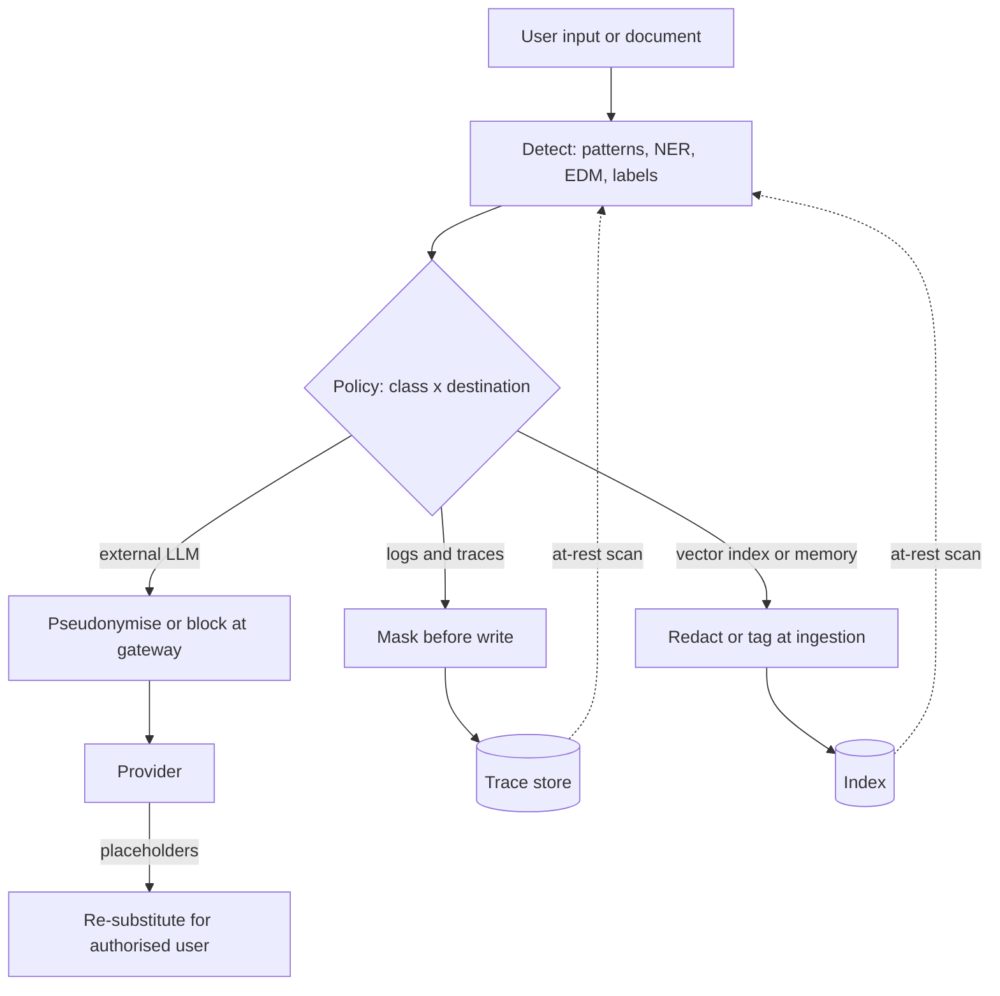

## TL;DR
PII protection decides which personal data may reach which destination; DLP finds it in motion, in use
and at rest and enforces allow, redact, tokenize, block or alert. LLM systems copy free text into
prompts, providers, logs, indexes and weights, so every copy can leak.

## Why it exists
- **Personal data stopped living in typed columns.** A `ssn` field could be encrypted, masked and
  access-controlled by name. An LLM application moves the same data as unstructured text.
- **One string, many copies.** A transcript containing a card number is pasted into a prompt, sent to a
  third-party model, written to a trace store, chunked into a vector index, summarised into "memory",
  perhaps used as fine-tuning data. None of those systems knows a card number is inside the string, so
  column-level controls never fire.
- **The naive approaches fail in opposite directions.** "Tell users not to paste personal data" fails
  because users paste whatever solves their problem, and documents arrive full of it. "Block anything that
  looks sensitive" fails because detectors have false positives; a gateway that rejects every prompt with
  a nine-digit number breaks the product, and users route around it to personal accounts, which is worse.
- **DLP makes the decision contextual.** The same email address is fine in an internal ticketing tool, must
  be pseudonymised before an external model, and must never appear in a debug log.
- **Regulation adds force.** GDPR's data minimisation and purpose limitation, sector rules such as HIPAA,
  and contractual terms all require you to show where personal data went and why. Redaction techniques
  are in the safety module's PII-redaction lesson; this lesson is the policy and enforcement program.

## How it works
### Know what counts
- **Direct identifiers:** name, government ID, email, phone.
- **Indirect, in combination:** date of birth plus postcode plus employer.
- **Special or sensitive categories:** health, biometric and financial data, with stricter rules.
- **The common gap:** a policy that lists only "SSN and card number" misses most of what an LLM actually
  sees, which is names and free-text descriptions of people.

### Detect with layered techniques
Each detector covers a different failure:

| Technique | What it catches | Why it is there |
|---|---|---|
| Patterns plus validation | Card numbers, IBANs and national IDs, confirmed with checksums such as Luhn | *Because* a bare 16-digit regex fires on order numbers |
| Dictionaries and context words | "DOB", "patient", "account no." raise confidence of nearby matches | Context separates IDs from random digits |
| NER models | Names, addresses and organisations no regex can find | Presidio combines patterns, context and NER in one analyzer |
| Exact data match / fingerprinting | Hash the real customer table and match against it | Finds your actual customers' records with very few false positives |
| Classification labels | A source already labelled Restricted needs no detection | The label drives the policy (see data classification) |

### Enforce at the points where data crosses a boundary
1. User input before it reaches the model.
2. Egress to any external model provider (usually the AI gateway).
3. Ingestion into vector stores and memory.
4. Writes to logs and traces.
5. Model output before display.
6. Tool-call arguments leaving the system.

- **Start with the gateway and the logging pipeline.** They cover the most traffic with the fewest
  integration points, *because* every call already passes through them.

### Choose the action per destination
From least to most disruptive:

| Action | What it does |
|---|---|
| Allow and record | Pass through, keep an audit entry |
| Mask for display | `****1234` |
| Pseudonymise | Typed placeholders and a short-lived mapping, so the model still reasons about "PERSON_1" |
| Tokenize | Replace with a vault token only the token service can map back; the usual PCI pattern |
| Redact irreversibly | Remove or one-way hash the value |
| Block | Refuse the request |
| Alert a human | Escalate for review |

- **The policy matrix is data class by destination,** not data class alone.

### Own the pseudonymisation return path
- **The model answers in placeholders** ("I have emailed PERSON_1 at EMAIL_1"); the gateway re-substitutes
  real values only in the response to the authorised user, using a mapping keyed to that request and
  deleted soon after.
- **The mapping must be consistent within a conversation,** *because* if "Jane" becomes PERSON_1 in turn
  one and PERSON_3 in turn two the model loses track of who is who.
- **Pseudonymised data is still personal data under GDPR,** *because* the mapping exists and
  re-identification is possible. Only data that cannot reasonably be re-identified (anonymised) falls
  outside the regulation, and free text is very hard to anonymise.

### Cover the other direction: people using outside AI tools
Employees pasting customer data into public chat assistants the organisation never sanctioned. There is
no gateway of yours in the path, so the controls differ:
- **A sanctioned enterprise tenant** with contractual data terms, so there is a legitimate place to go.
- **Browser or endpoint DLP** that inspects pastes and uploads to AI sites.
- **Network or CASB controls** that block or warn on unsanctioned AI domains.
- **Blocking without a sanctioned alternative** mostly moves the traffic to personal devices.

### Cover data at rest and retention
- **Scan stores:** trace databases, prompt logs, evaluation datasets and vector indexes, where personal
  data accumulates silently.
- **Pair findings with retention limits and deletion paths that reach derived copies,** because a
  right-to-erasure request must also remove the embeddings and cached summaries built from the record.

### Measure it
- **Detector precision and recall** on a labelled sample of your own traffic.
- **Block and redact rates per endpoint, and override requests.** A rising override rate means the policy
  is wrong for the workflow.

## Diagram
The same text is treated differently at each destination; every path out of the app passes a policy
decision keyed on data class and destination.



## Examples
### A destination-aware policy at the gateway
The same input gets different treatment depending on where it is going.

```python
import re

CARD = re.compile(r"\b\d(?:[ -]?\d){12,18}\b")   # 13-19 digits, no trailing separator
EMAIL = re.compile(r"\b[\w.+-]+@[\w-]+\.[\w.-]+\b")

def luhn_ok(digits: str) -> bool:
    nums = [int(c) for c in digits][::-1]
    total = sum(n if i % 2 == 0 else (n * 2 - 9 if n * 2 > 9 else n * 2) for i, n in enumerate(nums))
    return total % 10 == 0

POLICY = {  # (entity, destination) -> action
    ("CARD", "external_llm"): "block",   ("CARD", "log"): "mask",
    ("EMAIL", "external_llm"): "pseudonymise", ("EMAIL", "log"): "mask",
}

def enforce(text: str, dest: str):
    mapping, n = {}, 0
    for m in CARD.finditer(text):
        digits = re.sub(r"\D", "", m.group())
        if luhn_ok(digits) and POLICY[("CARD", dest)] == "block":
            return None, {"blocked": "CARD"}
        if luhn_ok(digits):
            text = text.replace(m.group(), "****" + digits[-4:])
    for m in set(EMAIL.findall(text)):
        if POLICY[("EMAIL", dest)] == "pseudonymise":
            n += 1; mapping[f"<EMAIL_{n}>"] = m; text = text.replace(m, f"<EMAIL_{n}>")
        else:
            text = text.replace(m, m[0] + "***@" + m.split("@")[1])
    return text, mapping   # mapping stays server-side, short TTL, never logged

msg = "Refund jane.doe@example.com, card 4111 1111 1111 1111"
print(enforce(msg, "log"))           # masked card and email for the log line
print(enforce(msg, "external_llm"))  # (None, {'blocked': 'CARD'})
```

- **Why the checksum matters:** `4111 1111 1111 1111` is a well-known test card number that passes Luhn;
  an order number such as `1234 5678 9012 3456` fails it and is left alone, which is exactly the false
  positive the checksum removes.

### Consistent pseudonymisation with a return path
One mapping per conversation, so the same person keeps the same placeholder across turns, and
re-substitution only on the response to the authorised user before the mapping expires.

```python
import re, time

class Pseudonymiser:
    """One per conversation: the same value maps to the same placeholder in every turn."""
    def __init__(self, ttl_s=900):
        self.fwd, self.rev, self.counts = {}, {}, {}
        self.expires = time.time() + ttl_s

    def mask(self, text, spans):              # spans: [(entity_type, value)] from your detectors
        for etype, value in spans:
            if value not in self.fwd:
                self.counts[etype] = self.counts.get(etype, 0) + 1
                ph = f"{etype}_{self.counts[etype]}"
                self.fwd[value], self.rev[ph] = ph, value
            text = text.replace(value, self.fwd[value])
        return text

    def unmask(self, text):                   # only on the response to the authorised user
        if time.time() > self.expires:
            raise RuntimeError("mapping expired; do not guess")
        return re.sub(r"\b[A-Z]+_\d+\b", lambda m: self.rev.get(m.group(), m.group()), text)

p = Pseudonymiser()
print(p.mask("Jane Doe (jane@example.com) wants a refund", [("PERSON", "Jane Doe"), ("EMAIL", "jane@example.com")]))
print(p.mask("Did Jane Doe confirm?", [("PERSON", "Jane Doe")]))   # still PERSON_1
print(p.unmask("I have emailed PERSON_1 at EMAIL_1."))
# PERSON_1 (EMAIL_1) wants a refund
# Did PERSON_1 confirm?
# I have emailed Jane Doe at jane@example.com.
```

- **The mapping object is itself a sensitive store:** keep it in memory or a short-TTL cache, never in
  logs or traces.

### Worked policy matrix for a support assistant
| Data class | External LLM | Logs and traces | Vector index | Display to agent |
|---|---|---|---|---|
| Card number (Luhn-valid) | block | mask `****1234` | redact | mask |
| Email, phone | pseudonymise | mask | pseudonymise or tag | allow |
| Customer name | pseudonymise | mask | allow with access control | allow |
| Health detail in free text | block or pseudonymise per contract | redact | exclude | allow for authorised roles |
| Order number | allow | allow | allow | allow |

- **Read it by column:** each column is an enforcement point that must exist in code. A missing column
  (for example no rule for the vector index) is the audit finding waiting to happen.

## Production patterns
- **DLP at the AI gateway.** Route every provider call through one gateway that runs detectors and the
  class-by-destination policy before egress. Detectors can be built on Presidio's `AnalyzerEngine` plus
  custom recognisers for local identifiers. Monitor block, pseudonymise and override rates per endpoint.
- **Redaction in the logging pipeline, not the app.** Apply masking in the log or trace collector so every
  service inherits it, and drop raw prompt fields by default. Monitor periodic DLP scans of the trace store;
  any hit is a pipeline bug.
- **Exact data match for your own customers.** Hash identifiers from the customer table and match prompt
  text against the hashes, catching real records with few false positives. Monitor match rate by source,
  and refresh the fingerprint set when the table changes.
- **Labelled real-traffic evaluation.** Sample production prompts (under access control), label entities,
  and compute precision and recall per entity type and per language each release. Monitor recall drops,
  which synthetic test sets hide.
- **Erasure that follows lineage.** Record source-record IDs on chunks, embeddings, summaries and eval rows
  so a deletion request fans out to derived copies. Monitor time-to-delete across all derived stores.
- **Sanctioned tenant plus endpoint controls for shadow AI.** Provide an enterprise AI tool with
  contractual data terms, then add browser or CASB warnings on unsanctioned AI domains. Monitor traffic to
  unsanctioned domains before and after the sanctioned tool launches.

## Trade-offs
- **Blocking vs shadow usage.** Blocking gives the strongest guarantee but drives users to unsanctioned
  tools; it is right only for data whose exposure is catastrophic, such as card numbers bound for an
  external provider.
- **Pseudonymisation vs reasoning on real values.** It keeps model quality while hiding raw values, but the
  mapping becomes a sensitive store itself and fails when the model must reason about the actual value,
  such as validating an address.
- **NER recall vs latency and language.** NER finds names that patterns miss, yet costs latency and has
  language-dependent recall, so multilingual traffic needs evaluation per language before you trust it.
- **Gateway centralisation vs bypass paths.** Centralising DLP at the gateway is cheap to operate, but
  anything that bypasses it, such as a direct SDK call or a local notebook, is invisible to it.
- **At-rest scans vs cost and ownership.** Scanning stores finds historical leaks, but large scans are
  expensive and their findings are useless without an owner who deletes or reclassifies what they find.

## Pitfalls
- **Redacting prompts sent to the provider but logging the raw prompt in your own traces.** Symptom: a DLP
  scan of the trace store returns thousands of hits.
- **Regex-only detection without checksums or context.** Symptom: a high block rate on order IDs and a
  flood of user complaints.
- **Forgetting derived artifacts.** An erasure request deletes the source record while its chunks,
  embeddings and summaries keep answering questions about the person.
- **Logging the pseudonymisation mapping for debugging,** which recreates the exact store you were trying
  to avoid in a place with weaker access control.
- **Measuring only recall on synthetic test data.** Real traffic has names, nicknames and descriptions that
  synthetic sets lack, so production recall is far lower than reported.

## When to use
- **Treat DLP as mandatory when:** user-supplied or customer data flows to an external model, or into any
  store you retain: logs, traces, indexes, eval sets, training data.
- **Start from the destinations, not the detectors:** list where text goes, then decide per data class and
  destination what action applies.
- **Lighter version when:** a fully internal, self-hosted pipeline over public documents may need only
  logging hygiene.
- **Measure:** precision and recall on a labelled sample of real traffic, block and override rates, and
  time-to-delete across derived stores.
- **Interviews:** the strong signal is knowing that the destination, not the data alone, determines the
  action.

## Role lens
- **Engineer:** Wires detectors into the gateway and logging pipeline, adds checksum validation, keeps
  mappings out of logs, and tests recall on real traffic samples.
- **Architect:** Owns the data-class-by-destination policy matrix and ensures every path to an external
  model or retained store passes an enforcement point.
- **FDE:** Learns the customer's regulated identifiers and local formats, and agrees what must never leave
  their environment versus what may be pseudonymised.

## Check yourself
**Q:** Your gateway pseudonymises names and emails before calling an external model, and legal is
satisfied. Six months later an audit finds raw customer emails in a vector index. How did that happen,
and what should the design have been?
**A:** The gateway protected only the egress path to the provider. Ingestion into the vector store took
a separate path, documents were chunked and embedded without passing an enforcement point, and traces may
hold the same raw text. The design should enumerate every destination (provider, index, memory, logs,
traces, eval sets) and put each behind a policy decision, ideally driven by source classification labels
so detection is not the only signal. Erasure must also reach derived chunks and embeddings, with periodic
at-rest scans to catch whatever slipped through.

## Interview questions
### Why do LLM applications need DLP more than a classic CRUD application?
- **Data moves as free text, not typed columns,** so column-level encryption and masking never see the
  card number inside a transcript.
- **Every call fans out into copies:** provider, traces, vector index, memory, eval sets, possibly training
  data. Each copy is a new place to leak or to outlive its purpose.

### Users complain the gateway blocks prompts containing order numbers. How do you fix it without weakening protection?
- **Add validation to patterns:** require a Luhn-valid number for cards, because most arbitrary digit
  strings fail the checksum.
- **Add context words and exact data match** so confidence depends on surrounding text and real customer
  records.
- **Re-measure precision and recall on labelled real traffic** and watch the override rate fall.

### When would you pseudonymise rather than redact or block?
- **Pseudonymise when the model must still reason about who is who** (PERSON_1 emailed EMAIL_1) and the
  destination is an external model, with consistent per-conversation mapping and re-substitution only for
  the authorised user.
- **Do not when** the model needs the actual value (validating an address), or for data whose exposure is
  catastrophic, such as card numbers to a provider, where blocking is right.
- **Remember it is still personal data under GDPR,** because re-identification is possible.

### A user exercises the right to erasure. What has to happen in an LLM system?
- **Delete the source record and every derived copy:** chunks, embeddings, cached summaries, memory
  entries, eval rows, and logs within retention.
- **That requires lineage,** source IDs carried on each derived artifact, plus at-rest scans to catch
  copies that slipped through, and a measured time-to-delete.

### How do you handle employees pasting customer data into public AI tools?
- **There is no gateway of yours in the path,** so offer a sanctioned enterprise tenant with contractual
  data terms first.
- **Then add browser or endpoint DLP and network or CASB controls** that warn or block on unsanctioned AI
  domains; blocking alone pushes traffic to personal devices.

## Quiz
### Q: Why validate candidate card numbers with the Luhn checksum after a regex match?
- [ ] Luhn decrypts the card number so it can be safely tokenized
- [x] It removes many false positives, since most arbitrary digit strings such as order numbers fail the check
- [ ] Regulators require Luhn validation before any card data is redacted
- [ ] It identifies which card network issued the number
> A 13–19 digit regex matches order numbers and IDs; requiring a valid checksum discards most of them,
> cutting false positives. Network identification comes from the leading digits, not from Luhn.

### Q: The same email address appears in a prompt. What should primarily decide whether it is allowed, masked or pseudonymised?
- [ ] The confidence score of the detector that found it
- [ ] Whether the user who typed it is authenticated
- [x] The destination the text is flowing to, combined with the data's class
- [ ] Whether the email domain belongs to a free mail provider
> DLP policy is a matrix of data class by destination: an email may be fine in an internal tool, need
> pseudonymising for an external model and masking in logs. Confidence affects detection, not policy.

### Q: Which store is most often missed when a team adds PII redaction to an LLM feature?
- [ ] The model provider's request endpoint
- [ ] The browser rendering the response
- [ ] The identity provider's user directory
- [x] The application's own traces and prompt logs
> Teams focus on the provider egress and forget that their observability pipeline captures full prompts
> and responses, often with broad access and long retention, which frequently makes it the largest
> silent PII store.
