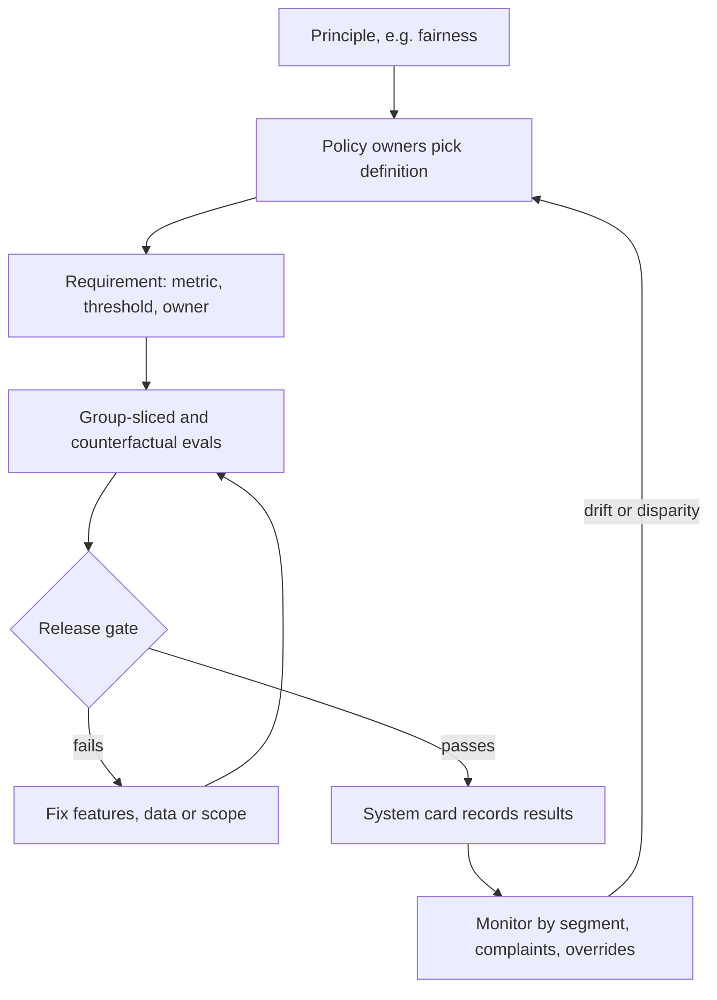

## TL;DR
Responsible AI turns values like fairness, transparency, accountability, privacy and safety into
requirements, metrics and owners per AI system. Principles alone change nothing: an accurate model can
still harm a group, so you measure and decide trade-offs explicitly.

## Why it exists
- **AI fails in ways ordinary software rarely does.** It learns patterns from historical data, including
  historical discrimination; produces fluent, confident output that may be false; acts at a scale where a
  small per-decision error rate becomes thousands of affected people; and its reasoning is hard to inspect.
- **These are not edge cases.** Hiring screens, credit scoring and content moderation systems have all been
  publicly criticized for disparate outcomes, and generative systems for fabricated facts.
- **A principles page fails predictably.** "We are committed to fair, transparent and accountable AI"
  cannot be tested, so it cannot block a release. Engineers cannot tell whether "fair" means equal
  approval rates, equal error rates or equal treatment of identical applicants, and those conflict
  mathematically. Nobody owns the decision, so nobody makes it.
- **Purely technical responses fail too.** "Run a bias toolkit, ship" misses that most harms come from
  use-case choices (should this be automated at all? can people contest it? do they know AI is
  involved?), not from a metric.
- **Responsible AI connects both layers:** socio-technical decisions about purpose and oversight, and
  technical measurements that make those decisions testable.

## How it works
### From principle to requirement
Each principle becomes a requirement with a metric, a threshold and an owner, scoped to a use case:

| Principle | Example requirement for a loan pre-screen |
|---|---|
| Fairness | Approval-rate ratio across protected groups at or above an agreed threshold; equal opportunity gap below a limit |
| Transparency | Applicants told AI is used; adverse decisions come with principal reasons |
| Accountability | A named owner; human review of all declines; audit trail of every decision |
| Privacy | Only documented features used; no protected attributes as inputs; retention limits |
| Reliability and safety | Performance monitored by segment; fallback to manual processing on drift |

### Fairness has several incompatible definitions
| Definition | What is equal across groups | Catch |
|---|---|---|
| **Demographic parity** | Selection rates | Easy to measure without labels, but ignores differences in qualification |
| **Equal opportunity** | True positive rates: qualified people selected at the same rate | Needs ground-truth labels, which are themselves often biased |
| **Equalized odds** | True positive *and* false positive rates | Strictest error-rate condition |
| **Calibration** | A score of 0.7 means the same outcome probability in every group | Conflicts with equal error rates when base rates differ |
| **Predictive parity** | Calibration's thresholded cousin: among people selected, the same share are truly positive (equal precision) | Same conflict |

### Why they conflict
- **The result.** Kleinberg et al. and Chouldechova showed that when base rates differ between groups, a
  non-perfect classifier cannot satisfy calibration and equal error rates at once.
- **The thresholded version is one line of algebra.** With base rate *p*, precision is:

```
PPV = p·TPR / (p·TPR + (1 − p)·FPR)
```

- **Equal error rates force unequal precision** when *p* differs, and equalizing precision forces the error
  rates apart (worked numbers below). The only escapes are equal base rates or a perfect classifier.
- **So choosing a definition is a policy decision with an owner,** not an engineering default: you are
  choosing which kind of unfairness you will tolerate.
- **Legal context constrains the choice.** US employment practice, for example, uses the "four-fifths" rule
  of thumb for adverse impact on selection rates.

### For generative systems
The same principles apply with different measurements:
- **Groundedness and hallucination rates.**
- **Refusal behaviour and harmful-content rates.**
- **Counterfactual consistency:** answers across names, dialects or demographic cues in otherwise identical
  prompts.
- **Disclosure** that users are talking to AI, and **provenance labelling** of generated media.

### The lifecycle
1. **Design:** decide whether to automate at all, who is affected, how decisions can be contested.
2. **Build:** data review, documented features, evaluation by group.
3. **Release:** thresholds as release gates; the model or system card records results.
4. **Operate:** monitor metrics by segment, collect complaints, re-evaluate on change.
5. **Govern:** review board for high-tier uses, escalation path, periodic audit.

## Diagram
Each principle becomes an owned, measured requirement; the gate and production monitoring both feed back
to the policy owners, who decide which definition and threshold apply.



## Examples
### Shortlisting tool: three fairness views on the same data
A recruiter tool shortlists applicants. On a labelled evaluation set, the team computes the two fairness
views the policy names.

```python
groups = {
    #        applicants, shortlisted, qualified, qualified_and_shortlisted
    "A": dict(n=400, sel=120, qual=150, tp=110),
    "B": dict(n=300, sel=60,  qual=100, tp=55),
}

rates = {g: d["sel"] / d["n"] for g, d in groups.items()}
tpr = {g: d["tp"] / d["qual"] for g, d in groups.items()}

impact_ratio = min(rates.values()) / max(rates.values())
tpr_gap = max(tpr.values()) - min(tpr.values())

print({g: round(r, 3) for g, r in rates.items()})   # A 0.30, B 0.20
print(round(impact_ratio, 3))                        # 0.667, below a 0.8 rule-of-thumb
print({g: round(t, 3) for g, t in tpr.items()})      # A 0.733, B 0.55
print(round(tpr_gap, 3))                             # 0.183: qualified B applicants missed more often
```

- **Both views flag a problem; equal opportunity is sharper.** Qualified applicants in group B are
  shortlisted far less often, so the gap is not explained by qualification (qualification rates are
  0.375 and 0.333, much closer than the selection rates).
- **The default view says "fair".** Precision is 110/120 ≈ 0.917 for A and 55/60 ≈ 0.917 for B:
  identical. A team that measured only "when we shortlist someone, are they equally likely to be
  qualified?" would declare this tool fair.
- **That is the impossibility result in miniature:** the same data is fair, unfair, or sharply unfair
  depending on the definition.
- **What the team did.** Traced the gap to a feature correlated with group membership (gaps in employment
  history), removed it, re-evaluated, and recorded before-and-after results and the chosen definitions in
  the system card.
- **Who decided.** The HR and legal owners made the policy decision about which threshold applies, not the
  engineer running the script.

### Worked numbers: equal error rates force unequal precision
Hold TPR = 0.8 and FPR = 0.1 equal for two groups (equalized odds) with base rates 0.5 and 0.2.

| Group | Base rate *p* | p·TPR | p·TPR + (1 − p)·FPR | PPV |
|---|---|---|---|---|
| A | 0.5 | 0.40 | 0.40 + 0.05 = 0.45 | 0.40 / 0.45 ≈ 0.89 |
| B | 0.2 | 0.16 | 0.16 + 0.08 = 0.24 | 0.16 / 0.24 ≈ 0.67 |

- **Same error rates, different precision.** A selected person in group B is truly positive about 67% of
  the time against 89% in group A.
- **Fixing precision breaks error rates.** Moving B's threshold to raise its PPV changes its TPR and FPR,
  so equalized odds no longer holds.

## Production patterns
- **Fairness metrics as a CI release gate.** Run group-sliced metrics in the eval harness on every
  candidate, for example Fairlearn's `MetricFrame` with `selection_rate` and `true_positive_rate` per
  sensitive feature, and fail the build when the agreed ratio or gap is breached. Monitor the metric
  trend per release, not just pass or fail.
- **Protected attributes in a separate evaluation store.** Keep group labels out of model inputs but in an
  access-controlled table joined only at evaluation time. Monitor who queries it, since that access is
  itself sensitive.
- **Counterfactual prompt suites for generative systems.** Template each test prompt and swap names,
  dialect or demographic cues while holding content fixed, then score both answers with the same
  grader. Track the quality gap per cue and alert when it widens between releases.
- **Override and review-time monitoring.** For human-in-the-loop decisions, log reviewer, decision and
  time spent per case. Approval rates near 100% at a few seconds per case signal automation bias; review
  those reviewers' workload and authority.
- **Complaints keyed to decision IDs.** Give every adverse decision an ID shown to the affected person
  and route complaints with it, so contestations join to the audit trail. Monitor complaint and
  overturn rates by segment.

## Trade-offs
- **Demographic parity vs equal opportunity.** Parity is simple to monitor without labels, but can select
  less-qualified candidates when base rates truly differ; equal opportunity fits better when labels are
  trustworthy.
- **Removing protected attributes vs measuring disparity.** It avoids direct discrimination, but blinds you
  to measuring disparity and does not remove proxies; keep attributes for evaluation under access controls
  instead.
- **Human review vs automation bias.** Review adds accountability, but reviewers who approve nearly
  everything provide automation bias, not oversight; it pays only when reviewers have time, context and
  authority to disagree.
- **Explanations vs faithfulness.** Explanations increase transparency and contestability, but post-hoc
  explanations of complex models can be unfaithful; for high-stakes decisions an inherently interpretable
  model may be worth the accuracy cost.

## Pitfalls
- **Publishing principles with no metrics, thresholds or owners.** Symptom: no release has ever been
  blocked on responsible AI grounds.
- **Measuring fairness only in aggregate or on a convenience sample.** Symptom: a disparity first reported
  by affected users or the press.
- **Picking a fairness metric because the toolkit defaults to it.** Symptom: a dispute late in the project
  about which definition the business actually meant.
- **Treating "a human is in the loop" as sufficient.** Symptom: review logs showing near-100% approval in
  seconds per case.
- **Testing generative systems only with neutral prompts.** Symptom: different answer quality when names or
  dialect change in otherwise identical questions.

## When to use
- **Apply proportionately:** every AI system gets basic transparency and an owner.
- **Go deep when:** systems affect people's access to jobs, credit, housing, healthcare, education or legal
  outcomes; they need full fairness evaluation, oversight design and review board sign-off.
- **Start at design time,** because the most effective decision is often scoping (advisory instead of
  automated, or not building it).
- **Measure:** what the requirements name: group-level error rates, complaint and override rates,
  groundedness.
- **Interviews:** show you know fairness definitions conflict and that choosing one is an accountable
  policy decision.

## Role lens
- **Engineer:** Builds group-sliced and counterfactual evaluations into the eval harness and wires the
  agreed thresholds in as release gates rather than one-off notebook checks.
- **Architect:** Places oversight, contestability, disclosure and monitoring into the system design and
  ensures each principle maps to a measurable requirement with an accountable owner.
- **FDE:** Translates a customer's policies and legal context into concrete fairness and transparency
  requirements and tests them on the customer's own population and data.

## Check yourself
**Q:** A product manager asks you to "make the credit model fair" before launch. What do you do first,
and why can you not simply pick a metric and optimize it?
**A:** First I would get the decision owners (risk, legal, compliance) to define what fair means for this
use, because fairness definitions conflict. With different default rates across groups, a realistic model
cannot be both calibrated and have equal error rates, so equal approval rates, equal opportunity and
calibration each imply different trade-offs and legal exposure. Then I would turn the chosen definition
into metrics and thresholds, evaluate on representative labelled data by group, check proxies, document
results in the model card, and add monitoring by segment. Also: confirm contestability and adverse-action
explanations, since fairness is not only a metric.

## Interview questions
### What turns a responsible AI principle into something that can block a release?
- **A requirement with a metric, threshold and owner,** scoped to one use case, for example an approval-rate
  ratio across groups at or above an agreed value for a loan pre-screen.
- **Wired in as a gate:** the eval harness computes it on every candidate and fails the build, so the
  principle has teeth instead of living on a web page.

### Your shortlisting model has equal precision across groups. Is it fair?
- **Not necessarily.** In the worked example both groups have precision ≈ 0.917, yet the impact ratio is
  0.667 and qualified B applicants are found 18 points less often.
- **Ask which definition the owners chose,** then compute that one, plus the others to show the trade-off.
- **Investigate proxies** such as employment gaps that correlate with group membership.

### Would you remove protected attributes from the model's inputs?
- **From inputs, often yes,** to avoid direct discrimination, but that alone is not fairness: proxies such
  as postcode still carry group information.
- **Keep the attributes for evaluation** in an access-controlled store, because without them you cannot
  measure disparity at all.

### How do you test an LLM assistant for unequal treatment?
- **Counterfactual suites:** identical prompts that differ only in names, dialect or demographic cues,
  scored by the same grader, with the gap tracked per cue.
- **Also measure** groundedness, refusal and harmful-content rates by segment, and check users are told
  they are talking to AI.

### A human reviews every AI decline. Is that enough oversight?
- **Only if the review is real.** Logs showing near-100% approval in seconds per case indicate automation
  bias, not oversight.
- **Give reviewers time, context and authority to disagree,** and monitor override rates and review time per
  case as health signals.

## Quiz
### Q: Why can't a team simply require a classifier to satisfy every common fairness definition at once?
- [ ] Fairness metrics are too expensive to compute together
- [x] When base rates differ across groups, calibration and equal error rates cannot both hold for an imperfect classifier
- [ ] Regulators only allow one fairness metric per model
- [ ] Demographic parity and equal opportunity are the same metric
> The impossibility results of Kleinberg et al. and Chouldechova show these criteria conflict under unequal
> base rates. Choosing among them is therefore a policy decision with an owner, not a technical oversight.

### Q: A team removes gender and ethnicity from model inputs and declares the model fair. What is the main flaw?
- [ ] Removing attributes always reduces accuracy too much
- [x] Proxies can still encode group membership, and without the attributes you cannot measure disparities
- [ ] Protected attributes are legally required inputs
- [ ] The model will refuse to train without them
> Features like postcode or employment gaps can correlate with protected groups, so outcomes may still
> differ. Keeping attributes for evaluation under access control lets you detect and fix that.

### Q: Which change most strengthens accountability in an AI-assisted decision process?
- [ ] Adding a disclaimer that the AI may make mistakes
- [ ] Increasing the model's accuracy on the aggregate test set
- [ ] Logging only the model's final score
- [x] A named owner, reviewers with authority and context to override, and an audit trail of decisions and overrides
> Accountability requires someone responsible, a real ability to disagree with the model, and evidence of
> what happened. Disclaimers and accuracy gains do not establish who answers for a decision.
