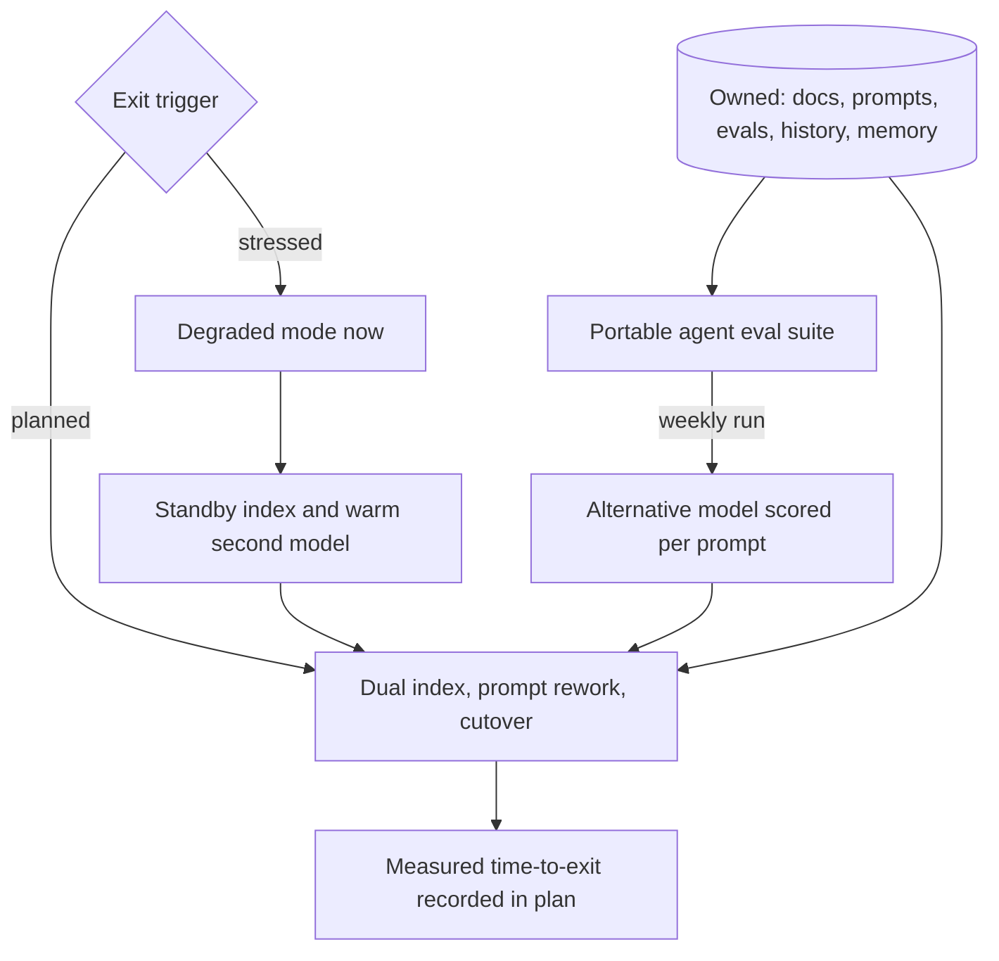

## TL;DR
A vendor exit strategy is a tested plan for moving an agent to another AI provider within a target time
and cost without losing data or quality. Lock-in hides in tuned prompts, tool-calling behaviour,
embeddings, fine-tunes and vendor-held memory.

## For agent builders
- **Why it matters for agents.** An agent is coupled to its model far beyond the HTTP call: prompts tuned
  to one model's quirks, how reliably it emits valid tool calls, how it handles refusals and structured
  output, and embeddings only that vendor's model can read. Swapping the client is a day; restoring task
  success can be weeks.
- **Where it shows up in your stack.** Your AI gateway (logical model names per route), your agent
  framework's provider adapter, the vector store's embedding model ID, any vendor-hosted thread, assistant,
  file or memory API, and the provider-independent agent eval suite.
- **What you control.** Keeping conversation history, agent memory, prompts and eval sets in your own
  systems; a thin provider boundary; a weekly run of the agent eval suite against an alternative model; and
  a degraded mode that works with no vendor at all.
- **What you can skip.** Abstracting every proprietary feature away. Use a vendor-specific capability when
  its value beats the exit cost you have written down.

## Decision case
### Scenario
An EU bank runs a customer-service agent on one vendor for generation, tool calling and embeddings. The
agent supports a function the bank classes as important under DORA, so the regulator expects a tested exit
plan. The team must choose how ready to be.

All costs are illustrative, in $k over a 2-year horizon,
including the business impact of the time to exit.
- **Probability of a forced or stressed exit within 2 years:** estimated at 0.15.
- **Cost of an exit unprepared:** 2,500 (about a week without the agent plus an emergency migration).
- **Constraints:**
  - after a vendor failure, degraded service within 4 hours and full service within 2 weeks;
  - a readiness budget of 120 a year, so 240 over the horizon;
  - 3 engineers on the agent team;
  - customer history and agent memory must stay in the bank's own systems (already true).

### Options
| Option | How it works | Cost of exit if prepared | Cost of staying ready | Expected saving: 0.15 × (2,500 − prepared) | Net | Degraded in 4 h? |
|---|---|---|---|---|---|---|
| **A. Cold** | owned data and prompts only; nothing pre-built | 2,500 | about 20 | 0 | about −20 | no: re-embedding alone takes days |
| **B. Warm standby** | weekly eval run on a second model for the critical prompts, a standby index of the most-retrieved documents, a tested degraded mode | 400 | 180 | 315 | +135 | yes |
| **C. Active-active** | 10% of live traffic on a second vendor, every prompt maintained twice | 150 | 600 | 352.5 | −247.5 | yes, in seconds |

### Decision
Choose **B, warm standby**, because it is the only option with a positive net value that also meets the
4-hour degraded-service target within budget.
- **Value:** B saves an expected 315 for 180 of readiness cost; C saves 352.5 but costs 600.
- **Budget:** B's 180 fits under 240; C's 600 does not.
- **Target:** the standby index and degraded mode give service in hours, which A cannot.
- **Incremental check:** moving from B to C buys 0.15 × (400 − 150) = 37.5 of expected saving for 420
  more cost, so C loses at any probability, since even at certainty it buys only 250.

**What would change it:**
- **A much higher exit probability** (vendor financial trouble): at 0.3, B nets +450 and C +105, so B still
  wins, but the case for testing the full migration grows.
- **A contract or regulator demanding no interruption at all:** the hours in degraded mode then carry a
  cost B cannot avoid, and C becomes the requirement, not an option.
- **A second vendor cheaper per token at volume:** the cost of staying ready in C falls and must be
  recomputed.

### Trade-offs accepted
- **Non-critical prompts drift on the alternative.** Only the critical prompts run weekly. Track how many
  production prompts have not been evaluated on the alternative in the last quarter.
- **Degraded mode is worse service.** Customers get search and templated answers for hours. Measure its
  task success in the quarterly drill and publish the number in the exit plan.
- **The 0.15 probability is a judgement.** Revisit it at each renewal and after any vendor incident.
- **Fine-tunes stay vendor-bound.** Keep training data and recipe in the bank's repository so one can be
  rebuilt elsewhere.

### Review rubric
- **Each option is priced with the readiness formula** over a stated horizon, with costs that include the
  business impact of time to exit.
- **The incremental value of the next readiness level is computed**, not only each option against doing
  nothing.
- **Planned and stressed exits are separated**, with a time target for each.
- **The plan names what is pre-built** (second model, standby index, degraded mode) and how it is tested.
- **Ownership of state is checked:** history, memory, prompts and eval sets live in your systems.
- **Guessed probabilities and costs are flagged**, with a review trigger.

## Why it exists
- **Organizations leave AI vendors for many reasons:** price changes, a model deprecated on the vendor's
  schedule, a better model elsewhere, data-residency or sovereignty rules, a security incident, an
  acquisition, or a regulator asking how a critical service would continue if the provider failed.
- **In financial services that last point is formal.** The EU's DORA regulation expects exit strategies for
  ICT third-party services that support critical or important functions.
- **AI coupling is behavioural, not just technical.** Swapping the HTTP client takes a day. But prompts were
  tuned to one model's quirks, eval thresholds were set on its outputs, every vector came from its embedding
  model (and vectors from different embedding models are not comparable), a fine-tune may exist only on its
  platform, and "assistant" or "thread" APIs may hold history and files you have no copy of.
- **"We use an abstraction layer" covers the API shape and nothing else.** The first switch attempt finds
  quality dropped on a third of eval cases, re-embedding takes days under rate limits, and nobody has the
  system prompts' history.
- **An exit strategy turns "we could switch" from a belief into a measured property.** Planning exit early is
  cheap; discovering lock-in during a price rise, outage or deprecation is not.

## How it works
### 1. Map the lock-in surface
List what would have to move or be rebuilt per vendor, *because* you can only plan for coupling you can
name:

| Surface | Examples |
|---|---|
| **API and features** | Request formats, tool calling conventions, structured output modes, proprietary features (built-in retrieval, server-side state, batch endpoints) |
| **Behaviour** | Prompts, few-shot examples and thresholds tuned to this model; how reliably it picks the right tool and fills arguments |
| **Derived data** | Embeddings, fine-tuned weights, cached outputs, vendor-side indexes |
| **State** | Conversation threads, uploaded files, agent memory held by the vendor |
| **Operational** | Monitoring, billing and identity integrations, data processing agreements, certifications customers rely on |

### 2. Keep what you need to leave, under your control
- **Own the source of truth.** Original documents, prompts (in a prompt registry), eval sets, labelled data,
  conversation history and agent memory live in your systems; anything vendor-side is a copy. This is the
  single most important control *because* everything else can be regenerated from it.
- **Thin abstraction at the boundary.** An AI gateway or provider interface normalizes requests, tool
  definitions, logging and auth, so a switch is configuration plus prompt changes, not a rewrite. Keep it
  thin; abstracting away every proprietary feature costs you their benefits.
- **Portable evaluation.** A provider-independent eval suite with task-specific acceptance criteria (for
  agents: task success, tool-call validity, wrong-tool rate, steps per task) makes a switch measurable.
  Without it you cannot tell whether the new vendor is good enough.
- **Record embedding model IDs with every vector,** *because* a migration needs dual indexes and a cutover,
  not an in-place mix of incompatible vectors.
- **Prefer exportable artifacts.** Fine-tune with methods and platforms that let you keep the weights, or at
  least the training data and recipe, so the fine-tune can be reproduced elsewhere.

### 3. Negotiate the exit into the contract
These cost little to ask for at signing and a lot afterwards:
- **Deprecation notice periods** for models, and **price-change notice**.
- **Data export** in usable formats, and **deletion with written confirmation**.
- **Transition assistance** and **continued service during a wind-down**.

### 4. Plan two exits, not one
| | Planned exit | Stressed exit |
|---|---|---|
| **Triggers** | Price rise, better model, renewal | Vendor outage, insolvency, sanctions, security incident, model pulled with no notice |
| **Timeline** | Yours: weeks to months | Nobody's |
| **Old vendor** | Still serving while you migrate | May already be gone |
| **Preparation** | Owned data, evals, a migration runbook | Pre-built what cannot be built quickly |

- **They need different preparation,** *because* steps that are fine in a planned exit, such as five days of
  re-embedding or two weeks of prompt rework, are an outage in a stressed one.
- **For a stressed exit, pre-build:**
  - a secondary model already passing the eval suite for the critical workflows;
  - a degraded mode that does not need the vendor at all (keyword search, templated answers, a human queue);
  - if retrieval is critical, a standby index built with another embedding model.

### 5. Decide how ready to be
Exit readiness is insurance, so price it like insurance:

```
buy readiness when  P(exit within horizon) × (cost unprepared − cost prepared)  >  cost of staying prepared
```

- **"Cost" includes the business impact of the time to exit,** not just engineering hours.
- **So a prototype needs only owned data and prompts,** while a revenue-critical workflow justifies a warm
  second provider: the probability may be similar, but the cost of a slow exit is not.

### 6. Write and test the plan
- **Define** exit triggers, a target time-to-exit, the alternative vendor or self-hosted option per
  component, and the steps.
- **Test it:** periodically run the eval suite against the alternative, and do at least a partial migration
  (one workflow, one index shard) so the estimate is measured, not guessed.

## Diagram
Most of the plan is preparation that pays off in both exits; the stressed path relies on what was
pre-built, because the old vendor may no longer answer.



## Examples
### Time-to-exit and readiness calculator
Size re-embedding by throughput, not price, and check whether warm readiness is worth buying. Prices,
rates and costs are illustrative assumptions, not quotes.

```python
def reembed_days(docs, chunks_per_doc, tokens_per_chunk, tokens_per_min):
    tokens = docs * chunks_per_doc * tokens_per_chunk
    return tokens, tokens / tokens_per_min / 60 / 24

def reembed_cost(tokens, usd_per_million):
    return tokens / 1e6 * usd_per_million

full, days = reembed_days(2_000_000, 10, 400, 1_000_000)
print(f"full corpus: {full / 1e9:.0f}B tokens, {days:.1f} days")              # 8B tokens, 5.6 days
print(f"cost: ${reembed_cost(full, 0.02):,.0f} to ${reembed_cost(full, 0.13):,.0f}")  # $160 to $1,040
standby, sdays = reembed_days(50_000, 10, 400, 1_000_000)
print(f"standby: {standby / 1e6:.0f}M tokens, {sdays * 24:.1f} hours")       # 200M tokens, 3.3 hours

def readiness_worth_it(p_exit, cost_unprepared, cost_prepared, cost_stay_ready):
    """Buy readiness when expected savings exceed the cost of staying prepared."""
    return p_exit * (cost_unprepared - cost_prepared) > cost_stay_ready

# Illustrative 2-year horizon, costs in $k including business impact of time to exit.
print(readiness_worth_it(0.2, 2_000, 300, 150))   # revenue-critical workflow: True (340 > 150)
print(readiness_worth_it(0.2, 60, 40, 150))       # prototype: False (4 < 150)
```

### Worked scenario: the board asks how fast the insurer could exit
An insurer's claims agent uses one vendor for generation, tool calling and embeddings. The team sizes each
surface (prices and rates are illustrative assumptions, not quotes):

| Surface | Finding | Estimate |
|---|---|---|
| **Re-embedding** | 2 million documents, about 10 chunks each of 400 tokens: 20M chunks × 400 = 8 billion tokens. At $0.02 to $0.13 per million tokens that is roughly $160 to $1,040, so money is not the constraint. | At an assumed 1 million tokens per minute, 8,000 minutes ≈ 5.6 days, plus building and validating a second index while the first keeps serving |
| **Prompts and quality** | 38 production prompts; the 1,200-case eval suite against the alternative shows 31 pass unchanged, 7 need rework (mostly structured-output, tool-argument and refusal behaviour) | Two engineer-weeks |
| **Fine-tune** | A classification fine-tune lives only on the vendor platform; weights not exportable. Training data and recipe are in their own repository. | Reproduce on an open-weight model in about a week, including evaluation |
| **State** | Conversation history and agent memory are in their own database, not the vendor's thread API | Nothing to migrate |

- **Planned result:** measured time-to-exit about 4 weeks, dominated by prompt rework and parallel indexing.
- **The board's real question is the stressed case.** If the vendor were unavailable tomorrow, claims intake
  would stop for at least the 5.6 days of re-embedding.
- **What the team pre-built:**
  - a small standby index of the 50,000 most-retrieved documents with a second embedding model (about 200
    million tokens, a few hours of embedding);
  - the 5 highest-volume prompts routed through the alternative model in a weekly eval run;
  - a degraded mode where adjusters get keyword search and no generated summaries.
- **Stressed time-to-degraded-service drops from about a week to hours.**
- **Follow-through:** recorded in the exit plan; model deprecation notice and data deletion confirmation added
  to the renewal negotiation; a quarterly eval run against the alternative keeps the estimate current.

### Worked scenario: where the agent's tool calling breaks on the alternative model
The same team runs its agent trajectory suite on the alternative model through the gateway, changing only
the logical model name. Counts are illustrative.

| Agent metric (200 tasks) | Primary model | Alternative, prompts unchanged | Alternative, after rework |
|---|---|---|---|
| Task success | 172 | 141 | 168 |
| Tool calls with invalid arguments | 6 | 29 | 8 |
| Wrong tool chosen | 9 | 18 | 10 |
| Median steps per task | 4 | 6 | 4 |

- **The gap is behavioural.** The gateway made the call work on day one; tool descriptions and few-shot
  examples tuned to the primary model caused most invalid arguments.
- **The suite turns rework into a number:** rewrite tool descriptions, add argument examples, re-run until
  task success is within the agreed margin, and record the effort as the measured exit cost.

## Production patterns
- **Gateway with logical model names.** Route all agent calls through an AI gateway (for example a LiteLLM
  proxy, whose `model_list` maps a name your code uses to a provider model) so a switch is a config change
  per route. Monitor the share of traffic that bypasses the gateway with direct SDK calls.
- **Own the agent's state.** Store conversation history, agent memory and uploaded files in your own database
  and send them per request, rather than relying only on a vendor-hosted thread or memory API. Monitor any
  feature whose data exists only vendor-side.
- **Embedding model ID on every vector and index alias cutover.** Store the embedding model ID in each
  vector's metadata, build the new index alongside the old, and switch with a search-engine index alias or a
  config pointer once evals pass. Alert if one index ever contains more than one embedding model ID.
- **Scheduled eval against the alternative.** A weekly job runs the provider-independent agent suite on the
  second provider and records pass rate per prompt and tool-call validity. Monitor that pass rate as the live
  measure of exit readiness, and how many prompts would need rework.
- **Exit terms tracked per vendor.** Keep a register of deprecation notice, export format, deletion
  confirmation and wind-down terms per AI vendor, reviewed at each renewal. Monitor critical-path vendors with
  no recorded exit terms.
- **Degraded-mode drill.** Each quarter, disable the primary provider in a staging or low-traffic environment
  and confirm the degraded mode and standby index serve the critical workflow. Track time to degraded service
  against the plan's target.

## Trade-offs
- **Thin gateway vs proprietary features.** It keeps switching cheap but forgoes some proprietary features;
  using a vendor-specific capability (hosted tools, server-side memory) is fine when its value exceeds the
  extra exit cost you have consciously recorded.
- **Multi-vendor in production vs maintenance.** A live fallback gives constant exit readiness, but doubles
  evaluation, prompt maintenance and security review; it pays off only for critical or high-volume
  workloads.
- **Self-hosting vs new lock-in.** Open-weight models remove model-vendor lock-in but move it to GPU capacity,
  serving software and in-house skills; it flips in favour when residency or cost at scale dominates.
- **Strong exit terms vs leverage.** Negotiating them costs leverage at signing; for small spend vendors may
  refuse, so compensate with technical controls such as owning all source data.

## Pitfalls
- **Treating an SDK abstraction as the whole strategy.** Symptom: a switch attempt that compiles in a day and
  fails quality review for a month. Fix: a portable agent eval suite run regularly.
- **Storing conversation state, memory or files only in a vendor's managed thread or assistant API.**
  Symptom: an export request that returns partial data or nothing usable. Fix: own the state.
- **Mixing vectors from two embedding models in one index during migration.** Symptom: retrieval quality
  collapsing for no obvious reason. Fix: dual indexes and an alias cutover.
- **Having no provider-independent eval suite.** Symptom: a migration decision made on vibes from a handful of
  demo prompts. Fix: task-level acceptance criteria per workflow.
- **Ignoring model deprecation schedules.** Symptom: a forced migration on the vendor's timeline with no
  tested alternative. Fix: track deprecation dates and keep a scored alternative.
- **Planning only the orderly exit.** Symptom: an exit plan whose first step assumes the old vendor is still
  answering requests during a vendor outage. Fix: a pre-built degraded mode.

## When to use
- **Use when:** any vendor is on the critical path of a production agent; write the plan before signing or
  renewing and scale its depth with criticality and spend.
- **Prototype:** owning your data and prompts is enough.
- **Regulated, customer-facing or high-volume agents:** add contract terms, a measured time-to-exit, and
  regular tests against an alternative.
- **Revisit when:** the vendor changes pricing, terms or models, or when you adopt a vendor-specific feature
  such as hosted memory or built-in tools.
- **Interviews:** show you know lock-in is behavioural and data-level, not just API-level, and that exit
  readiness is measured with evals.

## Role lens
- **Engineer:** Keeps prompts, evals and embeddings versioned and provider-independent, and makes the
  gateway the only place that knows provider-specific request formats.
- **Architect:** Decides which vendor-specific features are worth their recorded exit cost, sets the
  time-to-exit target per component, and owns the exit plan and its periodic tests.
- **FDE:** Answers the customer's procurement and risk teams on portability, data export and deletion, and
  often builds deployments that must run on the customer's preferred provider instead.

## Check yourself
**Q:** Leadership says "we're not locked in, everything goes through our LLM gateway." What questions
would you ask to test that claim?
**A:** The gateway covers request format, not behaviour or data. I would ask: do we have a provider-independent
eval suite and have we run it against an alternative recently, and with what result per prompt? Which
embedding model produced our vectors, how large is the corpus, and how long would re-embedding take under
realistic rate limits? Do any fine-tunes, files or conversation threads live only on the vendor's
platform? Which vendor-specific features do we rely on? What do our contracts say about deprecation
notice, data export and deletion? The honest answer is a measured time-to-exit, not a yes or no.

## Interview questions
### Where does lock-in actually hide in an LLM application or agent?
- **Behaviour:** prompts, few-shot examples, tool descriptions and thresholds tuned to one model's quirks.
- **Derived data and state:** embeddings only that model can read, unexportable fine-tunes, threads, memory
  and files held by the vendor.
- **Operations and contracts:** monitoring, identity, DPAs and certifications customers rely on. The API
  shape is the easy part.

### Your agent's provider deprecates its model in 90 days. How do you migrate the agent safely?
- **Run the agent trajectory suite** on candidate models through the gateway: task success, invalid tool
  arguments, wrong-tool rate and steps per task, against the current model's baseline.
- **Rework where it breaks:** tool descriptions, argument examples and structured-output prompts, re-running
  until within the agreed margin.
- **Cut over by route** with the logical model name, canary a share of traffic, and keep the old model
  pinned until the new one holds in production.

### How would you migrate a 20M-chunk vector index to a new embedding model without downtime?
- **Build a second index alongside the first,** tagged with the new embedding model ID, under rate-limit
  aware batch jobs (days, at 1 million tokens per minute for 8 billion tokens).
- **Evaluate retrieval on both,** then cut over with an alias or config pointer; never mix models in one index.
- **Keep the old index serving** until the new one passes, so rollback is a pointer flip.

### What is the difference between a planned and a stressed exit, and why plan both?
- **Planned** runs on your timeline with the old vendor still serving; **stressed** happens with no notice
  and the old vendor may be gone.
- **Steps that are fine in a planned exit** (days of re-embedding, weeks of prompt rework) are an outage in a
  stressed one, so you pre-build a standby index, a warm second model and a degraded mode.

### Would you run two LLM providers in production to stay exit-ready?
- **Only for critical or high-volume workloads,** because it doubles evaluation, prompt maintenance and
  security review.
- **Use the insurance test:** probability of exit times the saving from being prepared, against the cost of
  staying prepared.
- **For everything else,** owned data, a portable eval suite and a weekly run against the alternative are
  enough.

### A key fine-tune lives only on the vendor's platform. What do you do?
- **Keep the training data and recipe in your own repository** so it can be reproduced elsewhere, as the
  insurer did in about a week including evaluation.
- **Prefer platforms or methods with exportable weights** for future fine-tunes, and record the remaining
  exit cost explicitly.

## Quiz
### Q: Why does switching embedding providers usually require re-embedding the whole corpus?
- [ ] Vector databases are tied to the embedding vendor's licence
- [x] Vectors from different embedding models live in different spaces and cannot be meaningfully compared
- [ ] Old embeddings expire after a fixed period
- [ ] New providers refuse to accept vectors created elsewhere
> Each embedding model learns its own geometry, so a query vector from model B cannot be compared with
> document vectors from model A. Migration therefore needs a full re-embed into a new index and a cutover.

### Q: Which control most reduces the cost of exiting an AI vendor?
- [ ] Using every proprietary feature to maximize value before leaving
- [ ] Signing a longer contract for a lower price
- [x] Keeping source documents, prompts, eval sets and conversation history in your own systems
- [ ] Caching the vendor's outputs indefinitely
> Owned source data lets you regenerate embeddings, rebuild fine-tunes and re-evaluate on any provider.
> Cached outputs from the old model do not help produce a working system on a new one.

### Q: A team claims portability because their code calls models through a common interface. What is the most likely gap?
- [ ] The interface adds too much latency
- [ ] Common interfaces cannot handle streaming
- [x] Prompts and thresholds tuned to one model may fail quality checks on another, which only an eval suite reveals
- [ ] The interface requires the same pricing across vendors
> API compatibility is the easy part. Behavioural coupling means the same prompt can produce different
> structure, refusals and quality, so portability must be demonstrated by running acceptance evals.

## Use cases & projects
### Use cases
- **Model deprecations.** A provider retires the model your agent was tuned on; the portable eval suite
  measures the migration instead of guessing it.
- **Data-residency deals.** A customer requires a provider or region you do not use; owned state and a thin
  gateway make a per-tenant provider route feasible.
- **Regulated resilience reviews.** DORA-style questions about continuing a critical agent workflow if the
  provider fails are answered with a measured stressed-exit time.
- **Cost renegotiation.** A scored alternative model gives real leverage at renewal.

### Mini project
**Measure your agent's exit cost (2-3 hours).**
- **Goal:** turn "we could switch providers" into a measured number for one small agent.
- **Steps:** route a tool-calling agent through a gateway with a logical model name; keep history and memory
  in your own store; build a 50-task trajectory suite recording task success, invalid tool arguments,
  wrong-tool rate and steps; run it on two providers; rework tool descriptions for the weaker one and count
  the hours.
- **Done when:** you have a before-and-after table like the one above, the hours of rework, and a one-page
  exit plan with planned and stressed paths.
