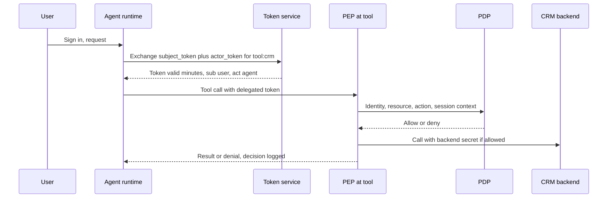

## TL;DR
An agent inside your network is a trickable insider, so zero trust verifies each of its tool calls:
authenticated, authorised per resource against the delegating user's rights, and given least privilege
for the shortest time, whatever its network location.

## For agent builders
- **Why it matters for agents.** Your agent reads text an outsider can write, and holds credentials to
  real systems. If those credentials are a broad service account, one injected email becomes a
  cross-tenant breach that the logs attribute only to "support-bot".
- **Where it shows up in your stack.** The token exchange your agent runtime does before each tool call,
  the PEP in your tool dispatcher or gateway, the policy engine behind it, workload identity for agents
  and MCP or tool servers, and the egress policy of code sandboxes.
- **What you control.** Token audience, scope and lifetime per tool call, which session context the PEP
  sees (such as taint), where backend secrets are attached, and which egress destinations are allowed.
- **What you can skip.** An organisation-wide zero-trust programme. Delegated, scoped, short-lived tokens
  plus one PEP in front of your agent's tools give most of the benefit for one agent.

## Why it exists
- **The perimeter model trusted location.** Outside the VPN or firewall was hostile, inside was trusted;
  once past it, a user or service could reach databases and internal APIs largely on the strength of
  network location.
- **It failed for well-understood reasons.** Phished credentials put attackers inside, one compromised
  server could move laterally across the flat network, and cloud services, SaaS and remote work dissolved
  the line the perimeter assumed. Attackers who get inside, or components that are tricked, inherit
  everything the perimeter protected.
- **AI makes the perimeter assumption actively dangerous.** An agent inside your VPC typically holds a
  service credential for the CRM, document store and ticketing system, and it reads untrusted text:
  emails, web pages, uploaded files. Prompt injection means that text can steer its actions.
- **The agent is a confused deputy.** Under perimeter thinking it is "internal" and its broad credential is
  fine; in reality an outsider can direct it. Its network location says nothing about whose intent it is
  currently carrying out.
- **A tighter firewall or AI subnet does not help,** because the attacker's instructions arrive through
  legitimate data channels the agent is supposed to read. What is needed is per-request verification of
  who is asking, on whose behalf, for what resource, with what scope.

## How it works
### The core principles
NIST SP 800-207 frames zero trust around a few tenets, paraphrased here:
1. Treat all data sources and services as resources.
2. Secure all communication regardless of network location.
3. Grant access per session, per resource.
4. Decide access by dynamic policy using identity, device or workload posture and other signals.
5. Monitor the integrity and security posture of all assets.
6. Enforce authentication and authorisation dynamically and strictly before access.
7. Collect telemetry to improve policy over time.

- **"Assume breach" summarises the attitude:** design so that any one compromised component has a small
  blast radius.

### The architecture: PDP and PEP
| Component | Role | Examples |
|---|---|---|
| Policy enforcement point (PEP) | Sits in the request path, asks for a verdict, allows or blocks | Gateway, sidecar proxy, tool dispatcher |
| Policy decision point (PDP) | Evaluates identity, resource, action and context against policy | Central policy engine |

- **Separate them** so policy is written once and enforced uniformly, *because* scattering
  `if user.is_admin` checks across services is how gaps appear.

### Identity for everything, including workloads
- **Humans:** SSO with MFA.
- **Services:** workload identities, for example SPIFFE-style identities carried in mutual TLS certificates
  or cloud IAM roles, rather than shared static API keys.
- **Short-lived credentials,** *because* a stolen token that expires in minutes is worth far less than a key
  valid for a year.

### Applying it to agents: delegated tokens
**The agent is a principal, and it acts on behalf of a user.** Use delegated credentials, for example
OAuth token exchange (RFC 8693), so a downstream API sees both the agent and the user and applies the
user's permissions.

A shared service account that can read every customer's data turns any injection into a cross-tenant
breach. The flow:
1. **The user signs in;** the agent runtime holds the user's token (audience: the agent).
2. **Before a tool call,** the runtime sends that token to the token service as `subject_token`, with the
   agent's own workload credential as `actor_token`, asking for audience `tool:crm` and scope `crm:read`.
3. **The token service checks** that this agent may act for this user on that tool.
4. **It returns a token valid for minutes** whose `sub` is the user and whose `act` claim names the agent.
5. **The tool never sees the user's original token,** *because* a token valid at every service is a token
   any compromised service can replay everywhere.

### Applying it to agents: the other controls
- **Scope per task.** Mint tokens with the narrowest scopes and audiences the current tool call needs,
  not one token with every scope for the whole session.
- **Authorise every tool call at the PEP.** The model proposing a call is not authorisation; the PEP checks
  the delegated user's rights, the resource, the arguments and session context such as whether untrusted
  content has been read.
- **Treat model output as untrusted input** to every downstream system: validate, parameterise, never
  execute it with ambient privileges.
- **Control egress.** Agents and code sandboxes get default-deny outbound network access with explicit
  allowlists, since exfiltration needs a way out.
- **Keep secrets out of the context.** Credentials are attached by the runtime at the PEP, never placed in
  the prompt where the model could repeat them.

### Continuous verification
- **Decisions are re-evaluated per request,** so revoking a user, quarantining a workload or raising a risk
  signal takes effect on the next call rather than at the next login.
- **Caveat:** if a PEP only validates self-contained tokens (such as JWTs) locally, a revocation lands when
  the token expires unless the PEP also checks revocation or introspects the token, which is one more
  reason to keep lifetimes short.
- **Every decision is logged** with principal, delegator, resource and outcome, which is what makes
  incident reconstruction possible.

## Diagram
Follow one tool call: the runtime exchanges the user's token for a narrow, short-lived one, and the PEP
decides on the delegated user's rights before any backend secret is attached.



## Examples
### A PEP in front of tools
- **What it checks:** the agent presents a delegated token whose signature the PEP has already verified; the
  PEP checks audience, expiry, scope and the *user's* tenant against the specific record before attaching
  the real backend credential.
- **Session state travels separately.** Whether untrusted content has been read is passed as runtime
  context rather than baked into the token, *because* the token was minted before that state existed.
- **Simplified:** a real PDP would also check record-level rights.

```python
import time

def pdp_decide(claims: dict, ctx: dict, tool: str, resource: dict) -> tuple[bool, str]:
    if claims["exp"] < time.time():
        return False, "token expired"
    if claims["aud"] != f"tool:{tool}":
        return False, "token minted for a different tool"
    if f"{tool}:{resource['action']}" not in claims["scope"].split():
        return False, "scope missing"
    if resource["tenant"] != claims["tenant"]:
        return False, "cross-tenant access"
    if resource["action"] == "write" and ctx.get("session_tainted"):
        return False, "writes blocked after untrusted content"
    return True, "ok"

def pep_call(token_claims, ctx, tool, resource, backend):
    ok, why = pdp_decide(token_claims, ctx, tool, resource)
    audit = {"sub": token_claims["sub"], "act": token_claims["act"]["sub"], "tool": tool,
             "res": resource["id"], "decision": why}
    print(audit)                                   # ship to the audit log
    return backend(resource) if ok else None       # backend secret added here, never in the prompt

claims = {"sub": "user:ana", "act": {"sub": "agent:support-bot"}, "tenant": "t-42",
          "aud": "tool:crm", "scope": "crm:read", "exp": time.time() + 300}
ctx = {"session_tainted": True}                  # set by the runtime when untrusted content is read
read_ok = pep_call(claims, ctx, "crm", {"id": "acct-9", "tenant": "t-42", "action": "read"}, lambda r: "row")
other   = pep_call(claims, ctx, "crm", {"id": "acct-1", "tenant": "t-7", "action": "read"}, lambda r: "row")
```

- **The `act` claim** is how RFC 8693 records the actor in a delegated token.
- **The second call fails** even if an injected instruction convinced the model to fetch another tenant's
  account, because the decision uses the delegated user's tenant, not the agent's network position.
- **Two independent checks guard writes.** A write would fail on scope alone here, and even with a write
  scope the tainted context would block it.

### The token-exchange request itself
What the agent runtime sends to the token service in step 2, using the parameter names RFC 8693 defines.
Token values are elided; the token endpoint URL is whatever your identity provider exposes.

```http
POST /oauth2/token HTTP/1.1
Content-Type: application/x-www-form-urlencoded

grant_type=urn:ietf:params:oauth:grant-type:token-exchange
&subject_token=<user access token, audience: agent>
&subject_token_type=urn:ietf:params:oauth:token-type:access_token
&actor_token=<agent workload credential>
&actor_token_type=urn:ietf:params:oauth:token-type:jwt
&audience=tool:crm
&scope=crm:read
```

- **The returned token's claims** look like the `claims` dict above: `sub` is the user, `act.sub` is the
  agent, `aud` is the single tool, the scope is one permission, and `exp` is minutes away.
- **Whether your identity provider supports token exchange,** and how it lets you restrict which actors may
  exchange for which audiences, varies by product; check before designing around it.

### Worked comparison: blast radius of one injected email
| Question | Shared service account | Delegated, scoped tokens plus PEP |
|---|---|---|
| Whose data can a steered agent read? | Every customer the account can see | Only the current user's tenant |
| Can it write? | Yes, if the account can | Only with a write scope, and not after untrusted content |
| What does the audit log show? | "support-bot" did it | User, agent, tool, resource, decision |
| How long is a stolen credential useful? | Until someone rotates the key | Minutes |
| How fast does revocation take effect? | Next key rotation | Next call, or token expiry if validated locally |

## Production patterns
- **Token exchange at a central token service.** Implement the RFC 8693 flow in the agent runtime so
  every tool call carries a per-tool, per-user token. Monitor the share of tool calls whose token carries
  an `act` claim; anything below all of them is a shared-credential path.
- **Workload identity instead of static keys.** Issue agents and tool servers SPIFFE-style identities over
  mutual TLS or cloud IAM roles, and remove long-lived API keys from config. Monitor the count and age of
  static keys still in use.
- **Policy as code in the PDP.** Write tool authorisation rules in a policy engine such as Open Policy Agent,
  with unit tests and review for every change, since a policy bug affects every service at once. Monitor
  deny rates by rule and alert on sudden shifts after a policy deploy.
- **Default-deny egress for agents and sandboxes.** Use network policy plus an allowlisting egress proxy;
  open-web agents go through an inspecting proxy instead. Monitor new egress destinations and blocked
  attempts per session.
- **Short lifetimes, plus introspection for high-risk tools.** Keep delegated tokens to minutes, and for
  write or payment tools have the PEP introspect the token (OAuth token introspection, RFC 7662) so
  revocation is immediate. Monitor revocation lag and token lifetime distribution.

## Trade-offs
- **Per-request authorisation vs latency.** It shrinks blast radius but adds latency and a PDP dependency;
  caching decisions briefly helps, and stops being acceptable when revocation must take effect immediately.
- **Short-lived delegated tokens vs moving parts.** They limit theft value but need a token service and
  refresh logic; static keys are simpler only for low-risk, single-tenant internal tools.
- **Default-deny egress vs browsing agents.** It blocks exfiltration channels but breaks agents that
  legitimately browse; an allowlist works for known APIs and flips to a proxy with inspection for open-web
  tasks.
- **User-delegated permissions vs workflows that need more.** They keep agents within what the user may do,
  yet some workflows need actions the user cannot perform, which then require an explicit, audited
  elevation path.
- **Central policy engines vs shared failure.** They give consistency, but a policy bug now affects every
  service at once, so policy changes need review and tests like code.

## Pitfalls
- **Running the agent under one broad service account.** Symptom: audit logs show only "support-bot" and you
  cannot tell which user's request caused an action.
- **Putting API keys in the system prompt or tool descriptions.** They appear in traces and can be echoed
  back by an injected instruction.
- **Calling the setup "zero trust" because it uses mTLS** while authorisation is still coarse; encrypted
  lateral movement is still lateral movement.
- **Trusting MCP servers or internal tools because they run inside the VPC.** A compromised or malicious
  tool server returns poisoned results and receives whatever arguments the agent sends.
- **Long-lived tokens cached in agent memory or checkpoints,** which turn a stored-state leak into a
  credential leak weeks later.

## When to use
- **Use when:** any AI system holds credentials to real data or can take actions, which means any agent or
  tool-using assistant, and especially multi-tenant products.
- **Start with the highest-value move:** delegated, scoped, short-lived credentials and a single PEP in
  front of tools.
- **Scope it:** full organisation-wide zero trust is a multi-year programme; you do not need it to apply the
  pattern to one agent.
- **Measure:** the share of tool calls carrying user delegation, token lifetimes, denied-decision rates and
  egress destinations.
- **Interviews:** explain why network location says nothing about the intent an agent is currently serving.

## Role lens
- **Engineer:** Implements token exchange, scoped tool tokens, the PEP check before each tool call, and
  injects backend secrets at dispatch rather than in prompts.
- **Architect:** Decides where the PDP and PEPs sit, which identities exist for agents and tools, and
  which actions require elevation or human approval.
- **FDE:** Integrates with the customer's IdP and IAM, maps their roles into delegated scopes, and
  justifies egress allowlists to their security team.

## Check yourself
**Q:** An agent in a customer's VPC reads emails and can query their ERP through a service account with
read access to all business units. Security says it is fine because the VPC has no inbound internet
access. What is wrong with that argument, and what would you change?
**A:** Inbound network controls do not address the threat, because the attacker's instructions arrive in
emails the agent is designed to read; injection steers the agent, which then uses its all-units
credential from inside. Network location says nothing about whose intent the agent is serving. Replace
the service account with delegated credentials so ERP queries run with the requesting user's
permissions, scope tokens per tool and short expiry, put a PEP in front of the ERP tool that checks the
user's business unit, restrict egress, and log principal plus delegator for every call.

## Interview questions
### What does zero trust mean, and why does it matter for AI agents specifically?
- **Definition:** no implicit trust from network location; every request is authenticated, authorised per
  resource by policy, and given least privilege for the shortest time, designed on the assumption of breach.
- **Why agents:** an agent reads untrusted text that can steer it, so it is a trickable insider; its tool
  calls must be verified against the delegating user's rights, not trusted because they come from the VPC.

### Walk me through how an agent should call a CRM on behalf of a user.
- **Token exchange:** the runtime trades the user's token plus its own workload credential for a token with
  audience the CRM tool, one scope, minutes of life, `sub` the user and `act` the agent.
- **PEP check:** before the call, verify audience, expiry, scope, the user's tenant against the record, and
  session context such as taint.
- **Attach secrets at dispatch,** log principal, delegator, resource and decision.

### When might you accept a static API key or a cached authorisation decision?
- **Static keys** only for low-risk, single-tenant internal tools, where the token service and refresh logic
  cost more than the theft risk.
- **Cached decisions** briefly, to cut PDP latency, but not where revocation must take effect immediately,
  such as write or payment tools.

### A user is offboarded but the agent keeps acting for them for a few minutes. Why, and what do you change?
- **Likely cause:** the PEP validates self-contained JWTs locally, so revocation lands only when the token
  expires.
- **Fix:** keep lifetimes short, and for high-risk tools introspect the token or check a revocation list at
  the PEP so the next call is denied.
- **Measure** revocation lag as a tracked number.

### A team says their agent setup is zero trust because all traffic uses mTLS. What do you check?
- **mTLS gives workload identity and encryption, not authorisation.** Check whether each tool call is
  authorised against the delegating user's rights at a PEP, or whether one broad service account still does
  everything.
- **Also check** egress controls, secrets kept out of prompts, and whether MCP or internal tool servers are
  trusted merely for being inside the VPC.

## Quiz
### Q: What is the main reason a shared service account is a poor identity for a multi-user agent?
- [ ] Service accounts cannot use mutual TLS
- [ ] Service account tokens are always long-lived by design
- [x] Every request runs with the union of all users' access, so a misled agent can reach any user's data
- [ ] Identity providers do not allow service accounts to call APIs
> A shared account erases who the agent is acting for, so authorisation cannot apply the user's limits
> and logs cannot attribute actions. Delegated tokens keep both the agent and the user visible.

### Q: In a zero-trust architecture, what does the policy enforcement point do?
- [ ] It authors and stores the access policies for the organisation
- [x] It intercepts each access, asks the decision point for a verdict, and allows or blocks the request
- [ ] It issues long-lived credentials to trusted internal workloads
- [ ] It monitors network traffic for anomalies after access has been granted
> The PEP sits in the request path and enforces; the PDP evaluates policy. Separating them keeps policy
> consistent while enforcement happens at every gateway, proxy or tool dispatcher.

### Q: Which control applies zero trust most directly to an agent's tool calls?
- [ ] Moving the agent to a private subnet with no inbound access
- [ ] Encrypting the vector database at rest
- [ ] Adding a system prompt telling the agent to respect user permissions
- [x] Authorising each call with a short-lived token scoped to that tool and the delegating user's rights
> Zero trust verifies every request against identity and policy. Network isolation and encryption at
> rest are useful but do not decide whether a specific call is permitted, and prompts enforce nothing.

## Use cases & projects
### Use cases
- **Multi-tenant support and CRM agents.** Delegated tokens keep a steered agent inside the requesting
  user's tenant and make every action attributable to user plus agent.
- **Agents connecting to MCP or internal tool servers.** Workload identity and a PEP in front of each server
  replace "it runs in the VPC" as the reason to trust it.
- **Coding and data agents with sandboxes.** Default-deny egress and secrets attached at dispatch stop an
  injected instruction from shipping data or keys out.
- **Agents deployed in a customer's estate.** Mapping the customer's IdP roles into delegated scopes is
  usually what gets the deployment through their security review.

### Mini project
**Put a PEP in front of an agent's tools (2-3 hours).**
- **Goal:** show that an injected instruction cannot read another tenant's data or write after untrusted
  content, whatever the model proposes.
- **Steps:** give a small tool-calling agent a fake CRM with two tenants; mint short-lived claims dicts
  per tool call (`sub`, `act`, `aud`, `scope`, `exp`, tenant) in place of a real token service; route every
  call through `pep_call`; plant an injected email asking for the other tenant's account and a write.
- **Done when:** both injected calls are denied with logged reasons, the audit log names user and agent
  for every call, and an expired token is refused on the next call.
