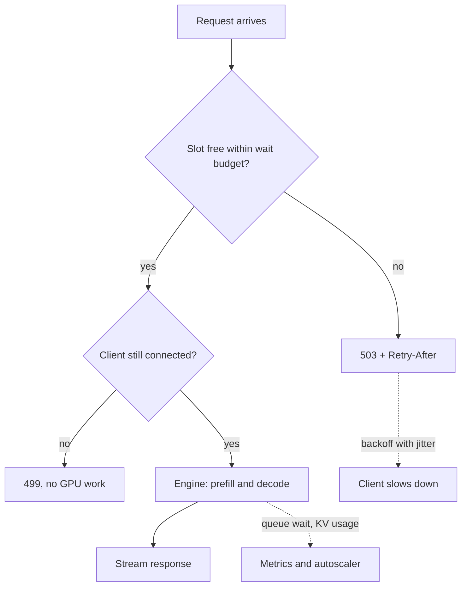

## TL;DR
One agent run fans out into many model and tool calls, so overload arrives faster than with chat.
Backpressure bounds admission per run, measures queue wait, and rejects the excess fast with 429 or 503
plus `Retry-After`.

## For agent builders
- **Why it matters for agents.** A user turn is not one request: a ReAct loop often makes 5-20 model calls
  (illustrative), and parallel tool calls or sub-agents multiply that. Ten users can look like two
  hundred requests, and a run
  shed at step 9 has already wasted eight steps of GPU time and tokens.
- **Where it shows up in your stack.** Provider 429s and `Retry-After` reaching your agent loop; the
  concurrency setting on LangChain or LangGraph batch and parallel execution; vLLM's `--max-num-seqs` and
  waiting gauges when you self-host; the semaphore in your FastAPI agent server.
- **What you control.** Admit whole runs at the front door, cap parallel tool and sub-agent fan-out, give
  each run a step and token budget, and make the loop honour `Retry-After` instead of hammering.
- **What you can skip.** Queueing-theory proofs and CoDel internals. Little's law and "bound queue time,
  not queue length" are enough to size an agent gateway.

## Why it exists
- **Capacity is fixed.** The running batch is capped by KV-cache memory (`max_num_seqs` and free cache
  blocks in vLLM), and token output is capped by memory bandwidth. Arrivals do not know this: when
  arrival rate λ exceeds service rate μ for even a few seconds, the difference accumulates somewhere.
- **An unbounded queue moves the problem.** Little's law, L = λW: requests in system equal arrival rate
  times time-in-system. Unbounded, W grows without limit and every queued request outlives its client's
  timeout. The client retries, raising λ on a system already saturated.
- **Useful throughput falls when demand peaks.** The GPU keeps prefilling 8k-token prompts for
  connections nobody is listening to. That is the cascading-failure pattern, and LLM work makes it worse
  because each unit is expensive and long-lived.
- **"Just autoscale" is too slow.** A new GPU node pulls an image, loads tens of gigabytes of weights and
  warms up, which takes minutes; the spike is over or the service has already collapsed.
- **What it buys.** The system keeps serving *some* traffic correctly while scaling catches up. Fail fast
  and selectively at the edge, where rejection costs microseconds, not slowly and universally in the
  middle, where every failure has already consumed GPU time.

## How it works
### Where the pressure originates
- **Scheduler state.** A continuous-batching engine holds a running batch and a waiting queue. Each
  decode step it tries to admit waiting requests.
- **Admission fails** when the sequence count would exceed `max_num_seqs` or no free KV blocks remain.
- **Preemption is the first sign of overload.** When a *running* request needs a block and none is free,
  the engine preempts a sequence (swapping or recomputing its cache).
- **Engines expose it as metrics,** for instance vLLM's running and waiting request gauges and its
  KV-cache usage percentage.
- **Queue wait time, not GPU utilisation, is the pressure signal.** A GPU at 95% with an empty queue is
  healthy; at 95% with a queue growing by eight requests a second it is minutes from collapse.

### Propagating it upstream
The path is client → gateway → application → engine. Each hop must:
1. **Bound its own buffer.**
2. **Translate "I am full"** into something the previous hop understands.

| Status | Meaning | Header |
|---|---|---|
| 429 | *this caller* exceeded its allowance | `Retry-After` |
| 503 | *the server* is out of capacity | `Retry-After` |

Two rules follow from the economics:
- **Decide before any GPU work starts,** because rejecting after prefill wastes the most expensive part of
  the request.
- **Make the decision cheap,** ideally a counter check, because under overload you make it thousands of
  times a second.

### Admission policies, simplest first
1. **Concurrency limit.** A semaphore sized from Little's law: at 4 requests/s and 8 s mean latency you
   need about 32 in flight. Set the limit near the engine's real capacity and reject beyond it. Simple,
   but one number cannot describe a mix of 500-token and 50,000-token requests.
2. **Bounded queue with a wait budget.** Allow a short queue, but reject any request that waited longer
   than a budget (say 1–2 s for interactive traffic). This is the CoDel insight from network queue
   management: control queue *delay*, not *length*, because length is meaningless when service times
   vary 100× between requests.
3. **Token-aware admission.** The real cost is tokens. Admit against a budget of prompt tokens plus
   `max_tokens`, because one 100k-token document request displaces fifty chat turns and a request count
   hides that.
4. **Priority shedding.** Over capacity, drop batch and background work before interactive traffic,
   because the cost of a dropped request differs by an order of magnitude between them.
5. **Adaptive limits.** Measure the latency gradient and shrink the limit when it rises (the TCP-Vegas
   idea used by adaptive concurrency libraries), because any static limit drifts as prompt mix and model
   change.

### Streaming and slow consumers
- **Pressure runs in reverse too.** The server produces tokens faster than a slow client reads them, so
  the application buffers.
- **Capacity leaks to dead streams.** The engine keeps generating and holding KV memory for a consumer that
  may have gone away.
- **Fix:** bound the per-connection buffer, detect disconnects, and cancel the generation (see
  cancellation).

### The caller's half of the loop
- **Rejection only helps if the caller slows down.** Well-behaved clients honour `Retry-After`, back off
  with jitter, and cap retries with a budget (see retry strategies).
- **AIMD in internal clients.** Shrink concurrency on 503s and grow it slowly on success (additive
  increase, multiplicative decrease, the TCP rule), because that converges on the server's real capacity
  without either side knowing the number in advance.
- **Own callers vs external callers.** Enforce this in the shared client library for your own services;
  for external callers, assume some retry immediately and size the edge rejection path to absorb it.

| Control | What it does |
|---|---|
| Rate limiting | caps one caller's share regardless of server health |
| Backpressure | the signal that the server as a whole is full |
| Load shedding | the act of dropping work once that signal fires |

A system needs all three.

### Queues as deliberate backpressure
- **For non-interactive work,** a durable queue with a bounded consumer pool turns rejection into latency:
  producers enqueue freely, consumers pull at the GPU's pace.
- **Only with a maximum depth or age;** an unbounded queue is the original problem wearing a different hat.

### Agent runs: admit the run, not the call
An agent run is a chain of dependent calls, so admission has to happen at two levels:
1. **Run admission at the front door.** Decide once, before step 1, whether the run can start. Rejecting
   a new run costs nothing; aborting a half-finished run wastes every step already paid for.
2. **Call-level gate inside the run.** Each model call still passes a shared semaphore or token gate, but
   admitted runs get priority over new runs, so work in progress drains first.
3. **Bounded fan-out.** Parallel tool calls and sub-agents share a per-run cap, because one planner that
   spawns 20 parallel searches can starve every other run.
4. **Budgets per run.** A maximum step count and token budget turn a looping agent into a bounded cost,
   which makes run-level admission predictable.
5. **Honour pushback in the loop.** On 429 or 503 the loop waits for `Retry-After` within the run's
   deadline, then either continues or ends the run with a clear "busy" result, never a tight retry loop.

## Diagram
Follow a request from arrival: it is shed at the edge if the wait budget runs out, and work starts only
after the disconnect check, so no GPU time goes to callers who left. For an agent, "request" is the
whole run: the gate sits before step 1.



## Examples
### Admission gate in front of an engine
A semaphore sized from Little's law, a wait budget after which the request is shed with a `503` and
`Retry-After`, a disconnect check so no GPU work is done for a caller who left while queued, and the
queue-wait histogram that is the real pressure signal.

```python
import asyncio, time
from fastapi import FastAPI, HTTPException, Request, Response

app = FastAPI()
MAX_CONCURRENT = 32      # Little's law: ~4 req/s × ~8 s latency, trimmed to the engine's real capacity
WAIT_BUDGET_S = 1.5      # longest an interactive request may queue before we shed it
sem = asyncio.Semaphore(MAX_CONCURRENT)

@app.post("/v1/generate")
async def generate(req: Request):
    body = await req.json()
    t0 = time.monotonic()
    try:
        await asyncio.wait_for(sem.acquire(), timeout=WAIT_BUDGET_S)
    except asyncio.TimeoutError:
        # Shed at the edge: costs us microseconds, and tells the caller exactly what to do.
        raise HTTPException(503, "overloaded", headers={"Retry-After": "2"})
    queue_wait_ms = (time.monotonic() - t0) * 1000   # export as a histogram: this IS the pressure signal
    try:
        if await req.is_disconnected():               # caller gave up while queued: do no GPU work
            return Response(status_code=499)          # nginx's "client closed request" convention
        return await call_engine(body)               # vLLM / provider call, with its own timeout
    finally:
        sem.release()
```

Tuning the two numbers:
- **Concurrency limit.** Start from Little's law, then lower it until the engine's waiting queue stays
  near zero under load.
- **Wait budget.** From the product's latency budget: if users abandon at 5 s and generation takes 3 s,
  queueing longer than 1.5–2 s is pointless.
- **In production** the semaphore is usually token-weighted and per-priority, and the same shape appears
  inside the engine as `--max-num-seqs`.

### Little's law sizing and a token-weighted gate
Size the limit, then admit by tokens rather than requests. Pure Python, runs as is.

```python
def littles_law(rate_per_s, latency_s):
    return rate_per_s * latency_s                 # L = λW: requests in flight

print(littles_law(4, 8))    # 32 in flight at steady state
print(littles_law(12, 8))   # 96 needed when traffic triples

class TokenGate:
    """Admit while in-flight tokens (prompt + max_tokens) stay under a budget."""
    def __init__(self, budget):
        self.budget, self.used = budget, 0
    def try_admit(self, prompt_tokens, max_tokens):
        cost = prompt_tokens + max_tokens
        if self.used + cost > self.budget:
            return False                          # caller returns 503 + Retry-After
        self.used += cost
        return True
    def release(self, prompt_tokens, max_tokens):
        self.used -= prompt_tokens + max_tokens

gate = TokenGate(budget=200_000)
print(gate.try_admit(100_000, 1_000))  # True: one long document
print(gate.try_admit(2_000, 500))      # True: a chat turn still fits
print(gate.try_admit(100_000, 1_000))  # False: a second document would exceed the budget
```

### Worked scenario: traffic triples with no backpressure
Illustrative numbers from 4 req/s at 8 s mean latency, engine capped near 32 concurrent.

| Time | Arrivals | Served | Waiting | Wait for a new arrival |
|---|---|---|---|---|
| Before | 4/s | 4/s | ~0 | ~0 s |
| +10 s | 12/s | 4/s | ~80 | ~20 s |
| +60 s | 12/s | 4/s | ~480 | ~120 s, past a 30 s client timeout |
| +60 s with a 1.5 s wait budget | 12/s | 4/s | ≤ ~6 | ≤ 1.5 s, the rest get fast 503s |

The wait grows by about 2 s every second (8 join, 4 leave), so after about 15 s of overload new arrivals
already wait past a 30 s client timeout; from then on the GPU serves mostly clients who have left.

### Agent server: run admission plus bounded tool fan-out
Admit whole runs with a cheap check, cap in-flight model calls across all runs, and cap parallel tool
calls per run. `llm_step` and `run_tool` stand in for your model client and tool executor.

```python
import asyncio

MAX_RUNS = 8              # runs in progress; size from Little's law on run duration, not call duration
MAX_LLM_CALLS = 32        # shared with every run: matches the engine or provider concurrency
MAX_TOOLS_PER_RUN = 4     # parallel tool calls one run may have in flight
MAX_STEPS = 12            # per-run step budget keeps a looping agent bounded

runs = asyncio.Semaphore(MAX_RUNS)
llm_calls = asyncio.Semaphore(MAX_LLM_CALLS)

class Busy(Exception):
    """Mapped to 503 + Retry-After by the API layer."""

async def start_run(task):
    if runs.locked():                      # admit or reject before step 1: no work wasted
        raise Busy("agent capacity full")
    async with runs:
        return await agent_loop(task)

async def agent_loop(task):
    tools_gate = asyncio.Semaphore(MAX_TOOLS_PER_RUN)
    history = [task]
    for step in range(MAX_STEPS):
        async with llm_calls:              # every model call passes the shared gate
            action = await llm_step(history)
        if action.final:
            return action.answer
        async def one(call):
            async with tools_gate:         # a planner asking for 20 searches runs 4 at a time
                return await run_tool(call)
        history += await asyncio.gather(*(one(c) for c in action.tool_calls))
    return "stopped: step budget reached"
```

### Worked scenario: ten users, one agent each
Illustrative: each run takes about 10 model calls of ~4 s, with 3 parallel tool calls per step.

| Setup | Model calls in flight at peak | What users see |
|---|---|---|
| No run admission, no fan-out cap | 10 runs × parallel sub-calls, often over 32 | everyone's step latency doubles, many runs time out at step 7-9 |
| Run admission at 8, fan-out cap 4 | at most 8 runs, calls capped at 32 | 8 runs finish at normal speed, 2 get an instant "busy, retry in a few seconds" |
| Same, plus priority to admitted runs | in-progress steps go first | no run is abandoned halfway, so no tokens are wasted on unfinished work |

## Production patterns
- **Run-level admission for agents.** Agent teams gate the start of a run, cap parallel tool calls and
  sub-agents per run, and give in-progress runs priority over new ones at the model-call gate. Monitor
  runs rejected at start versus runs aborted mid-way; the second number should be near zero.
- **Semaphore plus wait budget at the API layer.** Use for every route that fronts a GPU or metered quota.
  Size it with Little's law, set a 1–2 s budget for interactive traffic, return 503 with `Retry-After`.
  Monitor the queue-wait histogram and rejection rate.
- **Engine-side limits that match the gate.** Set `--max-num-seqs` in vLLM so the engine's own waiting
  queue stays near zero; the application gate then holds the real queue. Monitor vLLM's running and
  waiting gauges, KV-cache usage and preemption counts.
- **Priority lanes on shared GPUs.** When batch and chat share a deployment, give each class its own
  limit and shed batch first. Monitor rejections per class so batch is not starved forever.
- **AIMD in the shared client library.** Internal callers halve their concurrency on a 503 and add one
  slot per success window. Monitor client-side concurrency over time; a sawtooth shows it working.
- **Autoscale on queue wait, not GPU utilisation.** Trigger scale-out when p95 queue wait crosses part of
  the budget, because utilisation stays near 95% whether the queue is empty or exploding. For hosted
  models the equivalent signal is your own gate's wait time and the provider's 429 rate.

## Trade-offs
- **Fast 503s vs slow timeouts.** Shedding early turns some requests into fast 503s instead of all into
  slow timeouts. It flips when callers cannot retry (synchronous webhooks, batch jobs with no scheduler),
  where a longer queue with a strict age limit is kinder.
- **Static limit vs adaptive.** A static concurrency limit is predictable and trivial to reason about, but
  is tuned for one prompt mix; when 50k-token documents arrive it is too high (OOM, preemption) or too low
  (idle GPU). Token-aware or adaptive limits cost that simplicity back.
- **Delay control vs maintenance.** Queue-delay control bounds latency regardless of request size, but the
  wait budget is a product decision to revisit whenever generation length or the latency SLO changes.
- **Durable queue vs explicit rejection.** A durable queue hides overload from producers, right for
  pipelines and wrong for chat: once a reply takes longer than a user will wait, finishing it is wasted
  GPU time, so interactive paths need explicit rejection.
- **Admitting runs vs admitting calls.** Run-level admission protects finished-run throughput, but it
  reserves capacity for runs that may idle on slow tools. It flips when tool time dominates: then admit
  more runs than model-call slots and let the call gate do the real limiting.

## Pitfalls
- **Unbounded in-memory queues,** which many frameworks give you by default. Symptom: p99 latency climbs
  for minutes with a flat error rate, then an out-of-memory crash with no 5xx warning.
- **Watching queue length instead of queue time.** Symptom: a "healthy" depth of ten while p99 explodes,
  because those ten are long-document requests.
- **Rejecting after expensive work** (after retrieval, prompt assembly or, worst, after prefill). Symptom:
  GPU at 100% while completed requests per second falls.
- **Omitting `Retry-After`, or clients ignoring it.** Symptom: a sawtooth of load spikes at a fixed
  interval after each shedding episode, as every rejected client retries together.
- **Wiring load shedding into the load balancer's health check.** Symptom: total outage during a partial
  overload, because every instance reports unhealthy at once and is removed. Keep liveness separate from
  load.
- **Shedding agent runs halfway.** Symptom: token spend rises during overload while completed runs fall,
  because runs are rejected at step 6 or 8 by the call-level gate. Fix: admit at run start and give
  in-progress runs priority.
- **Agent loops that retry 429s immediately.** Symptom: provider 429 rate climbs after each incident and
  one user's run consumes the whole quota. Fix: honour `Retry-After` in the loop and cap waits by the
  run's deadline.

## When to use
- **Use at every boundary that fronts a GPU or a metered provider quota:** the gateway in front of your
  API, the application in front of the engine, and the engine's own scheduler limits. For agents, add
  the run-level gate and the per-run fan-out cap.
- **Start simple.** Semaphore plus wait budget first; add token weighting when prompt lengths vary widely,
  and priority tiers when batch and interactive traffic share a deployment.
- **Measure** queue wait time, rejection rate, in-flight tokens and KV-cache usage. Alert on wait time
  rather than errors, because it moves first.
- **Day to day** it is the question "what happens when traffic doubles for ten minutes".
- **Interviews:** walk from Little's law to bounded queues to 503-with-Retry-After, and distinguish it
  from rate limiting, which protects against a single caller rather than aggregate load.

## Role lens
- **Engineer:** Implements the admission gate in the API layer, sizes `max_num_seqs` and queue limits on
  the engine, exports queue-wait histograms, and tests the path by load-testing past capacity.
- **Architect:** Decides where in the chain rejection happens, which traffic classes are shed first, and
  how the latency SLO translates into a queue wait budget and autoscaling triggers.
- **FDE:** Diagnoses a customer's "the model got slow at 2 pm" incident from queue depth and preemption
  metrics, and negotiates priority tiers between their batch pipeline and their chat product on shared GPUs.

## Check yourself
**Q:** Your vLLM-backed API serves 4 requests per second at 8 seconds mean latency. A campaign triples
traffic for ten minutes. Walk through what happens with no backpressure, then design the controls you
would add and the numbers you would set.

**A:** By Little's law steady state needs about 32 concurrent requests; at 12 requests per second it
needs 96, so with the engine capped near 32 the queue grows by roughly 8 requests every second. After a
minute some 480 requests are waiting and a new arrival faces roughly two minutes of queueing (the wait
grows by about two seconds every second, since 8 join per second and 4 leave); clients time out at 30 s
and retry, raising the arrival rate further, while the GPU prefills prompts for abandoned connections.
Useful throughput falls below the original 4 per second: that is the collapse. With backpressure: keep
the engine limit near its true capacity, put a semaphore with a 1–2 s wait budget in front of it, return
503 with Retry-After for the rest, cancel generation on client disconnect, and shed batch traffic before
interactive. Roughly two thirds of requests get a fast rejection, but the third that is served sees
normal latency, and queue-wait time becomes the autoscaling trigger. A strong answer also mentions
token-aware admission if prompt lengths vary, and notes that per-tenant rate limiting is a separate
control for a different problem.

## Interview questions
### What is backpressure, and why is an unbounded queue not a solution?
- **Definition:** a stage that is full signals its upstream to slow down, by bounding admission and
  rejecting the excess quickly.
- **Why not queue everything:** by Little's law an unbounded queue lets wait time grow without limit, so
  requests outlive client timeouts, clients retry, and the GPU works for callers who already left.

### p99 latency is climbing for minutes but the error rate is flat. How do you debug it?
- **Suspect an unbounded queue.** Check queue-wait time and the engine's waiting gauge, not GPU
  utilisation, which looks the same whether the queue is empty or exploding.
- **Check preemption and KV-cache usage** to see if the engine is over-admitting.
- **Fix** with a wait budget and fast 503s at the edge, then lower the engine limit until its own queue
  stays near zero.

### Your background research agents and your chat agent share one deployment. When do you queue and when do you reject?
- **Queue when callers can wait:** batch pipelines, offline jobs and background agent runs, behind a
  durable queue with a bounded consumer pool and a maximum depth or age.
- **Reject for interactive traffic,** because once a reply takes longer than the user will wait, finishing
  it is wasted GPU time.
- **Give each class its own limit** and shed background runs first, monitoring rejections per class so
  they are not starved forever.

### During a traffic spike your agent's token spend rises but completed runs fall. What is happening?
- **Runs are shed halfway.** A call-level gate rejects step 7 of a run that already paid for six steps,
  so tokens are spent with no answer delivered.
- **Fix with run-level admission:** decide before step 1, give in-progress runs priority at the call gate,
  and cap parallel tool calls per run so one planner cannot starve the rest.
- **Check the loop's retry behaviour,** because tight retries on 429 inside the loop add load exactly when
  the system is full; honour `Retry-After` within the run's deadline.

### Traffic is 6 req/s at 5 s mean latency, and users abandon after 8 s. How do you size the gate?
- **Concurrency from Little's law:** 6 × 5 = 30 in flight, then lower it under a load test until the
  engine's own waiting queue stays near zero.
- **Wait budget from the latency budget:** 8 s minus 5 s of generation leaves at most 3 s; pick 1.5–2 s
  to leave headroom for long requests, and shed the rest with 503 plus `Retry-After`.
- **Autoscale on p95 queue wait** crossing part of that budget, because GPU utilisation reads the same
  whether the queue is empty or exploding.

### Why can a single concurrency number not protect a mixed workload?
- **Costs differ by orders of magnitude.** One 100k-token document displaces about fifty chat turns, so a
  request count hides the real load.
- **Use token-aware admission** (prompt tokens plus `max_tokens`) or an adaptive limit driven by the
  latency gradient, which tracks shifts in prompt mix and model.

## Quiz
### Q: Why should an admission controller for LLM requests bound queue *time* rather than queue *length*?
- [ ] Queue length cannot be measured accurately in an asynchronous server
- [x] Service times vary by orders of magnitude with prompt and output length, so the same queue length can mean one second or two minutes of waiting
- [ ] HTTP clients can only communicate time-based limits, not length-based ones
- [ ] Queue time is cheaper to compute than queue length
> A queue of ten short chat turns drains in a second; ten 50k-token document requests take minutes.
> Length hides this, while measured wait time directly tracks what the caller experiences, which is why
> delay-based control is the right signal.

### Q: A server at aggregate capacity must reject a request from a caller who is well within their own quota. Which response is correct?
- [ ] 429 Too Many Requests with Retry-After
- [x] 503 Service Unavailable with Retry-After
- [ ] 408 Request Timeout
- [ ] 200 with an empty completion and a warning header
> 429 states that the caller exceeded their allowance, which is false here and would send them to the
> wrong fix. 503 says the server is the bottleneck, and Retry-After tells clients when to come back
> without a synchronized retry storm.

### Q: Which is the primary reason an unbounded queue in front of a GPU server is harmful rather than merely wasteful?
- [ ] It makes the engine's continuous batching less efficient
- [ ] Queued requests consume KV-cache memory before they are scheduled
- [x] The server keeps doing expensive work for requests whose clients have already timed out, while their retries add new load
- [ ] HTTP keep-alive connections are limited to a fixed number per process
> Once wait time exceeds client timeouts, every completed request is wasted and every timed-out client
> retries, so useful throughput falls as load rises. Waiting requests do not yet hold KV memory; the
> damage is the wasted GPU time and the feedback loop.

## Use cases & projects
### Use cases
- **Self-hosted agent backends on vLLM.** Admission caps and queue-wait budgets keep a burst of agent runs
  from pushing every run past its client timeout at once.
- **Multi-tenant agent platforms.** Per-tenant run caps stop one customer's batch job of 500 agent runs from
  starving everyone else's interactive sessions.
- **Agents with parallel tool calls or sub-agents.** A fan-out cap per run bounds how many model and tool
  calls a single user turn can put in flight.
- **Agents calling hosted providers.** Turning provider 429s into a fast "busy, retry after N seconds" at
  your own front door, instead of letting each agent loop retry blindly.

### Mini project
**Shed load at the run level, not the call level (2-3 hours).**
- **Goal:** show that admitting whole agent runs keeps completed runs high under overload, while
  per-call admission wastes work on runs that fail midway.
- **Steps:** build a FastAPI endpoint that runs a fake 8-step agent (each step sleeps to mimic a model
  call); add a semaphore that admits runs, a queue-wait budget, and a 503 with `Retry-After` when the
  budget is exceeded; load-test it at 2× capacity with and without run-level admission.
- **Done when:** you have a table of completed runs, rejected runs and wasted steps for both modes, and
  run-level admission shows near-zero wasted steps.
