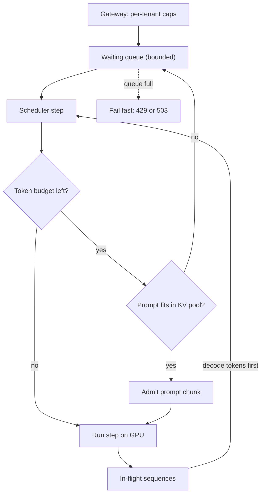

## TL;DR
Every agent run is many LLM calls, and parallel tool calls and subagents multiply them. Batching makes
concurrent calls nearly free until a knee; past it every call slows every agent, so measure the knee and
enforce it at engine, gateway and agent client.

## For agent builders
- **Why it matters for agents.** Agents are bursty, multiplying clients: one user task becomes 5 to 20
  sequential LLM calls, and a planner that fans out to subagents turns one call into many at once.
  Without limits, a few fan-outs push the engine past its knee and every agent's step gets slower.
- **Where it shows up in your stack.** The client-side semaphore around your LLM client (or your
  framework's max-concurrency setting), the gateway's per-tenant caps, provider rate limits and 429s
  for hosted models, and `max_num_seqs` and `max_num_batched_tokens` when you self-host with vLLM.
- **What you control.** How many LLM calls one agent run may have in flight, how many runs share the
  pool, timeouts and retry policy, and how much retrieved context each call carries.
- **What you can skip.** Deriving the roofline yourself. Remember that long contexts move the knee down
  and that Little's law turns call rate into replicas.

## Why it exists
- **Decode is bandwidth-bound.** A Llama-3-8B-class model in fp16 has about 16 GB of weights. At roughly
  3.35 TB/s (an H100 SXM's published figure), reading them once takes about 4.8 ms, capping one sequence
  at roughly 200 tokens per second however fast the tensor cores are. The FLOPs for that one token, about
  2 × 8 billion = 16 GFLOP, take a small fraction of that time: the GPU is mostly waiting on memory.
- **Batching reuses each weight read.** With 64 sequences the weights are read once for all 64 tokens, so
  the step takes about the same 4.8 ms plus extra KV-cache reads, and throughput rises toward 64×.
- **Over-admission ends badly.** KV memory is finite and each sequence holds it for its whole lifetime,
  so admitting everything leads to preemption, swap traffic and eventually OOM.
- **Latency objectives.** Past the knee, time per output token (TPOT) climbs with every extra sequence and
  time to first token (TTFT) climbs with queue depth. Throughput keeps rising while goodput, the fraction
  of requests meeting their SLO, falls.
- **Blast radius.** One tenant sending 10,000-token prompts can stall everyone's decode unless something
  bounds the prefill tokens entering a step. Limits make an engine queue or reject predictably instead of
  degrading for everyone.

## How it works
### Agent traffic is calls, not users
- **One run, many calls.** A tool-calling loop makes one LLM call per step, so a 10-step run is 10
  requests to the engine, each with a longer context than the last.
- **Fan-out is instantaneous concurrency.** Parallel tool calls that each need a model call, or a
  planner that launches 5 subagents, add 5 in-flight requests in the same second.
- **Context grows inside a run.** Later steps carry the whole transcript, so the same request count
  costs more KV reads at step 10 than at step 1. That is why limits belong in tokens.

### Background: where batching stops being free
- **Arithmetic intensity grows with batch.** Each 2-byte bf16 weight does 2 FLOPs (a multiply and an add)
  per sequence, so a batch of B gives about B FLOPs per weight byte.
- **The ridge point.** Peak FLOPs ÷ bandwidth is roughly 300 FLOP/byte for that GPU in bf16. Past it the
  step is compute-bound and latency per token grows with the batch.
- **Weight matmuls alone** would stay bandwidth-bound up to a batch in the low hundreds.
- **The knee usually arrives earlier** because each sequence also brings its own KV cache to read, and
  that traffic does not amortise across the batch (see the latency section below).

### Static, dynamic and continuous batching
| Mode | How it batches | Fits |
|---|---|---|
| Static | groups N requests, runs until the longest finishes, then admits more; GPU idles on finished slots | offline jobs |
| Dynamic | waits up to a few ms to collect a batch, runs it as a unit (Triton's queue-delay setting is the familiar example) | single-pass models (embedders, classifiers), where every request is one forward pass |
| Continuous (iteration-level, from Orca) | re-forms the batch every decode step: finished sequences leave, waiting ones join | generation |

- **Dynamic batching still holds a generation batch** until its longest output finishes.
- **Continuous batching makes batch size dynamic,** bounded by limits rather than a fixed number you
  pick. The continuous-batching lesson covers the scheduler.

### The three limits inside an engine
Every engine exposes some version of these (vLLM's names in parentheses):
1. **Maximum sequences per step** (`max_num_seqs`). Bounds decode batch size, and so worst-case TPOT once
   compute-bound, plus the per-step sampling buffers.
2. **Maximum tokens per step** (`max_num_batched_tokens`). Bounds prompt and decode tokens together in one
   step. With chunked prefill (Sarathi-Serve's idea) a long prompt is split into chunks that ride along
   with decode tokens, so a 20k-token prompt cannot monopolise a step and stall every conversation.
   Lower values give smoother TPOT; higher values give faster prefill.
3. **KV-cache capacity** (the block pool). The hard ceiling on tokens in flight. The scheduler admits a
   request only if its prompt fits, and preempts when generation outgrows the pool.

- **Why the token budget can be modest.** Prefill is already batched across positions: a chunk of T
  prompt tokens reuses each weight T times, so a few hundred to a few thousand tokens already saturate the
  tensor cores. A larger chunk mainly lengthens the step decode tokens wait on.
- **Fill order.** Each step takes decode tokens first, then admits waiting prompts up to the token budget,
  *because* stalling in-flight sequences is visible to users while delaying a new one by a few steps
  usually is not.

### Where the latency actually goes
```
step_time ≈ max(bytes_read / bandwidth, FLOPs / peak_FLOPs) + fixed overhead
bytes_read = weights + KV cache of every active sequence
```
- **The forgotten term is the KV cache.** With 64 sequences at 6k tokens each on the model above (128 KB
  of KV per token), the step reads 64 × 6,144 × 128 KB = 48 GiB (about 51.5 GB) of cache on top of 16 GB
  of weights.
- **Result:** about 20 ms per step, roughly 50 tokens per second per user instead of 200. Cache reads
  outweigh the weights three to one and grow with every sequence added.
- **The full-pool floor.** That configuration nearly fills an 80 GB card. With the pool full, each step
  reads close to all of HBM, so the step-time floor is roughly HBM capacity ÷ bandwidth (about 24 ms here)
  however bytes divide between weights and cache.
- **So express limits in tokens.** Safe concurrency depends on context length, not just request count.

### Little's law and the queue
- **Concurrency = arrival rate × residence time.** 10 requests/s that each live 8 s need 80 in flight.
- **Past the knee the queue never drains.** If the knee for your traffic shape is 48, the queue grows
  without bound. No scheduler setting fixes that; only more replicas, a smaller model, shorter outputs or
  load shedding do.
- **This converts an engine benchmark into a replica count.**
- **For agents, count LLM calls.** Arrival rate is runs per second × calls per run, and residence time is
  one call's queue + prefill + decode, not the whole run.

### Enforcing the limit at three layers
| Layer | Mechanism |
|---|---|
| Engine | the parameters above plus a bounded waiting queue; when full, fail fast with 429/503 rather than accept a request that will time out anyway |
| Gateway | per-tenant concurrency and token-rate caps so one client cannot consume the whole knee; priority or fair-share queuing where SLOs differ |
| Client (agent runtime) | a semaphore sized to its share, a per-run cap on parallel calls and subagents, retries with jitter only on explicit retry-after signals, timeouts longer than expected queueing time so retries do not amplify load |

### Measuring the knee
1. **Sweep concurrency** with prompts and output lengths that match production.
2. **Record** aggregate tokens/s, p50 and p95 TTFT and TPOT.
3. **Plot** throughput against p95 latency: throughput rises steeply then flattens while p95 bends
   upward. The bend is the knee.
4. **Re-run** whenever the model, quantization, context distribution or GPU changes, because every one of
   them moves it.

## Diagram
One scheduler step as agent calls see it: decode tokens go in first, waiting prompts (new agent steps)
fill the remaining token budget in chunks, and a full queue rejects instead of accepting work that will
time out.



## Misconceptions
- **"Batching always trades per-user latency for throughput."** Decode is bandwidth-bound, so up to the
  knee extra sequences reuse the same weight read almost for free: 64 short sequences take 7.3 ms per step
  versus 4.8 ms for one. Latency climbs only past the knee.
- **"The safe concurrency limit is a request count."** Each sequence adds its own KV reads, which do not
  amortise. The same 64 sequences at 6,144 tokens take about 20 ms per step, so the knee moves with
  context length and limits belong in tokens.
- **"Concurrency means users or agent runs."** The engine sees LLM calls. One run makes a call per step,
  and a planner fanning out to 5 subagents adds 5 in-flight calls at once, so count calls per second ×
  residence time per call.
- **"A smarter scheduler setting can drain a growing queue."** If arrival rate × residence time exceeds
  the knee, Little's law says the queue grows without bound. Only more replicas, a smaller model, shorter
  outputs or load shedding fix it.
- **"Client retries make agents more robust under load."** Retrying on timeouts while the first request
  is still running doubles load exactly when the engine is saturated. Retry only on an explicit
  `Retry-After`, within one budget per run.

## Examples
### Step-time model: why context length moves the knee
A roofline estimate of the formula above in pure Python. It ignores fixed overhead, so treat outputs as
illustrative orders of magnitude, not benchmarks.

```python
BW, PEAK = 3.35e12, 989e12          # H100 SXM: bytes/s, dense bf16 FLOP/s (published figures)
W_BYTES, PARAMS = 16e9, 8e9         # Llama-3-8B-class in bf16
KV_PER_TOKEN = 128 * 1024           # 32 layers x 8 KV heads x 128 dim x 2 (K,V) x 2 bytes

def step_ms(batch, ctx):
    bytes_read = W_BYTES + batch * ctx * KV_PER_TOKEN      # weights once + every sequence's cache
    flops = 2 * PARAMS * batch                             # one token per sequence
    return max(bytes_read / BW, flops / PEAK) * 1e3        # ignores fixed overhead

for batch, ctx in [(1, 1000), (64, 1000), (64, 6144), (256, 1000)]:
    ms = step_ms(batch, ctx)
    print(f"batch={batch:3d} ctx={ctx:5d} step={ms:5.1f}ms "
          f"per-user={1e3/ms:4.0f} tok/s total={batch*1e3/ms:6.0f} tok/s")
```

| Batch | Context | Step | Per user | Total |
|---|---|---|---|---|
| 1 | 1,000 | 4.8 ms | ~208 tok/s | ~208 tok/s |
| 64 | 1,000 | 7.3 ms | ~137 tok/s | ~8,800 tok/s |
| 64 | 6,144 | 20.2 ms | ~50 tok/s | ~3,200 tok/s |
| 256 | 1,000 | 14.8 ms | ~68 tok/s | ~17,300 tok/s |

Same batch of 64, six times the context: total throughput falls by almost two thirds, because the KV
reads, not the weights, now set the step time.

### Load sweep against an OpenAI-compatible endpoint
The client-side semaphore is the concurrency limit; the script reports throughput and tail latency per
level so you can see where the curve flattens. Streaming separates TTFT and TPOT; each streamed chunk
counts as one token.

```python
import asyncio, time, httpx

URL, MODEL = "http://localhost:8000/v1/completions", "meta-llama/Llama-3.1-8B-Instruct"
PROMPT, MAX_TOK = "Explain why decode is memory-bandwidth bound.", 128

async def one(client, sem):
    async with sem:                                        # the client-side concurrency limit
        t0, first, n = time.perf_counter(), None, 0
        body = {"model": MODEL, "prompt": PROMPT, "max_tokens": MAX_TOK, "stream": True}
        async with client.stream("POST", URL, json=body, timeout=300) as r:
            async for line in r.aiter_lines():
                if line.startswith("data:") and "[DONE]" not in line:
                    n += 1
                    first = first or time.perf_counter() - t0
        total = time.perf_counter() - t0
        first = total if first is None else first           # no tokens streamed: count as all wait
        return first, (total - first) / max(n - 1, 1), n   # TTFT, TPOT, tokens

async def sweep(level, requests=64):
    sem, t0 = asyncio.Semaphore(level), time.perf_counter()
    async with httpx.AsyncClient() as client:
        res = await asyncio.gather(*(one(client, sem) for _ in range(requests)))
    wall = time.perf_counter() - t0
    ttft = sorted(r[0] for r in res); tpot = sorted(r[1] for r in res)
    print(f"conc={level:3d} tok/s={sum(r[2] for r in res)/wall:7.0f} "
          f"p50 TTFT={ttft[len(ttft)//2]*1e3:6.0f}ms p95 TPOT={tpot[int(len(tpot)*.95)-1]*1e3:5.1f}ms")

for level in (1, 4, 16, 64):
    asyncio.run(sweep(level))
# Expect tok/s to climb steeply then flatten while p95 TPOT bends upward: that bend is the knee.
# Re-run with your real prompt and output length distribution before choosing limits.
```

### Worked scenario: from benchmark to replica count
| Step | Number |
|---|---|
| Target traffic | 10 requests/s |
| Residence time per request (queue + prefill + decode) | 8 s |
| Required concurrency (Little's law) | 10 × 8 = 80 in flight |
| Measured knee per replica, production-shaped traffic | 48 |
| Replicas | 80 ÷ 48 ≈ 1.7, so 2 at the knee, 3 with headroom for bursts and one replica down |

### Agent runtime: a shared call budget plus a per-run fan-out cap
A planner fans out to subagents. A global semaphore keeps total in-flight LLM calls at the engine's
knee; a per-run semaphore stops one run's fan-out from taking the whole budget. The model call is faked
with a sleep so the script runs as is.

```python
import asyncio, random, time

KNEE, MAX_FANOUT = 48, 4                # measured engine knee, per-run cap on parallel calls
GLOBAL = None                           # created inside the event loop (Python 3.9 binds loops)

async def llm_call(prompt: str) -> str:
    async with GLOBAL:                  # every call, from every run, goes through here
        await asyncio.sleep(random.uniform(0.5, 1.5))   # stand-in for the HTTP call
        return f"answer to {prompt[:20]}"

async def run_agent(task: str, subtasks: int = 10) -> list[str]:
    plan = await llm_call(f"plan: {task}")
    local = asyncio.Semaphore(MAX_FANOUT)
    async def sub(i: int) -> str:
        async with local:
            return await llm_call(f"{plan} / step {i}")
    results = await asyncio.gather(*(sub(i) for i in range(subtasks)))
    return [await llm_call(f"summarize {len(results)} results")]

async def main(runs: int = 30):
    global GLOBAL
    GLOBAL, t0 = asyncio.Semaphore(KNEE), time.perf_counter()
    await asyncio.gather(*(run_agent(f"task {r}") for r in range(runs)))
    print(f"{runs} runs, {runs * 12} calls, {time.perf_counter() - t0:.1f}s")

asyncio.run(main())
# Without MAX_FANOUT the first runs to finish planning queue 10 calls each and fill all 48 slots, so
# later runs wait for whole fan-outs; with it, no run holds more than 4 slots at once.
```

## Production patterns
- **Two-level limits in the agent runtime.** Wrap every LLM call in one shared semaphore sized to the
  engine knee (or your provider rate limit), and give each run its own cap on parallel tool calls and
  subagents. Monitor in-flight calls, queue wait inside the client, and steps per run.
- **Limit in tokens, not just requests.** When contexts vary widely, set `max_num_seqs` near the measured
  knee and size `max_num_batched_tokens` so one long prompt cannot dominate a step. Monitor KV-cache
  usage, preemptions and p95 TPOT together.
- **Keep chunked prefill on for chat.** When long prompts share a GPU with live conversations, use
  chunked prefill (default in recent vLLM, otherwise `--enable-chunked-prefill`) and tune the token budget
  down if TPOT spikes on prompt bursts. Monitor p95 TPOT during long-prompt arrivals.
- **Bound the queue and shed early.** Return 429 or 503 with a `Retry-After` header once queue depth or
  expected wait exceeds the client timeout. Monitor queue depth, rejection rate and the fraction of
  requests that time out after admission.
- **Per-tenant semaphores at the gateway.** When several teams share an engine, give each a concurrency
  and tokens-per-minute cap and lend idle share only if the gateway supports it. Monitor per-tenant
  in-flight count and rejections.
- **Re-sweep on every model or traffic change.** Run a load sweep (the script above, or vLLM's serving
  benchmark) with production-shaped prompts before changing limits. Track the knee as a dashboard number
  per model and GPU type.

## Trade-offs
- **Higher sequence limit vs per-user TPOT.** It raises throughput and lowers cost per token, but once the
  step is compute-bound or KV-read-bound every extra sequence adds to every user's TPOT.
- **Low tokens-per-step budget vs TTFT.** It keeps TPOT smooth during prompt bursts, but stretches TTFT for
  long prompts because their prefill is spread over more steps.
- **Rejecting vs accepting everything.** Rejecting at the queue (429/503) protects latency for admitted
  requests but pushes retry logic and fairness onto clients; accepting everything is simpler and fails
  slowly for all.
- **Agent fan-out vs fleet latency.** Parallel subagents finish one run sooner, but each fan-out adds
  in-flight calls that raise TPOT for every other run. Cap fan-out low when many runs share one engine;
  raise it when a single run's wall-clock time is what users see.
- **Per-tenant caps vs utilisation.** Caps guarantee isolation, yet leave capacity idle when one tenant is
  quiet unless the gateway can lend unused share, which adds scheduling complexity.

## Pitfalls
- **Limiting by request count only.** A handful of 100k-token requests exhausts the KV pool while the
  count looks healthy. Symptom: preemption spikes and latency jitter at low request rates. Fix: cap
  tokens per step and per tenant, and cap `max_model_len` per route.
- **Benchmarking with short synthetic prompts.** The knee measured that way is too high for traffic with
  long retrieved context: throughput looks fine in the benchmark and TPOT doubles in production. Sweep
  with production-shaped prompt and output lengths.
- **Client timeouts shorter than queueing time.** Clients retry while the original request is still
  running, so load doubles exactly when the system is saturated. Fix: timeouts above expected queueing
  time, and retry only on an explicit `Retry-After`.
- **Retrying each agent step independently.** A loop that retries every failed call three times turns
  a saturated engine into a retry storm across dozens of runs. Symptom: 429s and timeouts spike together.
  Fix: one retry budget per run, honour `Retry-After`, and fail the run cleanly when it is spent.
- **Disabling chunked prefill for peak prefill speed.** In-flight conversations then stall for hundreds of
  milliseconds each time a long prompt arrives. Fix: keep it on and tune the token budget instead.
- **Setting the tokens-per-step budget very high.** Engines that profile the activation peak at startup
  (vLLM) respond by shrinking the KV pool, so capacity silently drops. Engines that do not profile OOM on
  a large prefill, a failure that only appears when a big prompt and a full decode batch coincide.

## When to use
Every self-hosted deployment needs explicit limits; the question is their values.
- **Start from VRAM** to get a token ceiling, run the sweep with production-shaped traffic to find the
  latency knee, and set the sequence and token limits a little below it.
- **Use Little's law** to convert the target request rate into replicas; for agents, the rate is runs
  per second times LLM calls per run.
- **Cap agent fan-out** whenever a planner can launch parallel tool calls or subagents, on self-hosted
  and hosted models alike.
- **Apply per-tenant caps** whenever more than one team or customer shares an engine, and always bound the
  queue.
- **Hosted APIs too:** the same thinking applies to provider rate limits; a client-side semaphore and
  token budget avoid 429 storms.
- **Interviews:** derive why batching is nearly free for decode, where it stops being free, and what you
  would measure to find out.

## Role lens
- **Engineer:** Sets engine limits, writes the load-sweep harness, sizes client semaphores, and adds
  queue-depth and preemption metrics so the knee is visible on a dashboard.
- **Architect:** Owns the SLO-to-capacity model: goodput targets, per-tenant isolation policy, replica
  count from Little's law, and when to split prefill and decode onto separate pools.
- **FDE:** Reproduces the customer's traffic shape in a sweep, explains why their long-document workload
  needs lower concurrency than the vendor benchmark suggested, and tunes limits on site.

## Check yourself
**Q:** A single-GPU deployment reports 3,000 tokens/s at concurrency 32 and 3,400 tokens/s at
concurrency 96, so the team wants to raise the limit to 96. What would you check before agreeing, and
what do those numbers suggest?
**A:** Throughput rose only 13% for a 3× increase in concurrency, so the engine is already past the
knee: it is compute-bound or, more likely with long contexts, bound by KV-cache reads. Per-user rate fell from
about 94 tokens/s (3,000 ÷ 32) to about 35 (3,400 ÷ 96), so each user's TPOT is roughly 2.5–3× worse at
96 for almost no extra throughput, so goodput against the
latency SLO probably fell. I would check p95 TPOT and TTFT at both levels, preemption and queue-depth
metrics, and KV block utilization, and I would re-run the sweep with production prompt and output length
distributions. If more throughput is needed, the answer is a second replica, a quantized or smaller
model, or shorter contexts, not a higher limit on the same GPU.

## Interview questions
### Why is batching nearly free for decode but not for prefill?
- **Decode is bandwidth-bound:** one token per sequence means each weight read does ~2 FLOPs per sequence,
  so adding sequences reuses the same read and costs little extra time.
- **Prefill is already compute-bound:** a prompt of T tokens reuses each weight T times, so batching more
  prompts adds proportional compute time instead of riding on idle tensor cores.

### Users report TPOT doubling after a RAG feature launched, with the same request rate. What happened?
- **Context grew:** retrieved passages raise tokens per sequence, and every active sequence's KV cache is
  read each step, so step time rises even at constant concurrency.
- **Confirm** with KV-cache usage, prompt-length p95 and preemption counters.
- **Fix:** lower `max_num_seqs` for that route, trim retrieved context, use an fp8 KV cache, or add
  replicas.

### When would you choose dynamic batching over continuous batching?
- **Single-pass models:** embedders, rerankers and classifiers do one forward pass per request, so
  collecting a batch for a few milliseconds is simple and efficient.
- **Not for generation:** a dynamic batch holds every slot until the longest output finishes, wasting the
  GPU on finished sequences.

### Your agents make 30 LLM requests/s, each lives 4 s, and your knee is 40. How many replicas, and what else matters?
- **Little's law:** 30 × 4 = 120 in flight, so 3 replicas at the knee, more with headroom.
- **Residence time is not fixed:** past the knee queueing raises it, which raises required concurrency
  again, so size with margin and bound the queue.
- **Agent twist:** 30 requests/s may be only 3 runs/s at 10 calls each, and later calls carry longer
  contexts, so measure the knee with replayed agent traces.

### A planner agent fans out to 8 subagents and the whole platform slows down. What do you change?
- **Diagnose:** each fan-out adds 8 in-flight calls at once; a few concurrent planners push the engine
  past its knee, so TPOT rises for every run.
- **Fix in the runtime:** a per-run fan-out cap plus one shared semaphore sized to the knee, so runs
  queue in the client instead of thrashing the engine.
- **Then measure:** per-run wall-clock time against fleet p95 TPOT to pick the cap.

### Why should clients retry only on explicit retry-after signals?
- **Blind retries amplify overload:** a client that times out while its request still runs adds a second
  copy exactly when the engine is saturated.
- **So** set client timeouts above expected queueing time, add jitter, and let the server say when to come
  back.

## Quiz
### Q: Why does adding sequences to a decode batch raise throughput almost linearly at first?
- [ ] Because the GPU runs each sequence on a separate streaming multiprocessor in parallel
- [x] Because the weights are read from memory once per step and reused for every sequence in the batch
- [ ] Because attention cost is shared across sequences that have similar prompts
- [ ] Because the sampler can pick tokens for all sequences in a single kernel launch
> Decode is bound by streaming the weights through memory bandwidth. One read serves all sequences in
> the step, so until the step becomes compute-bound or KV reads dominate, more sequences cost little
> extra time.

### Q: What does a tokens-per-step budget with chunked prefill primarily protect?
- [ ] Peak memory used by the model weights
- [ ] Time to first token for the longest prompts in the queue
- [x] Time per output token for conversations already in flight when long prompts arrive
- [ ] The accuracy of generated tokens under high load
> Without the budget, a long prompt's prefill occupies entire steps and stalls every active decode.
> Chunking spreads it over steps so TPOT stays smooth, at the cost of a slower TTFT for that long prompt.

### Q: You need 20 requests/s and each request lives about 6 s in the system. The measured knee for one
replica is 40 concurrent requests. How many replicas do you need, roughly?
- [ ] One, because 40 concurrent requests exceeds 20 requests per second
- [ ] Two, because 20 requests per second is half the knee
- [x] Three, because Little's law gives 120 concurrent requests and each replica handles 40
- [ ] Six, because 120 concurrent requests must be halved for headroom
> Concurrency = arrival rate × residence time = 20 × 6 = 120 in flight. At a knee of 40 per replica
> that is three replicas before headroom. Confusing requests per second with concurrent requests is the
> classic error.

## Use cases & projects
### Use cases
- **Planner-and-subagent fan-out.** A per-run cap on in-flight LLM calls stops one planner that spawns
  many subagents from pushing the shared engine past its knee.
- **Multi-tenant agent products.** Gateway caps per tenant keep one customer's long-context agents from
  stalling everyone else's decode.
- **Hosted-API agents.** A client-side semaphore sized below the provider rate limit turns 429 storms into
  a short, predictable queue.
- **Capacity planning.** Little's law turns expected agent runs per minute, calls per run and seconds per
  call into a replica count.

### Mini project
**Find the knee for your agent's call pattern (2-3 hours).**
- **Goal:** measure where adding concurrent agent calls stops raising goodput on one endpoint.
- **Steps:** pick a self-hosted or hosted model; replay a fixed set of agent-shaped calls (system prompt,
  tool schemas, a few prior steps) at concurrency 1, 2, 4, 8, 16, 32 and 64; record TTFT, TPOT, tokens
  per second and the share meeting a latency SLO you choose; then wrap your agent client in an
  `asyncio.Semaphore` set at the knee.
- **Done when:** you have a table of concurrency versus throughput and goodput, a marked knee, and a run of
  your agent with the semaphore showing stable step latency under a burst.
