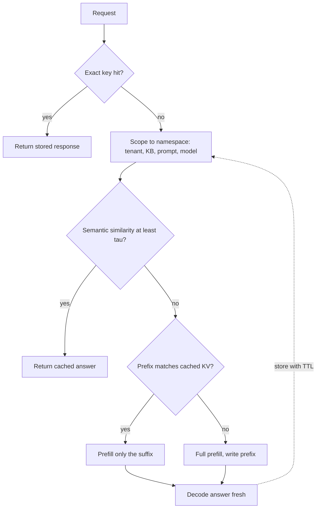

## TL;DR
Agents re-send the same system prompt, tool schemas and growing transcript on every step, so prompt
caching is their main cost lever. Exact and semantic response caches skip whole generations, but only fit
repeat-heavy, non-personal sub-calls.

## For agent builders
- **Why it matters for agents.** A 40-step session over a 12k-token prefix re-sends roughly half a million
  prefix tokens. Prompt caching turns most of that into cheap cache reads and cuts time to first token on
  every step, which is what makes long tool-calling loops affordable.
- **Where it shows up in your stack.** `cache_control` breakpoints and the usage fields on the Anthropic
  API, automatic caching and cached-token counts on OpenAI, vLLM prefix caching or SGLang RadixAttention
  when self-hosting, and Redis or a vector store for response and tool-result caches.
- **What you control.** Prompt order (tools, then system, then an append-only transcript), where
  breakpoints sit, keeping tool schemas byte-identical, which read-only tool results you memoise, and
  whether any user-facing answer may come from a semantic cache at all.
- **What you can skip.** Semantic-cache tuning for the main agent loop: answers depend on conversation
  state, so near-miss hits are wrong. Spend the effort on prefix stability instead.

## Why it exists
- **Prefill cost scales with prompt length, and most of the prompt repeats.** In agent and RAG systems the
  system prompt, tool schemas, few-shot examples and long documents are identical call to call. A 40-turn
  agent session with a 12k-token prefix re-processes roughly half a million tokens the model has already
  seen, and at long contexts prefill dominates time to first token.
- **Some products repeat whole questions** ("what is your refund policy"), where the entire generation
  repeats.
- **"Cache responses like any HTTP response" fails three ways.** Exact hits are rare in conversation,
  because prompts carry user- and time-specific content, so hit rate rounds to zero. A hit may be wrong
  for the new context: a cached answer about *this* customer's order is a data leak for the next one. And
  response caches do nothing for agent loops, where every turn is new but the prefix is identical.
- **Each layer targets one problem and adds one failure mode.** Prompt caching attacks prefill compute
  without touching the answer (failure: no speedup). Semantic caching trades exactness for hit rate
  (failure: wrong answers). Understand them separately before combining them.

## How it works
### The three layers at a glance
| Layer | Skips | Key | Failure mode |
|---|---|---|---|
| Exact-match response cache | the whole generation | hash of every input that affects output | near-zero hit rate on chat |
| Semantic cache | the whole generation | embedding of the normalised query, within a namespace | confident wrong answers |
| Prompt caching (prefix KV reuse) | prefill of the shared prefix only | exact token sequence, in order | silent misses, no speedup |

### Layer 1: exact-match response cache
- **Key:** a hash of model id and version, system prompt, messages, tool definitions, sampling parameters
  and any retrieved context.
- **Hit:** return the stored response.
- **Most valuable in deterministic pipelines** (classification, extraction, embedding of the same chunk),
  where identical inputs really recur.
- **Invalidate by versioning:** the key includes the prompt template, so bump a template version on change.
- **Temperature above zero:** product semantics decide whether a cached answer is acceptable; a
  "regenerate" action must bypass it.

### Layer 2: semantic cache
GPTCache is a well-known open-source implementation; the data flow is the same in any of them:
1. **Scope.** Build a namespace from tenant, corpus or knowledge-base version, prompt version and model,
   *because* a similar question against a different tenant's data or an older policy must never hit.
   Lookups only search inside the namespace.
2. **Embed** the normalised query, usually the latest user message with any context that changes the
   answer folded in. Embedding only the last message is what makes "and for business accounts?" match an
   unrelated earlier question.
3. **Search.** Nearest-neighbour lookup over stored queries in the namespace; take the best match and its
   similarity.
4. **Decide.** Hit if similarity ≥ τ. The threshold is a precision/recall knob: "how do I cancel my order"
   and "how do I cancel my subscription" embed close together and have different answers, so a threshold
   tuned only for hit rate ships wrong answers. A cheap verifier call ("does this stored answer answer
   this question?") can raise precision at some latency cost.
5. **Fill and expire.** On a miss, generate, then store query, embedding and answer with a TTL. Delete the
   namespace (or bump its version) when the underlying knowledge changes, because the cache does not know
   the policy page was edited.

- **Measure hit *precision*** (the fraction of sampled hits a human or judge rates correct) alongside hit
  rate, because the failure is a confident wrong answer that no error metric sees.
- **Fit:** FAQ-like, high-repeat, low-personalisation traffic; poor for chat with history or
  user-specific context.

### Layer 3: prompt caching (prefix KV reuse)
- **Mechanism.** The engine keeps the key and value tensors for a prompt prefix; when a new request's
  token sequence begins with the same prefix, it skips prefill for those tokens and processes only the
  suffix.
- **Where it shows up.** Providers expose it as a billing and latency feature; self-hosted engines as a
  scheduler feature (vLLM's automatic prefix caching by block hash, SGLang's RadixAttention tree with LRU
  eviction).

Rules that follow from the mechanism:
1. **Exact token sequence, in order.** The request renders as tools, then system, then messages; any change
   at position *i* invalidates everything after it.
2. **Static first, volatile last:** timestamps, user names and per-request retrieved documents go at the
   end.
3. **Isolation:** the cache is per model and isolated per organisation or workspace.
4. **Entries have a TTL and hits are not guaranteed under load,** so the usage report is the only ground
   truth. On Anthropic: `cache_creation_input_tokens` and `cache_read_input_tokens` alongside the uncached
   `input_tokens`. OpenAI reports cached tokens inside its usage details.
5. **Parallel cold requests all pay:** an entry becomes readable only once the writing request has begun
   responding, so N parallel identical requests all pay full price.

Vendor specifics at the time of writing, which change:

| | Anthropic | OpenAI |
|---|---|---|
| Activation | explicit `cache_control` breakpoints, up to four per request | automatic above a minimum prompt length |
| TTL | default five minutes, refreshed on every read; optional one hour | set by the provider; check current docs |
| Write price | more than ordinary input: 1.25× (five minutes), 2× (one hour) | no separate write charge |
| Read price | a fraction of input, around 0.1× | discounted cached input tokens |
| Minimum prefix | model-dependent, on the order of one to a few thousand tokens; shorter prefixes silently do not cache | a minimum length applies |

- **On both,** caching reduces input cost and time to first token; it does nothing for output tokens or
  decode speed.

### Which layer for which traffic
| Traffic | Layers |
|---|---|
| FAQ bot | semantic plus exact |
| Extraction or classification pipeline | exact |
| Agent loops, multi-turn chat, RAG with a large static context | prompt caching |
| Embedding generation | exact |

Most real systems run prompt caching always and add a response-level cache only where repeats are
measured.

### Caching inside an agent loop
| What repeats in an agent | Cache it with | Rule |
|---|---|---|
| Tool schemas and system prompt | prompt caching, breakpoint after them | byte-identical and in a fixed order on every step |
| Earlier turns of the transcript | prompt caching, incremental | append only; editing or trimming an old turn misses from that point |
| Read-only tool results (search, lookup) | exact cache keyed on tool, arguments, tenant | short TTL; never for tools with side effects |
| Embeddings of retrieved chunks | exact cache keyed on chunk hash and embedding model | invalidate on model change |
| The agent's final answer | usually nothing | depends on run state, so semantic hits are wrong |

- **Compaction costs one miss.** Summarising old turns into a new block rewrites the transcript, so the
  next call writes a fresh cache entry; compact rarely, at a boundary, not a little every step.
- **Sub-agents share prefixes only if they share bytes.** Give parallel sub-agents the same tool list and
  system prompt in the same order if you want them to read one cached prefix.

## Diagram
Read the request top to bottom: the cheapest full skip is tried first, and whatever falls through still
benefits from the prefix cache during prefill.



## Misconceptions
- **"Prompt caching stores the model's answer."** It reuses the KV tensors of a shared prefix, so only
  prefill is skipped: input cost and time to first token fall, while the answer is generated fresh and
  output cost and decode speed are unchanged.
- **"Similar prompts share the cache."** Matching is on the exact token sequence in order. One timestamp,
  user name or reordered tool list near the top misses everything after it, on every agent step.
- **"Turning caching on can only save money."** Anthropic cache writes cost about 1.25× input (2× for the
  one-hour TTL), so a prefix nobody reads within the TTL costs more than no caching. Verify reads in
  the usage fields.
- **"A semantic cache is a smarter response cache for the agent's answers."** Embedding similarity is not
  answer equivalence: "cancel my order" and "cancel my subscription" sit close together, and agent
  answers depend on run state. Keep semantic caches to scoped, FAQ-like traffic with measured precision.
- **"A high hit rate means the cache works."** Hits on short prefixes barely move the bill, and semantic
  hits can be confidently wrong. Track cost and TTFT deltas, cache-read share of input, and sampled hit
  precision.

## Examples
### Explicit prompt caching on the Anthropic API
The static manual sits before the breakpoint and the volatile question after it; the usage fields
confirm whether the second call read the prefix.

```python
import anthropic

client = anthropic.Anthropic()
MANUAL = open("policy_manual.md").read()          # ~20k tokens, identical on every request

def ask(question: str) -> str:
    resp = client.messages.create(
        model="claude-opus-5-5",
        max_tokens=1024,
        system=[
            {"type": "text", "text": "Answer questions using only the policy manual below."},
            {"type": "text", "text": MANUAL,
             "cache_control": {"type": "ephemeral"}},   # breakpoint: everything up to here is cacheable
        ],
        messages=[{"role": "user", "content": question}],   # volatile content after the breakpoint
    )
    u = resp.usage
    print(f"uncached={u.input_tokens} cache_write={u.cache_creation_input_tokens} "
          f"cache_read={u.cache_read_input_tokens} output={u.output_tokens}")
    return next(b.text for b in resp.content if b.type == "text")

ask("What is the refund window?")      # first call: cache_write ≈ 20k, cache_read = 0
ask("Who can approve an exception?")   # within the TTL: cache_read ≈ 20k, uncached ≈ the question
```

### Worked cost scenario
- **Traffic:** a 20,000-token manual, a 200-token question, a 400-token answer, and 1,000 questions a day
  arriving more often than every five minutes, so the entry stays warm.
- **Illustrative prices:** 3 per million input tokens, 3.75 per million for cache writes (1.25×), 0.30 per
  million for cache reads (0.1×) and 15 per million output tokens.

| Cost line | Without caching | With caching |
|---|---|---|
| Manual prefix | 1,000 × 20,200 × 3 / 10⁶ ≈ 60.6 (input incl. question) | one write: 20,000 × 3.75 / 10⁶ ≈ 0.08 |
| Cache reads | none | 1,000 × 20,000 × 0.30 / 10⁶ = 6.0 |
| Uncached questions | included above | 1,000 × 200 × 3 / 10⁶ = 0.6 |
| **Input total** | **≈ 60.6** | **≈ 6.7, a nine-fold reduction** |
| Output | 1,000 × 400 × 15 / 10⁶ = 6.0 | 6.0, unchanged |
| **Daily total** | **≈ 66.6** | **≈ 12.7** |

- **Latency:** time to first token drops by roughly the time it took to prefill 20,000 tokens.
- **Break-even:** at 1.25× write and 0.1× read, a prefix reused even once within the TTL is already
  cheaper than not caching (1.35× versus 2×).

### A scoped semantic cache, and why the threshold matters
Pure Python, runs as is. A bag-of-words vector stands in for a real embedding model; the order/subscription
pair shows how a threshold tuned for hit rate returns a wrong answer.

```python
import math, re, time
from collections import Counter

def embed(text):                                   # stand-in for a real embedding model
    return Counter(re.findall(r"[a-z]+", text.lower()))

def cosine(a, b):
    dot = sum(a[t] * b[t] for t in a)
    na, nb = math.sqrt(sum(v * v for v in a.values())), math.sqrt(sum(v * v for v in b.values()))
    return dot / (na * nb) if na and nb else 0.0

class SemanticCache:
    def __init__(self, threshold, ttl_s=3600):
        self.threshold, self.ttl_s, self.entries = threshold, ttl_s, {}
    def get(self, ns, query):
        q, best, best_sim = embed(query), None, 0.0
        for e in self.entries.get(ns, []):         # search only inside the namespace
            sim = cosine(q, e["vec"])
            if e["expires"] > time.monotonic() and sim > best_sim:
                best, best_sim = e, sim
        hit = best is not None and best_sim >= self.threshold
        return (best["answer"] if hit else None), round(best_sim, 3)
    def put(self, ns, query, answer):
        self.entries.setdefault(ns, []).append(
            {"vec": embed(query), "answer": answer, "expires": time.monotonic() + self.ttl_s})
    def invalidate(self, ns):                      # call when the knowledge base changes
        self.entries.pop(ns, None)

ns = ("acme", "kb-v7", "prompt-v3", "model-x")     # tenant, corpus version, prompt version, model
for tau in (0.9, 0.8):
    c = SemanticCache(threshold=tau)
    c.put(ns, "How do I cancel my order?", "Orders can be cancelled within 1 hour.")
    print(tau, c.get(ns, "how do i cancel my order"))           # identical wording: hit
    print(tau, c.get(ns, "How do I cancel my subscription?"))   # 0.833: miss at 0.9, WRONG hit at 0.8
    print(tau, c.get(("globex",) + ns[1:], "How do I cancel my order?"))  # other tenant: never hits
```

### Worked scenario: prompt caching across a 40-step agent session
Only the 12k-token tools-and-system prefix is counted, at the same illustrative prices (3 per million
input, 1.25× write, 0.1× read), with steps arriving inside the five-minute TTL.

| Cost line | Without caching | With caching |
|---|---|---|
| Prefix tokens sent | 40 × 12,000 = 480,000 | same tokens, billed differently |
| First step | 12,000 × 3 / 10⁶ ≈ 0.036 | one write: 12,000 × 3.75 / 10⁶ ≈ 0.045 |
| Steps 2-40 | 39 × 12,000 × 3 / 10⁶ ≈ 1.40 | 39 reads: 39 × 12,000 × 0.30 / 10⁶ ≈ 0.14 |
| **Prefix cost per session** | **≈ 1.44** | **≈ 0.19, about 7-8× less** |

- **The growing transcript adds more:** with incremental breakpoints each step writes only its own delta
  and reads the rest, so the saving grows with session length.
- **One dynamic line at the top** (a timestamp) turns every step back into the left column, plus the write
  premium.

### Memoising read-only tool results within an agent run
Agents often repeat the same lookup across steps. Cache only tools marked read-only, keyed on tenant, tool
name and canonical arguments, with a short TTL.

```python
import hashlib, json, time

READ_ONLY = {"search_docs", "get_order_status"}      # never cache tools with side effects
_cache = {}

def call_tool(ctx, name, args, tools, ttl_s=60):
    if name not in READ_ONLY:
        return tools[name](**args)
    key = hashlib.sha256(json.dumps([ctx.tenant, name, args], sort_keys=True).encode()).hexdigest()
    hit = _cache.get(key)
    if hit and hit["expires"] > time.monotonic():
        ctx.metrics["tool_cache_hits"] += 1
        return hit["value"]
    value = tools[name](**args)
    _cache[key] = {"value": value, "expires": time.monotonic() + ttl_s}
    return value
```

## Production patterns
- **Track cached-input share per agent step.** Log uncached, cache-write and cache-read input tokens from
  the usage fields on every step of every run, and alert when the cache-read share for step 2 onward
  falls. Monitor it per agent version, because prompt edits are the usual cause.
- **Freeze the tool list per run.** Load and sort tool schemas once at run start, rather than toggling
  tools per step by feature flag, so the cached prefix survives all steps. Monitor prefix-cache misses
  that coincide with tool-list changes.
- **Static-first prompt with a CI assertion.** Render tools, then system, then messages; put the
  breakpoint after the last stable block; add an integration test that sends the same prefix twice and
  asserts `cache_read_input_tokens` > 0. Monitor cache-read tokens as a fraction of total input.
- **Longer TTL for sessions with gaps.** When users pause longer than five minutes between turns, use
  Anthropic's one-hour option (`"cache_control": {"type": "ephemeral", "ttl": "1h"}`) only if reuse per
  hour justifies the 2× write. Monitor write-to-read token ratio.
- **Prefix caching on self-hosted engines.** Enable vLLM's automatic prefix caching (the
  `--enable-prefix-caching` engine argument; check your version's default) or use SGLang's RadixAttention,
  and route a session's requests to the same replica so its prefix stays resident. Monitor prefix-cache
  hit rate, TTFT and KV memory pressure.
- **Versioned exact cache for pipelines.** Key on a hash of canonical JSON of model, prompt version,
  parameters and inputs, stored in Redis with a TTL; bump the prompt version to invalidate. Monitor hit
  rate and spend avoided.
- **Semantic cache with sampled precision review.** Namespace per tenant and knowledge-base version, start
  with a strict threshold, and have a human or judge grade a daily sample of hits. Monitor hit precision,
  not just hit rate, and invalidate on every knowledge-base publish.

## Trade-offs
- **Exact cache: never wrong for its key, rarely hit.** Hit rate on free-form conversation is close to
  zero; it earns its keep in pipelines and embedding jobs, not chat.
- **Semantic cache: hit rate vs correctness.** High hit rates on FAQ traffic, but every hit bets that
  similarity implies same answer. It flips to a liability when answers are personalised, the corpus
  changes often, or a wrong answer is costly.
- **Prompt caching: cheap reads vs costly writes.** A prefix used once per TTL costs more than no caching.
  With a 1.25× write and 0.1× read the break-even is a single reuse; a one-hour TTL at a 2× write needs
  more.
- **Prefix ordering vs prompt habits.** Putting the date or user's name at the top fights caching; every
  byte of volatile content moved earlier shortens the cacheable prefix.
- **Resident prefixes vs batch size.** On self-hosted engines a prefix cache occupies KV memory that could
  hold running sequences, so retention competes with batch size under load.
- **Tool-result caching: fewer calls vs stale observations.** Memoising a lookup saves latency and API
  cost inside a run, but the agent may act on data that changed seconds ago; keep TTLs short and skip
  caching for anything the agent will act on irreversibly.

## Pitfalls
- **A timestamp, request id or user name early in the system prompt.** Symptom:
  `cache_read_input_tokens` stuck at zero while the bill is unchanged or slightly higher, because every
  request pays the write premium for an entry nothing reads.
- **A prefix shorter than the model's minimum.** Symptom: no cache-creation tokens ever reported despite
  the breakpoint.
- **Tool definitions in nondeterministic order, or a per-request tool list.** Symptom: intermittent hits
  that correlate with which feature flags were on.
- **A semantic cache without tenant scoping.** Symptom: answers referencing another customer's
  documents, a security incident, not a quality bug.
- **A similarity threshold tuned for hit rate only.** Symptom: support tickets saying the assistant
  answered a different question.
- **Caching responses at temperature above zero without a "regenerate" bypass.** Symptom: regenerate
  returns identical text.
- **Reporting hit rate instead of cost and latency deltas.** Symptom: a dashboard at 90% hits while the
  bill barely moves, because the hits were on short prefixes.
- **Expecting decode to speed up.** Symptom: unchanged tokens per second after enabling caching, which is
  correct, since only prefill is skipped.
- **Rewriting the agent transcript every step** (trimming, re-summarising, re-inserting memory at the
  top). Symptom: cache reads cover only the tools-and-system block while step cost keeps climbing. Fix:
  append-only transcript, memory after the stable prefix, compaction at rare boundaries.

## When to use
- **Prompt caching:** wherever a prompt has a stable prefix above the model's minimum: agent loops, long
  system prompts, document question answering, few-shot classifiers.
- **Exact-match cache:** deterministic pipelines and embeddings.
- **Semantic cache:** only for repeat-heavy, low-personalisation traffic, with tenant scoping, explicit
  invalidation and measured hit precision.
- **Measure** cache-read tokens as a fraction of total input, TTFT before and after, cost per request,
  and for semantic caches both hit rate and hit precision.
- **Day to day:** "why did the bill double after we added the date to the system prompt".
- **Interviews:** distinguish the three layers, explain why prompt caching needs ordered, byte-identical
  prefixes, and name the semantic cache's wrong-answer risk.

## Role lens
- **Engineer:** Orders the prompt static-first, places breakpoints, asserts in integration tests that a
  second identical request reports cache reads, and keys response caches on every input that affects output.
- **Architect:** Decides which layers each product surface gets, sets tenant isolation and retention
  rules for cached content, and models the cost and latency impact against provider pricing.
- **FDE:** Finds the one dynamic line a customer put at the top of their system prompt, restores their
  cache hits, and explains why their semantic cache must be partitioned per business unit.

## Check yourself
**Q:** An agent product makes about 40 model calls per session over a 12k-token system-and-tools prefix
followed by a growing conversation. Design its caching and state what each layer buys and cannot buy.

**A:** Prompt caching is the main lever. Render tools and system prompt first and keep them byte-stable;
put a breakpoint at the end of that 12k prefix so every call reads it instead of prefilling it, and let
the conversation tail be cached incrementally so each turn writes only its own delta. That removes most
input cost and most time to first token, but it does nothing for output tokens or decode speed, and it
needs the session to stay inside the TTL or to be re-warmed. An exact-match response cache buys little
here, since every turn is new, except for deterministic sub-calls such as embeddings or classification
inside tools. A semantic cache is inappropriate for the main loop because answers depend on conversation
state and would be wrong on a near-miss hit. I would verify with the usage fields, assert cache reads in
an integration test, and watch the bill for regressions when someone adds a dynamic line to the system
prompt.

## Interview questions
### What is the difference between prompt caching and a response cache?
- **A response cache skips the whole generation** and returns stored text, so it saves output cost too
  but only helps when requests repeat.
- **Prompt caching reuses the KV cache of a shared prefix,** skipping prefill but generating the answer
  fresh, so it helps every call with a stable prefix and never returns stale text.

### After a release, your agent's `cache_read_input_tokens` dropped to zero and the bill rose. How do you debug it?
- **Diff the rendered prompt** between two requests and find the first differing token; a timestamp,
  request id, user name or reordered tool list early in the prompt breaks every later position.
- **Check the prefix length** is still above the model's minimum and the breakpoint is after the stable
  block.
- **Fix** by moving volatile content after the breakpoint, then add a CI test asserting cache reads.

### When would you refuse to add a semantic cache?
- **When answers are personalised or depend on conversation state,** because a near-miss hit returns a
  confident wrong answer.
- **When the corpus changes often** and invalidation cannot keep up.
- **When a wrong answer is costly,** for example policy, billing or medical questions, since no error
  metric catches the failure.

### A 20,000-token manual serves 1,000 questions a day. What does prompt caching save?
- **Input cost falls about nine-fold** with illustrative prices: from about 60.6 to about 6.7 a day, since
  reads cost around 0.1× input.
- **Output cost (6.0) is unchanged,** so the total goes from about 66.6 to about 12.7.
- **TTFT drops** by about the prefill time of 20,000 tokens.

### How do you choose and validate a semantic-cache threshold?
- **Start strict and loosen with evidence,** because similar queries ("cancel my order" vs "cancel my
  subscription") can need different answers.
- **Validate on sampled hits** graded by a human or judge, tracking hit precision next to hit rate, and
  consider a cheap verifier call before returning a hit.

### Which parts of a tool-calling agent would you cache, and with which layer?
- **Prompt caching for the loop:** tools and system prompt first and byte-stable, an append-only
  transcript, breakpoints after the stable block, verified with the usage fields per step.
- **Exact caches for deterministic sub-calls:** read-only tool results within a run and embeddings of
  retrieved chunks, keyed on tenant and arguments with short TTLs.
- **No semantic cache on the agent's answers,** because they depend on run state, and no caching of
  side-effecting tools at all.

## Quiz
### Q: What does provider-side prompt caching reduce?
- [ ] Output token cost and decode latency
- [x] Input token cost and time to first token for the cached prefix
- [ ] The number of model calls needed per conversation
- [ ] The size of the context window needed for the prompt
> The provider reuses the KV cache for the prefix so prefill is skipped and cached input is billed at a
> discount. Generation of the answer still happens in full, so output cost and decode speed are unchanged.

### Q: Why does changing one word at the start of the system prompt eliminate prompt-cache hits?
- [ ] Because the provider hashes the whole request and any change invalidates the hash
- [x] Because the cache matches the exact token sequence in order, so a change at position i invalidates every cached position after it
- [ ] Because system prompts are never cached, only messages
- [ ] Because changing the prompt resets the five-minute TTL
> KV entries for position i depend on all earlier tokens, so matching is a prefix match on the token
> sequence. An early change means no later position can be reused, which is why volatile content belongs
> at the end.

### Q: What is the primary risk of a semantic cache?
- [ ] It increases time to first token for cache misses
- [ ] It cannot be scoped per tenant
- [x] A query similar in embedding space but different in meaning receives a confident, wrong cached answer
- [ ] It requires the model to support prompt caching
> Embedding similarity is not answer equivalence. "Cancel my order" and "cancel my subscription" sit close
> together and need different answers, so hit precision must be measured and the threshold tuned for
> correctness, not hit rate.

## Use cases & projects
### Use cases
- **Long-running coding and research agents.** Prompt caching keeps per-step input cost and TTFT flat as
  the transcript grows, as long as it stays append-only.
- **RAG agents over a large static manual.** A cached document prefix answers many questions for a
  fraction of the input price.
- **Support FAQ front door.** A tenant-scoped semantic cache answers repeated policy questions before the
  agent loop starts, with sampled precision review.
- **Agents that repeat lookups.** Memoised read-only tool results cut repeated search or status calls
  within one run.

### Mini project
**Measure and protect prompt-cache hits in an agent (1-2 hours).**
- **Goal:** show the cost and TTFT effect of a stable prefix across a 10-step tool-calling loop, and catch
  regressions automatically.
- **Steps:** build a small agent with two tools and a long system prompt above the model's minimum; add a
  `cache_control` breakpoint after it; log uncached, cache-write and cache-read tokens per step; then
  inject a timestamp at the top and rerun; write a test asserting `cache_read_input_tokens` > 0 on step 2.
- **Done when:** you have a per-step table for both runs, a cost estimate per session for each, and a test
  that fails on the timestamped prompt.
