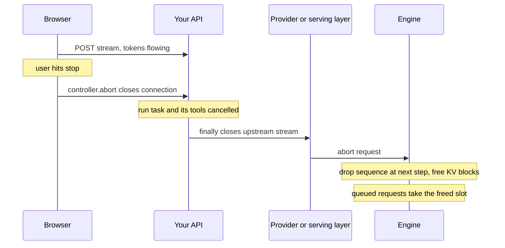

## TL;DR
A stopped agent run keeps decoding, calling tools and spending until something carries "stop" through
every hop: browser, agent loop, parallel tools, model stream and engine. Each layer must notice and
close the next connection, and side-effecting tools must survive being interrupted.

## For agent builders
- **Why it matters for agents.** Users stop agents that head the wrong way, and agents fan out parallel
  tools, sub-agents and speculative branches. Each abandoned piece keeps billing, holds capacity and may
  still fire a side effect unless cancellation reaches it.
- **Where it shows up in your stack.** `AbortController` in the UI, `task.cancel()` and
  `asyncio.TaskGroup` in a Python agent loop, `await stream.close()` on provider SDK streams, FastAPI
  `request.is_disconnected()`, and nginx `proxy_ignore_client_abort`.
- **What you control.** One cancellable task per run, structured concurrency so tools die with the run,
  upstream streams closed in `finally`, idempotency keys on write tools, and a "cancelled" run status.
- **What you can skip.** Engine scheduler internals; it is enough that an aborted sequence is dropped at
  the next step and its KV blocks are freed.

## Why it exists
- **LLM requests are expensive, long and often abandoned.** Users close tabs, hit stop, or send a new
  message mid-answer; agents fan out speculative branches and keep one; timeouts give up on running
  calls; hedged requests race two providers and need only the winner.
- **Work continues unless something says stop**, because a GPU engine has no idea whether anyone is
  reading.
- **The cost is threefold.**
  - *Money:* a provider bills every token decoded until the abort arrives; a self-hosted replica burns
    GPU time on discarded output.
  - *Capacity:* an abandoned sequence holds its KV blocks and batch place, so live requests queue behind
    ghosts, TTFT rises and preemptions start. Under a spike with many disconnects, a healthy cluster
    looks saturated.
  - *Correctness:* the old answer keeps streaming into a chat thread after the user moved on, and a
    cancelled agent step may already have fired a tool with side effects.
- **"Let it run, it is only a few hundred tokens" fails on arithmetic.** If a tenth of requests are
  abandoned halfway through 1,000-token answers, the replica spends about 5 % of its decode capacity on
  nothing, and the share climbs with longer outputs and more impatient users.
- **Timeouts without cancellation are worse:** they guarantee the client gives up while guaranteeing the
  upstream does not.

## How it works
### The chain, hop by hop
1. **Trigger.** In the browser an `AbortController` aborts the `fetch`; a stop button, a new message
   or navigation calls `controller.abort()`. Server-side triggers are timeouts, superseding requests
   and hedge resolution.
2. **Transport.** The client closes the connection (or resets the HTTP/2 stream).
3. **Your server.** The framework learns of the disconnect only when it next touches the socket. A
   streaming handler finds out at its next write, or by polling a disconnect check; a non-streaming
   handler that is simply awaiting the model never touches the socket and never finds out.
4. **Task cancellation.** The handler's task is cancelled (streaming frameworks usually do this on
   disconnect) or your code cancels it. In Python, `task.cancel()` schedules a `CancelledError` at the
   task's next `await`; it is cooperative, not a kill, so `finally` blocks run and must not swallow
   the exception.
5. **Upstream close.** Cleanup closes the response you were reading from the provider or engine. That
   close is the only signal the next hop gets; forgetting it leaves the upstream running while your
   own request looks finished.
6. **Engine abort.** The serving layer in front of the engine (an OpenAI-compatible server, a
   provider's gateway) detects its client's disconnect and aborts the request. A continuous-batching
   engine removes the sequence from the running batch at the next step and releases its KV blocks for
   other sequences. Without the abort, the sequence runs to end-of-sequence or `max_tokens`.

**Each arrow is a place the signal can be lost:**
- a proxy configured to keep the upstream alive after the client leaves;
- a worker that cannot observe the socket;
- a `finally` that logs and returns;
- an SDK that buffers the response instead of streaming it.

### Making disconnects observable
- **Streaming is the practical fix.** A write per token means the server notices a dead client within
  one token.
- **For non-streaming work**, run generation as a separate task and race it against a disconnect
  watcher, or poll the request's disconnect state while waiting.
- **Frameworks expose this differently:** FastAPI's `request.is_disconnected()`, a disconnect message on
  the ASGI receive channel. The companion lesson in the FastAPI module covers the mechanics.

### Side effects and accounting
- **Cancellation interrupts at an `await`**, so anything between awaits either happened or did not. For
  pure generation that is harmless.
- **Mid tool-call it is not.** The tool may have sent the email, written the row or charged the card
  before the cancel landed. Make tools idempotent or two-phase, and record the run as "cancelled"
  rather than "failed".
- **Shield work that must complete**, such as writing the usage record or releasing a lock, so a cancel
  cannot tear it.
- **Billing does not match what you received.** A cancelled stream never delivers its final usage event,
  while a provider generally charges for tokens generated until its gateway sees the abort. That can be
  more than you received: tokens in flight, buffered at a proxy, or decoded during the
  disconnect-detection lag.
- **So estimate and reconcile.** Keep the text you did receive and tokenize it for an estimate, treat it
  as a lower bound, and reconcile against the provider's usage reports rather than streamed chunk counts.

### Cancelling an agent run
- **The run is a tree of tasks.** The loop task owns the current model stream, any parallel tool calls
  and any sub-agents; a stop must reach every leaf, not only the HTTP response.
- **Structured concurrency does the fan-out.** Start parallel tools inside an `asyncio.TaskGroup` (Python
  3.11+) so cancelling the run cancels them all, and each tool's `finally` closes its own connection.
  Catch ordinary tool errors inside each tool wrapper, because a `TaskGroup` also cancels the sibling
  tools when one child raises.
- **Check before each step.** Between steps, check a cancel flag or deadline so the loop does not start
  a new model call after the user pressed stop.
- **Persist what finished.** Record completed steps and tool results so a restarted run can resume or
  show the user what already happened.

### Patterns built on cancellation
| Pattern | How it works | Note |
|---|---|---|
| **Supersede** | The newest user message cancels the in-flight generation before starting the next | Two answers never interleave and the slot is freed immediately |
| **Stop button** | Same mechanism, user-triggered | Keep the partial text, mark it truncated |
| **Deadline cancel** | A timeout is only useful if it cancels | The timeouts and cancellation lessons are halves of one behaviour |
| **Hedging** | Issue the same request to two replicas or providers after a short delay; cancel the loser when the first token or full response arrives | Cuts tail latency at the price of duplicate tokens, so reserve it for latency-critical, cheap-to-duplicate calls |
| **Speculative prefetch** | Start a likely-next generation early | Cancel it if the user goes elsewhere |

## Diagram
Follow the stop signal from the click to freed KV blocks. In an agent the run task and its tools are
cancelled too; every hop must close the next connection, or the engine keeps decoding for nobody.



## Misconceptions
- **"Closing the tab or hitting stop stops the model."** The engine has no idea whether anyone is
  reading. The stop must cross every hop, and each hop must close its own upstream connection, or
  decoding runs to `max_tokens`.
- **"`task.cancel()` kills the task."** It schedules a `CancelledError` at the next `await`. `finally`
  blocks run, and one that logs and returns swallows the cancel, so the upstream is never closed.
- **"My server knows when the client leaves."** It learns only when it next touches the socket. A
  streaming handler notices within a token; a non-streaming handler awaiting the model never does unless
  you race it against a disconnect watcher.
- **"Cancelling the HTTP response cancels the agent run."** The run is a tree: model stream, parallel
  tools and sub-agents. Only structured concurrency such as `asyncio.TaskGroup` and a cancel check
  between steps reaches every leaf.
- **"A cancelled tool call did nothing."** Cancellation lands at an `await`, after the email or charge
  may already have gone out; write tools need idempotency keys, and the run is recorded as cancelled,
  not failed.
- **"I am billed only for the tokens I received."** A cancelled stream never sends its usage event, and
  the provider charges until its gateway sees the abort. Treat received text as a lower bound and
  reconcile against usage reports.

## Examples
### Agent scenario: stop pressed while parallel tools run
Runnable on Python 3.11+: the run's parallel tools live in a `TaskGroup`, so cancelling the run cancels
the slow tool too, while a tool that already finished keeps its result.

```python
import asyncio

log = []

async def tool(name, secs):
    try:
        await asyncio.sleep(secs)                    # stand-in for an HTTP tool call
        log.append(f"{name}: done")
    finally:
        if asyncio.current_task().cancelling():
            log.append(f"{name}: cancelled, connection closed")

async def agent_run(steps=5):
    for step in range(steps):
        log.append(f"step {step}: model call")
        await asyncio.sleep(0.1)                     # stand-in for a streamed model call
        async with asyncio.TaskGroup() as tg:        # parallel tool calls share the run's fate
            tg.create_task(tool(f"search-{step}", 0.3))
            tg.create_task(tool(f"fetch-{step}", 1.0))

async def main():
    run = asyncio.create_task(agent_run())
    await asyncio.sleep(0.6)                         # user presses stop during step 0's tools
    run.cancel()
    await asyncio.wait([run])
    print(*log, sep="\n")
    print("run cancelled:", run.cancelled())

asyncio.run(main())
# step 0: model call
# search-0: done
# fetch-0: cancelled, connection closed
# run cancelled: True
```

### Supersede pattern for a chat session
The newest request cancels the previous generation, and the cancelled task's `finally` closes the
provider stream, which is the only way the provider learns to stop decoding. The `asyncio.wait` keeps
the caller from swallowing its own cancellation.

```python
import asyncio
from openai import AsyncOpenAI

client = AsyncOpenAI()
MODEL = "my-model"

class ChatSession:
    def __init__(self):
        self.current: asyncio.Task | None = None
        self.received: list[str] = []            # a cancelled stream sends no usage event; tokenize
                                                 # this later for a lower-bound estimate of billed output

    async def _generate(self, messages, on_delta):
        stream = await client.chat.completions.create(model=MODEL, messages=messages, stream=True)
        try:
            async for chunk in stream:
                if chunk.choices and chunk.choices[0].delta.content:
                    self.received.append(chunk.choices[0].delta.content)
                    on_delta(chunk.choices[0].delta.content)
        finally:
            await stream.close()                 # runs on CancelledError too: closing the HTTP response
                                                 # is the provider's only signal to abort the sequence

    async def submit(self, messages, on_delta) -> asyncio.Task:
        prev = self.current
        if prev and not prev.done():
            prev.cancel()                        # supersede: new message or stop button
            await asyncio.wait([prev])           # wait for its cleanup without swallowing our own cancel
        self.current = asyncio.create_task(self._generate(messages, on_delta))
        return self.current

async def demo():
    s = ChatSession()
    show = lambda t: print(t, end="", flush=True)
    first = await s.submit([{"role": "user", "content": "Write a long essay about rivers."}], show)
    await asyncio.sleep(1.0)                     # user changes their mind one second in
    second = await s.submit([{"role": "user", "content": "Actually, one sentence on rivers."}], show)
    await second
    print("\nfirst cancelled:", first.cancelled(), "| chars received:", sum(map(len, s.received)))

asyncio.run(demo())
```

### Racing a non-streaming generation against a disconnect watcher
Runnable with no server: a fake upstream decodes a token every 10 ms, and the "client" leaves after
0.5 s. The watcher wins the race, the generation task is cancelled, and its `finally` closes the
upstream, so decoding stops near 50 tokens instead of running to 1,000.

```python
import asyncio

class FakeUpstream:                                 # stands in for a provider or engine stream
    def __init__(self):
        self.closed, self.tokens = False, 0
    async def stream(self):
        while not self.closed:
            await asyncio.sleep(0.01)
            self.tokens += 1
            yield "tok "
    async def close(self):
        self.closed = True                          # real code: close the HTTP response

async def generate(up, out, max_tokens=1000):
    try:
        async for t in up.stream():
            out.append(t)
            if len(out) == max_tokens:
                break
    finally:
        await up.close()                            # runs on CancelledError too

async def handle(disconnect_after):
    up, out = FakeUpstream(), []
    gen = asyncio.create_task(generate(up, out))
    watch = asyncio.create_task(asyncio.sleep(disconnect_after))  # real code: poll is_disconnected()
    done, _ = await asyncio.wait({gen, watch}, return_when=asyncio.FIRST_COMPLETED)
    if watch in done:
        gen.cancel()
        await asyncio.wait([gen])                   # let cleanup finish
        status = "cancelled"
    else:
        watch.cancel()
        status = "completed"
    print(f"{status}: upstream closed={up.closed}, tokens decoded={up.tokens}")

asyncio.run(handle(0.5))
# cancelled: upstream closed=True, tokens decoded=45   (roughly 45-50, timing dependent)
```

### Worked scenario: what abandonment costs without cancellation
Decode capacity wasted when abandoned requests run to completion (illustrative; with working
cancellation the waste shrinks to the detection lag, about one token for streaming handlers).

| Abandonment rate | Abandoned at | Waste per abandoned request | Share of decode capacity wasted |
|---|---|---|---|
| 10 % | halfway through 1,000 tokens | 500 tokens | about 5 % |
| 10 % | after 100 of 1,000 tokens | 900 tokens | about 9 % |
| 30 % | halfway | 500 tokens | about 15 % |

The earlier and more often users leave, the larger the share, which is why long outputs and impatient
users make the problem grow.

## Production patterns
- **One cancellable task per agent run.** Keep a handle to the run's task keyed by run id, cancel it from
  the stop endpoint or on disconnect, and start tools and sub-agents inside a `TaskGroup` so they die
  with it. Monitor tool calls and model tokens that start after a run was cancelled; it should be zero.
- **Idempotency keys on side-effecting tools.** Derive a key from run id and step so a retried or resumed
  run cannot send the same email or order twice. Monitor duplicate side effects per tool.
- **Wire `AbortController` on every client call.** Create one per request, pass `signal` to `fetch`, and
  call `abort()` on stop, supersede and navigation. Monitor the abandonment rate from client telemetry.
- **Close upstream in `finally` or a context manager.** Wrap provider streams so cleanup always closes
  the HTTP response, and never catch `CancelledError` without re-raising. Monitor open upstream
  connections against active client streams.
- **Keep the proxy from hiding aborts.** In nginx leave `proxy_ignore_client_abort` at its default
  `off`, so a client abort closes the upstream connection; check equivalent settings on gateways.
  Monitor whether the serving layer logs disconnects when users press stop.
- **Shield bookkeeping.** Run the usage write and lock release inside `asyncio.shield(...)` so a cancel
  cannot tear them, and record the request as "cancelled", not an error. Monitor cancelled share
  separately from the error rate.
- **Hedge with an explicit loser cancel.** For short latency-critical calls, start a second attempt after
  a delay, take the first result with `asyncio.wait(..., return_when=FIRST_COMPLETED)`, and cancel the
  rest. Monitor duplicate tokens per hedged call and p99 latency.
- **Measure disconnect-to-abort time.** Track time from client disconnect to engine abort, tokens
  generated after disconnect, and the engine's aborted-request count. If provider usage does not fall
  when abandonment rises, the abort is not reaching them.

## Trade-offs
- **Freed capacity vs lost partial work.** Cancelling on disconnect frees capacity and money immediately
  but throws away partial work that might have been valuable; for long, expensive jobs the better
  design is an asynchronous job whose lifetime is independent of the HTTP connection.
- **Tail latency vs duplicate tokens.** Hedged requests cut tail latency and double the tokens spent on
  every hedged call; they pay off only for short, latency-critical calls where the tail is bad and
  capacity is available.
- **Immediate cancel vs grace period.** Immediate is cheapest, while a short grace period tolerates
  mobile network blips and tab switches. The right delay depends on how reconnecting clients resume,
  which for LLM streams is usually "they cannot", so grace periods rarely pay.
- **Safe generation vs risky side effects.** Cooperative cancellation is safe for generation and risky
  around side effects; idempotent tools can be cancelled freely, non-idempotent ones need shielding or
  compensation.
- **Polling overhead vs never stopping.** Polling for disconnects in non-streaming handlers adds a little
  overhead per request and is the only way those handlers ever stop early.

## Pitfalls
- **No disconnect handling at all.** Symptom: GPU utilisation and provider spend that stay flat when
  users leave, and TTFT that rises during periods of many abandoned requests. Fix: wire the chain
  above, hop by hop.
- **Catching `CancelledError` and continuing.** On Python before 3.8 a plain `except Exception` did this
  silently, since it was not yet a `BaseException`; a bare `except:` still does. Symptom: tasks that
  never finish and `finally` cleanup that never runs. Fix: clean up in `finally` and re-raise.
- **Closing your own response but not the upstream stream.** Symptom: provider usage higher than your
  logs can account for. Fix: close the provider stream in `finally` or a context manager.
- **A proxy that keeps the upstream connection alive after the client aborts.** Symptom: the serving
  layer never sees a disconnect even though clients clearly left. Fix: check settings such as nginx
  `proxy_ignore_client_abort`.
- **Assuming non-streaming endpoints cancel on disconnect.** Symptom: a 2-minute generation completing
  for a client that left after 5 seconds. Fix: race generation against a disconnect watcher.
- **Cancelling an agent mid-tool-call with no idempotency.** Symptom: duplicated emails or orders when
  the user retries after hitting stop. Fix: idempotency keys or two-phase tools.
- **Reporting cancelled requests as errors.** Symptom: a noisy error rate that masks real failures and
  panics on-call. Fix: a separate "cancelled" status and metric.

## When to use
- **Always, for services fronting a model:** cancellation on disconnect, timeout and supersede is not
  optional once outputs are longer than a sentence or traffic is bursty.
- **Hedging** only for short, latency-critical calls with capacity to spare; **speculative prefetch**
  only when the abandoned cost is clearly less than the latency saved.
- **Do not tie long batch jobs to a connection** at all.
- **Cancel the whole agent run,** not just its HTTP response: the loop, in-flight model stream, parallel
  tools and sub-agents.
- **Measure** the abandonment rate, time from client disconnect to engine abort, and tokens generated
  after disconnect; check that the provider's reported usage falls when abandonment rises, and if it
  does not, the abort is not reaching them.
- **Interviews:** trace the stop signal hop by hop from `AbortController` to KV-block release; that is
  the answer that shows you have run this in production.

## Role lens
- **Engineer:** Wires `AbortController` on the client, closes upstream streams in `finally`, and
  makes handlers observe disconnects for both streaming and non-streaming paths.
- **Architect:** Decides which calls may be hedged or prefetched, which jobs are detached from
  connections, and requires idempotent tools so cancelled agent steps cannot cause duplicates.
- **FDE:** Finds the customer proxy or gateway that swallows client aborts, and proves with engine
  metrics that abandoned requests were burning their GPU capacity.

## Check yourself
**Q:** Users hit the stop button constantly, yet GPU utilisation and the provider bill do not move at
all. Trace where the cancellation is being lost, and how you would prove each hypothesis.
**A:** Start at the browser: confirm `controller.abort()` is called and the fetch actually closes
(network tab shows the request cancelled). Next the server: does the handler observe the disconnect?
A non-streaming handler awaiting the model never will; a streaming one should see a failed write or
`is_disconnected()` within a token, so log it. Then task cancellation: check that the task is
cancelled and that `finally` runs without swallowing `CancelledError`. Then the upstream: verify the
provider or engine response is closed, not merely abandoned to the garbage collector, by watching the
connection count or the provider's streamed-token usage. Then infrastructure: a proxy configured to
ignore client aborts keeps the upstream alive, visible as the serving layer never logging a
disconnect. Finally the engine: its abort count and freed-block metrics should rise with stop-button
presses; if everything upstream is right and they do not, the serving layer is not calling abort.

## Interview questions
### Why does an abandoned LLM request cost more than an abandoned web request?
- **It keeps consuming:** a decode slot, KV-cache memory and billed tokens until end-of-sequence or the
  token limit, because the engine cannot tell nobody is reading.
- **It hurts live traffic:** abandoned sequences hold KV blocks, so queued requests wait, TTFT rises and
  preemptions start.
- **Numbers:** a tenth of requests abandoned halfway through 1,000-token answers wastes about 5 % of
  decode capacity.

### A user hits stop while an agent is mid tool-call. What can go wrong and how do you design for it?
- **The tool may already have acted:** cancellation lands at an await, so an email or payment may have
  been sent before it arrived.
- **Design:** idempotency keys or two-phase tools, the run recorded as cancelled, and shielded
  bookkeeping so usage and locks are written even under cancel.
- **On retry**, the idempotency key prevents a duplicate side effect.

### Users press stop on agents, but runs keep calling tools for a minute afterwards. What is wrong?
- **The stop only reached the HTTP response,** not the loop: the run task was never cancelled, or the
  loop does not check for cancellation between steps.
- **Tools run outside structured concurrency,** for example fire-and-forget tasks, so cancelling the
  parent does not reach them.
- **Fix:** one cancellable task per run, tools in a `TaskGroup`, a cancel check before each step, and a
  metric for work started after cancellation.

### When is hedging worth it, and what does it cost?
- **Worth it** for short, latency-critical calls with a bad tail and spare capacity: send a second
  request after a short delay and cancel the loser.
- **Cost:** duplicate tokens on every hedged call, and extra load exactly when an upstream is slow.
- **Requirement:** the loser must actually be cancelled upstream, or the cost doubles with no limit.

### How would you prove cancellation works end to end in production?
- **Metrics:** time from client disconnect to engine abort, tokens generated after disconnect, and the
  engine's aborted-request count rising with stop-button presses.
- **Billing check:** provider usage should fall when abandonment rises; if it does not, the abort is
  lost at some hop.
- **Reconcile** received text, tokenized as a lower bound, against the provider's usage reports.

## Quiz
### Q: Why does a non-streaming endpoint usually keep generating after the client disconnects?
- [ ] The engine refuses to abort requests that have already started prefill
- [x] The handler is awaiting the model and never touches the socket, so nothing observes the disconnect until it tries to write the response
- [ ] HTTP does not allow a client to close a connection before the response arrives
- [ ] Non-streaming responses are cached by the proxy and must be completed
> A disconnect is only visible to code that reads from or writes to the connection. A streaming
> handler writes every token and notices quickly; a non-streaming one discovers the dead client only
> when the finished answer fails to send, long after the work was wasted.

### Q: In Python asyncio, what does calling `task.cancel()` on a running generation task actually do?
- [ ] Kills the task immediately and skips any cleanup code
- [ ] Sends a SIGTERM to the thread running the coroutine
- [x] Schedules a `CancelledError` to be raised at the task's next `await`, so `finally` blocks run and can close upstream streams
- [ ] Marks the task as done and returns its partial result
> Cancellation is cooperative: the exception is delivered at the next suspension point, cleanup in
> `finally` runs, and code must re-raise rather than swallow it. That is exactly what lets the task
> close the provider stream on its way out.

### Q: What happens to an aborted sequence in a continuous-batching engine such as vLLM?
- [ ] Its KV cache is kept until `max_tokens` would have been reached, in case the client reconnects
- [ ] It finishes decoding in the background and the output is discarded
- [x] It is removed from the running batch and its KV blocks are released for other sequences
- [ ] It is moved to a low-priority queue and completed when the GPU is idle
> The point of propagating cancellation is to reclaim capacity now. The engine drops the sequence at
> the next scheduling step and frees its memory, which is why abandoned requests only cost capacity
> when the abort never reaches the engine.

## Use cases & projects
### Use cases
- **Stop buttons in agent UIs.** A user's stop must end decoding, pending tool calls and sub-agents, not
  just hide the stream.
- **Parallel tools and speculative branches.** When one branch wins, the others are cancelled so they
  stop billing and free capacity.
- **Agents with write tools.** Idempotency keys and a "cancelled" run status make an interrupted email,
  payment or ticket update safe to inspect and retry.
- **Deadlines and disconnects.** Timeouts and dropped connections reuse the same cancellation path, so
  abandoned runs do not keep spending.

### Mini project
**Make stop actually stop an agent (1-2 hours).**
- **Goal:** prove that cancelling a run ends every model stream and tool call within a second.
- **Steps:** build a FastAPI agent endpoint that streams a run with two parallel tools in an
  `asyncio.TaskGroup`; check `request.is_disconnected()` in the loop; close the provider stream in
  `finally`; log a line from every tool and stream when it starts, finishes or is cancelled; disconnect
  the client mid-run.
- **Done when:** the log shows every task cancelled shortly after the disconnect, no tool logs work after
  it, and the run is stored with a "cancelled" status.
