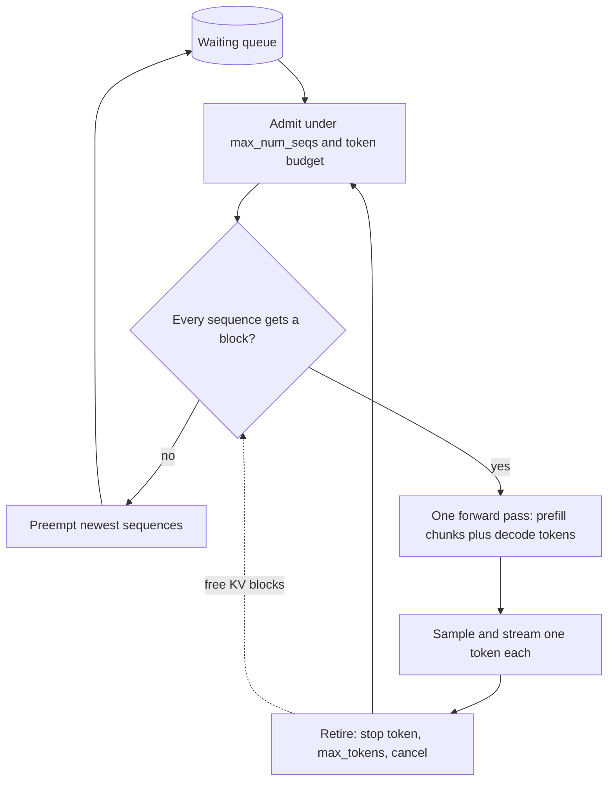

## TL;DR
Continuous batching schedules per decode iteration, not per request: finished sequences leave and waiting
ones join every step, so the GPU stays full. One weight read serves dozens of tokens, giving throughput an
order of magnitude above naive servers.

## Why it exists
- **Decode needs many tokens per weight read.** It is memory-bandwidth-bound, one token per full read of the
  weights per request, so the only way to use the hardware is to batch requests so one step advances all
  of them.
- **Static request-level batching breaks on generation.** Collect *B* requests, run until all finish, then
  collect the next *B*: fine for fixed-cost models. But one request stops after 20 tokens and another runs
  to 2,000, and the early finisher's slot idles, padded with nothing useful, until the longest ends.
- **The cost is twofold.** Utilization collapses toward that of the single longest sequence, and arrivals
  wait for the remaining life of the current batch, because no new request can start until it drains.
- **Smaller or time-boxed batches trade one waste for another.** Small batches lose the bandwidth
  amortization that was the point; time-boxing kills long generations.
- **The fix: stop treating the batch as a unit of work.** Every step is just "take one token from each of
  these sequences", so membership can change between steps. A finished sequence frees its slot and KV
  memory immediately; a waiting request is prefilled and joins next step. The original paper called it
  iteration-level scheduling.
- **Paging made it scale.** Orca, which introduced it, still reserved each sequence's maximum length
  contiguously, so only a small batch fit. Paged KV memory (vLLM) let the batch grow to sizes the hardware
  could use, because joining and leaving need no contiguous allocation or copying, and no slot is reserved
  for tokens that may never be generated.

## How it works
### The scheduler loop
Each iteration the engine does roughly this:

1. **Retire.** Remove sequences that emitted a stop token, reached `max_tokens`, or were cancelled; free
   their KV blocks.
2. **Admit.** Pull waiting requests, oldest first (or by priority), while two budgets hold:
   - running sequences stay under `max_num_seqs`;
   - tokens processed this iteration stay under `max_num_batched_tokens`. A newcomer's prompt counts its
     full length, because its prefill runs this step; a running request counts one token.
3. **Check memory.** Ensure every running sequence can get at least one more block; if not, preempt the most
   recently admitted ones (recompute or swap) until the rest fit.
4. **Run one forward pass** over the union: prefill tokens for newcomers and one decode token per running
   sequence, packed into one batch with per-sequence block tables.
5. **Sample and stream** one token per sequence to its client, then loop.

### Why one forward pass can mix prefill and decode
- **Weights do not care which sequence a token belongs to.** Only attention needs the boundaries, and with
  block tables each query reads its own sequence's cache.
- **Example:** 3 newcomers of 500 tokens plus 60 decoding sequences is a single batch of 1,560 tokens, close
  to compute-bound and therefore efficient.
- **Decode tokens ride along almost free,** because the weights were going to be read anyway.

### The interference problem and chunked prefill
- **Mixing has a cost.** A 10k-token newcomer makes the iteration as long as its prefill, and all 60
  decoding users see a pause.
- **Early implementations picked a policy:** prefill-first (admit eagerly, accept TPOT spikes, minimize
  TTFT) or decode-first (defer admissions until decode is quiet, accept TTFT growth).
- **Chunked prefill removes the dilemma.** Cap prefill tokens per iteration and split a long prompt across
  steps, each also carrying every decode token. TPOT stays smooth, the long prompt's TTFT grows a little,
  and every step is filled up to the token budget.

### Throughput versus latency inside the loop
- **Step time grows slowly with batch size** (weights read once; cache reads and compute grow with tokens),
  while tokens per step grow linearly. Throughput rises steeply until the step becomes compute- or
  cache-bound, and every user's TPOT rises along the way.
- **Two dials:** `max_num_seqs` and the token budget. Raise them to sell throughput, lower them to sell
  latency.
- **Little's law sizes the batch you need** in front of the loop:

```
running sequences ≈ arrival rate × time each spends generating
5 requests/s × (300 output tokens × ~20 ms TPOT = 6 s) ≈ 30 sequences in flight
```

- **So a `max_num_seqs` of 16 guarantees a growing queue** however fast each step is.
- **If arrivals exceed what the loop retires,** the queue grows without bound and TTFT explodes: the signal
  for backpressure or more replicas.

### What it does not fix
- **Single-request decode** stays at the bandwidth floor; nothing makes a batch of one efficient.
- **Memory becomes the binding constraint,** because the batch is limited by how many caches fit, not a
  fixed batch size. That is why this lesson and the KV-cache lessons are inseparable.

## Diagram
One pass of the iteration-level scheduler; the loop runs once per decode step, so batch membership changes
every step.



## Examples
### Static versus continuous batching, simulated
Same workload, an illustrative step-time model (a fixed weight-read time plus a small per-token cost), and
deliberately skewed output lengths, as real traffic is.

```python
import random
random.seed(0)
N, MAX_SEQS = 200, 32
lengths = [random.choice([20, 50, 100, 400, 1500]) for _ in range(N)]   # output tokens per request

def step_ms(n_tokens):               # illustrative: 5 ms weight read + 0.02 ms per token
    return 5.0 + 0.02 * n_tokens

def static_batching():
    t = 0.0
    for i in range(0, N, MAX_SEQS):
        batch = lengths[i:i + MAX_SEQS]
        for step in range(max(batch)):                       # batch lives until its longest finishes
            active = sum(1 for L in batch if L > step)       # idle slots are wasted
            t += step_ms(active)
    return t

def continuous_batching():
    t, waiting, running = 0.0, list(lengths), []
    while waiting or running:
        running = [L for L in running if L > 0]              # retire finished sequences
        while waiting and len(running) < MAX_SEQS:           # admit newcomers into freed slots
            running.append(waiting.pop(0))
        t += step_ms(len(running))
        running = [L - 1 for L in running]
    return t

total_tokens = sum(lengths)
for name, fn in (("static", static_batching), ("continuous", continuous_batching)):
    ms = fn()
    print(f"{name:11s}: {ms/1000:6.1f} s total, {total_tokens/ms*1000:8.0f} tok/s")
# With this seed: static ~54 s (~1.6k tok/s), continuous ~20 s (~4.5k tok/s), close to 3x,
# because static batches spend most steps at low occupancy waiting for the 1500-token
# outliers. Make the length skew harsher and the gap widens; make lengths uniform and it vanishes.
```

- **Why it is clean:** it ignores prefill and memory, isolating the one effect continuous batching is
  responsible for.
- **Extend it:** add a random long prefill to `step_ms` for newcomers and you reproduce the TPOT spike that
  chunked prefill exists to smooth.

### Sizing `max_num_seqs` with Little's law
The section's numbers as a calculator: what the loop must hold, and how fast a cap lets it retire work.

```python
def in_flight(arrivals_per_s, out_tokens, tpot_ms):
    return arrivals_per_s * out_tokens * tpot_ms / 1000      # Little's law: L = lambda x W

def max_retire_rate(max_num_seqs, out_tokens, tpot_ms):
    return max_num_seqs / (out_tokens * tpot_ms / 1000)      # requests/s the cap can finish

print(in_flight(5, 300, 20))                 # 30.0 sequences needed on average
for cap in (16, 32, 48):
    print(cap, round(max_retire_rate(cap, 300, 20), 2))
# 16 -> 2.67 req/s: below 5 arrivals/s, queue grows ~2.3 req/s (~140 per minute)
# 32 -> 5.33 req/s: barely above, so queueing delay is large at any burst
# 48 -> 8.0 req/s:  headroom, if TPOT stays near 20 ms at that batch (measure it)
```

| Day vs night (illustrative) | Arrivals | TPOT | Needed in flight |
|---|---|---|---|
| Night | 5 req/s | ~20 ms | 30 |
| Day, rate doubles | 10 req/s | ~25 ms (bigger batches, more cache reads) | 75 |

- **Read it as:** doubling traffic more than doubles the needed batch, because TPOT rises with the batch.
  The cap you can afford is set by the TPOT budget; beyond it, add replicas.

## Production patterns
- **Pick dials from a load-test knee.** Sweep `--max-num-seqs` and `--max-num-batched-tokens` (vLLM) under
  the production length mix, record TTFT, TPOT and tokens/s together, and choose the highest concurrency
  whose TPOT p95 is inside budget. Re-run on every model or hardware change.
- **Chunked prefill on mixed workloads.** Keep `--enable-chunked-prefill` on (the default in recent vLLM)
  unless prompts are uniformly short. Monitor per-step time and TPOT p99 when long prompts arrive.
- **Backpressure at the gateway.** Reject or shed load (HTTP 429 or 503 with `Retry-After`) when the engine's
  waiting-queue depth (vLLM's `vllm:num_requests_waiting`) passes a threshold derived from the TTFT budget.
  Monitor rejection rate and TTFT p99 together.
- **Scale on the queue, not CPU.** Autoscale replicas when waiting requests stay above zero for a sustained
  window or arrivals approach the retirement rate. Monitor queue depth trend and preemptions per replica.
- **Priority for interactive traffic.** Where the engine supports a priority scheduling policy (vLLM has a
  priority mode alongside first-come-first-served), give interactive requests precedence over batch jobs
  sharing the replica. Monitor TTFT per priority class.

## Trade-offs
- **Saturated GPU vs per-user TPOT.** It multiplies throughput, but every admitted request lengthens each
  step and every user's TPOT. The balance flips toward smaller `max_num_seqs` for interactive products.
- **Eager vs deferred admission.** Eager admission minimizes TTFT but injects prefill into decode steps;
  deferring does the opposite. Chunked prefill blunts the trade at the cost of slightly longer TTFT on
  long prompts.
- **Memory as the limit vs preemption risk.** Iteration-level scheduling makes memory, not batch size, the
  limit, which packs far more requests but introduces preemption as a failure mode when the sequence-length
  tail is long.
- **Large vs small token budget.** A large per-iteration budget raises utilization on long-prompt workloads
  but makes each step heavier; on chat with short prompts a smaller budget gives smoother streaming.

## Pitfalls
- **Benchmarking with uniform output lengths.** Symptom: little gain over static batching in the load test,
  then surprise when production's skewed lengths behave completely differently. Fix: replay output lengths
  sampled from production logs.
- **Raising `max_num_seqs` until throughput peaks and shipping that.** Symptom: excellent tokens/sec with
  complaints that text streams slowly, because TPOT was never on the dashboard. Fix: cap it where TPOT p95
  meets the budget.
- **Chunked prefill disabled on a mixed workload.** Symptom: periodic stalls across all streams that
  correlate with long-prompt arrivals rather than request rate. Fix: enable it with a token budget.
- **An unbounded waiting queue.** Symptom: TTFT climbing linearly over minutes under steady overload,
  because the loop retires fewer sequences per second than arrive. Fix: backpressure at the gateway and
  scale on queue depth.
- **Expecting better single-request latency.** Symptom: disappointment when a lightly loaded server's TPOT
  equals the bandwidth floor regardless of settings. Fix: use per-request levers such as weight
  quantization or speculative decoding.

## When to use
Every production LLM engine does this; what you choose is the dials.
- **Set the dials from a load test:** `max_num_seqs` and the token budget, recording TTFT, TPOT and
  tokens/sec together, at the point where TPOT is still inside the product's budget.
- **Enable chunked prefill** unless the workload is purely short prompts.
- **Watch overload signals:** queue depth and preemptions; add replicas or backpressure when the queue grows
  faster than it drains.
- **Building on a raw model library instead of an engine?** This is the first feature you are missing, and
  the reason to switch.
- **Interviews:** why static batching wastes slots, how iteration-level scheduling fixes it, why it needs
  paged memory, and what chunked prefill adds.

## Role lens
- **Engineer:** Tunes `max_num_seqs`, the per-iteration token budget and chunked prefill from load tests,
  and plots TPOT against concurrency to find the knee for the product's latency budget.
- **Architect:** Sets the throughput-versus-latency policy per endpoint class, decides replica counts from
  the loop's retirement rate versus arrival rate, and defines the backpressure contract.
- **FDE:** Demonstrates to a customer why their homegrown batching server caps out early, and reproduces
  their stutter by injecting long prompts into a loaded replica before proposing chunked prefill.

## Check yourself
**Q:** A team's engine shows 85% KV-cache utilization, average batch size 12, and users report that
responses stream fast at night and slowly during the day. Request rate doubles during the day. Explain
what the scheduler is doing and how you would tune it without buying hardware.
**A:** (Note the metric: KV-cache utilization, not GPU memory, which an engine pre-allocates and which
therefore always reads ~90%.) At night the running batch is small, so each decode step reads the
weights plus a few caches and TPOT sits near the bandwidth floor. During the day the loop admits more sequences up to `max_num_seqs` or
the memory limit; average batch 12 is a daily average hiding daytime batches several times larger. Each
step now reads many caches and carries newcomers' prefill, so TPOT grows and streaming slows; that is the
expected throughput-for-latency trade, not a bug. First, put TPOT and batch size per step on the
dashboard to confirm. Then enable chunked prefill so daytime admissions stop injecting stalls. Next,
decide the TPOT budget and cap `max_num_seqs` at the concurrency where the load test crosses it, accepting
that excess requests queue and TTFT rises; if the queue then grows without bound, the fleet is undersized
and backpressure or a replica is the honest answer. Prefix caching for the shared system prompt reduces
prefill tokens per iteration and helps both metrics. Only after those should quantization or hardware
enter the conversation.

## Interview questions
### What is continuous batching and why do LLMs need it when classic ML servers did not?
- **Definition:** scheduling at iteration granularity, so sequences join and leave the running batch every
  decode step instead of the batch living until its longest member finishes.
- **Why LLMs need it:** output lengths vary from tens to thousands of tokens, so static batches idle most
  slots; classic models have fixed cost per request, so their batches finish together.

### Why did paged KV memory matter so much for continuous batching?
- **Orca already scheduled per iteration,** but reserved each sequence's maximum length contiguously, so few
  sequences fit and batches stayed small.
- **Blocks remove that cap:** sequences join, grow and leave without reservations or copies, so the batch
  grows to what memory can actually hold.

### Your load test showed 3x throughput but production users say streaming stutters. Debug it.
- **Check the length mix:** a uniform-length test hides both the gains and the interference of skewed real
  traffic.
- **Correlate stalls with long-prompt arrivals;** an unchunked prefill stretches one step for every decoding
  user.
- **Fix:** enable chunked prefill with a token budget, and cap `max_num_seqs` at the TPOT budget rather than
  at peak throughput.

### When would you deliberately run smaller batches than the GPU could hold?
- **Interactive products with a TPOT budget:** every admitted sequence lengthens each step for everyone.
- **Long-tailed lengths:** optimistic admission near the memory limit invites preemption storms.
- **The cost** is lower tokens per GPU and more replicas, so do it per endpoint class, not fleet-wide.

### Arrivals are 5 requests/s, outputs average 300 tokens at ~20 ms TPOT. Is `max_num_seqs` 16 enough?
- **Little's law:** 5 × 6 s ≈ 30 sequences must be in flight on average.
- **A cap of 16** retires at most ~2.7 requests/s, so the queue grows by over 2 per second and TTFT climbs
  without bound.
- **Raise the cap** if TPOT at ~30-48 sequences stays in budget; otherwise add a replica and backpressure.

## Quiz
### Q: What is the core change continuous batching makes relative to static request-level batching?
- [ ] It pads shorter sequences so that all sequences in a batch finish together
- [x] It lets sequences join and leave the batch at every decode iteration rather than waiting for the whole batch to finish
- [ ] It runs prefill and decode on separate GPUs
- [ ] It increases the batch size until the GPU is compute-bound
> The unit of scheduling becomes one iteration. Finished sequences free their slots immediately and
> waiting requests fill them, so occupancy stays high regardless of length skew. Padding is what static
> batching does; disaggregation and batch sizing are separate techniques.

### Q: Why does continuous batching gain so much from paged KV-cache memory?
- [ ] Paging compresses the cache so more sequences fit in a static batch
- [x] Without paging each sequence reserves its maximum length contiguously, so few fit and the batch stays small; blocks let sequences join, grow and leave without reservations or copies
- [ ] Paging allows prefill to be skipped for new sequences
- [ ] Paging makes decode compute-bound
> Iteration-level scheduling works without paging (Orca did it), but contiguous worst-case reservations
> cap the number of resident sequences far below what memory could hold, and growing in place forces
> copies. Block-based allocation removes both limits. Skipping prefill is prefix caching, a different feature.

### Q: What problem does chunked prefill solve inside a continuous-batching scheduler?
- [ ] It reduces the total compute required to prefill a long prompt
- [ ] It lets prompts exceed the model's context window
- [x] It prevents a long newcomer's prefill from making one iteration so slow that every decoding user sees a stall
- [ ] It allows prefill to run on the CPU while decode runs on the GPU
> Mixing a long prefill into one step stretches that step for everyone. Chunking spreads the prefill
> across several steps, each still carrying all decode tokens, so TPOT stays smooth. Total work and
> context limits are unchanged.
