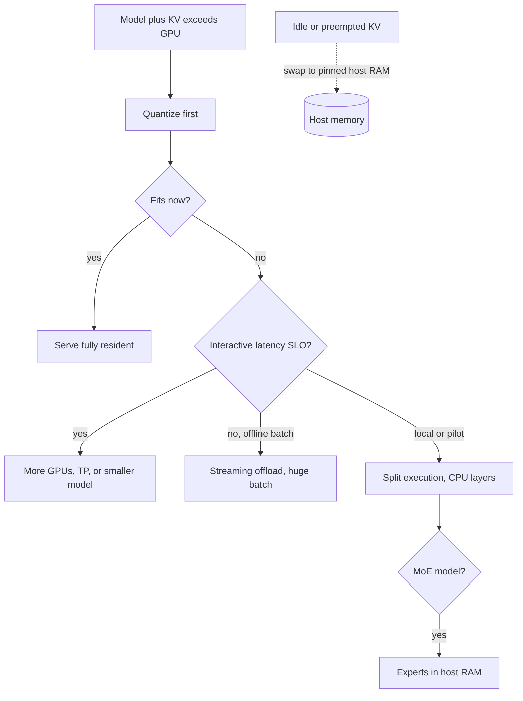

## TL;DR
CPU offloading keeps weights or KV cache in host RAM, behind PCIe 50–100× slower than HBM. Offloaded
weights make every agent step crawl; offloading the idle KV of paused agents, or offline batch runs,
is where it pays.

## For agent builders
- **Why it matters for agents.** Agent runs multiply per-token latency by steps and tokens per step, so
  the seconds-per-token of offloaded weights turns a 3-minute run into an hour. The useful case is the
  opposite: agents spend long stretches waiting on tools or humans, and their idle KV can leave the GPU.
- **Where it shows up in your stack.** Local agent development with llama.cpp (`-ngl`) or Hugging Face
  `device_map="auto"`, vLLM's `--cpu-offload-gb` and swap options, and tiered prefix caches that keep
  shared system-prompt blocks in CPU RAM.
- **What you control.** Model size and quantization for the agent, a load-time guard against silent
  offload, and context caps that decide whether a paused agent's KV must be swapped or recomputed.
- **What you can skip.** ZeRO-Infinity and NVMe tiers, which matter for training and offline research
  jobs, not for serving agents.

## Why it exists
- **The model does not fit.** A 70B model is about 140 GB in bf16 and about 40 GB at 4-bit, and the GPU on
  the desk has 24 GB. Options: a smaller model, more aggressive quantization, more GPUs, or putting the
  overflow somewhere else and fetching it on demand.
- **Host RAM looks like free capacity.** It is plentiful and cheap (hundreds of GB on a workstation), and
  PCIe can move data both ways while the GPU computes.
- **The catch is decode arithmetic.** Each token needs every weight once, so non-resident weights cross
  PCIe every step. Gen4 x16 moves about 25 GB/s in practice (theoretical a little above 30 GB/s; Gen5
  roughly doubles it). An H100's HBM delivers around 3.35 TB/s; even a consumer GPU around 1 TB/s.
- **So small offloads hurt a lot.** Streaming 20 GB of weights per token costs about 0.8 s before any
  compute. Offloading just 10% of a 40 GB model still adds roughly 160 ms of transfer to every token,
  several times the resident compute.
- **Three cases change the arithmetic.** The offloaded share is a rounding error; the workload is offline
  and a huge batch amortises each transfer over thousands of tokens (FlexGen's design); or what is
  offloaded is KV cache for idle or preempted sequences, read once on resume rather than every step.

## How it works
### Two very different offloads for an agent
- **Weights off the GPU: every step pays.** Each decoded token of every tool call and every reasoning
  step re-reads the offloaded bytes over PCIe. Avoid it for any agent a user waits on.
- **Idle KV off the GPU: paid once per resume.** While an agent waits on a 30 s tool call or a human
  approval, its cache does nothing. Parking it in host RAM frees blocks for active agents, and costs one
  transfer when the agent resumes.
- **The rest of this section** covers both mechanisms and the arithmetic to choose.

### What can live off the GPU
1. **Weights**, usually at layer granularity.
   - Hugging Face Accelerate's `device_map="auto"` places layers on GPU until full and the rest on CPU (or
     disk via `offload_folder`).
   - vLLM has a `--cpu-offload-gb` option.
   - DeepSpeed's ZeRO-Inference and FlexGen stream weights with prefetching.
2. **KV cache**, at block granularity.
   - vLLM's `--swap-space` (its V0 scheduler; the V1 engine preempts by recomputation only) reserves
     pinned host memory to swap the blocks of preempted sequences.
   - Tiered prefix caches keep warm system-prompt blocks in CPU RAM.
3. **Activations and optimizer state**, which matter for training (ZeRO-Offload, ZeRO-Infinity) and barely
   at all for inference.

### Style 1: streaming offload
- **Mechanism.** Compute stays on the GPU; each offloaded layer's weights are copied in before it runs,
  ideally prefetching layer i+1 on a second CUDA stream while layer i computes.
- **Pinned memory is required** *because* DMA engines cannot read pageable memory. An unpinned transfer
  goes through a staging copy and roughly halves effective bandwidth.
- **Decode cannot hide the transfer.** Compute per layer for one token is microseconds, so step time is
  essentially offloaded bytes ÷ PCIe bandwidth.
- **Where it works.** Prefill of long prompts, or decode of very large batches, has enough compute per
  layer to overlap the copies: exactly FlexGen's regime.

### Style 2: split execution
- **Mechanism.** CPU-resident layers are computed on the CPU. llama.cpp's `-ngl` (number of GPU layers)
  works this way: the first N layers run on the GPU, the rest on CPU cores using host memory bandwidth.
- **Host bandwidth.** Typically tens of GB/s on a dual-channel desktop and a few hundred on a server.
- **Only boundary activations cross PCIe,** so the cost is CPU memory bandwidth and matmul speed, not bus
  speed.
- **Why it usually beats streaming at batch size 1.** Host bandwidth (tens to hundreds of GB/s) is at
  least comparable to, and on a server well above, the 25–60 GB/s of a PCIe link, and weights are read
  where they already live.
- **The costs add,** because the two halves run one after the other for each token:

```
step ≈ gpu_bytes / HBM_bw + cpu_bytes / host_bw
```

- **Worked:** half of a 40 GB model on a desktop with ~60 GB/s of host bandwidth is about 20 ms + 330 ms.
  A many-channel server is far faster, but the CPU half still dominates the step.

### A timing model for streaming
```
overlapped:      step_time ≈ max(resident_bytes / HBM_bw, offloaded_bytes / PCIe_bw) + overhead
not overlapped:  add the two terms
```
- **The second term dominates** as soon as more than a few percent of weights are offloaded, because PCIe
  bandwidth is so much lower.
- **Solve it backwards** to find how much you can offload within a latency target. The answer is usually
  "less than you hoped", which is why quantizing first is nearly always the better lever.

### KV cache swap versus recompute
When the block pool runs dry, a preempted sequence is either swapped to pinned host memory and back, or
dropped and recomputed by re-running prefill.

| 8k-token context, Llama-3-8B-class | Cost |
|---|---|
| Swap | about 1 GB moved, roughly 40 ms over Gen4 |
| Recompute | on the order of a hundred TFLOP, several hundred milliseconds |

- **Short prompts:** recompute is simpler and nearly free. **Long prompts:** swap wins. The crossover moves
  with GPU and link speed.
- **It is an engine policy, not a per-request choice.** vLLM's V0 scheduler recomputed single-sequence
  requests by default and swapped multi-sequence groups (beam search, `n > 1`), for which it did not
  implement recomputation.
- **Swap space size bounds** how many sequences can be parked.
- **Agents waiting on tools look like this.** A paused agent's next step re-sends the transcript; if
  its blocks were evicted, prefix caching misses and the engine re-prefills, the recompute row above.

### Mixture-of-experts changes the arithmetic
- **Each token reads only routed experts,** a few per layer, not the whole expert set.
- **So a split hopeless for a dense model becomes workable:** keep attention, shared layers and the KV
  cache on the GPU; keep the large expert FFNs in host RAM and compute routed experts on the CPU.
- **Right match for cheap RAM.** CPU bytes read per token scale with *active* expert parameters, memory
  with *total*.
- **Tooling.** llama.cpp supports this placement through its tensor-override options.
- **Batching erodes it,** because a batch routes to many different experts and the CPU ends up reading
  most of them each step.

### NVMe and unified memory
- **NVMe tier.** ZeRO-Infinity and FlexGen extend the hierarchy to GPU ← CPU ← SSD, with GPUDirect Storage
  able to DMA from disk to GPU, at a few GB/s per drive.
- **Unified memory.** Apple silicon and Grace Hopper systems share memory between CPU and GPU, so a 40 GB
  model on a 64 GB Mac is not "offloaded" at all. It is bandwidth-limited by that machine's memory, which
  is why llama.cpp runs large models acceptably there.

## Diagram
The decision path for an agent model that does not fit: quantize first, and offload weights only when
latency does not matter or the offloaded share is tiny. Idle KV of paused agents is the cheap case.



## Misconceptions
- **"Offloading 10% of the weights costs about 10% of the speed."** Every token re-reads the offloaded
  bytes over PCIe. On the 24 GB example, 4 GB offloaded adds 160 ms per token against 36 ms resident, a
  4× slowdown, not 10%.
- **"Prefetching on a side stream hides the transfer."** Overlap needs compute to hide behind. One decode
  token spends microseconds per layer, so step time is offloaded bytes ÷ PCIe bandwidth. Overlap works for
  long prefills and huge offline batches, FlexGen's regime.
- **"Offloading and quantization are two ways to do the same thing."** Quantizing fp16 to 4-bit removes
  75% of the bytes for a modest quality cost; offloading 75% moves them over the bus on every token and
  multiplies latency by tens. Quantize first.
- **"Offloading KV cache is as bad as offloading weights."** A paused agent's KV is read back once on
  resume, about 40 ms for an 8k-token Llama-3-8B-class context over Gen4, not on every step. That is the
  case where offloading pays.
- **"`device_map="auto"` will fail if the model does not fit."** It falls back to CPU or disk silently,
  so the model "works" at a token or two per second. Cap `max_memory` and fail the load when any module is
  off the GPU.

## Examples
### Worked scenario: 4-bit 70B on a 24 GB GPU
A 70B model at about 4.5 bits per weight (the 4-bit `Q4_0` layout: 32 weights × 4 bits plus a 16-bit
scale is 144 bits per 32 weights) is roughly 40 GB across 80 layers, about 0.5 GB per layer.

The GPU has about 1 TB/s and a Gen4 x16 slot. Reserving 4 GB for KV cache, activations and the CUDA
context leaves 20 GB for weights.

| Placement | Resident time | Bus time | Step (overlapped) | Speed |
|---|---|---|---|---|
| 40 layers resident, 40 streamed | 20 GB ÷ 1 TB/s = 20 ms | 20 GB ÷ 25 GB/s = 800 ms | max(20, 800) = 800 ms | about 1.2 tokens/s |
| Only 10% (4 GB) offloaded | 36 ms | 160 ms | max(36, 160) = 160 ms | a 4× slowdown |
| Whole model resident (hypothetical) | ~40 ms | 0 | ~40 ms | roughly 25 tokens/s |

The calculator reproduces this and solves for the offload a latency budget allows:

```python
def step_ms(total_gb, gpu_frac, hbm_tbs=1.0, pcie_gbs=25.0, overlap=True):
    resident, offloaded = total_gb * gpu_frac, total_gb * (1 - gpu_frac)
    t_gpu = resident / hbm_tbs                 # GB / (TB/s) = ms, since 1 TB/s is 1 GB per ms
    t_bus = offloaded / pcie_gbs * 1000        # GB / (GB/s) = s, converted to ms
    return max(t_gpu, t_bus) if overlap else t_gpu + t_bus

for frac in (1.0, 0.9, 0.5):
    ms = step_ms(40, frac)
    print(f"{frac:.0%} resident -> {ms:6.0f} ms/token, {1000/ms:5.1f} tok/s")

budget_ms = 100                                  # latency target per token
max_offload_gb = budget_ms / 1000 * 25.0         # bytes PCIe can move within the budget
print(f"a {budget_ms} ms budget tolerates at most {max_offload_gb:.1f} GB offloaded")
```

### Worked scenario: a local coding agent on that 24 GB GPU
A 15-step agent run that decodes ~300 tokens per step (reasoning plus a tool call) is 4,500 output
tokens. Decode time only, from the step times above; prefill and tool time are extra.

| Placement | Speed | Decode per run |
|---|---|---|
| 40 layers resident, 40 streamed | 800 ms per token, about 1.2 tokens/s | about 60 min |
| Only 10% (4 GB) offloaded | 160 ms per token, about 6 tokens/s | about 12 min |
| Whole model resident (hypothetical) | roughly 25 tokens/s | about 3 min |

- **The agent becomes unusable long before the chat does.** 1.2 tokens/s is tolerable for one answer,
  not for 15 dependent steps.
- **Better options:** a smaller model that fits fully resident for the agent loop, or a hosted model for
  development, keeping the 70B for offline evaluation runs where an hour does not matter.

### Catch accidental offloading at load time
`device_map="auto"` falls back to CPU or disk silently. This production guard caps GPU memory
explicitly and fails the deploy if any module landed off the GPU.

```python
import torch
from transformers import AutoModelForCausalLM

model = AutoModelForCausalLM.from_pretrained(
    "Qwen/Qwen2.5-7B-Instruct",
    torch_dtype=torch.bfloat16,
    device_map="auto",
    max_memory={0: "20GiB", "cpu": "64GiB"},   # GPU 0 budget, host budget for overflow
    offload_folder="offload",                  # used only if even host RAM runs out
)
placement = model.hf_device_map                # module name -> 0, "cpu" or "disk"
off_gpu = [name for name, dev in placement.items() if dev in ("cpu", "disk")]
if off_gpu:
    raise RuntimeError(f"{len(off_gpu)} modules offloaded, e.g. {off_gpu[:3]}: "
                       "expect seconds per token. Quantize or use a bigger GPU.")
print("fully resident on GPU:", set(placement.values()))
```

## Production patterns
- **Plan for paused agents' KV.** When agents wait seconds to minutes on tools or approvals, decide
  whether their cache stays resident, is parked in host RAM (where the engine supports a CPU tier or
  swap), or is recomputed on resume. Monitor prefix-cache hit rate on resumed steps and TTFT after long
  tool calls.
- **Fail the deploy on silent offload.** For interactive services, check the placement after loading (as
  above, or the engine's startup log) and refuse to serve if weights are off the GPU. Monitor GPU
  utilisation: single digits with host RAM full is the signature.
- **Quantize before offloading.** When a model is slightly too big, try a 4-bit or 8-bit build and an eval
  run first, because it removes bytes instead of moving them over the bus. Monitor task quality, not just
  tokens/s.
- **Tune `-ngl` to the largest value that fits** for llama.cpp pilots on owned hardware. Raise it until
  VRAM is nearly full with your target context, then back off one or two layers for headroom. Monitor
  tokens/s and VRAM at the longest context you allow.
- **Park MoE experts in host RAM.** For a large MoE model on one GPU, use llama.cpp's tensor-override
  option (`--override-tensor`, for example a pattern matching the `ffn_.*_exps` tensors set to CPU) to
  keep expert FFN tensors on CPU and everything else on GPU. Monitor
  tokens/s as concurrency rises, since batching erodes the win.
- **Use pinned buffers and side streams for custom streaming.** Allocate host buffers with
  `pin_memory=True`, copy with `non_blocking=True` on a separate CUDA stream, and prefetch layer i+1.
  Monitor measured transfer GB/s against the PCIe spec.

## Trade-offs
- **Possible deployment vs per-token cost.** Offloading turns an impossible deployment into a possible
  one, but every offloaded gigabyte of weights adds roughly 40 ms per token over Gen4 PCIe. Worthwhile
  only when the share is tiny or latency is irrelevant.
- **Offline throughput vs interactive latency.** Large-batch generation amortises weight transfers over
  many tokens per step, so throughput can be acceptable where single-stream latency is not. It flips back
  to useless when requests must be answered one at a time.
- **KV swap vs reserved host memory.** Swap preserves long contexts cheaply compared with recomputation,
  but pinned host memory is reserved up front and PCIe traffic competes with any weight streaming on the
  same link.
- **Resident KV for paused agents vs capacity for active ones.** Keeping a waiting agent's cache on the
  GPU makes its next step fast, but blocks other agents. Parking it frees blocks for one ~40 ms transfer
  per 8k-token resume; it flips when tool waits are short and resumes frequent.
- **Split execution vs concurrency.** Computing on the CPU avoids bus traffic and suits a few layers on a
  fast machine, yet CPU matmul throughput caps batch size, so it does not scale to many users.

## Pitfalls
- **`device_map="auto"` silently placing layers on CPU** when the GPU is slightly too small. Symptom: a
  model that "works" at one or two tokens per second with the GPU at 5% utilization and host RAM full.
  Fix: set `max_memory` explicitly and fail the load if any module is off the GPU.
- **Streaming from pageable instead of pinned memory.** It halves effective bandwidth and adds CPU copy
  overhead, visible as transfer time far above the PCIe spec. Fix: allocate host buffers pinned.
- **Swap space too small for the long-context tail.** Depending on the engine, preemptions then fail
  outright or fall back to recomputation. Symptom: aborted requests, or a throughput cliff with
  prefill-heavy GPU traces, when concurrency rises.
- **Benchmarking on a Gen5 x16 workstation** and deploying to a cloud instance whose GPU sits on a shared
  or narrower link: identical settings, half the speed. Fix: benchmark on the target instance type.
- **Evaluating an agent on a partially offloaded local model.** Runs take an hour, so the team tests a
  handful of tasks and calls it done. Symptom: tiny eval sets and timeouts in the agent harness. Fix:
  run evals on a fully resident or hosted model, and offload only for offline batch jobs.
- **Treating offloading as an alternative to quantization.** Quantizing from fp16 to 4-bit removes 75% of
  the bytes with modest quality cost; offloading 75% of the bytes multiplies latency by tens.

## When to use
- **Use weight offloading when** a model is a few percent too large and a short-term fix is acceptable,
  for offline batch jobs where tokens per hour matter and latency does not, for local experimentation on
  a machine that serves no one, or when remaining layers can run on a strong CPU via split execution.
- **Avoid for anything interactive:** prefer quantization, a smaller model, or tensor parallelism. Agent
  loops are the strictest case, because every step pays the penalty again.
- **Use KV offloading deliberately:** size the swap space for your long-context tail and watch preemption
  and swap metrics.
- **Measure** tokens/s with and without offload before deciding; the formula above predicts it well.
- **Interviews:** the test is whether you can compute the PCIe penalty rather than assert that
  offloading "makes it fit".

## Role lens
- **Engineer:** Configures layer placement or swap space, pins host buffers, and reads GPU utilization
  and transfer timings to spot accidental offloading before it ships.
- **Architect:** Decides where offloading is permitted (batch pipelines, dev boxes) and where it is banned
  (interactive SLOs), and chooses quantization or more GPUs as the standard remedy.
- **FDE:** Gets a customer's oversized model running on the hardware they already own for a pilot, with
  explicit latency expectations, and a plan to move to properly sized GPUs for production.

## Check yourself
**Q:** A customer runs a 4-bit 70B model on a single 48 GB GPU by offloading the overflow to CPU and
reports 3 tokens/s. They ask whether a faster CPU would help. What is your analysis and recommendation?
**A:** A 4-bit 70B model is around 40 GB of weights; with KV cache and runtime overhead it slightly
exceeds 48 GB, so a few gigabytes are offloaded. If the engine streams those layers over PCIe, step time
is dominated by offloaded bytes divided by bus bandwidth, roughly 40 ms per gigabyte on Gen4, and a
faster CPU changes nothing; 3 tokens/s is about 330 ms per token, consistent with roughly 7–8 GB crossing
a Gen4 link every step. If it computes them on the CPU, the offloaded share runs at host memory
bandwidth, so more memory channels help more than a faster core clock, and neither reaches GPU-class
speed. The real fix is to remove the
overflow: cap context length so the KV cache shrinks, use a slightly smaller quantization or a model
with fewer KV heads, or add a second GPU with tensor parallelism. I would measure the offloaded size and
transfer time first, then predict the gain of each option before they buy anything.

## Interview questions
### Why is offloading weights so much worse for decode than for prefill?
- **Decode reads every weight per token** with microseconds of compute per layer, so transfer time cannot
  hide behind compute and step time becomes offloaded bytes ÷ PCIe bandwidth.
- **Prefill has thousands of tokens per layer,** enough compute to overlap the copies, which is the regime
  FlexGen exploits with huge offline batches.

### A model "works" after deployment but generates one token per second. How do you diagnose it?
- **Check placement:** `hf_device_map` or the engine log for layers on CPU or disk.
- **Check utilisation:** a GPU near idle with host RAM full and PCIe busy means streaming offload.
- **Fix:** quantize, cap context to shrink the KV reserve, or move to a GPU that fits; then add a load-time
  guard so it cannot recur silently.

### When is CPU offloading the right call?
- **Offline batch jobs** where tokens per hour matter and a big batch amortises each transfer.
- **Pilots on owned hardware,** local experiments, or a model a few percent too big for a short-term fix.
- **MoE models on one GPU,** with expert FFNs in host RAM, because each token reads only its routed experts.

### A developer wants to run your 15-step coding agent locally on a partially offloaded 70B. What do you tell them?
- **Do the arithmetic:** at about 1.2 tokens/s, 4,500 output tokens per run is about an hour of decode.
- **Recommend:** a smaller model that fits fully resident for the inner loop, or a hosted endpoint, and
  keep the 70B for offline eval runs.

### Your agents pause for minutes on human approval, and the GPU runs out of KV blocks. What are the options?
- **Leave it to eviction:** blocks of waiting agents get evicted, and the resumed step pays a re-prefill.
- **Park the cache in host RAM** where the engine supports it: about 40 ms to bring back 8k tokens versus
  several hundred milliseconds to recompute.
- **Or shrink what is parked:** compact the transcript before pausing, so the resume prefill is short.

### Swap or recompute for a preempted 8k-token sequence?
- **Swap:** about 1 GB over Gen4, roughly 40 ms, versus several hundred milliseconds to re-run prefill.
- **But** it is an engine policy: vLLM's V1 engine recomputes only, so on it the lever is fewer
  preemptions (smaller context caps, lower concurrency), not swap space.

## Quiz
### Q: Why does offloading even a small fraction of weights hurt decode latency so much?
- [ ] The CPU must re-quantize the weights on every transfer
- [ ] GPU kernels cannot start until all layers are resident
- [x] Every decode step needs every weight once, and PCIe bandwidth is orders of magnitude below GPU memory bandwidth
- [ ] Offloaded layers lose their KV cache and must recompute attention
> Decode streams the full weight set per token. Bytes that live across PCIe move at tens of GB/s rather
> than terabytes per second, so a small offloaded share can take longer than the entire resident
> computation.

### Q: When is swapping a preempted sequence's KV cache to CPU preferable to recomputing it?
- [ ] Always, because recomputation wastes GPU memory
- [x] When the context is long, so moving the cache over PCIe is cheaper than re-running prefill
- [ ] When the context is short, because small transfers are nearly free
- [ ] Only when the model uses grouped-query attention
> Swap cost scales with cache bytes, recompute cost with prefill FLOPs over the prompt. For long prompts
> the transfer is tens of milliseconds while prefill is hundreds; for short prompts recompute is simpler
> and about as fast.

### Q: Why must host buffers used for GPU transfers be pinned?
- [ ] Pinned memory is compressed, so fewer bytes cross the bus
- [ ] The GPU cannot address memory above 4 GB otherwise
- [x] DMA engines need page-locked memory; otherwise data goes through a staging copy and bandwidth drops
- [ ] Pinned memory lets the GPU execute CPU layers directly
> Page-locked memory cannot be swapped out, so the DMA engine can read it directly. Pageable memory
> forces the driver to copy into a pinned staging buffer first, roughly halving effective transfer
> bandwidth.

## Use cases & projects
### Use cases
- **Local agent development.** Partial GPU offload with llama.cpp lets you prototype an agent against a
  model larger than your laptop GPU, as long as you accept slow steps.
- **Paused and waiting agents.** Moving the idle KV of agents blocked on tools or humans to host RAM frees
  GPU blocks for agents that are actively decoding.
- **Offline agent evals and batch runs.** Large batches amortise each PCIe transfer, so offloading can make
  an overnight eval sweep possible on hardware that cannot serve the model interactively.
- **Load-time guards.** Detecting a silent `device_map="auto"` spill to CPU explains an agent that suddenly
  takes minutes per step.

### Mini project
**Measure what offloading does to an agent step (1-2 hours).**
- **Goal:** quantify the per-token and per-run cost of offloading part of a model behind a small agent.
- **Steps:** run a quantized GGUF model in llama.cpp with `-ngl` set to all layers, then to about 90% and
  50% of layers; drive a 5-step scripted tool-calling loop against each; record tokens per second and
  total run time; add a startup check that parses the load log's "offloaded N/M layers to GPU" line and
  fails if N is less than M when you expect full GPU.
- **Done when:** you have a table of layers on GPU versus tokens per second and run time, and the guard
  fails loudly on the 50% setup.
