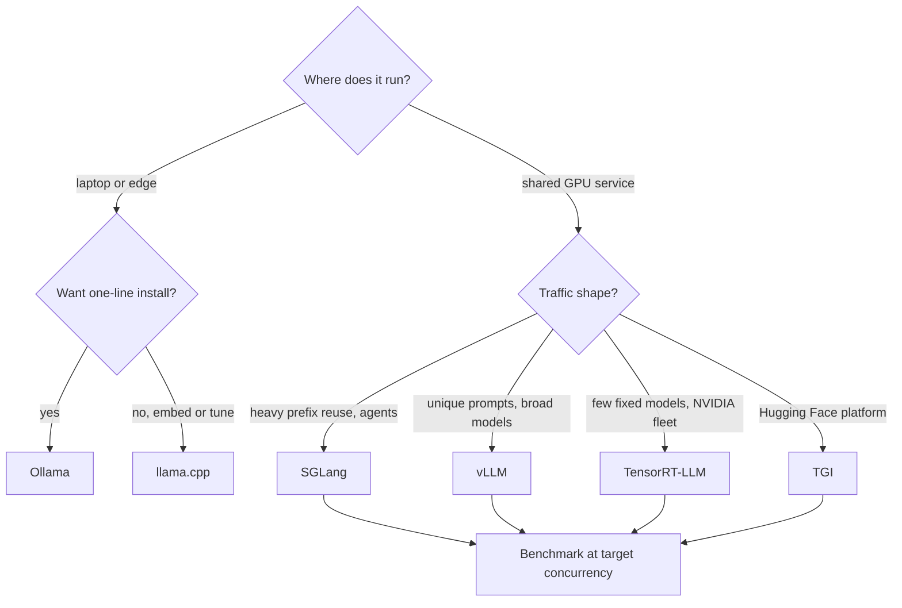

## TL;DR
An inference engine owns batching, KV memory, kernels and the API. For a self-hosted agent it decides how
many runs fit, whether prefixes are reused and whether tool calls parse. vLLM, SGLang, TGI and
TensorRT-LLM serve fleets; llama.cpp and Ollama run locally.

## For agent builders
- **Why it matters for agents.** Agent traffic is many calls per run over long, repeated prefixes with
  tool calls in the output. The engine's prefix reuse, KV pool and tool-call parser decide step latency,
  concurrent runs per GPU and whether your loop sees valid tool calls at all.
- **Where it shows up in your stack.** The `base_url` your agent framework's OpenAI-compatible client
  points at; `vllm serve` flags; Ollama on a laptop for local agent development; the engine's `/metrics`
  endpoint behind your agent dashboards.
- **What you control.** Engine choice per deployment, context ceiling and batch cap from KV arithmetic,
  prefix caching, the chat template and tool-call parser for the model, and a contract test suite for tool
  calling and JSON on every engine and model pair.
- **What you can skip.** Kernel internals and the TensorRT build details unless you run a fixed,
  high-volume model fleet. Most agent teams use a hosted API or vLLM or SGLang.

## Why it exists
- **A plain `model.generate()` loop wastes the GPU.** It serves one request at a time, allocates KV cache
  contiguously at maximum length, and runs generic attention kernels: single-digit utilisation and
  throughput tens of times below the hardware, because decode is memory-bandwidth-bound and only
  batching amortises the weight reads.
- **Serving well is a long list of systems work:** continuous batching, paged KV cache, fused attention
  kernels, quantized weight kernels, prefix caching, speculative decoding, constrained decoding, tensor
  parallelism, a streaming HTTP API, metrics and graceful draining. Each is a research-paper-sized
  problem; engines package them so an application team does not rebuild them.
- **The local end has a different problem.** A 7B model on a laptop or edge box needs memory-mapped
  quantized weights, CPU vector instructions, Apple Metal or a consumer GPU, and a binary with no Python
  dependency tree. That is llama.cpp's reason to exist; Ollama makes it a one-line install with a model
  registry.
- **The naive alternatives fail.** "Write our own server on Transformers" loses on throughput and memory.
  "Only use a hosted API" fails when data cannot leave the premises, when per-token prices exceed owning
  GPUs at volume, or when you need a fine-tuned or open-weight model the provider does not host. Engines
  make self-hosting viable.

## How it works
### Shared machinery
All the datacenter engines implement the same core ideas:
- **A token-granularity scheduler** (continuous or in-flight batching).
- **A block-based KV cache with a page table** (PagedAttention or an equivalent).
- **Prefix sharing** across requests.
- **Quantized weight formats** (AWQ, GPTQ, FP8 and relatives).
- **An OpenAI-compatible HTTP server** with streaming, and grammar-constrained decoding.

They differ in emphasis, hardware reach, model format and how much work it takes to run them.

### A request's path through a datacenter engine
1. **Startup sizing.** Load weights, run a profiling pass to measure peak activation memory, and turn the
   rest of the memory allowance into a fixed pool of KV blocks. In vLLM the allowance is
   `--gpu-memory-utilization` × GPU memory, so the KV pool is that minus weights minus activations; the
   startup log reports the capacity in tokens. Everything later is bounded by this pool, *because* KV
   memory, not compute, limits concurrency.
2. **Admission.** The HTTP layer applies the chat template, tokenizes, and queues the request. Templating
   inside the engine is why a wrong template corrupts output silently: the model sees a format it was
   never trained on.
3. **Scheduling each step.** The scheduler picks which waiting requests to prefill and which running ones
   to decode, subject to the sequence cap and free blocks. Prefill is often chunked so a 30k-token prompt
   does not stall every running decode for a whole step.
4. **Prefix lookup.** Before prefilling, reuse the prompt's leading blocks if cached, so only the new
   suffix is computed.
5. **Decode and stream.** Each step emits one token per running sequence (more with speculative
   decoding), applies any grammar mask for structured output, detokenizes incrementally and streams.
6. **Finish or preempt.** On a stop condition blocks return to the pool. If a running sequence needs a
   block and none is free, the engine preempts a sequence and recomputes or swaps its cache later, which
   shows up as latency spikes rather than errors.

- **Engines differ mainly in steps 3 to 5:** scheduler policy, prefix matching and kernel speed, which is
  why they must be compared on your traffic rather than on a single prompt.

### vLLM
- **What it is:** the engine that introduced PagedAttention. Python-first, loads Hugging Face checkpoints
  directly, widest model range.
- **Hardware:** several backends, NVIDIA first, AMD and others following.
- **Features:** tensor and pipeline parallelism, automatic prefix caching, speculative decoding,
  multi-LoRA serving and guided decoding.
- **Run it:** `vllm serve <model>` gives an OpenAI-compatible endpoint. The flags that matter most are
  `--max-model-len`, `--gpu-memory-utilization`, `--max-num-seqs` and `--tensor-parallel-size`.
- **Why default:** the default for production serving on NVIDIA hardware because of breadth and community
  pace.

### SGLang
- **From the LMSYS group.** Its distinctive piece is RadixAttention: the KV cache is a radix tree over
  token sequences, so any request sharing a prefix with any cached sequence reuses it automatically, with
  LRU eviction.
- **Strong for** multi-turn chat, agents and few-shot workloads where prefixes repeat heavily.
- **Also ships** a frontend language for structured programs (parallel calls, constrained generation) and
  fast constrained decoding.
- **API and deployment** are similar to vLLM; teams usually benchmark both on their own traffic.

### TGI (Text Generation Inference)
- **Hugging Face's server:** a Rust router in front of Python model shards, continuous batching, paged
  attention, several quantization backends, token streaming, and an OpenAI-style Messages API.
- **Its draw** is integration with the Hub and Inference Endpoints; if your fleet already lives in the
  Hugging Face ecosystem it is the shortest path.
- **Caveat:** its pace on the newest serving tricks has generally trailed vLLM and SGLang, so check the
  project's current maintenance status and roadmap before choosing it for a new deployment.

### TensorRT-LLM
- **NVIDIA's engine.** It compiles models ahead of time into TensorRT engines specialised for a GPU
  architecture and a configuration (maximum batch size, sequence length, parallelism).
- **That buys** aggressive kernel fusion and FP8 on Hopper-class parts. It implements in-flight batching
  and paged KV cache.
- **Newer option:** recent releases add a PyTorch-based backend that loads checkpoints directly,
  narrowing the operational gap, but the compiled path remains the reason to choose it.
- **Serving:** typically behind Triton Inference Server (NVIDIA's NIM containers build on the same stack).
- **Ceiling vs cost:** the highest performance ceiling on NVIDIA hardware and the highest operational
  cost: a build step per model and GPU type, NVIDIA-only, and rebuilds when limits change.

### llama.cpp
- **A C/C++ runtime** built around the GGUF weight format and its k-quant family (Q4_K_M and relatives).
- **Runs on** CPUs with SIMD, Apple Silicon through Metal, and GPUs through CUDA, Vulkan and others.
- **Partial offload:** a chosen number of layers goes to the GPU (`-ngl`), the rest stays in system RAM.
- **API:** `llama-server` exposes an OpenAI-compatible API.
- **Scope:** designed for one or a few users on commodity hardware; it has batching, but not the many-user
  throughput machinery of the datacenter engines.

### Ollama
- **A packaging layer over llama.cpp and its ggml library.** Newer releases run some model families on
  Ollama's own ggml-based engine, but the design and limits are the same.
- **Adds** a model registry (`ollama pull`), a Modelfile for prompts and parameters, a REST API on port
  11434 with an OpenAI-compatible endpoint, and automatic GPU detection.
- **The standard developer-laptop and prototyping runtime.**
- **Defaults are single-user:** environment variables such as `OLLAMA_NUM_PARALLEL` and the per-model
  context length need changing before it serves a team, and it inherits llama.cpp's throughput ceiling.

### Side by side
| Engine | Target | Concurrency machinery | Hardware | Weight format |
|---|---|---|---|---|
| vLLM | datacenter | continuous batching, paged KV, prefix cache | NVIDIA, AMD, others | HF checkpoints; AWQ/GPTQ/FP8 |
| SGLang | datacenter | as vLLM, plus RadixAttention | NVIDIA, AMD | HF checkpoints; quantized variants |
| TGI | datacenter, HF ecosystem | continuous batching, paged attention | NVIDIA, AMD, others | HF checkpoints; several quant backends |
| TensorRT-LLM | datacenter, peak performance | in-flight batching, paged KV | NVIDIA only | compiled TensorRT engines |
| llama.cpp | laptop, edge, CPU | small-scale batching | CPU, Apple Silicon, consumer GPUs | GGUF |
| Ollama | developer machine | single-user defaults | as llama.cpp | GGUF via registry |

### What agent traffic asks of an engine
| Agent need | Engine feature | What to check |
|---|---|---|
| Steps re-send a long, stable prefix | prefix caching (vLLM automatic prefix caching, SGLang RadixAttention) | prefix-cache hit rate and TTFT on step 2 onward |
| Many concurrent runs, each with a growing transcript | KV pool size, `--max-num-seqs`, `--max-model-len` | preemptions as runs get long |
| Tool calls in the model's output | a tool-call parser and the right chat template per model | parse-error rate on a tool-calling contract suite |
| Structured arguments and plans | grammar-constrained or guided decoding | invalid-JSON rate with and without it |
| Fan-out to parallel sub-agents | continuous batching across the parallel calls | step latency at peak fan-out |

- **Tool calling is engine-specific.** In vLLM, OpenAI-format tool calls need `--enable-auto-tool-choice`
  plus a `--tool-call-parser` matching the model family (for example `llama3_json` for Llama 3.1) at
  startup; other engines have their own switches. Without them the request is rejected or the call arrives
  as plain text the agent cannot run.

## Diagram
Start at the top with where the agent's model runs, then let traffic shape and operational budget pick
the engine; the leaves are starting points to benchmark on your agent traces, not verdicts.



## Examples
### One client, two engines
The same client code runs against a datacenter engine and a laptop runtime because both speak the OpenAI
chat API; only the base URL and model name change. The vLLM flags set the context ceiling, the share of
GPU memory handed to weights plus KV cache, the batch cap and prefix caching.

```bash
# Datacenter: vLLM serving an 8B instruct model, OpenAI-compatible API on :8000
vllm serve meta-llama/Llama-3.1-8B-Instruct --max-model-len 8192 \
  --gpu-memory-utilization 0.90 --max-num-seqs 128 --enable-prefix-caching
# Laptop: Ollama (llama.cpp underneath), OpenAI-compatible API on :11434
ollama pull llama3.1:8b && ollama serve
```

- **Order matters for Ollama:** `ollama pull` talks to a running server, so on a headless Linux box start
  `ollama serve` first (in another shell or as a service); the desktop app on macOS and Windows already
  runs it.

```python
from openai import OpenAI

ENGINES = {"vllm":   ("http://localhost:8000/v1",  "meta-llama/Llama-3.1-8B-Instruct"),
           "ollama": ("http://localhost:11434/v1", "llama3.1:8b")}

def stream(engine: str, prompt: str):
    base_url, model = ENGINES[engine]
    client = OpenAI(base_url=base_url, api_key="not-needed")   # local engines ignore the key
    resp = client.chat.completions.create(
        model=model, max_tokens=128, stream=True,
        messages=[{"role": "user", "content": prompt}],
    )
    for chunk in resp:
        delta = chunk.choices[0].delta.content
        if delta:
            print(delta, end="", flush=True)
    print()

stream("vllm", "Explain continuous batching in two sentences.")
stream("ollama", "Explain continuous batching in two sentences.")
# Same code, two engines: what differs is throughput under concurrency, not the API.
```

### What the vLLM flags buy on one 80 GB GPU
Llama-3.1-8B has 32 layers, 8 KV heads and head dimension 128.

| Quantity | Value |
|---|---|
| KV cache per token (bf16) | 2 × 32 × 8 × 128 × 2 bytes = 128 KiB |
| Memory allowance | 0.90 × 80 = 72 GB |
| Weights | about 16 GB |
| Activations and CUDA graphs | a few GB (illustrative) |
| KV pool | roughly 52 GB, or about 400,000 tokens |
| Sequences at the full 8,192-token context | only about 48 |

- **`--max-num-seqs 128` is reachable** only if the average live sequence is around 3,000 tokens or less;
  beyond that, the scheduler holds requests in the waiting queue or preempts.
- **Raising `--max-model-len` to 32k does not change the pool,** it only lets fewer, longer sequences use
  it.

### Capacity calculator to run before choosing flags
Pure Python, runs as is; plug in your model config and GPU.

```python
def kv_pool_tokens(gpu_gb, util, weights_gb, activations_gb, n_layers, n_kv_heads, head_dim, bytes_el=2):
    per_token = 2 * n_layers * n_kv_heads * head_dim * bytes_el      # K and V, every layer
    pool_bytes = (gpu_gb * util - weights_gb - activations_gb) * 1e9
    return per_token, int(pool_bytes // per_token)

per_tok, pool = kv_pool_tokens(80, 0.90, 16, 4, n_layers=32, n_kv_heads=8, head_dim=128)
print(per_tok // 1024, "KiB per token;", f"{pool:,} tokens in the pool")   # 128 KiB; 396,728 tokens
for ctx in (8_192, 3_000, 1_000):
    print(f"avg live sequence {ctx:>5,} tokens -> {pool // ctx} concurrent sequences")
# 8,192 -> 48   3,000 -> 132   1,000 -> 396
```

### Tool-calling contract test against any engine
Run the same agent-shaped request against the hosted API, vLLM and Ollama before switching an agent's
`base_url`. It asserts the engine returns a structured tool call with parseable arguments, not text.

```python
import json
from openai import OpenAI

TOOLS = [{"type": "function", "function": {
    "name": "get_order_status",
    "description": "Look up an order by id",
    "parameters": {"type": "object", "properties": {"order_id": {"type": "string"}},
                   "required": ["order_id"]}}}]

def check_tool_call(base_url, model):
    client = OpenAI(base_url=base_url, api_key="not-needed")
    resp = client.chat.completions.create(
        model=model, max_tokens=256, tools=TOOLS,
        messages=[{"role": "user", "content": "Where is order A-1042?"}])
    calls = resp.choices[0].message.tool_calls or []
    assert calls, f"{base_url}: no structured tool call, got text: {resp.choices[0].message.content!r}"
    args = json.loads(calls[0].function.arguments)          # raises if arguments are not valid JSON
    assert calls[0].function.name == "get_order_status" and args.get("order_id") == "A-1042"
    return "ok"

for name, (url, model) in ENGINES.items():                  # ENGINES from the example above
    print(name, check_tool_call(url, model))
```

### Worked scenario: sizing one GPU for concurrent agent runs
Same 80 GB GPU and Llama-3.1-8B (128 KiB per token, about 400,000 tokens of KV pool). Agents start at a
6k-token prefix and grow ~1.5k tokens per step (illustrative).

| Agent run length | Live tokens at the last step | Concurrent runs at that length |
|---|---|---|
| 5 steps | ~12,000 | ~33 |
| 10 steps | ~19,500 | ~20 |
| 20 steps | ~34,500 | ~11 |

- **Long runs, not users, set capacity:** the same GPU holds three times fewer 20-step runs than 5-step
  ones, and needs `--max-model-len` above 32k.
- **Prefix sharing recovers some of it:** with prefix caching, runs sharing the 6k prefix can share its
  blocks instead of storing it once per run.

## Production patterns
- **Develop agents locally, serve them on a GPU engine.** Point the agent framework's OpenAI-compatible
  client at Ollama during development and at vLLM or SGLang in staging and production, changing only
  `base_url` and the model name. Monitor tool-call parse errors when you switch.
- **Benchmark on recorded agent traces.** Replay real multi-step runs, including parallel tool calls, at
  target concurrency, rather than single prompts, because prefix reuse and long transcripts dominate agent
  traffic. Monitor step latency p95 and preemptions as runs lengthen.
- **Size flags from KV arithmetic.** Compute the pool as above, then set `--max-model-len` and
  `--max-num-seqs` so the expected traffic mix fits; confirm against the capacity the vLLM startup log
  reports. Monitor KV-cache usage and preemption counts on the engine's Prometheus `/metrics` endpoint.
- **Pin and re-benchmark on upgrade.** Pin the engine version in the container image and replay recorded
  production traffic at target concurrency before every upgrade, because vLLM and SGLang move fast.
  Monitor tokens per second at target concurrency and p95 time to first token.
- **Contract tests per engine and model.** Keep an OpenAI-compatible contract, and run tool-calling and
  JSON-mode tests against every engine and model pair, because each implements function calling with its
  own parser and chat template. Monitor parse-error rate in production.
- **Configure Ollama before sharing it.** For a small team, raise `OLLAMA_NUM_PARALLEL` and set the context
  length explicitly (for example `PARAMETER num_ctx 8192` in a Modelfile), so long prompts are not
  silently truncated. Monitor latency as users are added; move to a GPU engine when it climbs.
- **Build TensorRT-LLM engines per GPU type in CI.** Treat the compiled engine as an artifact tagged by
  model, GPU architecture and limits, and fail the deploy if the node type does not match. Monitor load
  failures after hardware refreshes.

## Trade-offs
- **vLLM breadth vs churn.** Breadth (models, hardware, features) comes with a fast-moving codebase;
  pinning and re-benchmarking on upgrade is part of owning it, whereas a compiled TensorRT-LLM engine is
  frozen and predictable until you need to change it.
- **TensorRT-LLM peak vs rigidity.** Peak throughput is bought with an ahead-of-time build per model, GPU
  type and configuration; it pays off for a few high-volume models on a homogeneous NVIDIA fleet, not for
  a long tail of models or mixed hardware.
- **SGLang prefix sharing vs unique prompts.** Radix-tree sharing wins with heavy prefix reuse (agents,
  multi-turn, shared system prompts); on single-shot traffic with unique prompts the advantage over vLLM
  shrinks to whatever the current kernels give.
- **Local portability vs concurrency.** llama.cpp and Ollama run anywhere with no Python stack, but their
  throughput under many concurrent users is far below a GPU engine: right for one user per box, wrong for
  a shared service.
- **Self-hosted engine vs hosted API for agents.** Self-hosting controls data and per-token cost at volume
  and lets you serve a fine-tuned agent model, but you take on tool-call parsing, template correctness and
  capacity; a hosted API wins until volume or data rules force the move.
- **TGI ecosystem fit vs cadence.** Hub and Inference Endpoints integration saves work, but adopting it
  means accepting Hugging Face's cadence for serving optimisations.

## Pitfalls
- **Benchmarking a single request and choosing llama.cpp or Ollama for a multi-user service.** Symptom:
  latency climbs steeply as users are added, because batching is limited to a handful of parallel slots
  rather than the hundreds of sequences a datacenter scheduler juggles.
- **Setting `--max-model-len` and `--gpu-memory-utilization` without the KV-cache arithmetic.** Symptom:
  an OOM at startup or a scheduler that admits only a handful of sequences.
- **Mixing weight formats.** Symptom: a GGUF file the datacenter engines load only experimentally or not
  at all, or an AWQ checkpoint llama.cpp cannot read, discovered on deploy day.
- **Assuming "OpenAI-compatible" means identical behaviour.** Symptom: tool calls and JSON mode parse
  differently across engines and models, because each implements function calling with its own parser
  and chat template.
- **Running Ollama with its default context length.** Symptom: long prompts silently truncated, since the
  runtime applies its own context window unless the model or request overrides it.
- **Serving a base model with an instruct chat template, or the reverse.** Symptom: rambling or
  never-terminating output.
- **A TensorRT engine built on one GPU type deployed to another.** Symptom: a load failure on the new
  nodes after a hardware refresh.
- **Serving an agent model without tool-call parsing enabled.** Symptom: the agent loop receives the tool
  call as plain text in `content` and either stops or answers without acting. Fix: enable the engine's
  tool-calling support with the right parser and template, and gate the deploy on the contract test.

## When to use
- **Where does it run?** Developer laptop or edge: llama.cpp or Ollama. A shared GPU service: one of the
  datacenter engines.
- **What concurrency and traffic shape?** Unique single-shot prompts favour vLLM; heavy prefix reuse and
  structured programs favour SGLang; a few very high-volume models on a homogeneous NVIDIA fleet justify
  TensorRT-LLM; a Hugging Face-centric platform points at TGI.
- **How much operational effort?** Compiled engines need a build pipeline, vLLM and SGLang need version
  discipline, Ollama needs almost nothing.
- **Measure** tokens per second at your target concurrency, p95 time to first token and GPU memory
  headroom; never choose on a single-request benchmark.
- **Interviews:** explain what continuous batching and paged KV cache do, why llama.cpp and vLLM are not
  competitors, and what the TensorRT-LLM build step buys and costs.

## Role lens
- **Engineer:** Runs the engine, tunes context length, memory utilisation and batch caps, enables prefix
  caching and quantization, and benchmarks candidates on recorded production traffic.
- **Architect:** Chooses the engine family per deployment target, decides whether the TensorRT-LLM build
  pipeline is worth its rigidity, and standardises on an OpenAI-compatible contract so engines stay swappable.
- **FDE:** Stands up vLLM or SGLang inside a customer's VPC, or Ollama on an analyst's workstation, and
  translates their "it is slow" into the batching and memory numbers that explain it.

## Check yourself
**Q:** A customer prototyped a support assistant on Ollama on a workstation and wants to roll it out to
300 agents on two NVIDIA GPUs. What do you change, and what do you keep?

**A:** Keep the model family, the prompts and the OpenAI-compatible client code, since those transfer.
Change the runtime: Ollama's llama.cpp core serves one or a few users well but lacks the large-batch
scheduler and paged KV-cache machinery that 300 concurrent users need, so latency would grow with every
added user.
Move to vLLM or SGLang on the GPUs; SGLang if the support prompts share a large system prefix, because
RadixAttention reuses it automatically, otherwise vLLM for breadth. Switch from the GGUF file to the
Hugging Face checkpoint, quantized with AWQ or FP8 if memory demands it, and do the KV-cache arithmetic
to set the context ceiling and memory utilisation so the scheduler can hold enough sequences. Put the two
GPUs behind one server with tensor parallelism or run two replicas behind a load balancer, depending on
model size. Benchmark on recorded traffic at target concurrency, verify tool calling still parses, and
add backpressure and metrics in front. TensorRT-LLM is a later optimisation if the model and fleet stay
fixed.

## Interview questions
### Why is an inference engine much faster than a `model.generate()` loop on the same GPU?
- **Decode is memory-bandwidth-bound,** so serving one request at a time leaves the GPU at single-digit
  utilisation; continuous batching reuses each weight read across many sequences.
- **Paged KV cache** avoids allocating every request at maximum length, so far more sequences fit, and
  fused and quantized kernels cut time per step.

### vLLM runs far fewer sequences than `--max-num-seqs` 128 and keeps preempting. What do you check?
- **The KV pool size in the startup log:** `--gpu-memory-utilization` × GPU memory minus weights and
  activations, divided by bytes per token.
- **The live context lengths:** with long sequences the pool fills well before 128; on an 80 GB GPU with
  an 8B GQA model only about 48 fit at 8,192 tokens.
- **Fix** with a lower `--max-model-len` (sending long-context traffic to a separate deployment), an FP8
  KV cache (`--kv-cache-dtype fp8`) or a quantized model, or more GPUs.

### When would you not pick TensorRT-LLM despite its higher ceiling?
- **When the model list is long or changing,** because every model, GPU type and limit change needs a
  rebuild.
- **On mixed or non-NVIDIA hardware,** since it is NVIDIA-only.
- **When the team cannot own a build pipeline;** vLLM or SGLang get most of the performance with far less
  operational cost.

### Are llama.cpp and vLLM competitors?
- **No: they target different deployments.** llama.cpp runs GGUF weights on CPUs, Apple Silicon and
  consumer GPUs for one or a few users; vLLM serves many concurrent users on datacenter GPUs.
- **Formats differ too:** GGUF for llama.cpp, Hugging Face checkpoints (optionally AWQ, GPTQ or FP8) for
  vLLM, so moving between them means switching weight files.

### Your tool calls work on the hosted API but break on a self-hosted engine. Why?
- **"OpenAI-compatible" covers the request shape, not behaviour.** Each engine implements function calling
  with its own parser and chat template, so outputs parse differently by engine and model.
- **Check the chat template** matches the model (base vs instruct), and run contract tests for tool
  calling and JSON mode on every engine and model pair.

### You are moving a 20-step agent from a hosted API to one GPU. Which engine and settings?
- **Engine:** SGLang or vLLM with prefix caching on, because every step re-sends the same tools-and-system
  prefix; benchmark both on recorded agent traces.
- **Settings from KV arithmetic:** a 20-step run reaches ~34.5k tokens, so `--max-model-len` must exceed
  that and only about 11 such runs fit on 80 GB with an 8B GQA model; cap concurrent runs to match.
- **Gate on behaviour:** tool-calling parser and template enabled (in vLLM, `--enable-auto-tool-choice`
  and `--tool-call-parser`) and a contract suite passing before any traffic moves.

## Quiz
### Q: Which engine's distinctive workflow compiles the model ahead of time for a specific GPU architecture and configuration?
- [ ] vLLM
- [ ] SGLang
- [x] TensorRT-LLM
- [ ] TGI
> TensorRT-LLM builds a TensorRT engine specialised to the GPU type, batch and sequence limits, which
> enables aggressive kernel fusion but means a rebuild when hardware or limits change. The others load
> checkpoints at startup and need no per-GPU build step.

### Q: What is the relationship between Ollama and llama.cpp?
- [ ] They are independent implementations of the same GGUF specification
- [x] Ollama packages llama.cpp with a model registry, a REST API and defaults for local use
- [ ] llama.cpp is a GPU-only fork of Ollama
- [ ] Ollama is the datacenter version of llama.cpp with continuous batching
> Ollama is built on llama.cpp and its ggml library; it adds pulling models, a Modelfile, an HTTP API
> and device detection. It inherits llama.cpp's strengths on commodity hardware and its limits under many concurrent
> users.

### Q: Which workload benefits most from SGLang's RadixAttention relative to a standard paged KV cache?
- [ ] Single-shot requests with unique prompts
- [x] Multi-turn chat and agent loops where many requests share long prefixes
- [ ] Offline batch embedding of documents
- [ ] CPU-only inference on edge devices
> RadixAttention stores the KV cache as a radix tree over token sequences, so any request whose prefix
> matches a cached one reuses it without recomputation. vLLM's block-hash prefix caching also reuses
> shared prefixes, so the gap is one of degree; it is largest in multi-turn and agent traffic, where
> branching conversations share long, irregular prefixes.

## Use cases & projects
### Use cases
- **Local agent development.** Ollama or llama.cpp on a laptop runs the agent loop offline, with the same
  OpenAI-compatible client code used in production.
- **Agents on private data.** vLLM or SGLang inside a customer's VPC keeps prompts and tool results on
  premises.
- **Serving a fine-tuned agent model.** An engine hosts the model the provider does not, with prefix
  caching for the agent's stable prompt.
- **High-volume agent fleets.** A fixed model on a homogeneous NVIDIA fleet can justify TensorRT-LLM's
  build pipeline for peak throughput.

### Mini project
**Run one agent on two engines and compare (2-3 hours).**
- **Goal:** move a small tool-calling agent from Ollama to vLLM or SGLang without code changes beyond
  `base_url` and model name, and measure the difference.
- **Steps:** build a 5-step agent with two tools using an OpenAI-compatible client; run the tool-calling
  contract test on both engines; replay 20 concurrent runs on each; record step latency, prefix-cache hit
  rate where reported, and tool-call parse failures.
- **Done when:** you have a table per engine of p50 and p95 step latency, parse failures and completed
  runs at 20-way concurrency, plus the flags you had to set to make tool calls parse.
