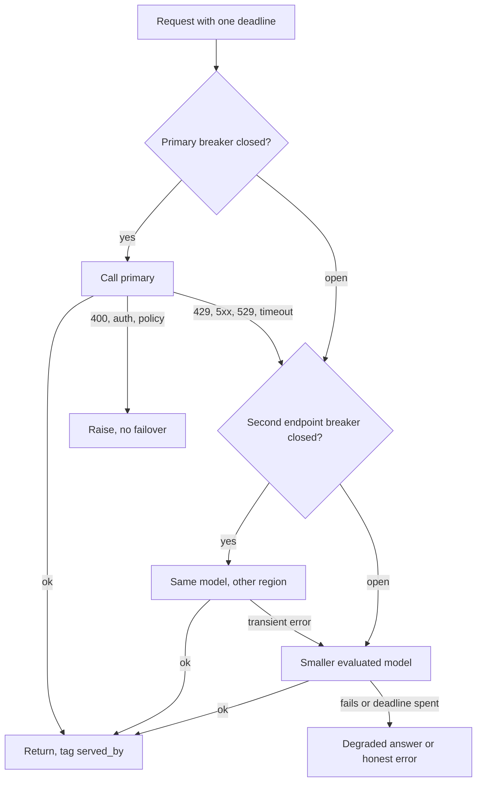

## TL;DR
A fallback is the pre-decided next move when an agent's model call fails or stalls: another endpoint, a
smaller model, a cached answer, or an honest "unavailable". The hard parts are tool-schema
compatibility, one deadline and never repeating a side effect.

## For agent builders
- **Why it matters for agents.** A 15-step run touches the provider 15 times, so one bad minute hits far
  more runs than chat. A fallback model must also speak your tool-calling format, or the run fails at the
  next step instead of this one.
- **Where it shows up in your stack.** LangChain's `.with_fallbacks()` on a chat model or chain, LiteLLM
  router fallbacks, gateways such as OpenRouter or Portkey, and LangSmith traces where you tag which model
  served each step.
- **What you control.** The ladder per step type (planner, tool-argument writer, summariser), which
  errors fail over, the run's shared deadline, and whether a step that already fired a tool may be
  replayed on another model.
- **What you can skip.** Circuit-breaker theory beyond "rate-based, with a minimum call count, and a
  half-open probe". Gateways implement the rest.

## Why it exists
- **Hosted models fail in ways a retry cannot fix.** A provider returns 529 overloaded or 429 for minutes
  during a demand spike, a region has an incident, a deployment pushes elevated 5xx, a model is
  deprecated, a content filter refuses, latency triples under load.
- **Self-hosted engines add their own.** A GPU node dies, a rollout ships a bad build, a long-context
  burst preempts everything.
- **Retries assume health a second later.** During an incident there is none: three attempts against a
  30-second timeout is a 90-second path to the same error.
- **The alternative is an error.** Sometimes right (a medical triage assistant should fail closed), but
  for most product surfaces a slightly worse answer beats none.
- **A naive `try/except` that calls model B fails in production,** for reasons you discover only when A
  is already down (table below). Fallbacks are a designed subsystem, not an exception handler.

| Naive assumption | What actually happens |
|---|---|
| B accepts the same request | B may not support your tool schema, JSON mode or context length |
| B is good enough | your eval suite never ran on B, so fallback quality is unknown |
| B has room | A fails for all traffic at once and B's unprovisioned rate limit is exceeded in seconds: the fallback storm |
| A did nothing | A's timeout may fire after it executed a side effect inside an agent loop, so B duplicates it |
| B can take over a stream | tokens already streamed from A cannot switch models mid-sentence |

## How it works
### The ladder
Order alternatives by **behavioural distance from the primary, not by cost**. Each rung costs quality, so
exhaust the cheapest-in-quality options first:

1. **Same model, different endpoint or region.** The major models are available through more than one
   cloud, which keeps prompts and evals valid.
2. **Sibling model** from the same family, one size down.
3. **Different vendor's model** with a translated request.
4. **Non-generative degraded answer:** cached response, retrieval results without synthesis, a template.
5. **Explicit error** with a retry affordance.

### Trigger classification
Only some failures justify a fallback:

| Failure | Examples | Action |
|---|---|---|
| Transient capacity | 429, 500, 502, 503, 504, 529 (Anthropic's overloaded status), connection failures, timeouts before the first token | one retry on the same target, then fall back |
| Request-specific | 400 malformed body, context-length overflow, unsupported parameter | do not fail over: it fails identically on any equivalent target |
| Context overflow (exception) | prompt too long for this window | may legitimately route to a model with a larger window |
| Auth and billing | invalid key, exhausted credit | configuration fault: page a human, do not fail over |
| Latency | time to first token over budget | cancel and try the next rung |

- **Latency is a trigger** because the user cannot tell the difference between slow and down.
- **Hedging is a softer variant.** Once the primary has been silent past roughly its p95 time to first
  token, start the fallback in parallel, keep whichever produces a first token first and cancel the other.
- **Hedge cost.** Only the slowest few percent of calls spawn a hedge, so the extra load is small, but each
  hedge is billed on both targets until the loser is cancelled.

### Circuit breaker per target
Without a breaker, every request during an outage pays the primary's full timeout before falling back, so
latency doubles exactly when the system is under stress. The breaker converts "try and wait" into "skip,
because we already know":

1. **Track the failure *rate*** over a sliding window of recent calls per target.
2. **Open when the rate crosses a threshold,** with a minimum call count, so three failures out of three at
   2 a.m. do not trip it.
3. **While open,** route straight to the fallback.
4. **After a cooldown, go *half-open*:** let a single probe through; its result decides close or reopen.

How much a breaker buys depends on how failures arrive:
- **Slow failures** (a 30-second timeout, a stalled stream) make "try the primary first" expensive, so
  breakers pay off most there.
- **Fast failures** (a 529 or 503 in tens of milliseconds) cost almost nothing to attempt. For a *partial*
  outage it is often better to leave the breaker closed and let each request try the primary once,
  keeping the healthy fraction of capacity in use.
- **Consecutive-failure counters behave badly.** At a 20% independent error rate, five failures in a row
  happen only once every few thousand calls, so the breaker almost never opens; at a 60% rate it flaps.

### Compatibility layer
The fallback must receive an equivalent request:
- **Normalise** message formats, translate tool schemas, map parameter names and ranges.
- **Re-check the context window** using the target's tokenizer.
- **Know** whether structured output is supported.
- **Gateways own this translation:** self-built, or products such as LiteLLM, OpenRouter or Portkey.
- **Evaluate prompts on every rung;** where a model needs a variant prompt, version it alongside the
  primary's.

### One deadline for the whole chain
- **Give the request a single deadline,** for example 20 seconds, and hand each rung the remainder rather
  than its own timeout.
- **Otherwise chained timeouts add up** to a wait no user will tolerate.

### Keeping the backup real
- **Provision quota on the fallback deliberately.**
- **Route a trickle of live traffic** (a few percent) to it, so credentials, quota, prompts and evals are
  continuously verified. An unexercised fallback is an untested one.

### Observability and streaming
- **Tag every response** with the target that served it and the reason for any fallback.
- **Alert when the fallback rate rises,** because quality regressions in fallback mode are invisible
  otherwise.
- **Streaming: decide before the first byte.** A failure after tokens were emitted either restarts the
  response under a new message id (so the client can discard the partial one) or surfaces an error with a
  retry button.

### Fallbacks inside an agent loop
An agent changes three things about the ladder:
1. **Fall back per step, not per run.** Step 9 failing does not mean restarting at step 1; the transcript
   so far is the state, so the next rung receives the same history and continues.
2. **Tool-calling parity is a hard requirement.** Every rung must accept your tool definitions and return
   well-formed tool calls. A rung that answers in prose ends the run at the next parse, so evaluate tool
   selection and argument accuracy per rung, not just answer quality.
3. **Side effects pin the step.** If the primary's tool call may have executed (timeout after dispatch),
   the fallback must not regenerate and re-run it. Check the tool's idempotency key or its result store
   first.
- **Mixed-model transcripts.** After a fallback the history contains another model's turns. Most chat
  APIs accept that, but provider-specific content (thinking blocks, cached-prompt markers, vendor tool-call
  ids) may need stripping or translating when the run switches vendor.

## Diagram
Trace one agent step's model call down the ladder: each rung is skipped if its breaker is open,
request-specific errors stop the chain, and every rung shares the run's remaining deadline.



## Examples
### Fallback chain with a rate-based breaker
The chain tries each target in order, skips any whose breaker is open, gives each the remaining share of
one deadline, refuses to fail over on request-specific errors, and labels the response with what served
it. Per-target retries live inside `call`, where the SDK already does them.

```python
import time
from collections import deque

class Breaker:
    """Opens when >= `threshold` of the last `window` calls failed; one half-open probe per cooldown."""
    def __init__(self, window=20, min_calls=10, threshold=0.5, cooldown_s=30):
        self.results, self.min_calls, self.threshold = deque(maxlen=window), min_calls, threshold
        self.cooldown_s, self.state, self.open_until = cooldown_s, "closed", 0.0
    def available(self):
        if self.state == "open" and time.monotonic() >= self.open_until:
            self.state = "half_open"; return True      # exactly one probe gets through
        return self.state == "closed"
    def record(self, ok):
        if self.state == "half_open":                  # the probe's result decides
            self.state = "closed" if ok else "open"
            self.results.clear(); self.open_until = time.monotonic() + self.cooldown_s
            return
        self.results.append(ok)
        n, fails = len(self.results), self.results.count(False)
        if n >= self.min_calls and fails / n >= self.threshold:
            self.state, self.open_until = "open", time.monotonic() + self.cooldown_s

TRANSIENT = {408, 429, 500, 502, 503, 504, 529, "timeout", "connection"}
LADDER = [("anthropic", "primary-model"), ("bedrock", "primary-model"), ("anthropic", "smaller-model")]
breakers = {t: Breaker() for t in LADDER}

def generate(req, deadline_s=20.0):
    deadline, last_err = time.monotonic() + deadline_s, None
    for target in LADDER:
        remaining = deadline - time.monotonic()
        if remaining <= 0 or not breakers[target].available():
            continue
        try:
            resp = call(target, adapt(req, target), timeout=min(remaining, 10.0))
        except ProviderError as e:
            if e.code not in TRANSIENT:                # malformed request, policy, auth: no rung fixes this
                breakers[target].record(True); raise   # the target was healthy; our request was not
            breakers[target].record(False); last_err = e; continue
        breakers[target].record(True)
        resp.meta = {"served_by": target, "fallback": target != LADDER[0]}
        return resp
    return degraded_response(req, last_err)            # cached/template answer, or an explicit error
```

### Worked incident trace
With a 50% threshold over 20 calls (numbers are starting points to tune against your own error and
latency distributions):

| Incident | Breaker | What each request pays |
|---|---|---|
| Primary returns 529 on 20% of requests | stays closed | failing requests pay one fast 529 and move to the second endpoint; the 80% that succeed keep using the primary |
| Primary times out on most calls | window crosses 50% after at least ten calls, opens | for the next 30 seconds, requests go straight to the second endpoint without paying a 10-second timeout |
| Cooldown ends | half-open | one probe tests recovery and decides close or reopen |

### Why consecutive-failure breakers misbehave
Pure Python, runs as is: the chance that five calls in a row fail at independent error rate p is p⁵.

```python
for p in (0.2, 0.6):
    run5 = p ** 5
    print(f"error rate {p:.0%}: P(5 in a row) = {run5:.4f}, about 1 in {round(1 / run5):,} windows")
# error rate 20%: P(5 in a row) = 0.0003, about 1 in 3,125 windows  -> almost never opens
# error rate 60%: P(5 in a row) = 0.0778, about 1 in 13 windows     -> opens and closes repeatedly
```

### Agent step with a tool-compatible fallback (LangChain)
Bind the tools to *each* model before chaining them, because the fallback wrapper does not carry the
primary's tool binding. Only transient errors fail over; a 400 from a bad tool schema still raises.

```python
import anthropic
from langchain_anthropic import ChatAnthropic
from langchain_openai import ChatOpenAI

tools = [search_tickets, create_ticket]          # your @tool functions

primary = ChatAnthropic(model="primary-model", timeout=10, max_retries=1).bind_tools(tools)
second = ChatOpenAI(model="evaluated-fallback-model", timeout=10, max_retries=1).bind_tools(tools)

agent_llm = primary.with_fallbacks(
    [second],
    exceptions_to_handle=(anthropic.RateLimitError, anthropic.InternalServerError,
                          anthropic.APITimeoutError, anthropic.APIConnectionError),
)

msg = agent_llm.invoke(history)                  # same transcript, either model
for call in msg.tool_calls:                      # check the step's idempotency key before executing
    run_tool_once(call, key=f"{run_id}:{step}:{call['name']}")
```

### Worked scenario: a 15-step support agent during a 529 burst
Illustrative: primary fails 20% of calls with fast 529s for 30 minutes; each run makes 15 model calls.

| Design | Runs that hit at least one failure | Outcome |
|---|---|---|
| No fallback, no retry | 1 − 0.8^15 ≈ 96% | almost every run errors out somewhere |
| One retry on the same target | per call 0.2² = 4% fail, so 1 − 0.96^15 ≈ 46% | still about half the runs fail |
| One retry, then a tool-compatible fallback | near zero, if the fallback is healthy and provisioned | runs finish; trace shows mixed served_by tags |
| Fallback without tool parity | the step "succeeds" in prose | run fails at the next tool-call parse instead |

## Production patterns
- **Per-step ladders with tool-call evals.** Agent teams give the planner and tool-calling steps a
  ladder whose every rung passed the tool-selection and argument evals, and may give summarisation steps
  a cheaper ladder. Tag each step's span in LangSmith or your tracer with served_by and fallback reason;
  monitor run success rate by served_by mix.
- **Same model in a second region first.** When a provider or cloud offers the model in several regions
  or platforms, make that rung one, because prompts and evals carry over. Monitor per-target error rate
  and latency per rung.
- **Gateway-owned fallback chains.** Put the ladder, request adaptation and served-by tagging in one AI
  gateway (self-built, or LiteLLM, OpenRouter or Portkey) instead of in each service. Monitor fallback
  rate per route and alert when it rises.
- **Warm backups with a live trickle.** Send a few percent of real traffic to each fallback all the time
  and reserve quota sized for the share that would move. Monitor the backup's own 429 rate during
  primary incidents to catch a fallback storm early.
- **Hedge at p95 time to first token.** For latency-sensitive chat, start the next rung in parallel once
  the primary is silent past its p95, then cancel the loser. Monitor hedge rate and double-billed tokens.
- **Quality by served-by tag.** Run the eval suite against every rung and break production quality
  metrics (JSON parse errors, refusal rate, thumbs-down) down by serving target, because silent model
  swaps hide there.

## Trade-offs
- **Availability vs known quality.** Availability rises, but fallback quality is lower and, unless you
  evaluate every rung, unknown. When the fallback cannot meet the product's accuracy bar, failing closed
  is the better design.
- **Fast breakers vs stable breakers.** Breakers cut incident latency sharply but can trip on a noisy
  error burst and divert healthy traffic. A low threshold and short window react fast but flap; a high
  threshold and minimum call count are stable but leave users paying timeouts longer. The slower the
  target's failures, the more "react fast" wins.
- **Second vendor vs second region.** A second vendor removes correlated outage risk but doubles
  compliance scope (data residency, DPAs), prompt maintenance and eval cost. A second region of the same
  provider is cheaper when the risk you fear is regional rather than vendor-wide.
- **Degraded answers vs honesty.** Non-LLM answers keep the interface alive, but presenting a cached or
  templated response as fresh can be worse than an honest error for time-sensitive questions.
- **Switching models mid-run vs restarting the run.** Continuing on the fallback keeps the work already
  done, but the run mixes two models' reasoning styles and tool habits. When the fallback is much weaker
  at planning, restarting the whole run on one model (or failing it cleanly) gives more predictable
  results.

## Pitfalls
- **A fallback that has never served traffic.** Symptom: fallback rate and error rate spike together in
  the first real incident, because the key expired, the quota was zero or the schema never matched.
- **Failing over on non-transient errors.** Symptom: every request costs two or three calls and still
  fails, with identical 400s from each target in the trace.
- **Independent timeouts per rung.** Symptom: p99 latency during incidents equals the sum of all the
  timeouts. Use one shared deadline.
- **A fallback storm.** Symptom: the secondary returns 429 within seconds of the primary's incident,
  because the whole fleet moved at once onto unprovisioned quota.
- **Silent model swaps.** Symptom: JSON parse errors or refusal-rate changes that correlate with fallback
  rate, because output formatting quirks differ between models and the parser was tuned to one.
- **Falling back after a side effect.** Symptom: duplicate tickets or emails whenever the primary times
  out mid-tool-call, an idempotency problem the fallback exposes.
- **A fallback that never sees the tools.** Symptom: during an incident the agent stops calling tools and
  answers in prose, or the parser fails on every fallback step. Cause: tools were bound to the primary
  only, or the fallback model does not support the schema. Fix: bind tools per rung and eval each rung.

## When to use
- **Use when** an LLM call sits on a user-facing path with an availability target one provider cannot
  meet alone, and wherever a cheaper degraded answer is genuinely acceptable. Multi-step agents need it
  sooner than chat, because each run makes many calls.
- **Avoid when** a worse answer is worse than no answer, or when the "fallback" would silently change
  compliance posture.
- **Build order:** same model on a second endpoint first (preserves prompts and evals), a smaller model
  only after evaluating it, a non-LLM degraded response as the last rung.
- **Measure** fallback rate, per-target error rate, latency per rung and quality by served-by tag.
- **Interviews:** classify the trigger, break the circuit, share one deadline, keep the fallback
  compatible and warm, and explain why streaming and side effects make "just try B" unsafe.

## Role lens
- **Engineer:** Builds the target ladder, breaker state and request adapters, writes evals that run
  against every rung, and tags traces with the serving target and the fallback reason.
- **Architect:** Owns the policy: which failures fail over, which fail closed, which models are approved
  as fallbacks, and how much quota is reserved on each backup.
- **FDE:** Negotiates with the customer which degraded behaviour is acceptable for their use case, and
  verifies that their data-residency rules still hold when traffic moves to a second region or vendor.

## Check yourself
**Q:** Your primary provider starts returning 529 overloaded errors for about 20% of requests for half an
hour. Design the fallback behaviour for a customer-support chat product and explain what you would
deliberately avoid doing.

**A:** First, classify: 529 is transient and, importantly, fast; it comes back in milliseconds, so
attempting the primary costs little. At a 20% error rate the primary is still serving most traffic, so I
would *not* want the breaker to open and push all load onto the backup; a rate-based breaker with a
threshold well above 20% stays closed, and each failing request makes one quick attempt (or one short
jittered retry) and then moves to the next rung. The breaker exists for the case where the primary
degrades into timeouts or a majority error rate. Route to the
same model on a second endpoint or region first, because prompts and evals carry over; only if that is
also degraded, step down to a smaller model that has already been evaluated on support transcripts.
Confirm the backup has quota for about a fifth of peak traffic, since that is what will move. Give
the whole chain one deadline of a few seconds to first token, since chat users abandon quickly. Decide
before streaming starts; a mid-stream failure shows the partial answer with a retry button rather than
silently restarting. Tag every reply with served-by and watch quality metrics in fallback mode. Avoid:
failing over on 400s, letting the entire fleet shift onto a backup with no pre-provisioned quota, and
failing over tool-executing turns without idempotency keys, which would duplicate ticket creation.

## Interview questions
### What is the difference between a retry and a fallback, and why do you need both?
- **A retry repeats the same call** on the same target, betting the fault clears in a second; a fallback
  switches to a different, pre-decided path.
- **During an incident retries only burn the deadline,** because the target stays unhealthy; the fallback
  is what actually returns an answer. One quick retry on transient errors, then fall back.

### During an outage, p99 latency equals the sum of every timeout in your chain. What went wrong?
- **Each rung has its own timeout** instead of sharing one deadline, so a request waits out each one in turn.
- **No breaker is open,** so every request still pays the primary's full timeout first.
- **Fix:** one deadline per request with each rung given the remainder, plus a rate-based breaker per target.

### How do you size and verify quota on a backup provider?
- **Size for the share that will move:** if the primary fails on about 20% of requests, the backup needs
  quota for about a fifth of peak; for a full outage, all of it.
- **Verify continuously** by routing a few percent of live traffic to it, and watch its 429 rate during
  primary incidents, because an untested backup fails in the first real outage.

### Why can you not just switch models when a stream fails halfway?
- **Tokens are already on the user's screen,** and a different model will not continue the same sentence.
- **Decide before the first byte;** after that, restart under a new message id so the client discards the
  partial answer, or surface an error with a retry button.

### Your agent's primary model times out at step 9, right after emitting a create_ticket call. How should the fallback behave?
- **Find out whether the tool ran.** The timeout may have fired after dispatch, so look up the step's
  idempotency key or the ticket system before doing anything else.
- **If it ran, record the result and continue** on the fallback with that tool result appended; do not let
  the fallback regenerate the call, which would create a second ticket.
- **If it did not, the fallback gets the same transcript** and makes its own call, under the same key.

### How do you choose and validate a fallback model for a tool-calling agent?
- **Tool-calling parity first:** it must accept your tool schemas and structured-output mode, and fit the
  run's context length with its own tokenizer.
- **Evaluate per step type** on recorded agent traces: tool selection accuracy, argument validity and
  task success, not just answer quality.
- **Keep it warm** with a few percent of live runs and alert on run success rate broken down by served_by.

## Quiz
### Q: Why put a circuit breaker in front of the primary model instead of simply catching its errors and calling the fallback?
- [ ] Breakers are required to satisfy provider terms of service during outages
- [x] Without one, every request during an outage waits for the primary's full timeout before falling back, so latency doubles when the system is already under stress
- [ ] Catching exceptions is unreliable for streaming responses
- [ ] Breakers reduce the number of distinct fallback targets you need
> A try/except still issues the doomed primary call. A breaker remembers recent failures and skips the
> primary while open, so fallback requests are fast instead of adding a full timeout to each response;
> the gain is largest when failures are slow timeouts rather than instant error codes.

### Q: Which failure should NOT trigger failover to a second provider?
- [ ] A 503 from the primary provider
- [ ] A timeout before the first token arrives
- [x] A 400 caused by a malformed tool schema in your request
- [ ] A 529 overloaded error
> A malformed request fails identically everywhere, so failing over doubles cost and latency for nothing;
> the fix is in your code. The other three are capacity or transient faults where another target can
> genuinely succeed.

### Q: What is a "fallback storm"?
- [ ] A loop where the fallback model's errors trigger retries against the primary
- [x] The whole fleet shifting onto the backup at once when the primary fails, exceeding quota the backup never had provisioned
- [ ] Repeated breaker trips caused by a noisy error threshold
- [ ] Clients retrying with no jitter after a 503
> During a primary outage every request moves simultaneously to the fallback. If its rate limit was sized
> for a trickle, it fails within seconds, turning one outage into two. Pre-provisioned quota and load
> shedding prevent it.
