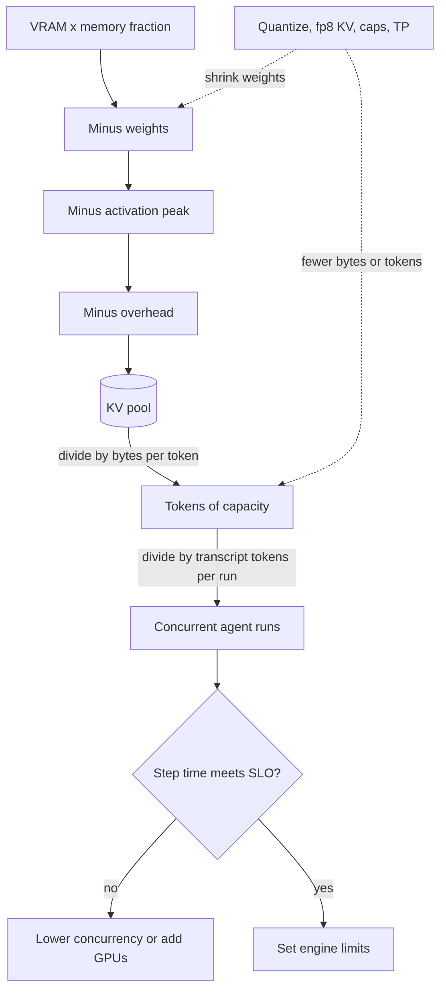

## TL;DR
How many agents one GPU serves is a four-line ledger: weights, KV cache, activation peaks, overhead plus
fragmentation. Subtract them from usable VRAM and every knob is a term you shrink; guessing causes
OOM alerts at peak and 20%-utilized GPUs.

## For agent builders
- **Why it matters for agents.** Agent transcripts grow every step (system prompt, tool schemas, each tool
  result), so the KV-cache line, not the weights, decides how many concurrent agent runs fit. A server
  sized for chat-length prompts OOMs or preempts when long research agents arrive.
- **Where it shows up in your stack.** vLLM's `--gpu-memory-utilization`, `--max-model-len`,
  `--max-num-seqs` and `--kv-cache-dtype fp8`, the KV-cache size the engine logs at startup, and an
  embedder or reranker for your RAG step sharing the same GPU.
- **What you control.** Model size and precision, the context cap per agent route, transcript compaction,
  a byte-identical shared prefix, concurrency caps, and which co-tenants share the GPU.
- **What you can skip.** Allocator internals beyond reserved versus allocated. With a hosted API the
  provider does this math; you only need it once you self-host the agent model.

## Why it exists
- **Failure 1: OOM at peak traffic.** Tests used short prompts and modest concurrency, and allocation is
  lazy, so the first time a long prompt met a full decode batch the engine died. Agents are the worst
  case: late steps carry the longest transcripts.
- **Failure 2: quietly wasted hardware.** An 80 GB GPU leaves 50 GB unused because the concurrency limit
  stayed at a cautious default, so tokens per dollar is a third of what the hardware allows.
- **Both come from observing instead of computing.** `nvidia-smi` mixes allocated, cached and reserved
  memory, and a model that "uses 18 GB" at idle can need 60 GB under load.
- **"Start it and see if it fits" answers the wrong question.** Fitting at idle says nothing about
  capacity at peak, because what matters (tokens in flight, prompt-length distribution) is a property of
  traffic, not the model.
- **The arithmetic is short and exact enough to plan on.** Weights are fixed by parameter count and
  precision; KV cache is a per-token cost times a traffic quantity you cap; activations are bounded by the
  largest step you allow; overhead is a few gigabytes you measure once.

## How it works
### Line 1: weights
`bytes = params × bytes_per_param`, or as a ledger line, `weights = params × bytes_per_param`.

| Precision | Bytes per param |
|---|---|
| bf16/fp16 | 2 |
| fp8/int8 | 1 |
| 4-bit | 0.5 plus scales and zero points |

- **4-bit is more than 4 bits.** The simple `Q4_0` layout stores 32 weights × 4 bits plus a 16-bit scale,
  4.5 bits per weight; group-128 schemes such as GPTQ or AWQ land near 4.1–4.2.
- **Embeddings and LM head.** Published parameter counts include them; if you estimate from per-layer
  shapes, add them. For a 128k-token vocabulary and hidden size 8,192 in bf16 each is about 2.1 GB, and
  an untied model has both. Weight-only quantizers often leave them at higher precision, so a "4-bit" file
  is larger than params × 0.5 suggests.
- **Everything else resident:** a draft model for speculative decoding (plus its own KV cache), a vision
  encoder for screenshot-reading agents, preallocated LoRA adapter slots for per-agent fine-tunes.
- **MoE: count all experts,** since every expert must be resident though only a few run per token. A model
  with 47B total and 13B active parameters costs 94 GB in bf16, not 26 GB.

### Line 2: KV cache
```
bytes_per_token = 2 × n_layers × n_kv_heads × head_dim × bytes_per_element
KV = 2 × layers × kv_heads × head_dim × bytes × tokens_in_flight
```
- **Tokens in flight** = the sum over active sequences of prompt plus generated tokens so far. For agents,
  each run's transcript at its current step.
- **With paged allocation** that is the *actual* total, not the sum of per-request maximums.
- **The levers are the formula read term by term:** fewer KV heads (GQA or MLA architectures), smaller
  elements (fp8 cache), fewer tokens (context cap, concurrency cap, transcript compaction, prefix sharing
  of the system prompt and tool schemas), or divide it across GPUs with tensor parallelism.

### Line 3: activations and workspace
- **Prefill shape.** A chunk of T tokens flows through each layer as [T, hidden], expands to
  [T, intermediate] inside the MLP, and attention needs its own buffers.
- **FlashAttention keeps attention linear in T,** because it never materialises the [T, T] score matrix;
  without it a 32k prompt would need gigabytes of scores per head.
- **Chunked prefill caps T per step,** which caps this peak regardless of prompt length, including a
  large tool result or retrieved document pasted into the transcript.
- **Scale.** With T = 8,192 and a 70B-class intermediate size of 28,672, gate and up projections each
  produce 8,192 × 28,672 × 2 bytes ≈ 0.47 GB, about 0.94 GB together before a tensor-parallel split. It is
  one layer's transient, reused layer after layer, not summed.
- **The LM-head trap.** On every prompt position it would produce 8,192 × 128k × 4 bytes ≈ 4.2 GB of fp32
  logits, which is why engines compute logits only at positions they sample from.
- **Sampling buffer.** [batch, vocab] in fp32: 256 sequences × 128k vocabulary × 4 bytes is about 131 MB,
  small but real.
- **Engines estimate this line** with a dummy forward pass at the maximum batch and token budget during
  startup, which is why those limits change the reported KV capacity.

### Line 4: runtime overhead and fragmentation
- **Per process:** the CUDA context, cuBLAS workspaces, NCCL buffers for tensor parallelism and CUDA-graph
  captures take a few hundred megabytes to a couple of gigabytes (illustrative range). That is why two
  processes on one GPU waste more than one.
- **Allocator reserve.** PyTorch's caching allocator holds freed blocks, so `memory_reserved()` exceeds
  `memory_allocated()`, and variable-size allocations fragment that reserve over time.
- **Mitigation.** The `expandable_segments` allocator option in recent PyTorch versions reduces
  fragmentation.
- **Engines sidestep most of it** by pre-allocating the KV pool in fixed blocks and profiling the
  activation peak once: PagedAttention's design logic applied to the whole budget.

### Putting the ledger together
```
usable          = VRAM × memory_fraction          (engine budget, e.g. 0.9)
pool_for_kv     = usable − weights − activation_peak − overhead
tokens_capacity = pool_for_kv / bytes_per_token
concurrency     = tokens_capacity / expected_tokens_per_sequence
```
- **Under tensor parallelism** run it per GPU, with weights and KV divided by the TP degree but overhead
  not.
- **For agents, size by late-step transcripts.** Use the p99 transcript length at the step where runs
  peak, not the first prompt, and subtract a shared prefix once when prefix caching is on.
- **Then check latency.** A capacity of 60 concurrent sequences is useless if the step time at 60 breaks
  the per-token SLO, and an agent run pays that step time many times over.

### Reading the instruments
| Instrument | Tells you |
|---|---|
| `torch.cuda.memory_allocated()` | live tensors |
| `memory_reserved()` | allocator reserve |
| `max_memory_allocated()` | the true peak |
| `torch.cuda.memory_summary()` | fragmentation |
| engine startup log | KV blocks allocated: the most useful number to compare with the ledger |
| `nvidia-smi` | unexpected processes and the total, not attribution |

## Diagram
The ledger as a pipeline from VRAM to concurrent agent runs: each subtraction is a lever, and the final
concurrency must still pass the latency check.



## Misconceptions
- **"`nvidia-smi` shows how much memory the model needs."** It includes the allocator's reserve and the
  KV pool the engine pre-allocates, so a serving engine looks nearly full even at idle. Attribute memory
  with the PyTorch counters and the KV size the engine logs at startup.
- **"If the model loads, the deployment fits."** Fitting at idle says nothing about peak: a model that
  "uses 18 GB" at idle can need 60 GB under load. Tokens in flight and the largest prefill step are
  properties of traffic, so size from capped p99 traffic, not from a successful start.
- **"The weights decide how many agents a GPU serves."** Weights are fixed; the KV line scales with
  traffic. On the same int8 70B pool of about 227,000 tokens per GPU pair, 8k conversations give about 27
  concurrent, and an fp8 cache plus a 4k cap gives about 111.
- **"An MoE model needs memory for its active parameters."** Every expert must be resident even though
  only a few run per token. A 47B-total, 13B-active model needs 94 GB of bf16 weights, not 26 GB.
- **"Activation memory adds up across layers and grows with the prompt."** It is one layer's transient,
  reused layer after layer: about 0.94 GB for the 70B-class gate and up projections at T = 8,192. Chunked
  prefill caps T per step, so a huge tool result does not raise the peak.

## Examples
### Worked plan: Llama-3-70B-class on two 80 GB GPUs
80 layers, 8 KV heads, head_dim 128, hidden 8,192, about 140 GB in bf16. TP = 2 and a 0.9 fraction give
72 GB usable per GPU.

| Step | Per-GPU ledger | Result |
|---|---|---|
| bf16 weights | about 70.6 GB against 72 GB | essentially nothing left for cache (a few GB at best, depending on GB vs GiB): not useful |
| int8 weights | about 35.3 GB | KV per token 2 × 80 × 8 × 128 × 2 = 320 KB in fp16, 160 KB per GPU after sharding |
| Reserve 2 GB (illustrative) | 72 − 35.3 − 2 ≈ 34.7 GB pool | 34.7 × 2³⁰ ÷ 160 KB ≈ 227,000 tokens |
| 8k tokens per conversation | | about 27 concurrent conversations |
| fp8 KV cache | bytes per token halved | about 55 |
| Context capped at 4k | tokens per conversation halved | about 111 |

Each step is one term of the ledger. The calculator reproduces it for any model. It blurs GB and GiB, a 7%
difference smaller than the uncertainty in the reserve; when the margin is that thin, use the engine's
logged block count instead.

```python
def vram_plan(vram_gb, params_b, w_bytes, layers, kv_heads, head_dim, kv_bytes,
              tp=1, fraction=0.9, reserve_gb=2.0, tokens_per_seq=8192, vocab=128_256, hidden=8192):
    usable = vram_gb * fraction
    weights = params_b * w_bytes / tp                       # GB per GPU (1e9 params ~ 1 GB at 1 byte)
    kv_per_token = 2 * layers * kv_heads * head_dim * kv_bytes / tp
    pool_gb = usable - weights - reserve_gb
    tokens = int(pool_gb * 2**30 / kv_per_token) if pool_gb > 0 else 0
    return dict(weights_gb=round(weights, 1), kv_kb_per_token=kv_per_token / 1024,
                pool_gb=round(pool_gb, 1), tokens=tokens, concurrent=tokens // tokens_per_seq)

base = dict(vram_gb=80, params_b=70.6, layers=80, kv_heads=8, head_dim=128, tp=2)
print("bf16 weights, fp16 KV:", vram_plan(w_bytes=2, kv_bytes=2, **base))
print("int8 weights, fp16 KV:", vram_plan(w_bytes=1, kv_bytes=2, **base))
print("int8 weights, fp8 KV: ", vram_plan(w_bytes=1, kv_bytes=1, **base))
print("int8, fp8 KV, 4k ctx: ", vram_plan(w_bytes=1, kv_bytes=1, tokens_per_seq=4096, **base))
```

### Agent scenario: how many tool-calling runs fit
The same int8, fp16-KV pool (about 227,000 tokens per GPU pair) serving a research agent. Transcript
sizes are illustrative: a 4k-token system prompt plus tool schemas, and runs that peak at 12k tokens by
their last steps.

| Policy | Tokens charged per run | Concurrent agent runs |
|---|---|---|
| No prefix sharing, size by peak transcript | 12,288 | about 18 |
| Prefix caching: shared 4k prefix counted once | 8,192 unique | about 27 |
| Plus compaction: old tool results summarised, unique part capped at 6k | 6,144 unique | about 36 |
| Plus fp8 KV cache (after an eval) | half the bytes | about 73 |

```python
def agent_runs(pool_tokens, shared_prefix, unique_per_run, prefix_cached=True):
    """Concurrent agent runs a KV pool holds, given a shared prefix and per-run transcript growth."""
    if not prefix_cached:
        return pool_tokens // (shared_prefix + unique_per_run)
    return (pool_tokens - shared_prefix) // unique_per_run    # prefix blocks stored once

pool = 227_000
print(agent_runs(pool, 4096, 8192, prefix_cached=False))   # ~18: every run pays for the prefix
print(agent_runs(pool, 4096, 8192))                        # ~27: shared prefix counted once
print(agent_runs(pool, 4096, 6144))                        # ~36: compaction caps the unique part
```

The prefix only shares if it is byte-identical across runs, and compaction trades memory for a recall
risk you should eval.

### Check the ledger against a live process
Measures weights, predicted KV and the prefill peak for a small model with PyTorch's own counters. The
gap between peak and live memory is Line 3; the gap between reserved and allocated is Line 4's allocator
reserve.

```python
import torch
from transformers import AutoModelForCausalLM

GB, T = 2**30, 4096
model = AutoModelForCausalLM.from_pretrained("Qwen/Qwen2.5-0.5B", torch_dtype=torch.bfloat16).cuda().eval()
cfg = model.config
params = sum(p.numel() for p in model.parameters())
print(f"Line 1 weights: predicted {params * 2 / GB:.2f} GiB, "
      f"allocated {torch.cuda.memory_allocated() / GB:.2f} GiB")

head_dim = cfg.hidden_size // cfg.num_attention_heads
kv_pred = 2 * cfg.num_hidden_layers * cfg.num_key_value_heads * head_dim * 2 * T
print(f"Line 2 KV for {T} tokens (bf16): predicted {kv_pred / GB:.3f} GiB")

torch.cuda.reset_peak_memory_stats()
ids = torch.randint(0, cfg.vocab_size, (1, T), device="cuda")
with torch.no_grad():
    out = model(ids, use_cache=True)                   # one prefill; logits for EVERY position
print(f"live after prefill {torch.cuda.memory_allocated() / GB:.2f} GiB, "
      f"peak {torch.cuda.max_memory_allocated() / GB:.2f} GiB, "
      f"reserved {torch.cuda.memory_reserved() / GB:.2f} GiB")
print(f"full logits tensor alone: {out.logits.numel() * out.logits.element_size() / GB:.2f} GiB")
```

The last line shows the LM-head trap at small scale: a large vocabulary times every prompt position, which
serving engines avoid by computing logits only where they sample.

## Production patterns
- **Derive engine limits from the agent ledger.** Before launch, compute the pool from p99 late-step
  transcript length and set vLLM's `--gpu-memory-utilization`, `--max-model-len` and `--max-num-seqs`
  from it. Compare the KV-cache size the engine logs at startup with your prediction; a large gap is a
  forgotten term.
- **Load-test the worst agent step, not the average.** Replay full agent runs so the longest transcript
  (or a huge tool result) arrives during a full decode batch, exercising the activation peak profiling
  predicted. Monitor peak memory, OOMs and preemptions during the test.
- **One engine per GPU, or explicit fractions.** If the RAG embedder or reranker must share a GPU, start
  it first and give the main engine a lower memory fraction, then re-profile. Alert on unexpected
  processes in `nvidia-smi`.
- **Reduce fragmentation in custom PyTorch servers.** Set `PYTORCH_CUDA_ALLOC_CONF=expandable_segments:True`
  and watch the reserved-minus-allocated gap and `memory_summary()` over long runs.
- **Pull levers in a fixed order.** Fewer KV heads or quantized weights first, then context and
  concurrency caps at the traffic p99 (plus transcript compaction for long agents), then an fp8 cache
  (`--kv-cache-dtype fp8`) after an eval, then tensor parallelism. Re-run the ledger and the load test
  after each change.

## Trade-offs
- **Quantized weights vs quality risk.** Quantizing frees the largest line and speeds decode, but every
  quantized artifact needs its own quality evaluation on agent tasks; the saving is not worth a silent
  regression in tool-call accuracy.
- **fp8 KV cache vs long-context accuracy.** It doubles token capacity at low reported quality cost, yet
  long-context retrieval is where cache precision bites, so the trade flips as agent transcripts grow.
- **Higher memory fraction vs headroom.** More blocks, but less headroom for activation peaks and other
  processes; past about 0.9–0.95 the OOM risk rises faster than capacity.
- **Lower context cap vs legitimate long requests.** Concurrency rises proportionally, but long agent runs
  are rejected or truncated; the right cap is the measured p99 of real traffic, not the model's maximum.
- **Tensor parallelism vs per-GPU overhead.** It divides weights and cache across GPUs but adds per-GPU
  overhead and interconnect cost, so two GPUs give less than twice the capacity of one.

## Pitfalls
- **Sizing from weights alone.** Symptom: a server that starts cleanly, reports healthy, and OOMs or
  preempts heavily the first time concurrency and context length rise together. Fix: write all four
  lines and size KV from capped tokens in flight.
- **Sizing agents by their first prompt.** Symptom: fine in the morning, preemption storms once many runs
  reach late steps at once. Fix: size by p99 transcript length at the peak step, and cap or compact.
- **Reading `nvidia-smi` as "memory the model needs".** It includes the allocator's reserve and the
  pre-allocated KV pool, so a serving engine reports near-full even at idle. Fix: use the PyTorch
  counters and the engine's logged KV size.
- **Adding a second process without re-profiling** (an embedding model, a reranker). The engine's pool was
  sized to the free memory at its own startup, so the newcomer OOMs or evicts it. Fix: lower the main
  engine's memory fraction and restart it.
- **Testing only short prompts and small batches.** The activation peak is never exercised; the first
  32k-token prompt during a full decode batch triggers the OOM profiling would have predicted. Fix:
  load-test the worst step.
- **Budgeting an MoE model by its active parameters.** The checkpoint then does not load. Fix: budget
  weights from total parameters.

## When to use
- **Do the ledger** before every deployment, model swap, change to context or concurrency limits, new
  agent route with longer transcripts, and whenever a new co-tenant lands on a GPU.
- **Pick levers in a fixed order:** a model with fewer KV heads or a quantized weight format first, then
  context and concurrency caps matched to traffic p99, then fp8 cache, then tensor parallelism, with CPU
  offloading as a last resort for non-interactive work.
- **Measure** the engine's reported block count and peak allocated memory under a production-shaped load
  test and compare with the ledger; a gap means a term you forgot.
- **Skip it** while your agents call a hosted API; the provider's rate limits are your capacity ceiling.
- **Interviews:** derive bytes-per-token and walk the four lines for a named model on a named GPU; it is
  the standard test of serving depth.

## Role lens
- **Engineer:** Computes the ledger in a notebook, sets `gpu_memory_utilization`, `max_model_len` and
  sequence limits from it, and verifies against the engine's logged block count and peak memory.
- **Architect:** Chooses GPU tier, precision policy and tensor-parallel degree per model from the ledger,
  and sets the context and concurrency policy that capacity planning depends on.
- **FDE:** Sizes a customer's self-hosted deployment on the hardware they have, showing the four lines
  and which lever changes their concurrent-user number before any purchase decision.

## Check yourself
**Q:** A customer wants to serve a Llama-3-8B-class model (32 layers, 8 KV heads, head_dim 128, ~16 GB
in bf16) on a single 24 GB GPU with 16k-token documents and asks how many users it supports. Walk the
ledger.
**A:** Usable memory at a 0.9 fraction is about 21.6 GB. Weights take 16 GB, and an illustrative 1.5 GB
goes to activation peak and runtime overhead, leaving roughly 4 GB for KV cache. KV per token is 2 × 32 ×
8 × 128 × 2 = 128 KB in fp16, so the pool holds around 32k tokens: two 16k documents in flight, not a
multi-user service. The levers in order: quantize weights to int8 (8 GB freed, about 96k tokens, six
documents) or 4-bit (another 4 GB, roughly 130k tokens), use an fp8 KV cache to double any of those,
enable chunked prefill so a 16k prefill does not blow the activation peak, and confirm the step time at
the resulting concurrency still meets their latency target. If they need dozens of concurrent documents,
the answer is a larger GPU, not more tuning.

## Interview questions
### What are the four lines of the inference memory ledger, and which one grows with traffic?
- **Weights, KV cache, activation and workspace peaks, runtime overhead plus fragmentation.**
- **Only the KV cache grows with traffic,** because it is bytes per token times tokens in flight; weights
  and overhead are fixed, and activations are bounded by the largest step you allow.

### Your self-hosted agent server is fine at launch but preempts heavily mid-afternoon. How do you size it properly?
- **Agents grow:** tokens in flight are the sum of current transcripts, so many runs reaching late steps
  together multiply the KV line even at constant run count.
- **Size by late steps:** use p99 transcript length at the peak step, count a byte-identical shared prefix
  once with prefix caching, and cap or compact transcripts.
- **Then verify:** replay real agent runs under load and compare the engine's KV usage and preemption
  metrics with the ledger.

### A deployment passed load tests but OOMs in production. How do you find the missing term?
- **Compare the ledger with reality:** the engine's logged KV size, `max_memory_allocated()` and
  `nvidia-smi` for co-tenant processes.
- **Check the worst step:** did production send longer prompts than the test, during a full decode batch,
  with chunked prefill off or a high token budget?
- **Check additions:** a draft model, LoRA slots or a second process (such as the RAG embedder) that the
  startup profile never saw.

### When would you raise the memory fraction, and when would you not?
- **Raise it** when the GPU is dedicated, the activation peak is profiled at your real limits, and KV usage
  is the bottleneck.
- **Do not** past about 0.9–0.95, or when other processes, CUDA graphs or unprofiled peaks need headroom;
  the OOM risk then rises faster than capacity.

### How much memory does a 47B-total, 13B-active MoE model need for weights in bf16?
- **About 94 GB,** because every expert must be resident even though only a few run per token.
- **Active parameters predict compute per token,** not the weight footprint; budgeting from 13B (26 GB)
  means the checkpoint does not load.

### Estimate concurrency for an int8 70B-class model at TP = 2 on 80 GB GPUs with 8k conversations.
- **Per GPU:** 72 GB usable − 35.3 GB weights − ~2 GB reserve ≈ 34.7 GB pool.
- **KV:** 320 KB per token in fp16, 160 KB per GPU, so about 227,000 tokens, about 27 conversations.
- **Levers:** fp8 KV doubles it to about 55; a 4k context cap doubles it again to about 111.

## Quiz
### Q: Which term of the memory ledger grows with traffic rather than with the model?
- [ ] Weights, because each request loads its own copy of the parameters
- [x] The KV cache, because it scales with tokens in flight across all active sequences
- [ ] Runtime overhead, because the CUDA context grows with each connection
- [ ] The embedding table, because new tokens are added as prompts arrive
> Weights and overhead are fixed once the model is loaded. The cache is proportional to the total number
> of prompt and generated tokens currently being served, which is a property of traffic you must cap.

### Q: Why does a serving engine run a dummy forward pass at startup before allocating its KV pool?
- [ ] To warm up the CUDA kernels so the first request is fast
- [ ] To verify the model weights loaded correctly
- [x] To measure the peak activation memory at the configured batch and token limits, so the pool can take the rest
- [ ] To compute the perplexity of the model on a calibration set
> Activation and workspace memory depends on the maximum step the scheduler may build. Measuring it
> once lets the engine give every remaining byte to KV blocks without risking OOM on the largest step.

### Q: A 47B-total, 13B-active mixture-of-experts model is planned for a GPU budget sized from 13B parameters. What happens?
- [ ] It fits, because only active experts are loaded per token
- [ ] It fits if the KV cache is quantized to fp8
- [x] It fails to load, because all experts must be resident and weights cost 47B × bytes per parameter
- [ ] It loads but runs at one-quarter speed due to expert swapping
> Routing picks experts per token, but every expert can be chosen, so the full set must sit in GPU
> memory. Active parameters predict compute per token, not the weight footprint.

## Use cases & projects
### Use cases
- **Sizing a self-hosted agent server.** The ledger turns a model, GPU and transcript profile into a
  concurrent-run number before any hardware is bought.
- **Choosing context and compaction policy.** Capping or summarising old tool results is a memory lever
  you can price in concurrent runs.
- **Co-locating the RAG stack.** Deciding whether the embedder and reranker can share the agent model's
  GPU, and at what memory fraction.
- **Debugging OOMs and preemptions.** Comparing the engine's logged KV size and peak memory with the
  ledger finds the forgotten term.

### Mini project
**Size and verify an agent server on one GPU (2-3 hours).**
- **Goal:** predict how many concurrent agent runs a small self-hosted model supports, then confirm it.
- **Steps:** pick a 0.5B to 8B model and your GPU; write the four-line ledger and the `agent_runs`
  estimate for a transcript profile you choose; start vLLM with limits derived from it and compare the
  logged KV size; replay N scripted tool-calling runs whose transcripts grow each step, raising N until
  preemptions appear.
- **Done when:** you have predicted versus measured KV capacity and concurrent runs in one table, the gap
  explained by a named term, and engine limits you would ship.
