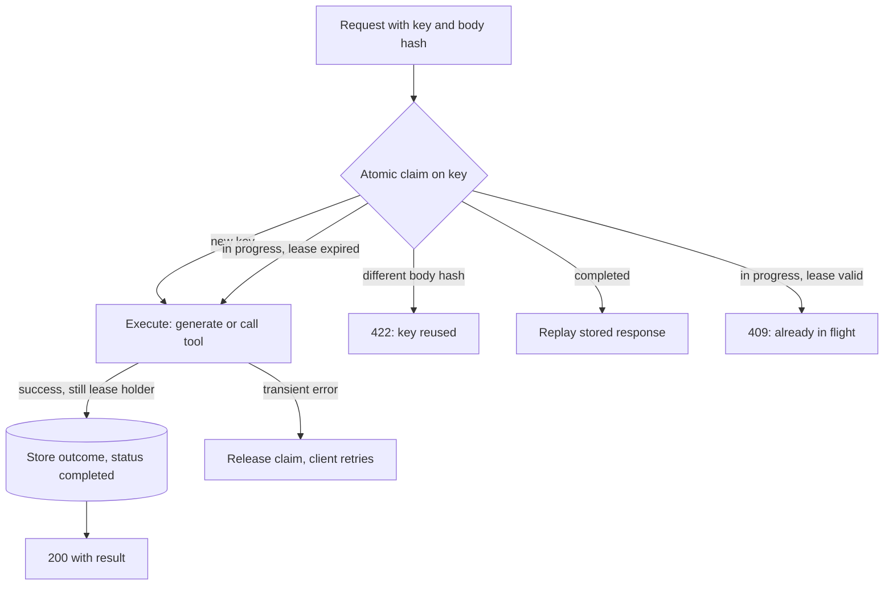

## TL;DR
An operation is idempotent when doing it twice equals doing it once. Agents retry, regenerate and resume,
so every side-effecting tool needs a key derived from run and step, stored with the outcome, so a repeat
replays the result instead of acting again.

## For agent builders
- **Why it matters for agents.** A model call that times out after the tool already ran, a regenerated
  turn, a resumed checkpoint: each replays a step. Without keys, `send_email`, `create_ticket` or a refund
  happens twice, and that is a customer-visible incident, not a log line.
- **Where it shows up in your stack.** Your tool functions (the only place the effect actually happens),
  the `Idempotency-Key` header on your agent API, external APIs that accept keys (Stripe does), durable
  execution and checkpointing in agent frameworks, and the queues that deliver agent jobs.
- **What you control.** How the key is derived (run id plus a stable step identifier, never only the
  model's tool-call id), the atomic claim, the lease length versus your slowest tool, and which tools are
  idempotent by design.
- **What you can skip.** Formal exactly-once theory. Know that it is impossible across a network and that
  at-least-once plus idempotent handlers is the substitute.

## Why it exists
- **A timeout is ambiguous.** The request may never have arrived, may still be running, or may have
  completed after the client stopped listening. The client can only give up (poor availability) or retry.
- **Exactly-once delivery is impossible** in general across a network. Systems achieve at-least-once
  delivery plus idempotent processing, which gives effectively-once results; that is why durable queues,
  webhooks and payment APIs are built around deduplication rather than preventing duplicates.
- **LLM generation is expensive.** A retried 30-second, 10k-token call doubles cost and latency; if the
  first call completed you paid twice for one answer.
- **Generation is non-deterministic, and agents act.** A second attempt produces different text, so one
  click can show two different replies. A retried step calling `create_ticket` or `send_email` does it
  twice, turning a flaky network into a customer-visible incident.
- **The naive alternatives fail.** "Never retry" sacrifices availability. "Dedupe by content" breaks when
  content is legitimately repeated ("send another reminder"). "Rely on a unique database constraint"
  needs a natural key, which an LLM call rarely has. Idempotency keys supply it explicitly.

## How it works
### The key
- **One key per *logical operation*,** usually a UUID generated by the client and reused on every retry
  of that operation.
- **Scoped to the caller** (tenant, API key), so collisions between callers are impossible.
- **Expires after a retention window;** Stripe, the canonical example, keeps keys for 24 hours.
- **Operation vs attempt is the whole idea:** a new key means "do it again", the same key means "make
  sure it happened once".

### The server algorithm
1. **Fingerprint** the request body (a hash of its canonical serialisation).
2. **Claim the key:** atomically insert `(key, fingerprint, status=in_progress)`. On conflict:

   | Existing row | Meaning | Response |
   |---|---|---|
   | different fingerprint | key reused for a different request, a client bug | 422 |
   | `status=completed` | already done | replay the stored response, same status code and body, no work done |
   | `status=in_progress` | a duplicate is racing the original | 409, or wait for the first to finish |

   Returning 409 rather than running a second copy is why the claim must be the first write.
3. **Execute** the operation.
4. **Store the outcome** atomically with `status=completed`. Transient failures release the claim so a
   retry can run; permanent failures (4xx) can be stored and replayed.

### The lease and the honest limit
- **The claim needs a lease.** If the process crashes between steps 3 and 4 the key stays `in_progress`
  forever, so the row carries a short expiry after which a retry may take over.
- **Lease length is a genuine tension.** Too short: a retry takes over while the first attempt (a long
  generation or slow tool) still runs, and you get the duplicate you were preventing. Too long: every
  second of lease is a second a crashed attempt blocks recovery.
- **Long operations heartbeat:** renew the lease periodically, and the completing write checks it still
  holds the lease, for example by matching an attempt id stored in the row, before recording the outcome.
- **The pattern's limit:** unless the side effect and the key store share one transaction, there is a
  window where the effect happened but was not recorded, and the retry repeats it. Outbox patterns and
  reconciliation jobs close that window.

### Idempotent by design
Often you can skip the key store by making the operation naturally idempotent:
- **Deterministic ids:** `job_id = hash(tenant, document_id, prompt_version)` inserted with
  `ON CONFLICT DO NOTHING`.
- **Set, not append:** "the summary of document X is S" rather than "add a summary" or an increment.
- **Conditional writes** with version numbers, so a stale duplicate is rejected.

### Where it lands in an LLM system
| Surface | Key | Behaviour |
|---|---|---|
| **Chat turns** | message id generated by the client when the user presses send | server appends the user turn and reply under that id only if absent and stores the text under it; a double click or retry returns the same reply and the second generation is never billed |
| **Agent tool calls** | run id plus a stable step identifier (not only the model's tool-call id), passed to the tool | the tool dedupes on it and forwards it to external APIs that accept an idempotency header |
| **Queues and webhooks** | processed message or event ids (the inbox pattern) | needed because deliveries are at-least-once by contract |
| **Provider calls** | your layer's key | most generation endpoints do not accept one themselves (check the specific provider), so coalesce concurrent duplicates onto one in-flight call and replay the stored completion to late retries |

- **Agent caveat:** a regenerated model turn produces new tool-call ids, so the derivation must include
  something stable about the step, not only the model's id.

### Deriving a stable key inside an agent loop
| Candidate key | Survives a transport retry | Survives a regenerated turn | Survives resume from checkpoint |
|---|---|---|---|
| Model's tool-call id | yes | no: new id each generation | only if the checkpoint stored it |
| Random UUID made in the tool | no: new id every attempt | no | no |
| `run_id` + step index + tool name + hash of key arguments | yes | yes, if the step index is the same | yes |

- **Include the arguments that define the effect** (recipient, amount, ticket subject), so a corrected
  call with different arguments is a new operation, not a replay.
- **Record the tool result in the transcript or checkpoint** under the same key, so a resumed run feeds
  the model the stored result instead of calling the tool again.

### Streaming
- **Partial output complicates replay.** Persist the final text under the key when the stream completes.
- **A retry arriving mid-stream** either attaches to the in-flight generation or restarts under the same
  message id so the client can discard the partial render.

## Diagram
Every request with a key goes through the atomic claim first; only the "claimed" branch does any work,
and only the lease holder may record the outcome.



## Examples
### Minimal idempotency layer
Claim first, fingerprint check, replay on completion, 409 on a racing duplicate, release on transient
failure so the client can retry. In production the dictionary is a Redis `SET NX PX` or a table with a
unique index, and `claim` is a single atomic operation.

```python
import hashlib, json, time

class IdempotencyStore:
    """In production: Redis SET NX PX, or a table with a unique index on key."""
    def __init__(self, ttl_s=86_400, lease_s=120):
        self.rows, self.ttl_s, self.lease_s = {}, ttl_s, lease_s
    def claim(self, key, fingerprint):
        row = self.rows.get(key)
        if row and row["expires"] > time.monotonic():
            if row["fp"] != fingerprint:
                return "mismatch", None
            return row["status"], row.get("response")      # "in_progress" or "done"
        self.rows[key] = {"fp": fingerprint, "status": "in_progress",
                          "expires": time.monotonic() + self.lease_s}   # short lease while running
        return "claimed", None
    def complete(self, key, response):
        self.rows[key].update(status="done", response=response, expires=time.monotonic() + self.ttl_s)
    def release(self, key):
        self.rows.pop(key, None)

store = IdempotencyStore()

def handle_generate(idem_key: str, tenant: str, body: dict):
    key = f"{tenant}:{idem_key}"                              # scope keys per caller
    fp = hashlib.sha256(json.dumps(body, sort_keys=True).encode()).hexdigest()
    status, saved = store.claim(key, fp)
    if status == "mismatch":    return 422, {"error": "idempotency key reused with a different body"}
    if status == "done":        return 200, saved             # replay: no second generation, no second bill
    if status == "in_progress": return 409, {"error": "already in flight; retry shortly"}
    try:
        resp = llm.generate(**body)       # expensive, non-deterministic; must finish within lease_s
    except TransientError:
        store.release(key)                                    # let the client retry with the same key
        raise                             # a permanent error could be stored and replayed instead
    store.complete(key, resp)
    return 200, resp
```

### Postgres claim with a lease and attempt id
A production shape for the same algorithm. The claim inserts, or takes over only an expired lease with a
matching fingerprint; the completing write succeeds only for the attempt that holds the lease.

```sql
CREATE TABLE idempotency_keys (
  scope       text        NOT NULL,           -- tenant or API key
  key         text        NOT NULL,
  fingerprint text        NOT NULL,
  status      text        NOT NULL DEFAULT 'in_progress',
  attempt_id  uuid        NOT NULL,
  lease_until timestamptz NOT NULL,
  response    jsonb,
  PRIMARY KEY (scope, key)
);

-- Claim: returns a row only if this attempt now owns the key.
INSERT INTO idempotency_keys (scope, key, fingerprint, attempt_id, lease_until)
VALUES ($1, $2, $3, $4, now() + interval '120 seconds')
ON CONFLICT (scope, key) DO UPDATE
  SET attempt_id = EXCLUDED.attempt_id, lease_until = EXCLUDED.lease_until
  WHERE idempotency_keys.status = 'in_progress'
    AND idempotency_keys.lease_until < now()
    AND idempotency_keys.fingerprint = EXCLUDED.fingerprint
RETURNING attempt_id;
-- No row returned: SELECT the existing row and answer 422, replay, or 409.

-- Heartbeat during long work, and completion: both only for the lease holder.
-- (Each statement numbers its own parameters: $1 scope, $2 key, $3 this attempt's id.)
UPDATE idempotency_keys SET lease_until = now() + interval '120 seconds'
WHERE scope = $1 AND key = $2 AND attempt_id = $3 AND status = 'in_progress';

UPDATE idempotency_keys SET status = 'completed', response = $4
WHERE scope = $1 AND key = $2 AND attempt_id = $3 AND status = 'in_progress';
-- 0 rows updated: the lease was lost, so another attempt owns the outcome.
```

### Worked timeline: why the lease must outlast the slowest call
A tool call that takes 150 s against a 120 s lease, without a heartbeat (illustrative numbers):

| Time | Attempt A | Attempt B (client retry, same key) |
|---|---|---|
| 0 s | claims key, lease until 120 s, starts `create_ticket` | |
| 30 s | still running | claim conflicts, lease valid: 409 |
| 130 s | still running | lease expired: takes over and creates a second ticket |
| 150 s | finishes, completion write matches no row | |

With a heartbeat every 30 s, B keeps getting 409 until A completes, then gets the replay.

### Agent tool wrapper keyed on run and step
A decorator for side-effecting tools: the key comes from the run, the step and the effect-defining
arguments, so a retried, regenerated or resumed step returns the stored result. `store` is the
`IdempotencyStore` above; `billing.create_invoice` stands in for your external API.

```python
import hashlib, json, functools

def idempotent_tool(effect_args):
    def wrap(fn):
        @functools.wraps(fn)
        def tool(ctx, **kwargs):
            effect = {k: kwargs[k] for k in effect_args}
            digest = hashlib.sha256(json.dumps(effect, sort_keys=True).encode()).hexdigest()[:16]
            key = f"{ctx.tenant}:{ctx.run_id}:{ctx.step}:{fn.__name__}:{digest}"
            status, saved = store.claim(key, digest)
            if status == "done":
                return saved                                   # replay: no second invoice
            if status == "in_progress":
                return {"error": "already running, check back"}   # observation for the model
            try:
                result = fn(ctx, idem_key=key, **kwargs)
            except TransientError:
                store.release(key)
                raise
            store.complete(key, result)
            return result
        return tool
    return wrap

@idempotent_tool(effect_args=["customer_id", "amount_cents"])
def create_invoice(ctx, idem_key, customer_id, amount_cents, memo=""):
    return billing.create_invoice(customer_id, amount_cents, memo, idempotency_key=idem_key)
```

### Worked scenario: one timeout, three layers of duplicates
A support agent's step calls `create_invoice` (invoice 1), then the model call that reads the result
times out and the step fails.

| Event | Without keys | With run-and-step keys |
|---|---|---|
| Framework node retry re-runs the whole step | tool executes again: second invoice | tool claim finds `completed`, replays invoice id |
| User clicks "regenerate" | new turn, new tool-call id: third invoice | same run and step, same arguments: replay |
| Worker crashes, run resumes from checkpoint | step re-executes: fourth invoice | stored result fed back to the model |
| Invoices created | 4 | 1 |

- **A plain SDK retry of the model call is not the danger here,** because it re-sends a transcript that
  already holds the tool result; duplicates come from layers that re-run the step itself.

- **Regenerate the text, not the effect.** "Regenerate" gets a new key for the model's reply (the user
  wants a different answer), while tool effects inside the step keep their run-and-step keys.

## Production patterns
- **Key every side-effecting tool by default.** Wrap tools that email, charge, create or delete with an
  idempotency decorator in the tool registry, so a new tool cannot ship without one. Monitor tools in the
  registry without a key as a release check.
- **Persist tool results with the checkpoint.** When an agent framework resumes a run, it should replay
  recorded tool results to the model rather than re-executing tools. Monitor tool executions per resumed
  run; it should be zero for already-completed steps.
- **Client-generated message ids for chat.** The UI creates the id when the user presses send and sends
  it as an `Idempotency-Key` header (the IETF draft's name) on every retry. Monitor replay rate per
  client version; a jump points at an over-eager retry loop.
- **Atomic claim in Redis or Postgres.** Use `SET key value NX PX <lease_ms>` in Redis or the
  `INSERT ... ON CONFLICT` claim above, scoped per tenant. Monitor 409 rate and claim latency.
- **Stable step keys for agent tools.** Derive the key from run id plus a stable step identifier and
  forward it to external APIs that accept idempotency keys (Stripe does). Monitor duplicate-effect counts
  from reconciliation.
- **Inbox table for queues and webhooks.** Record processed event ids in the same transaction as the
  handler's writes, because deliveries are at-least-once. Monitor duplicate deliveries skipped.
- **Reconciliation job for cross-system effects.** Periodically compare external records (invoices,
  tickets) against recorded steps, because the key store and the external system share no transaction.
  Monitor mismatches found per run.

## Trade-offs
- **Key store vs natural id.** A key store adds a write and a read to every request and a dependency on
  the store; when a deterministic natural id exists, an upsert achieves the same guarantee for free.
- **Consistency vs a better answer.** Replaying the stored response gives consistency but means a retry
  can never get a better answer; "regenerate" must therefore be a new key, not a retry.
- **409 vs coalescing.** Returning 409 to a racing duplicate is simple and safe; coalescing onto the
  in-flight call is a better experience but holds connections and needs more state.
- **Replay cache vs retention duty.** Stored responses double as a cache, but they are retained user
  content with privacy and retention obligations, so the TTL is a policy decision as well as a technical
  one.
- **Coarse vs fine step keys.** Keying on run and step only blocks a legitimate second call in the same
  step (two different emails); adding effect arguments allows it, but a model that rewords a memo
  slightly then looks like a new operation. Pick the effect-defining arguments per tool.

## Pitfalls
- **Generating the key inside the retry loop,** so each attempt gets a fresh one. Symptom: duplicates
  persist despite "idempotency" being implemented.
- **Check-then-insert instead of an atomic claim.** Symptom: duplicates that appear only under
  concurrency or load tests and never in local runs.
- **No fingerprint check.** Symptom: a client bug that reuses keys silently returns one request's answer
  to an unrelated request.
- **Storing transient failures as the final outcome.** Symptom: a momentary 503 becomes permanent for
  that key until it expires.
- **Agent tool calls keyed only on the model's tool-call id.** Symptom: duplicate tickets after a
  regenerated turn, because the regenerated call carries a new id.
- **A lease shorter than the slowest generation or tool call.** Symptom: duplicates only on long
  requests, with two attempts for the same key overlapping in the trace.
- **Assuming temperature zero makes generation idempotent.** Symptom: subtly different replayed outputs,
  since determinism is not guaranteed across hardware and batch composition.
- **Resuming a checkpointed run by re-executing its last step.** Symptom: duplicate effects only after
  worker restarts or deploys. Fix: record each tool result under its key before advancing the checkpoint.

## When to use
- **Require a key** on every endpoint that creates something, costs money or triggers a side effect: in
  an LLM product, message creation, job submission and every tool with an external effect.
- **Skip the key store** where a natural deterministic id makes the write an upsert, and for pure reads.
- **Pair it with the retry policy:** retries are only safe because of this.
- **Measure** replay rate (how often a key is reused) and 409 rate. A high replay rate points at an
  overly aggressive client; a nonzero duplicate-effect rate points at a window in the
  claim-execute-store sequence.
- **Interviews:** define idempotency precisely, explain why exactly-once is impossible and at-least-once
  plus idempotency is the substitute, and walk through claim, fingerprint, replay and lease.

## Role lens
- **Engineer:** Adds the key header to the API, implements the atomic claim and replay in Redis or
  Postgres, and threads run and step ids into every agent tool call.
- **Architect:** Decides which operations must be idempotent, where the key store lives relative to the
  side effect, and how reconciliation closes the gap the store cannot.
- **FDE:** Audits a customer's agent integration for tools that email, charge or create records without
  keys, and proves the fix with a chaos test that injects timeouts mid-step.

## Check yourself
**Q:** An agent step calls a `create_invoice` tool and the LLM request times out after the tool has
already run. How do you make the whole system safe to retry end to end?

**A:** Treat each layer separately. The user's turn carries a client-generated message id, so the retried
turn replays or attaches to the in-flight run instead of starting a second one. Inside the run, each
tool call gets an idempotency key derived from the run id and a stable step identifier, not only the
model's tool-call id, which changes if the turn is regenerated. The `create_invoice` implementation
claims that key atomically before acting, forwards it as the idempotency header to the billing API if
that API supports one, and stores the invoice id under the key; a retried step then returns the existing
invoice instead of creating another. The LLM call itself is wrapped so a retry after timeout coalesces
onto the in-flight generation or replays the stored completion. Finally, because the key store and the
billing system are not one transaction, a reconciliation job compares invoices against recorded steps to
catch the rare window where the effect happened but the record did not.

## Interview questions
### Why is exactly-once delivery impossible, and what do systems do instead?
- **A timeout is ambiguous:** the sender cannot know whether the request was lost, is running, or
  finished, so it must either give up or resend.
- **Systems use at-least-once delivery plus idempotent processing,** deduplicating on a key so repeats
  have no extra effect, which yields effectively-once results.

### Users report two different replies to one message. How do you debug and fix it?
- **Likely cause:** a double click or client retry triggered a second, non-deterministic generation.
- **Check** whether the client sends a stable message id and whether the server claims it atomically
  before generating; a check-then-insert race shows up only under load.
- **Fix:** client-generated id per send, atomic claim, replay the stored reply, 409 for in-flight duplicates.

### When would you not use an idempotency key store?
- **When a natural deterministic id exists,** such as `hash(tenant, document_id, prompt_version)`; an
  upsert with `ON CONFLICT DO NOTHING` gives the same guarantee without an extra store.
- **For pure reads,** which have no effect to duplicate.
- **When set semantics fit,** because setting a value twice leaves one state.

### Your agent's slowest tool takes up to 150 s. How long should the idempotency lease be, and what happens if you get it wrong?
- **It must outlast the slowest legitimate execution,** or a retry takes over a running attempt and
  duplicates its effect.
- **But a long lease delays recovery** after a crash, so long operations heartbeat and the completing
  write checks the attempt id before recording.

### How do you derive idempotency keys for an agent's tool calls?
- **Not from the model's tool-call id alone,** because a regenerated turn gets a new id and repeats the
  effect.
- **Use run id, a stable step identifier, the tool name and a hash of the effect-defining arguments,**
  scoped per tenant, and forward the key to external APIs that accept one.
- **Store the result under that key** and feed it back on resume, so a restarted run never re-executes a
  finished step.

### Why does temperature zero not make generation idempotent?
- **Determinism is not guaranteed** across hardware and batch composition, so replayed outputs can differ
  subtly.
- **And idempotency is about effects, not text:** a second generation still costs money and may run tools
  again, so you still need the key and stored outcome.

## Quiz
### Q: Which operation is idempotent by construction, with no key store needed?
- [ ] Append the model's reply to the conversation
- [x] Set the summary of document 42 to the generated text
- [ ] Increment the tenant's token counter by the response usage
- [ ] Send the generated digest email to the user
> Setting a value to the same thing twice leaves one state; appending, incrementing and sending accumulate
> with each repeat. Designing writes as sets instead of appends removes the need for deduplication. If
> the text is regenerated on the retry the final value may differ, but there is still exactly one summary.

### Q: A client sends a request with idempotency key K, times out, and retries with K while the first attempt is still generating. What should the server do?
- [ ] Start a second generation, since the first may have failed
- [x] Detect the in-progress claim on K and return 409 (or attach the retry to the in-flight result) instead of generating again
- [ ] Return the stored response for K, which is empty
- [ ] Reject the retry with 422 because the key was reused
> The atomic claim exists precisely to catch this race: the key is in progress, so a second execution
> would duplicate cost and effects. 422 is for a key reused with a different body, which this is not.

### Q: Why should the server store a fingerprint of the request body alongside the idempotency key?
- [ ] To allow the key to be shorter than a UUID
- [ ] To let the server compress the stored response
- [x] To detect a key being reused for a different request, which is a client bug that would otherwise return the wrong stored response
- [ ] To make the key unique across tenants
> Keys are generated by clients, and clients have bugs. Without the fingerprint a reused key silently
> replays a response to an unrelated request; with it the server can reject the mismatch explicitly.

## Use cases & projects
### Use cases
- **Agents that move money or create records.** Refund, invoice and order tools keyed on run and step
  make retries and regenerations safe.
- **Email and notification agents.** A stored outcome per key means a timed-out step never sends the same
  message twice.
- **Durable, resumable agent runs.** Checkpointed runs replay recorded tool results after a crash instead
  of re-executing them.
- **Chat front ends for agents.** Client-generated message ids stop a double click from starting two
  agent runs and billing two generations.

### Mini project
**Make a side-effecting agent tool safe under chaos (2-3 hours).**
- **Goal:** prove that a tool-calling agent creates exactly one record per intended action, despite
  timeouts, regenerations and crashes.
- **Steps:** build a small agent with a `create_ticket` tool writing to SQLite; wrap it with a run-and-step
  key and an atomic claim; inject a timeout after the tool runs, a "regenerate" of the turn, and a worker
  kill mid-run; resume from a checkpoint each time.
- **Done when:** across 50 chaos runs the ticket table holds exactly one row per intended ticket, and a log
  shows which events were replays.
