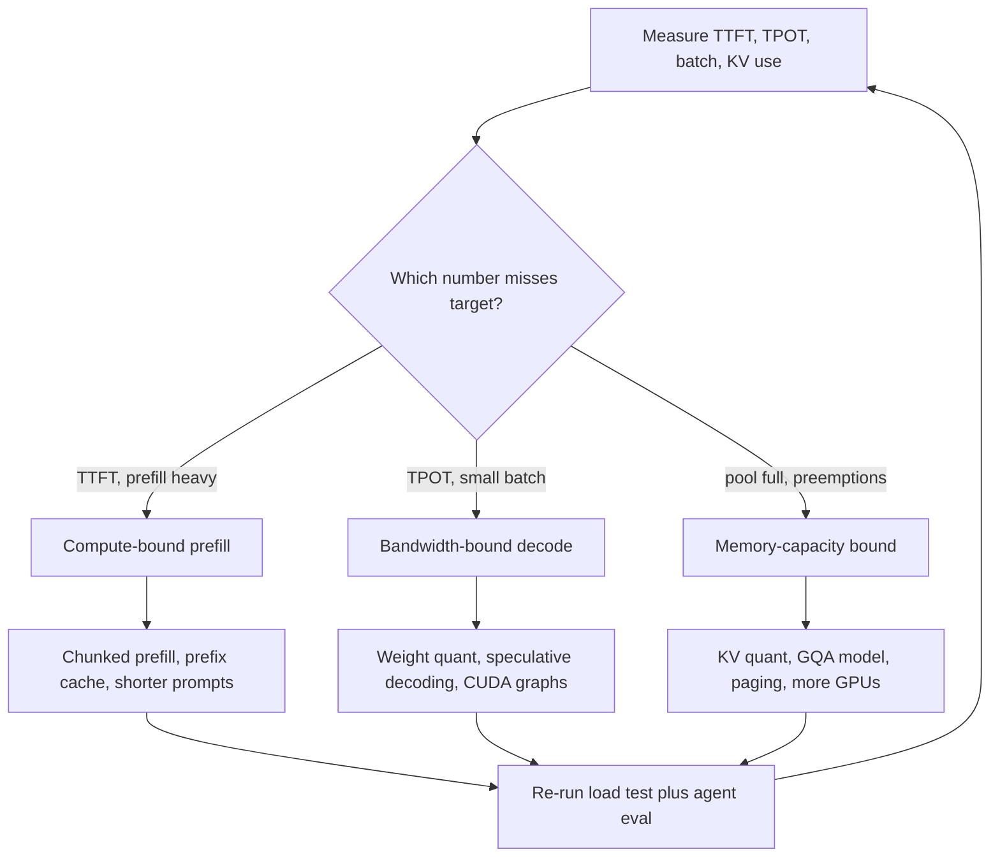

## TL;DR
Levers that make each agent step cheaper or faster on a fixed model. Decode is bandwidth bound (each
token re-reads weights and cache), prefill compute bound, and agent traffic leans on prefill: the bound
you hit decides which lever helps.

## For agent builders
- **Why it matters for agents.** An agent multiplies every per-call cost by its step count. A 10-step
  task with long transcripts and 150-token tool calls can spend over half its GPU time re-prefilling the
  same history (worked example below), so prefix caching and prompt discipline come before decode tricks.
- **Where it shows up in your stack.** Provider prompt caching and smaller-model tiers for hosted APIs;
  vLLM flags (`--enable-chunked-prefill`, `--kv-cache-dtype fp8`, `--quantization`) or their SGLang
  equivalents, plus speculative decoding, for self-hosted models; structured-output or tool-call
  constraints in both.
- **What you control.** Fewer steps per task, shorter and stable prompts, per-step `max_tokens`, routing
  easy steps (classify, summarize a tool result) to a small model, and one-flag-at-a-time changes gated
  by your agent eval.
- **What you can skip.** Writing kernels or tuning CUDA graphs yourself. Know the roofline and the regime
  table; that tells you which lever to ask for.

## Why it exists
- **GPUs have a fixed compute-to-bandwidth ratio.** An H100 does on the order of a thousand teraFLOPs of
  dense fp16 math but moves only a few terabytes per second from HBM. It needs roughly a few hundred
  FLOPs per byte loaded to keep its arithmetic busy.
- **Decode at batch 1 is nowhere near that.** A matmul over *B* tokens does about 2·B FLOPs per weight
  element while reading it once, so intensity is about *B* FLOPs per byte, and single-request decode has
  *B* = 1.
- **So the tensor cores idle.** An 8B model at batch 1 does ~16 GFLOPs in a ~5 ms step: a few TFLOP/s
  against a peak near a thousand, a utilization well under one percent. That is the default state of a
  naive LLM server.
- **"Buy a bigger GPU" fails.** More FLOPs with similar bandwidth makes decode no faster.
- **"Run more requests at once" is correct but hits memory.** Each concurrent request pins a KV cache, and
  the pool fills long before the batch is large enough to be compute-bound.
- **Every technique gets around one of those two walls:** move fewer bytes per token, do less work per
  request, or fit more requests into the same bytes. Matching lever to wall is the discipline, which is
  why measurement precedes tuning.

## How it works
### Start from the roofline
For a decode step at batch size *B* with weights of *W* bytes and a total KV cache of *C* bytes across the
batch:

```
time_per_step ≈ max( (W + C) / bandwidth ,  2·B·params / FLOPs )
```

- **Left term, the bandwidth floor,** dominates until *B* reaches the GPU's ridge point (a few hundred
  tokens per step on current hardware).
- **Prefill** processes the whole prompt as one batch of *B* = prompt length tokens, so it sits on the
  right-hand, compute-bound side.
- **Each lever below shrinks one term.**

### Levers that move fewer bytes (help decode)
| Lever | What it shrinks | Note |
|---|---|---|
| **Weight quantization** (int8, fp8, 4-bit formats such as AWQ or GPTQ) | Halves or quarters *W*, so the batch-1 floor drops proportionally; frees VRAM for cache | Evaluate per model and task, because the loss is not uniform |
| **KV-cache quantization** (fp8 or int8 cache) | Shrinks *C* | Matters once cache reads rival weight reads; long-context, high-concurrency workloads benefit most |
| **Architecture choices** (grouped-query attention, multi-head latent attention) | Cache bytes per token, by sharing or compressing K/V | You pick these by picking the model, not by tuning |

### Levers that do less work per request
- **Prefix caching.** Skip prefill for a prompt prefix already in cache. Cuts TTFT and compute for shared
  system prompts, few-shot blocks, tool schemas, multi-turn chat and every step of an append-only agent
  transcript.
- **Prompt and output discipline.** Shorter prompts cut prefill compute linearly; a sensible `max_tokens`
  and stop sequences stop decode from generating tokens nobody uses. For agents, trimming verbose tool
  results before appending them shrinks every later step.
- **Fewer steps.** Each agent step is a full request. Parallel tool calls in one step, or a plan that
  needs fewer round trips, removes whole prefill and decode passes.
- **Constrained decoding.** Masking logits with a grammar or JSON schema removes retries for invalid
  output (such as malformed tool-call arguments), a request-level optimization. Computing the mask is CPU
  work per step, so a slow grammar engine can itself bottleneck at high batch.

### Speculative decoding
1. **Draft.** A small draft model (or a lightweight head) proposes *k* tokens.
2. **Verify.** The large model checks all of them in one forward pass. That costs barely more than one
   decode step, because the step was bandwidth-bound anyway, so accepted drafts come almost free.
3. **Correct.** Rejection sampling corrects every draft to the target model's distribution, so the
   output distribution is unchanged.

```
expected tokens per target pass = (1 − α^(k+1)) / (1 − α)      # α = per-token acceptance
α = 0.8, k = 4  ->  about 3.4 tokens per pass instead of 1, minus the draft's own cost
```

- **When it helps:** small batch and an accurate draft. Acceptance falls on creative or unusual text, and
  tends to be high on predictable text such as code and structured tool-call JSON.
- **When it hurts:** at large batch the GPU is already busy, so verification competes with real work.

### Levers that fit more work into the same bytes
- **Continuous batching.** Admit and retire requests every iteration so the running batch stays full.
  Each weight read then serves many tokens, pushing *B* toward the ridge point.
- **Paged KV cache.** Eliminates fragmentation so the pool holds more sequences, which is what makes large
  batches reachable.
- **Chunked prefill.** Split long prompts into chunks interleaved with decode steps, so prefill's compute
  and decode's bandwidth demand overlap rather than queue.
- **Disaggregated prefill and decode.** Run the phases on separate GPU pools and ship the KV cache between
  them, so long prefills stop stalling decode and each pool is sized for its own bound. Pays at large
  scale with mixed traffic; below that, chunked prefill gets most of the benefit.
- **Tensor parallelism.** Shard weights so each GPU reads a fraction of *W* per step. It adds an
  all-reduce per layer, so it pays when a model does not fit or per-GPU bandwidth is the limit.

### Levers at the kernel level
- **Fused attention kernels** (FlashAttention and successors) avoid materializing the full attention
  matrix, cutting prefill memory traffic and enabling long contexts.
- **Fused elementwise ops and CUDA graphs** remove per-kernel launch overhead, which at batch 1 can be a
  surprisingly large fraction of a step.
- **Compiled or engine-specific runtimes** (TensorRT-LLM style) specialize kernels to the model shape.

### Levers outside the engine
- **Route easy requests to a smaller model, cache whole responses, distill a task-specific small model, or
  precompute embeddings.**
- **For agents:** use a small model for routing, intent classification and summarizing tool output, and
  keep the large model for planning; cache deterministic tool results so repeated lookups skip a step.
- **These often beat any engine knob,** because they cut the number of tokens that touch an expensive GPU
  in the first place.

### The order of operations
1. **Measure** TTFT, TPOT, tokens/sec per GPU, batch size per step and KV-cache utilization.
2. **Classify and pick:**

| Signal | Regime | Levers |
|---|---|---|
| Small batch, pool far from full | Latency-bound per request | Quantize weights, add speculative decoding, trim prompts |
| Pool full | Memory-bound | Quantize cache, enable prefix caching, choose a GQA model, add GPUs |
| Prefill dominates, TTFT is the complaint (typical of agents) | Compute-bound prefill | Chunked prefill, prefix caching, shorter prompts |

3. **Change one knob, re-measure.** Changing a knob without knowing the regime is how teams "optimize"
   into a slower system.

## Diagram
Measure agent steps first, then let the regime pick the lever; each branch attacks a different term of
the roofline, and every change goes back through the agent eval.



## Misconceptions
- **"A GPU with more FLOPs makes decode faster."** Batch-1 decode re-reads every weight per token and
  sits on the bandwidth floor with tensor cores well under 1% busy, so more FLOPs at similar bandwidth
  buys almost nothing. Fewer bytes (quantized weights or cache) or more requests per weight read do.
- **"Quantization helps because low-precision math is cheaper."** In decode the math was idle anyway.
  4-bit weights help because each step reads a quarter of the bytes, which is why the batch-1 step gets
  roughly 3-4x faster and why the gain shrinks once cache reads or compute dominate the step.
- **"Speculative decoding trades quality for speed."** Rejection sampling keeps the target model's output
  distribution unchanged. Its real cost is draft time and verification compute, so it pays at small
  batch with high acceptance (about 3.4 tokens per pass at α = 0.8, k = 4) and hurts on a busy GPU.
- **"For an agent, decode is where the GPU time goes."** Without prefix reuse, a 10-step task re-prefills
  105k tokens, about 56% of its GPU time. A stable, append-only prompt cuts that to 15k tokens before any
  decode trick is worth trying.
- **"Turn on every optimization flag and the gains add up."** Each lever shrinks one term of the
  roofline. Applied in the wrong regime it does nothing or makes things slower, so classify the regime,
  change one knob, and re-run the load test and agent eval.

## Examples
### A roofline calculator
The hardware numbers are rounded, publicly quoted figures, meant to show the shape of the result, not to
predict a benchmark.

```python
def decode_step_ms(params_b, batch, ctx_tokens, kv_bytes_per_token,
                   weight_bytes=2, bw_tb_s=3.0, tflops=900):
    """Lower bound on one decode iteration: bandwidth floor vs compute floor."""
    W = params_b * 1e9 * weight_bytes                # bytes of weights read per step
    C = batch * ctx_tokens * kv_bytes_per_token      # bytes of KV cache read per step
    t_bw = (W + C) / (bw_tb_s * 1e12)
    t_fl = 2 * batch * params_b * 1e9 / (tflops * 1e12)
    bound = "bandwidth" if t_bw >= t_fl else "compute"
    return 1000 * max(t_bw, t_fl), bound

KV8B = 2 * 32 * 8 * 128 * 2        # 8B GQA model, fp16 cache: ~128 KB per token
for batch in (1, 8, 64, 256):
    ms, b = decode_step_ms(8, batch, ctx_tokens=2048, kv_bytes_per_token=KV8B)
    print(f"fp16 batch={batch:4d}: {ms:6.2f} ms/step, {batch/ms*1000:8.0f} tok/s  ({b}-bound)")

ms4, _ = decode_step_ms(8, 1, 2048, KV8B, weight_bytes=0.5)   # 4-bit weights, fp16 cache
print(f"4-bit batch=1: {ms4:.2f} ms/step  -> weight bytes were the floor, so ~3-4x faster")
# Illustrative output shape: ~5.4 ms at batch 1 (~180 tok/s); by batch 256 the step is
# ~5x longer while aggregate tok/s is ~50x higher, and the growth is all KV-cache traffic.
# Note the roofline is not a capacity check: 256 x 2048 tokens of cache is 64 GiB, which would
# not fit beside 16 GB of weights on an 80 GB card; the memory-estimation lesson covers that.
```

- **At batch 1** the step time is almost entirely weight traffic, so quantizing weights is the lever.
- **At batch 256 with 2k contexts** cache reads already exceed weight reads, so cache size (GQA, cache
  quantization) is the lever. The compute term only takes over at larger batches with short contexts.
- **With `ctx_tokens=32000`** cache reads overtake weight reads at modest batch sizes (about batch 4 here),
  which is when KV quantization and GQA start to pay.

### What speculative decoding buys at different acceptance rates
The formula from above, swept over α. Real speedup is lower, because the draft model costs time too.

```python
def tokens_per_pass(alpha, k):
    return (1 - alpha ** (k + 1)) / (1 - alpha)

for alpha in (0.5, 0.7, 0.8, 0.9):
    print(alpha, [round(tokens_per_pass(alpha, k), 2) for k in (2, 4, 8)])
# 0.5 -> [1.75, 1.94, 2.0]   drafting more than a few tokens is wasted
# 0.8 -> [2.44, 3.36, 4.33]  the lesson's ~3.4 at k = 4
# 0.9 -> [2.71, 4.1, 6.13]   predictable text (code, templates) rewards longer drafts
```

### Agent scenario: where a 10-step task spends its GPU time
A tool-calling agent on the 8B model above: a 6k-token prefix (system prompt plus tool schemas), ~1k
tokens appended per step (tool call plus result), ~150 output tokens per step. Rates are illustrative
assumptions (10,000 prefill tokens/s, the ~5.4 ms batch-1 decode floor), not a benchmark.

| Quantity over 10 steps | No prefix reuse | Append-only transcript plus prefix caching |
|---|---|---|
| Prefill tokens | 6k + 7k + … + 15k = 105k | 6k + 9 × 1k = 15k |
| Prefill time | ~10.5 s | ~1.5 s |
| Decode tokens and time | 1,500 tokens, ~8.1 s | 1,500 tokens, ~8.1 s |
| Prefill share of GPU time | ~56% | ~16% |

```python
prefix, per_step, out, steps = 6000, 1000, 150, 10
no_reuse = sum(prefix + per_step * i for i in range(steps))      # 105,000
reuse = prefix + per_step * (steps - 1)                          # 15,000
decode_s = steps * out * 5.4e-3                                  # ~8.1 s
for name, toks in (("no reuse", no_reuse), ("prefix cache", reuse)):
    pre_s = toks / 10_000
    print(name, toks, f"{pre_s:.1f}s prefill", f"{pre_s / (pre_s + decode_s):.0%} of GPU time")
```

- **Read it as:** for agents the first lever is a stable, append-only prompt, not a decode trick. Once
  prefill is small, decode dominates and weight quantization or speculative decoding (high acceptance on
  tool-call JSON) becomes the next lever.

### Worked triage: three slow deployments
| Deployment | Measured | Regime | First lever |
|---|---|---|---|
| Internal copilot, 70B on 2 GPUs | Batch 3, pool 30% used, slow streaming | Bandwidth-bound decode | fp8 or 4-bit weights with an eval, then speculative decoding |
| Support chat at peak | Pool pinned near 100%, preemptions climbing | Memory-capacity bound | fp8 KV cache, prefix caching for the shared system prompt |
| Contract review, 30k-token prompts | TTFT is the complaint, decode fine | Compute-bound prefill | Chunked prefill, prefix caching, trimming boilerplate from prompts |
| Research agent, 25 steps per task | Per-step TTFT grows each step, low cache hit rate | Compute-bound prefill, re-done every step | Stable prefix, append-only transcript, session-affine routing, trim tool output |

## Production patterns
- **Load test with the production length mix.** Replay real prompt/output length distributions (for
  example 6k in / 800 out, not 500 in / 100 out) at target concurrency with a serving benchmark such as
  vLLM's, before and after each flag. For agents, replay recorded multi-step traces so later, longer
  steps are represented. Monitor TTFT p95, TPOT p95 and tokens/s per GPU together.
- **One flag per change, with an agent eval gate.** Treat quantization (`--quantization` with an AWQ,
  GPTQ or fp8 checkpoint in vLLM) and `--kv-cache-dtype fp8` as releases: run the task eval set,
  especially its hard tail and tool-call validity rate, and roll back on regression. Monitor eval score
  alongside latency.
- **Make the prompt cacheable before tuning the engine.** Put system prompt and tool schemas first and
  byte-identical, append tool results instead of rewriting history, and trim tool output. Monitor
  cached-token share per agent step.
- **Chunked prefill for mixed traffic.** Enable it (`--enable-chunked-prefill` in vLLM, on by default in
  recent versions) and tune `--max-num-batched-tokens` to bound how much prefill rides in each step.
  Monitor TPOT p99 during long-prompt bursts.
- **Speculative decoding only on low-batch routes.** Enable it for latency-sensitive, low-concurrency
  deployments and keep it off on high-utilization batch pools. Monitor acceptance rate and throughput; turn
  it off when acceptance drops or throughput falls.
- **Cheap path first.** Route easy intents and easy agent steps (routing, summarizing tool output) to a
  smaller model and cache whole responses for repeated queries, gated by an eval proving the cheaper path
  meets the bar. Monitor share of traffic on the cheap path and its quality score.

## Trade-offs
- **Weight quantization vs accuracy.** Cuts bytes per step and VRAM but costs some accuracy. Flips against
  you when the task is sensitive (math, code, long reasoning) and no evaluation has been run on it.
- **Speculative decoding vs throughput.** Lowers per-token latency at small batch by spending extra
  compute. At high utilization the GPU has no spare compute and it can reduce throughput.
- **Larger batches vs TPOT.** They raise throughput per GPU but lengthen every user's TPOT. The right point
  depends on whether you sell tokens per dollar or seconds per answer.
- **Tensor parallelism vs communication.** Spreads bandwidth across GPUs but adds inter-GPU communication
  every layer. It stops helping once the model fits comfortably and the interconnect is slow.
- **Smaller models and response caches vs proof.** They can beat every engine knob, but only if an
  evaluation proves the cheaper path meets the quality bar; in an agent, a weaker step can cost more
  steps later, so measure task success, not per-call accuracy.
- **Shorter context vs agent memory.** Trimming tool output and compacting history cuts prefill on every
  later step, but drops facts the agent may need. Flips when tasks depend on details from early steps.

## Pitfalls
- **Tuning for batch throughput, shipping to an interactive product.** Symptom: good tokens/sec dashboards
  alongside user complaints about slow typing. Fix: set a TPOT p95 target and tune batch limits against it.
- **Speculative decoding under heavy load.** Symptom: throughput drops while per-request latency barely
  improves, because verification steals compute from the batch. Fix: keep it to low-batch routes.
- **Quantizing to 4-bit without a task-specific eval.** Symptom: a regression that only appears on the hard
  tail of the evaluation set, weeks after deployment. Fix: gate every quantized checkpoint on the task eval.
- **Chasing kernel gains while prompts carry thousands of tokens of boilerplate.** Symptom: prefill
  dominates TTFT no matter what engine flags change. Fix: trim the prompt or cache its shared prefix first.
- **Optimizing per-call latency while the agent takes too many steps.** Symptom: each call got faster but
  task latency and cost barely moved. Fix: measure steps per task and cut round trips (parallel tool
  calls, better plans) before tuning the engine.
- **Reading vendor peak FLOPS as a throughput promise.** Symptom: utilization in the single digits and a
  purchase order for faster GPUs that do not help decode. Fix: compare GPUs on memory bandwidth for decode.
- **Load-testing with the wrong length mix** (say, 500 in / 100 out when real traffic is 6k in / 800 out).
  Symptom: a lever that won in the benchmark does nothing, or harm, in production, because the benchmark
  sat in a different regime. Fix: replay length distributions sampled from production logs.

## When to use
- **Use when a measured number misses a target:** TTFT above budget, TPOT making text feel slow, agent
  task latency above budget, or cost per million tokens above plan.
- **Classify the regime first** (bandwidth-bound decode, compute-bound prefill, or memory-capacity-bound
  concurrency) and pick the lever that attacks it.
- **Avoid** optimizing a workload you have not profiled, and stacking levers blindly: quantization plus
  speculative decoding plus aggressive batching interact.
- **Day to day:** change one flag, re-run the load test, compare TTFT/TPOT/throughput and a quality eval.
- **Interviews:** "how would you make this faster" starts with "which bound are we hitting", not with a
  technique.

## Role lens
- **Engineer:** Runs the load test, reads batch size and cache utilization from engine metrics, and
  changes one flag at a time with a quality eval in the loop.
- **Architect:** Sets the latency and cost targets that define which regime matters, chooses GQA models
  and GPU tiers accordingly, and decides where routing to smaller models is acceptable.
- **FDE:** Diagnoses a customer's slow deployment by classifying the bottleneck from their metrics, then
  proposes the cheapest lever rather than the most impressive one.

## Check yourself
**Q:** A team serves a 70B model across two GPUs with tensor parallelism. Batch size per step averages 3,
the KV-cache pool is 30% used, and users complain about slow token streaming. Which optimizations would
you try first, which would you avoid, and why?
**A:** Batch 3 with a nearly empty cache pool means they are not memory-capacity-bound; they are
bandwidth-bound per step, reading 140 GB of fp16 weights for three tokens. The first lever is weight
quantization (fp8 or 4-bit with an eval), which cuts bytes per step directly; the second is speculative
decoding, which is ideal at low batch because the verification step is nearly free. Checking that CUDA
graphs and a fused attention kernel are enabled is cheap. Avoid adding GPUs for capacity or quantizing the
KV cache: the pool is not the constraint and cache traffic is small at batch 3. Also avoid raising batch
limits; there is no demand to fill them. If traffic later grows and the pool fills, the answer changes.

## Interview questions
### What is the roofline model and why does it matter for LLM inference?
- **Definition:** step time is the larger of bytes moved divided by bandwidth and FLOPs divided by peak
  compute. Arithmetic intensity (FLOPs per byte) decides which term wins.
- **Why it matters:** decode at small batch has intensity near *B* FLOPs per byte, far below the few
  hundred an H100 needs, so it is bandwidth-bound and only byte-cutting levers help it. Prefill is
  compute-bound and needs different levers.

### A faster, more expensive GPU gave you almost no decode speedup. Explain and propose what to do instead.
- **Diagnosis:** if its bandwidth is similar, the bandwidth floor of a decode step barely moves, because
  each step still streams all weights and cache.
- **Instead:** quantize weights to cut *W*, raise effective batch with continuous batching, add speculative
  decoding at low batch, or pick a GPU on memory bandwidth rather than peak FLOPS.

### When would you not use speculative decoding?
- **High-utilization batches:** the GPU is already compute-busy, so verification steals compute and
  throughput falls.
- **Low acceptance:** creative or unusual text lowers α; at α = 0.5 even long drafts yield about 2 tokens
  per pass, which the draft's cost can erase.
- **Use it** for small-batch, latency-sensitive routes with predictable output.

### Your agent fleet's pool is at 100% and preemptions are climbing. Which levers and in what order?
- **Confirm the regime:** pool full means memory-capacity bound, not bandwidth or compute. Long-running
  agents with growing transcripts are the usual cause.
- **Cheap first:** prefix caching for shared prompts, tighter `max_tokens`, fp8 KV cache after an eval.
- **Then structural:** a GQA model, more GPUs or replicas. Weight quantization helps only by freeing VRAM
  for cache.

### Estimate the decode latency floor of an 8B fp16 model on a ~3 TB/s GPU.
- **Bytes per step:** ~16 GB of weights plus the batch's cache.
- **Floor:** 16 GB ÷ 3 TB/s ≈ 5.3 ms, so ~5.4 ms with a 2k-token cache at batch 1, about 180 tokens/s.
- **4-bit weights** cut that to about 1.4 ms, roughly 3-4x faster, because weight bytes were the floor.

### A coding agent averages 12 steps and 30 seconds per task on a self-hosted model. Where do you start?
- **Profile the steps, not one call:** prompt tokens, cached tokens, output tokens and time per step. Long
  prompts with short tool-call outputs mean prefill is the bulk of GPU time.
- **Cheapest levers first:** a stable, append-only prefix with prefix caching and session-affine routing,
  trimmed tool output, fewer steps via parallel tool calls.
- **Then the engine:** chunked prefill, weight quantization or speculative decoding, each gated on the
  agent eval's task success rate.

## Quiz
### Q: Why does weight quantization speed up single-request decode even though the GPU was not compute-limited?
- [ ] Smaller numbers are faster to multiply on tensor cores
- [x] Decode at batch 1 is bound by bytes read per step, and quantization halves or quarters those bytes
- [ ] Quantized models have fewer layers to run
- [ ] It reduces the number of tokens that must be generated
> At batch 1 the step time is the time to stream the weights through memory. Fewer bytes per weight means
> less traffic and a lower floor. Multiply speed is not the limit, and quantization changes neither depth
> nor output length.

### Q: When does speculative decoding stop paying off?
- [ ] When the draft model is smaller than the target model
- [ ] When prompts are longer than 1,000 tokens
- [x] When the batch is large enough that the GPU is already compute-busy, so verification has no slack to use
- [ ] When the KV cache is quantized
> Speculation exploits idle compute during bandwidth-bound decode. Once batching has made the step
> compute-bound, verifying drafted tokens competes with real work, and throughput falls. The draft being
> smaller is the normal setup, not a failure condition.

### Q: Which measurement tells you whether to prioritize KV-cache reductions over weight reductions?
- [ ] Average prompt length in characters
- [x] Whether the cache pool is near full and cache bytes read per step rival weight bytes
- [ ] The GPU's peak FLOPS rating
- [ ] Tokenizer vocabulary size
> Cache levers (quantized cache, GQA models, prefix caching) matter when concurrency and context make the
> cache the dominant memory traffic or the thing that caps concurrency. If the pool is mostly empty and
> batches are small, weight bytes dominate and weight quantization is the lever.

## Use cases & projects
### Use cases
- **Cutting agent task latency.** Locating whether a multi-step task is prefill-heavy or decode-heavy
  picks the lever: prefix caching and shorter prompts first, decode tricks second.
- **Lowering cost per agent task.** Routing easy steps such as classifying or summarizing a tool result to
  a smaller model, and capping per-step `max_tokens`, cuts GPU time without touching the hard steps.
- **Fitting more agent runs per GPU.** Weight and cache quantization raise concurrency once an agent eval
  confirms quality holds.
- **Triage of a slow self-hosted deployment.** The roofline and regime table tell you which flag to try
  before buying hardware.

### Mini project
**One-lever-at-a-time optimization of an agent (2-3 hours).**
- **Goal:** measure what each inference lever does to a real agent task's time and quality.
- **Steps:** record a baseline for a 10-step tool-calling agent on a small eval set (task time, tokens per
  step, pass rate); then change one thing at a time, such as stable prefix plus prefix caching, a lower
  per-step `max_tokens`, or a quantized model; rerun the same set after each change.
- **Done when:** you have a table of lever, task-time change and pass-rate change, and a recommendation of
  which levers to keep.
