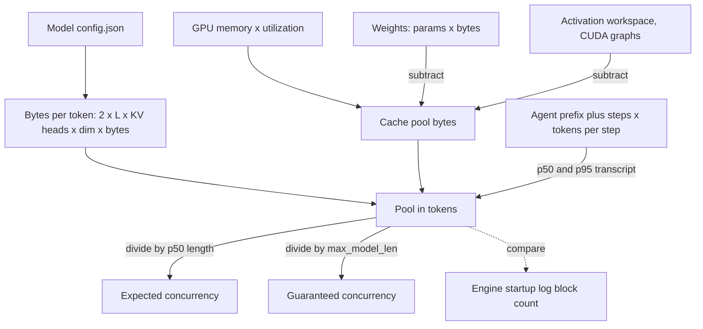

## TL;DR
KV-cache estimation turns "we have an 80 GB GPU" into "we can run N agents whose transcripts reach L
tokens": 2 × layers × KV heads × head dim × bytes per element, times tokens, times sequences. It prevents
OOM surprises and half-empty GPUs.

## For agent builders
- **Why it matters for agents.** Agent transcripts grow every step, so a fleet's cache demand rises over
  each run. Capacity sized from step 1 (or from chat traffic) collapses into preemption storms once runs
  reach step 15 or 20.
- **Where it shows up in your stack.** `max_model_len`, `max_num_seqs`, `gpu_memory_utilization` and
  `--kv-cache-dtype fp8` on a self-hosted engine such as vLLM; the model's `config.json` fields; the
  engine's startup log of cache blocks. With a hosted API the provider does this math for you.
- **What you control.** Prefix size (tool schemas count), tokens appended per step, maximum steps per run,
  when you compact history, and how many agent runs you allow in flight per replica.
- **What you can skip.** Exact allocator and CUDA-graph overheads; trust the startup log for those. Learn
  the formula, the pool arithmetic and how to turn a step count into a transcript length.

## Why it exists
- **The cache is the invisible cost.** A team that budgets 16 GB for an 8B fp16 model and calls the
  remaining 64 GB "headroom" has not budgeted at all, because every running request pins a cache that
  grows with its context, and the engine refuses or preempts requests once that pool is exhausted.
- **The failure is silent until load arrives.** Nothing crashes at low traffic. Under real concurrency the
  server OOMs, stalls admissions, or evicts half-finished generations and recomputes them, which shows up
  as latency collapse.
- **"Try it and see" fails.** The answer depends on what you do not observe until production: the
  distribution of prompt lengths, output lengths and concurrency, and how they move together. Synthetic
  500-token load tests say nothing about the day a customer pastes a 40-page contract, or the day an
  agent run takes 30 steps instead of 8.
- **"Pick the biggest GPU" fails** on cost, and often still does not fit: a 70B model's cache at 128k
  context on a modest batch exceeds any single card.
- **What the estimate buys:** reason forward from a config file and a traffic model to a GPU count before
  buying anything, and backward from an OOM to the parameter that caused it.

## How it works
### Bytes per token
Each layer stores one key vector and one value vector per KV head per token:

```
bytes_per_token = 2 × n_layers × n_kv_heads × head_dim × bytes_per_element
```

| Term | Meaning | Config field |
|---|---|---|
| 2 | K and V | — |
| `n_layers` | transformer layers | `num_hidden_layers` |
| `n_kv_heads` | key/value heads, **not** attention heads: equal under multi-head attention, fewer under GQA (8 is common), 1 under multi-query attention | `num_key_value_heads` |
| `head_dim` | usually `hidden_size / n_attention_heads` | `hidden_size`, `num_attention_heads` |
| `bytes_per_element` | 2 for fp16/bf16, 1 for fp8 or int8 cache | engine setting |

### Two architectures that break the formula
- **Multi-head latent attention** (DeepSeek-V2/V3 and derivatives) replaces per-head K and V with one
  compressed latent vector per layer per token plus a small decoupled RoPE key:

```
bytes_per_token = 1 × layers × (latent_dim + rope_dim) × bytes
DeepSeek-V3: 61 × (512 + 64) × 2 ≈ 70 KB in bf16   (an equivalent MHA layout: several MB)
```

  Read the architecture before applying the standard formula.
- **Sliding-window attention.** A layer attending only to the last *W* positions needs at most *W* tokens of
  cache however long the sequence grows. Several recent model families interleave windowed and
  full-attention layers, so the estimate becomes a sum: full layers scale with sequence length, windowed
  layers cap at *W*, and average bytes per token falls past the window.
- **Caveat:** whether an engine actually frees out-of-window blocks depends on engine and version, so
  confirm with its startup log.

### From per-token to per-GPU
```
cache_per_request = bytes_per_token × (prompt_tokens + max_output_tokens)
pool_bytes        = gpu_memory × utilization_fraction − weight_bytes − activation_workspace
max_concurrency   ≈ pool_bytes / cache_per_request
```

Four refinements matter in practice, plus one constraint on the fourth:

1. **Weights.** Parameters × bytes per parameter: 8B × 2 = 16 GB in fp16, 8 GB at int8, ~4.5 GB at 4-bit
   (plus a little for scales). Quantizing weights frees cache space, often its biggest payoff.
2. **Activation and workspace.** Engines profile a worst-case forward pass at startup (the largest prefill
   batch they allow) and reserve that memory before sizing the pool. CUDA graphs, sampling buffers and
   allocator overhead take a few GB more. vLLM's knob is `gpu_memory_utilization` (default 0.9), and it
   prints the cache blocks it allocated; that number times block size is the real pool in tokens.
3. **Sequence length is a distribution.** Use p95 or p99 of (prompt + output) to decide what fits without
   preemption, and the mean for steady-state concurrency. Paged allocation means a request only consumes
   what it has generated so far, so admission can be optimistic about the mean while max context bounds
   the worst case.
4. **Tensor parallelism splits the cache, up to a point.** At degree *T* each GPU holds the K/V of
   `n_kv_heads / T` heads, so per-GPU cache per token divides by *T* along with weights, and the pool is the
   sum over GPUs. Once *T* exceeds `n_kv_heads` (say *T* = 16 with 8 KV heads) heads are replicated and
   per-GPU cache stops shrinking.
5. **TP degree must divide the head counts,** which is why deployments use TP 2, 4 or 8, not 3 or 6.

### Turning an agent run into a sequence length
An agent's "sequence" is its transcript at the current step, so estimate it from the loop's shape:

```
transcript_tokens(step n) = prefix_tokens + (n − 1) × tokens_appended_per_step + output_tokens
```

- **Prefix** is the system prompt plus every tool schema; dozens of tools can add thousands of tokens.
- **Appended per step** is the tool call plus its result; one verbose tool result can dominate it.
- **Use the step-count distribution:** the p50 step count gives steady-state demand, the p95 or the step
  cap gives the tail you must fit or preempt. Averaged over a run, each agent holds roughly the cache of
  its midpoint step.
- **Idle time between steps matters.** While a tool runs the request has finished, so its blocks return
  to the pool. With prefix caching they stay as evictable cached blocks: they still count as free, so
  other requests can reclaim them, and a busy pool or a slow tool can evict the prefix before the next
  step arrives.

### Running the numbers for common shapes
Illustrative, computed from public config values:

| Shape (fp16) | Bytes per token | 8k context | Note |
|---|---|---|---|
| 32 layers, 32 KV heads, head_dim 128 (Llama-2-7B-class MHA) | 2 × 32 × 32 × 128 × 2 = 524,288 B ≈ 512 KB | ≈ 4 GB per request | |
| 32 layers, 8 KV heads, head_dim 128 (Llama-3-8B-class GQA) | 2 × 32 × 8 × 128 × 2 = 131,072 B = 128 KB | ≈ 1 GB per request | Same size class, 4× less cache: this is why GQA exists |
| 80 layers, 8 KV heads, head_dim 128 (70B-class GQA) | 2 × 80 × 8 × 128 × 2 = 327,680 B = 320 KB | ≈ 2.5 GB per request | 128k context ≈ 40 GB for one request |

### Reading it backwards
1. **Engine reports N cache blocks of 16 tokens:** the pool holds 16N tokens.
2. **Divide by p50 sequence length** for expected concurrency, and by `max_model_len` for guaranteed
   concurrency.
3. **A large gap between the two** means the scheduler will run many requests at once and preempt when the
   tail arrives. That is a policy choice, not an error, but make it consciously.

## Diagram
Work from the config and the agent loop's shape down to a concurrency number, then check it against what
the engine actually allocated.



## Misconceptions
- **"Weights are the memory budget; the rest of the card is headroom."** The rest is the cache pool, and
  every running request pins a slice of it that grows with its context. On an 80 GB card an 8B fp16
  model leaves ~52 GB after workspace, about 400k tokens, not unlimited concurrency.
- **"More attention heads means a bigger cache."** Only KV heads count. Two 7-8B-class models with 32
  attention heads differ 4x in cache (512 KB vs 128 KB per token) because one has 32 KV heads and the
  other 8.
- **"Every request reserves `max_model_len` of cache."** With paged allocation a request holds only what
  it has generated so far. `max_model_len` bounds the guaranteed concurrency; the p50 length sets the
  expected one, and the gap between them is where preemption lives.
- **"Size an agent fleet from chat traffic or step 1."** Transcripts grow every step. The GPU that holds
  ~132 requests at a 3k p50 holds about 20 agents at the end of a 10-step run and about 9 at a 25-step
  p95 run.
- **"Adding tensor parallelism always shrinks per-GPU cache."** It divides KV heads across GPUs only until
  *T* reaches `n_kv_heads`. With 8 KV heads, TP 16 replicates heads and per-GPU cache stays at 40 KB per
  token.
- **"One formula fits every model."** MLA models store one compressed latent per layer (~70 KB per token
  for DeepSeek-V3), and sliding-window layers cap at *W* tokens. Read the architecture and trust the
  engine's startup log.

## Examples
### A capacity helper for any Hugging Face config
Answers "how many fit" before touching a GPU.

```python
import json

def kv_bytes_per_token(cfg, cache_bytes=2):
    n_heads = cfg["num_attention_heads"]
    n_kv = cfg.get("num_key_value_heads", n_heads)        # GQA/MQA; defaults to MHA
    head_dim = cfg.get("head_dim") or cfg["hidden_size"] // n_heads
    return 2 * cfg["num_hidden_layers"] * n_kv * head_dim * cache_bytes

def capacity(cfg, params_b, gpu_gb=80, util=0.90, weight_bytes=2, workspace_gb=4,
             p50_seq=3000, max_seq=8192, cache_bytes=2):
    per_tok = kv_bytes_per_token(cfg, cache_bytes)
    weights = params_b * 1e9 * weight_bytes
    pool = gpu_gb * 1e9 * util - weights - workspace_gb * 1e9
    return {
        "kv_kb_per_token": per_tok / 1024,
        "pool_gb": pool / 1e9,
        "pool_tokens": int(pool // per_tok),
        "concurrency_at_p50": int(pool // (per_tok * p50_seq)),
        "concurrency_at_max": int(pool // (per_tok * max_seq)),
    }

llama3_8b_like = {"num_hidden_layers": 32, "num_attention_heads": 32,
                  "num_key_value_heads": 8, "hidden_size": 4096}
print(json.dumps(capacity(llama3_8b_like, params_b=8), indent=1))
# -> ~128 KB/token, pool ≈ 52 GB ≈ 400k tokens, ~132 requests at a 3k p50, ~48 at an 8k max.
print(capacity(llama3_8b_like, 8, cache_bytes=1)["concurrency_at_p50"])   # fp8 cache: ~2x
print(capacity(llama3_8b_like, 8, weight_bytes=0.5)["pool_gb"])           # 4-bit weights: +12 GB pool
```

- **The last two lines are the two cheapest levers** when the answer is "not enough": quantize the cache to
  double token capacity (264 requests at the p50), or quantize the weights to enlarge the pool (64 GB).
- **Compare the printed `pool_tokens`** with the block count the engine logs at startup. If they disagree
  by more than ~10%, the workspace estimate is wrong for that engine and model; trust the log.

### Agent scenario: how many research agents fit on that GPU?
Same 8B GQA model and ~52 GB pool (~396,700 tokens). Each agent has a 6k-token prefix and appends ~1.5k
tokens per step; runs take 10 steps at p50 and 25 at p95.

| Quantity | Transcript tokens | Agents in flight (fp16 cache) | With fp8 cache |
|---|---|---|---|
| Midpoint of a p50 run (averaged over its life) | (6,000 + 19,500) / 2 = 12,750 | ~31 | ~62 |
| End of a p50 run, step 10 | 6,000 + 9 × 1,500 = 19,500 | ~20 | ~40 |
| End of a p95 run, step 25 | 6,000 + 24 × 1,500 = 42,000 | ~9 | ~18 |

```python
def transcript(step, prefix=6000, per_step=1500):   # current step's output (~100s of tokens) omitted
    return prefix + (step - 1) * per_step

for label, seq in (("mid p50", (6000 + transcript(10)) // 2), ("p50 end", transcript(10)),
                   ("p95 end", transcript(25))):
    print(label, seq, capacity(llama3_8b_like, 8, p50_seq=seq)["concurrency_at_p50"],
          capacity(llama3_8b_like, 8, p50_seq=seq, cache_bytes=1)["concurrency_at_p50"])
# mid p50 12750 31 62 / p50 end 19500 20 40 / p95 end 42000 9 18
```

- **Read it as:** the same GPU that holds ~132 chat requests at a 3k p50 holds about 20 agents near the
  end of a normal run, and `max_model_len` must be at least 42,000 (and within the model's window) for the
  tail to run at all.
- **Levers specific to agents:** trim tool results (cuts the 1.5k), lazy-load tool schemas (cuts the
  prefix), compact history at a step threshold, and cap steps per run.

### Worked scenario: how far tensor parallelism shrinks a 70B cache
The 70B-class GQA shape above (80 layers, 8 KV heads, head_dim 128, fp16), per-GPU cache per token as TP
grows:

| TP degree *T* | KV heads per GPU | Per-GPU bytes per token | 12k-token session per GPU |
|---|---|---|---|
| 1 | 8 | 320 KB | ~3.9 GB |
| 2 | 4 | 160 KB | ~2 GB |
| 4 | 2 | 80 KB | ~1 GB |
| 8 | 1 | 40 KB | ~0.5 GB |
| 16 | 1 (replicated) | 40 KB | ~0.5 GB, no further saving |

- **Read it as:** past *T* = 8 you add GPUs for weights and bandwidth, not for cache per token.

### Worked scenario: a model with interleaved sliding-window layers
A hypothetical shape for illustration: 32 layers, of which 8 are full attention and 24 use a 4,096-token
window, 8 KV heads, head_dim 128, fp16 (2 × 8 × 128 × 2 = 4 KB per layer per token, 128 KB across all 32
layers).

| Sequence length | Cache per request | Average bytes per token |
|---|---|---|
| 4,096 | 0.5 GiB | 128 KB (same as all-full) |
| 32,768 | ~1.4 GiB | 44 KB |
| 131,072 | ~4.4 GiB | 35 KB |

- **The naive formula** would say 16 GiB at 131,072 tokens, about 3.7× too high, but only if the engine
  really frees out-of-window blocks.

## Production patterns
- **Keep a bytes-per-token table for every served model.** Compute it from `config.json` in CI and store it
  next to the deployment config, so capacity questions take seconds. Recompute on every model change.
- **Gate deploys on the engine's own number.** After startup, parse the logged cache size (blocks, or
  tokens and maximum concurrency at `max_model_len` in recent vLLM versions) and fail the rollout if it is
  more than ~10% below plan. Monitor it per model and GPU type.
- **Set flags from the distribution.** Derive `max_model_len` from the p99 of prompt + output and
  `max_num_seqs` from pool tokens divided by the mean, then load-test the tail. Monitor KV-cache
  utilization and preemption counts per replica.
- **Quantize the cache before adding GPUs.** Try `--kv-cache-dtype fp8` (vLLM) with a quality eval; it
  roughly doubles token capacity. Monitor eval scores on long-range recall tasks specifically.
- **Size agent fleets from late-step transcripts.** Log prompt tokens per agent step, take the p50 and
  p95 at the final step, and size `max_num_seqs` and replica count from those, not from step 1. Monitor
  prompt tokens by step number and preemptions per replica.
- **Cap and compact agent context by policy.** Set a maximum step count and a compaction threshold (say,
  summarize history when the transcript passes a fixed fraction of `max_model_len`) so the tail is bounded
  by design. Monitor how often runs hit the cap or compact.
- **Review context-limit requests against the model.** Treat "raise the context window" as a capacity
  change: rerun the estimate at the new p99 and the new guaranteed concurrency before approving. Monitor
  context-length p95 per route after the change.

## Trade-offs
- **Size to the max vs size to the median.** Sizing to the maximum context guarantees no preemption but
  leaves most of the pool idle on typical traffic; sizing to the median packs more users but accepts
  preemption on the tail.
- **8-bit cache vs recall.** It doubles token capacity at a small, task-dependent quality cost. The trade
  flips against it for workloads where exact long-range recall is the product.
- **GQA model vs model choice.** A GQA model shrinks the cache several-fold and raises concurrency, but
  constrains model choice; a stronger MHA model may still win when quality per request matters more than
  requests per GPU.
- **Rich agent context vs agents per GPU.** Keeping every tool result verbatim helps the agent recall
  details but grows each transcript; compaction and trimming fit two or three times more runs. Flips when
  task success depends on details from early steps.
- **`gpu_memory_utilization` toward 1.0 vs headroom.** It enlarges the pool but removes headroom for
  activation spikes and other processes. Dangerous when the GPU is shared or prompts are bursty.

## Pitfalls
- **Using the attention-head count instead of the KV-head count.** Symptom: a capacity estimate four or
  eight times too pessimistic for GQA models, and a purchase of GPUs you did not need. Fix: read
  `num_key_value_heads` from the config.
- **Forgetting that output tokens also need cache.** Symptom: OOM or preemption on long generations even
  though every prompt fit comfortably in the estimate. Fix: size on prompt plus `max_tokens`.
- **Trusting the formula over the engine's startup log.** Symptom: a pool 10–20% smaller than planned,
  because activation workspace and allocator overhead were not budgeted. Fix: plan from the logged block
  count.
- **Estimating with mean sequence length and promising that concurrency.** Symptom: latency collapse the
  first time a batch of long-context requests arrives together. Fix: promise concurrency at p95/p99 length.
- **Sizing an agent fleet from its first step.** Symptom: fine at launch, then preemptions and TTFT spikes
  as runs reach later steps, worst when many runs are long at once. Fix: size on the transcript at the
  p95 step, and cap steps or compact history.
- **The standard formula on latent or sliding-window attention.** Symptom: an estimate off by a large
  factor in either direction, because the cache layout is different. Fix: read the architecture and use its
  own cache formula.

## When to use
- **Do the arithmetic at four moments:** choosing a model and GPU before any code exists; setting
  `max_model_len`, `max_num_seqs` and utilization flags; an OOM or preemption storm in production; and a
  request for a longer context window or a bigger model on the same hardware.
- **For agents, also redo it** when you add tools (bigger prefix), raise the step cap, or change how much
  tool output is kept.
- **Keep the per-token number** for every model you serve in your head or a table; it answers most capacity
  questions in seconds.
- **Measure** actual cache utilization and preemption counts in production to validate the estimate
  against real traffic.
- **Interviews:** deriving bytes per token from a config, then a concurrency number with weights
  subtracted, is the canonical serving question; the follow-up is always "what would you change if it does
  not fit".

## Role lens
- **Engineer:** Computes the pool before deployment, sets context and concurrency flags from it, and
  checks the engine's logged block count against the estimate on every model change.
- **Architect:** Owns the capacity model that links context-window policy, model choice (GQA or not), GPU
  tier and replica count, and reviews any request to raise the context limit against it.
- **FDE:** Turns a customer's "we need 200 concurrent users with 50-page documents" into a per-token
  number, a GPU count and a cost, and shows the trade when it does not fit their budget.

## Check yourself
**Q:** A customer wants a 70B-class GQA model (80 layers, 8 KV heads, head_dim 128) in fp16 to serve 40
concurrent sessions that average 12k tokens of context, on 80 GB GPUs. How many GPUs, and what would you
propose if they only have two?
**A:** Cache per token is 2 × 80 × 8 × 128 × 2 = 327,680 B ≈ 320 KB. Per session at 12k tokens: ~3.9 GB.
Forty sessions: ~157 GB of cache. Weights in fp16 are ~140 GB, which already needs at least two 80 GB GPUs
with tensor parallelism, and at 90% utilization those two offer ~144 GB, so after weights and workspace
there is almost nothing left for cache: the model loads but serves one or two sessions. Four GPUs (TP = 4)
give ~288 GB usable, roughly 130–140 GB after weights and per-GPU workspace, about 34 sessions at the
average and no tail headroom, so slightly short. Six GPUs is not a valid TP degree for 8 KV heads, so the
next real step is eight: either one TP = 8 replica with ~400 GB of cache, or two TP = 4 replicas of ~34
sessions each, which also buys redundancy. With only two GPUs: quantize the weights to 8-bit (~70 GB) and
the cache to 8-bit (halving per-session cost to ~2 GB); with ~65 GB left after weights and workspace that
fits roughly 30–33 sessions at the average. Then cap context per session at 16k to bound the tail, enable
paging and prefix caching, and run a quality eval on the quantized configuration before promising
anything. A strong answer notes that decode at 40 sessions
will have higher TPOT because every step reads all 40 caches.

## Interview questions
### Walk me through estimating how many concurrent requests an 8B GQA model serves on one 80 GB GPU.
- **Bytes per token:** 2 × 32 layers × 8 KV heads × 128 × 2 bytes = 128 KB.
- **Pool:** 0.9 × 80 GB minus 16 GB of weights minus ~4 GB of workspace ≈ 52 GB, about 400k tokens.
- **Concurrency:** ~132 at a 3k p50, ~48 guaranteed at an 8k max; then confirm against the engine's
  startup log.

### Why does the KV-head count matter more than the attention-head count?
- **Only KV heads are cached.** Under GQA several query heads share one K/V head, so a 32-query-head model
  with 8 KV heads stores a quarter of the cache of its MHA twin.
- **Getting it wrong** makes estimates four or eight times too pessimistic and leads to buying GPUs you do
  not need.

### Your agent platform shows preemption storms at only 60% average cache utilization. What is going on?
- **Averages hide the tail.** Admission was sized on mean length, and bursts of long-context requests
  (several agent runs reaching late steps together) arrive together and exhaust the pool.
- **Check** p95/p99 of prompt + output and the preemption counter over time, not the mean.
- **Fix:** cap context per route, lower the concurrency cap, quantize the cache, or split long-context
  traffic onto its own replicas.

### How many concurrent agent runs can one replica hold, and how do you estimate it?
- **Model the transcript:** prefix (system prompt plus tool schemas) plus steps × tokens appended per
  step, at the p50 and p95 step counts. With a 6k prefix and 1.5k per step, a 10-step run ends near 19.5k
  tokens.
- **Divide the pool:** ~396,700 tokens on the 8B example gives ~20 runs at their final step and ~9 at a
  25-step tail; an fp8 cache roughly doubles both.
- **Then bound the tail** with a step cap and history compaction rather than buying for the worst run.

### When would you not trust the standard formula, and when does adding tensor parallelism stop helping?
- **Latent attention** caches one compressed vector per layer (DeepSeek-V3 is ~70 KB per token in bf16), so
  the MHA formula is far too high.
- **Sliding-window layers** cap at *W* tokens, so the cost per token falls with length, but only if the
  engine frees out-of-window blocks. In both cases read the architecture and the startup log.
- **TP stops shrinking the cache when *T* exceeds the KV-head count.** With 8 KV heads, TP 16 replicates
  heads, so per-GPU cache per token stays at the TP 8 value; *T* must divide the head counts, so 3 or 6
  GPUs are not valid degrees; real steps are 2, 4, 8.

## Quiz
### Q: Which model-config fields do you need to compute KV-cache bytes per token?
- [ ] Vocabulary size, hidden size and number of layers
- [x] Number of layers, number of KV heads, head dimension and the cache element size
- [ ] Number of parameters and the context length
- [ ] Number of attention heads, MLP width and dropout rate
> The cache stores one K and one V vector per layer per KV head per token, so those dimensions plus the
> bytes per element are exactly what is needed. Vocabulary, parameter count and MLP width do not appear
> in the cache at all.

### Q: Two 8B models differ only in that one has 32 KV heads and the other 8. What is the effect on serving capacity?
- [ ] No difference; cache size depends on parameter count
- [ ] The 8-KV-head model needs 4× more cache because each head is larger
- [x] The 8-KV-head model needs about one quarter of the cache per token, so roughly 4× more sequences fit
- [ ] The 32-KV-head model is faster to decode because attention is more parallel
> Cache bytes scale linearly with the number of KV heads. Grouped-query attention shares each K/V head
> across several query heads precisely to cut this number, which is why GQA models serve far more
> concurrent requests per GPU.

### Q: Your estimate says 60 requests fit, but the engine's startup log allocates blocks for only 45. What is the most likely cause?
- [ ] The engine is using a larger block size than you assumed
- [x] Activation workspace, CUDA graphs and allocator overhead reduce the pool below "VRAM minus weights"
- [ ] The engine stores keys and values in separate pools
- [ ] Your formula double-counted the factor of 2 for K and V
> Engines profile a worst-case forward pass and reserve memory for activations, graphs and sampling before
> sizing the cache pool. Block size does not change total pool bytes, and the K/V factor is correct. Trust
> the log and tighten the workspace term in the estimate.

## Use cases & projects
### Use cases
- **Sizing replicas for an agent fleet.** Bytes per token times the transcript length at the last step
  gives the cache each run needs, and therefore how many runs a GPU holds.
- **Choosing a model for long-running agents.** Two models of similar quality can differ several-fold in
  KV heads, and so in concurrent runs per GPU.
- **Setting step and compaction limits.** Maximum steps per run and when to compact history follow from
  the cache budget per run.
- **Explaining preemption storms late in agent runs.** Capacity sized from step 1 fails once transcripts
  reach step 15 or 20.

### Mini project
**Agent capacity calculator (1-2 hours).**
- **Goal:** predict how many concurrent agent runs one replica holds, then check it against the engine.
- **Steps:** write a script that reads a model's `config.json`, computes bytes per token, and turns prefix
  size, tokens per step and maximum steps into a final transcript length; compute runs per GPU for two
  models and an fp16 versus fp8 cache; then start vLLM on a GPU and compare with the KV-cache size in
  its startup log.
- **Done when:** your estimate and the engine's log agree within your stated workspace margin, and you have
  a table of runs per GPU for each model and cache precision.
