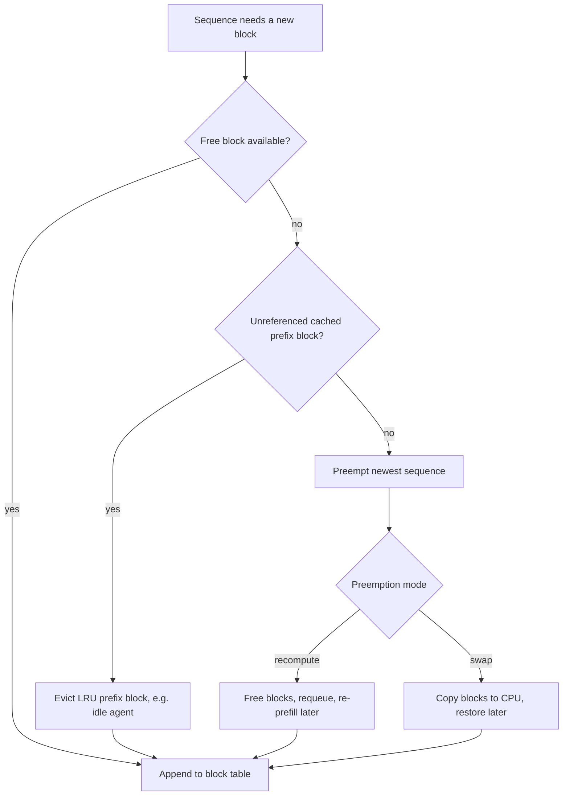

## TL;DR
Paging stores KV cache in fixed-size blocks behind a block table, like OS virtual memory, so agent
transcripts grow without reserving their maximum or fragmenting the pool. Eviction handles overflow:
preempt sequences, drop cached prefixes (an idle agent's transcript), or lossily drop tokens.

## For agent builders
- **Why it matters for agents.** While your agent waits on a tool, its transcript's blocks are
  unreferenced cached prefix, eligible for LRU eviction and closer to the front of the queue the longer
  the tool runs. Under load, a slow tool means the next step re-prefills much of the transcript; an
  oversubscribed pool also preempts steps mid-generation.
- **Where it shows up in your stack.** Self-hosted engines: vLLM's preemption counter and block metrics,
  SGLang's radix cache, host-memory prefix tiers (SGLang's hierarchical cache, LMCache with vLLM). Hosted
  APIs hide it, but cached-token fields in usage reveal misses.
- **What you control.** Admission limits (`max_num_seqs`, `max_model_len`), whether long-lived agent
  prefixes get a host-memory tier, routing steps back to the same replica, and keeping in-sequence token
  eviction off unless an agent eval approves it.
- **What you can skip.** The PagedAttention kernel itself and block-table data structures beyond the
  toy below.

## Why it exists
- **Final length is unknown.** A request's cache grows one token per decode step until the model emits a
  stop token, so the allocator cannot know how much to give it.
- **Contiguous max-length reservation wastes memory internally.** A request allowed 8k tokens that stops at
  600 pins 8k tokens' worth for its whole life, so the pool is mostly reserved-but-empty and concurrency
  is a fraction of what the hardware could hold.
- **It also fragments externally.** Requests finish at different times, leaving holes each too small for
  the next arrival even though the free total is large.
- **"Grow in place" fails too.** The neighbour's region is right behind you, so growing means copying the
  whole cache to a bigger hole, which is expensive and still fragments. Attention kernels read K and V as
  one contiguous tensor, which is why everyone accepted the waste for years.
- **Paging breaks the contiguity assumption.** If the kernel follows a table from logical positions to
  physical blocks, memory goes out in small fixed units on demand, waste is bounded by one block per
  sequence, any free block fits any request, and two sequences can share physical blocks (the basis of
  prefix sharing). Eviction exists because the pool is usable but not infinite; the policy decides whether
  overload shows up as graceful queueing or latency collapse.

## How it works
### Blocks and block tables
1. **Carve the pool** into blocks of a fixed number of tokens (vLLM's default is 16). Each block holds K and
   V for every layer and KV head for those positions.
2. **Give each running sequence a block table:** logical block *i* maps to some physical block number.
3. **Grow on demand:** when the current last block is full, pop a free block from the free list and append
   it to the table.
4. **Attend through the table:** the kernel receives the table and, for each query, gathers keys and values
   block by block. This is PagedAttention; the dedicated lesson covers the kernel.

Consequences that follow directly:
- **Waste is bounded.** Only the last block of each sequence can be partially filled, so internal waste is
  under one block per sequence rather than up to a full context length.
- **Any free block serves any request.** External fragmentation disappears because allocation is in
  uniform units.
- **Admission is optimistic.** The scheduler admits on the blocks the prompt needs plus a small reserve, not
  the maximum output. Far more requests run at once, with the risk that they collectively outgrow the pool.

### Sharing and copy-on-write
- **Reference-counted blocks.** Because mapping is indirect, several sequences can map logical blocks to the
  same physical block.
- **Parallel sampling and beam search** (n candidates from one prompt) share the prompt's blocks. When a
  sequence must write into a shared block, the engine copies it first.
- **Prefix caching generalizes this across requests** by keeping blocks alive after their owner finishes,
  keyed by a hash of their content.

### Running out: sequence-level preemption
- **Why whole sequences:** a sequence needs all of its blocks to take even one step, so freeing half of one
  helps nobody.

| Mechanism | How | Strength | Weakness |
|---|---|---|---|
| **Recomputation** | Free the victim's blocks, requeue it, and on readmission re-run prefill over its prompt plus the tokens generated so far | No host memory or transfer machinery; re-prefill is compute-bound and batches well, which is why it is vLLM's default | Wastes prefill compute |
| **Swapping** | Copy the victim's blocks to pinned CPU memory and back on resumption | Saves compute | Limited by PCIe bandwidth and host memory; many small block copies are less efficient than one large transfer |

- **Which is cheaper is arithmetic, not doctrine.** Recompute costs roughly `2 × params` FLOPs per token
  plus an attention term growing with the square of sequence length. Swap costs `bytes_per_token` over
  PCIe, twice.
- **Swap gains** as sequences get long (the quadratic attention term) and as cache per token gets small
  relative to the model (GQA, fp8 cache). **Recompute gains** when the cache is fat (MHA) or the host link
  is slow or shared. Measure resume latency for both on your hardware before choosing.
- **Victim selection** is typically most recently admitted first, so older requests, which have already
  consumed the most resources, finish. Preemption is all-or-nothing per sequence.
- **User-visible symptom:** a pause in the token stream and a jump in TTFT-like latency for the preempted
  request.

### Running out: evicting cached prefixes
- **Unreferenced blocks go first.** Blocks kept for prefix reuse have a reference count of zero and are
  reclaimable, usually in LRU order, before anything is preempted. So a prefix cache degrades gracefully:
  hit rate falls, nobody is preempted.
- **A tier below VRAM.** Some deployments demote evicted prefix blocks to host memory or local disk instead
  of discarding them, turning a miss into a transfer rather than a full re-prefill. It pays when prefixes
  are long and reused across minutes.
- **SGLang's radix tree.** It organizes cached prefixes as a radix tree and evicts leaves
  least-recently-used, which keeps shared ancestors (the system prompt) resident longest.
- **What this means for an agent between steps.** When a step finishes, its blocks drop to zero
  references and become cached prefix. The longer the tool runs and the busier the pool, the likelier the
  transcript's tail (its newest, least-shared blocks) is evicted before the next step arrives. The shared
  system prompt and tool schemas usually survive.

### Eviction inside a sequence
- **Exact for sliding-window models.** They attend only to the last *W* positions, so older blocks can be
  released as soon as the window moves past them.
- **Approximate for full-attention models.** Research methods drop tokens judged unimportant (low
  accumulated attention, or everything except the first few "sink" tokens plus a recent window) to bound
  memory for very long streams.
- **They change the output,** sometimes imperceptibly and sometimes badly on recall-heavy tasks, so evaluate
  them like any lossy optimization. Production engines treat them as opt-in or do not ship them at all.

### What to watch
- **Signals:** free and used blocks, the preemption count and the prefix-cache hit rate.
- **Preemptions above zero under normal load** mean admission is too optimistic for the sequence-length
  distribution.
- **Falling prefix hit rate with rising cache usage** means the pool is too small for both duties.
- **For agents,** compare cached-token share on steps that followed a slow tool with steps that followed a
  fast one; a gap means transcripts are being evicted during tool waits.

## Diagram
What the engine does when a running sequence needs a new block: free list first, then unreferenced cached
prefixes (including transcripts of agents waiting on tools), and only then preemption.



## Examples
### A toy block allocator
A block table per sequence and LRU reclaim of unreferenced cached blocks. It is not an attention kernel;
it shows the bookkeeping that makes paging and eviction work.

```python
from collections import OrderedDict

BLOCK = 16                      # tokens per block

class Pool:
    def __init__(self, n_blocks):
        self.free = list(range(n_blocks))
        self.refs = {}                 # physical block -> reference count
        self.cached = OrderedDict()    # content_hash -> block, LRU order (ref 0)

    def alloc(self):
        if not self.free and self.cached:            # evict an unreferenced cached block
            _, blk = self.cached.popitem(last=False)
            self.free.append(blk)
        if not self.free:
            raise MemoryError("pool exhausted: preempt a sequence")
        blk = self.free.pop(); self.refs[blk] = 1
        return blk

    def release(self, blk, content_hash=None):
        self.refs[blk] -= 1
        if self.refs[blk] == 0:
            if content_hash: self.cached[content_hash] = blk   # keep for prefix reuse
            else: self.free.append(blk)

class Seq:
    def __init__(self, pool): self.pool, self.table, self.n = pool, [], 0
    def append_token(self):
        if self.n % BLOCK == 0: self.table.append(self.pool.alloc())
        self.n += 1

pool = Pool(n_blocks=4)
a, b = Seq(pool), Seq(pool)
for _ in range(40): a.append_token()           # a uses 3 blocks (last one 8/16 full)
for _ in range(16): b.append_token()           # b uses the 4th block; pool is now full
try:
    b.append_token()                           # needs a 5th block -> no free, no cached
except MemoryError as e:
    print(e)                                   # scheduler would now preempt b (recompute or swap)
```

- **Capacity:** 4 blocks of 16 tokens hold 64 tokens; internal waste is the 8 empty slots in `a`'s last
  block.
- **With reuse:** if `a` had finished and released its blocks with a content hash, `b`'s next allocation
  would have evicted the least-recently-used of them instead of raising.

### Worked scenario: contiguous versus paged at real scale
`max_model_len` 8,192, an 8B GQA model at 128 KB per token, and a request that stops after 600 tokens.

| | Contiguous | Paged (16-token blocks) |
|---|---|---|
| Reserved for the request | 8,192 slots (1 GB) | 38 blocks = 608 slots |
| Actually used | 600 (75 MB) | 600 |
| Wasted | over 90% of the reservation, for the request's whole life | 8 slots |
| Resident requests on a ~50 GB pool | about 50 | several hundred, if typical requests look like this one |

- **This is why paging is what made large continuous batches possible at all.**

### Swap or recompute? Do the arithmetic
Illustrative lower bounds: recompute counts only the matmul term at ~900 TFLOPs (attention adds a
quadratic term on top), and swap assumes ~25 GB/s of effective host-link bandwidth each way.

```python
FLOPS, PCIE = 900e12, 25e9              # illustrative hardware figures

def recompute_ms(params_b, tokens):     # matmul term only; attention grows quadratically on top
    return 2 * params_b * 1e9 * tokens / FLOPS * 1e3

def swap_ms(kv_bytes_per_token, tokens):  # out to host and back in
    return 2 * kv_bytes_per_token * tokens / PCIE * 1e3

GQA, MHA = 128 * 1024, 512 * 1024       # 8B-class GQA vs 7B-class MHA, fp16 cache
for name, kv, params in [("GQA 8B", GQA, 8), ("MHA 7B", MHA, 7)]:
    for t in (4_000, 32_000):
        print(f"{name} {t:>6} tokens: recompute >= {recompute_ms(params, t):4.0f} ms, "
              f"swap ~ {swap_ms(kv, t):4.0f} ms")
# GQA 8B   4000 tokens: recompute >=   71 ms, swap ~   42 ms
# GQA 8B  32000 tokens: recompute >=  569 ms, swap ~  336 ms
# MHA 7B   4000 tokens: recompute >=   62 ms, swap ~  168 ms
# MHA 7B  32000 tokens: recompute >=  498 ms, swap ~ 1342 ms
```

- **Read it as:** the thin GQA cache favours swap, and more so at long lengths once attention's quadratic
  term is added; the fat MHA cache favours recompute. Recompute also competes with live decode for
  compute, which this sketch ignores.

### Agent scenario: the transcript evicted during a slow tool call
A research agent on the 8B GQA model has a 20,000-token transcript and calls a web-scrape tool that takes
30 s. The pool is busy, so its unreferenced blocks are evicted LRU before the next step. Same illustrative
figures as above.

| Next step finds | What runs | Extra latency on that step |
|---|---|---|
| Whole transcript still cached | prefill only the ~1,000-token tool result | ~18 ms |
| System prompt and tools cached (6,000), rest evicted | re-prefill ~15,000 tokens | ~267 ms |
| Everything evicted | re-prefill 21,000 tokens | ~373 ms |
| Evicted to a host-memory tier | copy ~2.6 GB back over the host link, then prefill ~1,000 | ~105 ms + ~18 ms |

```python
KV = 128 * 1024
ctx, new = 20_000, 1_000
print("hit:", round(recompute_ms(8, new)), "ms")
print("tail evicted:", round(recompute_ms(8, ctx - 6_000 + new)), "ms")
print("all evicted:", round(recompute_ms(8, ctx + new)), "ms")
print("host tier:", round(swap_ms(KV, ctx) / 2), "ms in +", round(recompute_ms(8, new)), "ms")
```

- **Read it as:** one miss costs a few hundred milliseconds per step on this model (more on bigger models
  or longer transcripts) and burns prefill compute other agents needed. Across a 20-step run with many
  slow tools, misses can dominate task latency.

## Production patterns
- **Keep agent transcripts resident across tool waits.** Route every step of a run to the same replica,
  leave headroom in the pool so idle prefixes survive, and add a host-memory tier when tool waits are
  long. Monitor prefix hit rate on the step after each tool call, split by tool latency.
- **Alert on preemptions, not memory percent.** Page on the engine's preemption counter (in vLLM,
  `vllm:num_preemptions_total` on `/metrics`) and on free blocks, and tune `max_num_seqs`, the
  per-iteration token budget and `max_model_len` until preemptions are near zero at target peak.
- **Bound the worst case with context policy.** Set `max_model_len` near the real p99 of prompt + output
  per deployment, and route rare very long requests to a separate replica class. Monitor preemptions per
  replica class after the split.
- **Choose the preemption mode by measurement.** Recompute is the default; consider swap only where your
  engine version still supports it, pinned host memory is plentiful and sequences are long. Benchmark the
  resume latency of a preempted 4k and 32k request both ways on the target host.
- **Add a host-memory tier for long reused prefixes.** When long documents or agent histories are reused
  across minutes, offload evicted prefix blocks to CPU memory (for example SGLang's hierarchical cache, or
  LMCache with vLLM). Monitor prefix hit rate and TTFT on hits served from the lower tier.
- **Treat block size as a tuned constant.** Keep the default (16 in vLLM) unless a measurement says
  otherwise, and re-measure prefix hit rate and kernel throughput whenever you change it.

## Trade-offs
- **Smaller vs larger blocks.** Smaller blocks cut internal waste and make prefix matching finer-grained,
  but enlarge block tables and reduce kernel efficiency. The balance flips toward larger blocks on long
  contexts with few sequences.
- **Optimistic admission vs preemption risk.** It packs many more sequences per GPU but makes preemption
  possible. It flips to harmful when lengths are long-tailed and preemption storms recompute more than they
  save.
- **Recompute vs swap.** Recomputation is simple and batches well but wastes prefill compute. Swapping saves
  compute at the cost of PCIe traffic and host memory, and wins as sequences grow long, because re-prefill
  cost grows faster than linearly with length while transfer cost grows linearly.
- **Resident prefixes vs live sequences.** Keeping finished prefixes raises hit rate but competes with live
  sequences for blocks. Under sustained load LRU eviction turns prefix caching into a weak benefit rather
  than a guarantee.
- **In-sequence token eviction vs fidelity.** It bounds memory for unbounded streams but changes outputs.
  Acceptable for chatty, low-recall workloads, not for retrieval or long-document QA.

## Pitfalls
- **Reading "memory utilization 95%" as healthy while the preemption counter climbs.** Symptom: periodic
  multi-second stalls on individual streams with no error logged. Fix: alert on the preemption counter.
- **Setting `max_model_len` far above real prompt lengths and assuming it is free.** Symptom: a preemption
  storm the first time a handful of requests actually grow into that headroom, because optimistic admission
  let them in on their prompt size and the pool was sized for the typical case. Fix: set it near the real
  p99.
- **Swap-based preemption on hosts with little pinned memory or slow PCIe.** Symptom: preempted requests
  take longer to resume than recomputation would have. Fix: benchmark resume latency both ways first.
- **Changing block size on a tuned deployment without re-measuring.** Symptom: a surprise drop in prefix hit
  rate or kernel throughput that nobody attributes to the flag. Fix: re-run the load test on any change.
- **An approximate token-eviction method for long conversations.** Symptom: the model forgets instructions
  from early in the chat while memory charts look great. Fix: gate it on a long-range recall eval.

## When to use
Paging is not optional in a modern engine; what you decide is the policy around it.
- **Overload signal:** use the preemption counter, and tune admission (`max_num_seqs`, per-iteration token
  budget, `max_model_len`) until it is near zero at target load.
- **Preemption mode:** choose recomputation unless sequences are so long that re-prefill is the dominant
  cost.
- **Prefix caching:** keep it on when prompts share prefixes and watch hit rate under load. If it
  collapses, the pool is too small for both duties and you need memory, not flags.
- **Avoid by default:** in-sequence token eviction is a research option to evaluate, not a default.
- **Interviews:** explain why preemption is per-sequence, how blocks bound waste, and what LRU prefix
  eviction buys.

## Role lens
- **Engineer:** Tunes block size, admission limits and the preemption mode, and alerts on preemption count
  and free-block count rather than on raw memory utilization.
- **Architect:** Decides whether the pool is shared between live sequences and cached prefixes or split by
  replica class, and sets the context-length policy that bounds worst-case reservations.
- **FDE:** Reads a customer's engine metrics to explain mid-stream pauses as preemption, then proposes
  the admission or hardware change that removes them without breaking their latency promise.

## Check yourself
**Q:** A deployment runs at 92% KV-cache utilization with 3–5 preemptions per minute and a prefix-cache hit
rate that has fallen from 60% to 15% since traffic grew. Explain what is happening inside the pool and
what you would change, in order.
**A:** The pool is oversubscribed. Live sequences have grown until there are almost no free blocks, so the
engine first evicted unreferenced cached prefixes (hit rate collapsed) and, once those were gone, began
preempting the most recently admitted sequences, which then recompute their prefill and consume the
compute that was supposed to go to decode. First, make admission less optimistic: lower `max_num_seqs` or
the per-iteration token budget so that live sequences fit without eviction; queueing at admission is
cheaper than preemption mid-stream. Second, reduce per-sequence cost: cap `max_model_len` to the real
p99, and quantize the cache to fp8 if an eval allows. Third, if hit rate matters to TTFT, add memory
(another replica or a larger GPU) so that cached prefixes survive; prefix caching is only a benefit when
there is slack. Measure preemptions per minute after each change and stop when it is near zero at peak.

## Interview questions
### What problem does paging solve that contiguous KV allocation cannot?
- **Unknown length:** contiguous allocation must reserve the maximum context up front, so a request that
  stops at 600 of 8,192 tokens wastes over 90% of its slot.
- **Fragmentation:** finished requests leave holes too small to reuse. Fixed-size blocks behind a block
  table bound waste to under one block per sequence and let any free block serve any request.
- **Bonus:** indirection enables shared, copy-on-write blocks for parallel sampling and prefix caching.

### A user reports their stream pausing for two seconds mid-answer, with no errors. How do you investigate?
- **Suspect preemption:** check the preemption counter and free-block count at that timestamp.
- **Confirm the mechanism:** the request was the most recently admitted when the pool ran dry, so it was
  evicted and had to re-prefill its prompt plus generated tokens.
- **Fix admission:** lower `max_num_seqs` or the token budget, cap `max_model_len` to real p99, or quantize
  the cache; queueing at admission is cheaper than preemption mid-stream.

### When would you choose swap over recompute for preemption?
- **Long sequences with a small cache per token** (GQA, fp8): re-prefill grows faster than linearly while
  transfer grows linearly.
- **Ample pinned host memory and a fast, unshared PCIe link.**
- **Otherwise recompute,** especially for fat MHA caches or short sequences, and measure resume latency
  both ways before deciding.

### Why is evicting cached prefix blocks safe but dropping tokens inside a sequence is not?
- **Prefix blocks with zero references** are optimization state; losing one costs a re-prefill on the next
  matching request but changes no output.
- **Dropping tokens** (attention sinks plus a window, low-attention pruning) changes what the model attends
  to, so outputs change, and recall-heavy tasks can break while memory charts look great.

### What does a falling prefix-cache hit rate alongside rising cache usage tell you?
- **The pool is too small for both duties.** Live sequences are crowding out cached prefixes, which LRU
  evicts first.
- **Next stage is preemption** once no unreferenced blocks remain.
- **Remedy:** more memory (replica or larger GPU), a host-memory tier for prefixes, or less optimistic
  admission; flags alone will not restore the hit rate.

## Quiz
### Q: Why does paging bound internal fragmentation to less than one block per sequence?
- [ ] Because blocks are allocated in sorted order of sequence length
- [x] Because a sequence only ever has one partially filled block, its most recent one; all earlier blocks are full
- [ ] Because the engine compacts the cache after every decode step
- [ ] Because block size is chosen to divide the maximum context length
> Tokens are appended sequentially, so every block except the last is completely used. Contiguous
> reservation, by contrast, wastes the whole unused remainder of the maximum context for each request.

### Q: When the pool is exhausted, why do engines preempt entire sequences rather than freeing some blocks from several?
- [ ] Because block tables cannot be modified while a sequence is running
- [ ] Because partial frees would corrupt the attention mask
- [x] Because a sequence needs all of its blocks to take even one decode step, so partially freeing it makes it useless
- [ ] Because recomputation is only possible from the beginning of a sequence
> Attention for the next token reads every cached position. Removing some blocks from a live sequence
> means it cannot proceed at all, so the only useful units of eviction are whole sequences or blocks nobody
> references.

### Q: Which eviction is lossless for a full-attention model?
- [ ] Dropping tokens with the lowest accumulated attention scores
- [ ] Keeping only the first few tokens and a recent window
- [x] Reclaiming cached prefix blocks that no running sequence references
- [ ] Discarding every other block once context exceeds a threshold
> Unreferenced prefix blocks are pure optimization state; losing them costs a recompute on the next
> matching request but changes no output. Token-dropping methods alter what the model attends to and are
> approximations that must be evaluated.

## Use cases & projects
### Use cases
- **Agents with slow tools.** While a tool runs, the transcript's blocks are evictable; headroom, a
  host-memory tier and same-replica routing decide whether the next step re-prefills.
- **Long-context agents on a shared replica.** Admission limits and preemption counters explain mid-answer
  pauses that show no errors.
- **Many runs sharing one system prompt and toolset.** Shared blocks with reference counts hold one copy of
  the common prefix for every run.
- **Evaluating KV compression for agents.** Token-dropping eviction changes what the model attends to, so
  it ships only after an agent eval approves it.

### Mini project
**Watch a transcript get evicted during a tool wait (2-3 hours).**
- **Goal:** reproduce the slow-tool eviction effect and show one fix.
- **Steps:** serve a small model with vLLM and prefix caching on, shrinking the pool (a low
  `--gpu-memory-utilization`) so it fills quickly; run one agent whose tool sleeps 30 s while a load
  generator sends unrelated long prompts; record cached tokens (usage details or the engine's prefix-cache
  metrics) and TTFT on the step after the tool; repeat with lower background load or more pool headroom.
- **Done when:** you have both runs' post-tool TTFT and cached-token counts, plus the preemption and
  prefix-hit metrics from `/metrics` that explain the difference.
